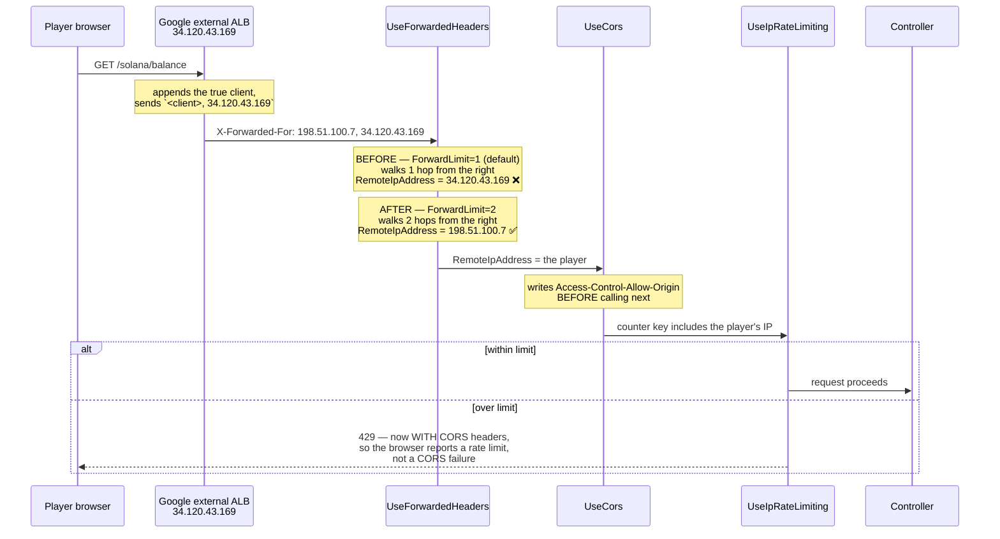

# SpaceStroker — "In-app rate limiter keying" Feature — Implementation Spec

> **Status: Ready for implementation** — refined via Trello card
> [The in-app rate limiter buckets every player on earth together](https://trello.com/c/h27WZeQC)
> (**#112**, refined 2026-07-27).
> Repos affected: `monkify-backend`, and this doc in `monkify-meta` (**no `monkify-front`**).
>
> **Purpose:** Every in-app rate-limit rule is currently keyed on the **load balancer's** address
> instead of the player's, so all rules are one global bucket shared by every player on earth — a live
> production bug that can deny real players mid-round while reporting itself to the browser as a CORS
> error. Fix the keying (`ForwardLimit`), make the 429 legible (middleware order), and delete a rule
> that has never matched a request. Backend-only; no game, bet, payout or realtime behaviour changes.

---

## 1. Summary

`SpaceStroker.Api/Program.cs:135-141` configures `UseForwardedHeaders` for the Cloud Run / external
ALB topology but never sets **`ForwardLimit`**. ASP.NET's default is **1**, which trusts only the
**rightmost** `X-Forwarded-For` entry — and the rightmost entry is the proxy that *added* the header,
never the client. `spacestrokersettings.json` sets no `RealIpHeader` value that is actually present on
the wire, so AspNetCoreRateLimit falls through to `Connection.RemoteIpAddress` and keys every rule on
the load balancer.

This was **measured in production**, not inferred (Trello #112, comment of 2026-07-27 21:47 UTC):

```
XFF_PROBE raw=[189.6.251.135,34.120.43.169] hops=2
          socketPeer=::ffff:169.254.169.126
          resolved=34.120.43.169
          realIp=[] host=api.spacestroker.com method=POST path=/launch-token/default
```

`34.120.43.169` is the load balancer — the same address `app.spacestroker.com` resolves to. Every
path probed (`/launch-token/default`, `/operators/{id}`, `/games/active-types`,
`/players/preferences`, `/solana/balance`) produced the identical `resolved=` value.

Three defects, one change:

| # | Defect | Where | Effect today | After |
| --- | --- | --- | --- | --- |
| 1 | `ForwardLimit` unset ⇒ default `1` ⇒ rightmost XFF entry | `Program.cs:135-141` | Every rule is **one global bucket** for all players | `ForwardLimit = 2` ⇒ keyed on the real client |
| 2 | `UseIpRateLimiting()` runs **before** `UseCors()` | `Program.cs:143` vs `:151` | The 429 short-circuits with no `Access-Control-Allow-Origin` ⇒ browser reports a **CORS error** | Limiter moved after `UseCors()`; the 429 carries CORS headers |
| 3 | `api/*` rule matches nothing (`api` is parsed as a **hostname**, not a path prefix) | `spacestrokersettings.json:16-19` | Config advertises protection it has never provided | Rule **deleted** |

Defects 1 and 3 have been **cancelling each other out**: the global bucket only ever applied to
`*:/rpc` and `*:/solana/*`, because the one rule meant to cover everything else never matched. That is
why this has not yet produced a total outage — and it is exactly why defect 3 must be *deleted* rather
than *repaired* (see §3, decision 2).

Worst case live today: `*:/solana/balance/live` at **20/min globally**. `TokenBalance.vue:147,170,180,195`
calls it once per player per round on bet placement and win settlement, so a handful of concurrent
players exhausts it for everyone.

### Rule table: before → after

| Endpoint pattern | Period | Before | After | Note |
| --- | --- | --- | --- | --- |
| `api/*` | 1m | 100 | **deleted** | Never matched a request |
| `*:/rpc` | 1m | 120 | **240** | Raised — see §3 decision 5 |
| `*:/solana/*` | 1m | 120 | 120 | Unchanged |
| `*:/solana/balance/live` | 1m | 20 | 20 | Unchanged |
| *(new)* `EndpointWhitelist` | — | absent | `*:/health`, `*:/Hubs/*` | Standing guardrail |

All four numbers only ever *were* per-player in intent. Restoring the keying is what makes them true.

---

## 2. Constraints (MANDATORY)

From `monkify-meta/constraints.md` (full list there):

- **Worktree-per-repo / branch-per-repo (§2):** work lives in
  `.worktrees/rate-limiter-keying/<repo>`; the hub stays on `main` (never `git checkout -b` /
  `git switch` in the hub). Branch `feature/rate-limiter-keying` in `monkify-backend` and
  `monkify-meta` is the merge/PR ref. Both were created off `origin/main` and pushed at spec time.
- **Unit tests (§3):** update/add in `SpaceStroker.Tests` and **report exactly which tests changed or
  were added** at the end of implementation. Run via **`scripts/run_tests.bat`** — **not** the full
  `dotnet test` (`ProductionSessions` is a slow Monte Carlo suite).
- **Integration tests (§3):** the card is Level **`Minor change`**, so the mandatory-happy-path rule
  does **not** apply. The integration test in §11.2 is **voluntary but agreed at refinement** — every
  one of the three fixes is a claim about middleware behaviour that only a booted host can falsify.
  Precedent: `RobotsTxtTests` was a voluntary integration test on Minor-change card #105.
- **EF mapping / migrations (§4):** **N/A** — no entity, column, DTO, enum or migration. Nothing is
  added to `SpaceStrokerDbContext`.
- **Secrets/config (§1):** `spacestrokersettings.json` is edited here. Only **mock/placeholder**
  values. The `IpRateLimiting` section carries no secrets, but **the same file holds RSA signing keys
  and a Solana private key — leave every one of them byte-identical.** Diff the file before committing.
- **Production data / external APIs (§5):** **no production queries, no external API requests.** The
  probe that produced the evidence in §1 is already done and **reverted in `28a5c9c`** — do **not**
  re-deploy it. Reading prod LB logs and checking the post-deploy Helius credit burn are **operator
  steps**; hand them to the user.
- **Operator messaging (§6):** nothing here surfaces operator state. A 429 is not an operator error and
  must not become one.
- **Hosts (§8):** the API stays stateless and does not migrate; `SpaceStroker.Consumers` is untouched.

---

## 3. Resolved product decisions

| # | Decision |
| --- | --- |
| 1 | **`ForwardLimit = 2`, as a hardcoded constant** — not a config knob. The hop count is a property of the deployment topology (Google external ALB → Cloud Run), not an operational dial. A knob is a foot-gun: `null` or a large value means trusting the **leftmost**, fully attacker-controlled entry, which is strictly worse than today's bug. Adding a CDN in front would require a deploy regardless. |
| 2 | **Delete the `api/*` rule — do not repair it into a catch-all.** The limiter exists to protect the paid Helius quota, and `*:/rpc` + `*:/solana/*` already cover that. A catch-all is *soft* anyway (in-process counters across `api_min_instances: 1` … `max: 10`) while carrying the one failure mode that denies the whole player base at once. |
| 3 | **⚠️ The card's ordering constraint no longer binds.** The comment "`ForwardLimit` MUST land before the `api/*` rule is repaired" was about **repairing** it — a repaired catch-all shipped while `ForwardLimit` was still `1` would have created a global 100/min bucket across the boot path and locked out every player simultaneously. **Deletion** matches nothing today, so it is safe in any order and needs no same-commit coupling. Do not carry the constraint forward, and do not repair the rule. |
| 4 | **`RealIpHeader: "X-Forwarded-For"` is REJECTED as an alternative fix.** It looks equivalent but AspNetCoreRateLimit reads the header itself and takes the **leftmost** entry, fully attacker-controlled. Same trap as `ForwardLimit = null`. Do not propose it. |
| 5 | **`*:/rpc` raised 120 → 240/min.** `useConnection.ts:87-112` confirms a broadcast transaction by polling `getSignatureStatuses` **once per second for up to 45 s**, all as `POST /rpc` — one path, therefore one counter — plus `getLatestBlockhash` and `sendTransaction`. One slow-confirming bet can cost **~47** of a player's budget. A throttled `/rpc` mid-confirm means the player cannot confirm a transfer **whose tokens have already left their wallet**: the only failure mode on this card that costs a real player real money. |
| 6 | **`*:/solana/*` (120) and `*:/solana/balance/live` (20) keep their numbers.** Restoring the keying is the fix; changing more numbers in the same change would confound it. |
| 7 | **Shortening the frontend confirm poll is REJECTED** (`VUE_APP_SOLANA_CONFIRM_POLL_INTERVAL_MS`). The cost is absorbed by decision 5 instead, so confirmation latency is unchanged for every player and **`monkify-front` is untouched by this card.** |
| 8 | **Add `EndpointWhitelist: ["*:/health", "*:/Hubs/*"]`.** Two lines, no behavioural change today (nothing matches those paths once `api/*` is gone), and unlike `api/*` a whitelist can only ever *prevent* limiting — it cannot falsely advertise protection. It guards precisely the scenario decision 3 describes: someone later adding a catch-all without re-deriving these constraints. The consequences are outsized — a throttled `/health` makes Cloud Run recycle the instance, and a mass SignalR reconnect behind one NAT would blank an operator's realtime. |
| 9 | **The bet path stays unlimited app-side.** For `SolanaToken` the client transfers on-chain **first**, then posts the signature (`useGame.ts:522-540`). A rejected `POST /games/{id}/bets` means tokens left the wallet with **no `Bet` row** — the auto-refund never fires and `POST /admin/bets/refund` cannot find it (it looks up by `ExternalTransactionReference`). Recovery is a manual on-chain transfer off a support ticket, and `SolanaToken` is Main's only payment method. Decision 2 is what guarantees this. |
| 10 | **Level: `Minor change`.** Nothing new becomes possible — three misconfigurations are corrected so the limiter does what it was already written to do. ⇒ no `features/rate-limiter-keying.md`; the existing KB docs are corrected instead (§10.3). |
| 11 | **Accepted: the Helius bill will rise.** See §12. There is no version of this fix that does not release the traffic today's bug is suppressing. |

---

## 4. Data model

**None.** No entity, column, DTO, enum, EF mapping, or migration. `SpaceStrokerDbContext` and
`SpaceStrokerDbContextModelSnapshot.cs` are untouched. `SpaceStroker.Consumers` is untouched.

---

## 5. Configuration

### 5.1 `SpaceStroker.Common/spacestrokersettings.json` — the `IpRateLimiting` section

Replace lines 11-36 (the whole `IpRateLimiting` object) with:

```json
    "IpRateLimiting": {
        "EnableEndpointRateLimiting": true,
        "StackBlockedRequests": false,
        "EndpointWhitelist": [
            "*:/health",
            "*:/Hubs/*"
        ],
        "GeneralRules": [
            {
                "Endpoint": "*:/rpc",
                "Period": "1m",
                "Limit": 240
            },
            {
                "Endpoint": "*:/solana/*",
                "Period": "1m",
                "Limit": 120
            },
            {
                "Endpoint": "*:/solana/balance/live",
                "Period": "1m",
                "Limit": 20
            }
        ]
    },
```

Changes, precisely:

- **Removed:** the `api/*` rule. `api` was being parsed as the hostname component of
  `{verb}:{path}`, so the rule never matched a single request.
- **Changed:** `*:/rpc` limit `120` → `240`.
- **Added:** the `EndpointWhitelist` array.
- **Added at implementation:** `"RealIpHeader": ""` — see §6.3. The library's default of `"X-Real-IP"`
  was a live bypass of the whole limiter; this pin is not cosmetic.
- **Unchanged:** `EnableEndpointRateLimiting`, `StackBlockedRequests`, and both `/solana` rules.

The shipped block is therefore:

```json
    "IpRateLimiting": {
        "EnableEndpointRateLimiting": true,
        "StackBlockedRequests": false,
        "RealIpHeader": "",
        "EndpointWhitelist": [
            "*:/health",
            "*:/Hubs/*"
        ],
        "GeneralRules": [
            { "Endpoint": "*:/rpc", "Period": "1m", "Limit": 240 },
            { "Endpoint": "*:/solana/*", "Period": "1m", "Limit": 120 },
            { "Endpoint": "*:/solana/balance/live", "Period": "1m", "Limit": 20 }
        ]
    },
```

**Do not touch any other part of this file.** It also holds `LaunchTokens.*` PEM keys and
`Token.TokenOwnerPrivateKey`. Verify with `git diff -- src/SpaceStroker.Common/spacestrokersettings.json`
that only the `IpRateLimiting` block moved.

There is **no** `IpRateLimitingPolicies` section today (`Program.cs:23` binds it but the file defines
none). Leave it that way — per-client policy overrides are not part of this card.

### 5.2 Deploy / Terraform

**No change.** These values live in the committed `spacestrokersettings.json`, which ships inside the
container image; they are not in `secrets.<env>.json` and not in the deploy tool's `appConfig`. No
Terraform, no Secret Manager id, no `deploy/` change. The fix takes effect on the next **API image
build + Cloud Run deploy**.

---

## 6. Backend behaviour

### 6.1 `Program.cs` — set `ForwardLimit`

Current (`SpaceStroker.Api/Program.cs:133-141`):

```csharp
// Behind the Cloud Run / external LB TLS terminator the container receives HTTP; trust the
// forwarded scheme/IP so UseHttpsRedirection + rate limiting see the real client, not the proxy.
var forwardedHeadersOptions = new ForwardedHeadersOptions
{
    ForwardedHeaders = ForwardedHeaders.XForwardedFor | ForwardedHeaders.XForwardedProto
};
forwardedHeadersOptions.KnownNetworks.Clear();
forwardedHeadersOptions.KnownProxies.Clear();
app.UseForwardedHeaders(forwardedHeadersOptions);
```

Add `ForwardLimit` with the measurement recorded in the comment, because the value is only defensible
with the evidence attached:

```csharp
// Behind the Cloud Run / external LB TLS terminator the container receives HTTP; trust the
// forwarded scheme/IP so UseHttpsRedirection + rate limiting see the real client, not the proxy.
var forwardedHeadersOptions = new ForwardedHeadersOptions
{
    ForwardedHeaders = ForwardedHeaders.XForwardedFor | ForwardedHeaders.XForwardedProto
};
forwardedHeadersOptions.KnownNetworks.Clear();
forwardedHeadersOptions.KnownProxies.Clear();

// ForwardLimit MUST be set. ASP.NET's default is 1, which walks ONE hop from the RIGHT of
// X-Forwarded-For — and the rightmost entry is the proxy that added the header, never the client.
// Measured in production 2026-07-27 (Trello #112): the LB sends `<client>, 34.120.43.169`, i.e.
// hops=2 with the client LEFTMOST, and Cloud Run adds NO further hop. With the default, every
// request from every player resolved to 34.120.43.169 (the load balancer), so every
// AspNetCoreRateLimit rule was ONE GLOBAL BUCKET shared by all players.
//
// 2 is also stable against a hostile client: if it prepends its own entry the LB appends the true
// client after it, so the client stays 2nd from the right
// (verified: `1.2.3.4, 203.0.113.9, 35.191.10.1` -> 203.0.113.9).
//
// Do NOT set this to null and do NOT set IpRateLimitOptions.RealIpHeader to "X-Forwarded-For":
// both end up trusting the LEFTMOST entry, which is fully attacker-controlled, so every request
// could mint its own rate-limit bucket. That is strictly worse than the bug this fixes.
forwardedHeadersOptions.ForwardLimit = 2;

app.UseForwardedHeaders(forwardedHeadersOptions);
```

`UseForwardedHeaders` **must stay the first middleware** — everything downstream that reads
`Connection.RemoteIpAddress` (the limiter above all) depends on it having already run.

### 6.2 `Program.cs` — move `UseIpRateLimiting()` after `UseCors()`

`AspNetCoreRateLimit`'s middleware short-circuits a throttled request with a 429 and never calls the
rest of the pipeline. Sitting at `:143` — before `UseCors()` at `:151` — that 429 carries no
`Access-Control-Allow-Origin`, so the browser refuses to expose the response and surfaces a **CORS
error** instead. That is why #104's incident read as "the app is broken" rather than "you are being
rate limited", and why `mainService.ts` cannot currently tell the two apart.

`CorsMiddleware` evaluates the policy and writes its headers **before** invoking the rest of the
pipeline for non-preflight requests, so simply moving the limiter below it is sufficient — the headers
are already on the response when the limiter short-circuits.

Delete the `app.UseIpRateLimiting();` line at `:143` and place it immediately after
`app.UseCors("DevOrigins");`. Resulting order:

```csharp
app.UseForwardedHeaders(forwardedHeadersOptions);   // 1. must stay first

if (app.Environment.IsDevelopment())
{
    app.UseSwagger();
    app.UseSwaggerUI();
}

app.UseCors("DevOrigins");

// Must run AFTER UseCors: this middleware short-circuits a throttled request with a 429 and never
// calls the rest of the pipeline. Above UseCors, that 429 carried no Access-Control-Allow-Origin, so
// the browser reported a CORS error instead of a rate-limit error (Trello #112 / #104).
app.UseIpRateLimiting();

app.UseHttpsRedirection();

app.UseMiddleware<LaunchTokenValidationMiddleware>();
app.UseMiddleware<AdminTokenValidationMiddleware>();

app.MapControllers();
```

**Side effect to confirm, not to fix:** a CORS **preflight** `OPTIONS` is now answered by
`CorsMiddleware` before the limiter runs, so preflights no longer consume a counter. Today only
`/rpc` and `/solana/*` are limited, and the SPA's calls to them are simple/allow-listed, so this is
expected to be inert — but confirm it during QA rather than assuming.

### 6.3 What deliberately does **not** change

- **✅ RESOLVED AT IMPLEMENTATION — `RealIpHeader` is pinned to `""`, and this was load-bearing.**
  AspNetCoreRateLimit **4.0.2** defaults `IpRateLimitOptions.RealIpHeader` to **`"X-Real-IP"`**
  (measured, not read from docs), and it resolves the client from that header **in preference to**
  `Connection.RemoteIpAddress`. The production probe recorded `realIp=[]` — Google's ALB does not send
  it — **but the ALB forwards whatever the client sends.** So a caller supplying its own
  `X-Real-IP: <anything>` minted a **fresh bucket per request** and walked through every rule over the
  **ordinary public path**, not merely via the `run.app` bypass of §6.4.

  This was **verified live against the booted host** (`ClientSuppliedRealIpHeader_CannotMintAFreshBucket`,
  §11.2 test 6): before the pin, a client that exhausted its bucket and then added `X-Real-IP` was
  served normally; after the pin it stays throttled. Two consequences worth stating plainly:

  1. **This was a pre-existing production bypass**, independent of this card — the `/rpc` and
     `/solana/*` quota limits could already be evaded by rotating one header.
  2. **Without the pin, `ForwardLimit = 2` would have been trivially defeatable**, so the fix would
     have looked correct in tests and bought almost nothing in production.

  `""` makes the header contributor find nothing, so resolution falls through to the connection
  address that `UseForwardedHeaders` has already corrected. It must still never be `"X-Forwarded-For"`
  (decision 4). Both properties are pinned by
  `RateLimitSettingsTests.RealIpHeader_IsPinnedEmpty_SoNoClientHeaderCanOverrideTheConnectionAddress`.
- **`EnableEndpointRateLimiting: true` stays true.** Setting it false would collapse the per-path
  rules and kill the `/rpc` + `/solana/*` caps that protect the paid Helius quota.
- **`app.UseHttpsRedirection()` (`:153`) stays exactly where it is.** It is a known no-op — the app
  logs `Failed to determine the https port for redirect` at startup — but it is **out of scope and has
  its own card**. Do not delete it and do not "tidy" it while moving the limiter.
- **`Program.cs:22-27`** (the options binding and the four `MemoryCache*`/`AsyncKeyLock` singletons)
  is unchanged. Counters stay **in-process**, which is why the app layer is **soft**: its effective
  limit scales with instance count (1 → 10). **It must never be used to justify loosening Cloud
  Armor.**

### 6.4 Known ceiling on this fix — the `run.app` ingress bypass

The API runs `INGRESS_TRAFFIC_ALL` with `KnownProxies`/`KnownNetworks` cleared, so the `run.app` URL
is reachable directly, bypassing the load balancer. A caller hitting it directly sets
`X-Forwarded-For` freely, and `ForwardLimit = 2` walks two hops from the right of **whatever they
sent** ⇒ a **fresh bucket per request**. Against a determined abuser, `120` and `240` are equally
worth nothing; these numbers only constrain traffic that arrives through the LB.

This is **out of scope** (its own card — restricting Cloud Run ingress to LB-only) and is recorded
here so the next reader does not mistake this fix for an abuse defence. It is a **fairness** fix
between real players.

For completeness, what `/rpc` abuse actually buys, read from the code rather than assumed:
`OriginAllowList.cs:22-23` returns `true` for an **absent** `Origin` (deliberate — the token-less
wallet-bridge popup depends on it), so a non-browser caller bypasses the Origin gate by simply not
sending one; `/rpc` is deliberately **not** launch-token gated (`RpcController.cs:22-24`); and the
body is forwarded verbatim with no tie to a game, bet, operator or wallet. **Abusable:** unlimited
cheap `getLatestBlockhash` reads and `sendTransaction` as a free broadcast relay for the attacker's
own signed transactions ⇒ Helius credit drain plus an abuse-policy risk on the account. **Not
abusable:** our tokens cannot move (the attacker must sign with their own key), bets cannot be placed
or settled (`POST /games/{id}/bets` is launch-token gated), and no player data is reachable. The
three-method allow-list (`RpcProxyOptions.cs:35-40`) is the only gate doing real work.

---

## 7. Frontend behaviour

**None.** `monkify-front` is not touched by this card.

Two related items belong to **#110** ([KvfUl6ff](https://trello.com/c/KvfUl6ff)), not here:

- `mainService.ts:103-129` branches only on `status === 401`; a 429 falls through to
  `Promise.reject(error)` and callers either toast or swallow it. This card only guarantees the 429
  **arrives with CORS headers** so #110 *can* tell the difference — it does not make the frontend act
  on it.
- The `/error` dead-end that turns a transient failure into a terminal page.

---

## 8. Flow diagram — how the client address is resolved



---

## 9. Out of scope

- **Restricting Cloud Run ingress to LB-only** — the prerequisite that would make any keying scheme
  meaningful against a determined abuser (§6.4). Own card.
- **Cloud Armor keying / thresholds** → **#111** ([gkY5CLnT](https://trello.com/c/gkY5CLnT)).
- **The `/error` dead-end and making a 429 legible to the frontend** → **#110**
  ([KvfUl6ff](https://trello.com/c/KvfUl6ff)), which also carries the Cloud Armor-side `/health` +
  `/Hubs/*` whitelist and the `deploy/README.md:117` + `patchRule` doc corrections.
- **A distributed counter store.** Redis has no fail-open here; a Memorystore blip would become 500s
  on the money path.
- **The dead `app.UseHttpsRedirection()`** (§6.3). Own card.
- **Making a rejected paid bet refundable** (post the signature before transferring, or a
  signature-only reclaim path). Own card.
- **Launch-token-gating `/rpc`** — un-gated by design so the token-less wallet-bridge popup works.
- **Shortening the frontend confirm poll** — explicitly rejected (decision 7).
- **Introducing a test framework to `monkify-front`** — no frontend change here.
- **Re-proposing a `100` limit** (#104 recorded a real player at **109 req/60 s**) or
  **`EnableEndpointRateLimiting: false`**.
- **`setup_local_environment.bat` exiting 255 on success** (`monkify-backend`, line 93 quoting bug).

---

## 10. File checklist

### 10.1 Backend (`monkify-backend`)

| # | File | Change |
| --- | --- | --- |
| 1 | `src/SpaceStroker.Api/Program.cs` | Add `forwardedHeadersOptions.ForwardLimit = 2;` before `UseForwardedHeaders` with the evidence comment (§6.1) |
| 2 | `src/SpaceStroker.Api/Program.cs` | Move `app.UseIpRateLimiting();` from `:143` to immediately after `app.UseCors("DevOrigins");`, with the ordering comment (§6.2) |
| 3 | `src/SpaceStroker.Common/spacestrokersettings.json` | Replace the `IpRateLimiting` block: delete `api/*`, `*:/rpc` → 240, add `EndpointWhitelist` (§5.1). **No other line changes.** |
| 4 | `src/SpaceStroker.Tests/UnitTests/Api/RateLimitSettingsTests.cs` | **New** — config-shape regression pin (§11.1) |
| 5 | `src/SpaceStroker.Tests.Integration/RateLimitKeyingTests.cs` | **New** — per-client keying, spoof resistance, CORS-on-429, whitelist (§11.2) |
| 6 | `src/SpaceStroker.Tests.Integration/Harness/IntegrationTestFixture.cs` | Add a `CreateClientWithForwardedFor(string chain, string? origin = null)` helper (§11.2) |

### 10.2 Frontend (`monkify-front`)

None.

### 10.3 Meta (`monkify-meta`)

| # | File | Change |
| --- | --- | --- |
| 1 | `specs/rate-limiter-keying.md` | This spec |
| 2 | `INDEX.md` | Spec row (status **Ready**) + "Feature currently in flight" |
| 3 | `architecture.md` → Edge / rate limiting | At ship: the in-app limiter is keyed per player via `ForwardLimit = 2`; only `/rpc` + `/solana/*` are limited; counters are in-process and therefore soft |
| 4 | `features/terraform-gcp-deploy.md` → Cloud Armor | At ship: how the edge limiter and the in-app limiter relate; the in-app one must never justify loosening Armor |
| 5 | `features/frontend-helius-gateway.md` | At ship: `*:/rpc` is 240/min per player (was a global 120), and why the confirm poll drove it |
| 6 | `conventions/backend.md` → middleware ordering | At ship: `UseForwardedHeaders` first; any short-circuiting middleware goes **after** `UseCors()` or its error reaches the browser as a CORS failure |

Rows 3-6 are the **`Minor change`** KB sync, done by `/monkify-ship-feature`. There is **no**
`features/rate-limiter-keying.md` (decision 10).

---

## 11. Tests

### 11.1 Unit — `SpaceStroker.Tests`

New file `src/SpaceStroker.Tests/UnitTests/Api/RateLimitSettingsTests.cs`, following the style of the
existing `UnitTests/Api/RpcMethodAllowlistTests.cs`.

Bind the **real** committed settings file exactly as `Program.cs:22` does. `spacestrokersettings.json`
is `<CopyToOutputDirectory>Always</CopyToOutputDirectory>` on `SpaceStroker.Common`
(`SpaceStroker.Common.csproj:37-39`), and `SpaceStroker.Tests` references that project, so the file is
present in the test output directory:

```csharp
private static IpRateLimitOptions BindOptions()
{
    var configuration = new ConfigurationBuilder()
        .AddJsonFile(Path.Combine(AppContext.BaseDirectory, "spacestrokersettings.json"), optional: false)
        .Build();

    var options = new IpRateLimitOptions();
    configuration.GetSection("IpRateLimiting").Bind(options);
    return options;
}
```

`IpRateLimitOptions` comes from the `AspNetCoreRateLimit` package, referenced by `SpaceStroker.Api`
(`SpaceStroker.Api.csproj:14`, version **4.0.2**) which `SpaceStroker.Tests` references transitively.
If the type does not resolve, add the `AspNetCoreRateLimit` `PackageReference` to
`SpaceStroker.Tests.csproj` at the same version rather than changing the Api project.

| Test case | Expected | AC |
| --- | --- | --- |
| `GeneralRules_ContainNoHostnameStyleRule` | No rule's `Endpoint` equals `api/*`, and no `Endpoint` lacks a `:` separator (the shape that made it a hostname match) | 08 |
| `RpcRule_IsRaisedTo240PerMinute` | A rule with `Endpoint == "*:/rpc"`, `Period == "1m"`, `Limit == 240` | 09 |
| `SolanaRules_KeepTheirLimits` | `*:/solana/*` → 120/1m and `*:/solana/balance/live` → 20/1m | 09 |
| `GeneralRules_ContainExactlyTheThreeExpectedPatterns` | Exactly 3 rules, endpoints being the `/rpc` + two `/solana` patterns — so **nothing else in the app is limited**, which is what keeps the bet path free | 09, 11 |
| `EndpointWhitelist_ContainsHealthAndHubs` | Whitelist contains `*:/health` and `*:/Hubs/*` | 10 |
| `EndpointRateLimiting_StaysEnabled` | `EnableEndpointRateLimiting == true` | — |
| `RealIpHeader_IsNotForwardedFor` | `RealIpHeader` is null/empty, or at least **not** `X-Forwarded-For` — encodes decision 4 so nobody "fixes" the keying the leftmost-trusting way | — |

The 4th case is deliberately an **exact-set** assertion, not a "contains". It is what makes AC 11
(the bet path stays unlimited) true by construction and what will fail loudly if someone re-adds a
catch-all.

### 11.2 Integration — `SpaceStroker.Tests.Integration`

New file `src/SpaceStroker.Tests.Integration/RateLimitKeyingTests.cs`, in the existing
`IntegrationCollection` so it shares the booted hosts.

**Harness addition** — `IntegrationTestFixture` needs one helper next to the existing
`CreateAnonymousClient()`:

```csharp
/// <summary>
/// A client that replays a proxy chain in X-Forwarded-For, so a test can exercise the
/// ForwardLimit keying. Pass the FULL chain the app would see, e.g.
/// "198.51.100.7, 34.120.43.169" (client leftmost, LB rightmost) — the same shape Google's
/// external ALB sends in production. Optionally sets Origin so CORS middleware emits headers.
/// </summary>
public HttpClient CreateClientWithForwardedFor(string forwardedForChain, string? origin = null)
{
    var client = _apiFactory.CreateClient();
    client.DefaultRequestHeaders.Add("X-Forwarded-For", forwardedForChain);
    if (origin is not null)
        client.DefaultRequestHeaders.Add("Origin", origin);
    return client;
}
```

**Why these tests can be cheap and isolated:** each test uses its **own distinct** client IPs, so it
gets its **own** counters and cannot poison `SolanaBalanceTests`, which shares the
`*:/solana/balance/live` bucket. Drive the low-limit `*:/solana/balance/live` rule (20/min) rather
than the 120/min ones — exhaustion costs ~21 in-memory requests. `/solana/*` is **not** in
`LaunchTokenValidationMiddleware.ProtectedPrefixes` (`/games`, `/operators`, `/players`, `/fx`), so
**no launch token is needed**. Query values can be junk: the limiter counts the request before the
controller runs, so a 4xx from the controller still consumes a counter.

| # | Test | Shape | AC |
| --- | --- | --- | --- |
| 1 | `DistinctClientsBehindTheSameLoadBalancer_GetIndependentBuckets` | Exhaust `/solana/balance/live` as `198.51.100.10, 34.120.43.169` until a 429; then client `198.51.100.11, 34.120.43.169` gets a **non-429** first response | 01, 05, 06 |
| 2 | `SpoofedLeftmostForwardedForEntry_CannotMintAFreshBucket` | Exhaust as `1.2.3.4, 198.51.100.12, 34.120.43.169`; then `9.9.9.9, 198.51.100.12, 34.120.43.169` — a *different* forged leftmost but the same real client — is **still 429** (same bucket) | 02 |
| 3 | `SingleEntryForwardedFor_KeysOnThatEntry` | `203.0.113.9` and `203.0.113.10` (no chain, as local docker-compose sends) get independent buckets | 03 |
| 4 | `NoForwardedForHeader_FallsBackToTheSocketPeer` | A client with no XFF is a **separate** bucket from any XFF client: exhaust an XFF client, then the header-less client is not 429 | 04 |
| 5 | `ThrottledResponse_CarriesCorsHeaders` | Exhaust a dedicated client that sends `Origin: http://localhost:8080`; assert the 429 **has** `Access-Control-Allow-Origin`. This is the only guard against `UseIpRateLimiting()` drifting back above `UseCors()` | 07 |
| 6 | `ClientSuppliedRealIpHeader_CannotMintAFreshBucket` | **Added at implementation.** Exhaust a client's bucket, then repeat the request with a self-supplied `X-Real-IP` — it must **stay** 429. This is what caught the pre-existing bypass in §6.3 | — |
| 7 | `WhitelistedPaths_AreNeverThrottled_EvenUnderACatchAllRule` + `NonWhitelistedPath_IsThrottledByTheCatchAllRule` | Second host with a 1/min `*:/*` catch-all layered over the real settings; whitelisted paths survive 5 hits, the control path throttles on its 2nd. See the caveat below | 10 |
| 8 | `SolanaBalanceLive_EffectiveLimitIsTheSpecificRuleNotTheBroaderOne` | Count how many requests are allowed before the 429 and assert that exact number. **Measured: 20** — the specific rule wins over `*:/solana/*` | 12 |

**⚠️ Caveat on test 6 (AC 10).** A test that simply hammers `/health` and sees no 429 passes **even
without the whitelist**, because no rule matches `/health` once `api/*` is gone — so it proves the
requirement but cannot prove the *wildcard actually matches*. AC 10 explicitly asks for the latter.
Satisfy it with a **dedicated factory** for this test only: a `WebApplicationFactory<Program>` whose
`ConfigureAppConfiguration` layers an in-memory source adding a deliberately tiny catch-all rule
(`*:/*`, `1/1m`) on top of the real settings, keeping the real whitelist. Then assert that `/health`
and `/Hubs/Games/negotiate` still pass many times while an unrelated path 429s on the second request.
If the wildcard form turns out **not** to match, correct the whitelist entries to whatever 4.0.2 does
match and record it in the revision log — do not silently drop the assertion.

**⚠️ Caveat on tests 1-4 (the TestServer baseline).** `TestWebAppFactory` boots via
`WebApplicationFactory`/TestServer, where `Connection.RemoteIpAddress` is **not** a real socket peer.
Do **not** assert an absolute resolved address. Every assertion above is deliberately **relative** —
"these two clients share / do not share a bucket" — which holds regardless of the TestServer baseline
and is what the production defect is actually about.

**Note on the harness environment.** `TestWebAppFactory.ConfigureWebHost` calls
`builder.UseEnvironment("Development")`, so CORS takes the permissive
`SetIsOriginAllowed(origin => true)` branch (`Program.cs:112-120`). That is fine for test 5 — the
question is whether the CORS middleware **ran before** the limiter short-circuited, not which origins
are allowed — but the request **must** carry an `Origin` header or `CorsMiddleware` emits nothing at
all and the test would fail for the wrong reason.

### 11.3 Running the suites

```bash
cd E:/Monkify/.worktrees/rate-limiter-keying/monkify-backend
scripts/run_tests.bat              # unit — NEVER the full `dotnet test`
scripts/run_integration_tests.bat  # integration (Docker must be running)
```

Report at the end **exactly** which unit tests were added or changed (`constraints.md` §3).

---

## 12. ⚠️ Accepted consequence — Helius spend will rise

Today's global buckets are **accidentally throttling legitimate traffic**: `*:/solana/*` at 120/min
for the entire player base is being enforced in production right now. Correcting the keying
**releases that suppressed traffic**, and the `*:/rpc` 120 → 240 raise releases more. Real Helius
usage — and the bill — **will go up after this deploys**.

This is correct behaviour, not a regression, and there is no version of this fix that avoids it: the
lockout and the suppression are the same bug. It was **accepted knowingly at refinement**.

**Operator step after deploy:** watch the Helius credit burn for the first day or two. If it rises
beyond appetite, the lever is the per-player numbers in §5.1 — a config change and an image redeploy,
no code change. Do **not** reach for the old global bucketing.

---

## 13. Acceptance criteria

Mapped 1:1 from the Trello **Acceptance Criteria** checklist on
[#112](https://trello.com/c/h27WZeQC).

1. Given a request carrying Google's ALB header shape `X-Forwarded-For: <client>, <lb>`, when the API
   processes it, then the resolved client address is `<client>` and NOT the load balancer.
2. Given a hostile client that prepends its own entry so the chain reads `1.2.3.4, <client>, <lb>`,
   when the API processes the request, then the resolved address is still `<client>` — the forged
   leftmost entry is ignored and cannot mint a fresh bucket.
3. Given a request with a single-entry `X-Forwarded-For` (no proxy chain, as in local docker-compose),
   when the API processes it, then the resolved address is that single entry — `ForwardLimit = 2` does
   not break single-hop environments.
4. Given a request with no `X-Forwarded-For` header at all (Cloud Run's internal probe,
   `raw=[] hops=0`), when the API processes it, then the resolved address is the socket peer and the
   probe keeps its own separate bucket.
5. Given two distinct clients A and B arriving through the same load balancer, when each calls the
   same rate-limited endpoint once, then each response reports the same `X-Rate-Limit-Remaining` —
   proving independent per-client counters rather than one shared bucket.
6. Given client A has exhausted a rate-limited endpoint's bucket and is being throttled, when client B
   calls that same endpoint, then client B is served normally — one player can no longer throttle
   another.
7. Given a client from an allow-listed `Origin` that has exhausted a rate-limited endpoint's bucket,
   when the next request is rejected with 429, then the response carries `Access-Control-Allow-Origin`
   so the browser reports a rate-limit error rather than a CORS error.
8. Given the bound `IpRateLimiting` configuration, when the API host starts, then no rule with
   endpoint `api/*` exists — the dead rule is deleted, not repaired.
9. Given the bound `IpRateLimiting` configuration, when the API host starts, then `*:/rpc` is 240/1m
   and `*:/solana/*` (120/1m) and `*:/solana/balance/live` (20/1m) are unchanged.
10. Given `EndpointWhitelist` contains `*:/health` and `*:/Hubs/*`, when a single client calls
    `/health` far above any configured limit, then no request is ever throttled by the in-app limiter
    (verifying the wildcard form actually matches, not just that it is present in config).
11. Given a player placing bets at any rate, when `POST /games/{id}/bets` is called, then no in-app
    rate-limit rule ever rejects it — the bet path stays unlimited app-side, so a paid SolanaToken
    transfer can never be stranded on-chain with no `Bet` row by the limiter.
12. Given `EnableEndpointRateLimiting: true` and a path matching BOTH `*:/solana/*` and
    `*:/solana/balance/live`, when a client calls `/solana/balance/live`, then the effective limit is
    asserted by test rather than assumed — the counter key's path component and the overlapping-rule
    precedence are pinned, not trusted.
13. Given the new integration test is added, when the whole `SpaceStroker.Tests.Integration` suite
    runs, then every pre-existing test still passes — in particular `SolanaBalanceTests`, which shares
    the `*:/solana/balance/live` bucket, is not poisoned by any bucket this test exhausts.

**Note on AC 5.** It assumes AspNetCoreRateLimit emits `X-Rate-Limit-Remaining` on **allowed**
responses (it does by default — `DisableRateLimitHeaders` is unset). If 4.0.2 turns out not to emit
them, AC 5 is satisfied instead by test 1 of §11.2, which proves the same property by exhaustion and
does not depend on the header. Record which path was taken.

---

## 14. Manual QA

Local docker-compose only (`constraints.md` §5 — never point these at production).

1. Start the stack (`setup_local_environment.bat`) and confirm the API answers `GET /health`.
2. `curl -i -H 'X-Forwarded-For: 198.51.100.7, 34.120.43.169' 'http://localhost:<port>/solana/balance?wallet=x&mint=y'`
   — note the `X-Rate-Limit-Remaining` header value.
3. Repeat step 2 with `198.51.100.8, 34.120.43.169`. The remaining count must be the **same**, not
   decremented — two players, two buckets.
4. Loop step 2 with one IP until a `429` appears. Confirm a **different** IP still succeeds
   immediately afterwards.
5. Re-run the 429 with `-H 'Origin: http://localhost:8080'` and confirm the response carries
   `Access-Control-Allow-Origin`. Before this card, it did not.
6. Hammer `GET /health` a few hundred times from one IP; no `429`.
7. Play a full round in the browser (place a paid `SolanaToken` bet on the local stack, let it settle)
   and confirm no request is throttled and the balance still refreshes on bet + settlement.
8. Confirm the startup logs are unchanged apart from the pre-existing
   `Failed to determine the https port for redirect` warning (§6.3 — not ours to fix).

---

## 15. Trello / pipeline

- **Source card:** [#112 — The in-app rate limiter buckets every player on earth together](https://trello.com/c/h27WZeQC)
  — list **Specs created**; the **Implementation** section on the card carries branch, worktree, spec
  path and Level.
- **Worktree:** `.worktrees/rate-limiter-keying/<repo>` — `monkify-backend` + `monkify-meta`.
- **Branch:** `feature/rate-limiter-keying` in both repos (pushed to `origin` at spec time).
- **Next:** `/monkify-implement-feature` to build it, then `/monkify-ship-feature` to sync the KB
  (§10.3 rows 3-6) and merge to `main`.
- **Related cards:** #110 ([KvfUl6ff](https://trello.com/c/KvfUl6ff)) — the `/error` dead-end and
  making a 429 legible to the frontend; #111 ([gkY5CLnT](https://trello.com/c/gkY5CLnT)) — Cloud Armor
  keying; #104 ([SpTvJGi9](https://trello.com/c/SpTvJGi9)) — the shipped `singleFlight` + Armor
  `throttle` change this thread started from.
- **Housekeeping:** the probe branch `feature/xff-probe` and its worktree
  (`.worktrees/xff-probe/monkify-backend`, `323c5ac`) are leftovers from the measurement. The probe
  was reverted in `28a5c9c` on `main`; the branch can be deleted once the evidence in the card
  comments is considered durable. **Not part of this card's work.**

---

## 16. Revision log

| Date | Change |
| --- | --- |
| 2026-07-27 | Initial spec from refined card #112 (Level `Minor change`, short answer mode). Records the production `ForwardLimit` measurement, the delete-not-repair decision that dissolves the card's ordering constraint, the `/rpc` 120 → 240 raise and its money-path rationale, and the accepted Helius cost increase. |
| 2026-07-27 | **Implemented.** Findings, all measured against the booted host: **(1)** `RealIpHeader` defaults to **`"X-Real-IP"`** in 4.0.2 and **takes priority over the connection address**, so a client-supplied header minted a fresh bucket per request over the ordinary public path — a **pre-existing production bypass** that would also have made `ForwardLimit = 2` trivially defeatable. Pinned to `""` and covered by a dedicated test; §5.1 and §6.3 rewritten. **(2)** AC 12 resolved: with `EnableEndpointRateLimiting: true` the **specific** rule wins — `/solana/balance/live` allows exactly **20**, not the broader rule's 120. **(3)** The `EndpointWhitelist` wildcard forms `*:/health` and `*:/Hubs/*` **do** match as written, proven by a second host carrying a 1/min `*:/*` catch-all plus a control test showing a non-whitelisted path throttles on its 2nd request. **(4)** AC 05 satisfied by the exhaustion proof rather than the `X-Rate-Limit-Remaining` header. **(5)** AC 03/04 tests pass both before and after the fix by design — with `ForwardLimit = 1` a single-entry XFF already resolved to the client and a header-less request already keyed on the socket peer, so those criteria are "must not break" guards, not bug reproductions; only `DistinctClientsBehindTheSameLoadBalancer_GetIndependentBuckets` fails before and passes after. Suites: **510 unit**, **80 integration** (was 70), all green. |
