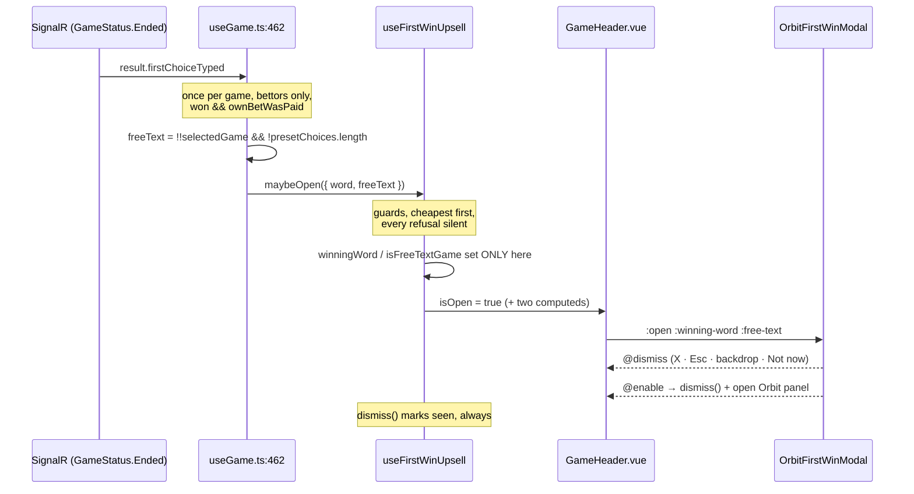

# SpaceStroker — "Redesign nice win modal" Feature — Implementation Spec

> **Status: Ready for implementation** — refined via Trello card
> [Redesign nice win modal](https://trello.com/c/fcklCgcd) (#157, refined 2026-08-07).
> Repos affected: `monkify-front` and this doc in `monkify-meta`. **`monkify-backend` is NOT touched
> — this card has zero backend surface** (AC17 asserts an empty backend diff).
>
> **Purpose:** `OrbitFirstWinModal.vue` — the once-ever Orbit upsell that fires right after a
> player's first **paid** win — is oversized, wordy and visually anonymous: an 832px black panel with
> a cyan `NICE WIN!` titlebar and 28 words of documentation-voice body copy. Nothing on it says
> *Orbit*, and the celebration is a caption. This rebuilds the surface with Orbit's identity, at half
> the width, with the hype carried by the **message** — the win, the word the player hit, and what
> makes Orbit worth having.

---

## 1. Summary

One component is rebuilt, one composable grows two values, and two call sites pass them through.
**Nothing about when or how often the modal fires changes.**

| | Today | After |
| --- | --- | --- |
| Panel | `variant="black"` (void-deep + 2px cyan) | `variant="orbit"` (void-deep + 2px violet-deep) |
| Desktop width | `size="standard"` → **832px** | `size="compact"` → **540px** |
| Titlebar | `NICE WIN!` centred between two sparkles | `ORBIT` left-aligned, `OrbitMark` in `titlebar-lead`, X kept |
| Celebration | the 9px titlebar caption | a large in-body `NICE WIN!` headline |
| The winning word | **not shown at all** | the hero, directly under the headline |
| Body copy | 28 words, one paragraph, identical for every game type | **one short line, conditional on game type** |
| CTAs | amber `Set up Orbit` + outline `Not now` | **unchanged** |
| Edson sprite | `h-24` / `md:h-28` | **unchanged** (explicitly decided) |
| Trigger / guards / `seen` | `useGame.ts:462` one-shot, `localStorage` per browser | **unchanged** |
| Backend | — | **no change of any kind** |

### 1.1 What the modal looks like after

```
┌─ .dialog--orbit (void-deep fill, 2px violet-deep border, 540px on lg) ─────┐
│ ⟡ ORBIT                                                              [X]  │ ← 46px violet titlebar
├───────────────────────────────────────────────────────────────────────────┤
│                            (Edson, h-24 / md:h-28)                        │
│                                                                            │
│                              NICE WIN!                                     │ ← .dialog-headline
│                                                                            │
│                          B  A  N  A  N  A                                  │ ← .dialog-word (violet)
│                                                                            │
│      Orbit keeps playing it for you, every round — and the word            │ ← .dialog-copy
│                 stays yours while it runs.                                 │   (free-text copy)
│                                                                            │
│                    [        Set up Orbit        ]                          │ ← btn-dialog--primary
│                    [          Not now           ]                          │ ← btn-dialog
└────────────────────────────────────────────────────────────────────────────┘
```

Below `lg` it is the same content in the shell's existing **bottom sheet** (full width, 90dvh cap,
body as the scroll container) — `compact` and `standard` are identical there, so "smaller on mobile"
comes from the content, not from the size token.

---

## 2. Constraints (MANDATORY)

From `monkify-meta/constraints.md` (full list there):

- **Worktree-per-repo (§2):** `feature/redesign-nice-win-modal`, checked out at
  `.worktrees/redesign-nice-win-modal/<repo>` for `monkify-front` and `monkify-meta`. Both hubs stay
  on `main` — never `git switch` a hub. Push each branch after its first commit.
- **Unit tests (§3):** **N/A for the backend** — no `SpaceStroker.Tests` file changes, because no
  backend behaviour changes. `monkify-front` has **no test runner at all**; the bar is `yarn lint` +
  `yarn build` clean plus the manual QA in §13.
- **Integration test (`AGENTS.md` rule 8):** **does not apply.** The rule mandates a happy-path test
  in `SpaceStroker.Tests.Integration` for every new feature; this card has **no backend surface to
  exercise end to end**, and it is a redesign of a shipped surface rather than a new feature.
  Recorded deliberately, not skipped silently.
- **EF mapping / migrations (§4):** N/A — no entity, no column, no migration.
- **Secrets/config (§1):** N/A — no configuration key is added. `VUE_APP_ORBIT_ENABLED` already
  exists and is not touched.
- **User-facing messaging (§6):** N/A — this surface raises no error and names no failure reason.
- **⚠️ #118 Orbit invisibility (feature-specific, load-bearing):** the copy may state **that** a word
  can be claimed. It must **never** name, count, list or hint at **which** words or **whose**, and it
  must **not** introduce any "is this word reserved?" lookup. `orbit-feedback-adjustments.md`
  shipped deviation 2 refused exactly such a probe on `useGame.bet()` because it is an
  Orbit-membership oracle for any stranger. See D6 and §7.6.
- **⚠️ Palette rules that must survive** (`orbit-ui-overhaul.md`, `conventions/frontend.md`):
  **violet = Orbit identity, amber = the primary action, red = warning only.** Cyan stays unspent on
  this panel. See D9.
- **⚠️ CRLF (`monkify-front`):** the front needs uniform CRLF line endings; a mangled ending fails
  `yarn lint` as `Insert ␍`. Never edit these files with `sed -i` or any tool that rewrites endings
  to LF.
- **⚠️ The `arcade.css` cascade rule (`conventions/frontend.md`):** `arcade.css` is imported *after*
  `@tailwind utilities` at equal specificity, so a Tailwind utility stacked on an arcade class that
  declares that property **silently loses**. The new typography is therefore **classes in
  `arcade.css`**, not a stack of utilities at the call site (§7.5).

---

## 3. Resolved product decisions

| # | Decision | Why (and what was rejected) |
| --- | --- | --- |
| D1 | **`variant="black"` → `variant="orbit"`** — a full material switch, not violet accents on the black panel. | Makes the modal read as one surface with `/orbit`, `OrbitModal` and `HomeOrbitCard`. `ArcadeModal` already supports `orbit` (#141), so no design-system change is needed to adopt it. Rejected "violet accents on black": two Orbit looks for one feature is the drift `.dialog--orbit` was created to end. |
| D2 | **`variant="black"` / `.dialog--black` is KEPT, not deleted** — and becomes **consumer-less**. | Deleting it would be a second, unrelated design-system change inside a copy/skin card. ⚠️ Accepted consequence: the tutorial/help **overlay** tier now has **no implementation**, which `conventions/frontend.md` must record (D11) rather than leaving a documented tier that no code proves. `.arcade-frame--black` — the How to play guide's `GuideTip` — is the black **material's** remaining live consumer and is **untouched**. |
| D3 | **`size="standard"` (832) → `size="compact"` (540).** | Desktop-only effect: below `lg`, `compact` and `standard` are both full-width bottom sheets. 832px for a headline, a word, one line and two buttons is a page pretending to be a dialog. |
| D4 | **The Edson sprite stays at `h-24` / `md:h-28`.** | Explicitly decided, not an oversight — he is the celebration's only illustration and the panel is already halving its width. Do not "tidy" him smaller. |
| D5 | **The titlebar is kept and retitled `ORBIT`**, with `<OrbitMark />` in the **`titlebar-lead`** slot. | Preserves the **X**, keeps `aria-labelledby` pointed at a real title, and puts identity where the design system already has a slot for it (`ArcadeModal.vue:234` — `titlebar-lead` renders for `grey` and `orbit`, never for `black`). Rejected `chrome="none"`: it deletes the X, and on mobile (no Esc) that leaves an **unprompted** modal with only the backdrop and `Not now` as exits. Rejected a hand-rolled floating X as design-system drift. |
| D6 | **`NICE WIN!` is promoted out of the titlebar into a large in-body headline**, and **the winning word is the hero** beneath it. | The titlebar now says `ORBIT`, so there is no duplication. The word is the single most personal thing the app knows at that moment and it was being thrown away. |
| D7 | **One short supporting line replaces the 28-word paragraph, conditional on game type.** Free-text: *"Orbit keeps playing it for you, every round — and the word stays yours while it runs."* Preset: *"Orbit keeps playing for you, every round. Hands off."* | `orbit-single-control.md` → *"the word claim follows playability"* makes **two** qualifiers mandatory whenever word ownership is advertised: **free-text games only**, and **only while Orbit is running**. This modal fires after **any** paid win, preset types included, where word claims do not exist — so a flat "your word stays yours" is **false** for a Beast Mode winner. Rendering the claim beat **only where it is true** removes the need for the "type-it-yourself games" clause `HomeOrbitCard` has to carry; `while it runs` is retained inline. Rejected a disclaimer sentence (it re-introduces the documentation voice this card exists to delete). |
| D8 | **If `selectedGame` is unavailable, the PRESET (claim-free) copy is used.** | Never assert word ownership on unknown ground. ⚠️ This inverts the natural expression — see the trap in §7.2. |
| D9 | **CTAs unchanged: amber `btn-dialog--primary` `Set up Orbit`, outline `btn-dialog` `Not now`.** | Orbit's palette rule assigns **amber to the primary action** and **violet to identity**, so a violet fill would be both off-rule and lower-contrast against a violet-deep frame. |
| D10 | **The headline is ink; the word hero is full `--color-orbit`.** | Amber is spoken for by the CTA (`arcade.css`: *"amber owns one job now — the active step's primary action"*), so a big amber headline would compete with the only thing the player is meant to press. Full violet (0.72) rather than `--color-orbit-deep` (0.5) follows #141's shipped **"frame deep, content full"** intensity split — the same call `.eyebrow--orbit` makes. Rejected cyan (it is the *black* panel's frame colour and is deliberately unspent on `--orbit`) and rejected red outright (warning only). |
| D11 | **`conventions/frontend.md` is corrected in the same change:** the black **overlay** tier is recorded as having **no implementation**, and `compact` is stated as **540**, not 608. | ⚠️ **KB drift found during refinement:** the doc says `compact` = 608 in **four** places; `ArcadeModal.vue:173` says `lg:max-w-[540px]`. **The code is truth.** Left alone, this card's "540" would look like a regression against the doc. |
| D12 | **Rejected: showing any amount.** | At the moment this fires the front knows the stake (`requiredAmount`) and the pot (`currentPot`) but **not the payout** — rewards settle asynchronously (`RewardForWinnersInProgress` → `RewardForWinnersCompleted`) and the pot splits across winners minus commission. A wrong number on a money screen is the expensive kind of wrong. |
| D13 | **Rejected: motion.** No entrance pop, sprite bounce or frame pulse. | The hype is the message. The shell's existing 140ms fade/translate is untouched, so `prefers-reduced-motion` is moot for this card. |
| D14 | **Rejected: touching the trigger.** Once-ever, first **paid** win, the guard ordering, the `localStorage` key, per-browser-not-per-wallet and every-exit-marks-seen are all untouched. | They are a separate, working design (`features/orbit-ui-overhaul.md`, `conventions/frontend.md` → "Two overlay tiers"). |

---

## 4. Data model

**N/A.** No entity, column, enum, EF mapping or migration. The winning word and the game type are
both already client-side.

---

## 5. Configuration

**N/A.** No new key, no `.env` change, no seed data. `VUE_APP_ORBIT_ENABLED` (→ `orbitEnabled`)
already gates every Orbit surface and is not modified.

---

## 6. Backend behaviour

**N/A — deliberately.** No handler, consumer, domain service, endpoint, DTO, SignalR contract or
message changes. `GameStatus.Ended`'s payload already carries `result.firstChoiceTyped`, which is the
winning word; `presetChoices` already arrives on the game type. **AC17 asserts the `monkify-backend`
diff for this card is empty**, and no branch is created there.

---

## 7. Frontend behaviour

Four files change in `monkify-front`. The data flows **useGame → useFirstWinUpsell → GameHeader →
OrbitFirstWinModal**; the composable is a module singleton, so the header reads the same refs the
game loop writes.

### 7.1 `src/hooks/useFirstWinUpsell.ts` — carry the word and the game-type kind

Two module-scope refs beside the existing `isOpen` / `seen`, exposed as computeds:

```ts
const winningWord = ref('');
const isFreeTextGame = ref(false);
```

`maybeOpen` grows one options argument. **Both refs are assigned only at the very end, immediately
before `isOpen.value = true`** — after every guard — so the cheapest-first, silently-refusing guard
chain is unchanged and a refused open never leaves stale state behind:

```ts
const maybeOpen = (context?: { word?: string | null; freeText?: boolean }) => {
  if (!orbitEnabled) return;
  if (seen.value) return;
  // … every existing guard, in the existing order, untouched …
  if (!termsAccepted.value) return;

  // Set ONLY once the modal is actually opening. A refusal must not mutate anything.
  winningWord.value = context?.word ?? '';
  isFreeTextGame.value = context?.freeText === true;
  isOpen.value = true;
};
```

- The parameter is **optional** so an argument-less call still compiles and behaves exactly as today
  (empty word ⇒ the word row hides, preset copy ⇒ no claim). That is the safe degradation, not a
  code path anyone should rely on.
- `context?.freeText === true` — an explicit `true` test, never `!!context?.freeText` on a value that
  might be `undefined` for the wrong reason. See the trap in §7.2.
- `dismiss()` is **unchanged** and deliberately does **not** clear the two refs: the modal can never
  reopen (`seen` is set on every exit), and clearing them would flash an empty body during the shell's
  140ms leave transition.
- Return `winningWord` and `isFreeTextGame` as `computed(...)` alongside `isOpen` / `hasSeen`.

### 7.2 `src/hooks/useGame.ts:462` — pass the two values in

Inside the existing round-ended, bettors-only, once-per-game block (nothing about the block moves):

```ts
// ⚠️ NOT `!selectedGame.value?.presetChoices?.length` — that is `true` when selectedGame is
// UNDEFINED, which would assert word ownership on unknown ground (AC8/D8). The game must be known
// AND have no preset choices before the free-text copy is allowed.
const freeText = !!selectedGame.value && !selectedGame.value.presetChoices?.length;
if (won && ownBetWasPaid.value)
  useFirstWinUpsell().maybeOpen({ word: winnerCh, freeText });
```

- `winnerCh` is `statusData.result?.firstChoiceTyped` and is already in scope; `won` being true means
  it is a non-empty string that is in `ownBetChoices`, so exactly one word can ever be shown.
- ⚠️ **The same shape exists at `useGame.ts:608`** (`const isPreset = !!selectedGame.value?.presetChoices?.length`)
  and is correct there because it defaults to *preset*. Do not "harmonise" the two into one
  expression — they need **opposite** fallbacks.
- `ownBetWasPaid` (`useGame.ts:103`) still gates the call, so a **free-bet** win does not open the
  upsell. Unchanged.

### 7.3 `src/components/GameHeader.vue:110` / `:453` — bind them through

```ts
const {
  isOpen: isFirstWinUpsellOpen,
  dismiss: dismissFirstWinUpsell,
  winningWord: firstWinWord,
  isFreeTextGame: firstWinIsFreeText,
} = useFirstWinUpsell();
```

```html
<OrbitFirstWinModal
  v-if="orbitEnabled && !isEmbedded"
  :open="isFirstWinUpsellOpen"
  :winning-word="firstWinWord"
  :free-text="firstWinIsFreeText"
  @dismiss="dismissFirstWinUpsell"
  @enable="acceptFirstWinUpsell"
/>
```

The `v-if`, the `@enable` → `isOrbitOpen = true` hand-off and the mount location are **unchanged**.

### 7.4 `src/components/orbit/OrbitFirstWinModal.vue` — the rebuild

```html
<ArcadeModal
  :open="open"
  variant="orbit"
  size="compact"
  title="ORBIT"
  :dismissible="true"
  @close="emit('dismiss')"
>
  <template #titlebar-lead>
    <OrbitMark :size="13" class="flex-none text-orbit" aria-hidden="true" />
  </template>

  <div class="flex flex-col items-center">
    

    <p class="dialog-headline mt-3">NICE WIN!</p>

    <!-- Hidden, not blanked: the modal must never fail to open over a missing decoration. -->
    <p v-if="winningWord" class="dialog-word mt-2.5">{{ winningWord }}</p>

    <p class="dialog-copy mt-3 max-w-[32ch] text-balance text-center">{{ supportingLine }}</p>

    <div class="mt-6 flex w-full flex-col items-center gap-2.5">
      <button type="button" class="btn-dialog btn-dialog--primary w-full" @click="emit('enable')">
        Set up Orbit
      </button>
      <button type="button" class="btn-dialog w-full" @click="emit('dismiss')">Not now</button>
    </div>
  </div>
</ArcadeModal>
```

```ts
const props = defineProps<{ open: boolean; winningWord?: string; freeText?: boolean }>();

const supportingLine = computed(() =>
  props.freeText
    ? 'Orbit keeps playing it for you, every round — and the word stays yours while it runs.'
    : 'Orbit keeps playing for you, every round. Hands off.'
);
```

- `:size="13"` on the mark matches `OrbitModal.vue:925` exactly — one Orbit titlebar look, not two.
- The uppercase rendering of the word is **presentational only** (`text-transform` in CSS, §7.5).
  Stored choices are always lowercase (uppercase is rejected as `InvalidCharacters` —
  `bet-choice-casing.md`); **nothing here may echo the displayed string back into a bet path.**
- ⚠️ **Rewrite the file's docblock.** Its current text says the modal is BLACK and "the black tier's
  only overlay implementation, so it is also its reference one" — after this card that is false in
  both halves. The `EVERY EXIT MARKS IT SEEN` and shell-ownership paragraphs stay.

### 7.5 `src/assets/styles/arcade.css` — two new dialog content helpers

They go in the **"Dialog content helpers"** block, beside `.dialog-copy` / `.dialog-eyebrow` (~line
539). Classes, not call-site utilities: the cascade rule makes utilities on an arcade class lose
silently, and `conventions/frontend.md` requires a missing primitive to be **added to the design
system**. They are named `dialog-*`, not `orbit-*`, because they describe a *shape inside a dialog
body* (a celebration headline, a hero value) rather than Orbit identity.

```css
  /* The headline INSIDE a body — not the titlebar's name for the dialog. Ink, never amber: amber owns
     the primary action on these panels, and a headline that shouts in the CTA's colour competes with
     the only thing the player is meant to press. */
  .dialog-headline {
    display: block;
    margin: 0;
    font-family: var(--font-display, 'Press Start 2P', system-ui, sans-serif);
    font-size: 18px;
    line-height: 1.3;
    letter-spacing: 0.04em;
    text-align: center;
    color: var(--color-ink);
  }

  /* A hero VALUE under a headline — today the winning word. VT323, because the word is the game's own
     artifact (the terminal types it in this face) and because Press Start 2P at 20 characters cannot
     fit 540px minus 18px of body padding on either side. Full --color-orbit per #141's "frame deep,
     content full" split.
     ⚠️ The wrap rules are load-bearing, not defensive: `choiceRequiredLength` allows up to 20
     characters, and at the smallest supported width that MUST wrap to a second line rather than push
     the sheet sideways. */
  .dialog-word {
    margin: 0;
    max-width: 100%;
    font-family: var(--font-body, 'VT323', ui-monospace, monospace);
    font-size: 34px;
    line-height: 1.1;
    letter-spacing: 0.18em;
    text-align: center;
    text-transform: uppercase;
    overflow-wrap: anywhere;
    color: var(--color-orbit);
  }
```

And in the existing `@media (max-width: 1023px)` dialog block (~line 1660), the mobile step-down —
the same block that already carries the 44px titlebar and the 9px `.btn-dialog`:

```css
  .dialog-headline {
    font-size: 15px;
  }
  .dialog-word {
    font-size: 28px;
    letter-spacing: 0.14em;
  }
```

**Fit check (why these numbers).** At `compact` the dialog is 540px minus 2×2px border minus 2×18px
`.dialog__body` padding ⇒ **~500px** of text width. VT323's advance is ≈0.42em, so at 34px with
0.18em tracking a character costs ≈20.4px ⇒ 20 characters ≈ **408px**, inside 500. On a 320px phone
the sheet gives ≈284px; at 28px/0.14em a character costs ≈15.7px ⇒ 20 characters ≈ 314px, which
**wraps to two lines** via `overflow-wrap: anywhere` and never scrolls the page sideways. Both ends
must be verified at the maximum length (AC12, QA step 6).

### 7.6 Copy — load-bearing, read before changing a word

| Case | Line |
| --- | --- |
| Free-text type (`presetChoices` empty — e.g. Cosmic Sprint) | *Orbit keeps playing it for you, every round — and the word stays yours while it runs.* |
| Preset type (e.g. Beast Mode) **and** unknown game type | *Orbit keeps playing for you, every round. Hands off.* |

- The free-text line's **"while it runs"** is the mandatory lifetime qualifier from
  `orbit-single-control.md` — the claim lives only while the enrolment is `Enabled` **and** funded.
  Dropping it promises a permanent word.
- The **"type-it-yourself games"** qualifier `HomeOrbitCard` carries is **not** needed here precisely
  because the line is only rendered on those games. That is the whole point of D7 — if the
  conditional is ever collapsed back into one line, the qualifier must come back with it.
- #118: this says **that** a word can be claimed. It never says **which** or **whose**, and it adds
  no reserved-word probe.
- No win-rate, strategy or profitability promise, ever. No amount (D12).

### 7.7 Edge cases

| Case | Behaviour |
| --- | --- |
| Winning word missing / empty | The word row is **hidden** (`v-if`); headline, supporting line and both buttons render normally. A missing decoration must never stop the invitation. |
| 20-character choice | Wraps per §7.5; no horizontal page scroll at 540px or at the smallest supported width. |
| Casing | Uppercase is CSS-only. Stored choices are lowercase; nothing echoes the rendered string into a bet path. |
| `selectedGame` unavailable | Preset (claim-free) copy — see the §7.2 trap. |
| Multiple own bets | `firstChoiceTyped` is a single winning choice already verified against `ownBetChoices`; exactly one word can render. |
| Mobile | Bottom sheet, full width, 90dvh cap, body scrolls — unchanged shell behaviour. |
| `prefers-reduced-motion` | Moot — no motion is added (D13). |
| Light-graphics mode | No `backdrop-filter` is introduced; `.dialog--orbit` deliberately carries **no glow** for exactly this reason. |
| `orbitEnabled === false` | Unchanged: the modal never mounts, `maybeOpen` returns before `seen` is persisted, so a player who wins while Orbit is dark still gets the invitation after Orbit ships. |
| Embedded (iframe) | Unchanged: `maybeOpen` refuses outright, and `GameHeader`'s `v-if` never mounts it. |
| Overlay collision | Unchanged: refuses while Settings / Provably Fair / Orbit is open, and while recovering / idle-disconnected / relaunching / terms not accepted. |

---

## 8. Flow diagram



---

## 9. Out of scope

- **When and how often it fires.** Once-ever, first **paid** win only, the guard ordering, the
  `localStorage` key (`space-stroker.orbit.first-win-seen`), per-browser-not-per-wallet and
  every-exit-marks-seen are all untouched.
- Showing any monetary amount (D12). Any animation or motion (D13).
- Deleting `variant="black"` / `.dialog--black` (D2), and any change to `.arcade-frame--black` or the
  guide's `GuideTip`.
- `OrbitModal`, the `/orbit` page, `HomeOrbitCard` and `GuideOrbit` — none are touched or restyled.
- Any backend or API change; any new `features/` doc (this is a redesign of a surface already
  described by `features/orbit-ui-overhaul.md`).

---

## 10. File checklist

### 10.1 Backend (`monkify-backend`)

**No files. No branch.** AC17 asserts an empty diff.

### 10.2 Frontend (`monkify-front`)

| # | File | Change |
| --- | --- | --- |
| 1 | `src/hooks/useFirstWinUpsell.ts` | Add module refs `winningWord` / `isFreeTextGame`; `maybeOpen(context?)` sets them **after every guard**, immediately before `isOpen = true`; expose both as computeds. `dismiss()` untouched. |
| 2 | `src/hooks/useGame.ts` (~462) | Compute `freeText = !!selectedGame.value && !selectedGame.value.presetChoices?.length` and pass `{ word: winnerCh, freeText }` into `maybeOpen`. Comment the undefined-game trap. No change to the one-shot's gating. |
| 3 | `src/components/GameHeader.vue` (~110, ~453) | Destructure the two new computeds; bind `:winning-word` / `:free-text` on `<OrbitFirstWinModal>`. |
| 4 | `src/components/orbit/OrbitFirstWinModal.vue` | Rebuild: `variant="orbit"`, `size="compact"`, `title="ORBIT"`, `OrbitMark` in `titlebar-lead`, in-body `NICE WIN!` headline, conditional word hero, one conditional supporting line, CTAs unchanged, sprite unchanged. New props + `supportingLine` computed. **Rewrite the docblock** (it currently documents the black panel). |
| 5 | `src/assets/styles/arcade.css` | Add `.dialog-headline` + `.dialog-word` to the dialog content helpers; add their two mobile step-downs to the existing `@media (max-width: 1023px)` dialog block. |

### 10.3 Meta (`monkify-meta`)

| # | File | Change |
| --- | --- | --- |
| 1 | `specs/redesign-nice-win-modal.md` | This spec. |
| 2 | `INDEX.md` | KB-map row for the spec; "Feature currently in flight" entry. |
| 3 | `conventions/frontend.md` | **(a)** `compact` **608 → 540** in all four places (§"Shared by both", the size-token bullet, the `ArcadeModal` props summary, and the "Two overlay tiers" system-tier list). **(b)** Record that the tutorial/help **overlay** tier has **no implementation** — the first-win upsell moved to the Orbit material; `.arcade-frame--black` (`GuideTip`) remains the black *material's* live consumer. **(c)** Update the two-panel table row that still names the first-win upsell as the black tier's reference overlay. |
| 4 | `features/orbit-ui-overhaul.md` | One-line update at ship time: the first-win upsell is an **Orbit-material** surface, compact, and carries the winning word + conditional claim copy. (Ship-time KB sync, per `monkify-ship-feature`.) |

---

## 11. Unit tests

**Backend: none.** `SpaceStroker.Tests` is not touched — no backend behaviour changes, so
`constraints.md` §3's "update + add + report" has nothing to act on, and rule 8's integration test
has nothing to exercise (§2).

**Frontend: `monkify-front` has no test runner** (no `.spec` / `.test` files, no runner configured).
The verification bar for this card is:

| Gate | Command | Expected |
| --- | --- | --- |
| Lint | `yarn lint` | clean — watch for `Insert ␍` (CRLF, §2) |
| Build | `yarn build` | clean, no type error on the new props |
| Manual | §13 | all 8 steps pass |

---

## 12. Acceptance criteria

Copied 1:1 from the Trello **Acceptance Criteria** checklist (#157).

1. **AC1** — Given a player wins their first paid game, when the upsell opens, then it renders through `ArcadeModal` with `variant="orbit"` (violet-deep frame on void-deep) and `size="compact"`.
2. **AC2** — Given the upsell is open, when the titlebar renders, then it shows `OrbitMark` in the `titlebar-lead` slot beside the title `ORBIT`, and the close X is present and dismisses the modal.
3. **AC3** — Given the upsell is open, when the body renders, then `NICE WIN!` appears as a large in-body headline and no longer as the titlebar title.
4. **AC4** — Given the winning choice is known, when the upsell opens, then that word is rendered as the hero directly beneath the headline.
5. **AC5** — Given the winning choice is missing or empty, when the upsell opens, then the word row is hidden and the headline, supporting line and both buttons still render normally.
6. **AC6** — Given the player won a FREE-TEXT game type (`presetChoices` empty), when the upsell opens, then the supporting line states both that Orbit keeps playing every round AND that the word stays theirs while it runs.
7. **AC7** — Given the player won a PRESET game type (e.g. Beast Mode), when the upsell opens, then the supporting line mentions hands-off auto-play only and makes NO claim about word ownership.
8. **AC8** — Given `selectedGame` is unavailable when the upsell opens, then the PRESET (claim-free) copy is used — word ownership is never asserted on unknown ground.
9. **AC9** — Given the upsell is open, when the body copy is read, then the previous 28-word paragraph ("Put it in orbit. Fund an Orbit balance once…") is gone and exactly one short supporting line remains.
10. **AC10** — Given the upsell is open, when the CTAs render, then `Set up Orbit` is the amber `btn-dialog--primary` and `Not now` is the outline `btn-dialog`; neither carries a violet fill.
11. **AC11** — Given the upsell is open, when the player exits via the X, Esc, the backdrop, `Not now` or `Set up Orbit`, then it is marked seen and never opens again in that browser.
12. **AC12** — Given a 20-character winning choice, when the upsell opens at 540px desktop and at the smallest supported mobile width, then the word hero stays inside its container and the page does not scroll horizontally.
13. **AC13** — Given a build with `orbitEnabled === false`, when a player wins their first paid game, then the modal never mounts and `seen` is not persisted (the invitation still fires the first time they win after Orbit ships).
14. **AC14** — Given the app is embedded in an iframe, or Settings / Provably Fair / the Orbit panel is open, or the app is recovering / idle-disconnected / relaunching, or terms are not accepted, when a player wins their first paid game, then the upsell does not open and no error is surfaced.
15. **AC15** — Given the redesign is merged, when the codebase is searched, then `variant="black"` / `.dialog--black` still exist with zero consumers, and `.arcade-frame--black` (the guide's `GuideTip`) is unchanged.
16. **AC16** — Given the redesign is merged, when `monkify-meta/conventions/frontend.md` is read, then it records that the tutorial/help OVERLAY tier has no implementation, and `compact` is stated as 540px (not 608).
17. **AC17** — Given the redesign is merged, when the backend repo is diffed, then it contains no changes for this card (no entity, handler, consumer, endpoint, EF mapping or migration).

---

## 13. Manual QA (local, `yarn serve` from the worktree)

Reaching the real trigger needs a paid win on a fresh browser profile. Steps 1–2 make that
repeatable; steps 3–8 are the checks.

1. **Reset "seen":** in DevTools, `localStorage.removeItem('space-stroker.orbit.first-win-seen')`,
   then reload. Confirm the wallet is **not** Orbit-enrolled (an enrolled wallet is refused by
   `orbit.value?.enabled`).
2. **Win a paid round** on a **free-text** game (Cosmic Sprint) with two players against the local
   Docker stack — a free bet will **not** open it (`ownBetWasPaid`).
3. **AC1/AC2/AC3:** violet frame, 540px on desktop, `⟡ ORBIT` titlebar with a working X, `NICE WIN!`
   in the body.
4. **AC4/AC6:** the word you bet is the hero, and the line ends *"…and the word stays yours while it
   runs."*
5. **AC7:** repeat on **Beast Mode** (reset `seen` first) — the line must be the hands-off one, with
   **no** word-ownership claim.
6. **AC12:** with the modal open, in DevTools set the word to 20 characters
   (`document.querySelector('.dialog-word').textContent = 'abcdefghijklmnopqrst'`) and check 540px
   desktop **and** a 320px viewport — no horizontal scrollbar on `body`.
7. **AC5:** with the modal open, blank the word node — headline, line and both buttons still render.
8. **AC11:** close via Esc, reload, win again → it must not reopen. Repeat for the X, the backdrop,
   `Not now` and `Set up Orbit` (the last one should also open the Orbit panel).

---

## 14. Trello / pipeline

- **Source card:** [Redesign nice win modal](https://trello.com/c/fcklCgcd) (#157) — list
  **Specs created**; the `## Implementation` block on the card carries branch, worktree and spec path.
- **Next:** `/monkify-implement-feature Redesign nice win modal`, then
  `/monkify-ship-feature Redesign nice win modal` (KB sync on the feature branch, then merge).

---

## 15. Revision log

| Date | Change |
| --- | --- |
| 2026-08-07 | Initial spec from refined card #157 (+ the refinement changelog comment). Adds, beyond the card: the `selectedGame`-undefined expression trap (§7.2), the two `arcade.css` helpers and their fit maths (§7.5), and the four-place `compact` 608→540 correction (§10.3). |
