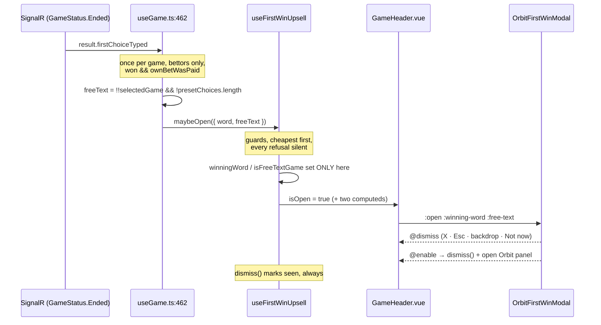

# SpaceStroker — "Redesign nice win modal" Feature — Implementation Spec

> **Status: SHIPPED 2026-08-08** — merged to `main` from `feature/redesign-nice-win-modal` in
> `monkify-front` + `monkify-meta`. Refined via Trello card
> [Redesign nice win modal](https://trello.com/c/fcklCgcd) (#157, refined 2026-08-07).
> Repos affected: `monkify-front` and this doc in `monkify-meta`. **`monkify-backend` is NOT touched
> — this card has zero backend surface** (AC17 asserts an empty backend diff).
>
> **Purpose:** `OrbitFirstWinModal.vue` — the once-ever Orbit upsell that fires right after a
> player's first **paid** win — is oversized, wordy and visually anonymous: an 832px black panel with
> a cyan `NICE WIN!` titlebar and 28 words of documentation-voice body copy. Nothing on it says
> *Orbit*, and the celebration is a caption. This rebuilds the surface as **a celebration first and
> an upsell second**: the win owns the panel, the word the player hit is quoted from the game's own
> terminal, and Orbit is one line plus the CTA.
>
> ⚠️ **This spec was rewritten on 2026-08-08, after implementation, at the visual gate.** The first
> build followed §§1–7 as originally written and the owner rejected it twice — *"i still think the
> modal is ugly"*, then *"nice win repeated 2 times… still small fonts on titles, too much empty
> black space, orbit logo too small"*. The sections below describe **what shipped**, not what was
> first designed; the superseded decisions are kept in §3 with the reason they fell, because the
> reasoning that produced them is still the reasoning a future reader will re-derive. See §15.

---

## 1. Summary

One component is rebuilt, one composable grows two values, two call sites pass them through, and the
design system gains one colour token and one primitive. **Nothing about when or how often the modal
fires changes.**

| | Today | After |
| --- | --- | --- |
| Panel | `variant="black"` (void-deep + 2px cyan) | `variant="orbit"` (void-deep + 2px violet-deep) |
| Desktop width | `size="standard"` → **832px** | `size="compact"` → **540px** |
| Titlebar | `NICE WIN!` centred between two sparkles | **`CONGRATS!`** left-aligned, a 6px phosphor square in `titlebar-lead`, X kept |
| Celebration | the 9px titlebar caption | an in-body **`NICE WIN!` at 34px** + `you won your first game` at 28px |
| The winning word | **not shown at all** | the hero, inside a **miniature CRT** — phosphor green, Press Start 2P, typed out |
| Body copy | 28 words, one paragraph, identical for every game type | **one short line, conditional on game type** |
| CTAs | amber `Set up Orbit` + outline `Not now` | **unchanged** |
| Edson sprite | `h-24` / `md:h-28` | **168px** desktop / 112px mobile, left-anchored |
| Motion | none | a **~640ms entrance beat**, then still |
| Palette | — | **`--color-phosphor`** added as a named exception |
| Trigger / guards / `seen` | `useGame.ts:462` one-shot, `localStorage` per browser | **unchanged** |
| Backend | — | **no change of any kind** |

### 1.1 What the modal looks like after

```
┌─ .dialog--orbit (void-deep fill, 2px violet-deep border, 540px on lg) ─────┐
│ ▪ CONGRATS!                                                          [X]  │ ← 46px violet titlebar
├───────────────────────────────────────────────────────────────────────────┤
│  ╭──────────╮                                                              │
│  │          │   NICE WIN!                        ← .dialog-headline, 34px  │
│  │  EDSON   │   you won your first game          ← .first-win__sub, 28px   │
│  │  168px   │                                                              │
│  ╰──────────╯                                                              │
│  ┌──────────────────────────────────────────────────────────────────────┐  │
│  │            >  B A N A N A  █                                          │ │ ← .win-screen
│  └──────────────────────────────────────────────────────────────────────┘  │   (black glass,
│                                                                            │    phosphor green)
│  ⟡  Orbit keeps playing it for you, every round — and the word stays        │ ← .dialog-copy +
│     yours while it runs.                                                   │   a 30px OrbitMark
│                                                                            │
│  [                      Set up Orbit                      ]                │ ← btn-dialog--primary
│  [                        Not now                         ]                │ ← btn-dialog
└────────────────────────────────────────────────────────────────────────────┘
```

⚠️ **The titlebar and the sub-line are one sentence, split.** `CONGRATS!` + `you won your first game`
is the owner's phrasing; it is split because the full 33-character string costs **~471px** at the
bar's 14px Press Start (advance 1.0em), against ~466px of room on a 540px dialog and **~308px on a
390px phone** — and `.dialog__title` is `overflow: hidden` with no ellipsis, so it would be chopped
mid-word on every phone. Splitting it also let the second half get *bigger* instead of smaller.
**Edit the two halves together or the sentence breaks.**

Below `lg` it is the same content in the shell's existing **bottom sheet** (full width, 90dvh cap,
body as the scroll container) — `compact` and `standard` are identical there, so "smaller on mobile"
comes from the content, not from the size token.

---

## 2. Constraints (MANDATORY)

From `monkify-meta/constraints.md` (full list there):

- **Worktree-per-repo (§2):** `feature/redesign-nice-win-modal`, checked out at
  `.worktrees/redesign-nice-win-modal/<repo>` for `monkify-front` and `monkify-meta`. Both hubs stay
  on `main` — never `git switch` a hub. Push each branch after its first commit.
- **Unit tests (§3):** **N/A for the backend** — no `SpaceStroker.Tests` file changes, because no
  backend behaviour changes. `monkify-front` has **no test runner at all**; the bar is `yarn lint` +
  `yarn build` clean plus the manual QA in §13.
- **Integration test (`AGENTS.md` rule 8):** **does not apply.** The rule mandates a happy-path test
  in `SpaceStroker.Tests.Integration` for every new feature; this card has **no backend surface to
  exercise end to end**, and it is a redesign of a shipped surface rather than a new feature.
  Recorded deliberately, not skipped silently.
- **EF mapping / migrations (§4):** N/A — no entity, no column, no migration.
- **Secrets/config (§1):** N/A — no configuration key is added. `VUE_APP_ORBIT_ENABLED` already
  exists and is not touched.
- **User-facing messaging (§6):** N/A — this surface raises no error and names no failure reason.
- **⚠️ #118 Orbit invisibility (feature-specific, load-bearing):** the copy may state **that** a word
  can be claimed. It must **never** name, count, list or hint at **which** words or **whose**, and it
  must **not** introduce any "is this word reserved?" lookup. `orbit-feedback-adjustments.md`
  shipped deviation 2 refused exactly such a probe on `useGame.bet()` because it is an
  Orbit-membership oracle for any stranger. See D6 and §7.6.
- **⚠️ Palette rules that must survive** (`orbit-ui-overhaul.md`, `conventions/frontend.md`):
  **violet = Orbit identity, amber = the primary action, red = warning only.** Cyan stays unspent on
  this panel. See D9.
- **⚠️ CRLF (`monkify-front`):** the front needs uniform CRLF line endings; a mangled ending fails
  `yarn lint` as `Insert ␍`. Never edit these files with `sed -i` or any tool that rewrites endings
  to LF.
- **⚠️ The `arcade.css` cascade rule (`conventions/frontend.md`):** `arcade.css` is imported *after*
  `@tailwind utilities` at equal specificity, so a Tailwind utility stacked on an arcade class that
  declares that property **silently loses**. The new typography is therefore **classes in
  `arcade.css`**, not a stack of utilities at the call site (§7.5).

---

## 3. Resolved product decisions

| # | Decision | Why (and what was rejected) |
| --- | --- | --- |
| D1 | **`variant="black"` → `variant="orbit"`** — a full material switch, not violet accents on the black panel. | Makes the modal read as one surface with `/orbit`, `OrbitModal` and `HomeOrbitCard`. `ArcadeModal` already supports `orbit` (#141), so no design-system change is needed to adopt it. Rejected "violet accents on black": two Orbit looks for one feature is the drift `.dialog--orbit` was created to end. |
| D2 | **`variant="black"` / `.dialog--black` is KEPT, not deleted** — and becomes **consumer-less**. | Deleting it would be a second, unrelated design-system change inside a copy/skin card. ⚠️ Accepted consequence: the tutorial/help **overlay** tier now has **no implementation**, which `conventions/frontend.md` must record (D11) rather than leaving a documented tier that no code proves. `.arcade-frame--black` — the How to play guide's `GuideTip` — is the black **material's** remaining live consumer and is **untouched**. |
| D3 | **`size="standard"` (832) → `size="compact"` (540).** | Desktop-only effect: below `lg`, `compact` and `standard` are both full-width bottom sheets. 832px for a headline, a word, one line and two buttons is a page pretending to be a dialog. |
| ~~D4~~ | ~~**The Edson sprite stays at `h-24` / `md:h-28`.**~~ **SUPERSEDED (2026-08-08) → 168px desktop / 112px mobile, left-anchored.** | The original reasoning — *he is the celebration's only illustration and the panel is already halving its width* — was written for a **centred column**. In the shipped left-anchored band he is beside the headline, not above it, and at `h-24` in that position he read as **a bullet point** rather than a mascot (owner's call). The panel also lost its second bordered block, which freed the height. |
| D5 | **The titlebar is kept** (retitled — see D5.1), with the `titlebar-lead` slot filled. | Preserves the **X**, keeps `aria-labelledby` pointed at a real title, and puts a mark where the design system already has a slot for it (`ArcadeModal.vue:234` — `titlebar-lead` renders for `grey` and `orbit`, never for `black`). Rejected `chrome="none"`: it deletes the X, and on mobile (no Esc) that leaves an **unprompted** modal with only the backdrop and `Not now` as exits. Rejected a hand-rolled floating X as design-system drift. |
| **D5.1** | **The title is `CONGRATS!`, not `ORBIT`, and the lead is a 6px phosphor square, not `OrbitMark`.** (2026-08-08) | `ORBIT` made the **first word a player reads after their first-ever win a feature name** — an ad where a congratulation belongs. Once the celebration leads, an Orbit glyph at the top of the panel puts the identity back in the position the retitle just took it out of. Orbit's identity moved to the 30px mark on the pitch line and the amber CTA, both of which are *below* the win. |
| ~~D6~~ | ~~**`NICE WIN!` is promoted out of the titlebar into a large in-body headline**~~ — **kept, but see D6.1.** The winning word is the hero. | The word is the single most personal thing the app knows at that moment and it was being thrown away. |
| **D6.1** | **`NICE WIN!` appears exactly once — in the body — and the bar carries `CONGRATS!`.** (2026-08-08) | D6 assumed the bar would say `ORBIT`, so promoting the phrase into the body created no duplication. D5.1 changed the bar, and the first build shipped **`NICE WIN!` in both places** — the owner's first note on it was *"nice win repeated 2 times"*. ⚠️ Whatever the bar says in future, it may not be the body headline's phrase. |
| **D6.2** | **The word renders inside `.win-screen`, a miniature CRT: black glass, a `>` prompt, Press Start 2P in `--color-phosphor`, a blinking block caret.** (2026-08-08) | The first build put the headline and the word in one bordered inset block and the Orbit pitch in a **second, identical** one — same border, same radius, same glyph-left layout. Two equal blocks read as **two table rows**, which is what "still ugly" and "too much empty black space" were describing: no focal point, and a box-in-a-box-in-a-box. The fix was to delete one box and make the other a different **object**. It quotes the terminal because the word genuinely *is* terminal output — the monkey typed it — which also settles the face: **Press Start 2P**, what `#app` and the console word input actually inherit, not the VT323 the first draft chose. |
| D7 | **One short supporting line replaces the 28-word paragraph, conditional on game type.** Free-text: *"Orbit keeps playing it for you, every round — and the word stays yours while it runs."* Preset: *"Orbit keeps playing for you, every round. Hands off."* | `orbit-single-control.md` → *"the word claim follows playability"* makes **two** qualifiers mandatory whenever word ownership is advertised: **free-text games only**, and **only while Orbit is running**. This modal fires after **any** paid win, preset types included, where word claims do not exist — so a flat "your word stays yours" is **false** for a Beast Mode winner. Rendering the claim beat **only where it is true** removes the need for the "type-it-yourself games" clause `HomeOrbitCard` has to carry; `while it runs` is retained inline. Rejected a disclaimer sentence (it re-introduces the documentation voice this card exists to delete). |
| D8 | **If `selectedGame` is unavailable, the PRESET (claim-free) copy is used.** | Never assert word ownership on unknown ground. ⚠️ This inverts the natural expression — see the trap in §7.2. |
| D9 | **CTAs unchanged: amber `btn-dialog--primary` `Set up Orbit`, outline `btn-dialog` `Not now`.** | Orbit's palette rule assigns **amber to the primary action** and **violet to identity**, so a violet fill would be both off-rule and lower-contrast against a violet-deep frame. |
| D10 | **The headline is ink.** ~~The word hero is full `--color-orbit`.~~ **Word colour SUPERSEDED (2026-08-08) → `--color-phosphor` (`#4ade80`).** | The headline half stands: amber is spoken for by the CTA (`arcade.css`: *"amber owns one job now — the active step's primary action"*), so a big amber headline would compete with the only thing the player is meant to press. **The word half fell with D6.2.** Once the word is drawn on a screen, violet is the wrong ink for it — phosphor is what that hardware paints. Requested directly by the owner (*"show the winning word in green with a `>` thing and flashing"*, *"use the same word font used in the terminal and orbit input"*). ⚠️ This is a **fifth hue on an Orbit surface** and therefore a **named exception**, recorded in `conventions/frontend.md` and in the token's own docblock: licensed **only** for quoted machine output drawn on a screen, never as a general accent. Distinct from `--color-live`, which is a *state*; this is a *material*. |
| D11 | **`conventions/frontend.md` is corrected in the same change:** the black **overlay** tier is recorded as having **no implementation**, and `compact` is stated as **540**, not 608. | ⚠️ **KB drift found during refinement:** the doc says `compact` = 608 in **four** places; `ArcadeModal.vue:173` says `lg:max-w-[540px]`. **The code is truth.** Left alone, this card's "540" would look like a regression against the doc. |
| D12 | **Rejected: showing any amount.** | At the moment this fires the front knows the stake (`requiredAmount`) and the pot (`currentPot`) but **not the payout** — rewards settle asynchronously (`RewardForWinnersInProgress` → `RewardForWinnersCompleted`) and the pot splits across winners minus commission. A wrong number on a money screen is the expensive kind of wrong. |
| ~~D13~~ | ~~**Rejected: motion.**~~ **SUPERSEDED (2026-08-08) → a ~640ms entrance beat, then still.** | *"The hype is the message"* was tested and the message did not carry it — a static celebration read as a form. What shipped: Edson scale-pops at 120ms, the headline rises at 200ms, the screen rises at 300ms, then the word **types out at ~40ms/char**, and on the last character one glow throb fires and the caret starts blinking. The typing is the point — it is the MonkeyTyper's own behaviour played back, which is what makes the word feel produced rather than printed. ⚠️ `prefers-reduced-motion` is **no longer moot**: every keyframe ends on the element's resting state so cancelling them lands the panel fully formed, the caret blink is cancelled outright, and the **type-out is cancelled in JS** — a media query cannot stop a timer, so the component reads `matchMedia` itself and prints the whole word on the first frame. |
| **D13.1** | **The word's font size is computed from its character count**, not fixed: `min(44px, calc(100cqi / var(--win-cells) / 1.06))` in a `container-type: inline-size` wrapper, with a plain `font-size` above it as the no-container-query fallback. | Forced by D6.2's face change. **Press Start 2P's advance is exactly 1.0em** (measured in-browser), against VT323's **0.4em** — the very reason the first draft picked VT323 (§7.5's original fit maths). A fixed size that flatters a 5-letter word overflows the 20-character `choiceRequiredLength` ceiling by ~4×. Sizing from the count keeps the common case (real games are 3–7 characters) at the 44px cap **and** keeps 20 characters on one line at every width, with no wrap and no sideways scroll. |
| D14 | **Rejected: touching the trigger.** Once-ever, first **paid** win, the guard ordering, the `localStorage` key, per-browser-not-per-wallet and every-exit-marks-seen are all untouched. | They are a separate, working design (`features/orbit-ui-overhaul.md`, `conventions/frontend.md` → "Two overlay tiers"). |

---

## 4. Data model

**N/A.** No entity, column, enum, EF mapping or migration. The winning word and the game type are
both already client-side.

---

## 5. Configuration

**N/A.** No new key, no `.env` change, no seed data. `VUE_APP_ORBIT_ENABLED` (→ `orbitEnabled`)
already gates every Orbit surface and is not modified.

---

## 6. Backend behaviour

**N/A — deliberately.** No handler, consumer, domain service, endpoint, DTO, SignalR contract or
message changes. `GameStatus.Ended`'s payload already carries `result.firstChoiceTyped`, which is the
winning word; `presetChoices` already arrives on the game type. **AC17 asserts the `monkify-backend`
diff for this card is empty**, and no branch is created there.

---

## 7. Frontend behaviour

Four files change in `monkify-front`. The data flows **useGame → useFirstWinUpsell → GameHeader →
OrbitFirstWinModal**; the composable is a module singleton, so the header reads the same refs the
game loop writes.

### 7.1 `src/hooks/useFirstWinUpsell.ts` — carry the word and the game-type kind

Two module-scope refs beside the existing `isOpen` / `seen`, exposed as computeds:

```ts
const winningWord = ref('');
const isFreeTextGame = ref(false);
```

`maybeOpen` grows one options argument. **Both refs are assigned only at the very end, immediately
before `isOpen.value = true`** — after every guard — so the cheapest-first, silently-refusing guard
chain is unchanged and a refused open never leaves stale state behind:

```ts
const maybeOpen = (context?: { word?: string | null; freeText?: boolean }) => {
  if (!orbitEnabled) return;
  if (seen.value) return;
  // … every existing guard, in the existing order, untouched …
  if (!termsAccepted.value) return;

  // Set ONLY once the modal is actually opening. A refusal must not mutate anything.
  winningWord.value = context?.word ?? '';
  isFreeTextGame.value = context?.freeText === true;
  isOpen.value = true;
};
```

- The parameter is **optional** so an argument-less call still compiles and behaves exactly as today
  (empty word ⇒ the word row hides, preset copy ⇒ no claim). That is the safe degradation, not a
  code path anyone should rely on.
- `context?.freeText === true` — an explicit `true` test, never `!!context?.freeText` on a value that
  might be `undefined` for the wrong reason. See the trap in §7.2.
- `dismiss()` is **unchanged** and deliberately does **not** clear the two refs: the modal can never
  reopen (`seen` is set on every exit), and clearing them would flash an empty body during the shell's
  140ms leave transition.
- Return `winningWord` and `isFreeTextGame` as `computed(...)` alongside `isOpen` / `hasSeen`.

### 7.2 `src/hooks/useGame.ts:462` — pass the two values in

Inside the existing round-ended, bettors-only, once-per-game block (nothing about the block moves):

```ts
// ⚠️ NOT `!selectedGame.value?.presetChoices?.length` — that is `true` when selectedGame is
// UNDEFINED, which would assert word ownership on unknown ground (AC8/D8). The game must be known
// AND have no preset choices before the free-text copy is allowed.
const freeText = !!selectedGame.value && !selectedGame.value.presetChoices?.length;
if (won && ownBetWasPaid.value)
  useFirstWinUpsell().maybeOpen({ word: winnerCh, freeText });
```

- `winnerCh` is `statusData.result?.firstChoiceTyped` and is already in scope; `won` being true means
  it is a non-empty string that is in `ownBetChoices`, so exactly one word can ever be shown.
- ⚠️ **The same shape exists at `useGame.ts:608`** (`const isPreset = !!selectedGame.value?.presetChoices?.length`)
  and is correct there because it defaults to *preset*. Do not "harmonise" the two into one
  expression — they need **opposite** fallbacks.
- `ownBetWasPaid` (`useGame.ts:103`) still gates the call, so a **free-bet** win does not open the
  upsell. Unchanged.

### 7.3 `src/components/GameHeader.vue:110` / `:453` — bind them through

```ts
const {
  isOpen: isFirstWinUpsellOpen,
  dismiss: dismissFirstWinUpsell,
  winningWord: firstWinWord,
  isFreeTextGame: firstWinIsFreeText,
} = useFirstWinUpsell();
```

```html
<OrbitFirstWinModal
  v-if="orbitEnabled && !isEmbedded"
  :open="isFirstWinUpsellOpen"
  :winning-word="firstWinWord"
  :free-text="firstWinIsFreeText"
  @dismiss="dismissFirstWinUpsell"
  @enable="acceptFirstWinUpsell"
/>
```

The `v-if`, the `@enable` → `isOrbitOpen = true` hand-off and the mount location are **unchanged**.

### 7.4 `src/components/orbit/OrbitFirstWinModal.vue` — the rebuild (as shipped)

```html
<ArcadeModal :open="open" variant="orbit" size="compact" title="CONGRATS!"
             :dismissible="true" @close="emit('dismiss')">
  <template #titlebar-lead>
    <span class="h-[6px] w-[6px] flex-none bg-[var(--color-phosphor)]" aria-hidden="true" />
  </template>

  <div class="first-win flex flex-col gap-4">
    <div class="first-win__band">
      
      <div class="first-win__titles">
        <p class="dialog-headline">NICE WIN!</p>
        <p class="first-win__sub">you won your first game</p>
      </div>
    </div>

    <!-- HIDDEN, not blanked: the invitation must never fail to open over a missing decoration,
         and an empty CRT is worse than no CRT. -->
    <div v-if="winningWord" class="win-screen" :style="{ '--win-cells': cells }">
      <p class="win-screen__line" :class="{ 'is-struck': struck }">
        <span class="win-screen__prompt" aria-hidden="true">&gt;</span>{{ typed
        }}<i class="win-screen__caret" :class="{ 'is-live': caretLive }" aria-hidden="true" />
      </p>
    </div>

    <p class="dialog-copy first-win__pitch">
      <OrbitMark :size="30" class="first-win__pitch-mark" aria-hidden="true" />
      <span class="min-w-0">{{ supportingLine }}</span>
    </p>

    <div class="flex flex-col gap-2.5">
      <button type="button" class="btn-dialog btn-dialog--primary w-full" @click="emit('enable')">
        Set up Orbit
      </button>
      <button type="button" class="btn-dialog w-full" @click="emit('dismiss')">Not now</button>
    </div>
  </div>
</ArcadeModal>
```

```ts
const props = defineProps<{ open: boolean; winningWord?: string; freeText?: boolean }>();

const supportingLine = computed(() =>
  props.freeText
    ? 'Orbit keeps playing it for you, every round — and the word stays yours while it runs.'
    : 'Orbit keeps playing for you, every round. Hands off.'
);

// The `>`, its space, and the caret — the three cells beyond the word itself. `|| 1` floors it so
// the divisor in `.win-screen__line` can never reach 0 through a future edit.
const cells = computed(() => (props.winningWord?.length || 1) + 3);
```

**The type-out** (`typed` / `struck` / `caretLive`, driven by a `setInterval` at 40ms):

- It is armed by a `watch` on `[open, winningWord]` with `immediate: true`, and cleared on close and
  in `onBeforeUnmount` — a timer that outlives the overlay is a leak and a stale-word bug.
- ⚠️ **`prefers-reduced-motion` is honoured here, in JS.** A stylesheet cannot stop a timer. Under
  `reduce` the whole word is assigned on the first frame and the caret is set live immediately; the
  CSS media query separately cancels the blink animation, so the caret renders as a static block.
- ⚠️ The caret only goes live **after** the last character. A caret blinking while characters are
  still arriving reads as a glitch, not as a prompt.
- 40ms/char: a 20-character choice still finishes inside a second, and a 5-character one is legibly
  typed rather than a flicker.

Other notes:

- The uppercase rendering of the word is **presentational only** (`text-transform` in `.win-screen__line`).
  Stored choices are always lowercase (uppercase is rejected as `InvalidCharacters` —
  `bet-choice-casing.md`); **nothing here may echo the displayed string back into a bet path.** The
  component renders `typed`, which is a prefix of the prop — never a re-cased string.
- ⚠️ **`OrbitMark` is 30px here, not the titlebar's 13px.** At 13px in a bare text row it was *"too
  small, barely noticeable"* — deleting the pitch's bordered block also deleted the 52px glyph that
  had been carrying Orbit's identity, and the weight had to come back without the border.
- ⚠️ **Rewrite the file's docblock.** Its original text says the modal is BLACK and "the black tier's
  only overlay implementation, so it is also its reference one" — false in both halves. The
  `EVERY EXIT MARKS IT SEEN` and shell-ownership paragraphs stay.

### 7.5 `src/assets/styles/arcade.css` + `colors.css` — the new primitives (as shipped)

> ⚠️ **This section replaces the original §7.5**, whose `.dialog-word` (VT323, 34px, violet, wrapping)
> was superseded by D6.2/D10/D13.1. The original fit maths is preserved in D13.1 because it is *why*
> the shipped rule has the shape it has.

**`colors.css`** gains one token: `--color-phosphor: #4ade80` — the exact green `GameTerminal.vue`
already paints its hot near-miss rows and its pot value in. Named `phosphor`, not `term`, because
`--color-terminal-border` already exists in `GuideBetPanelArt.vue`. Its docblock carries the named
exception (see D10).

**`arcade.css`** gains, in the dialog content helpers block:

| Class | Job |
| --- | --- |
| `.dialog-headline` | The in-body shout. **34px** Press Start, ink. Sets no `text-align` — the block it sits in decides. |
| `.win-screen` | The CRT. `container-type: inline-size`, `#000` fill, 1px phosphor border at 34%, inset shadow, 88px min-height. |
| `.win-screen__line` | `font-size: 20px` **then** `min(44px, calc(100cqi / var(--win-cells, 12) / 1.06))`, Press Start, uppercase, `nowrap`, phosphor + an 8px resting bloom. |
| `.win-screen__prompt` | The `>`, at 62% phosphor — punctuation the machine prints, not the prize. |
| `.win-screen__caret` | A block cursor sized in `em` so it tracks the resolved font size. Blinks only with `.is-live`. |
| `.win-screen__line.is-struck` | The one 340ms glow throb, ending on the resting shadow. |
| `.first-win__band` / `__edson` / `__sub` / `__pitch` / `__pitch-mark` | The celebration band: Edson **168px** left-anchored at `margin-left: -10px`, the sub-line at **28px** VT323 in `ink-dim`, the pitch as bare text with a 30px mark. |
| `@keyframes win-pop` / `win-rise` / `win-caret` / `win-strike` | The entrance beat. Every one ends on the resting state. |

⚠️ **The two declarations of `font-size` on `.win-screen__line` are not duplication.** The plain
`20px` is the fallback for engines without container-query units (older in-app wallet browsers), which
drop the `min()` line entirely. Deleting it ships a 20-character word at whatever the cascade leaves.

⚠️ **`margin-left: -10px` on the band is safe only because it is smaller than the body's 18px
padding.** The dialog body is the scroll container; anything wider than it earns a horizontal
scrollbar on a surface that must never have one.

**Mobile step-downs** go in the existing `@media (max-width: 1023px)` dialog block:

| | Value | Why |
| --- | --- | --- |
| `.dialog-headline` | `clamp(16px, 5.4vw, 26px)` | ⚠️ **The one thing here that cannot take a flat number.** It sits beside a fixed-width Edson: at a 320px sheet the text column is only ~180px, so anything above ~19px collides with the sprite, while a size chosen for 320px wastes half a 768px row. The sheet is full-bleed below `lg`, so its width **is** the viewport width — the one case where `vw` genuinely tracks the container. |
| `.win-screen__line` | cap `30px` | The fit maths itself is container-relative and needs no mobile variant. |
| `.first-win__edson` | 112px | |
| `.first-win__sub` | `clamp(17px, 5vw, 24px)` | VT323's 0.4em advance means it never collides; clamped only to stay in proportion. |
| `.win-screen` | 72px min-height, 12/10 padding | |

**Reduced motion** (`@media (prefers-reduced-motion: reduce)`) cancels `win-pop`, `win-rise`,
`is-struck` and the caret blink. **`html.light-graphics`** drops `.win-screen__line`'s `text-shadow`
**and** names `.is-struck` explicitly — the throb sets `text-shadow` in its own keyframes, so killing
only the resting shadow would leave the bloom this mode exists to remove. The typing and the caret
survive both modes' *layout*; the green is ≈11:1 on black, so no legibility depended on the glow.

**Fit verification (measured in-browser, not derived):**

| Width | Headline | 20-char word | Horizontal scroll |
| --- | --- | --- | --- |
| 1440 (540px dialog) | 34px, 312px wide | 19.4px | none |
| 390 sheet | ~21px | one line | none |
| 320 sheet | 17.3px, 159px in ~180px | 10.6px, 247px in a 280px screen | none; titlebar not clipped |

<details>
<summary>Superseded original §7.5 — two dialog content helpers</summary>

They go in the **"Dialog content helpers"** block, beside `.dialog-copy` / `.dialog-eyebrow` (~line
539). Classes, not call-site utilities: the cascade rule makes utilities on an arcade class lose
silently, and `conventions/frontend.md` requires a missing primitive to be **added to the design
system**. They are named `dialog-*`, not `orbit-*`, because they describe a *shape inside a dialog
body* (a celebration headline, a hero value) rather than Orbit identity.

```css
  /* The headline INSIDE a body — not the titlebar's name for the dialog. Ink, never amber: amber owns
     the primary action on these panels, and a headline that shouts in the CTA's colour competes with
     the only thing the player is meant to press. */
  .dialog-headline {
    display: block;
    margin: 0;
    font-family: var(--font-display, 'Press Start 2P', system-ui, sans-serif);
    font-size: 18px;
    line-height: 1.3;
    letter-spacing: 0.04em;
    text-align: center;
    color: var(--color-ink);
  }

  /* A hero VALUE under a headline — today the winning word. VT323, because the word is the game's own
     artifact (the terminal types it in this face) and because Press Start 2P at 20 characters cannot
     fit 540px minus 18px of body padding on either side. Full --color-orbit per #141's "frame deep,
     content full" split.
     ⚠️ The wrap rules are load-bearing, not defensive: `choiceRequiredLength` allows up to 20
     characters, and at the smallest supported width that MUST wrap to a second line rather than push
     the sheet sideways. */
  .dialog-word {
    margin: 0;
    max-width: 100%;
    font-family: var(--font-body, 'VT323', ui-monospace, monospace);
    font-size: 34px;
    line-height: 1.1;
    letter-spacing: 0.18em;
    text-align: center;
    text-transform: uppercase;
    overflow-wrap: anywhere;
    color: var(--color-orbit);
  }
```

And in the existing `@media (max-width: 1023px)` dialog block (~line 1660), the mobile step-down —
the same block that already carries the 44px titlebar and the 9px `.btn-dialog`:

```css
  .dialog-headline {
    font-size: 15px;
  }
  .dialog-word {
    font-size: 28px;
    letter-spacing: 0.14em;
  }
```

**Fit check (why these numbers).** At `compact` the dialog is 540px minus 2×2px border minus 2×18px
`.dialog__body` padding ⇒ **~500px** of text width. VT323's advance is ≈0.42em, so at 34px with
0.18em tracking a character costs ≈20.4px ⇒ 20 characters ≈ **408px**, inside 500. On a 320px phone
the sheet gives ≈284px; at 28px/0.14em a character costs ≈15.7px ⇒ 20 characters ≈ 314px, which
**wraps to two lines** via `overflow-wrap: anywhere` and never scrolls the page sideways. Both ends
must be verified at the maximum length (AC12, QA step 6).

</details>

### 7.6 Copy — load-bearing, read before changing a word

| Case | Line |
| --- | --- |
| Free-text type (`presetChoices` empty — e.g. Cosmic Sprint) | *Orbit keeps playing it for you, every round — and the word stays yours while it runs.* |
| Preset type (e.g. Beast Mode) **and** unknown game type | *Orbit keeps playing for you, every round. Hands off.* |

- The free-text line's **"while it runs"** is the mandatory lifetime qualifier from
  `orbit-single-control.md` — the claim lives only while the enrolment is `Enabled` **and** funded.
  Dropping it promises a permanent word.
- The **"type-it-yourself games"** qualifier `HomeOrbitCard` carries is **not** needed here precisely
  because the line is only rendered on those games. That is the whole point of D7 — if the
  conditional is ever collapsed back into one line, the qualifier must come back with it.
- #118: this says **that** a word can be claimed. It never says **which** or **whose**, and it adds
  no reserved-word probe.
- No win-rate, strategy or profitability promise, ever. No amount (D12).

### 7.7 Edge cases

| Case | Behaviour |
| --- | --- |
| Winning word missing / empty | The word row is **hidden** (`v-if`); headline, supporting line and both buttons render normally. A missing decoration must never stop the invitation. |
| 20-character choice | Wraps per §7.5; no horizontal page scroll at 540px or at the smallest supported width. |
| Casing | Uppercase is CSS-only. Stored choices are lowercase; nothing echoes the rendered string into a bet path. |
| `selectedGame` unavailable | Preset (claim-free) copy — see the §7.2 trap. |
| Multiple own bets | `firstChoiceTyped` is a single winning choice already verified against `ownBetChoices`; exactly one word can render. |
| Mobile | Bottom sheet, full width, 90dvh cap, body scrolls — unchanged shell behaviour. |
| `prefers-reduced-motion` | Moot — no motion is added (D13). |
| Light-graphics mode | No `backdrop-filter` is introduced; `.dialog--orbit` deliberately carries **no glow** for exactly this reason. |
| `orbitEnabled === false` | Unchanged: the modal never mounts, `maybeOpen` returns before `seen` is persisted, so a player who wins while Orbit is dark still gets the invitation after Orbit ships. |
| Embedded (iframe) | Unchanged: `maybeOpen` refuses outright, and `GameHeader`'s `v-if` never mounts it. |
| Overlay collision | Unchanged: refuses while Settings / Provably Fair / Orbit is open, and while recovering / idle-disconnected / relaunching / terms not accepted. |

---

## 8. Flow diagram



---

## 9. Out of scope

- **When and how often it fires.** Once-ever, first **paid** win only, the guard ordering, the
  `localStorage` key (`space-stroker.orbit.first-win-seen`), per-browser-not-per-wallet and
  every-exit-marks-seen are all untouched.
- Showing any monetary amount (D12). Any animation or motion (D13).
- Deleting `variant="black"` / `.dialog--black` (D2), and any change to `.arcade-frame--black` or the
  guide's `GuideTip`.
- `OrbitModal`, the `/orbit` page, `HomeOrbitCard` and `GuideOrbit` — none are touched or restyled.
- Any backend or API change; any new `features/` doc (this is a redesign of a surface already
  described by `features/orbit-ui-overhaul.md`).

---

## 10. File checklist

### 10.1 Backend (`monkify-backend`)

**No files. No branch.** AC17 asserts an empty diff.

### 10.2 Frontend (`monkify-front`)

| # | File | Change |
| --- | --- | --- |
| 1 | `src/hooks/useFirstWinUpsell.ts` | Add module refs `winningWord` / `isFreeTextGame`; `maybeOpen(context?)` sets them **after every guard**, immediately before `isOpen = true`; expose both as computeds. `dismiss()` untouched. |
| 2 | `src/hooks/useGame.ts` (~462) | Compute `freeText = !!selectedGame.value && !selectedGame.value.presetChoices?.length` and pass `{ word: winnerCh, freeText }` into `maybeOpen`. Comment the undefined-game trap. No change to the one-shot's gating. |
| 3 | `src/components/GameHeader.vue` (~110, ~453) | Destructure the two new computeds; bind `:winning-word` / `:free-text` on `<OrbitFirstWinModal>`. |
| 4 | `src/components/orbit/OrbitFirstWinModal.vue` | Rebuild: `variant="orbit"`, `size="compact"`, `title="CONGRATS!"`, a 6px phosphor square in `titlebar-lead`, the Edson band, the `.win-screen` CRT with its JS type-out, one conditional supporting line beside a 30px `OrbitMark`, CTAs unchanged. New props + `supportingLine` / `cells` computeds + the `typed`/`struck`/`caretLive` beat. **Rewrite the docblock.** |
| 5 | `src/assets/styles/arcade.css` | Add `.dialog-headline`, the `.win-screen*` block, the `.first-win__*` block and the four `@keyframes`; add the mobile step-downs, the `prefers-reduced-motion` cancellations and the `html.light-graphics` carve-out. |
| 6 | `src/assets/styles/colors.css` | Add `--color-phosphor: #4ade80` with its named-exception docblock. |

⚠️ **`src/components/orbit/OrbitModal.vue` is NOT in this list, deliberately.** An intermediate build
moved `.orbit-intro` out of its scoped style into `arcade.css` so the upsell could share it. D6.2
deleted the upsell's use of that shape, so the move became churn with one consumer again and was
reverted — `OrbitModal.vue` ends this card byte-identical to `main`.

### 10.3 Meta (`monkify-meta`)

| # | File | Change |
| --- | --- | --- |
| 1 | `specs/redesign-nice-win-modal.md` | This spec. |
| 2 | `INDEX.md` | KB-map row for the spec; "Feature currently in flight" entry. |
| 3 | `conventions/frontend.md` | **(a)** `compact` **608 → 540** in all four places (§"Shared by both", the size-token bullet, the `ArcadeModal` props summary, and the "Two overlay tiers" system-tier list). **(b)** Record that the tutorial/help **overlay** tier has **no implementation** — the first-win upsell moved to the Orbit material; `.arcade-frame--black` (`GuideTip`) remains the black *material's* live consumer. **(c)** Update the two-panel table row that still names the first-win upsell as the black tier's reference overlay. |
| 4 | `features/orbit-ui-overhaul.md` | One-line update at ship time: the first-win upsell is an **Orbit-material** surface, compact, and carries the winning word + conditional claim copy. (Ship-time KB sync, per `monkify-ship-feature`.) |

---

## 11. Unit tests

**Backend: none.** `SpaceStroker.Tests` is not touched — no backend behaviour changes, so
`constraints.md` §3's "update + add + report" has nothing to act on, and rule 8's integration test
has nothing to exercise (§2).

**Frontend: `monkify-front` has no test runner** (no `.spec` / `.test` files, no runner configured).
The verification bar for this card is:

| Gate | Command | Expected |
| --- | --- | --- |
| Lint | `yarn lint` | clean — watch for `Insert ␍` (CRLF, §2) |
| Build | `yarn build` | clean, no type error on the new props |
| Manual | §13 | all 8 steps pass |

---

## 12. Acceptance criteria

Copied 1:1 from the Trello **Acceptance Criteria** checklist (#157).

1. **AC1** — Given a player wins their first paid game, when the upsell opens, then it renders through `ArcadeModal` with `variant="orbit"` (violet-deep frame on void-deep) and `size="compact"`.
2. **AC2** — ⚠️ **AMENDED (D5.1).** Given the upsell is open, when the titlebar renders, then it shows a small phosphor square in the `titlebar-lead` slot beside the title **`CONGRATS!`** — **not** `ORBIT`, and **not** `OrbitMark` — and the close X is present and dismisses the modal.
3. **AC3** — ⚠️ **AMENDED (D6.1).** Given the upsell is open, when the body renders, then `NICE WIN!` appears as a large in-body headline **and appears exactly once on the surface** — the titlebar must not repeat it.
4. **AC4** — ⚠️ **AMENDED (D6.2).** Given the winning choice is known, when the upsell opens, then that word is rendered inside the `.win-screen` CRT — phosphor green, Press Start 2P, behind a `>` prompt, followed by a block caret — beneath the celebration band.
5. **AC5** — Given the winning choice is missing or empty, when the upsell opens, then the **whole screen block is hidden** and the headline, sub-line, supporting line and both buttons still render normally.
5b. **AC5b** *(new, D13)* — Given the upsell opens with motion allowed, then the word types out one character at a time and the caret begins blinking only after the final character. Given `prefers-reduced-motion: reduce`, then the whole word is present on the first frame, nothing animates, and the caret is a static block.
5c. **AC5c** *(new, D13.1)* — Given any winning choice from 1 to 20 characters, when the upsell opens at 1440px, 390px and 320px, then the word renders on **one line**, inside the screen, and `document.documentElement` does not scroll horizontally.
6. **AC6** — Given the player won a FREE-TEXT game type (`presetChoices` empty), when the upsell opens, then the supporting line states both that Orbit keeps playing every round AND that the word stays theirs while it runs.
7. **AC7** — Given the player won a PRESET game type (e.g. Beast Mode), when the upsell opens, then the supporting line mentions hands-off auto-play only and makes NO claim about word ownership.
8. **AC8** — Given `selectedGame` is unavailable when the upsell opens, then the PRESET (claim-free) copy is used — word ownership is never asserted on unknown ground.
9. **AC9** — Given the upsell is open, when the body copy is read, then the previous 28-word paragraph ("Put it in orbit. Fund an Orbit balance once…") is gone and exactly one short supporting line remains.
10. **AC10** — Given the upsell is open, when the CTAs render, then `Set up Orbit` is the amber `btn-dialog--primary` and `Not now` is the outline `btn-dialog`; neither carries a violet fill.
11. **AC11** — Given the upsell is open, when the player exits via the X, Esc, the backdrop, `Not now` or `Set up Orbit`, then it is marked seen and never opens again in that browser.
12. **AC12** — Given a 20-character winning choice, when the upsell opens at 540px desktop and at the smallest supported mobile width, then the word hero stays inside its container and the page does not scroll horizontally. ⚠️ **The mechanism changed (D13.1):** it is satisfied by the container-query size, on one line, **not** by wrapping.
12b. **AC12b** *(new, D5.1)* — Given the upsell opens at 320px, then the titlebar title is not clipped (`scrollWidth <= clientWidth`) — the bar and the sub-line together must read as one complete sentence at every supported width.
13. **AC13** — Given a build with `orbitEnabled === false`, when a player wins their first paid game, then the modal never mounts and `seen` is not persisted (the invitation still fires the first time they win after Orbit ships).
14. **AC14** — Given the app is embedded in an iframe, or Settings / Provably Fair / the Orbit panel is open, or the app is recovering / idle-disconnected / relaunching, or terms are not accepted, when a player wins their first paid game, then the upsell does not open and no error is surfaced.
15. **AC15** — Given the redesign is merged, when the codebase is searched, then `variant="black"` / `.dialog--black` still exist with zero consumers, and `.arcade-frame--black` (the guide's `GuideTip`) is unchanged.
16. **AC16** — Given the redesign is merged, when `monkify-meta/conventions/frontend.md` is read, then it records that the tutorial/help OVERLAY tier has no implementation, and `compact` is stated as 540px (not 608).
16b. **AC16b** *(new, D10)* — Given the redesign is merged, when `conventions/frontend.md` is read, then `--color-phosphor` is recorded as a **named palette exception** scoped to quoted machine output on a screen, and explicitly distinguished from `--color-live`.
16c. **AC16c** *(new)* — Given the redesign is merged, when `git diff main -- src/components/orbit/OrbitModal.vue` is run in `monkify-front`, then it is **empty**.
17. **AC17** — Given the redesign is merged, when the backend repo is diffed, then it contains no changes for this card (no entity, handler, consumer, endpoint, EF mapping or migration).

---

## 13. Manual QA (local, `yarn serve` from the worktree)

Reaching the real trigger needs a paid win on a fresh browser profile. Steps 1–2 make that
repeatable; steps 3–8 are the checks.

1. **Reset "seen":** in DevTools, `localStorage.removeItem('space-stroker.orbit.first-win-seen')`,
   then reload. Confirm the wallet is **not** Orbit-enrolled (an enrolled wallet is refused by
   `orbit.value?.enabled`).
2. **Win a paid round** on a **free-text** game (Cosmic Sprint) with two players against the local
   Docker stack — a free bet will **not** open it (`ownBetWasPaid`).
3. **AC1/AC2/AC3:** violet frame, 540px on desktop, a `▪ CONGRATS!` titlebar with a working X,
   `NICE WIN!` in the body **and nowhere else on the surface**.
4. **AC4/AC5b/AC6:** the word you bet appears in the black CRT strip in phosphor green behind a `>`,
   typed out character by character, with the caret blinking **only after** the last character; the
   line ends *"…and the word stays yours while it runs."*
4b. **AC5b (reduced motion):** enable *Emulate `prefers-reduced-motion`* in DevTools → Rendering and
   reopen — the whole word must be there on the first frame with a static caret.
5. **AC7:** repeat on **Beast Mode** (reset `seen` first) — the line must be the hands-off one, with
   **no** word-ownership claim.
6. **AC12/AC12b/AC5c:** with a 20-character choice, check 1440px, 390px **and** 320px (use device
   emulation — resizing the Chrome *window* bottoms out around 500px on Windows and will silently
   test the wrong width). Assert `documentElement.scrollWidth === clientWidth`, that
   `.win-screen__line` does not overflow its screen, and that `.dialog__title` is not clipped.
   ⚠️ Setting `--win-cells` requires re-rendering with a real word — editing only the node's
   `textContent` leaves the cell count stale and gives a false pass.
7. **AC5:** with the modal open, reopen with an empty word — the whole `.win-screen` block is gone
   and the headline, sub-line, line and both buttons still render.
8. **AC11:** close via Esc, reload, win again → it must not reopen. Repeat for the X, the backdrop,
   `Not now` and `Set up Orbit` (the last one should also open the Orbit panel).

---

## 14. Trello / pipeline

- **Source card:** [Redesign nice win modal](https://trello.com/c/fcklCgcd) (#157) — list
  **Specs created**; the `## Implementation` block on the card carries branch, worktree and spec path.
- **Next:** `/monkify-implement-feature Redesign nice win modal`, then
  `/monkify-ship-feature Redesign nice win modal` (KB sync on the feature branch, then merge).

---

## 15. Revision log

| Date | Change |
| --- | --- |
| 2026-08-07 | Initial spec from refined card #157 (+ the refinement changelog comment). Adds, beyond the card: the `selectedGame`-undefined expression trap (§7.2), the two `arcade.css` helpers and their fit maths (§7.5), and the four-place `compact` 608→540 correction (§10.3). |
| 2026-08-08 | **Rewritten after the visual gate rejected the first build twice.** The surface became a *celebration first, upsell second*. Superseded **D4** (Edson 168px, left-anchored), **D6** → **D6.1/D6.2** (`NICE WIN!` exactly once; the word moved into a miniature CRT quoting the terminal, in Press Start 2P), **D10**'s word colour (→ `--color-phosphor`, a new named palette exception), **D13** (a ~640ms entrance beat with a JS type-out and a `matchMedia` reduced-motion path), and added **D5.1** (`CONGRATS!` titlebar) and **D13.1** (character-count-driven sizing via a container query, forced by Press Start's 1.0em advance). New: §7.5 rewritten with the shipped primitives + measured fit table (old §7.5 folded into a `<details>`), file-checklist row 6 (`colors.css`) and the note that `OrbitModal.vue` is deliberately untouched, ACs **2/3/4/5/12** amended and **5b/5c/12b/16b/16c** added. Verification: `yarn lint` + `yarn build` clean; all states checked in-browser at 1440/390/320. |
