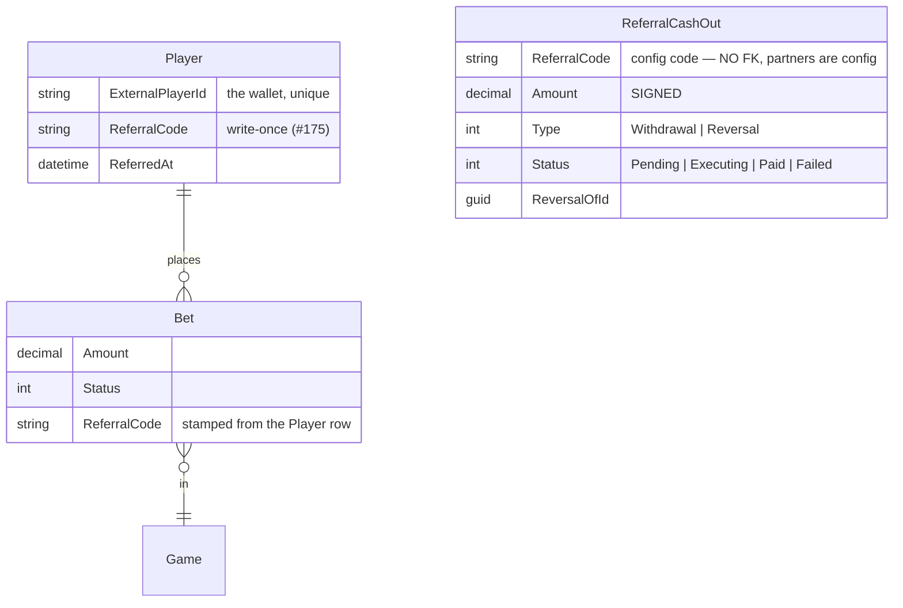
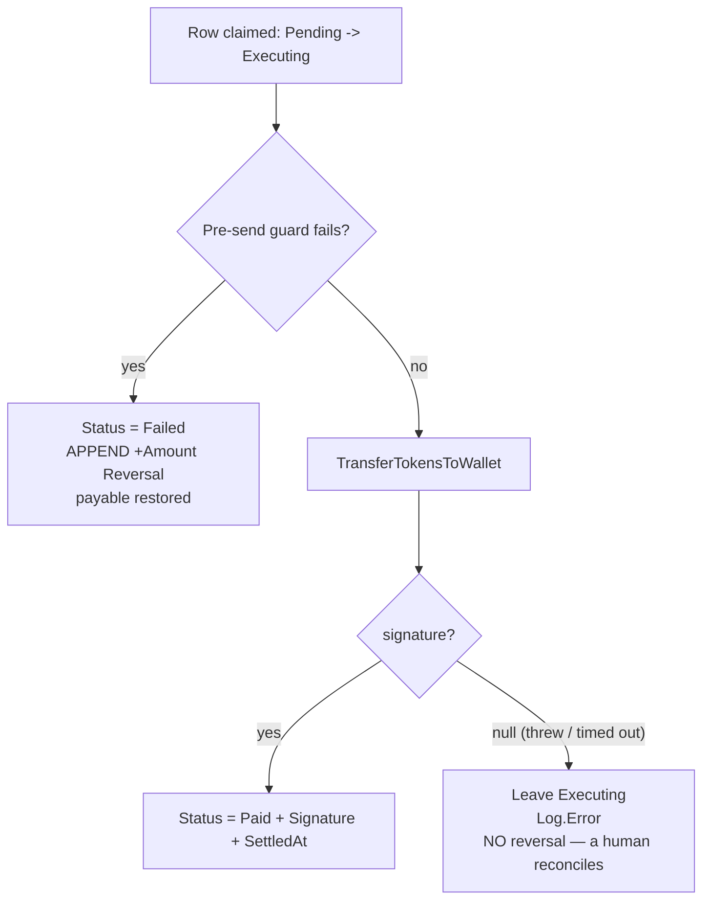

# Space Stroker — "Partner earnings page (referral cash-out)" — Implementation Spec

> **Status: Ready for implementation** — refined via Trello card
> [#177 Partner earnings page (referral cash-out)](https://trello.com/c/FRzhCu07/177-partner-earnings-page-referral-cash-out)
> (2026-08-21).
> Repos affected: `monkify-backend`, `monkify-front`, and this doc + the deploy stack in `monkify-meta`.
>
> **Purpose:** give a referral partner a page where they can see what their traffic has earned and be
> paid for it, automatically, from a dedicated on-chain account — replacing the hand-run SQL report
> and the human sending SOL that [#175](referral-program.md) deliberately shipped with.

---

## 1. Summary

[#175](../features/referral-program.md) built **attribution only**: `Player.ReferralCode`,
`Bet.ReferralCode`, the stamping, the 2% commission that funds it, and
`deploy/sql/referral-payout-report.sql`. Its decision 5 was explicit — *"Report only — the product
pays nobody."* This card **supersedes that decision** and nothing else: every column, guard and test
#175 shipped stands unchanged, and the SQL report survives as the **reconciliation** tool rather than
the payment mechanism.

| | Today (#175) | After this card |
| --- | --- | --- |
| Partner sees earnings | Never — they ask us | `/partner`, self-serve, wallet-gated |
| Payment | A human reads SQL and sends SOL | The partner presses a button; Consumers signs a real transfer |
| Money source | The treasury, by hand | A **dedicated** `ReferralPayout` account |
| Record of payment | A human's memory | `ReferralCashOut`, append-only, signed amounts |
| Rate limit | None | 1-hour rolling cooldown + a unique partial index |

⚠️ **This is the platform's first automated outbound payment to someone who is not a player.** The
Orbit custody playbook ([`orbit.md`](../features/orbit.md)) is therefore applied **in full** — the
append-only ledger with no status filter, the compensating-row reversal, the fresh-signature rule for
money movement, the pool-aware solvency guard, the separate keypair — not as inspiration but as the
specification.

---

## 2. Constraints (MANDATORY)

From [`../constraints.md`](../constraints.md) (full list there):

- **Worktree-per-repo:** `feature/referral-cash-out` in `monkify-backend`, `monkify-front` and
  `monkify-meta`, each checked out at `.worktrees/referral-cash-out/<repo>`. The shared checkouts stay
  on `main`; never `git checkout -b` in a hub.
- **Unit tests:** update/add in `SpaceStroker.Tests`; **report changed tests** at the end of
  implementation. Run via `scripts/run_tests.bat` — never the raw full `dotnet test` (the
  `ProductionSessions` Monte-Carlo suite is slow).
- **Integration test is MANDATORY** — Level is `Feature`. At least one happy path end to end in
  `SpaceStroker.Tests.Integration`, plus one for the reversal path (a complex flow in its own right).
- **EF mapping:** inline in `SpaceStrokerDbContext.OnModelCreating`; no `IEntityTypeConfiguration`.
- **Migrations:** under `SpaceStroker.Infrastructure/Migrations/`; applied only by
  `SpaceStroker.Consumers`.
- **Secrets/config:** committed values are **MOCK only**. The real `ReferralPayout` keypair arrives
  from Secret Manager.
- **Vague messaging (§6):** a wallet that matches no configured partner gets the same unavailable
  message as a bad signature. A caller must never be able to enumerate partners.
- **Host split (§8):** the API writes the row and moves **no money**; every transfer is signed in
  `SpaceStroker.Consumers`.

---

## 3. Resolved product decisions

Answer mode during refinement: **short**. 1–6 were settled in the card's own brainstorming; 7–15 in
`/monkify-refine-tasks`; 16–19 taken by default.

| # | Decision |
| --- | --- |
| 1 | **Fully automated cash-out.** The button signs and sends a real transfer; no human in the loop. A cooldown and a payable balance only make sense if the button pays. |
| 2 | **The cache never touches the money path.** Cash out recomputes payable **live, inside the transaction that writes the row**, and pays that. Earnings can go DOWN (an admin refund removes a settled bet from turnover), so paying a cached figure would overpay. |
| 3 | **Orbit's ledger invariant, exactly.** `payable = earnings + SUM(Amount)` over **all** rows, **no status filter**. A transfer that did not move money is cancelled by an **appended** compensating row, never by flipping the original and filtering it out. The rejected alternative double-pays whenever a transfer times out but confirms on-chain. |
| 4 | **Wallet proof mirrors Orbit.** Two new purposes on the existing `GET /players/nonce`: `referral-session` and `referral-cashout` (a **fresh** signature per cash-out the session cannot substitute for). *Money movement is not covered by the session.* |
| 5 | **A DEDICATED referral payout account**, not the treasury: a referral-maths bug can then drain at most the referral float, never the pot that pays winners, and "what we owe partners vs what we hold for them" stays checkable on-chain. |
| 6 | **Its own card**, not an extension of #175 — so the attribution layer shipped immediately (there is deliberately no backfill, so every unmerged day was traffic that could never be attributed). |
| 7 | **Payable is recomputed all-time and the deficit is CARRIED, unclamped.** Chosen over freezing history with a per-cash-out turnover watermark, because it keeps ONE invariant. The page displays `max(0, payable)` and the button refuses `<= 0`. ⚠️ **A `SharePercentage` edit re-prices ALL of a partner's history** ⇒ **ops rule: do not re-rate a live partner, issue a new code.** Removing a partner from config zeroes earnings while cash-outs still sum negative: intended and visible, not an error. |
| 8 | **The partial index on `Bet.ReferralCode` ships in this card's migration** (`WHERE "ReferralCode" IS NOT NULL`), taking #175's own conditional escape hatch. The aggregate is no longer monthly: it runs on page load, on every cash-out, and once per configured partner per cash-out via the solvency guard. Measured, not assumed — see §11.3. |
| 9 | **Cache TTL 60 seconds, invalidated on cash-out** (the card said 1 day). With the index behind it the aggregate is cheap, and a 24h-stale money figure beside a button that pays a different number is the one thing this page must not do. The cache exists only to absorb a refresh-hammer. |
| 10 | **The session logic is EXTRACTED out of `Orbit/` into a shared wallet-session component** both features consume. ⚠️ **No audience field** — the payload stays `{wallet}\|{expiresAt}` on the existing `Orbit:SessionSecret`, so there is **no second secret and no second Terraform binding to forget**. Knowingly accepted: an Orbit session token and a referral session token for the same wallet are the same string. Contained — a session only reads that wallet's own numbers, and every money movement still demands a fresh signature. |
| 11 | **A configurable product minimum, default `0.1` SOL**, refused **API-side before the row is written** so the button greys with the bound named. The 890,880-lamport rent-exempt floor stays as the consumer's hard backstop. |
| 12 | **One wallet, one code — a duplicate `PayoutWallet` throws at startup**, exactly as the shipped duplicate-`Code` guard does. Per-campaign codes need a second wallet. |
| 13 | **Definite vs uncertain failure is classified by WHERE it failed, not by the return value.** Pre-send guards the consumer owns append a reversal; a `null` back **from the transfer call** always leaves the row unresolved for a human. No `ISolanaService` change. |
| 14 | **Dry-account ops signal: `Log.Error` + a log-based metric and alert policy** in `modules/monitoring` — production's log floor is Warning, and nobody reads logs before a partner complains. |
| 15 | **`GET /referrals/me` shows totals + cash-out history only.** No referred-wallet identities, no wallet count, no bet count. |
| 16 | **The transfer destination is always the CONFIGURED `PayoutWallet`** — never caller-supplied, never read off the connected wallet. |
| 17 | **`/partner` must not be indexed.** Already satisfied by the app host's blanket `Disallow: /` — see §15.4. |
| 18 | **Player self-exclusion does NOT block a partner cash-out** — referral earnings are a commercial payment, not gambling winnings. Confirmed against [`legal.md`](../features/legal.md): exclusion is evaluated **per bet**, and there is no rule that touches non-wagering money. |
| 19 | **`deploy/sql/referral-payout-report.sql` is updated here** to subtract `ReferralCashOuts`, or it stops reconciling the moment the first cash-out lands. |

### 3.1 Two deviations from the card's data model, and why

Both are corrections a spec has to make, not scope changes:

- **`ReferralCashOutStatus` gains `Executing`.** The card lists `Pending / Paid / Failed`. Bus
  delivery is at-least-once, so the consumer must **claim** the row with a conditional
  `Pending → Executing` update before it signs — with only three statuses there is no state to claim
  into, and a duplicate delivery pays twice. `OrbitTransactionStatus` carries `Executing` for exactly
  this reason.
- **An "uncertain" transfer therefore rests at `Executing`, not `Pending`.** The card said "left
  `Pending` for a human"; it meant *unresolved*. `Executing` is the precise state and is strictly more
  useful — it distinguishes "we signed something and do not know the outcome" from "we never tried".
  Payable still counts the row (no status filter), so the money stays reserved either way.

---

## 4. Data model

### 4.1 New entity + enums

`SpaceStroker.Domain/Referrals/Entities/ReferralCashOut.cs`

```csharp
/// <summary>
/// The append-only partner statement. Rows are never updated to change an AMOUNT and never deleted;
/// a payment that has to be undone is cancelled by APPENDING its opposite.
///
/// THE INVARIANT: payable = earnings(code) + SUM(Amount) for that code, over ALL rows, with NO
/// status filter. This is OrbitTransaction's invariant applied to a partner instead of a player.
/// </summary>
public class ReferralCashOut : TableEntity
{
    /// <summary>The CONFIGURED spelling of the partner's code — what ReferralDirectory.Resolve returns.</summary>
    public string ReferralCode { get; set; }

    /// <summary>SIGNED: a withdrawal is NEGATIVE, a reversal POSITIVE.</summary>
    public decimal Amount { get; set; }

    public ReferralCashOutType Type { get; set; }
    public ReferralCashOutStatus Status { get; set; }

    public DateTime RequestedAt { get; set; }
    public DateTime? SettledAt { get; set; }

    /// <summary>The on-chain signature, once one exists. Null on a reversal and before settlement.</summary>
    public string? Signature { get; set; }

    /// <summary>Reversal rows only — the withdrawal this cancels.</summary>
    public Guid? ReversalOfId { get; set; }

    public string? Reason { get; set; }
}
```

`SpaceStroker.Domain/Referrals/ValueObjects/ReferralCashOutType.cs` and
`ReferralCashOutStatus.cs`:

```csharp
public enum ReferralCashOutType { Withdrawal = 0, Reversal = 1 }

// Executing exists because bus delivery is at-least-once — see §3.1.
public enum ReferralCashOutStatus { Pending = 0, Executing = 1, Paid = 2, Failed = 3 }
```

⚠️ `TableEntity` already supplies `Id`, `CreatedDate` and `UpdatedDate`. `RequestedAt` is kept as its
own column rather than reusing `CreatedDate`, because the cooldown is a **business** rule and must not
be silently re-defined by a future change to the audit timestamp.

### 4.2 EF configuration (inline)

In `SpaceStroker.Infrastructure/Data/Context/SpaceStrokerDbContext.cs` — add the DbSet beside the
Orbit ones and the mapping at the end of `OnModelCreating`:

```csharp
public DbSet<ReferralCashOut> ReferralCashOuts { get; set; }
```

```csharp
// The append-only partner statement. Authoritative for what a partner is owed:
// earnings(code) + SUM(Amount) over ALL rows for that code, with NO status filter.
modelBuilder.Entity<ReferralCashOut>(builder =>
{
    builder.HasKey(x => x.Id);
    // Matches Bet.ReferralCode / Player.ReferralCode.
    builder.Property(x => x.ReferralCode).IsRequired().HasMaxLength(32);
    builder.Property(x => x.Amount).HasPrecision(18, 9).IsRequired();
    builder.Property(x => x.Type).IsRequired();
    builder.Property(x => x.Status).IsRequired();
    builder.Property(x => x.RequestedAt).IsRequired();
    builder.Property(x => x.Signature).HasMaxLength(100);
    builder.Property(x => x.Reason).HasMaxLength(300);

    // Every read here is "this partner's rows". UNLIKE GameBets, this table is small — a partner
    // presses a button at most once an hour — so a plain index is the right call and needs no
    // measurement to justify.
    builder.HasIndex(x => x.ReferralCode);

    // ⚠️ THE CONCURRENCY GATE. The cooldown is a TIME check and cannot do this job: two presses in
    // the same millisecond both pass it. A partial UNIQUE index means the loser gets 23505 having
    // written nothing. Postgres allows exactly one in-flight withdrawal per code.
    builder.HasIndex(x => x.ReferralCode)
           .IsUnique()
           .HasDatabaseName("IX_ReferralCashOuts_InFlight")
           .HasFilter("\"Type\" = 0 AND \"Status\" IN (0, 1)");
});
```

⚠️ The filter covers **`Pending` AND `Executing`** — the card said `Pending` only, which would let a
second press slip through the instant the consumer claims the row and before the transfer lands.

And, on the existing `Bet` mapping, decision 8:

```csharp
// #177: the referral aggregate is no longer a monthly hand-run report — it runs on every /partner
// load, on every cash-out, and once per configured partner per cash-out (the solvency guard).
// PARTIAL on purpose: only referred bets pay the index-write cost, and they are a small minority of
// inserts. #175 declined this index with the reasoning "if it ever matters, add a partial index with
// measurements behind it" — the measurements are in SpaceStroker.Tests.Integration/Benchmarks.
builder.HasIndex(x => x.ReferralCode)
       .HasDatabaseName("IX_GameBets_ReferralCode")
       .HasFilter("\"ReferralCode\" IS NOT NULL");
```

### 4.3 Migration

```bash
dotnet ef migrations add AddReferralCashOuts \
  --project src/SpaceStroker.Infrastructure \
  --startup-project src/SpaceStroker.Consumers
```

Creates `ReferralCashOuts` with its two indexes, and adds `IX_GameBets_ReferralCode`. **No backfill** —
there are no historical cash-outs, and `Bet.ReferralCode` is already populated forward from #175.
⚠️ Never hand-edit `SpaceStrokerDbContextModelSnapshot.cs`.

### 4.4 ER diagram



⚠️ **`ReferralCashOut.ReferralCode` carries no foreign key** and cannot: partners live in
`GeneralSettings:Operator:Referrals`, not in a table ([#175 chose config because no admin token can be
minted in production](../features/admin-and-ops.md)). The code is joined the same way
`Bet.ReferralCode` is.

---

## 5. Configuration

### 5.1 `ReferralPayoutSettings`

`SpaceStroker.Domain/Configs/Entities/ReferralPayoutSettings.cs`, bound at
`GeneralSettings:Operator:Token:ReferralPayout` — beside `Orbit` and `HouseSeed`, and shaped like
`HouseSeedSettings`:

```csharp
public class ReferralPayoutSettings
{
    public string PublicKey { get; set; }
    public string PrivateKey { get; set; }

    /// <summary>The smallest payable a partner may cash out. Refused API-side, before the row exists.</summary>
    public decimal MinimumCashOut { get; set; } = 0.1m;

    /// <summary>Rolling gap between withdrawals for one code.</summary>
    public int CashOutCooldownMinutes { get; set; } = 60;

    /// <summary>
    /// ⚠️ A SOLVENCY FLOOR, NOT A RAW BALANCE FLOOR — see OrbitSettings.MinimumSolBalance. Settlement
    /// is native SOL, so what we owe partners sits IN the balance being checked.
    /// </summary>
    public decimal MinimumSolBalance { get; set; } = 0.02m;

    /// <summary>
    /// ⚠️ FAILS CLOSED on a MOCK_ value in EITHER half — the house-seed lesson (#168), where a MOCK_
    /// private key silently disabled seeding while the gate test still passed.
    /// </summary>
    public bool IsConfigured
        => !string.IsNullOrWhiteSpace(PublicKey)
           && !PublicKey.StartsWith("MOCK_", StringComparison.OrdinalIgnoreCase)
           && !string.IsNullOrWhiteSpace(PrivateKey)
           && !PrivateKey.StartsWith("MOCK_", StringComparison.OrdinalIgnoreCase);
}
```

Add `public ReferralPayoutSettings ReferralPayout { get; set; } = new();` to `TokenSettings`.

### 5.2 Committed config (mock only)

`SpaceStroker.Common/spacestrokersettings.json`, under `GeneralSettings.Operator.Token`:

```json
"ReferralPayout": {
  "PublicKey": "MOCK_REFERRAL_PAYOUT_PUBLIC_KEY",
  "PrivateKey": "MOCK_REFERRAL_PAYOUT_PRIVATE_KEY",
  "MinimumCashOut": 0.1,
  "CashOutCooldownMinutes": 60,
  "MinimumSolBalance": 0.02
}
```

⇒ every local stack and the development GCP environment show **earnings with cash-out unavailable**,
which is the correct default.

### 5.3 ⚠️ Terraform secret binding — MANDATORY, and the thing that has shipped broken twice

`GeneralSettings:Operator:Token:ReferralPayout:PrivateKey` must be added to **BOTH** lists in
`monkify-meta/deploy/terraform/workload/main.tf`:

```hcl
# base_secret_ids — grants accessor IAM
"GeneralSettings-Operator-Token-ReferralPayout-PrivateKey",

# base_secret_env — mounts it as an env var
"GeneralSettings__Operator__Token__ReferralPayout__PrivateKey" = "GeneralSettings-Operator-Token-ReferralPayout-PrivateKey"
```

A key in `secrets.<env>.json` does **nothing** without both lines: `SyncSecrets` still pushes the
value, `terraform apply` still succeeds, the deploy still prints "Deploy complete." — and the
container never receives the variable, so `IsConfigured` sees the committed `MOCK_` fallback and
cash-out is a silent no-op. This shipped for Orbit (#123) and reached production for the house seed
(#168). `SpaceStroker.Deploy/SecretBindingCheck.cs` now catches it; **run the deploy tool's
`validate` and confirm the check passes** rather than trusting a read of the file.

`PublicKey` is **not** a secret — it goes in the `appConfig` block, which reaches Cloud Run on its own.

---

## 6. Backend behaviour

### 6.1 The shared earnings service — one predicate, four callers

`SpaceStroker.Infrastructure/Services/Referrals/IReferralEarningsService.cs` + implementation.
This is the whole point of the card's "moved into a shared service so the page and the report cannot
drift": the page, the cash-out recompute and the solvency guard all resolve here.

```csharp
public interface IReferralEarningsService
{
    /// <summary>Σ paid stakes attributed to this code, all time.</summary>
    Task<decimal> ResolveTurnover(string configuredCode, CancellationToken cancellationToken = default);

    /// <summary>SharePercentage x turnover, rounded DOWN to the asset's decimals.</summary>
    Task<decimal> ResolveEarnings(string configuredCode, CancellationToken cancellationToken = default);

    /// <summary>earnings + SUM(Amount) over ALL rows. MAY BE NEGATIVE — never clamp here.</summary>
    Task<decimal> ResolvePayable(string configuredCode, CancellationToken cancellationToken = default);

    /// <summary>Σ max(0, payable) across every configured partner — the solvency guard's input.</summary>
    Task<decimal> ResolveTotalOwed(CancellationToken cancellationToken = default);
}
```

The turnover predicate — **identical** to `deploy/sql/referral-payout-report.sql`, minus its
reporting window (this page is all-time):

```csharp
var cutover = _settings.Operator.Token.SettlementCutoverUtc;

var turnover = await _context.GameBets
    // Exact match, NOT lower(): ReferralDirectory stores the CONFIGURED spelling, so every stamped
    // value is already canonical — and a lower() here would discard IX_GameBets_ReferralCode.
    .Where(x => x.ReferralCode == configuredCode
             && x.Amount > 0                                   // free bets earn nothing
             && x.Game.Status == GameStatus.RewardForWinnersCompleted
             && x.Status != BetStatus.NeedsRefunding
             && x.Status != BetStatus.Refunded
             && x.Status != BetStatus.NeedsManualAnalysis
             && x.Player.ExternalPlayerId != partner.PayoutWallet   // the one hard self-referral guard
             && (cutover == null || x.CreatedDate >= cutover))
    .SumAsync(x => (decimal?)x.Amount, cancellationToken) ?? 0m;
```

⚠️ **Rounding is DOWN, to the asset's decimals**, applied to the earnings figure before anything is
paid — `Math.Round(share / 100m * turnover, decimals, MidpointRounding.ToZero)`, the same discipline
`BetDomainService` applies after commission. Rounding up would owe a fraction of a lamport that no
transfer can ever settle.

⚠️ **`ResolvePayable` never clamps.** A negative result is real (decision 7) and the caller decides
what to do with it: the page floors the *display* at zero, the reserver refuses, and `ResolveTotalOwed`
takes `max(0, …)` per partner so a partner in deficit cannot lend headroom to another.

### 6.2 `ReferralDirectory` — a wallet index and a second startup guard

Two additions to `SpaceStroker.Domain/Games/Services/ReferralDirectory.cs`. Its existing behaviour
(normalize, resolve, fail closed, duplicate-code throw, skip a malformed code) is unchanged.

```csharp
private readonly Dictionary<string, ReferralSettings> _byPayoutWallet;   // Ordinal — a base58 address is case-sensitive

/// <summary>The partner whose PayoutWallet this is, or null. Fails closed exactly like Resolve.</summary>
public ReferralSettings? ResolveByWallet(string? wallet);

/// <summary>The configured partner behind a code, for SharePercentage and PayoutWallet.</summary>
public ReferralSettings? ResolveSettings(string? rawCode);
```

⚠️ **A duplicate `PayoutWallet` throws at startup**, with the same shape as the duplicate-code throw:

```
Duplicate referral payout wallet '<wallet>' in GeneralSettings:Operator:Referrals.
One wallet must map to exactly one code — a partner running two campaigns needs a second wallet.
```

Unlike a malformed *code* (skipped, because it is inert), a duplicate wallet is **not** inert: it
makes `ResolveByWallet` ambiguous on the money path, and the alternatives are aggregation (a payment
split across rows, dragging the cooldown and the unique index with it) or first-match-wins (the second
partner's earnings silently unreachable). Registration is already
`services.AddSingleton(new ReferralDirectory(settings.Operator.Referrals))` in
`SpaceStroker.Infrastructure/DependencyInjection.cs`, so the throw fails the host at boot.

⚠️ A partner whose `PayoutWallet` is blank (the committed mock is a placeholder string, not empty) is
simply absent from the wallet index — not an error, and not a match for anyone.

### 6.3 Extracting the wallet session out of Orbit

Move, do not copy (decision 10). `OrbitSessionService` / `IOrbitSessionService` become
`SpaceStroker.Infrastructure/Services/Wallets/WalletSessionService.cs` + `IWalletSessionService`, with
**the payload, the secret and the algorithm unchanged**:

- Format stays `Base64Url("{wallet}|{expiresAtUnixSeconds}") + "." + Base64Url(HMACSHA256(payload, secret))`.
- The secret stays `GeneralSettings:Operator:Token:Orbit:SessionSecret`, and the TTL stays
  `Orbit.SessionTtlDays`. Keeping both under the `Orbit` key is deliberate: a new key means a new
  secret and a new Terraform binding to forget (§5.3), which is a worse trade than the naming oddity.
  ⚠️ Note the coupling in the doc: removing Orbit would break partner sign-in.
- `FixedTimeEquals` and the "never logged" rule carry over verbatim — they are the reason this class
  is worth sharing rather than re-typing.

⚠️ **No audience field** (the accepted trade-off): an Orbit session token and a referral session token
for the same wallet are the same string, so either opens the other's reads. Contained — a session
reads only that wallet's own numbers, and every money movement demands a fresh purpose-scoped
signature. The two are still separated at the **header** and at the **challenge**:

- `SpaceStroker.Api/Orbit/OrbitSessionAccessor.cs` keeps `X-Orbit-Session` and now delegates to
  `IWalletSessionService`.
- New `SpaceStroker.Api/Referrals/ReferralSessionAccessor.cs` (`IReferralSessionAccessor`) reads
  **`X-Referral-Session`**, same on-demand pattern (`/referrals/session` must work without one).

`OrbitProof` moves alongside as `WalletProof`
(`SpaceStroker.Infrastructure/Services/Wallets/WalletProof.cs`) — it is already purpose-agnostic and
verify-then-consume is a rule worth having in one place. `OrbitMessages` stays where it is;
referral gets its own.

⚠️ **This refactor must be behaviour-preserving.** The existing Orbit session tests run unchanged
against the shared component; if any of them needs editing beyond a namespace, something moved that
should not have.

### 6.4 Two new nonce purposes

`SpaceStroker.Infrastructure/Handlers/Players/GetWalletNonce/GetWalletNonceRequest.cs`:

```csharp
public const string ReferralSession = "referral-session";
public const string ReferralCashOut = "referral-cashout";
```

…and both added to `IsKnown`. No new endpoint — `GET /players/nonce` already mints purpose-scoped
challenges, exactly as Orbit reuses it.

`SpaceStroker.Infrastructure/Services/Referrals/ReferralMessages.cs`, mirroring `OrbitMessages`:

```csharp
public static string BuildSessionMessage(string wallet, string nonce)
    => string.Join("\n", "Space Stroker partner session", $"Wallet: {wallet}", $"Nonce: {nonce}");

/// <summary>
/// Authorizes moving the WHOLE payable balance to the CONFIGURED payout wallet. Binds no amount and
/// no destination, for the same reason Orbit's does not: both are resolved server-side and there is
/// no caller-supplied alternative to redirect.
/// </summary>
public static string BuildCashOutMessage(string wallet, string nonce)
    => string.Join("\n", "Space Stroker partner cash-out", $"Wallet: {wallet}", $"Nonce: {nonce}");
```

⚠️ These strings are a **shared contract** with `monkify-front`, byte for byte. A stray space or a
CRLF produces a signature that verifies against a different message and is rejected with a vague
error the partner cannot act on — the trap `OrbitMessages` already documents.

### 6.5 `POST /referrals/session`

Handler `SpaceStroker.Infrastructure/Handlers/Referrals/CreateReferralSession/`. Order matters:

1. `ReferralDirectory.ResolveByWallet(body.Wallet)` → null ⇒ vague `ReferralRequestInvalid`, **and
   nothing else happens**. A caller must not learn whether a wallet is a partner.
2. `WalletProof.TryConsume(cache, WalletNoncePurpose.ReferralSession, wallet, nonce, signature,
   ReferralMessages.BuildSessionMessage)` → false ⇒ **the same** vague message.
3. Mint: `new ReferralSessionDto { SessionToken = _sessions.Mint(wallet), ExpiresAt = … }`.

⚠️ Unlike `CreateOrbitSessionHandler` this writes **no `Player` row** and touches no referral
attribution. A partner is not a player, and creating a row for them would put their wallet into the
player-facing surfaces for no reason.

⚠️ Steps 1 and 2 must return byte-identical responses. Ordering the wallet check first is safe only
because its failure is indistinguishable from a bad signature — verified by a test.

### 6.6 `GET /referrals/me`

Handler `.../Handlers/Referrals/GetReferralEarnings/`. Session-gated; the wallet comes from the
validated session, never from the caller.

```csharp
public class ReferralEarningsDto
{
    public string DisplayName { get; set; }        // the partner's own configured label
    public decimal SharePercentage { get; set; }
    public decimal EarnedAllTime { get; set; }
    public decimal PaidOut { get; set; }           // -SUM(Amount) over Withdrawal+Reversal rows
    public decimal Available { get; set; }         // max(0, payable) — the DISPLAY figure
    public decimal MinimumCashOut { get; set; }
    public bool CashOutAvailable { get; set; }     // resolver.IsConfigured
    public DateTime AsOf { get; set; }             // when the cached aggregate was computed
    public DateTime? CashOutAllowedAt { get; set; }// the cooldown, from the SHARED gate
    public List<ReferralCashOutRowDto> History { get; set; }
}
```

**Caching (decision 9).** `CacheHelper.GenerateReferralEarningsCacheSettings(code)` →
`$"ReferralEarnings:{code}"`, **TTL 60 seconds**, holding the `(turnover, computedAt)` pair only.
Everything else on the payload is derived live — the cash-out rows, the cooldown and `Available` are
cheap reads off a small table, and stale money on the money page is the failure mode this TTL exists
to avoid. The key is **deleted** by the cash-out handler on a successful reservation.

⚠️ `History` includes **`Failed` withdrawals and their `Reversal` rows**. Hiding them would make the
displayed balance stop reconciling against what the partner can see — the pair nets to zero and the
UI labels it `REVERSED`.

⚠️ `PaidOut` is `-SUM(Amount)` over all rows, not `SUM` of `Paid` rows. That keeps the three headline
figures internally consistent (`Available = max(0, EarnedAllTime - PaidOut)`) under the no-status-filter
invariant, instead of showing a number that does not add up while a cash-out is in flight.

### 6.7 `POST /referrals/cash-outs` — the reserver

Handler `.../Handlers/Referrals/RequestReferralCashOut/`, delegating to
`IReferralCashOutReserver` (`.../Services/Referrals/ReferralCashOutReserver.cs`), which mirrors
`OrbitCashOutReserver`. The API **writes the row and moves no money**.

1. `resolver.IsConfigured` false ⇒ `ReferralPayoutUnavailable`. Checked **first**, so a dev stack
   cannot start a flow it can never finish.
2. `ReferralDirectory.ResolveByWallet(session wallet)` → null ⇒ vague `ReferralRequestInvalid`.
3. **Fresh proof** — `WalletProof.TryConsume(..., WalletNoncePurpose.ReferralCashOut, ...,
   ReferralMessages.BuildCashOutMessage)`. Before the balance is read: an unproven caller must not
   learn even whether the balance is below the minimum.
4. `payable = await earnings.ResolvePayable(code)` — **live, unclamped**.
5. `payable < MinimumCashOut` ⇒ `ReferralBelowMinimumCashOut`, naming the bound. Covers the `<= 0`
   case too (a deficit is below any positive minimum), so a partner in deficit is told the same
   ordinary thing rather than something alarming.
6. Cooldown — `ReferralCashOutGate.ResolveNextAllowedAt(...)` non-null ⇒ `ReferralCashOutOnCooldown`.
7. **Transaction:** insert `ReferralCashOut { ReferralCode = code, Amount = -payable, Type = Withdrawal,
   Status = Pending, RequestedAt = UtcNow }` and `SaveChangesAsync`. A `DbUpdateException` whose inner
   `PostgresException.SqlState == "23505"` on `IX_ReferralCashOuts_InFlight` ⇒ roll back and return
   `ReferralCashOutOnCooldown` (a concurrent press is, from the partner's side, the same "not right
   now"). Commit.
8. Invalidate the earnings cache key.
9. **After the commit**, `_messageBus.PublishEventAsync(new ReferralCashOutRequestedEvent(rowId))`.
   Publishing inside the transaction would let Consumers pick the row up before it exists — or after a
   rollback.

⚠️ **There is no balance row and no `TryDebit` here**, and that is not an omission. Orbit needs a
conditional debit because `OrbitBalance` is a materialised column; a partner's balance is *derived*,
and the reserved row is itself the debit — the moment it commits, `ResolvePayable` already returns
≈ 0 for that code, because the sum has no status filter. The unique partial index is the belt to that
braces, for two presses that read before either wrote.

**Cooldown gate** — `SpaceStroker.Infrastructure/Services/Referrals/ReferralCashOutGate.cs`:

```csharp
/// <summary>
/// ⚠️ THE SINGLE DEFINITION, shared by the WRITE (the reserver, authoritative) and the READ
/// (GetReferralEarningsHandler, which the UI greys the button from). OrbitManualCashOutGate exists
/// because those were once two hand-written copies of one query and could drift, showing a partner a
/// control that could only ever refuse. Do not inline this.
/// </summary>
public static Task<DateTime?> ResolveNextAllowedAt(SpaceStrokerDbContext context, GeneralSettings settings,
                                                   string referralCode, CancellationToken cancellationToken = default);
```

Latest `Type == Withdrawal` row with `RequestedAt > now - CashOutCooldownMinutes`, `+ minutes`.
Reversed and failed withdrawals **still consume** the cooldown: the rate limit is on *presses*, not on
successful payments, and exempting failures would let a partner retry in a tight loop against a dry
account. `CashOutCooldownMinutes <= 0` disables it (test stacks).

### 6.8 `PayReferralCashOutConsumer`

`SpaceStroker.Infrastructure/Consumers/ReferralCashOut/PayReferralCashOutConsumer.cs`,
`BaseConsumer<ReferralCashOutRequestedEvent>`, registered in `SpaceStroker.Consumers/Program.cs` with
its **own receive endpoint** (`cfg.ReceiveEndpoint(nameof(PayReferralCashOutConsumer), …)`) so a slow
partner transfer never sits behind Orbit's queue.

```
1. CLAIM  ExecuteUpdateAsync: Id == message.Id && Status == Pending  =>  Status = Executing
          0 rows affected => already claimed; log and return. (§3.1 — at-least-once delivery.)
2. Reload the row; resolve the partner by code.
   Partner gone from config => DEFINITE (Reason: "Partner no longer configured.")
3. PRE-SEND GUARDS — every one of these is DEFINITE and appends a reversal:
   a. !resolver.IsConfigured                       (absent or MOCK_ in either half)
   b. resolver collides with treasury / Orbit / house seed
   c. amount < MinimumCashOut                      (re-checked; config may have moved)
   d. rawAmount < NativeSol.RentExemptMinimumLamports
   e. solvency guard (§6.9) fails
4. TRANSFER
   solana.TransferTokensToWallet(partner.PayoutWallet, new BetTransactionAmountResult(amount, rawAmount),
                                 resolver.ToDescriptor(includePrivateKey: true))
5. null signature => UNCERTAIN. Leave the row Executing, Log.Error, return. NO reversal.
   signature      => Status = Paid, Signature, SettledAt = UtcNow. Invalidate the earnings cache.
```

⚠️ **Guard (d) must run in the consumer, before the call.** `SolanaService.TransferTokens` performs
its own rent-exempt refusal and returns `null` — which step 5 would classify as *uncertain* and strand
the partner's money in `Executing` forever. Checking it ourselves is what makes it definite.

⚠️ **Step 5 is the whole of decision 13, and it is where `OrbitCashOutConsumer` is deliberately NOT
copied.** Orbit calls `FailAndRestore` on any `null`; here a `null` from the transfer call means the
transaction may have been submitted and may yet confirm, so auto-reversing would credit the partner
for money that also left the account. It is never auto-corrected.

**`FailAndReverse(row, reason)`** — appends, never edits an amount:

```csharp
// 1. the original row -> Failed (Status only; the Amount is history)
// 2. APPEND ReferralCashOut { ReferralCode, Amount = +|row.Amount|, Type = Reversal,
//                             Status = Paid, ReversalOfId = row.Id, Reason = reason,
//                             RequestedAt = UtcNow, SettledAt = UtcNow }
// 3. invalidate the earnings cache
```

⚠️ A `Reversal` is written `Paid`, not `Pending`: nothing has to happen for it to be true. It is a
bookkeeping entry, and leaving it `Pending` would put it in the in-flight index's scope and block the
partner's next press.

### 6.9 The solvency guard — pool-aware, like Orbit's

```csharp
var sol = await solana.GetSolBalance(resolver.PublicKey);

// Null is "unknown", not "empty" — a failed RPC read must not fail a payment. Orbit's guard makes the
// same call.
if (sol is not { } balance) return true;    // proceed

var owed = await earnings.ResolveTotalOwed(cancellationToken);   // Σ max(0, payable) over ALL partners
var headroom = balance - owed - amount;

if (headroom >= settings.Operator.Token.ReferralPayout.MinimumSolBalance) return true;

Log.Error("The referral payout account has {Headroom} SOL of headroom ({Balance} held, {Owed} owed to "
        + "partners, {Amount} about to be sent); refusing cash-out {RowId}.", headroom, balance, owed, amount, row.Id);
return false;
```

⚠️ **Three things here are load-bearing and each has a way of being got wrong:**

1. **`- owed`** is the difference between this and a flat floor. Settlement is native SOL, so what we
   owe partners sits in the very balance being read; without it the check passes forever while the
   float is empty. This is `PlaceOrbitBetConsumer.IsLowOnFees`'s lesson (`sol-settlement.md` §6.5).
2. **`- amount`** is needed because the reserving row is already in the ledger, so `ResolveTotalOwed`
   has *already stopped counting* the money we are about to send. Omitting it double-discounts the
   payment and lets the account run below the floor.
3. **`max(0, payable)` per partner inside `ResolveTotalOwed`** — a partner in deficit (decision 7) owes
   *us*, and letting their negative offset another partner's balance would overstate headroom.

⚠️ Unlike Orbit's `WarnIfLowOnFees`, this guard **refuses**. Orbit warns and pays anyway because
refusing would trap a *player's own custodied money* for an operational problem that is not theirs.
A partner's payable is not custodied — it is a commercial balance we can settle a minute later — and
failing a transfer for want of fees would burn the fee and produce exactly the ambiguous outcome step 5
cannot resolve.

### 6.10 `ReferralPayoutAccountResolver`

`SpaceStroker.Infrastructure/Services/Referrals/ReferralPayoutAccountResolver.cs`, modelled on
`HouseSeedAccountResolver` including its `ToDescriptor` / `ResolveSenderAccount` split (native SOL ⇒
the wallet **is** the source; SPL ⇒ derive the ATA):

```csharp
public bool IsConfigured
    => Payout is { IsConfigured: true }
    && !string.IsNullOrWhiteSpace(Token.MintAddress)
    // Treasury: paying partners out of the pot that pays winners is the whole reason decision 5 exists.
    && !string.Equals(Payout.PublicKey, Token.TokenOwnerPublicKey, StringComparison.Ordinal)
    // Orbit: player CUSTODY money.
    && !string.Equals(Payout.PublicKey, Token.Orbit?.PublicKey, StringComparison.Ordinal)
    // House seed: a third house pot with its own accounting.
    && !string.Equals(Payout.PublicKey, Token.HouseSeed?.PublicKey, StringComparison.Ordinal);
```

⚠️ Three collisions, not `HouseSeedAccountResolver`'s two — the house seed account did not exist when
that guard was written, and this is the fourth keypair in the system.

### 6.11 Error messages

New entries in `SpaceStroker.Common/Resources/ErrorMessages.resx` (+ `.Designer.cs` regenerated):

| Key | Value | Note |
| --- | --- | --- |
| `ReferralRequestInvalid` | `The request could not be processed.` | ⚠️ The **vague** one — unknown wallet, bad signature, unknown/replayed nonce all get this, byte-identical |
| `ReferralPayoutUnavailable` | `Cash-out is temporarily unavailable. Your balance is unaffected.` | Not configured, or the solvency guard refused. Says nothing about why |
| `ReferralBelowMinimumCashOut` | `The minimum cash-out is {0} SOL.` | Ordinary state, not an auth failure ⇒ a **clear** reason, the same call `OrbitBelowMinimumCashOut` makes |
| `ReferralCashOutOnCooldown` | `You can cash out again shortly.` | Also ordinary state; the exact time is on the payload |

### 6.12 API surface + DI

`SpaceStroker.Api/Controllers/ReferralsController.cs`, `[Route("referrals")]`, modelled on
`OrbitController` (including the `[HttpOptions]` CORS preflight block):

| Route | Auth | Host |
| --- | --- | --- |
| `POST /referrals/session` | signed challenge (`referral-session`) | API |
| `GET /referrals/me` | `X-Referral-Session` | API |
| `POST /referrals/cash-outs` | session **+ fresh** `referral-cashout` signature | API — writes the row only |
| `PayReferralCashOutConsumer` | — | **Consumers** — guards, signs, settles |

`SpaceStroker.Infrastructure/DependencyInjection.cs`:

```csharp
services.AddScoped<IWalletSessionService, WalletSessionService>();          // replaces IOrbitSessionService
services.AddScoped<IReferralPayoutAccountResolver, ReferralPayoutAccountResolver>();
services.AddScoped<IReferralEarningsService, ReferralEarningsService>();
services.AddScoped<IReferralCashOutReserver, ReferralCashOutReserver>();
```

…and `IReferralSessionAccessor` beside `IOrbitSessionAccessor` in the API's own registration.

⚠️ **Rate limiting:** `/referrals/cash-outs` contains no `/bets` substring, so it does not trip
`RateLimitSettingsTests`' blunt guard on the money bet path. No rate-limit rule is added by this card —
the 1-hour cooldown is the real limit, and the in-app limiter is now per-client after
`specs/rate-limiter-keying.md`.

---

## 7. Frontend behaviour (`monkify-front`)

### 7.1 Route

`src/routes.ts` — a new **unlisted** route:

```ts
// The partner earnings page (#177). UNLISTED: a partner is given the URL directly.
// ⚠️ It cannot go in the ☰ pad — that is a 3-column NINE-cell grid and features/frontend-ux.md is
// explicit that a tenth cell is not an option (it would start a fourth row the grid can never fill).
// Not an isPlayerRoute() in App.vue: it renders no display name and no game state.
{ name: 'Partner', path: '/partner', component: require('@/pages/PartnerPage.vue').default },
```

⚠️ **Add `'Partner'` to `EMBED_REDIRECT_ROUTES` in `src/main.ts`.** A partner's commercial balance
inside a casino's iframe is a leak of exactly the class Orbit joined that set for — and the guard
redirects before the component mounts, which is stronger than remembering to hide a link.

### 7.2 Service, hook, types

- `src/services/partnerService.ts` — reuses `mainService`'s axios instance (shared baseURL, boot
  recovery, interceptors), `X-Referral-Session` header helper, three calls. ⚠️ **No referral code is
  attached here** — `orbitService`/`mainService` attach `?ref=` capture on the *player* paths; a
  partner reading their own statement is not an acquisition event.
- `src/hooks/usePartnerEarnings.ts` — nonce → canonical message → `signMessage` → session, then the
  statement; mirrors `useOrbit.ts`'s signing block (including its "a deeplink wallet has no in-page
  `signMessage`" guard).
- `src/types/partner.ts` — `PartnerSession`, `PartnerEarnings`, `PartnerCashOutRow`.

⚠️ The two canonical message builders must match §6.4 **byte for byte**:

```ts
const buildSessionMessage = (wallet: string, nonce: string) =>
  ['Space Stroker partner session', `Wallet: ${wallet}`, `Nonce: ${nonce}`].join('\n');
const buildCashOutMessage = (wallet: string, nonce: string) =>
  ['Space Stroker partner cash-out', `Wallet: ${wallet}`, `Nonce: ${nonce}`].join('\n');
```

### 7.3 The page — Direction A "Statement"

`src/pages/PartnerPage.vue`, built from the chosen mockup and the shared dialog/panel primitives of
`specs/modal-panel-design-system.md` (no bespoke chrome):

1. **Connect gate** — no wallet ⇒ a connect prompt, nothing else. Identical in shape to the Orbit
   page's gate.
2. **A wallet that is not a partner** ⇒ the vague unavailable copy. ⚠️ It must read the same as a
   failed signature; never "this wallet is not a registered partner".
3. **The statement** — a grey panel with three figures (`EARNED ALL TIME`, `PAID OUT`, `AVAILABLE`)
   plus the `as of` stamp and the partner's share percentage.
4. **The footer bar** — the cash-out button and the cooldown. Disabled, with the reason, when:
   available is below the minimum (bound named), the cooldown has not elapsed (countdown), or
   `cashOutAvailable` is false (temporarily unavailable).
5. **History table** — newest first: date, amount, status, signature (linked to the explorer).
   ⚠️ A `Reversal` row renders as `REVERSED` next to its failed withdrawal and the pair nets to zero.
   Hiding it breaks reconciliation against the headline figures.

Money figures go through the shared `MoneyValue` readout (`specs/money-changing-animations.md`) so a
post-cash-out change animates like every other money change in the app.

⚠️ **`$` in the display face:** Press Start 2P draws `$` wrong; any display-face copy carrying a
currency mark goes through `ui/PixelText.vue` (`features/frontend-ux.md`). Amounts are `SOL`-suffixed,
so this mostly does not arise — do not introduce a `$`.

---

## 8. Flow diagrams

### 8.1 Cash-out, happy path

```mermaid
sequenceDiagram
    participant P as Partner (browser)
    participant API as SpaceStroker.Api
    participant DB as Postgres
    participant C as SpaceStroker.Consumers
    participant SOL as Solana

    P->>API: GET /players/nonce?purpose=referral-cashout
    API-->>P: nonce (Redis, 5 min, single-use)
    P->>P: wallet signs the canonical cash-out message
    P->>API: POST /referrals/cash-outs {nonce, signature} + X-Referral-Session
    API->>API: WalletProof.TryConsume (verify, THEN consume)
    API->>DB: payable = earnings(code) + SUM(Amount)   [LIVE, unclamped]
    API->>DB: BEGIN; INSERT ReferralCashOut(-payable, Withdrawal, Pending); COMMIT
    Note over DB: IX_ReferralCashOuts_InFlight rejects a concurrent second press (23505)
    API->>C: ReferralCashOutRequestedEvent(rowId)   [published AFTER the commit]
    API-->>P: 200 {amountRequested, available: 0}
    C->>DB: UPDATE ... SET Status=Executing WHERE Status=Pending   [the at-least-once claim]
    C->>C: pre-send guards (configured, collisions, minimum, rent-exempt, solvency)
    C->>SOL: transfer(amount) -> PayoutWallet, signed by ReferralPayout
    SOL-->>C: signature
    C->>DB: Status=Paid, Signature, SettledAt
```

### 8.2 Failure classification (decision 13)



⚠️ The `U` branch is the one that differs from `OrbitCashOutConsumer`, which reverses on any `null`.
That path double-pays whenever a transfer times out but confirms on-chain.

---

## 9. Out of scope

- **Self-serve partner signup** — onboarding stays a config edit plus a redeploy of both hosts.
- **Partial cash-out / choosing an amount** — cash out is all-available.
- **Any player-facing surface**, and any entry in the ☰ header menu.
- **Changing anything shipped by #175** — attribution, the write-once rule, the 2% rate, the stamping.
- **Telegram notifications to a partner** (Orbit's channel is per-player and enrolment-bound).
- **Wiring alert policies for the existing uptime checks** — see §15.3; a real gap, but a different card.

---

## 10. File checklist

### 10.1 Backend (`monkify-backend`)

| # | File | Change |
| --- | --- | --- |
| 1 | `SpaceStroker.Domain/Referrals/Entities/ReferralCashOut.cs` | **New** — the append-only partner statement |
| 2 | `SpaceStroker.Domain/Referrals/ValueObjects/ReferralCashOutType.cs` · `ReferralCashOutStatus.cs` | **New** — `Withdrawal/Reversal`; `Pending/Executing/Paid/Failed` |
| 3 | `SpaceStroker.Domain/Configs/Entities/ReferralPayoutSettings.cs` | **New** — §5.1, fails closed on `MOCK_` in either half |
| 4 | `SpaceStroker.Domain/Configs/Entities/TokenSettings.cs` | `ReferralPayout` property |
| 5 | `SpaceStroker.Domain/Games/Services/ReferralDirectory.cs` | Wallet index, `ResolveByWallet`, `ResolveSettings`, duplicate-`PayoutWallet` throw |
| 6 | `SpaceStroker.Infrastructure/Data/Context/SpaceStrokerDbContext.cs` | `DbSet<ReferralCashOut>`, inline mapping, in-flight partial unique index, `IX_GameBets_ReferralCode` |
| 7 | `SpaceStroker.Infrastructure/Migrations/*_AddReferralCashOuts.cs` | **New** — table + 2 indexes + the `GameBets` partial index |
| 8 | `SpaceStroker.Infrastructure/Services/Wallets/WalletSessionService.cs` · `IWalletSessionService.cs` | **Moved** from `Services/Orbit/OrbitSessionService.cs` — payload/secret/algorithm unchanged |
| 9 | `SpaceStroker.Infrastructure/Services/Wallets/WalletProof.cs` | **Moved** from `Services/Orbit/OrbitProof.cs` |
| 10 | `SpaceStroker.Infrastructure/Services/Referrals/IReferralEarningsService.cs` · impl | **New** — §6.1, the single predicate |
| 11 | `SpaceStroker.Infrastructure/Services/Referrals/ReferralCashOutGate.cs` | **New** — the one cooldown definition, read + write |
| 12 | `SpaceStroker.Infrastructure/Services/Referrals/IReferralCashOutReserver.cs` · impl | **New** — §6.7 |
| 13 | `SpaceStroker.Infrastructure/Services/Referrals/ReferralPayoutAccountResolver.cs` · interface | **New** — §6.10, three collision guards |
| 14 | `SpaceStroker.Infrastructure/Services/Referrals/ReferralMessages.cs` | **New** — the two canonical signed messages |
| 15 | `SpaceStroker.Infrastructure/Services/Cache/CacheHelper.cs` | `GenerateReferralEarningsCacheSettings` (60s) |
| 16 | `SpaceStroker.Infrastructure/Handlers/Players/GetWalletNonce/GetWalletNonceRequest.cs` | Two purposes + `IsKnown` |
| 17 | `SpaceStroker.Infrastructure/Handlers/Referrals/CreateReferralSession/` | **New** — §6.5 |
| 18 | `SpaceStroker.Infrastructure/Handlers/Referrals/GetReferralEarnings/` | **New** — §6.6 |
| 19 | `SpaceStroker.Infrastructure/Handlers/Referrals/RequestReferralCashOut/` | **New** — §6.7 |
| 20 | `SpaceStroker.Infrastructure/Consumers/ReferralCashOut/PayReferralCashOutConsumer.cs` · `ReferralCashOutRequestedEvent.cs` | **New** — §6.8/§6.9 |
| 21 | `SpaceStroker.Infrastructure/Services/Orbit/OrbitSessionService.cs` · `OrbitProof.cs` | **Deleted** (moved to `Services/Wallets/`); Orbit call sites updated |
| 22 | `SpaceStroker.Api/Orbit/OrbitSessionAccessor.cs` | Delegates to `IWalletSessionService`; header unchanged |
| 23 | `SpaceStroker.Api/Referrals/ReferralSessionAccessor.cs` | **New** — `X-Referral-Session` |
| 24 | `SpaceStroker.Api/Controllers/ReferralsController.cs` | **New** — §6.12, incl. the `[HttpOptions]` preflight block |
| 25 | `SpaceStroker.Infrastructure/DependencyInjection.cs` | Four registrations; `IOrbitSessionService` → `IWalletSessionService` |
| 26 | `SpaceStroker.Consumers/Program.cs` | `AddConsumer<PayReferralCashOutConsumer>()` + its own `ReceiveEndpoint` |
| 27 | `SpaceStroker.Common/Resources/ErrorMessages.resx` (+ `.Designer.cs`) | Four keys — §6.11 |
| 28 | `SpaceStroker.Common/spacestrokersettings.json` | `ReferralPayout` block, **MOCK values only** |

### 10.2 Frontend (`monkify-front`)

| # | File | Change |
| --- | --- | --- |
| 1 | `src/routes.ts` | The unlisted `Partner` route at `/partner` |
| 2 | `src/main.ts` | `'Partner'` added to `EMBED_REDIRECT_ROUTES` |
| 3 | `src/pages/PartnerPage.vue` | **New** — Direction A "Statement" |
| 4 | `src/hooks/usePartnerEarnings.ts` | **New** — nonce → sign → session → statement → cash out |
| 5 | `src/services/partnerService.ts` | **New** — three calls, `X-Referral-Session` |
| 6 | `src/types/partner.ts` | **New** — the three DTO mirrors |
| 7 | `src/hooks/index.ts` · `src/services/index.ts` | Barrel exports |

⚠️ **No change to `public/robots.txt`** — see §15.4.

### 10.3 Meta (`monkify-meta`)

| # | File | Change |
| --- | --- | --- |
| 1 | `specs/referral-cash-out.md` | **New** — this document |
| 2 | `INDEX.md` | Map row + "Feature currently in flight" |
| 3 | `deploy/terraform/workload/main.tf` | ⚠️ `ReferralPayout-PrivateKey` in **both** `base_secret_ids` and `base_secret_env` (§5.3) |
| 4 | `deploy/terraform/workload/modules/monitoring/main.tf` | **New** `google_logging_metric` + the module's **first** `google_monitoring_alert_policy` (§15.3) |
| 5 | `deploy/sql/referral-payout-report.sql` | Subtract `ReferralCashOuts` so the report still reconciles (§15.5) |
| 6 | `features/referral-cash-out.md` · `features/referral-program.md` · `features/orbit.md` | ⚠️ **At ship time, not now** — `/monkify-ship-feature` writes the new doc and corrects the two existing ones |

---

## 11. Unit tests

Project: `monkify-backend/src/SpaceStroker.Tests`. Run with `scripts/run_tests.bat`.

### 11.1 New and extended test files

| Test file | Cases | Expected |
| --- | --- | --- |
| `ReferralDirectoryTests` (extend) | `ResolveByWallet` hit / miss / null / blank; duplicate `PayoutWallet`; duplicate code still throws; a blank configured wallet is not indexed | The duplicate-wallet constructor throws `InvalidOperationException`; every miss returns null, never an error |
| `ReferralEarningsServiceTests` | free bet excluded; unsettled round excluded; `NeedsRefunding`/`Refunded`/`NeedsManualAnalysis` excluded; pre-cutover excluded; null cutover applies no floor; the partner's own `PayoutWallet` excluded; share applied; **rounded DOWN**; payable subtracts `Pending`, `Executing`, `Paid` **and** `Failed` rows; a `Reversal` restores it; **payable may be negative**; `ResolveTotalOwed` clamps each partner at 0 | The predicate matches the SQL report exactly |
| `ReferralCashOutReserverTests` | not configured; unknown wallet; bad proof; below minimum; deficit reads as below minimum; cooldown; happy path writes `-payable` `Pending`; publishes **after** commit; 23505 → cooldown result, no row | The row is the only debit; nothing publishes on a refusal |
| `ReferralCashOutGateTests` | no prior row; within the window; outside it; a `Failed` withdrawal still consumes it; `<= 0` disables | Read and write resolve the same value |
| `PayReferralCashOutConsumerTests` | duplicate delivery claims once; partner de-configured → reversal; `MOCK_` key → reversal; each account collision → reversal; below rent-exempt → reversal; solvency fail → reversal; **transfer returns null → row stays `Executing`, NO reversal**; success → `Paid` + signature + `SettledAt` | The `null` case is the one that must not reverse |
| `ReferralPayoutAccountResolverTests` | `MOCK_` in either half; each of the three collisions; native-SOL sender is the wallet; SPL sender is the derived ATA | `IsConfigured` false in every collision |
| `WalletSessionServiceTests` (renamed) | The existing `OrbitSessionServiceTests` cases, unchanged | ⚠️ Pass with **only** a namespace edit — proof the extraction is behaviour-preserving |
| `CreateReferralSessionHandlerTests` | unknown wallet and bad signature produce **byte-identical** responses; success mints; **no `Player` row is created** | Indistinguishable failures |
| `GetReferralEarningsHandlerTests` | payload shape; `Available = max(0, payable)`; history includes `Failed` + `Reversal`; **no wallet/bet counts on the DTO**; cache hit reuses `AsOf`; cash-out invalidates | A contract test asserts the DTO carries no player data |
| `ReferralPayoutSettingsBindingTests` | Defaults bind (`0.1`, `60`, `0.02`); the committed block is `MOCK_` | Mirrors `OrbitSettingsBindingTests` |

⚠️ **Do not "fix" `BetDomainServiceTests`.** Its fixtures deliberately use their own `0.5m` commission
rate with hardcoded expectations; nothing in this card touches commission.

### 11.2 Integration tests (MANDATORY — Level `Feature`)

`monkify-backend/src/SpaceStroker.Tests.Integration/ReferralCashOutFlowTests.cs`, following the
`OrbitFlowTests` / `ReferralAttributionFlowTests` pattern. Run via
`scripts/run_integration_tests.bat`.

1. **`PartnerCashOut_HappyPath_PaysAndZeroesTheBalance`** — seed referred bets in a settled round →
   `GET /players/nonce?purpose=referral-session` → sign → `POST /referrals/session` →
   `GET /referrals/me` shows the expected earnings → fresh `referral-cashout` nonce → sign →
   `POST /referrals/cash-outs` → the consumer settles → row `Paid` with a signature, `Available` is 0.
2. **`PartnerCashOut_TransferRefused_AppendsReversalAndRestoresBalance`** — force a pre-send guard,
   assert `Failed` + an appended `Reversal` and that payable returns to its pre-request value.
3. **`PartnerCashOut_SecondConcurrentPress_IsRejectedByTheIndex`** — one `Pending` row survives.
4. **`PartnerSession_UnknownWallet_IsIndistinguishableFromABadSignature`** — byte-identical responses.

⚠️ **Fixture gotchas, both already demonstrated in `IntegrationTestFixture`:**

- `GeneralSettings__Operator__Token__ReferralPayout__PrivateKey` must **not** start with `MOCK_`, or
  `IsConfigured` fails closed and the flow silently no-ops while the test still "passes" — the exact
  trap the house-seed env var is commented about. Use the same shape:
  `"NOT_A_REAL_KEY_referral_payout_for_tests"`.
- Referral partners are configured through `GeneralSettings__Operator__Referrals__0__*` env vars
  **before the hosts build** — `ReferralDirectory` is constructed at DI time, so a test cannot add a
  partner afterwards. The fixture already sets partner 0; give the payout account a wallet that
  collides with none of treasury / Orbit / house seed.
- Seeding a `Player` through a handler's own in-memory context throws an EF identity conflict — seed
  through a separate context, as `OrbitHandlerTestsBase` does.

### 11.3 Index measurement (decision 8)

`SpaceStroker.Tests.Integration/Benchmarks/` already exists precisely for this: `IndexSets.cs` holds
the `Before`/`After` DDL a migration swaps between, and `IndexBenchmarkTests` measures against a
seeded table. Add `IX_GameBets_ReferralCode` to both states, add the earnings aggregate to
`BenchmarkQueries`, and **record the before/after plan and timing in `TestReports/`** — the way
`IX_GameBets_Status` was measured, found net-negative and dropped. An index added here without a
recorded measurement contradicts the reasoning in `SpaceStrokerDbContext` that justified declining it.

---

## 12. Acceptance criteria

Copied 1:1 from the Trello **Acceptance Criteria** checklist (28 items).

1. Given a wallet configured as a partner's `PayoutWallet`, when it signs the `referral-session` challenge from `GET /players/nonce`, then `POST /referrals/session` returns a session token and its expiry.
2. Given a connected wallet matching no configured `PayoutWallet`, when it requests a referral session, then it gets the same vague "unavailable" as a bad signature does, and nothing in the response distinguishes the two.
3. Given a valid referral session, when `GET /referrals/me` is called, then it returns earned all time, already paid out, available, the "as of" stamp, the cooldown's next-allowed-at and the cash-out history — and NO referred-wallet identity, wallet count or bet count.
4. Given a partner with settled referred bets, when earnings are computed, then they equal `SharePercentage × SUM(stakes)` over `RewardForWinnersCompleted` rounds, excluding free bets, `BetStatus` 3/4/5, pre-`SettlementCutoverUtc` bets and bets from the partner's own `PayoutWallet`.
5. Given the same partner and window, when the shared earnings service and `deploy/sql/referral-payout-report.sql` are both run, then they return the same turnover and the same owed figure.
6. Given earnings were read less than 60 seconds ago, when `GET /referrals/me` is called again, then the cached figure is served with its original "as of" stamp and the aggregate query does not run.
7. Given a cash-out was just written, when `GET /referrals/me` is called immediately after, then the cache has been invalidated and the statement reflects the payment rather than the pre-cash-out figure.
8. Given a valid session but no fresh `referral-cashout` signature, when `POST /referrals/cash-outs` is called, then it is refused and no `ReferralCashOut` row is written — the session alone never authorises money movement.
9. Given a `referral-cashout` nonce already consumed by a successful cash-out, when it is replayed, then the second request is refused and no second row is written.
10. Given available payable of 0.09 SOL and a configured minimum of 0.1, when Cash out is pressed, then it is refused API-side, no `ReferralCashOut` row exists, and the UI names the bound.
11. Given a partner whose cash-outs exceed current earnings (an admin refund, or a `SharePercentage` cut), when payable is computed, then it is negative internally, the page shows 0 available with the button disabled, and a later cash-out only becomes possible once new turnover clears the deficit.
12. Given payable is computed, when the sum is taken, then EVERY `ReferralCashOut` row for the code is included with NO status filter — a `Failed` withdrawal is cancelled only by its appended `Reversal`, never by exclusion.
13. Given two cash-out requests arriving concurrently for one code, when both attempt to write, then the unique partial index rejects the second and exactly one `Pending` withdrawal exists.
14. Given a withdrawal requested less than 1 hour ago, when the partner presses Cash out again, then it is refused with the next-allowed-at, and `GET /referrals/me` greys the button from the SAME resolved value (one shared helper, as `OrbitManualCashOutGate` is for Orbit).
15. Given a `Pending` withdrawal, when `PayReferralCashOutConsumer` transfers successfully, then the row becomes `Paid` with its signature and `SettledAt`, and the SOL lands at the CONFIGURED `PayoutWallet` (never a caller-supplied address).
16. Given the same cash-out event is delivered twice, when the consumer runs both times, then only one transfer is attempted — the row is claimed by a conditional status update and the duplicate affects zero rows.
17. Given a pre-send guard fails (unconfigured account, `MOCK_` value, account collision, solvency, below rent-exempt, below minimum), when the consumer runs, then the withdrawal is `Failed`, a positive `Reversal` row is APPENDED, and payable returns to its pre-request value.
18. Given the transfer call itself returns null (threw, or the confirmation timed out), when the consumer runs, then the row is left unresolved (`Executing`), an Error is logged, and NO reversal is appended — the uncertain case is never auto-corrected.
19. Given the referral account's SOL balance minus payable owed to ALL configured partners is below `MinimumSolBalance`, when a cash-out is processed, then it is refused before signing, an Error is logged, and the page shows an honest unavailable message rather than a generic failure.
20. Given `ReferralPayout` holds a `MOCK_` value in EITHER `PublicKey` or `PrivateKey`, when the host starts, then the resolver reports not configured, the page still shows earnings, and cash-out is unavailable (the correct local/dev default).
21. Given the `ReferralPayout` account is configured to the same key as the treasury, the Orbit account or the house seed, when the resolver evaluates it, then it refuses to configure.
22. Given two configured partners sharing one `PayoutWallet`, when either host starts, then startup throws — the same treatment as a duplicate `Code` today.
23. Given the wallet-session logic is extracted out of `Orbit/` into the shared component, when the existing Orbit session unit + integration tests run unchanged, then they pass — the refactor is behaviour-preserving and the token payload is unchanged.
24. Given `ReferralPayout:PrivateKey` is added to config, when `deploy/terraform/workload/main.tf` is inspected, then the id appears in BOTH `base_secret_ids` and `base_secret_env`, and `SecretBindingCheck` passes.
25. Given the `/partner` page renders a cash-out history containing a `Failed` withdrawal and its `Reversal`, when the partner reads the table, then BOTH rows are visible and net to zero, so the displayed balance reconciles against what they can see.
26. Given the app is served in production, when `robots.txt` is fetched, then `/partner` is disallowed, and no header-menu cell or player-facing link to it exists anywhere in `monkify-front`.
27. Given a Testcontainers stack with a configured partner and referred settled bets, when the MANDATORY happy path runs (nonce → session → `GET /referrals/me` → signed cash-out → consumer settles), then the row is `Paid` and payable drops to zero — and a second integration test drives the reversal path to a restored balance.
28. Given the partial index on `Bet.ReferralCode`, when the earnings aggregate is `EXPLAIN`ed before and after, then the plan moves off a sequential scan of `GameBets` and both plans are recorded in the spec.

> ⚠️ AC 18 is satisfied by `Executing` rather than `Pending` — see §3.1. AC 26's `robots.txt` half is
> satisfied by the existing blanket rule with **no file change**; the "no link exists" half is a real
> assertion — see §15.4.

---

## 13. Manual QA

Against the local Docker stack (`docker-compose.yml`), which carries `MOCK_` keys and therefore shows
the earnings-visible / cash-out-unavailable state:

1. Configure a partner in `spacestrokersettings.json` (`Code`, `SharePercentage`, and a
   `PayoutWallet` you control on devnet).
2. Place a paid bet from a wallet that arrived via `?ref=<code>` and let the round settle.
3. Open `/partner`, connect that `PayoutWallet`, sign the session challenge — the statement shows
   `share × stake`.
4. Confirm the cash-out button is **disabled** with "temporarily unavailable" (the `MOCK_` key).
5. Set a real devnet `ReferralPayout` keypair via env vars (never in a committed file), restart
   Consumers, fund the account above the rent-exempt minimum plus the payable, and press Cash out.
   Verify the signature on the explorer and that `Available` drops to 0.
6. Press again — the cooldown message appears with a countdown.
7. Duplicate the partner's `PayoutWallet` onto a second config entry and restart — **both hosts must
   fail at startup**.
8. Load `/partner` inside `public/embed-example.html` — it must redirect to the lobby.

⚠️ Steps 5–8 touch devnet only. Never point any of this at production, and never commit a real key.

---

## 14. Trello / pipeline

- **Source card:** [#177 Partner earnings page (referral cash-out)](https://trello.com/c/FRzhCu07/177-partner-earnings-page-referral-cash-out)
  — list **Specs created**; the card's **Implementation** block carries the branch, worktree and spec path.
- **Level:** `Feature` ⇒ the mandatory integration test (§11.2) and a dedicated
  `features/referral-cash-out.md` at ship time.
- **Next:** `/monkify-implement-feature Partner earnings page` → then `/monkify-ship-feature`.
- **Depends on:** #175, merged to `main` on 2026-08-21. This branches off a `main` that already has
  `Player.ReferralCode`, `Bet.ReferralCode` and `ReferralDirectory`.

---

## 15. Code-exploration findings

Things found in the code that the card could not know, each of which would otherwise be discovered
mid-implementation.

### 15.1 The card's `Pending`-only unique index has a hole

A partial unique index filtered on `Status = Pending` stops being unique the instant the consumer
claims the row into `Executing` — so a second press landing in that window writes a second withdrawal
and the partner is paid twice. §4.2 filters on `Status IN (0, 1)`.

### 15.2 `OrbitCashOutConsumer` cannot simply be copied

It reverses on **any** `null` from `TransferTokensToWallet` (`FailAndRestore`), which is exactly the
double-pay decision 3 forbids. It also *warns and pays anyway* when low on SOL, where this card must
refuse. Read §6.8/§6.9 rather than pattern-matching the file.

### 15.3 ⚠️ `modules/monitoring` has NO alert policies at all

The module has uptime checks, two `google_logging_metric`s, a dashboard, a billing budget and an
`ops` notification channel — but **zero** `google_monitoring_alert_policy` resources. The channel is
referenced only by the billing budget. So decision 14 introduces the module's **first** alert policy,
and the `google_logging_metric` pattern to copy is `armor_denied`.

A side-effect worth stating plainly: **the existing uptime checks currently alert nobody.** That is a
real gap and out of scope here (§9) — it wants its own card.

### 15.4 `robots.txt` already covers `/partner`

`monkify-front/public/robots.txt` is `User-agent: * / Disallow: /` for the whole app host (per
`specs/robots-txt.md`), so decision 17 needs **no file change**. The half of AC 26 that still has to be
implemented is *"no header-menu cell or player-facing link exists"* — assert it, do not edit the file.

### 15.5 The SQL report will silently over-report after the first cash-out

`deploy/sql/referral-payout-report.sql` totals turnover and applies the share; it knows nothing about
payments. Once cash-outs exist it answers a different question from the page, and it is the tool a
human reconciles with. It needs a `LEFT JOIN` onto a `SUM(Amount)` per code so `owed_sol` becomes
`earnings + SUM(cash-outs)`.

⚠️ Two traps in that file: it hand-mirrors the schema and the enum **ints** (it will rot silently —
re-check `BetStatus`/`GameStatus` when either changes), and its join is
`lower(r.code) = lower(b."ReferralCode")`, which cannot use `IX_GameBets_ReferralCode`. Leave the
`lower()` — it is deliberately tolerant of a hand-typed partner table — but do not copy that pattern
into the C# service, which matches the canonical spelling exactly (§6.1).

### 15.6 The extraction touches Orbit's public surface

`IOrbitSessionService` is referenced by `OrbitSessionAccessor`, `CreateOrbitSessionHandler` and
`DependencyInjection`. Renaming it is a small, mechanical change — but §11.1's rule stands: if an
existing Orbit **test** needs more than a namespace edit, the extraction changed behaviour and should
be re-examined.

### 15.7 `MinimumWaitPeriodForBets` and the game loop are untouched

Nothing here runs inside a round. The consumer has its own receive endpoint, the aggregate reads
settled rounds only, and no bet, payout, refund or SignalR contract changes. The one shared write path
is the new `GameBets` index, whose insert cost is measured in §11.3.

---

## 16. Revision log

| Date | Change |
| --- | --- |
| 2026-08-21 | Initial spec from refined card #177 (19 decisions), with two documented data-model corrections (§3.1) and seven code-exploration findings (§15). |
