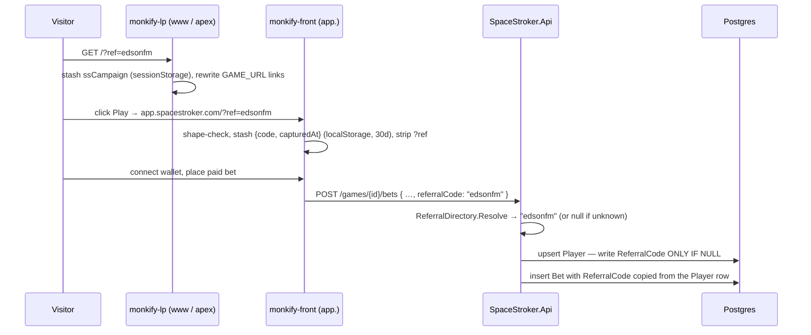
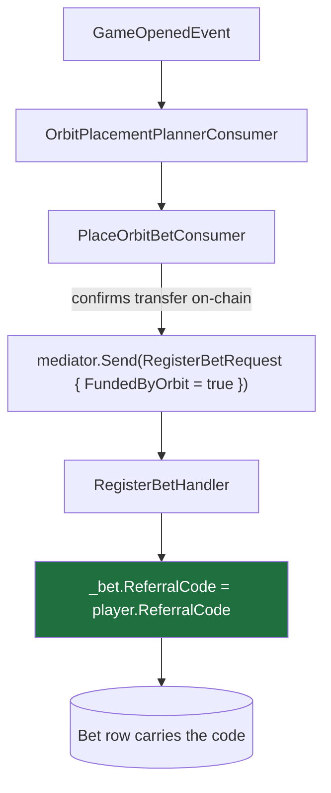

# SpaceStroker — "Referral Program" Feature — Implementation Spec

> **Status: SHIPPED 2026-08-21** (merged via `feature/referral-program`) — refined via Trello card
> [#175 Referral program](https://trello.com/c/GPgZJksn/175-referral-program) (2026-08-20).
> Repos affected: `monkify-backend`, `monkify-front`, `monkify-lp`, and this doc in `monkify-meta`.
>
> **Purpose:** let the house pay a streamer (or any partner) for the players they send us. A partner
> hands out `https://spacestroker.com?ref=<code>`; every **paid** bet placed by a player who arrived
> through it — Orbit auto-bets included — is stamped with that partner's code, so a report can total
> what that traffic wagered and the partner is paid a configured share of it **by hand**. The house
> commission is raised **1% → 2%** in the same card to fund the programme.
>
> Distilled in [`../features/referral-program.md`](../features/referral-program.md). Superseded in part
> by Trello #177, which replaces §3 decision 5 ("report only") with an automated partner cash-out.

---

## 1. Summary

Three separable pieces ship together:

| Piece | What it does | Where it lives |
| --- | --- | --- |
| **Capture** | Read `?ref=<code>` on the LP or the app, carry it across the host hop, stash it in the browser for 30 days, strip it from the URL | `monkify-lp`, `monkify-front` |
| **Attribution** | On the first request that proves wallet control, write the code onto the `Player` row **if and only if it is NULL**; stamp every bet from that row | `monkify-backend` |
| **Settlement** | A hand-run SQL report totalling each partner's referred turnover; a human sends the SOL | `monkify-meta` |

Plus a **rate change**: `CommissionPercentage` `1.0` → `2.0`, its pinning test, and the five
hand-written copies that name the old number.

**What this is not.** Nothing in either app pays a referrer. There is no accrual table, no job, no
outbound transfer, no admin screen, no player-facing UI. The product's whole job is to record *who
sent whom*; the money is moved by a person reading a report. This mirrors the
[Feedbacker Program](feedbacker-program.md), which is likewise an announcement rather than a system.

### The attribution model in one line

**First-touch, bound to the wallet, permanent.** The first partner to bring a wallet owns it; a later
link never overrides it, and an existing player can never be claimed.

---

## 2. Constraints (MANDATORY)

From `monkify-meta/constraints.md` (full list there):

- **Worktree-per-repo** (§2): `feature/referral-program` in all four repos, each at
  `.worktrees/referral-program/<repo>`. Hubs stay on `main` (`monkify-lp` on `master`).
- **Unit tests** (§3): update + add in `SpaceStroker.Tests`; report which tests changed.
- **Integration test mandatory** (§3): this card is a **`Feature`** — at least one happy-path test in
  `SpaceStroker.Tests.Integration`, plus a dedicated one for the Orbit-stamping flow.
- **EF mapping inline** in `SpaceStrokerDbContext.OnModelCreating` (§4); no
  `IEntityTypeConfiguration`. Migration under `SpaceStroker.Infrastructure/Migrations/`, applied only
  by `SpaceStroker.Consumers`. Never hand-edit the model snapshot.
- **Secrets/config are mock-only** (§1): the seeded `Referrals` block and every `PayoutWallet` in
  `spacestrokersettings.json` are placeholders. A real partner wallet is never committed.
- **No production queries by the agent** (§5): the report SQL is written here and **run by the user**.
- **Vague messaging** (§6): an unrecognised referral code is silently ignored. No response, log line,
  or status code ever tells a caller whether a code exists — a partner list is not public.
- **Host split** (§8): the API stays stateless and does not migrate; Consumers owns migrations.

---

## 3. Resolved product decisions

| # | Decision | Why |
| --- | --- | --- |
| 1 | House cut raised **1% → 2%** inside this card | Owner's call; the raise funds the programme and ships with it |
| 2 | The URL parameter is **`?ref=<code>`**, accepted on the LP **and** the app | Industry default, short enough to read out on stream; the card's `refferal` spelling is a typo that would become a permanent public contract |
| 3 | **First-touch, wallet-bound, permanent**; never overridden | Orbit bets are placed server-side with no browser, so the code must resolve from the DB; first-touch pays for acquisition, not for the last click |
| 4 | Referrers are a **config allowlist** (`GeneralSettings:Operator:Referrals`) | ⚠️ No admin token can be minted in production today, so an admin screen would be unreachable — `admin-and-ops.md` |
| 5 | **Report only.** Nothing in the product pays anyone | An automated outbound transfer to a third party's wallet would be the platform's first; Feedbacker is the precedent for a hand-run programme |
| 6 | Basis is **turnover**: `SharePercentage × Σ(paid stakes of that referrer's players)` | Owner's call — trivially explainable to a partner |
| 7 | Counts **paid bets in `RewardForWinnersCompleted` rounds**, excluding refunded and pre-cutover bets | The rule every existing stats read already applies (`stats-and-history.md`) |
| 8 | **No player-facing UI**; the parameter is **stripped from the URL** | The deal is house-to-partner; stripping keeps the code out of GA4 `page_location` and out of shared links |
| 9 | Written on the two bodies that already **prove wallet control** — `POST /games/{id}/bets` and `POST /orbit/session` | A dedicated public unsigned write keyed on a wallet address would let anyone claim any wallet |
| 10 | **Both columns** — `Player.ReferralCode` (+ `ReferredAt`) and `Bet.ReferralCode` | The player column makes Orbit work; the bet column freezes attribution at placement |
| 11 | Abuse control is the **report** (per-wallet breakdown) plus excluding the referrer's own `PayoutWallet` | A cap tuned with no data produces a number a partner will dispute and we cannot explain |
| 12 | The report is a checked-in **`deploy/sql/referral-payout-report.sql`** | ⚠️ Revised from the card — see §3.1 |
| 13 | `/terms` gets the **2% rate edit** and a **numberless referral clause** | Pre-answers the only two player questions the programme can generate; no figure means it cannot go stale |
| 14 | Browser stash window is **30 days**, then ignored and cleared | An unconsumed code would otherwise claim a player who returned organically months later |
| 15 | **No index on `Bet.ReferralCode`** | ⚠️ Revised from the card — see §3.1 |

### 3.1 Two decisions revised against the code (owner-confirmed 2026-08-20)

**No index on `Bet.ReferralCode` (was: an index on `(ReferralCode, CreatedDate)`).**
`SpaceStrokerDbContext` already carries a measured verdict on speculative `Bet` indexes:

> *"NO INDEX ON Status — tried, MEASURED, and removed… indexing Status turned that 45.8ms scan into
> 6.3ms at 1M rows. It is still not worth it."*

The referral report runs by hand, perhaps monthly. An index would buy ~40ms a month and cost one
index write on **every** bet insert forever, plus bloat. ⚠️ Note the HOT argument does **not** apply
here — `ReferralCode` is never updated after insert, so settlement's `Status`/`UpdatedDate` writes
stay HOT-eligible either way. The cost is purely insert-side, and it is still not worth it. If the
report ever gets slow enough to notice, a **partial** index (`WHERE "ReferralCode" IS NOT NULL`) is a
one-line migration to add **with numbers behind it**, which is how every other index on this table
was decided.

**The report is a `.sql` file, not a DB-console subcommand (was: "a read-only command on the `tools`
DB console").** `SpaceStroker.DbConsole` is an **interactive SQL REPL over raw `Npgsql`** — it starts
the Cloud SQL Auth Proxy, opens one connection, and executes typed SQL. It has **no entity model and
no CSV writer**, so the card's "prefer the entity model over hand-rolled SQL" is not reachable inside
it. `deploy/sql/sol-settlement-cutover.sql` is the standing precedent for *a query a human runs
against production*. So the deliverable is the query itself, run through the existing REPL. The CSV
was a nice-to-have; the operator can copy the result out.

### 3.2 One code finding that shrinks the work

⚠️ **Orbit auto-bets already flow through `RegisterBetHandler`.**
`PlaceOrbitBetConsumer.RegisterBet` (line ~399) builds a `RegisterBetRequestBody` carrying
`Wallet = player.ExternalPlayerId` and sends `new RegisterBetRequest(gameId, body) { FundedByOrbit = true }`
in-process. So a **single** stamp site — in `RegisterBetHandler`, reading the resolved `Player` row —
covers browser bets and Orbit bets alike. **No change is needed in `PlaceOrbitBetConsumer` or
`OrbitBetPlacementService`**, contrary to the card's "Orbit placement path" bullet.

The `POST /orbit/session` capture is still required, and for a different reason: a player who arrives
via a link and goes straight to Orbit has **no** `Player.ReferralCode` when the engine places their
first bet, because the consumer builds the body itself and never sees the browser's stash.

### 3.3 Clarification to acceptance criterion 3

AC 3 reads *"a `ref` value that is not in the config allowlist … then nothing is stashed."* The SPA
**cannot** evaluate the allowlist — publishing the partner list to the browser would expose every
partner's code and name, which §6 vague-messaging forbids. The implementable split:

- **The SPA validates shape only** (`[a-z0-9_-]`, 1–32 chars after trim + lower-case) and stashes
  anything shape-valid.
- **The backend validates membership.** An unknown code is discarded — no `Player` write, no `Bet`
  stamp, no error, no distinguishable response.

Net observable behaviour is unchanged (`no Player or Bet row ever receives it`); only *where* the
rejection happens moves. AC 3 is restated accordingly in §12.

---

## 4. Data model

### 4.1 Entity changes

**`SpaceStroker.Domain/Games/Entities/Player.cs`**

```csharp
/// <summary>
/// The referral code that brought this player, or NULL if they arrived on their own.
///
/// ⚠️ WRITE-ONCE. Set only when currently NULL, by the two handlers that already prove wallet
/// control (RegisterBetHandler, CreateOrbitSessionHandler). A later link NEVER overrides it: the
/// programme pays for acquisition, and a mutable column would let one partner take another's
/// established player with a single click — and would retroactively change what a partner already
/// invoiced for.
/// </summary>
public string? ReferralCode { get; set; }

/// <summary>
/// When ReferralCode was written (UTC). Deliberately NOT CreatedDate: the Player row is created by
/// five different paths (a bet, an Orbit session, the display-name prompt, self-exclusion, the house
/// seed) and can predate attribution by days, so CreatedDate is not the acquisition date the report
/// needs.
/// </summary>
public DateTime? ReferredAt { get; set; }
```

**`SpaceStroker.Domain/Bets/Entities/Bet.cs`**

```csharp
/// <summary>
/// The referring partner's code, copied from Player.ReferralCode at placement. Denormalized on
/// purpose: it FREEZES this bet's attribution at the moment it was placed, so a future change to the
/// attribution policy cannot retroactively move history a partner was already paid on.
///
/// ⚠️ NOT exposed on any DTO, SignalR event or public endpoint — see §7.4.
/// ⚠️ NO INDEX. See §3.1.
/// </summary>
public string? ReferralCode { get; set; }
```

### 4.2 EF configuration (inline)

In `SpaceStroker.Infrastructure/Data/Context/SpaceStrokerDbContext.cs`:

```csharp
// modelBuilder.Entity<Player>(builder => { … })
builder.Property(x => x.ReferralCode).HasMaxLength(32);
builder.Property(x => x.ReferredAt);
// No index: every read of this column is either by the unique ExternalPlayerId (attribution write)
// or a full-table report run by hand (§3.1).

// modelBuilder.Entity<Bet>(builder => { … })
builder.Property(x => x.ReferralCode).HasMaxLength(32);
// No index — deliberate, see §3.1 and the NO INDEX ON Status note directly above in this file.
```

`32` matches the code charset bound in §5.1. Both columns are nullable with **no default** — an
existing row reads as "not referred", which is exactly true.

### 4.3 Migration

```bash
# from monkify-backend/src, inside the feature worktree
dotnet ef migrations add AddReferralAttribution \
  --project SpaceStroker.Infrastructure \
  --startup-project SpaceStroker.Consumers
```

Expected shape: three `AddColumn` calls (`Players.ReferralCode`, `Players.ReferredAt`,
`GameBets.ReferralCode`), all nullable, **no `Sql()` backfill**, no index. Applied at
`SpaceStroker.Consumers` startup like every other migration.

---

## 5. Configuration

### 5.1 The referrer allowlist

New: `GeneralSettings:Operator:Referrals` — a list on `OperatorSettings`.

**`SpaceStroker.Domain/Configs/Entities/ReferralSettings.cs`** (new)

```csharp
/// <summary>
/// One referral partner. The whole programme is config: onboarding a partner is an edit here plus a
/// redeploy of both hosts. That is deliberate — no admin token can be minted in production, so an
/// admin-managed table would be unreachable exactly where it is needed (features/admin-and-ops.md).
/// </summary>
[ExcludeFromCodeCoverage]
public class ReferralSettings
{
    /// <summary>The URL code, e.g. "edsonfm". Matched case-insensitively; see ReferralDirectory.</summary>
    public string Code { get; set; } = string.Empty;

    /// <summary>Human label for the payout report only. Never rendered to a player.</summary>
    public string DisplayName { get; set; } = string.Empty;

    /// <summary>
    /// Percent of referred TURNOVER owed to this partner (1.5 = 1.5%), applied by the report — the
    /// app never computes or moves money from it.
    ///
    /// ⚠️ SANITY BOUND, NOT ENFORCED IN CODE: at a 2% commission the house retains 2% of LOSING
    /// stakes, which on a MinimumNumberOfPlayers = 2 type (Cosmic Sprint, heads-up) is 1% OF
    /// TURNOVER, rising to ~1.67% at six bets with one winner. Above ~1% this pays a partner more
    /// than their traffic earned the house.
    /// </summary>
    public decimal SharePercentage { get; set; }

    /// <summary>
    /// Where the partner is paid, by hand. Also the ONE hard abuse guard: bets from this wallet are
    /// excluded from the partner's own turnover (§8.2).
    /// </summary>
    public string PayoutWallet { get; set; } = string.Empty;
}
```

On `OperatorSettings`: `public List<ReferralSettings> Referrals { get; set; } = new();`

**Committed `spacestrokersettings.json`** carries a mock entry so the shape is discoverable and the
tests have something to bind. ⚠️ **Placeholder values only** (constraints §1):

```json
"Referrals": [
  {
    "Code": "mock-partner",
    "DisplayName": "MOCK_REFERRAL_PARTNER",
    "SharePercentage": 1.0,
    "PayoutWallet": "MOCK_REFERRAL_PAYOUT_WALLET"
  }
]
```

An **absent or empty** list makes the whole programme inert: every code is unknown, nothing is ever
written. That is the correct default for local, docker-compose and the development GCP environment.

### 5.2 The commission rate

`GeneralSettings:Operator:Token:CommissionPercentage`: **`1.0` → `2.0`**.

⚠️ **This committed value IS the production rate** — no deploy surface overrides it (not
`secrets.<env>.json`, not the workload tfvars, not the secret lists in
`deploy/terraform/workload/main.tf`). Changing it needs a redeploy of **both** Cloud Run hosts:
Consumers computes the payout, the API serves the badge.

⚠️ **The rate is read at payout time and never snapshotted per round.** A round already open when
Consumers restarts settles at the **new** rate. Deploy the flip with **no paid round open** — the
exposure is the 24h Space Jackpot. See §13.

---

## 6. Backend behaviour

### 6.1 `ReferralDirectory` — the one place a code is resolved

New: `SpaceStroker.Domain/Games/Services/ReferralDirectory.cs`. A small, RPC-free, DB-free service
over `List<ReferralSettings>`, registered as a singleton alongside `GeneralSettings`.

```csharp
/// <summary>
/// Resolves a raw referral code to a configured partner. FAILS CLOSED: null, blank, malformed, or
/// not-configured all resolve to null, and a null resolution means "this bet was not referred" —
/// never an error, never a distinguishable response (constraints.md §6; a partner list is not public).
/// </summary>
public sealed class ReferralDirectory
{
    // [a-z0-9_-], 1..32, after Trim + ToLowerInvariant. Matches Player.ReferralCode's HasMaxLength(32).
    public static string? Normalize(string? raw);

    /// <summary>The CANONICAL configured code (config casing wins), or null if unknown.</summary>
    public string? Resolve(string? raw);
}
```

Rules:

- `Normalize` trims and lower-cases, then rejects anything outside `[a-z0-9_-]` or longer than 32.
- `Resolve` normalizes both sides, so `?ref=EdsonFM` matches a configured `edsonfm`. It returns the
  **configured** `Code` verbatim, so the stored column is one canonical spelling per partner —
  otherwise a partner's earnings split across `edsonfm` and `EdsonFM` with no way to merge them.
- ⚠️ **Duplicate codes in config are a startup failure**, not a silent last-wins. Two partners sharing
  a code means one is paid for the other's traffic. Validate on construction and throw.

### 6.2 `RegisterBetHandler` — attribution + stamp (covers Orbit for free)

`SpaceStroker.Infrastructure/Handlers/Games/RegisterBet/`

1. **`RegisterBetRequestBody`** gains `public string? ReferralCode { get; set; }`.
   ⚠️ On the **body**, unlike `FundedByOrbit` which lives on the request: a referral code grants
   nothing and skips no validation, so a public caller setting it is harmless — the worst they can do
   is attribute *their own* wallet to a partner we configured.
2. **`UpsertPlayerAsync`** takes the resolved code and writes it **only when NULL**:

   ```csharp
   var resolved = _referrals.Resolve(request.Body.ReferralCode);

   // existing player branch — alongside the LastSeenAt / DisplayName updates already there
   if (resolved != null && string.IsNullOrEmpty(existing.ReferralCode))
   {
       existing.ReferralCode = resolved;
       existing.ReferredAt = now;
   }
   // …existing Players.Update(existing) + SaveChangesAsync already follow.

   // new player branch
   var player = new Player { …, ReferralCode = resolved, ReferredAt = resolved != null ? now : null };
   ```

   ⚠️ The existing branch already calls `_spacestrokerDbContext.Players.Update(existing)` explicitly —
   keep it. `SpaceStrokerDbContext` is **NoTracking by default**, so a plain load-mutate-SaveChanges
   persists nothing.
3. **Stamp the bet** immediately after `_bet.Player = player;`:

   ```csharp
   // From the PLAYER row, never from the request body: this is what makes an Orbit auto-bet carry the
   // code. PlaceOrbitBetConsumer sends a RegisterBetRequest in-process with no referral on the body
   // (there is no browser), so reading the body here would leave every Orbit bet NULL.
   _bet.ReferralCode = player?.ReferralCode;
   ```

   ⚠️ Placement matters: `GameService.InsertBet` **detaches** `bet.Player` before `AddAsync` and
   restores it after (see `player.md` — this has caused two bugs). `Bet.ReferralCode` is a scalar on
   the bet itself, so it survives the detach — but read it from `player` **before** `InsertBet`, not
   from `_bet.Player` after.
4. **Free bets are unaffected in behaviour but not in code path.** An anonymous free bet has no
   wallet ⇒ no `Player` ⇒ `resolvedExternalId == null` ⇒ no upsert, and `_bet.ReferralCode` stays
   NULL. A free bet *with* a wallet gets the row and the stamp, and simply contributes 0 turnover
   (`Amount == 0`).

### 6.3 `CreateOrbitSessionHandler` — the Orbit-first acquisition path

`CreateOrbitSessionRequestBody` gains `public string? ReferralCode { get; set; }`, and
`EnsurePlayerExists` performs the same **NULL-only** write.

⚠️ The write happens **after** `OrbitProof.TryConsume` succeeds — the ed25519 signature is what makes
this a wallet the caller controls. Never before.

⚠️ That method already uses `Context.Players.AsTracking()` for exactly the NoTracking reason above —
extend the existing tracked load, do not add a second query.

Why this endpoint and not a dedicated one: a player can reach Orbit before ever betting (the handler
says so in its own comment), and their first bet is then placed **server-side** with no browser. Any
public unsigned write would let a caller claim an arbitrary wallet, which is the same reason
`PATCH /players/preferences` is signature-gated.

### 6.4 What deliberately does not change

| Area | Why |
| --- | --- |
| `PlaceOrbitBetConsumer` / `OrbitBetPlacementService` | Already routes through `RegisterBetHandler` (§3.2) |
| `BetDomainService`, `RewardGameConsumer`, `RefundInvalidBetConsumer` | Referral affects no payout, refund or commission arithmetic |
| `TransactionLog` | No new ledger row — nothing moves money |
| SignalR contracts, `BetDto`, history/stats/verification DTOs | §7.4 |
| `UpdatePlayerPreferencesHandler`, `SetSelfExclusionHandler`, `HouseSeedBetService` | They may create a `Player` with a NULL code; the first bet or Orbit session fills it |

---

## 7. Frontend behaviour

### 7.1 `monkify-lp` — carry the code across the host hop

`https://spacestroker.com` and `www.` both resolve to the **LP bucket** (one LB host rule,
`domain_lp` + `domain_lp_www`), while the game is a different origin at `app.spacestroker.com` and
every "Play now" is a hard-coded `GAME_URL` **with no parameters**. The LP already solves this for
campaigns.

In `src/layouts/Layout.astro`, add `'ref'` to the existing **`CAMPAIGN_KEYS`** allowlist. That is the
entire change: the same script stashes it in `sessionStorage` under `ssCampaign` and rewrites
outbound `GAME_URL` links, honouring the existing "an explicit parameter on the link wins" rule.

⚠️ **`sessionStorage` here is correct and is not the 30-day window.** The LP's job is only to survive
*this visit* (land → read `/terms` → click Play). The 30-day window lives in the app (§7.2), which is
the side that has to bridge "saw the stream today, funded a wallet tomorrow".

⚠️ The block is deliberately **outside** the `gaId` guard — forwarding is a property of the link, not
of whether we are measuring. Adding `ref` inherits that, which is what makes it work in the
development environment where GA4 is off.

### 7.2 `monkify-front` — capture, stash, strip

**`src/utils/referral.ts`** (new) — the stash, modelled on `utils/adminToken.ts`:

```ts
const STORAGE_KEY = 'space-stroker.referral';
const WINDOW_DAYS = 30;
// Shape only. The allowlist is server-side config and must NOT be published to the browser (§3.3).
const CODE_PATTERN = /^[a-z0-9_-]{1,32}$/;

export function normalizeReferral(raw: string | null): string | null;   // trim + lower-case + test
export function readReferral(): string | null;   // null when absent, malformed, or older than 30 days
export function storeReferral(code: string): void;  // { code, capturedAt } as JSON
export function clearReferral(): void;
```

⚠️ Every access is `try`/`catch` — `localStorage` throws in private mode / embedded webviews, and a
referral must never be able to break boot. Degrade to "no referral", never to an exception.
⚠️ An entry past its window is **cleared**, not merely ignored, so a stale code cannot sit in a
browser indefinitely.

**`src/hooks/useReferral.ts`** (new) — capture + strip:

```ts
// Reads ?ref= from the CURRENT URL, stashes it if shape-valid, and removes ONLY that parameter,
// preserving path, other query params and the hash — unlike useAdmin's stripFragment, which drops
// the whole hash because that is where the admin token lives.
export const useReferral = () => ({ captureFromUrl, getReferral, clearReferral });
```

Wired at the **top of `App.vue`'s `onMounted`**, before the admin hand-off branch, so it runs on every
route and every entry (a partner may paste a link to any page).

⚠️ Strip with `history.replaceState` so there is no reload and no navigation entry.

### 7.3 Sending it — one place, not four

`useGame.ts` builds a `BodyGameBet` at **four** sites (free bet, paid bet, and two mobile-deeplink
resume paths at ~746 / ~882 / ~915 / ~1021). Stamping at the call sites would reliably miss one.

**Stamp centrally in `src/services/mainService.ts`:**

```ts
const applyBet = async (gameTypeId: string, body: BodyGameBet) => {
  // Attach the stashed referral here rather than at the four useGame call sites — including the
  // mobile-deeplink resume paths, which rebuild the body after a round trip through the wallet app.
  const referralCode = readReferral() ?? undefined;
  const { data } = await mainAPI.post<DefaultResponse<boolean>>(
    `/games/${gameTypeId}/bets`, { ...body, referralCode });
  return data;
};
```

Same for `orbitService.createOrbitSession(wallet, nonce, signature)` — add `referralCode` to the
posted object.

`BodyGameBet` in `src/types/index.ts` gains an optional `referralCode?: string`.

**Clearing:** call `clearReferral()` after a **successful** `applyBet` or `createOrbitSession`. The
code has done its job — it either landed on a NULL column or was discarded as unknown, and neither
outcome benefits from a retry. Failure leaves it stashed so the next attempt carries it.

### 7.4 Nothing renders, nothing is returned

No component, route, copy string, or DTO field exposes a referral. Specifically **not** on `BetDto`,
`BetNotificationEvent`, games history, stats, or the verification payload. A partner's code is a
commercial arrangement, not public information, and adding it to a shipped contract would be
irreversible.

### 7.5 The rate copy — five hand-written sites

⚠️ **The live badges are free** (`GameStatsPanel.vue` / `GameStatsPage.vue` interpolate
`commissionPercentage` from the backend and will read `2% HOUSE CUT` with no change). These are not:

| # | File | Line | Current text |
| --- | --- | --- | --- |
| 1 | `monkify-lp/src/pages/terms.astro` | ~69 | `We take a house cut of winnings — currently 1% —` |
| 2 | `monkify-lp/src/components/TokenSection.vue` | ~271 | `The profit from the 1% house cut will buy … and burn it.` |
| 3 | `monkify-front/.../guide/sections/GuideWhatYouWin.vue` | ~43 | `1%, and only on what you win above your own stake.` |
| 4 | `monkify-front/.../guide/sections/GuideToken.vue` | ~173, ~180 | `THE 1% HOUSE CUT BUYS THE COIN` / `The game takes 1% of what you win…` |
| 5 | `monkify-front/.../home/HomeTokenCard.vue` | ~207 | `The profit from the 1% house cut will buy … and burn it.` |

Also update the **explanatory comments** in files 3 and 4, which state *"if the deployment ever runs a
rate that is not 1%, both sections are wrong — fix both."* That instruction is being executed; the
number in it must move too.

> ⚠️ **DO NOT blanket find-and-replace `1%`.** `monkify-lp/src/constants.ts:116`
> (`"Our own rule on top: 1% per $100M of market cap."`) is the **team vesting schedule**, and
> `GuideToken.vue` ~233–250 describes the same release cadence. They have nothing to do with the house
> cut and must stay at 1%.

⚠️ Preserve the load-bearing wording flagged in-place at sites 2 and 5: **"the profit from"**, not
"the 2% cut" — the cut is gross revenue and infra comes out of it first.

### 7.6 The Terms referral clause

A new clause in `monkify-lp/src/pages/terms.astro`, **carrying no figures** (that page is
hand-maintained and has already gone stale once). Three sentences:

- We may compensate third parties for referring players.
- A referral link confers **no** benefit or obligation on the player; it changes nothing about their
  bets, odds, payouts or the house cut.
- Attribution and any payment to a referrer are at our discretion.

⚠️ Ungated — unlike the Feedbacker clause it has no `TOKEN_LIVE` dependency; the programme is not a
token surface.

---

## 8. The payout report (`monkify-meta`)

### 8.1 Where it lives

`monkify-meta/deploy/sql/referral-payout-report.sql`, next to `sol-settlement-cutover.sql`, run by a
human through the `spacestroker-db` REPL. Read-only: no `--execute` mode exists because it moves no
money.

### 8.2 What it computes

Per referrer, over `[:from, :to)`:

```
turnover = Σ Bet.Amount
owed     = turnover × SharePercentage / 100        -- SharePercentage read from config by the operator
```

over bets satisfying **all** of:

| Filter | Value | Why |
| --- | --- | --- |
| `b."ReferralCode" IS NOT NULL` | — | Only referred bets |
| `b."Amount" > 0` | — | Free bets contribute nothing (`money.md`) |
| `g."Status" = 7` | `RewardForWinnersCompleted` | The rule every stats read applies |
| `b."Status" NOT IN (3,4,5)` | not `NeedsRefunding` / `Refunded` / `NeedsManualAnalysis` | A refunded stake came straight back |
| `b."CreatedDate" >= :cutover` | `SettlementCutoverUtc` | ⚠️ Pre-cutover `Amount` is denominated in the previous asset — summing it would report a number in no currency |
| `p."ExternalPlayerId" <> :payoutWallet` | per referrer | The one hard self-referral guard |

Two result sets: **totals per referrer**, and a **per-wallet breakdown** (wallet,
`Player.ReferredAt` as first-seen, bet count, volume, share of that referrer's total) — the breakdown
is what makes concentration visible, which is how self-referral gets caught (§3, decision 11).

Table names are EF defaults from the `DbSet` property names: `"GameBets"`, `"Games"`, `"Players"`.
Enums are stored as `int` — `GameStatus.RewardForWinnersCompleted = 7`; `BetStatus` is zero-based
(`Made = 0` … `NeedsManualAnalysis = 5`).

⚠️ Turnover is **not** the same thing as house revenue. At 2% the house retains 2% of *losing* stakes,
which heads-up on Cosmic Sprint is **1% of turnover**. The header of the SQL file must say so, right
above the query, so nobody reads a turnover figure as profit.

⚠️ **This SQL hand-mirrors the schema and will rot silently** (the deploy tools' seeder broke for a
week with every backend test green). Re-check it whenever `Bet`, `Player` or either enum changes.

---

## 9. Flow diagrams

### 9.1 Capture → attribution → stamp



### 9.2 Why Orbit needs no extra stamp site



The body the consumer builds has **no** referral on it — the code comes from the `Player` row, which
is why the `POST /orbit/session` capture (§6.3) is load-bearing for Orbit-first players.

---

## 10. File checklist

### 10.1 Backend (`monkify-backend`)

| # | File | Change |
| --- | --- | --- |
| 1 | `SpaceStroker.Domain/Games/Entities/Player.cs` | Add `ReferralCode`, `ReferredAt` |
| 2 | `SpaceStroker.Domain/Bets/Entities/Bet.cs` | Add `ReferralCode` |
| 3 | `SpaceStroker.Domain/Configs/Entities/ReferralSettings.cs` | **New** — one partner |
| 4 | `SpaceStroker.Domain/Configs/Entities/OperatorSettings.cs` | Add `List<ReferralSettings> Referrals` |
| 5 | `SpaceStroker.Domain/Games/Services/ReferralDirectory.cs` | **New** — `Normalize` + `Resolve`, fail-closed, duplicate-code guard |
| 6 | `SpaceStroker.Common/spacestrokersettings.json` | `CommissionPercentage` `1.0` → `2.0`; add mock `Referrals` block |
| 7 | `SpaceStroker.Infrastructure/Data/Context/SpaceStrokerDbContext.cs` | Inline mapping for all three columns; **no index** |
| 8 | `SpaceStroker.Infrastructure/Migrations/*_AddReferralAttribution.cs` | Generated; three nullable `AddColumn`s |
| 9 | `.../Handlers/Games/RegisterBet/RegisterBetRequestBody.cs` | Add `ReferralCode` |
| 10 | `.../Handlers/Games/RegisterBet/RegisterBetHandler.cs` | Resolve, NULL-only player write, stamp `_bet.ReferralCode` |
| 11 | `.../Handlers/Orbit/CreateOrbitSession/CreateOrbitSessionRequest.cs` | Add `ReferralCode` to the body |
| 12 | `.../Handlers/Orbit/CreateOrbitSession/CreateOrbitSessionHandler.cs` | NULL-only write in `EnsurePlayerExists`, after proof |
| 13 | DI registration (wherever `GeneralSettings` is bound) | Register `ReferralDirectory` as a singleton |

### 10.2 Frontend (`monkify-front`)

| # | File | Change |
| --- | --- | --- |
| 1 | `src/utils/referral.ts` | **New** — stash + 30-day window + shape check |
| 2 | `src/hooks/useReferral.ts` | **New** — capture from URL + strip `?ref` only |
| 3 | `src/App.vue` | Call `captureFromUrl()` at the top of `onMounted` |
| 4 | `src/services/mainService.ts` | Attach `referralCode` in `applyBet`; clear on success |
| 5 | `src/services/orbitService.ts` | Attach `referralCode` in `createOrbitSession`; clear on success |
| 6 | `src/types/index.ts` | `BodyGameBet.referralCode?: string` |
| 7 | `src/components/guide/sections/GuideWhatYouWin.vue` | 1% → 2% (copy **and** the rule comment) |
| 8 | `src/components/guide/sections/GuideToken.vue` | 1% → 2% at ~173/~180 (**not** the vesting cadence at ~233+) |
| 9 | `src/components/home/HomeTokenCard.vue` | 1% → 2%, keep "the profit from" |

### 10.3 Landing page (`monkify-lp`, branch `feature/referral-program` off `master`)

| # | File | Change |
| --- | --- | --- |
| 1 | `src/layouts/Layout.astro` | Add `'ref'` to `CAMPAIGN_KEYS` |
| 2 | `src/pages/terms.astro` | 1% → 2%; add the numberless referral clause |
| 3 | `src/components/TokenSection.vue` | 1% → 2%, keep "the profit from" |

⚠️ `src/constants.ts:116` is the **team vesting** rule — leave it at 1%.

### 10.4 Meta (`monkify-meta`)

| # | File | Change |
| --- | --- | --- |
| 1 | `specs/referral-program.md` | This spec |
| 2 | `deploy/sql/referral-payout-report.sql` | **New** — the payout query (§8) |
| 3 | `INDEX.md` | Map row + "Feature currently in flight" |

---

## 11. Unit tests

Project: `monkify-backend/src/SpaceStroker.Tests`.

| Test file | Test cases | Expected |
| --- | --- | --- |
| `UnitTests/Domain/ReferralDirectoryTests.cs` **(new)** | `Resolve` known code; unknown code; different casing; leading/trailing space; `null`/empty; `>32` chars; out-of-charset (`.`, space, uppercase-only-after-normalize); empty config; duplicate codes in config | Canonical configured code, else `null`; duplicates throw at construction |
| `UnitTests/Handlers/Games/RegisterBetHandlerTests.cs` | New player + valid code; existing player with NULL code; existing player with a **different** code already set; unknown code; no code at all; free bet with a wallet | Code written only when NULL; never overridden; `Bet.ReferralCode` mirrors the player row; unknown ⇒ both NULL and the bet still succeeds |
| `UnitTests/Handlers/Orbit/CreateOrbitSessionTests.cs` | Valid proof + valid code on a new player; on an existing player with a code; **invalid proof** + valid code | Written on success only; ⚠️ a failed proof must write nothing |
| `UnitTests/Api/CommissionRateTests.cs` | `CommissionPercentage_IsOnePercent` → `IsTwoPercent` | `ShouldBe(2.0m)`; the percent-not-fraction bound test is unchanged and still passes |
| `UnitTests/Domain/BetDomainServiceTests.cs` | — | ⚠️ **Leave alone.** It deliberately uses its **own `0.5m`** rate with hardcoded expectations (`1.4975` / `19.95` / `18.98`) to test the *formula* independently of the configured rate. Do **not** "fix" these to 2% |

### 11.1 Integration tests (mandatory — this card is a `Feature`)

Project: `SpaceStroker.Tests.Integration` (Testcontainers, real API + Consumers hosts), following the
`GameFlowTests` pattern.

**`ReferralAttributionFlowTests.cs` (new)**

1. **Happy path** — a paid bet carrying a configured code creates the `Player` with
   `ReferralCode` + `ReferredAt` and stamps `Bet.ReferralCode`; the round settles normally.
2. **⚠️ Orbit stamping (the dedicated complex-flow test)** — a player whose `Player.ReferralCode` is
   already set, enrolled and funded in Orbit, gets an engine-placed bet whose `Bet.ReferralCode`
   carries the code. This is the one path with **no browser in it** and the reason the level is
   `Feature`.
3. **Never overridden** — a second bet carrying a different valid code leaves the stored code and
   `ReferredAt` unchanged, and the bet succeeds.
4. **Unknown code** — nothing persisted anywhere, bet succeeds, response byte-identical to a bet with
   no code at all.
5. **Contract check** — the bet's public `BetDto` / notification payload contains no referral field.

⚠️ The integration harness **fakes the chain**, so these assert the attribution reaching the DB
through two real hosts, not an on-chain transfer.
⚠️ These tests must add a `Referrals` block to the harness config; the default committed mock entry is
`mock-partner`.

---

## 12. Acceptance criteria

From the Trello checklist (17 items), with **AC 3 restated** per §3.3.

1. Given a referrer code allowlisted in `GeneralSettings:Operator:Referrals`, when a visitor lands on
   `app.spacestroker.com?ref=<code>`, then the code is stashed in `localStorage` with a capture
   timestamp and `ref` is removed from the address bar without a page reload.
2. Given a visitor lands on `https://spacestroker.com?ref=<code>`, when they click any "Play now" link
   to `GAME_URL`, then the outbound URL carries `ref=<code>` alongside any forwarded `utm_*` values,
   and the code survives navigating to `/terms` and back within the same visit.
3. **(restated)** Given a **malformed** `ref` (outside `[a-z0-9_-]` or longer than 32 chars), then
   nothing is stashed. Given a **well-formed but unknown** code, then it may be stashed and sent but
   **no `Player` or `Bet` row ever receives it**, and no response, status code or message tells the
   caller whether a code exists.
4. Given a stashed code and a wallet with no `Player` row, when the player places their first paid bet
   via `POST /games/{id}/bets`, then the upserted `Player` gets `ReferralCode` + `ReferredAt`, and that
   bet's `Bet.ReferralCode` is stamped with the same code.
5. Given a stashed code and a wallet that reaches Orbit before ever betting, when the SPA calls
   `POST /orbit/session` with a valid nonce + signature, then `EnsurePlayerExists` writes
   `ReferralCode` + `ReferredAt` on the created or existing row.
6. Given a `Player` whose `ReferralCode` is already set, when a bet or Orbit session arrives carrying a
   different valid code, then the stored code and `ReferredAt` are unchanged and the request succeeds.
7. Given a `Player` row created by `UpdatePlayerPreferences` (the display-name prompt on wallet
   connect) with `ReferralCode` NULL, when that player later places their first paid bet with a
   stashed code, then the NULL is filled and every subsequent bet stamps the same code.
8. Given an enrolled, funded Orbit player whose `Player.ReferralCode` is set, when the engine places
   their auto-bet server-side with no browser involved, then that `Bet.ReferralCode` carries the code
   — verified end to end in `SpaceStroker.Tests.Integration`.
9. Given a code stashed more than 30 days ago, when the player connects a wallet and bets or opens an
   Orbit session, then the stash is ignored **and cleared**, no code is sent, and `Player.ReferralCode`
   stays NULL.
10. Given a referred player and an anonymous free bet in the same round, when the round completes, then
    the free bet's `Bet.PlayerId` and `Bet.ReferralCode` are both NULL and it contributes 0 turnover.
11. Given referred bets that were refunded, that predate `SettlementCutoverUtc`, or that sit in rounds
    ending `NotEnoughPlayersToStart` / `ErrorWhenProcessingRewards` / `GameEndedAbruptely`, when the
    report runs, then none appear in the referrer's turnover.
12. Given a referrer with several referred wallets and a date window, when the report SQL is run, then
    it yields that referrer's total turnover and `SharePercentage × turnover` owed, plus a per-wallet
    breakdown (first-seen date, bet count, volume, share of the referrer's total), excluding bets from
    the referrer's own `PayoutWallet`.
13. Given `CommissionPercentage` is `2.0`, when a paid round with one winner and one loser settles,
    then the winner is credited `pot − 2% × (winnerReward − ownStake)`, the STATS badge and
    `GET /games/stats` report `2%`, `CommissionRateTests` pins `2.0`, and `BetDomainServiceTests` still
    uses its own `0.5m` fixtures unchanged.
14. Given the rate has moved to 2%, when the five hand-written copies are checked (§7.5), then none
    still says 1% — **and** the team-vesting "1% per $100M of market cap" is untouched.
15. Given `/terms` is rendered, when the referral clause is read, then it states that we may compensate
    third parties for referrals, that a referral link confers no player benefit or obligation, and that
    attribution is at our discretion — carrying no percentage, cap or referrer name.
16. Given a referred player is in a live round, when their bet is returned by any public endpoint or
    pushed over SignalR (`BetDto`, `BetNotificationEvent`, games history, stats, verification payload),
    then no referral code appears and no new field is added to a shipped contract.
17. Given the migration is applied to a database holding pre-existing rows, when
    `SpaceStroker.Consumers` starts, then all three columns are NULL on historical rows, no backfill
    runs, and every existing stats, history and payout read returns exactly what it did before.

---

## 13. Manual QA (local stack)

1. Add a real-looking test entry to the local `Referrals` config (`Code: "teststreamer"`), rebuild.
2. Open `http://localhost:6003/?ref=teststreamer` → the address bar drops `?ref` immediately;
   `localStorage['space-stroker.referral']` holds `{ code, capturedAt }`.
3. Connect a wallet, place a paid bet → `SELECT "ReferralCode","ReferredAt" FROM "Players"` shows the
   code; the new `GameBets` row carries it.
4. Reload with `?ref=someoneelse` and bet again → the `Player` row is **unchanged**; the new bet
   carries the **original** code.
5. Open `?ref=NOT_A_REAL_CODE` (malformed) → nothing stashed. Open `?ref=unknownpartner` (well-formed,
   not configured) → stashed and sent, but both columns stay NULL and the bet succeeds normally.
6. Check the STATS panel reads **2% HOUSE CUT**, and that a settled round credits the winner
   `pot − 2%` of profit above their stake.
7. Enrol that wallet in Orbit, fund it, let a round run → the engine-placed bet carries the code.

### 13.1 Deploy note (production)

⚠️ **The commission rate is read at payout time and never snapshotted.** Deploy the 2% flip with **no
paid round open** — drain the 24h Space Jackpot first — and release **both** Cloud Run hosts together
(Consumers computes the payout, the API serves the badge). The LP must be deployed too, or `/terms`
publishes a house cut lower than the one actually taken.

---

## 14. Trello / pipeline

- **Source card:** [#175 Referral program](https://trello.com/c/GPgZJksn/175-referral-program) —
  list **Specs created**; the **Implementation** section on the card carries branch, spec, worktree
  and level.
- **Next:** `/monkify-implement-feature Referral program`, then `/monkify-ship-feature Referral program`.

---

## 15. Revision log

| Date | Change |
| --- | --- |
| 2026-08-20 | Initial spec from refined card #175. Two card decisions revised against the code (§3.1): no index on `Bet.ReferralCode`; the report is a checked-in `.sql` file rather than a DB-console subcommand. One simplification found (§3.2): Orbit auto-bets already route through `RegisterBetHandler`, so no Orbit-specific stamp site is needed. AC 3 restated (§3.3) because the SPA cannot evaluate a server-side allowlist. |
