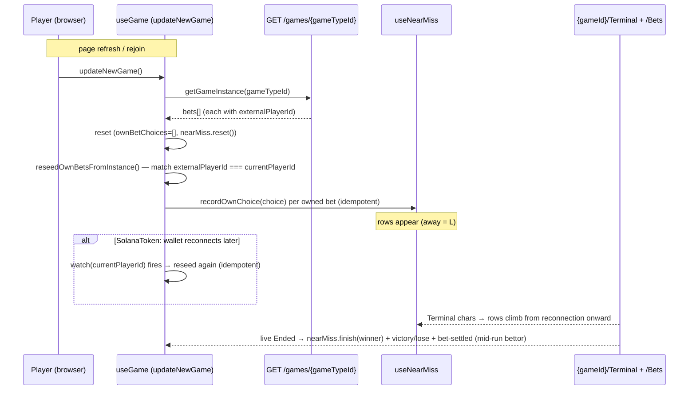

# SpaceStroker — "Restore your own bets after a refresh" Feature — Implementation Spec

> **Status: Shipped** (2026-07-17) — merged via `feature/restore-own-bets-on-refresh` into `main`
> (`monkify-front` + `monkify-meta`). Refined via Trello card
> [Bug: on refresh doesn't show your bets on spectator](https://trello.com/c/IkVOurKA/70-bug-on-refresh-doesnt-show-your-bets-on-spectator) (2026-07-17).
> Repos affected: `monkify-front`, and this doc in `monkify-meta`. **No `monkify-backend` change.**
>
> **Purpose:** When a player bets on a game and then refreshes the page (or quits and rejoins the
> same round), all of their **own-bet UI cues** disappear — most visibly the `> N AWAY!` near-miss
> rows never render, so the returning bettor is treated as a spectator who never played ("it's as if
> I'm not playing" when the game starts). The bet is still live server-side; the frontend just loses
> track of which bets are the player's own across a reload. This restores that identity on load.

---

## 1. Summary

The Characters Away near-miss rows, the bettors-only victory/lose sound, and the embedded
bettors-only settlement signal all gate on **`ownBetChoices`** (`useGame.ts:75`) — a durable-per-game
list of the player's own committed choices. But `ownBetChoices` is **only ever written by
`recordOwnChoice`** (`useGame.ts:91`), which is **only ever called from the live PLACE BET click**
(`submitBet`, `useGame.ts:314`). On a page reload the module state resets to `[]`
(`updateNewGame` → `useGame.ts:540` + `nearMiss.reset()` at `:543`), and although `getBets`
(`useGame.ts:120`) re-fetches the full bets array — where **every bet already carries
`externalPlayerId` + `displayName`** (`BetDto`) — it uses those bets only to seed the pot. It never
matches them against the current player, so `ownBetChoices` stays empty and the returning bettor
renders exactly like a spectator.

**The identity is already available on both sides — it is simply never used to re-derive ownership:**

| Cue | Source of "own" today | Survives refresh? |
| --- | --- | --- |
| Bet-list **"YOU"** label | `betPlayerLabel` matches `bet.externalPlayerId === myId()` (`GameTerminal.vue:73`) | ✅ (identity-derived) |
| **"YOU WON! CONGRATS!"** + winner label | `userWon` / `winnerLabel` from live `winners` + wallet/externalId | ✅ (live Status) |
| **"YOUR BET IS IN!"** waiting copy | `userHasBet` scans `gameInstance.bets` | ✅ (identity-derived) |
| **`> N AWAY!` near-miss rows** | `ownBetChoices` / `nearMiss.trackChoice` (click-time only) | ❌ **broken** |
| **Victory / lose sound** (returning bettor) | `ownBetChoices.length > 0` + `.includes(winner)` (`useGame.ts:225,229`) | ❌ **broken** |
| **Embedded `bet-settled` signal** | same `ownBetChoices` gate (`useGame.ts:232`) | ❌ **broken** |

**Fix (frontend-only):** re-derive ownership from data the client already receives. On the game load
path, after the reset, match the fetched `gameInstance.bets` against the current player's identity and
replay each owned choice through the existing, idempotent `recordOwnChoice` — which re-seeds both
`ownBetChoices` **and** `nearMiss.trackChoice` in one call, restoring all three broken cues at once.
Make the re-seed **reactive** so it re-runs when the identity becomes available (SolanaToken games are
keyed to the connected wallet, which reconnects asynchronously after a refresh). The backend already
exposes the owner identity on `GET /games/{gameTypeId}` (`ActiveGameDto` → `BetDto`) and on the
SignalR `{gameId}/Bets` event (`BetNotificationEvent`), so **no backend change is required.**

---

## 2. Constraints (MANDATORY)

From `monkify-meta/constraints.md` (full list there):

- **Worktree-per-repo / branch-per-repo:** work lives in
  `.worktrees/restore-own-bets-on-refresh/<repo>`; the shared checkout of each repo stays on `main`
  (never `git checkout -b` on the hub). Branch `feature/restore-own-bets-on-refresh` in
  `monkify-front` and `monkify-meta`. Push after branch work.
- **Frontend-only bug fix ⇒ no backend integration test required.** Per `AGENTS.md` rule 8, the
  mandatory happy-path integration test applies to **new features**, not bug fixes. `SpaceStroker.Tests` /
  `SpaceStroker.Tests.Integration` are untouched. (`Level: Minor change`.)
- **No frontend unit-test harness exists** (`monkify-front` has no vitest/jest, no `test` script).
  Verification is `yarn lint` + `yarn build` green + the manual QA in §13.
- **Frontend env vars use `VUE_APP_*`** (Vue CLI), not `VITE_*`. (This spec adds **no** env var.)
- **Front-worktree build gotchas** apply at implement/deploy time: copy the hub `yarn.lock` into the
  front worktree before a Docker build (it is gitignored), and mind prettier `endOfLine: lf` (CRLF
  breaks `yarn build`). See the KB memories on front-worktree builds.
- **Display-only:** never touch bets, outcomes, payouts, pacing, or the seed/audit trail. Secrets and
  operator messaging are not involved.

---

## 3. Resolved product decisions

| # | Decision |
| --- | --- |
| 1 | **Scope = all own-bet UI cues, frontend-only.** The three broken cues (near-miss rows, returning-bettor victory/lose sound, embedded `bet-settled`) all key off `ownBetChoices`; one re-seed on load restores all of them. The already-working identity-derived cues ("YOU" label, "YOU WON!", "YOUR BET IS IN!") are left intact. |
| 2 | **Re-derive ownership from the fetched bets by identity.** On load, match `gameInstance.bets` against the current player's id (`bet.externalPlayerId === currentPlayerId`) and replay each match through the existing idempotent `recordOwnChoice`. No new state, no backend call. |
| 3 | **Restore for waiting + running only.** The reported scenario ("when the session starts, it doesn't show"). |
| 4 | **Reloading into an already-ended reward view is explicitly out of scope** (see §7.7). `GET /games/{gameTypeId}` only returns games in `ActiveGamesStatus = [WaitingBets, GameStarting, InProgress]` (`Game.cs:57`) — it never returns an `Ended` game, and `ActiveGameDto` carries only `WinningChoice`, not the `winners` list. So a just-ended reward screen cannot be reconstructed on refresh **for anyone** today (a spectator can't either; it is inherently live-only). Supporting it would require backend changes (return a recently-ended game + add `winners` to the DTO) and would reclassify the card as a Feature. Decided **against** during spec exploration (2026-07-17) to keep this a frontend-only Minor change. |
| 5 | **A bettor who refreshes MID-RUN still gets the full end-of-round experience.** Because `ownBetChoices` is re-seeded in the running state, the **live** `Ended` handler (`useGame.ts:219-241`) fires normally for the returning bettor: the winning word types out, and the victory/lose sound + `bet-settled` one-shot fire exactly once. These stay tied to the **live** `Ended` transition and are **not** replayed on refresh (there is no ended game to reload into — decision #4). |
| 6 | **SolanaToken (crypto) games restore reactively on wallet reconnect.** Own bets are keyed to the connected wallet, so the identity is null until the wallet reconnects after a refresh. The re-seed is driven by a **reactive watch** on the current-player id, not a single fire at mount. For regulated (Standard) games the launch-token `sub` is in `sessionStorage`, so identity is available synchronously and cues restore immediately. This mirrors how the existing "YOU" bet-label already behaves. |
| 7 | **One consistent identity resolver.** Centralize "who am I" into a single `currentPlayerId` (SolanaToken → connected wallet; else launch-token `externalPlayerId`/`sub`), and route the existing `GameTerminal.myId` through it, so the "YOU" label and the near-miss re-seed provably mark the **same** bets. Mirrors the `wallet-display-name` precedence (prefer the wallet in a SolanaToken context). |
| 8 | **Idempotent.** `recordOwnChoice` de-dupes via `ownBetChoices.includes` and `nearMiss.trackChoice` no-ops on an already-tracked choice, so the re-seed is safe to run many times (reactive re-fire, live own-bet echo) without duplicate rows or double-counted state. |

---

## 4. Data model

**N/A** — no entity, column, EF mapping, or migration change. The bet owner identity is already
persisted (`Bet.OperatorPlayer.ExternalPlayerId` / `.DisplayName`) and already exposed on the wire.

---

## 5. Configuration

**N/A** — no new env var, no config, no seed data. Existing Solana/launch-token plumbing is reused
unchanged.

---

## 6. Backend behaviour

**N/A — no backend change.** The identity the frontend needs is already emitted on both paths:

- **`GET /games/{gameTypeId}`** → `GetActiveGameForParameterHandler` → `ActiveGameDto` whose `Bets`
  are `BetDto` carrying `ExternalPlayerId` + `DisplayName`
  (`SpaceStroker.Infrastructure/Contracts/Games/BetDto.cs`, `ActiveGameDto.cs:22`).
- **SignalR `{gameId}/Bets`** → `BetNotificationEvent(GameId, ExternalPlayerId, DisplayName, Amount,
  Choice)` (`SpaceStroker.Infrastructure/Consumers/BetNotification/BetNotificationEvent.cs:9`).

Bet ownership is bound server-side from the launch token at registration
(`GamesController.cs:108` → `ExternalPlayerId = _launchContext.ExternalPlayerId`). The frontend simply
compares that value to the current player's id.

---

## 7. Frontend behaviour

All changes are contained in **`monkify-front/src/hooks/useGame.ts`** and a one-line reuse in
**`src/components/game/GameTerminal.vue`**. No new component, no user-facing copy change.

### 7.1 The current-player identity resolver (decision #7)

Add a single reactive `currentPlayerId` computed in `useGame.ts` and export it. It mirrors the
`wallet-display-name` precedence (wallet in a SolanaToken context; otherwise the launch-token
identity):

```ts
// useGame.ts — add imports
import { useDisplayCurrency } from '@/hooks/useDisplayCurrency';
import { getPlayerIdFromToken } from '@/utils/launchToken';

// inside useGame() (publicKey + selectedGame already in scope):
const { externalPlayerId } = useDisplayCurrency();

// The current player's bet-ownership id, consistent everywhere. SolanaToken games are keyed by the
// connected wallet; everything else by the launch-token identity (prefs externalPlayerId, else `sub`).
const currentPlayerId = computed<string | null>(() => {
  const isCrypto = selectedGame.value?.paymentMethod === PaymentMethod.SolanaToken;
  if (isCrypto && publicKey.value) return publicKey.value.toString();
  return externalPlayerId.value || getPlayerIdFromToken() || null;
});
```

`GameTerminal.vue` then replaces its local `myId` (currently `publicKey.value?.toString() ||
ownExternalId.value`, `GameTerminal.vue:56`) with this shared `currentPlayerId`, so the "YOU" label
(`betPlayerLabel`) and the near-miss re-seed use identical logic and mark the same bets. (This is a
strict consistency improvement — the "YOU" determination is unchanged in behaviour for the common
cases, and gains the `sub` fallback for the edge where prefs have not loaded.)

### 7.2 Re-seed own bets from the fetched instance (decisions #1, #2, #8)

Add an idempotent helper in `useGame.ts` that replays the current player's existing bets:

```ts
// Re-derive the player's own committed choices from the loaded game's bets (survives refresh/rejoin).
// Idempotent: recordOwnChoice de-dupes ownBetChoices and nearMiss.trackChoice no-ops on a known choice.
const reseedOwnBetsFromInstance = () => {
  const me = currentPlayerId.value;
  if (!me || !gameInstance.value) return;
  for (const b of gameInstance.value.bets) {
    if (b.externalPlayerId && b.externalPlayerId === me) recordOwnChoice(b.choice);
  }
};
```

### 7.3 Wire it into the load path — AFTER the reset (decision #2)

`updateNewGame` (`useGame.ts:528`) currently calls `getBets` **first** and resets `ownBetChoices = []`
+ `nearMiss.reset()` **after** (`:540,:543`). The re-seed must therefore run at the **very end** of
`updateNewGame`, after the reset block, or it would be wiped:

```ts
const updateNewGame = async (ignoreInitialBets?: boolean) => {
  await disconnectAllPreviousConnections();
  await getBets(ignoreInitialBets);
  // ... existing reset block (terminalOutput, currentPot, ownBetChoices = [], nearMiss.reset(), chat) ...
  reseedOwnBetsFromInstance(); // NEW: re-derive own choices from the just-loaded bets
};
```

`updateNewGame` is the single load/rollover entry point (initial load `GamePage.vue:38`, game
selection `GameTypes.vue:42`, rollover `GameConsole.vue:109`), so this one call covers every load.

### 7.4 Reactive re-run for wallet reconnect (decision #6)

For SolanaToken games `currentPlayerId` is null at mount and resolves only once the wallet
reconnects. Register a `watch` inside `useGame()` that re-runs the re-seed whenever the identity
changes:

```ts
// inside useGame():
watch(currentPlayerId, () => reseedOwnBetsFromInstance());
```

**One watch per consumer, not module-guarded.** `watch()` called in `useGame()` attaches to the
calling component's effect scope and is auto-disposed on unmount. A one-time module guard
(`if (!started) { started = true; watch(...) }`) would tie the single watcher to whichever component
called `useGame()` **first**, and when that component unmounts the watcher dies while the guard stays
`true` — silently killing the reconnect re-seed. Because `reseedOwnBetsFromInstance` is idempotent
(decision #8), letting each consumer register its own component-scoped watch is both simpler and
correct: duplicate fires across consumers (and alongside the load-path call) never duplicate rows, and
the feature keeps working as long as any `useGame` consumer is mounted (always true on the game page).
The watch is **lazy** (fires on change only); the initial load is covered by the `updateNewGame` call
in §7.3, so `immediate` is not needed.

### 7.5 Match own bets on the live `{gameId}/Bets` stream

In the `{gameId}/Bets` handler (`useGame.ts:273-291`), after pushing the incoming bet, also mark it
own when it belongs to the current player — so an own bet placed in another tab, or an echo received
on reconnect, lights up the same way:

```ts
// after gameInstance.value.bets.push({...}) and the pot accumulation:
if (newBet.externalPlayerId && newBet.externalPlayerId === currentPlayerId.value) {
  recordOwnChoice(newBet.choice);
}
```

This is idempotent with the `submitBet` path (which already calls `recordOwnChoice` at `:314`).

### 7.6 What restores, by state

- **Waiting-to-start (the reported bug):** on load, `reseedOwnBetsFromInstance` re-adds a near-miss
  row (`away = L`) per owned choice. When the game starts, the rows climb from the live Terminal
  stream. `userHasBet` already shows "YOUR BET IS IN!" (identity-derived) — unchanged.
- **Running:** rows reappear immediately and climb fresh from reconnection onward (see §7.7 — no
  stream replay). "YOU" labels already correct.
- **Live end after a mid-run refresh (decision #5):** the existing `Ended` handler fires with a
  now-populated `ownBetChoices`, so the winning word types out (`nearMiss.finish`) and the
  victory/lose sound + `bet-settled` fire once. No new code.

### 7.7 Why re-seeded rows climb fresh (no stream replay)

There is **no history replay** of the `<gameId>/Terminal` stream — a late joiner/reconnect only sees
characters produced after it (re)connects (documented in `features/characters-away.md`). So a
re-seeded row starts at `away = L` and only advances on newly-streamed characters; the pre-refresh
progression is not reconstructed. The fix is that the rows **appear at all** (and still type out the
winner on a live end). This matches the existing reconnect behaviour and is not a regression.

### 7.8 Ended-view reload is out of scope (decision #4)

`GET /games/{gameTypeId}` filters on `Game.ActiveGamesStatus = [WaitingBets, GameStarting,
InProgress]` (`GetActiveGameForParameterHandler.cs:41`, `Game.cs:57`) and never returns an `Ended`
game; right after a round ends the game type rolls to its next `WaitingBets` round (or briefly 404s).
`ActiveGameDto` also lacks the `winners` list. So reloading into a just-ended **reward** screen is
impossible frontend-only and is not attempted here — the reward view remains live-only for everyone,
exactly as today.

### 7.9 What stays the same

- The identity-derived cues (`betPlayerLabel` "YOU", `userHasBet`, `userWon` / `winnerLabel`) — now
  `GameTerminal.myId` routes through the shared `currentPlayerId`; no visible regression.
- No change to `submitBet`, bet placement, outcomes, payouts, pacing, provably-fair, or the seed
  audit trail. Display-only.
- Genuine game rollover: `updateNewGame`'s reset still clears own state; the fresh game has no owned
  bets, so `reseedOwnBetsFromInstance` is a no-op (decision #8 / AC 9).
- Spectators: no bet matches their identity → no cues (no false positives).

---

## 8. Flow diagram



---

## 9. Out of scope

- Any **backend** change (identity is already exposed).
- Reloading into an **already-ended reward view** (YOU WON! / winner type-out on a fresh load of an
  ended round) — not possible frontend-only; unchanged for everyone (decisions #4, §7.8).
- **Replaying** the historical `<gameId>/Terminal` near-miss progression — rows climb fresh from
  reconnection (§7.7).
- **Persisting** a wallet/identity hint so crypto own-bets survive **without** a wallet reconnect.
- Re-firing victory/lose audio or the embedded settlement signal on refresh.
- Any change to bets, outcomes, payouts, pacing, or the seed/audit trail.

---

## 10. File checklist

### 10.1 Backend (`monkify-backend`)

**None.**

### 10.2 Frontend (`monkify-front`)

| # | File | Change |
| --- | --- | --- |
| 1 | `src/hooks/useGame.ts` | Import `useDisplayCurrency` + `getPlayerIdFromToken`. Add the reactive `currentPlayerId` computed (crypto → wallet; else `externalPlayerId`/`sub`) and **export** it. Add `reseedOwnBetsFromInstance()` (match `gameInstance.bets` by `externalPlayerId === currentPlayerId`, replay via idempotent `recordOwnChoice`). Call it at the **end** of `updateNewGame` (after the reset block, `~:547`). Register a per-consumer, component-scoped `watch(currentPlayerId, reseedOwnBetsFromInstance)` for crypto wallet reconnect (idempotent — not module-guarded; see §7.4). In the `{gameId}/Bets` handler (`:273-291`) add an identity match → `recordOwnChoice(newBet.choice)`. |
| 2 | `src/components/game/GameTerminal.vue` | Replace the local `myId` (`:56`) with the shared `currentPlayerId` from `useGame`, so `betPlayerLabel` ("YOU") and the near-miss re-seed use one resolver. |
| 3 | `src/hooks/useGameChat.ts` | *(Optional consolidation)* reuse `currentPlayerId` for the chat identity (`:28`) instead of its local `publicKey || externalPlayerId || getPlayerIdFromToken()` expression. Nice-to-have; skip if it widens blast radius. |

### 10.3 Meta (`monkify-meta`)

| # | File | Change |
| --- | --- | --- |
| 1 | `specs/restore-own-bets-on-refresh.md` | This spec. |
| 2 | `INDEX.md` | Add the spec row to the KB map (status **Ready**); update **Feature currently in flight**. |

> `features/characters-away.md` is corrected later by `/monkify-ship-feature` (KB sync on the feature
> branch before merge) — note that own-bet cues re-derive from the fetched bets on load, not
> click-time-only. No **new** `features/` doc (Minor change).

---

## 11. Unit tests

**N/A (no frontend test harness).** `monkify-front` has no vitest/jest setup and no `test` script;
frontend-only changes verify via `yarn lint` + `yarn build` green + the manual QA in §13. Backend
`SpaceStroker.Tests` / `SpaceStroker.Tests.Integration` are untouched (frontend-only bug fix; `AGENTS.md`
rule 8 exemption).

---

## 12. Acceptance criteria

Reconciled from the Trello **Acceptance Criteria** checklist after the ended-reload scope was dropped
(decision #4). Given / When / Then:

1. Given I placed a bet on a game still waiting to start, when I refresh and the game then starts,
   then my `> N AWAY!` near-miss row(s) render for each choice I bet (I am not treated as a
   spectator).
2. Given I placed a bet and the game is already running, when I refresh and rejoin, then my
   near-miss row(s) reappear and climb from reconnection onward (starting at `away = L`; pre-refresh
   progress is not reconstructed).
3. Given I refreshed mid-run and stayed connected, when the round then ends, then my winning word
   types out and the victory/lose sound + embedded `bet-settled` fire exactly once (never replayed).
4. Given a SolanaToken (crypto) game where my bet is keyed to my wallet, when I refresh and my wallet
   is not yet reconnected, then my own-bet cues are absent, and as soon as the wallet reconnects they
   appear reactively (no full page reload needed).
5. Given a regulated (Standard) game where my identity is the launch-token `sub` (in sessionStorage),
   when I refresh, then my own-bet cues restore immediately on load without any reconnect step.
6. Given I placed multiple bets (including free bets, amount 0), when I refresh, then every one of my
   choices re-seeds exactly one near-miss row — with no duplicated rows despite the reactive re-run
   and the live `{gameId}/Bets` echo of my own bet.
7. Given I never bet on the game (a genuine spectator), when I load/refresh, then no own-bet cues
   appear (no bet matches my identity) — the fix produces no false positives.
8. Given the game rolls over to a genuinely new round (not a refresh), when `updateNewGame` runs,
   then own-bet state is cleared and nothing is incorrectly re-seeded from the previous round's bets.
9. Given a just-ended round I bet on, when I do a fresh reload into it, then (as before, for everyone)
   the reward view is not reconstructed — reloading into an already-ended reward screen is out of
   scope (the round has rolled to the next `WaitingBets` game).

---

## 13. Manual QA

Local stack (`setup_local_environment.bat`). Use a fast-starting game type so the waiting→running
transition is easy to hit.

1. **Regulated waiting→running (AC1, AC5):** on a Standard game, place a bet, **refresh** while still
   in waiting, wait for the game to start → the `> N AWAY!` row(s) for your choice(s) appear and climb
   (immediately, no reconnect step).
2. **Running refresh (AC2):** bet, let the game start, **refresh** mid-run → rows reappear at the
   start and climb from that point onward.
3. **Mid-run refresh then end (AC3):** bet, refresh mid-run, let the round finish → your winning word
   types out (if you won) and you hear the victory/lose sound once; a spectator hears nothing.
4. **Crypto reconnect (AC4):** on a SolanaToken game, bet with a connected wallet, **refresh** →
   cues absent until the wallet reconnects, then they appear without another reload.
5. **Multiple / free bets (AC6):** place two choices (and/or a free bet), refresh → exactly one row
   per choice, no duplicates (check no double rows after the wallet reconnects / the echo arrives).
6. **Spectator (AC7):** open the game without betting, refresh → no near-miss rows, no "YOU".
7. **Rollover (AC8):** stay on a game across a natural rollover → own state clears; the new round
   shows no rows until you bet again.

Then `yarn lint` and `yarn build` green in the front worktree (copy the hub `yarn.lock` in first;
mind CRLF/prettier `endOfLine: lf`).

---

## 14. Trello / pipeline

- **Source card:** [Bug: on refresh doesn't show your bets on spectator](https://trello.com/c/IkVOurKA/70-bug-on-refresh-doesnt-show-your-bets-on-spectator)
  — moved to **Specs created**; the **Implementation** section on the card lists the branch + spec +
  worktree + level.
- **Next step:** `/monkify-implement-feature Bug: on refresh doesn't show your bets on spectator`.
- **After merge:** `/monkify-ship-feature Bug: on refresh doesn't show your bets on spectator`
  (reads branch + spec from the card; corrects `features/characters-away.md`).

---

## 15. Revision log

| Date | Change |
| --- | --- |
| 2026-07-17 | Initial spec from refined card #70. Frontend-only: re-derive own-bet ownership on the load path by matching the fetched `gameInstance.bets` against a shared reactive `currentPlayerId`, replaying owned choices through the idempotent `recordOwnChoice` (re-seeds `ownBetChoices` + `nearMiss.trackChoice`); reactive re-run for crypto wallet reconnect; live `{gameId}/Bets` identity match. Ended-view reload dropped (GET excludes ended games; DTO lacks `winners`) to keep it a frontend-only Minor change. |
| 2026-07-17 | Implementation correction (§7.4): the reconnect watch is registered **per useGame consumer** (component-scoped, auto-disposed), **not** module-guarded once — a one-time guard would tie the sole watcher to the first caller's scope and silently die on its unmount. The re-seed is idempotent, so per-consumer watches are safe. Implemented in `feature/restore-own-bets-on-refresh` (`monkify-front`). |
