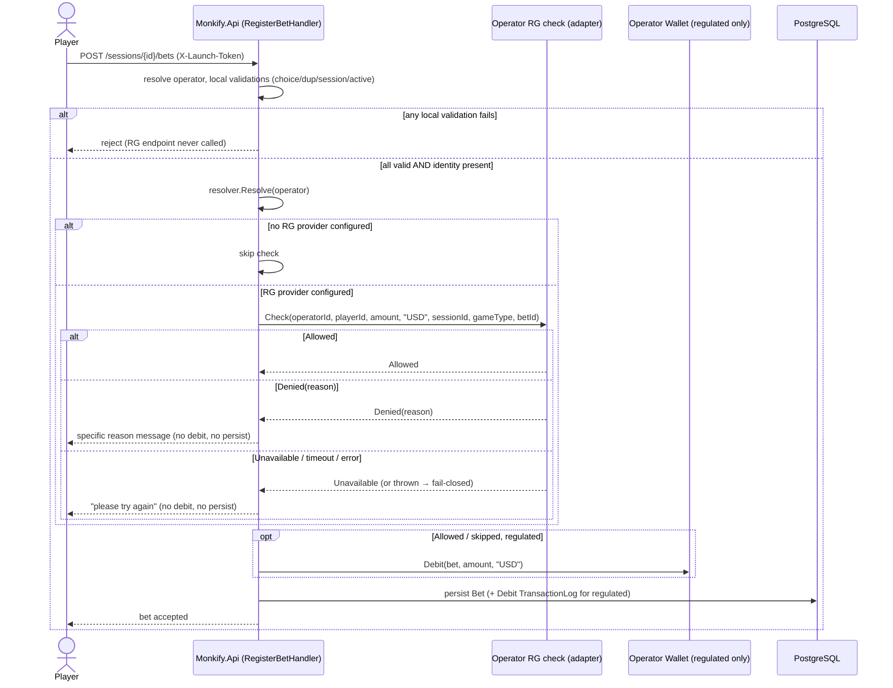

# Monkify — "Responsible-gaming pre-bet hook" Feature — Implementation Spec

> **Status: Shipped** — merged via `feature/rg-pre-bet-hook` on 2026-07-01. Refined via Trello card
> [RG pre-bet hook + operator integration doc](https://trello.com/c/Dj4znhYo) (2026-06-30).
> Repos affected: `monkify-backend` and this doc in `monkify-meta`. **Not** `monkify-front`.
> Distilled summary: `../features/rg-pre-bet-hook.md`.
>
> **Purpose:** Regulated operators own responsible gaming (RG) — self-exclusion, deposit/time
> limits, cooling-off, KYC. Monkify must let an operator **allow or deny a bet before it is
> accepted**, via a pluggable per-operator pre-bet check, without Monkify building an RG engine or
> storing player PII. The pitch-facing RG/operator **integration document is descoped to a separate
> story** — this spec is the backend hook only.

---

## 1. Summary

Today `RegisterBetHandler` (the API host) validates a bet locally (choice length, duplicate,
session accepting bets, operator active), then — for regulated operators — debits the stake through
the operator wallet as the last step before persisting. There is **no way for an operator to reject
a bet on responsible-gaming grounds** (a self-excluded player, a player over their deposit/time
limit, a cooling-off period, incomplete KYC, or an operator-blocked account).

This feature adds a **pre-bet check hook**: a pluggable per-operator adapter that Monkify calls
after local validation and **before** the wallet debit. The operator answers **allow / deny(reason)
/ unavailable**; a denial rejects the bet with a specific player message and never debits.

It deliberately mirrors the **shape** of the shipped operator-wallet adapter pattern
(`specs/operator-wallet-api.md`) — interface + provider **resolver** + a single dev/test mock — but
is a **separate, decoupled abstraction** because RG and wallet have opposite applicability rules:

| Aspect | Operator wallet (`IOperatorWalletService`) | Pre-bet check (`IPreBetCheckService`, this spec) |
| --- | --- | --- |
| Applies to | **Regulated only** (crypto pays on-chain) | **Any operator**, both payment models |
| Provider configured? | **Required** for regulated — missing = hard error | **Optional** — missing provider ⇒ resolver returns `null` ⇒ **check skipped** |
| Trigger | debit at bet time; credit/refund later | pre-bet check at bet time only (read-only) |
| Failure mode | fail-closed (specific player message) | fail-closed (specific player message) |

Because the check is opt-in and skips when unconfigured, **existing operators see zero behaviour
change** until one is configured.

---

## 2. Constraints (MANDATORY)

From `monkify-meta/constraints.md` (full list there):

- **Branch-per-repo:** `feature/rg-pre-bet-hook` in `monkify-backend` and `monkify-meta`
  (already created + pushed). **No** frontend branch — card marks `monkify-front` as not affected.
- **Unit tests:** update/add in `Monkify.Tests`; **report changed tests** at end of implementation.
- **EF mapping:** N/A — this feature adds **no entity, no column, no migration** (RG decisions are
  logged, not persisted). Do not add a table.
- **Secrets/config:** the per-operator RG config in `monkifysettings.json` uses **mock/placeholder
  values only**; real base URLs/keys are bound from the environment.
- **Operator messaging:** the vague operator-contract-status rule still applies to operator
  *availability* elsewhere. It does **not** apply here: an RG **denial** describes the *player's*
  state (self-excluded, over limit, …) and surfaces a **specific** message, exactly as the player's
  own wallet errors do (see §3 decision 6 and `operator-wallet-api.md` §2).
- **Host split:** the check is a synchronous **outbound call only** on the bet path in
  `Monkify.Api`; the API stays stateless and does not migrate. No work moves to `Monkify.Consumers`.

---

## 3. Resolved product decisions

| # | Decision |
| --- | --- |
| 1 | **New, dedicated abstraction.** `IPreBetCheckService` (single method `Check`) + a provider `IPreBetCheckResolver`, built in the same shape as the wallet adapter but **decoupled** — chosen over adding a method to `IOperatorWalletService` because RG applies to *any* operator and is *optional*, the opposite of the wallet service. |
| 2 | **Applies to any operator, both payment models.** The resolver selects an adapter per operator regardless of `PaymentModel`; crypto **and** regulated operators can use RG. |
| 3 | **Optional / opt-in.** No RG provider configured for an operator ⇒ `Resolve` returns **`null`** ⇒ the check is **skipped** and the bet proceeds. Default for every existing operator → backward compatible. (Contrast the wallet resolver, which **throws** on a missing provider.) |
| 4 | **Placement.** The check runs in `RegisterBetHandler` **after** `ValidateBetParameters` (choice/duplicate/session-accepting/operator-active all passed) and **immediately before** the wallet debit. So a malformed/duplicate/invalid bet never calls the RG endpoint, and a denied bet is never debited. Runs for both models: crypto → RG → persist; regulated → RG → debit → persist. |
| 5 | **Reason codes.** `PreBetCheckDenyReason` = `SelfExcluded, LimitReached, CoolingOff, KycRequired, Blocked` (+ `Other` for any operator-supplied/unmapped reason). Each of the five maps to a specific `ErrorMessages` key; `Other`/unknown → a **generic** fallback message. |
| 6 | **Deny UX — specific message.** A denial surfaces the mapped specific player-facing message via `ApiResult.messages` (player-state, not operator-contract status — the vague rule does not apply). |
| 7 | **Failure = fail-closed.** A timeout, transport error, or unexpected exception from the hook is treated as **`Unavailable`** and the bet is **rejected** with a specific "please try again" message; no debit, no persistence. No synchronous retry. |
| 8 | **Free bets.** The check **applies** to a free bet that carries an external player id; it is **skipped** for identity-less (anonymous) free bets — there is no player to check. (Non-free bets always carry an identity by the time the check runs.) The single guard is "run only when a resolved external player id exists." |
| 9 | **Audit = log only.** Each decision (outcome + reason code + a correlation id = the bet id) is written to the **server-side Serilog log only**. **No DB row, no migration, no PII stored.** |
| 10 | **Request payload.** `operatorId`, `externalPlayerId`, `amount`, `currency` ("USD"), `sessionId`, `gameType` (`SessionParameters.Name`), `betId` (correlation). |
| 11 | **Config & secrets** live under `GeneralSettings.OperatorRgChecks.Operators[<operatorId>]` = `{ Provider, BaseUrl, ApiKey, TimeoutSeconds }` in `monkifysettings.json`, **mock values only**; the committed block ships **empty** (`Operators: {}`) so no operator runs RG by default. |
| 12 | **Dev/test mock — shared class.** The existing `MockOperatorWalletService` **also implements** `IPreBetCheckService` (provider `"mock"`), returning `Allowed` for every check, so dev/tests keep a single mock. Forced deny/timeout are exercised in unit tests via Moq (the concrete mock always allows, exactly like the wallet mock always succeeds). |

---

## 4. Data model

**No entity, column, EF mapping, or migration changes.** RG decisions are logged, not persisted
(decision 9). This section is intentionally empty.

---

## 5. Configuration

New per-operator RG config, hung off `GeneralSettings`, mirroring `OperatorWalletSettings`.

**`Monkify.Domain/Configs/Entities/OperatorRgCheckSettings.cs`** — NEW:

```csharp
using System.Collections.Generic;
using System.Diagnostics.CodeAnalysis;

namespace Monkify.Domain.Configs.Entities
{
    /// <summary>
    /// Per-operator responsible-gaming pre-bet check configuration, keyed by operatorId (Guid as
    /// string). OPTIONAL per operator: an operator with no entry here has no RG check (the bet
    /// proceeds). Committed values are MOCK only.
    /// </summary>
    [ExcludeFromCodeCoverage]
    public class OperatorRgCheckSettings
    {
        public Dictionary<string, OperatorRgCheckConfig> Operators { get; set; } = new();
    }

    [ExcludeFromCodeCoverage]
    public class OperatorRgCheckConfig
    {
        public string Provider { get; set; }      // adapter key, e.g. "mock"
        public string BaseUrl { get; set; }       // mock placeholder in committed config
        public string ApiKey { get; set; }        // mock placeholder only
        public int TimeoutSeconds { get; set; }   // synchronous check timeout
    }
}
```

- Add `public OperatorRgCheckSettings OperatorRgChecks { get; set; }` to
  `Monkify.Domain/Configs/Entities/GeneralSettings.cs` (alongside `OperatorWallets`).
- Add an **empty** `"OperatorRgChecks": { "Operators": {} }` block to
  `Monkify.Common/monkifysettings.json` (under `GeneralSettings`, next to `OperatorWallets`).
  **Mock values only**; keep `Operators` empty so no operator runs RG by default (preserves
  acceptance criterion 1). A local dev entry can be added to exercise the hook (see §13).

---

## 6. Backend behaviour

### 6.1 The adapter abstraction (`Monkify.Infrastructure/Services/PreBetChecks/`)

New folder, sibling of `Services/OperatorWallets/`.

**`IPreBetCheckService.cs`**:

```csharp
public interface IPreBetCheckService
{
    string Provider { get; }
    Task<PreBetCheckResult> Check(PreBetCheckRequest request, CancellationToken cancellationToken);
}
```

**`PreBetCheckRequest.cs`** (value object passed to the adapter; the adapter serialises as its
operator API needs):

```csharp
public record PreBetCheckRequest
{
    public Guid OperatorId { get; init; }
    public string ExternalPlayerId { get; init; }
    public decimal Amount { get; init; }
    public string Currency { get; init; }        // "USD"
    public Guid SessionId { get; init; }
    public string GameType { get; init; }        // SessionParameters.Name
    public Guid BetId { get; init; }             // correlation
}
```

**`PreBetCheckDenyReason.cs`**:

```csharp
public enum PreBetCheckDenyReason
{
    SelfExcluded,
    LimitReached,
    CoolingOff,
    KycRequired,
    Blocked,
    Other          // operator-supplied / unmapped → generic fallback message
}
```

**`PreBetCheckResult.cs`** (mirrors `OperatorWalletResult`):

```csharp
public enum PreBetCheckOutcome { Allowed, Denied, Unavailable }

public record PreBetCheckResult
{
    public PreBetCheckOutcome Outcome { get; init; }
    public PreBetCheckDenyReason? DenyReason { get; init; }

    public static PreBetCheckResult Allowed() => new() { Outcome = PreBetCheckOutcome.Allowed };
    public static PreBetCheckResult Denied(PreBetCheckDenyReason reason)
        => new() { Outcome = PreBetCheckOutcome.Denied, DenyReason = reason };
    public static PreBetCheckResult Unavailable() => new() { Outcome = PreBetCheckOutcome.Unavailable };
}
```

**`IPreBetCheckResolver.cs` / `PreBetCheckResolver.cs`** — mirrors `OperatorWalletResolver`, but
**returns `null` when the operator has no/unknown provider** (opt-in; never throws for "not
configured"):

```csharp
public interface IPreBetCheckResolver
{
    // null => no RG check configured for this operator (skip).
    IPreBetCheckService? Resolve(Operator betOperator);
}

public class PreBetCheckResolver : IPreBetCheckResolver
{
    public PreBetCheckResolver(GeneralSettings settings, IEnumerable<IPreBetCheckService> adapters)
    {
        _settings = settings;
        _adapters = adapters.ToDictionary(a => a.Provider, StringComparer.OrdinalIgnoreCase);
    }

    private readonly GeneralSettings _settings;
    private readonly IReadOnlyDictionary<string, IPreBetCheckService> _adapters;

    public IPreBetCheckService? Resolve(Operator betOperator)
    {
        if (betOperator == null) return null;

        var config = GetConfig(betOperator.Id);
        if (config == null || string.IsNullOrWhiteSpace(config.Provider))
            return null;                                    // opt-in: not configured => skip

        // Configured with an unknown provider name is a real misconfiguration → throw (do NOT
        // silently skip a configured check).
        if (!_adapters.TryGetValue(config.Provider, out var adapter))
            throw new InvalidOperationException(
                $"No pre-bet check adapter registered for provider '{config.Provider}' (operator {betOperator.Id}).");

        return adapter;
    }

    private OperatorRgCheckConfig GetConfig(Guid operatorId)
    {
        var operators = _settings.OperatorRgChecks?.Operators;
        if (operators == null) return null;
        return operators.TryGetValue(operatorId.ToString(), out var config) ? config : null;
    }
}
```

> Note the deliberate asymmetry with the wallet resolver: **no config → skip (null)**, but
> **config present with an unknown provider → throw** (a configured check must not be silently
> dropped).

**Mock (shared class).** Extend `Monkify.Infrastructure/Services/OperatorWallets/MockOperatorWalletService.cs`
to also implement `IPreBetCheckService`:

```csharp
public class MockOperatorWalletService : IOperatorWalletService, IPreBetCheckService
{
    // string Provider => "mock";  (already present; shared for both interfaces)
    // ... existing Debit/Credit/Refund ...

    public Task<PreBetCheckResult> Check(PreBetCheckRequest request, CancellationToken cancellationToken)
    {
        Log.Information("Mock pre-bet check for bet {BetId} (operator {OperatorId}, player {Player}): Allowed",
            request.BetId, request.OperatorId, request.ExternalPlayerId);
        return Task.FromResult(PreBetCheckResult.Allowed());
    }
}
```

**DI** (`Monkify.Infrastructure/DependencyInjection.cs`, next to the wallet registrations at
lines 49–52):

```csharp
// RG pre-bet check: one adapter per provider, selected per operator via the resolver from
// GeneralSettings.OperatorRgChecks. OPTIONAL per operator (resolver returns null when unconfigured).
services.AddScoped<IPreBetCheckService, MockOperatorWalletService>();  // shared mock class, provider "mock"
services.AddScoped<IPreBetCheckResolver, PreBetCheckResolver>();
```

> Registering `MockOperatorWalletService` under both `IOperatorWalletService` and
> `IPreBetCheckService` is intentional — the resolver enumerates only its own interface, so each
> resolver sees the mock under provider `"mock"`. The class is stateless, so separate scoped
> instances are harmless.

### 6.2 The check step — `RegisterBetHandler`

`Monkify.Infrastructure/Handlers/Sessions/RegisterBet/RegisterBetHandler.cs`. Inject
`IPreBetCheckResolver` (new last constructor parameter).

Current order (post-refactor): build `_bet` → `ValidateBetSignature()` → `ValidateBetParameters(request)`
(line 117) → *(regulated)* `DebitOperatorWallet(...)` (lines 121–122) → `RegisterBet()` (line 124).

Insert the RG check **between line 117 and the debit block** (before line 121):

```csharp
await ValidateBetParameters(request);

// Responsible-gaming pre-bet check (any operator, opt-in). Runs after all local validation and
// before the wallet debit, so a denied/blocked bet is never debited and invalid/duplicate bets
// never reach the operator's RG endpoint. Skipped when there is no player identity to check
// (anonymous free bet) or when the operator has no RG provider configured.
if (resolvedExternalId != null)
    await RunPreBetCheck(betOperator!, resolvedExternalId, request, cancellationToken);

// Regulated (Model A): debit the stake ... (existing block, unchanged)
if (!_isCrypto && !_isFreeBet)
    await DebitOperatorWallet(betOperator!, cancellationToken);

await RegisterBet();
```

New private method:

```csharp
private async Task RunPreBetCheck(Operator betOperator, string externalPlayerId,
    RegisterBetRequest request, CancellationToken cancellationToken)
{
    var checkService = _preBetCheckResolver.Resolve(betOperator);   // null => not configured => skip
    if (checkService == null)
        return;

    PreBetCheckResult result;
    try
    {
        result = await checkService.Check(new PreBetCheckRequest
        {
            OperatorId = betOperator.Id,
            ExternalPlayerId = externalPlayerId,
            Amount = _bet.Amount,
            Currency = _bet.OperatorPlayer?.Currency ?? "USD",
            SessionId = request.SessionId,
            GameType = _bet.Session?.Parameters?.Name ?? request.Body?.Choice, // Name via loaded session
            BetId = _bet.Id
        }, cancellationToken);
    }
    catch (Exception ex)
    {
        // Fail-closed: any transport error / timeout / unexpected exception => Unavailable.
        Log.Warning(ex, "Pre-bet check failed for bet {BetId} (operator {OperatorId}); failing closed",
            _bet.Id, betOperator.Id);
        result = PreBetCheckResult.Unavailable();
    }

    Log.Information("Pre-bet check for bet {BetId} (operator {OperatorId}): {Outcome}{Reason}",
        _bet.Id, betOperator.Id, result.Outcome,
        result.DenyReason.HasValue ? $" ({result.DenyReason})" : string.Empty);

    switch (result.Outcome)
    {
        case PreBetCheckOutcome.Allowed:
            return;
        case PreBetCheckOutcome.Denied:
            Messaging.ReturnValidationFailureMessage(MapDenyReasonToMessage(result.DenyReason));
            return;   // ReturnValidationFailureMessage short-circuits the request (no debit, no persist)
        default: // Unavailable
            Messaging.ReturnValidationFailureMessage(ErrorMessages.RgCheckTemporarilyUnavailable);
            return;
    }
}

private static string MapDenyReasonToMessage(PreBetCheckDenyReason? reason) => reason switch
{
    PreBetCheckDenyReason.SelfExcluded => ErrorMessages.RgSelfExcluded,
    PreBetCheckDenyReason.LimitReached => ErrorMessages.RgLimitReached,
    PreBetCheckDenyReason.CoolingOff   => ErrorMessages.RgCoolingOff,
    PreBetCheckDenyReason.KycRequired  => ErrorMessages.RgKycRequired,
    PreBetCheckDenyReason.Blocked      => ErrorMessages.RgBlocked,
    _ => ErrorMessages.RgBetNotAllowed,   // Other / null / any future code => generic fallback
};
```

Notes:

- `resolvedExternalId` is the identity already computed at handler lines 93–95 (crypto → wallet from
  body; regulated → token `sub`). Using it as the guard means: non-free bets always run the check
  (they must have an identity by line 97); a free bet with an identity runs it; an anonymous free
  bet (`resolvedExternalId == null`) skips it. This satisfies decisions 4 and 8.
- `_bet.Session` is assigned inside `ValidateBetParameters` (handler line 233), so
  `_bet.Session.Parameters.Name` is available for `gameType` by the time this runs.
- `Messaging.ReturnValidationFailureMessage(...)` is the existing short-circuit used throughout the
  handler; after a Denied/Unavailable outcome, control does not reach the debit or `RegisterBet()`.
- The message flows `Messaging` → `ApiResult.messages` → existing frontend toast (no FE change).

### 6.3 Player-facing messages

Add to `Monkify.Common/Resources/ErrorMessages.resx` (and the generated `ErrorMessages.Designer.cs`
regenerates from it), following the existing `Wallet*` entries:

| Key | Suggested value |
| --- | --- |
| `RgSelfExcluded` | `You are currently unable to place bets. Please contact your operator.` |
| `RgLimitReached` | `This bet exceeds a limit set on your account. Please contact your operator.` |
| `RgCoolingOff` | `Betting is temporarily paused on your account. Please try again later.` |
| `RgKycRequired` | `Your account needs to be verified before you can place bets. Please contact your operator.` |
| `RgBlocked` | `Your account is not able to place bets at the moment. Please contact your operator.` |
| `RgBetNotAllowed` | `You can't place this bet right now. Please contact your operator.` |
| `RgCheckTemporarilyUnavailable` | `We could not process your bet at the moment. Please try again.` |

> Copy tone matches the existing `Wallet*` messages. Keep them generic enough not to leak sensitive
> RG state beyond what the operator's own reason code implies. These are **player-state** messages,
> not operator-contract-status — the vague-operator rule does not apply (constraints §2).

### 6.4 Host ownership

| Operation | Host | Why |
| --- | --- | --- |
| Pre-bet check | `Monkify.Api` (`RegisterBetHandler`) | must be synchronous to gate acceptance; outbound call only — API stays stateless, no persistence |

---

## 7. Frontend behaviour

**None.** A denied or unavailable bet rejection rides the existing `ApiResult.messages` → toast path
(identical to wallet-debit errors, which already ship). No composables, services, types, env flags,
or copy change in `monkify-front`.

---

## 8. Flow diagram



---

## 9. Out of scope

- A Monkify RG engine (limits, self-exclusion DB, KYC storage).
- Storing player PII for RG, or **persisting** RG decisions in Monkify's DB (log-only).
- The RG / operator **integration document** — moved to a separate story.
- Real (non-mock) per-operator RG adapters — added per onboarding later (separate cards).
- Any frontend change.

---

## 10. File checklist

### 10.1 Backend (`monkify-backend`)

| # | File | Change |
| --- | --- | --- |
| 1 | `Monkify.Domain/Configs/Entities/OperatorRgCheckSettings.cs` | **NEW** settings (`OperatorRgCheckSettings`, `OperatorRgCheckConfig`). |
| 2 | `Monkify.Domain/Configs/Entities/GeneralSettings.cs` | Add `OperatorRgChecks` property. |
| 3 | `Monkify.Common/monkifysettings.json` | Add empty `OperatorRgChecks: { "Operators": {} }` block under `GeneralSettings` (mock-only). |
| 4 | `Monkify.Infrastructure/Services/PreBetChecks/IPreBetCheckService.cs` | **NEW** abstraction (`Provider`, `Check`). |
| 5 | `Monkify.Infrastructure/Services/PreBetChecks/PreBetCheckRequest.cs` | **NEW** request VO. |
| 6 | `Monkify.Infrastructure/Services/PreBetChecks/PreBetCheckDenyReason.cs` | **NEW** enum (5 reasons + `Other`). |
| 7 | `Monkify.Infrastructure/Services/PreBetChecks/PreBetCheckResult.cs` | **NEW** result VO + `PreBetCheckOutcome` enum. |
| 8 | `Monkify.Infrastructure/Services/PreBetChecks/IPreBetCheckResolver.cs` + `PreBetCheckResolver.cs` | **NEW** resolver — returns `null` when unconfigured; throws only on a configured-but-unknown provider. |
| 9 | `Monkify.Infrastructure/Services/OperatorWallets/MockOperatorWalletService.cs` | Also implement `IPreBetCheckService.Check` → `Allowed` (shared mock). |
| 10 | `Monkify.Infrastructure/DependencyInjection.cs` | Register `IPreBetCheckService` (mock) + `IPreBetCheckResolver` (near the wallet registrations). |
| 11 | `Monkify.Infrastructure/Handlers/Sessions/RegisterBet/RegisterBetHandler.cs` | Inject `IPreBetCheckResolver`; add `RunPreBetCheck` + `MapDenyReasonToMessage`; call after `ValidateBetParameters`, before the debit, guarded by `resolvedExternalId != null`; fail-closed try/catch; log decision. |
| 12 | `Monkify.Common/Resources/ErrorMessages.resx` (+ regenerate `ErrorMessages.Designer.cs`) | Add the 7 `Rg*` message keys from §6.3. |

> **Hidden blocker (constructor fan-out):** adding a parameter to the `RegisterBetHandler`
> constructor breaks **every** `new RegisterBetHandler(...)` call site in the tests. In
> `Monkify.Tests/UnitTests/Handlers/RegisterBetHandlerTests.cs` there are **13** instantiations (all
> pass `_walletResolverMock.Object` as the last arg today). Each must gain a new
> `_preBetCheckResolverMock.Object` last argument. Grep `new RegisterBetHandler(` before finishing to
> catch any other call site (e.g. integration tests). MediatR constructs the handler by DI at
> runtime, so no production call site changes beyond DI registration.

### 10.2 Frontend (`monkify-front`)

None.

### 10.3 Meta (`monkify-meta`)

| # | File | Change |
| --- | --- | --- |
| 1 | `specs/rg-pre-bet-hook.md` | This spec. |
| 2 | `INDEX.md` | Add spec row (Ready); update "Feature currently in flight". |
| 3 | `features/rg-pre-bet-hook.md` | **Created at ship time** — distilled feature doc (hook contract, reason codes, opt-in/skip rules, fail-closed, sequence diagram). Add during `/monkify-ship-feature`. |

---

## 11. Unit tests

Project: `monkify-backend/src/Monkify.Tests`. Stack: xUnit + Shouldly + Moq + Bogus, in-memory EF.

Add a `Mock<IPreBetCheckResolver> _preBetCheckResolverMock` to `RegisterBetHandlerTests`; by default
have it **return `null`** (`Resolve(...)` → `null`) so all **existing** tests keep passing unchanged
(check skipped). Thread `_preBetCheckResolverMock.Object` as the new last ctor arg in all 13
instantiations. For the new RG tests, set up a `Mock<IPreBetCheckService>` and make the resolver
return it.

| Test file | Test cases | Expected |
| --- | --- | --- |
| `UnitTests/Handlers/RegisterBetHandlerTests.cs` | **Update** all 13 existing instantiations to pass the new resolver mock (default `Resolve` → `null`) | existing behaviour unchanged; RG skipped when resolver returns null (AC 1). |
| `UnitTests/Handlers/RegisterBetHandlerTests.cs` | Regulated, resolver returns a check service → `Allowed` | debit called once, bet persisted, `Check` called once (AC 2). |
| `UnitTests/Handlers/RegisterBetHandlerTests.cs` | Resolver returns service → `Denied(SelfExcluded)` | rejected with `ErrorMessages.RgSelfExcluded`; **debit not called**; `InsertBet` never called (AC 3, 4). |
| `UnitTests/Handlers/RegisterBetHandlerTests.cs` | `Denied(Other)` (or an unmapped reason) | rejected with generic `ErrorMessages.RgBetNotAllowed` (AC 6). |
| `UnitTests/Handlers/RegisterBetHandlerTests.cs` | `Check` returns `Unavailable` **and** `Check` throws | both rejected with `ErrorMessages.RgCheckTemporarilyUnavailable`; no debit, no persist; `Check` invoked once (no retry) (AC 5). |
| `UnitTests/Handlers/RegisterBetHandlerTests.cs` | Malformed / duplicate / wrong-status bet with a configured resolver | local validation rejects first; `Check` **never** called (AC 7). |
| `UnitTests/Handlers/RegisterBetHandlerTests.cs` | Free bet (amount 0) with an `ExternalPlayerId` + `Denied` | bet rejected by RG (AC 8). |
| `UnitTests/Handlers/RegisterBetHandlerTests.cs` | Anonymous free bet (no wallet, no `ExternalPlayerId`) with a configured resolver | `Check` **never** called; bet proceeds (AC 9). |
| `UnitTests/Handlers/RegisterBetHandlerTests.cs` | **Crypto** operator, resolver returns service → `Denied` | `Check` called and bet rejected (proves not regulated-only) (AC 10). |
| `UnitTests/Services/PreBetChecks/PreBetCheckResolverTests.cs` (**NEW**) | no config → null; config with provider "mock" → mock adapter; config with unknown provider → throws | opt-in skip (null); resolves; throws only on configured-unknown provider. |

> **Report every changed/added test file at the end of implementation** (constraints §2).

---

## 12. Acceptance criteria

From the Trello **Acceptance Criteria** checklist (1:1):

1. Given an operator with no RG provider configured, when a player places an otherwise-valid bet (crypto or regulated), then the RG check is skipped and the bet proceeds exactly as today.
2. Given an operator with an RG provider configured that returns Allow, when a player places a valid bet, then the bet proceeds (regulated: the wallet debit occurs; crypto: the bet persists).
3. Given an RG provider that returns Deny with a known reason code, when a player places a bet, then the bet is rejected with that reason's specific message, no wallet debit occurs, and no bet is persisted.
4. Given a regulated operator whose RG provider returns Deny, when a player places a bet, then the operator wallet Debit is never called (the RG check runs before the debit).
5. Given an RG provider that times out or errors, when a player places a bet, then the bet is rejected fail-closed with a specific "temporarily unavailable, please try again" message and no debit occurs.
6. Given an RG provider that returns Deny with an unknown/unmapped reason code, when a player places a bet, then a generic "you can't place this bet right now" fallback message is shown.
7. Given an operator with an RG provider configured, when a malformed, duplicate, or structurally invalid bet is submitted, then local validation rejects it first and the RG endpoint is never called.
8. Given a free bet that carries an external player id and an operator whose RG provider returns Deny, when the free bet is placed, then it is rejected by the RG check.
9. Given an anonymous free bet with no OperatorPlayer (no external player id), when it is placed against an operator with an RG provider, then the RG check is skipped and the bet proceeds.
10. Given a crypto (PaymentModel == Crypto) operator with an RG provider configured, when a player places a bet, then the RG check runs (the hook is not regulated-only).

---

## 13. Manual QA (local, docker-compose)

The shipped mock always **allows**, so locally you can verify the **allow** and **skip** paths
end-to-end; **deny** and **unavailable** outcomes are covered by the unit tests (Moq), matching how
the wallet mock's forced errors are unit-test-only.

1. Bring up the stack (`docker-compose up`). No migration is added by this feature.
2. **Skip path (default):** with `OperatorRgChecks.Operators` empty, mint a launch token for a
   seeded dev operator and place a bet → succeeds; logs show **no** pre-bet check line.
3. **Allow path:** temporarily add the dev operator's id to `OperatorRgChecks.Operators` with
   `{ "Provider": "mock", "BaseUrl": "https://mock-rg.local", "ApiKey": "MOCK_VALUE",
   "TimeoutSeconds": 10 }`, restart, place a bet → succeeds; logs show
   `Pre-bet check for bet … : Allowed`.
4. Revert the temporary config entry.

---

## 14. Trello / pipeline

- **Source card:** [RG pre-bet hook + operator integration doc](https://trello.com/c/Dj4znhYo)
  — list **Specs created**; the **Implementation** section on the card lists branch + spec.
- **Descoped:** the RG/operator **integration document** is a separate story (not this card).
- **After merge:** run `/monkify-ship-feature RG pre-bet hook + operator integration doc`
  (reads branch + spec from the card), then create `features/rg-pre-bet-hook.md`.

---

## 15. Revision log

| Date | Change |
| --- | --- |
| 2026-06-30 | Initial spec from refined card #20 + in-thread refinement decisions and code exploration. |
