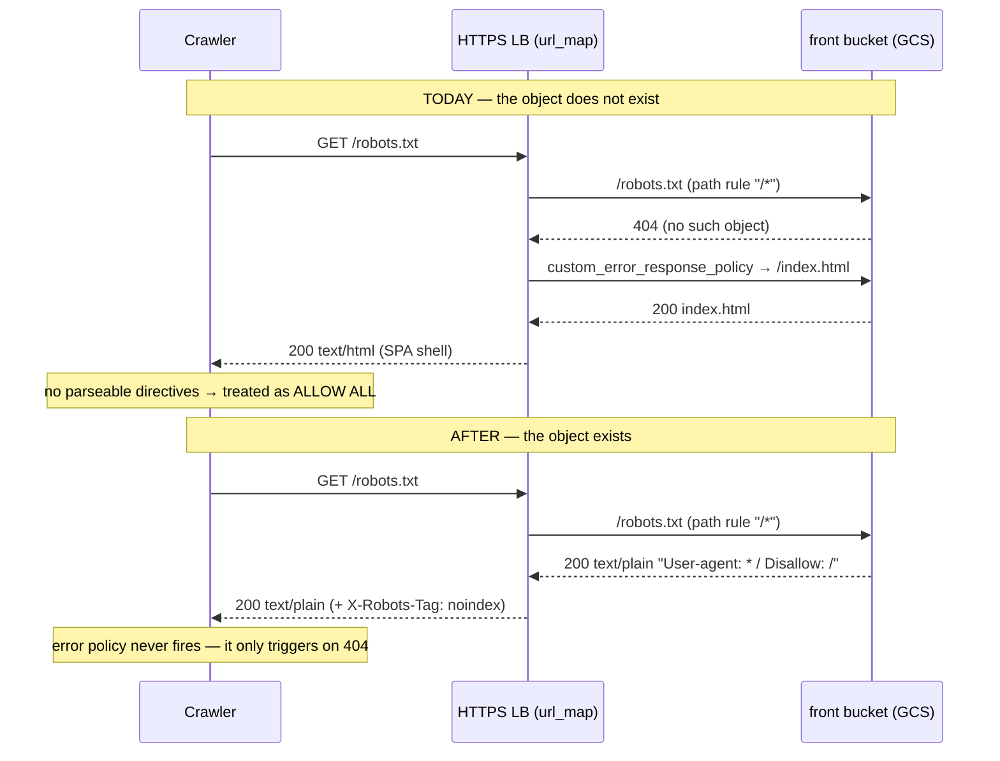

# SpaceStroker — "robots.txt" — Implementation Spec

> **Status: Ready for implementation** — refined via Trello card
> [Robots.txt](https://trello.com/c/6aOoMq2n) (2026-07-27).
> Repos affected: `monkify-backend`, `monkify-front`, `monkify-lp`, and this doc + Terraform in
> `monkify-meta`.
>
> **Purpose:** Give the three publicly reachable production hosts a deliberate crawler policy. Today
> the landing page is the only one with a `robots.txt`; `app.spacestroker.com` answers `/robots.txt`
> with the SPA's HTML under a **200** status, and `api.spacestroker.com` 404s — both of which
> crawlers read as *allow everything*. This spec blocks the app and the API outright, keeps the LP
> indexable, and stops AI **training** crawlers on the LP while leaving AI **search** crawlers (which
> cite and link back) allowed.

---

## 1. Summary

Three hosts, three different answers — and one of them is actively wrong rather than merely missing.

| Host | `GET /robots.txt` today | After |
| --- | --- | --- |
| `www.spacestroker.com` | 200, `Allow: /` + sitemap | 200, `Allow: /` + sitemap **+ AI-training deny blocks** |
| `spacestroker.com` (apex) | identical to `www` (same bucket) | identical to `www` — unchanged by design |
| `app.spacestroker.com` | **200 + the SPA's HTML** (`text/html`) | **200 + `text/plain`**, `Disallow: /` |
| `api.spacestroker.com` | **404** | **200 + `text/plain`**, `Disallow: /` |

### 1.1 Why the app host is the real bug

`monkify-front` has no `robots.txt`, so the object does not exist in the bucket. Since
[static-site-status-codes](static-site-status-codes.md) shipped, the `app` path matcher carries a
`custom_error_response_policy` on `/*` that rewrites a bucket 404 into `/index.html` with
`override_response_code = 200` (`deploy/terraform/workload/modules/edge/main.tf:140-153`). A crawler
therefore receives an HTML document with a **200 OK** where it expected robots directives.

Per [RFC 9309 §2.3](https://www.rfc-editor.org/rfc/rfc9309.html), a 2xx response is parsed as a
robots file and **unparseable lines are skipped**. An HTML document yields zero valid rules, which is
indistinguishable from an empty allow-all file. The practical effect: `app.spacestroker.com` is
fully crawlable right now, including

- `/space-stroker/wallet-bridge` — the same-origin wallet popup (`features/iframe-crypto-games.md`)
- `/space-stroker/background` — the chrome-free backdrop route (`specs/background-page.md`)
- `/verify.html` and `/embed-example.html` — real, unhashed, crawlable HTML pages

…and the LP's "PLAY NOW" links straight at it, so Google has a discovery path in.

### 1.2 What it costs

- **The app has nothing worth indexing.** It is a Vue SPA with no server-side rendering; a crawler
  receives the empty shell. A blank or title-only result under the brand name is worse than no result.
- **The API is crawlable on routes that cost money.** `GET /solana/balance` proxies to the paid
  Helius endpoint (`features/frontend-helius-gateway.md`), and `/health` wakes Cloud Run.
- **Bot traffic spends the player rate-limit budget.** Cloud Armor enforces 100 req/60 s per IP
  (`modules/edge/main.tf:20-29`); card [#104](https://trello.com/c/SpTvJGi9) documents that budget
  already banning a real player session.

---

## 2. Constraints (MANDATORY)

From `monkify-meta/constraints.md` (full list there):

- **Worktree per repo:** work in `.worktrees/robots-txt/<repo>` on branch `feature/robots-txt`
  (already created and pushed in all four repos). Every hub stays on its default branch — never
  `git checkout -b` there. **`monkify-lp`'s default branch is `master`, not `main`** — its branch was
  cut from `origin/master` and merges back to `master`.
- **Unit tests (§3):** the backend changes, so `SpaceStroker.Tests` gains a test for the new endpoint
  and the full suite must be run via `scripts/run_tests.bat`; report exactly which tests changed or
  were added.
- **Integration tests (§3):** the card is **Minor change**, so the mandatory happy-path integration
  test does **not** apply. One is written anyway for the API endpoint (§11.2) because it costs almost
  nothing — see decision #12.
- **API stays stateless (§8):** the endpoint returns a compile-time constant. No DB, no cache, no
  MediatR request, no injected service beyond what `BaseController` already requires.
- **EF / migrations:** not applicable — no entity, no column, no migration.
- **Secrets/config (§1):** nothing here reads or writes a secret. No `secrets.<env>.json` change.
- **Production applies are an operator step (§5):** the `X-Robots-Tag` Terraform change is written by
  the implementer but **`terraform apply` is run by the user**. See §5.2.
- **Knowledge base must be corrected:** `features/terraform-gcp-deploy.md` and `architecture.md`
  (§10.4). **No new `features/<slug>.md`** — the card is a Minor change.

---

## 3. Resolved product decisions

| # | Decision |
| --- | --- |
| 1 | **"Consumer" is out of scope** — the card's third target was a misspeak, confirmed during refinement. `SpaceStroker.Consumers` runs with `ingress = "INGRESS_TRAFFIC_INTERNAL_ONLY"` (`modules/cloud_run_consumers/main.tf:9`), has no DNS record and appears in no URL-map host rule, so no crawler can reach it. A `robots.txt` there would be unfetchable by anyone. **No change.** |
| 2 | **`app.spacestroker.com` is blocked outright** — `User-agent: *` / `Disallow: /`, not a targeted deny-list. The SPA is client-rendered, so there is no SEO to lose, and a maintained deny-list would silently rot as routes are added. |
| 3 | **The app also gets `X-Robots-Tag: noindex`** as a bucket response header. `Disallow` stops crawling but does **not** de-index — and by blocking the crawl it prevents Google from ever reading a `noindex` meta tag, so an already-known URL can persist as a bare titleless link. The header is the directive that actually removes it. |
| 4 | **The API serves `robots.txt` from a controller action**, not a static file and not an LB path rule. It is ~6 lines in `HomeController` (already `[Route("/")]`, already unauthenticated), works identically in local Docker and every deployed environment, needs **no Terraform**, and is unit-testable. |
| 5 | **The LP stays indexable.** Its wildcard group keeps `Allow: /` and the existing `Sitemap:` line unchanged. The LP is the property built for search — canonical, sitemap, OG tags, `max-image-preview:large` (`monkify-lp/src/layouts/Layout.astro:46-56`). |
| 6 | **The LP blocks AI *training* crawlers and allows AI *search* crawlers.** Search/answer engines that cite and **link back** are free distribution for a $0-budget organic launch (`marketing/twitter-launch-campaign.md`, `marketing/telegram-launch-campaign.md`, `marketing/promotion-channels.md`); training crawlers take the Edson story, art and positioning copy with no attribution and give nothing back. Tokens verified in §6.3. |
| 7 | **No `Disallow: /404` on the LP.** `monkify-lp/src/pages/404.astro` already renders `noindex, follow` via `Layout.astro:51-56` and is already excluded from the sitemap (`astro.config.mjs:24`). Blocking the crawl would *prevent* Google from ever reading that `noindex` — the opposite of the intent. |
| 8 | **The development environment is out of scope.** `deploy/terraform/workload/development.tfvars.json:16-19` gives dev its own public domains behind the same LB and publicly-readable buckets, so dev will keep serving prod's committed `robots.txt` verbatim — including a `Sitemap:` pointing at prod. Accepted knowingly; see §9. |
| 9 | **No sitemap for the app host.** It is being blocked; advertising a sitemap on a disallowed host is contradictory. |
| 10 | **The apex is not special-cased.** `spacestroker.com` and `www.spacestroker.com` share one path matcher and one bucket (`modules/edge/main.tf:113`), so both serve the same file with the same `www` `Sitemap:` line. `Layout.astro` already emits a `www` canonical, which is what resolves the duplicate. **Do not** introduce a per-host variant. |
| 11 | **`Cache-Control` and Cloud Armor sizing stay on their own cards** — [#103](https://trello.com/c/bSSvCfKF) and [#104](https://trello.com/c/SpTvJGi9). |
| 12 | **An API integration test is written even though the level waives it.** `GET /robots.txt` is an unauthenticated HTTP endpoint the existing harness reaches with `CreateAnonymousClient()`, so the marginal cost is one short file. It covers only the API third — the two static files are served by GCS and the header only exists in deployed GCP, and no test in this repo can reach either. |
| 13 | **⚠️ Correction to the card (found during code exploration):** the card's edge-case note says a changed `robots.txt` may sit stale at the CDN for up to an hour. **`Deployer.UploadAndInvalidate` already issues `gcloud compute url-maps invalidate-cdn-cache --path="/*"` immediately after every `gsutil rsync`** (`deploy/tools/SpaceStroker.Deploy/Deployer.cs:591-599`). No extra invalidation step is needed. Browser-side `max-age=3600` staleness is real but belongs to card #103. |
| 14 | **⚠️ Correction to the card (found during verification):** the card's proposed token list included `anthropic-ai`, which Anthropic's current documentation does not list, and left `ClaudeBot` "ambiguous". Anthropic documents `ClaudeBot` as the **training** crawler. Both resolved in §6.3. |
| 15 | **Social/link-preview crawlers must stay allowed on the LP.** `facebookexternalhit`, `Twitterbot`, `TelegramBot` and friends generate the unfurls the launch campaigns depend on. The wildcard `Allow: /` covers them; the AI deny blocks must **not** be written broadly enough to catch them. This is the single most damaging mistake available in this card. |

---

## 4. Data model

**Not applicable.** No entity, no enum, no column, no `OnModelCreating` mapping, no migration. The API
endpoint returns a constant string.

---

## 5. Configuration

### 5.1 Application configuration

None. No `GeneralSettings` key, no environment variable, no `.env` entry, no `spacestrokersettings.json`
change, no secret. Every value in this spec is a literal in committed source.

### 5.2 Terraform — one line, and it is an ops step

`deploy/terraform/workload/main.tf:132-140`, `module "front_site"`:

```hcl
module "front_site" {
  source                  = "./modules/static_site"
  project_id              = var.project_id
  name_prefix             = "${local.name_prefix}-front"
  bucket_name             = var.front_bucket_name
  location                = var.bucket_location
  custom_response_headers = [
    "Content-Security-Policy: frame-ancestors *",
    "X-Robots-Tag: noindex",
  ]
  labels = var.labels
}
```

No module change and no new variable — `custom_response_headers` is already a `list(string)` passed
through to `google_compute_backend_bucket.cdn` (`modules/static_site/main.tf:34`).

`module "lp_site"` is **deliberately untouched**: adding the header there would de-index the landing
page, which is the exact opposite of decision #5.

> ⚠️ **The header is not live until an operator runs `terraform apply` against production.** The
> implementing agent may run `terraform fmt` / `validate` / `plan`; it must not `apply`
> (`constraints.md` §5). Acceptance criterion §12.4 is verified by the user after that apply.

---

## 6. Behaviour

### 6.1 API — `GET /robots.txt` (`monkify-backend`)

`HomeController` is already `[Route("/")]` and already exposes an unauthenticated `health` action.
`/robots.txt` sits outside `LaunchTokenValidationMiddleware.ProtectedPrefixes`
(`= { "/games", "/operators", "/players", "/fx" }`, `LaunchTokenValidationMiddleware.cs:21`), so it
needs no launch token and no middleware change.

> **⚠️ Code-exploration finding — the class-level `[Produces("application/json")]` will break this.**
> `HomeController` is decorated `[Produces("application/json")]` (`HomeController.cs:18`). That filter
> forces the response content type for **every** action on the class, so a `Content(body, "text/plain")`
> would still be emitted as `application/json` and acceptance criterion §12.5 would fail. The new
> action **must** carry its own `[Produces("text/plain")]`, which overrides the class-level attribute.
> Do not remove the class-level attribute — `health` and future actions rely on it.

```csharp
/// <summary>
/// Crawler directives for the API host. Blocks everything: the API serves JSON, has no
/// indexable content, and crawler traffic spends the same per-IP Cloud Armor budget as players.
/// </summary>
/// <response code="200">The robots.txt body.</response>
[HttpGet("robots.txt")]
[Produces("text/plain")]
public IActionResult RobotsTxt()
    => Content("User-agent: *\nDisallow: /\n", "text/plain");
```

Notes for the implementer:

- Return `Content(...)`, not `Ok(...)` — `Ok(string)` round-trips through the JSON formatter.
- Use `\n` line endings, not `\r\n`. RFC 9309 accepts both, but `\n` keeps the unit-test assertion
  byte-exact across platforms and matches what the two static files will contain.
- The action takes no parameters and touches no injected dependency. `BaseController`'s `IMediator` /
  `IMessaging` are inherited but unused here, exactly as in `HealthCheck()`.
- **No sitemap line** on the API host (decision #9).

### 6.2 App SPA — `monkify-front/public/robots.txt`

New file, verbatim:

```
User-agent: *
Disallow: /
```

Vue CLI copies everything in `public/` to `dist/` untouched; `Deployer.BuildStaticSite(repo, isYarn: true)`
then `UploadAndInvalidate`s `dist/` to the front bucket (`Deployer.cs:50-51`). **No deploy-tool change,
no `vue.config.js` change.**

`gsutil` sets `Content-Type` from the file extension, so `.txt` → `text/plain`. Because the object now
exists, the bucket returns it directly and the `/*` `custom_error_response_policy` never fires — that
policy only triggers on a 404.

**No `Sitemap:` line** (decision #9). No SPA source file changes.

### 6.3 LP — `monkify-lp/public/robots.txt`

The existing file is:

```
User-agent: *
Allow: /

Sitemap: https://www.spacestroker.com/sitemap-index.xml
```

Both existing groups stay **byte-identical**. The AI deny blocks are appended.

#### Verified crawler tokens

Every token below was opened against the vendor's own documentation on **2026-07-27**. Tokens are
matched case-insensitively by crawlers, but write them exactly as the vendor documents them.

**Disallow — training crawlers**

| Token | Vendor | What the vendor says | Source |
| --- | --- | --- | --- |
| `GPTBot` | OpenAI | "used to crawl content that may be used in training our generative AI foundation models" | [developers.openai.com/api/docs/bots](https://developers.openai.com/api/docs/bots) |
| `ClaudeBot` | Anthropic | "collecting web content that could potentially contribute to their training" | [support.claude.com](https://support.claude.com/en/articles/8896518-does-anthropic-crawl-data-from-the-web-and-how-can-site-owners-block-the-crawler) |
| `Google-Extended` | Google | controls "whether content Google crawls from their sites may be used for training future generations of Gemini models"; explicitly **"does not impact a site's inclusion in Google Search nor is it used as a ranking signal"** | [developers.google.com](https://developers.google.com/search/docs/crawling-indexing/google-common-crawlers) |
| `meta-externalagent` | Meta | crawls "for training foundation AI models or improving products by indexing content directly" | [developers.facebook.com](https://developers.facebook.com/docs/sharing/webmasters/web-crawlers/) |
| `CCBot` | Common Crawl | Common Crawl publishes an open web-crawl repository. **Honest caveat:** its own page describes the mission as open research access and does **not** itself claim training use — the corpus is nonetheless a well-known input to public training datasets. Blocked on that basis. | [commoncrawl.org/ccbot](https://commoncrawl.org/ccbot) |
| `Bytespider` | ByteDance | **⚠ No official vendor documentation exists.** Third-party trackers attribute it to ByteDance LLM data collection, and multiple report that it **ignores `robots.txt`**. Include the rule (it costs one line) but do not expect compliance. | third-party only — no vendor source |

**Allow — search / user-triggered (they cite and link back)**

| Token | Vendor | What the vendor says | Source |
| --- | --- | --- | --- |
| `OAI-SearchBot` | OpenAI | "used to surface websites in search results in ChatGPT's search features" | [developers.openai.com](https://developers.openai.com/api/docs/bots) |
| `ChatGPT-User` | OpenAI | "used for certain user actions in ChatGPT"; "not used for crawling the web in an automatic fashion" | same |
| `Claude-SearchBot` | Anthropic | "navigates the web to improve search result quality for users" | [support.claude.com](https://support.claude.com/en/articles/8896518-does-anthropic-crawl-data-from-the-web-and-how-can-site-owners-block-the-crawler) |
| `Claude-User` | Anthropic | used when "individuals ask questions to Claude, it may access websites" | same |
| `PerplexityBot` | Perplexity | "designed to surface and link websites in search results… **not** used to crawl content for AI foundation models" | [docs.perplexity.ai/guides/bots](https://docs.perplexity.ai/guides/bots) |
| `Perplexity-User` | Perplexity | "supports user actions within Perplexity… not used for web crawling or to collect content for training" | same |
| `meta-webindexer` | Meta | enhances "Meta AI search result quality for users" | [developers.facebook.com](https://developers.facebook.com/docs/sharing/webmasters/web-crawlers/) |

These allowed tokens need **no explicit group** — the wildcard `Allow: /` already covers them, and a
crawler applies the most specific matching group. They are listed here so the next person understands
what was deliberately *not* blocked, and so nobody "tidies up" by widening a deny block over them.

**Corrections to the card's proposed list**

- `anthropic-ai` — **dropped.** Not present in Anthropic's current documentation (a legacy token).
  Leaving it in would imply a currency the list does not have.
- `ClaudeBot` — the card left its bucket open; Anthropic documents it as the **training** crawler, so
  it is in the Disallow set.
- `Applebot-Extended` — **⚠ deferred, not written.** Apple's support page (`support.apple.com/kb/HT6619`)
  could not be retrieved at spec time and web search was unavailable, so its behaviour could not be
  verified first-hand. Per the card's own rule (unverifiable ⇒ drop or flag), it is **omitted from the
  file**. If the implementer can open Apple's page and confirm that `Applebot-Extended` governs
  Apple-Intelligence training only and does **not** affect Applebot search indexing, add it to the
  Disallow set and note the verification date. Otherwise ship without it.
- `OAI-AdsBot` — newly discovered in OpenAI's docs (validates ad landing pages, explicitly not used
  for training). We buy no ads; **left allowed** by the wildcard. No rule.

#### Resulting file

```
User-agent: *
Allow: /

# AI training crawlers — blocked. The landing page copy, the Edson story and the art are ours;
# training corpora take them with no attribution and send nobody back.
# Search and answer engines that cite and LINK BACK are deliberately NOT blocked (see specs/robots-txt.md).
# Verified against vendor documentation 2026-07-27.

User-agent: GPTBot
Disallow: /

User-agent: ClaudeBot
Disallow: /

User-agent: Google-Extended
Disallow: /

User-agent: meta-externalagent
Disallow: /

User-agent: CCBot
Disallow: /

User-agent: Bytespider
Disallow: /

Sitemap: https://www.spacestroker.com/sitemap-index.xml
```

> **Do not** add `facebookexternalhit`, `Twitterbot`, `TelegramBot`, `Discordbot` or any other
> link-preview agent to a deny block (decision #15). Blocking them kills the unfurls that
> `marketing/twitter-launch-campaign.md` and `marketing/telegram-launch-campaign.md` depend on. Note in
> particular that `meta-externalagent` (blocked) and `facebookexternalhit` (allowed) are different
> agents from the same vendor — block the first, never the second.

Astro copies `public/` into `dist/` unchanged. **No `astro.config.mjs`, layout, page or component
change.**

---

## 7. Frontend behaviour

**No behavioural change in either frontend.** `monkify-front` gains one static file in `public/`;
`monkify-lp` edits one static file in `public/`. No component, composable, service, type, route, env
var or user-facing copy is touched, and no SPA code path reads either file.

---

## 8. Flow diagram — why the app host currently answers wrong



---

## 9. Out of scope

- **The development environment** (`dev.spacestroker.com`, `www.dev.`, `app.dev.`, `api.dev.`). Dev has
  real public DNS, publicly-readable buckets and managed TLS, and `robots.txt` is a committed static
  file, so dev will keep serving prod's `Allow: /` verbatim — leaving `dev.spacestroker.com` an
  indexable duplicate of the LP, with a `Sitemap:` pointing at prod. Knowingly accepted to keep this
  card to plain static files. The environment-aware alternative (an Astro `robots.txt` endpoint driven
  by the existing `frontBuild` env block, the pattern GA4 already uses per `features/analytics.md`,
  defaulting to *block* when unset) is the shape a follow-up card should take.
- `SpaceStroker.Consumers` — internal ingress only; unreachable by crawlers (decision #1).
- **`Cache-Control` on static-site uploads** — card [#103](https://trello.com/c/bSSvCfKF).
- **Cloud Armor rate-limit sizing / player lockouts** — card [#104](https://trello.com/c/SpTvJGi9).
- Any change to SPA behaviour, LP content or design, the LB topology, or the Astro sitemap config.
- A sitemap for `app.spacestroker.com`.
- Running `terraform apply` — an operator step (§5.2).
- Requesting removal of already-indexed app URLs in Google Search Console — a manual follow-up if any
  turn up.

---

## 10. File checklist

### 10.1 Backend (`monkify-backend`)

| # | File | Change |
| --- | --- | --- |
| 1 | `src/SpaceStroker.Api/Controllers/HomeController.cs` | Add `RobotsTxt()` — `[HttpGet("robots.txt")]` + **`[Produces("text/plain")]`** (overrides the class-level JSON attribute), returning `Content("User-agent: *\nDisallow: /\n", "text/plain")`. |
| 2 | `src/SpaceStroker.Tests/UnitTests/Controllers/HomeControllerTests.cs` | **New file.** Assert body and content type (§11.1). |
| 3 | `src/SpaceStroker.Tests.Integration/RobotsTxtTests.cs` | **New file.** Anonymous client hits `GET /robots.txt` (§11.2). |

### 10.2 App frontend (`monkify-front`)

| # | File | Change |
| --- | --- | --- |
| 1 | `public/robots.txt` | **New file.** `User-agent: *` / `Disallow: /`. No sitemap line. |

### 10.3 Landing page (`monkify-lp`)

| # | File | Change |
| --- | --- | --- |
| 1 | `public/robots.txt` | Append the six AI-training deny groups from §6.3. Wildcard group and `Sitemap:` line unchanged. |

### 10.4 Meta (`monkify-meta`)

| # | File | Change |
| --- | --- | --- |
| 1 | `deploy/terraform/workload/main.tf` | `module "front_site"` → add `"X-Robots-Tag: noindex"` to `custom_response_headers`. `module "lp_site"` untouched. |
| 2 | `specs/robots-txt.md` | This spec (already committed at spec time). |
| 3 | `INDEX.md` | Spec row + "Feature currently in flight" (already done at spec time); flip to Shipped at ship time. |
| 4 | `features/terraform-gcp-deploy.md` | **At ship time.** Record the per-bucket crawler policy: the front bucket now carries `X-Robots-Tag: noindex` alongside the CSP; the lp bucket deliberately does not. |
| 5 | `architecture.md` | **At ship time.** Record that app + API are `Disallow: /` while the LP is indexable, and that the LP blocks AI training crawlers but not AI search or link-preview crawlers. |

**No** `features/robots-txt.md` — the card is a **Minor change**.

---

## 11. Tests

### 11.1 Unit tests

Project: `monkify-backend/src/SpaceStroker.Tests`. New file
`UnitTests/Controllers/HomeControllerTests.cs`, following the existing
`UnitTests/Controllers/LaunchControllerTests.cs` shape (`UnitTestsClass` base, Shouldly, xUnit).

| Test case | Expected |
| --- | --- |
| `RobotsTxt_ReturnsDisallowAll` | Result is `ContentResult`; `Content` equals `"User-agent: *\nDisallow: /\n"` exactly. |
| `RobotsTxt_ReturnsPlainTextContentType` | `ContentResult.ContentType` starts with `text/plain` — guards the `[Produces("application/json")]` trap in §6.1. |
| `RobotsTxt_AdvertisesNoSitemap` | Body does **not** contain `Sitemap:` (decision #9). |
| `HealthCheck_StillReturnsOk` | Regression guard: the existing `health` action still returns `OkObjectResult` with `"Api running!"`. |

### 11.2 Integration test (voluntary — decision #12)

Project: `monkify-backend/src/SpaceStroker.Tests.Integration`. New file `RobotsTxtTests.cs`, modelled
on `RpcProxyTests.cs` (`[Collection(IntegrationCollection.Name)]`, `IntegrationTestFixture`,
`CreateAnonymousClient()`).

| Test case | Expected |
| --- | --- |
| `RobotsTxt_WithNoLaunchToken_ReturnsPlainTextDisallowAll` | `GET /robots.txt` on an **anonymous** client → `HttpStatusCode.OK`, `Content-Type` starts with `text/plain`, body contains `User-agent: *` and `Disallow: /`. Proves the launch-token middleware does not gate it. |

Run with `scripts/run_integration_tests.bat`. Report changed/added tests at the end
(`constraints.md` §3).

### 11.3 What no test can cover — stated honestly

- `monkify-front/public/robots.txt` and `monkify-lp/public/robots.txt` are served by **GCS**, entirely
  outside the Testcontainers harness. Verified manually (§13) and by §12.1/§12.8.
- `X-Robots-Tag: noindex` exists only on a deployed GCP backend bucket. Verified by the user after
  `terraform apply` (§12.4).
- Neither frontend repo has a JS test runner, so the two static files get no automated check at all.

---

## 12. Acceptance criteria

Mirrors the Trello **Acceptance Criteria** checklist 1:1.

1. Given the app is deployed, when `https://app.spacestroker.com/robots.txt` is fetched, then it
   returns HTTP 200 with `Content-Type: text/plain` and a body containing `User-agent: *` and
   `Disallow: /` — **not** the SPA's HTML.
2. Given the app's `robots.txt`, when `/space-stroker/wallet-bridge`, `/space-stroker/background`,
   `/verify.html` and `/embed-example.html` are each evaluated against it, then every one is
   disallowed for every user-agent, and no `Sitemap:` line is advertised for the app host.
3. Given `module "front_site"` in `deploy/terraform/workload/main.tf`, when the config is reviewed,
   then `custom_response_headers` contains **both** `Content-Security-Policy: frame-ancestors *` and
   `X-Robots-Tag: noindex`; and `module "lp_site"`'s headers are unchanged.
4. Given `terraform apply` has been run against production by an operator, when any object is fetched
   from `app.spacestroker.com`, then the response carries `X-Robots-Tag: noindex`.
   *(Ops step — cannot be closed by merging alone.)*
5. Given `SpaceStroker.Api` is running, when `GET /robots.txt` is requested with **no**
   `X-Launch-Token` header, then it returns HTTP 200 with `Content-Type: text/plain` and a body
   disallowing all agents — never 401, never 404.
6. Given the backend change, when `scripts/run_tests.bat` runs, then the full `SpaceStroker.Tests`
   suite is green, a unit test asserts the exact `/robots.txt` body and content type, and the
   changed/added tests are reported at the end.
7. Given `SpaceStroker.Tests.Integration`, when the suite runs, then a test drives `GET /robots.txt`
   against the real API host and asserts 200 + `text/plain` + `Disallow: /`.
8. Given `https://www.spacestroker.com/robots.txt` after the change, when fetched, then the wildcard
   group still reads `User-agent: *` / `Allow: /` and the
   `Sitemap: https://www.spacestroker.com/sitemap-index.xml` line is byte-for-byte unchanged.
9. Given the LP `robots.txt`, when an AI **training** token (`GPTBot`, `CCBot`, `Google-Extended`) is
   evaluated, then it is disallowed from `/`; and when an AI **search** token (`OAI-SearchBot`,
   `PerplexityBot`) is evaluated, then it remains allowed.
10. Given the spec, when the AI bot token list is written, then every token was checked against that
    vendor's current published documentation at spec time, the source is cited per token, and
    `ClaudeBot`'s bucket is decided with a written reason. **→ satisfied by §6.3**, with
    `Applebot-Extended` explicitly deferred as unverifiable and `anthropic-ai` dropped.
11. Given the LP `robots.txt`, when it is reviewed, then **no** `Disallow: /404` rule exists.
12. Given the apex host, when `https://spacestroker.com/robots.txt` is fetched, then it returns the
    identical file to `www` with the same `www` `Sitemap:` line — no per-host variant.
13. Given the change ships, when the knowledge base is synced, then `features/terraform-gcp-deploy.md`
    records the per-bucket crawler policy (including the new `X-Robots-Tag` header) and
    `architecture.md` records that app + API are `Disallow: /` while the LP is indexable — and **no**
    new `features/<slug>.md` is created.

**Added during spec writing (not on the card):**

14. Given the LP `robots.txt`, when it is reviewed, then **no** link-preview agent
    (`facebookexternalhit`, `Twitterbot`, `TelegramBot`, `Discordbot`) appears in any `Disallow`
    group, and sharing `https://www.spacestroker.com` on X and Telegram still renders a full unfurl
    with the OG image.

---

## 13. Manual QA

Local (verifies the API third only — the static files need a deployed bucket):

1. `docker compose up` the local stack (or run `SpaceStroker.Api` directly).
2. `curl -i http://localhost:<api-port>/robots.txt` → expect `200`, `Content-Type: text/plain`, body
   `User-agent: *` / `Disallow: /`. **If the content type says `application/json`, the
   `[Produces("text/plain")]` attribute from §6.1 is missing.**
3. `curl -i http://localhost:<api-port>/health` → still `200` `"Api running!"` (regression).

After the front/LP deploy and the operator's `terraform apply`:

4. `curl -i https://app.spacestroker.com/robots.txt` → `200`, `text/plain`, `Disallow: /`, and an
   `X-Robots-Tag: noindex` header.
5. `curl -i https://app.spacestroker.com/` → `200` and also carries `X-Robots-Tag: noindex`.
6. `curl -i https://www.spacestroker.com/robots.txt` → `200`, wildcard still `Allow: /`, deny blocks
   present, sitemap line intact, and **no** `X-Robots-Tag` header.
7. `curl -i https://spacestroker.com/robots.txt` → byte-identical to step 6.
8. `curl -i https://api.spacestroker.com/robots.txt` → `200`, `text/plain`, `Disallow: /`.
9. Paste `https://www.spacestroker.com` into X and Telegram → the unfurl still renders with the OG
   image (guards §12.14).
10. Google Search Console → check whether any `app.spacestroker.com` URL is already indexed; if so,
    request removal (out of scope for the code change, noted in §9).

---

## 14. Trello / pipeline

- **Source card:** [Robots.txt](https://trello.com/c/6aOoMq2n) (#105) — list **Specs created**;
  the **Implementation** section on the card carries the branch, worktree, spec path and level.
- **Level:** `Minor change` → no mandatory integration test, no dedicated `features/<slug>.md`.
- **Next:** `/monkify-implement-feature Robots.txt`, then `/monkify-ship-feature Robots.txt`.
- **Note for ship:** `monkify-lp` merges into **`master`**, not `main`.

---

## 15. Revision log

| Date | Change |
| --- | --- |
| 2026-07-27 | Initial spec from refined card #105. Crawler tokens verified live against OpenAI, Anthropic, Google, Perplexity, Meta and Common Crawl documentation; `anthropic-ai` dropped and `Applebot-Extended` deferred as unverifiable. Two card corrections recorded (decisions #13 CDN invalidation already exists, #14 token list) plus the `[Produces("application/json")]` trap in §6.1 and the link-preview-crawler risk in decision #15. |
