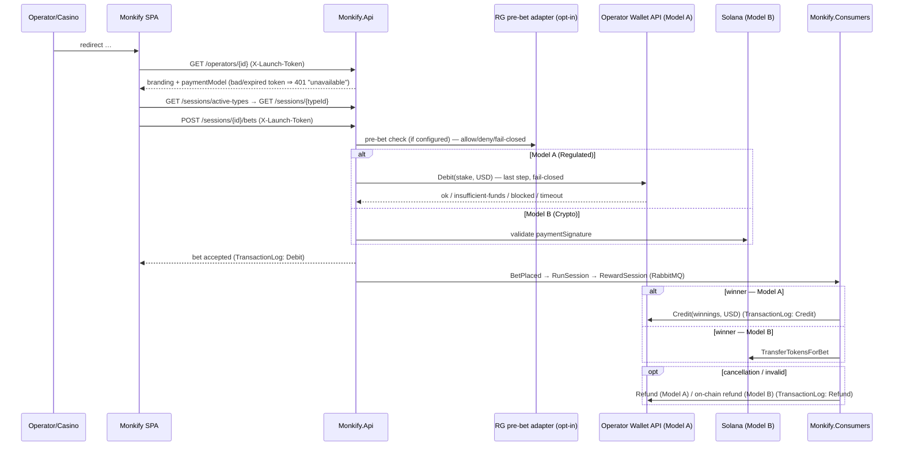

# Monkify — "Sales Technical Documents (B2B SaaS)" — Implementation Spec

> **Status: Ready for implementation** — refined via Trello card
> [Setup technical documents for selling the game as a SAAS](https://trello.com/c/NFNDRlBk) (2026-07-01).
> Repos affected: **`monkify-meta`** (write target — the deliverable + this spec).
> `monkify-backend` and `monkify-front` are **read-only grounding sources** (no branches, no code changes).
>
> **Purpose:** Produce the **technical / commercial document set** sales uses to take a casino
> prospect from first contact through the under-NDA deep-dive. This is a **non-code,
> document-production** story: the deliverable is a set of standardized Markdown documents committed
> under `monkify-meta/sales/`, grounded read-only in the shipped backend so the technical claims are
> accurate, with **no real PII/contacts/secrets** committed and every paid step marked **DEFERRED**.

---

## 1. Summary

This card is the **technical/commercial** sibling of the *legal* documents batch
([`specs/legal-pitch-documents-batch-1.md`](legal-pitch-documents-batch-1.md)) and of the
pitch-**strategy** card [#1 (ZowgQHZg)](https://trello.com/c/ZowgQHZg). It consolidates three
archived cards — #23 (Dual-track pitch doc), #21 (Integration overview for casino tech teams), and
#24 (Anti-clone positioning playbook) — into **one work item → one spec → three documents** (each
with a PT-BR variant). Parent epic: [B2B integration package](https://trello.com/c/w6ymVPgD).

The three documents and their nature:

| # | Document | Audience | Reveal stage | Grounding |
| --- | --- | --- | --- | --- |
| 01 | **Dual-track pitch doc** | Casino commercial / BD | Cold-sendable (self-contained) | Commercial framing; Model A/B tracks |
| 02 | **Integration overview** | Casino CTO / integration engineer | **Under NDA** (Confidential) | **Read-only live backend** (launch→bet→settle) |
| 03 | **Anti-clone positioning playbook** (+ pre-sales-call checklist) | Internal sales / BD | Internal | Commercial / GTM |

**Single source of truth for the two tracks:** the **Model A vs Model B** definition is written
**once** in `sales/README.md` and reused **verbatim** across all three docs:

- **Model A (Regulated)** — operator-owned wallet; buyer example BetMGM / BR-licensed; integration =
  signed **launch token** + operator **wallet API** (debit/credit/refund) + optional **RG pre-bet hook**;
  player identity = token `sub` (`ExternalPlayerId`). Monkify holds **no float**.
- **Model B (Crypto-native)** — Monkify-hosted payments (SOL/USDT/etc.); buyer example BetFury-style;
  integration = launch token (`iss` operator, empty `sub`) + wallet public key as the player reference,
  on-chain settlement via Solana.

**Deliverable location:** `monkify-meta/sales/` — `01`–`03` (+ `.pt-BR.md` each), a shared
`_TEMPLATE.md`, and a `README.md` index that carries the canonical track definitions. Mermaid diagrams
inline; a **PDF / slide-deck export is DEFERRED** (optional / separate step).

---

## 2. Constraints (MANDATORY)

From `monkify-meta/constraints.md` (full list there) and the refined card:

- **Branch-per-repo:** `feature/sales-technical-documents` — created in **`monkify-meta` only** (the
  only write target). **No** branches in `monkify-backend` / `monkify-front` (no code changes).
- **No real PII / contacts / secrets committed (§1):** placeholders only. No real owner/entity/CNPJ,
  no real casino contacts, and — critically for Doc 02 — **no real keys, credentials, connection
  strings, or tokens**. Any illustrative token/config is an obvious mock (`MOCK_…`, `your-key-here`).
- **Vague operator messaging (§6):** Doc 02, when describing token/operator failures, must present a
  single generic **HTTP 401** / "not found / unavailable" — **never** reveal contract status
  ("expired", "not started"). This is a factual property of the shipped system; document it as such.
- **Zero-budget / DEFERRED:** every cost-incurring step (GLI/BMM lab RNG certification, lawyer review,
  trademark filing) is tagged **DEFERRED** — never presented as done or promised.
- **IP-protection discipline:** Doc 02 is **under-NDA** (`Confidential — shared under NDA`); nothing
  sensitive (source, real credentials, internal infra topology) is shared pre-signature. Docs are
  drafts (`Status: Draft — not legal advice` where commercial terms appear).
- **No production data / external calls (§5):** grounding for Doc 02 is **read-only** local code; no
  production DB/API access, no live endpoint probing.
- **Non-code work:** no backend/frontend changes, no EF mapping, no migrations, **no unit tests** (§3
  test discipline does not apply — see §11). Backend/front are read **only** to ground Doc 02.
- **EF/migrations/secrets constraints for app code:** N/A — no app code is written.

---

## 3. Resolved product decisions

| # | Decision |
| --- | --- |
| 1 | Deliverable = **3 standardized Markdown docs** under **`monkify-meta/sales/`** (`01`–`03`), on **one shared template**; plus `_TEMPLATE.md` and `README.md`. Mermaid diagrams; **PDF/deck export DEFERRED**. |
| 2 | **One batch, one spec:** this single card produces all three docs together (shared track framing + pricing source). |
| 3 | **Model A / Model B defined once** in `sales/README.md` and reused **verbatim** in all three docs (single source of truth; consistent framing). |
| 4 | **Language:** EN master **+ a PT-BR variant for all three docs** (`NN-….pt-BR.md`), same structure and content. |
| 5 | **Doc 01 is self-contained** — restates the pitch strategy it needs so it can be sent alone; **references** card #1 (ZowgQHZg) as the strategy source but does not depend on it. Messaging = *"integrate with YOUR wallet and player account"* (not "we don't do payments"). |
| 6 | **Pricing headline = setup fee + monthly platform fee ONLY — no %NGR / revenue share** (dropped for now). Keep **12-month minimum term** and **exclusivity as a paid add-on** as editable commercial levers (not revenue components). All figures tagged **editable**. |
| 7 | **Doc 02 = under-NDA technical detail** — endpoint-level `launch token → game load → bet → settle` flow, deeper architecture, API specifics. Supersedes the old "one-page / no full OpenAPI" framing: endpoint-level flow is in scope; **no real secrets**. Marked **Confidential — under NDA**. |
| 8 | **Doc 02 grounded read-only in shipped code:** launch-token-validation, operator-wallet-api, rg-pre-bet-hook, and the session state machine (see §6). Accuracy over drift. |
| 9 | **Doc 03 = anti-clone playbook + pre-sales-call checklist** — first-reference-operator (aspirational, **no client claimed**), exclusivity, speed-to-launch, brand-by-name, cost framing, plus a short pre-sales-call checklist. |
| 10 | **Discipline:** placeholders, no real PII/contacts; operator names (BetMGM/BetFury/Hub88/SOFTSWISS…) are **illustrative examples only, never claimed clients**; paid steps **DEFERRED**; mock-only secrets; `Draft` status where commercial terms appear. |
| 11 | Non-code — `monkify-meta` only; **no** backend/front branches; **no** unit tests. |

---

## 4. Document-set architecture

### 4.1 Folder layout (`monkify-meta/sales/`)

```
sales/
  README.md                         index + the canonical Model A / Model B track definitions
  _TEMPLATE.md                      the shared document template (§4.2)
  01-dual-track-pitch.md            (+ 01-dual-track-pitch.pt-BR.md)
  02-integration-overview.md        (+ 02-integration-overview.pt-BR.md)
  03-anti-clone-playbook.md         (+ 03-anti-clone-playbook.pt-BR.md)
```

PT-BR variants use the `.pt-BR.md` suffix and carry the same structure as their English master.

### 4.2 Shared document template (`_TEMPLATE.md`)

Every document opens with the same front block, then Purpose and body, and closes with Document
control:

```markdown
# Monkify — <Document Title>

> **Version:** <n> · **Date:** <YYYY-MM-DD>
> **Audience:** <who this is for>
> **Confidentiality:** <Public / Cold-sendable | Confidential — shared under NDA>
> **Status:** Draft — not legal advice.

## Purpose
<one short paragraph: what this document is and who it is for.>

## <body sections — per document>

## Document control
- **Model A/B source of truth:** `sales/README.md` (definitions reused verbatim).
- **Grounded in (read-only):** <code paths, or "n/a — commercial">.
- **Deferred (paid) steps:** <list, or "none">.
```

### 4.3 `sales/README.md` (canonical track definitions + index)

Contains: (a) a one-line index of the three docs with audience + confidentiality; (b) the **verbatim
Model A / Model B block** from §1 that every doc reuses; (c) a note that PDF/deck export is deferred;
(d) the discipline note (placeholders, illustrative operator names, DEFERRED paid steps).

---

## 5. Per-document production plan

### 5.1 `01-dual-track-pitch.md` (+ PT-BR)

- **What:** A **self-contained** commercial pitch document explaining the **two integration tracks** so
  sales can pitch the right shape to crypto vs regulated buyers. Restates only the strategy it needs
  (one-liner, staged-reveal note, next step = NDA + technical review); **references** card #1 for the
  full outreach/strategy but does not depend on it.
- **Body:**
  - **One-liner + "why it's different"** (players bet on the first word a simulated monkey types;
    fully built backend/web/mobile/ops).
  - **The two tracks table** (verbatim from `README.md`): Track · buyer example · payments ·
    integration depth.
  - **What Monkify owns vs what the operator owns:** player identity, KYC, responsible-gaming, float —
    per model (Model A: operator owns player/KYC/RG/float; Model B: Monkify hosts payments, wallet is
    the player reference).
  - **Messaging guardrail:** *"integrate with YOUR wallet and player account"* — never "we don't do
    payments".
  - **Commercial model (SaaS only):** headline = **setup fee + monthly platform fee** (figures
    **editable**, **no %NGR / revenue share**); **12-month minimum term** and **exclusivity as a paid
    add-on** as editable levers; closing line: *"Detailed game logic, internal tooling, and diligence
    materials are available under NDA/non-use for serious counterparties."*
- **Confidentiality:** Cold-sendable (self-contained; no internals).
- **Deferred:** GLI/BMM certification (if mentioned) = **DEFERRED**.

### 5.2 `02-integration-overview.md` (+ PT-BR) — **UNDER NDA, ground in code**

- **What:** The under-NDA **technical integration deep-dive** for casino engineering teams: the
  endpoint-level **launch → game load → bet → settle** flow, the deeper architecture, and API
  specifics, with the **Model A vs Model B** paths called out at every settlement step.
- **Confidentiality:** header **`Confidentiality: Confidential — shared under NDA`**. No real
  secrets/keys/credentials — any example token/config is an obvious mock.
- **Required content (grounded in §6 code):**
  1. **Launch** — the casino signs an **RS256 launch token** with its private key; redirects to
     `…/monkify/game/sessions#launch_token=<jwt>`. Claims: `iss` = operatorId, `sub` =
     externalPlayerId (empty for crypto), `exp`/`iat`/`jti`. Monkify validates against
     `Operator.LaunchPublicKey` (±2 min skew) in `LaunchTokenValidationMiddleware`; every
     operator-scoped REST call carries **`X-Launch-Token`**. Any failure → **generic HTTP 401** (real
     reason logged server-side only) — never reveals contract status.
  2. **Game load** — SPA reads branding via **`GET /operators/{id}`** (returns `paymentModel`), lists
     game types via **`GET /sessions/active-types`**, a session via **`GET /sessions/{sessionTypeId}`**;
     player prefs via **`PATCH /players/preferences`** (display name + currency, render-only).
  3. **Bet** — **`POST /sessions/{id}/bets`** → `RegisterBetHandler`. Order: local validation →
     **RG pre-bet check** (`RunPreBetCheck`, opt-in per operator, allow/deny/**fail-closed**, **before**
     the debit) → **stake settlement** (Model A: operator **wallet debit**, `DebitOperatorWallet`, last
     step, fail-closed; Model B: on-chain `paymentSignature` validated). Denied/invalid bet is **never
     debited or persisted**.
  4. **Run** — session state machine over RabbitMQ/MassTransit:
     `BetPlacedEvent → RunSessionEvent → RewardSessionEvent`, with `RefundInvalidBetEvent` for
     failures. The typer streams over SignalR (`/Hubs/Sessions`, `/Hubs/RecentBets`).
  5. **Settle** — **credit** at reward (Model A: `CreditThroughOperatorWallet` in
     `RewardSessionConsumer`; Model B: `ISolanaService.TransferTokensForBet`); **refund** on
     post-acceptance cancellation (Model A: `RefundThroughOperatorWallet` in
     `RefundInvalidBetConsumer`; Model B: on-chain refund). **No Monkify commission** — winners
     receive the **full pot**. Every money movement is a **`TransactionLog`** row
     (`Credit | Debit | Refund`); there is **no** `RefundLog`.
  6. **What the operator implements (Model A):** a wallet API with **Debit / Credit / Refund**
     (`IOperatorWalletService` shape; amounts in **USD**), and optionally an **RG pre-bet adapter**
     (`IPreBetCheckService`: allow / deny(reason) / fail-closed).
- **Diagram:** a Mermaid `sequenceDiagram` of launch→bet→settle showing both model paths (see §8).
- **Cross-references:** the legal **Fairness & Game Rules** (`legal/04-…`) and **Proof of Ownership**
  (`legal/03-…`) docs; do not restate their content.
- **Out (of this doc):** full OpenAPI for every endpoint; real infra topology; source.
- **Deferred:** none for the doc itself (certification claims stay in the legal fairness doc, DEFERRED).

### 5.3 `03-anti-clone-playbook.md` (+ PT-BR)

- **What:** An internal **commercial/GTM positioning playbook** (1–2 pages) that makes *licensing*
  Monkify easier than *building* internally, plus a **pre-sales-call checklist**.
- **Body:**
  - **First reference operator** — even one crypto-native live deployment is social proof (framed
    **aspirationally — no client is named or claimed**; use "target" / "once live" language).
  - **Exclusivity** — a paid contract add-on (territory / vertical / time-boxed).
  - **Speed narrative** — "weeks to launch vs months to build + certify internally".
  - **Brand** — players/operators ask for Monkify by name, not "word typer game".
  - **Cost framing** — internal rebuild + certify vs SaaS setup + monthly (tie to Doc 01 pricing; no
    %NGR).
  - **Pre-sales-call checklist** — a short checklist sales runs before a prospect call (which doc to
    send when, NDA gating for Doc 02, what to confirm about the buyer's payment model, etc.).
- **Confidentiality:** Internal.
- **Deferred:** patents / legal anti-clone enforcement are **out of scope** (see §9), not "deferred".

---

## 6. Code-grounding requirements (read-only) — Doc 02

The producer must **read** the live code before finalizing Doc 02 — the KB `features/` docs are the
map, the code is the ground truth. Confirmed touchpoints (verified 2026-07-01):

| Area | Read (no edits) | Confirm |
| --- | --- | --- |
| Launch token | `Monkify.Api/Middleware/LaunchTokenValidationMiddleware.cs`; `Monkify.Api/Launch/LaunchTokenService.cs`; `Infrastructure/Services/Launch/ILaunchContext.cs`; `features/launch-token-validation.md` | `X-Launch-Token` RS256; `iss`/`sub`; ±2 min skew; generic 401; `paymentModel` from `GET /operators/{id}` |
| Endpoints | `Monkify.Api/Controllers/{Sessions,Operators,Players,Dev}Controller.cs` | Routes: `GET /sessions/active-types`, `GET /sessions/{sessionTypeId}`, `POST /sessions/{id}/bets`, `GET /operators/{id:guid}`, `PATCH /players/preferences`, `POST /dev/launch-token` (dev-only) |
| Bet + RG + debit | `Infrastructure/Handlers/Sessions/RegisterBet/RegisterBetHandler.cs` (`RunPreBetCheck`, `DebitOperatorWallet`, `MapWalletErrorToMessage`) | RG check before debit; debit last + fail-closed; specific player wallet messages |
| RG hook | `Infrastructure/Services/PreBetChecks/IPreBetCheckService.cs`, `IPreBetCheckResolver.cs`; `features/rg-pre-bet-hook.md` | allow / deny(reason) / fail-closed; opt-in per operator; unconfigured ⇒ skipped |
| Wallet adapter | `Infrastructure/Services/OperatorWallets/IOperatorWalletService.cs`, `MockOperatorWalletService.cs` | Debit / Credit / Refund; USD; per-operator provider resolver |
| Credit / refund | `Infrastructure/Consumers/RewardSession/RewardSessionConsumer.cs` (`CreditThroughOperatorWallet`); `Infrastructure/Consumers/RefundInvalidBet/RefundInvalidBetConsumer.cs` (`RefundThroughOperatorWallet`) | Model A wallet vs Model B Solana; free bets skipped |
| Ledger | `Monkify.Domain/Bets/Entities/TransactionLog.cs`; `Monkify.Domain/Bets/ValueObjects/TransactionLogType.cs`; `features/operator-wallet-api.md` | Unified `TransactionLog` (`Credit`/`Debit`/`Refund`); **no** `RefundLog`; **no commission** |
| State machine | `architecture.md` §4; `Infrastructure/Consumers/{BetPlaced,RunSession,RewardSession,RefundInvalidBet}/*` | `BetPlaced → RunSession → RewardSession`; `RefundInvalidBet`; SignalR hubs |

---

## 7. Frontend / backend behaviour

**None.** No code is written in either app. All references above are **read-only** grounding for the
prose and the sequence diagram in Doc 02. Doc 02 may *describe* the frontend launch flow
(`#launch_token=…`, `X-Launch-Token` interceptor, param-free routes, payment-model-gated bet UX) as
integration context, but changes **no** frontend file.

---

## 8. Flow diagram (Doc 02 — launch → bet → settle, both models)



---

## 9. Out of scope

- **Legal contract text** (NDA/MSA/pilot/escrow) and **GLI/BMM certification promises** — owned by the
  legal batch; certification stays **DEFERRED**.
- **Patents / legal anti-clone enforcement.**
- The pitch **deck**, demo **video**, and promotional **art** (separate cards on this board).
- **Full OpenAPI** for every endpoint (Doc 02 gives endpoint-level flow, not an API reference).
- A **PDF / slide-deck export** pipeline (Markdown in `monkify-meta/sales/` is the deliverable).
- The runnable **demo environment** (Trello #22 — complementary, but a separate card).
- Any application **code change**, EF mapping, migration, or unit test.
- Committing any **real PII**, contacts, or secrets.

---

## 10. File checklist

### 10.1 Backend (`monkify-backend`)
None (read-only grounding — no files changed).

### 10.2 Frontend (`monkify-front`)
None (read-only grounding — no files changed).

### 10.3 Meta (`monkify-meta`)

| # | File | Change |
| --- | --- | --- |
| 1 | `sales/README.md` | New — index + **canonical Model A/B track definitions** + discipline note |
| 2 | `sales/_TEMPLATE.md` | New — shared document template (§4.2) |
| 3 | `sales/01-dual-track-pitch.md` (+ `.pt-BR.md`) | New — self-contained dual-track pitch (§5.1) |
| 4 | `sales/02-integration-overview.md` (+ `.pt-BR.md`) | New — under-NDA technical deep-dive, code-grounded (§5.2, §6, §8) |
| 5 | `sales/03-anti-clone-playbook.md` (+ `.pt-BR.md`) | New — anti-clone playbook + pre-sales-call checklist (§5.3) |
| 6 | `specs/sales-technical-documents.md` | This spec |
| 7 | `INDEX.md` | Add spec row + set "Feature currently in flight" |

---

## 11. Unit tests

**Not applicable.** This is a non-code, document-production story — no backend behavior changes, so
`Monkify.Tests` is not touched and the §3 test-discipline constraint does not apply. "Verification" is
the §12 acceptance-criteria review (see §13 Manual QA), not automated tests.

---

## 12. Acceptance criteria

Mapped 1:1 from the Trello **Acceptance Criteria** checklist:

1. Given the `monkify-meta/sales/` folder, when the batch is complete, then it contains `README.md`,
   `_TEMPLATE.md`, and the three docs `01-dual-track-pitch`, `02-integration-overview`,
   `03-anti-clone-playbook`, each following the shared template (title, version/date, status, purpose,
   body, control) with Mermaid used for any diagram.
2. Given the Model A vs Model B track framing, when it appears in any of the three docs, then it
   matches the single definition in `sales/README.md` verbatim (Model A = regulated / operator wallet +
   launch token + RG hook; Model B = crypto / Monkify-hosted, wallet as ExternalPlayerId) with no
   divergent wording.
3. Given doc 01 (dual-track pitch), when reviewed, then it is self-contained (restates the strategy it
   needs, references card #1 ZowgQHZg without depending on it), maps both tracks to
   buyer/payments/integration-depth and Monkify-vs-operator ownership, and states pricing as setup fee
   + monthly platform fee only (no %NGR / revenue share) with 12-month minimum term and
   exclusivity-as-paid-add-on tagged editable.
4. Given doc 02 (integration overview), when reviewed against the shipped backend, then its
   endpoint-level launch→bet→settle flow matches launch-token-validation (X-Launch-Token RS256,
   iss/sub, vague 401), operator-wallet-api (debit at bet time / credit at reward / refund; unified
   TransactionLog; no commission), rg-pre-bet-hook (allow/deny/fail-closed before the debit), and the
   session state machine, and shows both Model A (operator wallet) and Model B (on-chain Solana)
   settlement paths.
5. Given doc 02 (integration overview), when inspected for IP-protection, then it is marked
   "Confidential — under NDA", contains no real secrets/keys/credentials (mock placeholders only),
   describes operator/token failures as a generic 401 / "not found / unavailable" (never revealing
   contract status), and cross-references the legal Fairness & Game Rules and Proof of Ownership docs.
6. Given doc 03 (anti-clone playbook), when reviewed, then it covers first-reference-operator (framed
   aspirationally, no client claimed), exclusivity as a contract add-on, speed-to-launch narrative,
   brand-by-name, and internal-rebuild-vs-SaaS-fee cost framing, and includes a short pre-sales-call
   checklist for sales conversations.
7. Given the produced doc set, when validated for language, then each of the three docs has an EN
   master and a PT-BR variant (`NN-….pt-BR.md`) carrying the same structure and content.
8. Given any committed sales doc, when inspected for discipline, then it contains no real PII/contacts
   (placeholders only), any operator names appear as illustrative examples only (never claimed as
   clients), every paid step (GLI/BMM cert, lawyer, trademark) is marked DEFERRED and never presented
   as done, and commercial-term sections carry a "Draft — not legal advice" status.
9. Given the batch is a non-code monkify-meta story, when it is implemented, then a
   `feature/sales-technical-documents` branch is created in `monkify-meta` only (no monkify-backend /
   monkify-front branches, no code changes, no unit tests), and `INDEX.md` is updated with the new spec
   row plus the `sales/` docs.

---

## 13. Manual QA (review checklist)

1. `sales/` contains `README.md`, `_TEMPLATE.md`, and the three docs each with a `.pt-BR.md` variant
   (9 files total); each opens with the shared front block and closes with **Document control**.
2. Diff-check: the Model A/B block in `01`, `02`, `03` is byte-for-byte the block in `README.md`.
3. `02-integration-overview.md`: header says `Confidential — shared under NDA`; grep for a real key /
   connection string / CNPJ / owner name → **no** matches (only obvious `MOCK_…` placeholders).
4. `02-…`: mentions `X-Launch-Token`, `iss`/`sub`, generic 401, `RunPreBetCheck` (allow/deny/fail-closed
   before debit), `DebitOperatorWallet`, `CreditThroughOperatorWallet`, `RefundThroughOperatorWallet`,
   unified `TransactionLog`, no commission; the Mermaid sequence renders and shows both model paths.
5. `01-…`: pricing = setup + monthly only (no `%NGR` / "revenue share"); 12-mo minimum + exclusivity
   present and tagged editable.
6. `03-…`: no operator named as a live client; includes a pre-sales-call checklist.
7. Every `DEFERRED` paid step is visibly labelled; nothing paid is claimed as done.
8. `INDEX.md` shows the new spec row (status **Ready**) and the "Feature currently in flight" entry.

---

## 14. Trello / pipeline

- **Source card:** [Setup technical documents for selling the game as a SAAS](https://trello.com/c/NFNDRlBk)
  — moved to **Specs created**; the **Implementation** section on the card lists the branch + spec path.
- **After the docs are produced & merged:** run
  `/monkify-ship-feature Setup technical documents for selling the game as a SAAS` (reads the branch
  from the card). Note: ship-feature's backend-test step is N/A here; the KB "sync" is that `sales/`
  now holds the technical/commercial documents.

---

## 15. Revision log

| Date | Change |
| --- | --- |
| 2026-07-01 | Initial spec from refined card #27 (same-chat refinement). Doc 02 grounded read-only in shipped `launch-token-validation`, `operator-wallet-api` (unified `TransactionLog`, no commission), and `rg-pre-bet-hook`; controller routes and service/handler touchpoints verified live. |
