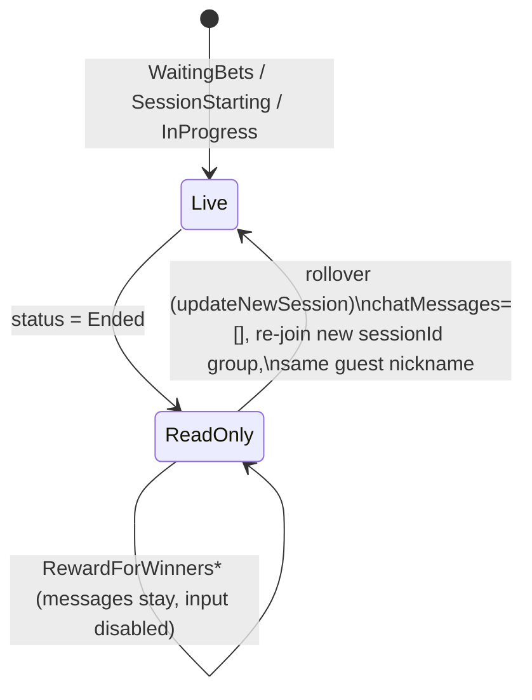

# Monkify — "Add chat" Feature — Implementation Spec

> **Status: Ready for implementation** — refined via Trello card
> [Add chat](https://trello.com/c/7UnjEOom/4-add-chat) (2026-07-03).
> Repos affected: `monkify-backend`, `monkify-front`, and this doc in `monkify-meta`.
>
> **Purpose:** A lightweight, ephemeral, per-session chat so players on `/game` can talk to each
> other while watching the monkey type — during the betting/waiting phase and the live run. This is
> social engagement, **not** a persisted support channel: no database, no history, SignalR only.

---

## 1. Summary

Add a realtime chat scoped to **one active session instance**. It reuses the existing
`ActiveSessionsHub` (the `Sessions` hub), its per-session SignalR group, and its Redis backplane —
**no new hub, no new hub connection**. The frontend already opens exactly one `ActiveSessionsHub`
connection per session (`wsSessionsConnection` in `useSession`) and joins the session group via
`JoinSession(sessionId)`; chat piggybacks on that same connection and group.

| Aspect | Behaviour |
| --- | --- |
| **Scope** | One chat room per **active session instance** = the existing SignalR group keyed by `sessionId`. |
| **Identity** | Auto-generated guest nickname (e.g. `Player-4821`); **no wallet required**. Stable per browser tab via `sessionStorage`; new tab / browser close ⇒ new name. |
| **Persistence** | **Ephemeral** — no DB, no entity, no migration. Late joiners see no prior messages. |
| **Transport** | New hub method `SendChatMessage` on `ActiveSessionsHub`; server broadcasts `ChatMessage` to the session group. |
| **Content** | Plain text only (keyboard emoji OK). No linkify, no emoji picker, no markdown. |
| **Limits** | **Client-side only:** 200 chars max, 1 message / 2 s, inline validation. Server enforces **length (≤200) + non-empty** as a hard guard; **no** server rate limiting in v1. |
| **Lifecycle** | Visible the whole time on `/game`. After the session ends (status `Ended`), messages stay visible and the input goes **read-only**. On session rollover (auto-advance to the next instance), the message list clears, input re-enables, the **same** guest nickname is kept, and chat re-joins the new session group. |
| **UI** | Right sidebar, absolutely positioned, **open by default**, hide/show toggle (no persistence of the toggle across reload). |
| **Host** | `Monkify.Api` only (SignalR hub). No `Monkify.Consumers` change. |

There is **no REST API** for chat — it is entirely over SignalR.

---

## 2. Constraints (MANDATORY)

From `monkify-meta/constraints.md` (full list there):

- **Branch-per-repo:** `feature/session-chat` in **both** `monkify-backend` and `monkify-front`
  (and this doc in `monkify-meta`).
- **Unit tests:** add tests in `Monkify.Tests` for the new hub behaviour (length/empty guard,
  broadcast shape); update any affected tests; **report which tests changed/added** at end of work.
  Run the full `Monkify.Tests` suite via `scripts/run_tests.bat` before declaring done.
- **EF mapping / migrations:** **N/A** — this feature adds no entity, no column, no migration.
- **Secrets/config:** only mock/placeholder values in committed config. The one new setting
  (`SessionChatEndpoint`) is a non-secret string template.
- **Operator messaging:** unchanged — chat adds **no** operator-specific messaging; operator scoping
  is implicit via the per-session group. Never reveal contract status anywhere.
- **Host responsibilities intact:** the API stays stateless w.r.t. chat (SignalR only, Redis-backed);
  no game/money/typer logic added; `Monkify.Consumers` untouched.

---

## 3. Resolved product decisions

| # | Decision |
| --- | --- |
| 1 | Chat is per **active session instance** — one room per session, reusing the existing `sessionId` SignalR group on `ActiveSessionsHub`. |
| 2 | Extend `ActiveSessionsHub` with `SendChatMessage` — **do not** add a third hub or a third client connection. |
| 3 | Anonymous **guest nickname** (`Player-XXXX`); no wallet required to read or send. |
| 4 | Nickname is stable for the browser **tab** via `sessionStorage`; a new tab or a browser-close ⇒ a new name. Same-tab refresh reuses it. |
| 5 | **Ephemeral** — no DB, no history; late joiners see only messages sent after they joined. |
| 6 | Chat is visible the whole time on `/game` for that session. |
| 7 | After the session ends (`Ended`): messages from the run stay visible; the input becomes **read-only**. |
| 8 | On session rollover (auto-advance to the next instance): **full reset** — clear the message list, re-enable input, keep the same guest nickname, join the new session room. |
| 9 | **UI:** right sidebar, absolutely positioned, **open by default**, hide/show toggle. The toggle state is **not** persisted (no `localStorage`). |
| 10 | **Content:** plain text only (keyboard emoji allowed). No linkify, no emoji picker, no markdown. |
| 11 | **Limits (client-side):** 200 chars max, 1 message / 2 s, inline validation feedback. |
| 12 | **Server guard:** reject empty/whitespace and messages > 200 chars; do not broadcast them. **No** server-side rate limiting, profanity filter, or moderation in v1. |
| 13 | v1 **trusts the client-sent guest name** (acceptable for an anonymous MVP). |
| 14 | Broadcast payload shape: `{ guestName, text, sentAt }`, where `sentAt` is a **server** UTC timestamp. |

---

## 4. Data model

**None.** No entity, no EF mapping change, no migration, no `SessionParameters`/`Session` column.
Chat messages exist only in-flight over SignalR and in the browser tab's memory. This is deliberate
(decision #5). Do not add a table or a `ChatMessage` entity.

---

## 5. Configuration

### 5.1 Backend — one new endpoint template (non-secret)

Mirror the existing per-session endpoint convention in `GeneralSettings.Sessions` (`{0}/Terminal`,
`{0}/Status`, `{0}/Bets`, `{0}/DisplaySpeed`).

- **`Monkify.Domain/Configs/Entities/SessionSettings.cs`** — add:

  ```csharp
  public string SessionChatEndpoint { get; set; }
  ```

- **`Monkify.Common/monkifysettings.json`** → `GeneralSettings.Sessions` — add:

  ```json
  "SessionChatEndpoint": "{0}/ChatMessage"
  ```

  (The bin-folder copies are build outputs; only edit the source `Monkify.Common/monkifysettings.json`.)

### 5.2 Frontend — client limits (no new env var required)

The 200-char and 1-msg/2 s limits are v1 constants in the composable; no `VUE_APP_*` needed. Keep them
as named constants (e.g. `MAX_CHAT_LENGTH = 200`, `CHAT_MIN_INTERVAL_MS = 2000`) so they are easy to
find. `VUE_APP_WEBSOCKET_BASE_URL` (already used by `useSession`) is reused unchanged.

---

## 6. Backend behaviour (`monkify-backend`)

All backend work is in `Monkify.Infrastructure/Hubs/ActiveSessionsHub.cs`. The hub currently has no
constructor and three methods (`OnConnectedAsync`, `OnDisconnectedAsync`, `JoinSession`,
`LeaveSession`). Chat clients already call `JoinSession(sessionId)` (via `useSession`), so the group
membership needed for chat already exists.

### 6.1 Inject settings

Give the hub a constructor that takes `GeneralSettings` (already registered in DI and consumed the
same way by `SessionService`) so the broadcast method name comes from `Sessions.SessionChatEndpoint`
instead of a magic string:

```csharp
public class ActiveSessionsHub : Hub
{
    private readonly GeneralSettings _settings;
    public ActiveSessionsHub(GeneralSettings settings) => _settings = settings;
    // ...existing overrides + JoinSession/LeaveSession unchanged...
}
```

### 6.2 `SendChatMessage`

```csharp
public const int MaxChatMessageLength = 200;

public async Task SendChatMessage(string sessionId, string guestName, string text)
{
    // Hard guard (decision #12): reject empty/whitespace or over-length; do NOT broadcast.
    if (string.IsNullOrWhiteSpace(sessionId)) return;
    if (string.IsNullOrWhiteSpace(text)) return;
    if (text.Length > MaxChatMessageLength) return;

    // Trust the client-sent guest name in v1 (decision #13); fall back if absent.
    var name = string.IsNullOrWhiteSpace(guestName) ? "Player" : guestName.Trim();

    var chatEndpoint = string.Format(_settings.Sessions.SessionChatEndpoint, sessionId);
    var payload = new { guestName = name, text = text.Trim(), sentAt = DateTime.UtcNow }.AsJson();

    await Clients.Group(sessionId).SendAsync(chatEndpoint, payload);
}
```

Notes:

- **Broadcast target:** `Clients.Group(sessionId)` — the same group used for terminal/status/bets;
  Redis backplane already fans this out across API instances.
- **Method name:** `string.Format(SessionChatEndpoint, sessionId)` ⇒ `"{sessionId}/ChatMessage"`,
  matching the `{sessionId}/Terminal` convention so the client can `.on(...)`/`.off(...)` it per
  session on rollover exactly like the other handlers.
- **Payload:** serialized with `.AsJson()` (from `Monkify.Common.Extensions.CommonExtensions`, same
  helper `SessionService` uses for status/terminal). The frontend `JSON.parse`s it, consistent with
  the existing `${sessionId}/Terminal` and `${sessionId}/Status` handlers.
- **`sentAt`** is a **server** UTC timestamp — do not trust a client timestamp.
- **No server rate limiting** in v1 (decision #12). The `MaximumReceiveMessageSize` (32 KB) already
  configured in `Program.cs` is an ambient safety net; the 200-char guard is the real limit.
- On rejection the method simply returns (no broadcast). Optionally throw `HubException` for detailed
  errors in Development, but the acceptance criteria only require "does not broadcast" — returning is
  sufficient and simpler to test.

### 6.3 What does NOT change

- No new hub, no new `MapHub` entry (chat uses `/Hubs/Sessions`, already mapped in `Program.cs`).
- `RecentBetsHub` untouched.
- No consumer, no `SessionService`, no MassTransit event, no controller, no DTO, no migration.

---

## 7. Frontend behaviour (`monkify-front`)

The chat reuses the single `wsSessionsConnection` that `useSession` already owns (an
`ActiveSessionsHub` connection to `/Hubs/Sessions`). Transport is centralised in `useSession`;
presentation and guest identity live in a new `useSessionChat` composable and a `GameChatPanel`
component.

### 7.1 `useSession.ts` — transport wiring (shared connection is the single source of truth)

`wsSessionsConnection` is recreated on every `initalizeWebsocketConnections`, so the chat receive
handler must be (re)registered there and torn down in `disconnectAllPreviousConnections`, exactly
like `${sessionId}/Terminal` and `${sessionId}/Status`.

Add a module-scoped `const chatMessages = ref<ChatMessage[]>([]);` and:

1. **Register receive** — inside `initalizeWebsocketConnections`, after the connection starts and
   `JoinSession` is invoked, alongside the existing `.on(...)` handlers:

   ```ts
   wsSessionsConnection.value.on(
     `${sessionInstance.value?.sessionId}/ChatMessage`,
     (data: string) => {
       const msg = JSON.parse(data) as ChatMessage; // { guestName, text, sentAt }
       chatMessages.value.push(msg);
     }
   );
   ```

2. **Tear down** — in `disconnectAllPreviousConnections`, add
   `wsSessionsConnection.value.off(`${sessionInstance.value?.sessionId}/ChatMessage`)` next to the
   existing `.off('SessionReceived')` / `.off(`${...}/Terminal`)` lines.

3. **Send** — expose a `sendChatMessage`:

   ```ts
   const sendChatMessage = async (guestName: string, text: string) => {
     const sessionId = sessionInstance.value?.sessionId;
     if (!sessionId || !wsSessionsConnection.value) return;
     await wsSessionsConnection.value.invoke('SendChatMessage', sessionId, guestName, text);
   };
   ```

4. **Rollover reset** — in `updateNewSession` (which already resets `terminalOutput`,
   `currentLotteryPot`, etc.), add `chatMessages.value = [];` so the message list clears when the game
   auto-advances to the next instance. The same `initalizeWebsocketConnections` call re-registers the
   `ChatMessage` handler against the **new** `sessionId` group, satisfying "join the new session
   room". The guest nickname lives in `sessionStorage` (§7.2) and is untouched by rollover.

5. **Expose** `chatMessages` (as a `computed`/ref) and `sendChatMessage` from the `useSession` return
   object.

> Rationale: `useSession` already tears down and rebuilds the sessions connection on rollover and on
> `onreconnected`. Centralising chat transport there means chat automatically follows the connection
> lifecycle instead of racing it — no second connection, no stale group subscription.

### 7.2 `useSessionChat.ts` — new composable (identity + client limits + read-only state)

Owns everything that is presentation/identity, delegating transport to `useSession`:

- **Guest nickname (decision #3/#4):** on first use, read `sessionStorage` key
  `monkify.chat.guestName`; if absent, generate `Player-${1000 + Math.floor(Math.random()*9000)}`
  (4-digit) and persist it. Same-tab refresh reuses it; new tab / browser close ⇒ new name (that is
  exactly `sessionStorage` semantics).
- **Client limits (decision #11):** `MAX_CHAT_LENGTH = 200`, `CHAT_MIN_INTERVAL_MS = 2000`. Track
  `lastSentAt`. `send(text)` blocks and surfaces inline validation when `text` is empty/whitespace,
  exceeds 200 chars, or is within 2 s of the last send; otherwise calls
  `useSession().sendChatMessage(guestName, text)` and updates `lastSentAt`.
- **Read-only state (decision #7):** expose `isReadOnly = computed(() => (status ?? 0) >=
  SessionStatus.Ended)` using `sessionInstance.status` from `useSession` (`Ended = 5`, so `Ended`,
  `RewardForWinnersInProgress`, `RewardForWinnersCompleted`, `ErrorWhenProcessingRewards` are all
  read-only). Chat input stays enabled during `WaitingBets`, `SessionStarting`, and `InProgress`.
- Expose `messages` (from `useSession().chatMessages`), `guestName`, `isReadOnly`, `send`, and a
  reactive `validationMessage`/`charsRemaining` for the input UI.

### 7.3 `GameChatPanel.vue` — new component

- Right sidebar, **absolutely positioned** over the game area, **open by default**; a local `ref`
  `isOpen` (default `true`) with a hide/show toggle button. Do **not** persist `isOpen` (decision #9).
- Scrollable message list rendering `guestName`, `text`, and a rendered `sentAt` time; auto-scroll to
  bottom on new message.
- Plain-text `<input>`/`<textarea>` with a live char counter (`{{ text.length }}/200`), inline
  validation feedback, and `@keyup.enter` to send. **Disabled** (read-only) when
  `useSessionChat().isReadOnly` is true; keep messages visible while disabled (decision #7).
- No emoji picker, no linkify, no markdown — render `text` as plain text.

### 7.4 `GamePage.vue` — mount the panel

The template's inner container is already `class="... relative"`, so an absolutely positioned panel
anchors to it:

```html
<div class="overflow-hidden flex w-full relative">
  <game-terminal />
  <game-monkey class="flex-1" />
  <game-chat-panel />   <!-- absolute right sidebar -->
</div>
```

### 7.5 Types (`src/types/index.ts`)

Add:

```ts
export interface ChatMessage {
  guestName: string;
  text: string;
  sentAt: string; // ISO 8601, server UTC
}
```

### 7.6 What does NOT change

- No wallet gate — chat works with no wallet connected (decision #3, AC #2). Do **not** reuse the
  `connected` gate from `GameConsole.vue`.
- No new service in `src/services` (SignalR only; no REST).
- No new env var; no change to `useOperator`, betting, or payment flows.

---

## 8. Flow diagrams

### 8.1 Send / receive

```mermaid
sequenceDiagram
  participant A as Player A (tab)
  participant Hub as ActiveSessionsHub (/Hubs/Sessions)
  participant B as Player B (tab)
  Note over A,B: Both already invoked JoinSession(sessionId) via useSession
  A->>Hub: invoke SendChatMessage(sessionId, guestName, text)
  alt text empty/whitespace or > 200 chars
    Hub-->>A: return (no broadcast)
  else valid
    Hub->>Hub: name = guestName; sentAt = UtcNow
    Hub-->>A: Group(sessionId) → "{sessionId}/ChatMessage" { guestName, text, sentAt }
    Hub-->>B: Group(sessionId) → "{sessionId}/ChatMessage" { guestName, text, sentAt }
  end
```

### 8.2 Lifecycle / rollover



---

## 9. Out of scope

- DB persistence, chat history, audit log.
- Server-side rate limiting, profanity filter, moderation / reporting / muting.
- Wallet-linked identity or "must bet to chat".
- Emoji picker, linkify, markdown.
- Mobile layout polish (separate card: "(DESIGN) Mobile layout for the game screen", #5).
- Global / lobby / cross-session chat.

---

## 10. File checklist

### 10.1 Backend (`monkify-backend`)

| # | File | Change |
| --- | --- | --- |
| 1 | `src/Monkify.Domain/Configs/Entities/SessionSettings.cs` | Add `public string SessionChatEndpoint { get; set; }`. |
| 2 | `src/Monkify.Common/monkifysettings.json` | Add `"SessionChatEndpoint": "{0}/ChatMessage"` under `GeneralSettings.Sessions`. |
| 3 | `src/Monkify.Infrastructure/Hubs/ActiveSessionsHub.cs` | Add ctor injecting `GeneralSettings`; add `SendChatMessage(sessionId, guestName, text)` with length/empty guard + group broadcast to `{sessionId}/ChatMessage`. |
| 4 | `src/Monkify.Tests/UnitTests/Hubs/ActiveSessionsHubTests.cs` | **New** test class (see §11). |

### 10.2 Frontend (`monkify-front`)

| # | File | Change |
| --- | --- | --- |
| 1 | `src/hooks/useSession.ts` | Add `chatMessages` ref; register/tear-down `${sessionId}/ChatMessage` handler in `initalizeWebsocketConnections`/`disconnectAllPreviousConnections`; add `sendChatMessage`; clear `chatMessages` in `updateNewSession`; export both. |
| 2 | `src/hooks/useSessionChat.ts` | **New** composable: guest nickname (`sessionStorage`), client 200-char + 1-msg/2 s limits, `isReadOnly` from status, `messages`, `send`. |
| 3 | `src/components/game/GameChatPanel.vue` | **New** component: absolute right sidebar, open-by-default toggle (no persistence), message list, plain-text input, read-only when ended. |
| 4 | `src/pages/GamePage.vue` | Mount `<game-chat-panel />` inside the existing `relative` container. |
| 5 | `src/types/index.ts` | Add `ChatMessage` interface. |

### 10.3 Meta (`monkify-meta`)

| # | File | Change |
| --- | --- | --- |
| 1 | `specs/session-chat.md` | This spec. |
| 2 | `INDEX.md` | Add spec row; update "Feature currently in flight". |
| 3 | `features/session-chat.md` | Distilled feature summary — **on ship** (`/monkify-ship-feature`), not required for this skill. |

---

## 11. Unit tests

Project: `monkify-backend/src/Monkify.Tests` (xUnit + Shouldly + Moq). New class
`UnitTests/Hubs/ActiveSessionsHubTests.cs`. Instantiate the hub with a `GeneralSettings` whose
`Sessions.SessionChatEndpoint = "{0}/ChatMessage"`, and set `hub.Clients`, `hub.Groups`, and
`hub.Context` to Moq objects (mirror the `IHubClients`/`IClientProxy` mock pattern in
`UnitTests/Shared/SessionServiceTestFactory.cs`). Verify broadcast via `IClientProxy.SendCoreAsync`
(the method the `SendAsync` extension calls).

| Test case | Setup | Expected |
| --- | --- | --- |
| `SendChatMessage_ValidMessage_BroadcastsToSessionGroup` | valid `sessionId`, `guestName`, 10-char `text` | `Clients.Group(sessionId)` used; `SendCoreAsync("{sessionId}/ChatMessage", ...)` invoked once with a payload containing `guestName`, `text`, `sentAt`. |
| `SendChatMessage_EmptyOrWhitespaceText_DoesNotBroadcast` | `text` = `""` and `"   "` | `SendCoreAsync` **never** invoked. |
| `SendChatMessage_TextOver200Chars_DoesNotBroadcast` | `text` = 201-char string | `SendCoreAsync` **never** invoked. |
| `SendChatMessage_Exactly200Chars_Broadcasts` | `text` = 200-char string | broadcast occurs (boundary check). |
| `SendChatMessage_EmptySessionId_DoesNotBroadcast` | `sessionId` = `""`/whitespace | `SendCoreAsync` **never** invoked. |
| `SendChatMessage_MissingGuestName_UsesFallbackName` | `guestName` = `""` | broadcast payload `guestName` = `"Player"` (fallback); still broadcasts. |

> Frontend has no unit-test harness in this repo; validate the client limits and read-only/rollover
> behaviour via Manual QA (§13).

---

## 12. Acceptance criteria

Mapped 1:1 from the Trello **Acceptance Criteria** checklist.

1. **Realtime delivery** — Given two players joined the same active session group on
   `ActiveSessionsHub`, when one sends a chat message via SignalR, then the other receives it in
   realtime with `guestName`, `text`, and `sentAt`.
2. **No wallet required** — Given a player opens `/game` without a wallet connected, when they type
   and send a chat message, then it is broadcast using their auto-generated guest nickname.
3. **Late joiner sees no history** — Given a player joins a session mid-run, when they open the chat
   panel, then they see no messages sent before they joined.
4. **Read-only after end** — Given the session status transitions to `Ended`, when the player is
   still on `/game`, then chat messages from the run remain visible and the input is disabled
   (read-only).
5. **Full reset on rollover** — Given the game auto-advances to a new session instance while the
   player stays on `/game`, when the rollover completes, then the chat message list is cleared, input
   is re-enabled, and the same guest nickname is kept.
6. **Hide toggle, no persistence** — Given the chat panel is open by default on `/game`, when the
   player clicks the hide toggle, then the panel collapses/hides without persisting the preference
   across page reload.
7. **Server guard** — Given the backend receives an empty/whitespace-only message or one exceeding
   200 characters, when `SendChatMessage` is invoked, then the hub rejects it and does not broadcast.
8. **Client guard** — Given a player attempts to send a message over 200 characters or within 2
   seconds of their last send, when they submit, then the client blocks the send and shows inline
   validation feedback.
9. **Nickname stable per tab** — Given a player refreshes `/game` in the same browser tab, when chat
   loads, then the same guest nickname from `sessionStorage` is reused.

---

## 13. Manual QA

1. `docker-compose` up the backend; `yarn serve` the front (dev launch buttons enabled).
2. Open `/game` in two browser tabs (or two browsers) on the same session type. Confirm each tab gets
   a distinct `Player-XXXX` nickname; send a message in tab A → it appears in tab B in realtime with
   name + timestamp (AC #1). Neither tab has a wallet connected (AC #2).
3. Refresh tab A → same nickname persists (AC #9). Open a **new** tab → new nickname.
4. Join late from a third tab mid-run → no prior messages shown (AC #3).
5. Type 201 chars / spam two sends within 2 s → client blocks with inline feedback (AC #8). Confirm no
   broadcast for an over-length/empty message even if forced via console `invoke` (AC #7).
6. Let the session reach `Ended` → messages stay, input disabled (AC #4). Wait for auto-rollover →
   list clears, input re-enables, nickname unchanged, new messages flow on the new session (AC #5).
7. Toggle the panel hidden, reload → panel returns to open-by-default (AC #6).

---

## 14. Trello / pipeline

- **Source card:** [Add chat](https://trello.com/c/7UnjEOom/4-add-chat) — moved to **Specs created**;
  branch + spec recorded in the card's **Implementation** section.
- **After merge:** run `/monkify-ship-feature Add chat` (reads branch + spec from the card), which
  also creates the distilled `features/session-chat.md`.

---

## 15. Revision log

| Date | Change |
| --- | --- |
| 2026-07-03 | Initial spec from refined card #4 "Add chat". |
