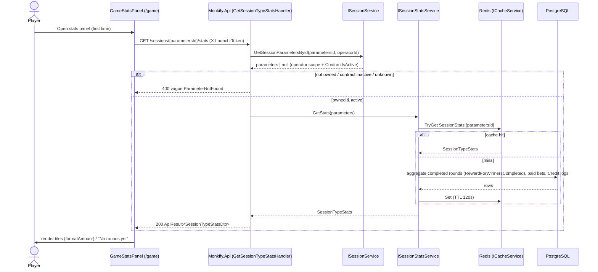

# Monkify — "Per-game general stats (all-time, per session type)" Feature — Implementation Spec

> **Status: Shipped** — merged via `feature/session-type-stats` on 2026-07-10. Distilled summary:
> `../features/session-type-stats.md`. _Originally: Ready for implementation_ — refined via Trello card
> [Per-game general stats (all-time, per session type)](https://trello.com/c/oxZkifXh/43-per-game-general-stats-all-time-per-session-type) (2026-07-10).
> Repos affected: `monkify-backend`, `monkify-front`, and this doc in `monkify-meta`.
>
> **Post-ship note:** shipped as specified, with two deltas — (1) the stats panel is bundled with chat
> as a **CHAT/STATS tabbed right-side panel** (`GameSidePanel`) rather than a standalone left panel, and
> (2) `formatAmount` was extracted into a shared `useAmountFormatter` composable. The integration test
> also surfaced a pre-existing multi-winner reward double-credit race under redelivery
> (`RewardSessionConsumer`), tracked separately; the stats read itself is correct.
>
> **Purpose:** Show casino-style "general stats" for a **game type** (`SessionParameters`) —
> biggest pot ever split, biggest single payout, rounds played, total paid out, and (for preset
> types) the hottest choice — aggregated **all-time** across every round that type has run. Surfaced
> as a **lazy-loaded stats panel on the live `/game` screen**. Monkify's twist: **no house cut**
> (winners split 100%), so we lean into trust rather than RTP/house-edge.

---

## 1. Summary

A new **read-only** endpoint `GET /sessions/{parametersId}/stats` returns aggregated all-time stats
for one session type, computed **on demand** over the type's completed rounds and **cached in Redis**
(short TTL). A new frontend **stats panel** on `/game` fetches it **lazily** (only when the panel is
opened) and renders tiles, formatting money with the existing amount formatter.

There is **no new entity and no migration** — stats are derived from existing tables (`Session`,
`Bet`, `TransactionLog`).

| Stat | Source (per session type, all-time) |
| --- | --- |
| Rounds played | `COUNT(Session)` where `Status == RewardForWinnersCompleted` |
| Biggest pot ever split | `MAX` over those rounds of `Σ Bet.Amount` (+ `LotteryPot` base for lottery types) |
| Biggest single payout | `MAX(TransactionLog.Amount)` where `Type == Credit` |
| Total paid out | `Σ TransactionLog.Amount` where `Type == Credit` |
| Hottest choice (preset types only) | `Bet.Choice` with the highest bet count → top 1 |
| Trust tile ("0% house cut") | **Frontend-only static copy** — no backend field |

**Key design decision (documented reversal of the card's original note):** the card's brief warned
"do NOT recompute by scanning `Bet`/`Session` on every GET" and floated a maintained-counter
`SessionTypeStats` row. Refinement chose the **on-demand aggregate + Redis cache** instead. It is
acceptable here because the panel is a **lazy-loaded game-screen panel** (it fires only when a player
opens the panel on `/game`, **never** on lobby/sessions-list load) **plus** the cache absorbs repeat
opens. The maintained-counter design is explicitly **not** taken (no write-path touch, no new table,
no migration).

---

## 2. Constraints (MANDATORY)

From `monkify-meta/constraints.md` (full list there):

- **Worktree-per-repo:** `feature/session-type-stats` in an isolated worktree in each affected repo
  (`monkify-backend`, `monkify-front`, `monkify-meta`); hub stays on `main`. Push after branch work.
- **Unit tests:** add/update in `Monkify.Tests`; report changed tests at end of implementation.
- **EF mapping:** N/A — **no entity/column change** (read-only feature). Do not add
  `IEntityTypeConfiguration`.
- **Migrations:** **None** — no schema change.
- **Secrets/config:** mock-only values in committed files (no real secrets; the private token key is
  never read by this read path).
- **Operator messaging:** vague errors only. A stats request for a type that does not belong to the
  caller's operator, or whose operator contract is not active, returns the **generic**
  `ParameterNotFound` — never reveal the type's existence or contract status.
- **Backend integration test (mandatory — this is a new feature):** `Monkify.Tests.Integration` must
  contain a happy-path test that drives a preset-type session end-to-end to
  `RewardForWinnersCompleted`, then `GET`s the stats endpoint and asserts the result. See §11.2.
- **Host split:** the endpoint is a **stateless read served by `Monkify.Api`**; `Monkify.Consumers`
  is untouched (no write path).

---

## 3. Resolved product decisions

| # | Decision |
| --- | --- |
| 1 | **Surface:** a stats panel on the `/game` screen (beside the terminal), **lazy-loaded** — it fetches only when opened/mounted, NOT on lobby/sessions-list load. (Rejected: lobby card back, dedicated stats page.) |
| 2 | **Computation:** on-demand aggregate query + Redis cache (~120 s TTL). **No new entity, no migration.** Deliberate, documented reversal of the card's "don't scan on GET" note (justified by lazy-load + cache); the maintained-counter `SessionTypeStats` design is explicitly rejected. |
| 3 | **MVP stat set:** biggest pot, biggest single payout, rounds played, total paid out, hottest choice (most-picked, **preset types only**, top 1), plus a **frontend-only** "0% house cut" trust tile. |
| 4 | **Dropped:** "fastest win / longest grind" — characters-typed-before-winner is **not persisted today**; capturing it is out of scope. |
| 5 | **Rounds counted:** only sessions that reached `RewardForWinnersCompleted`. Excludes refunded/under-subscribed lotteries (`NotEnoughPlayersToStart`) and `SessionEndedAbruptely`. |
| 6 | **Money source:** payouts from `TransactionLog` `Credit` rows; per-round pot reconstructed as `Σ Bet.Amount` (+ `LotteryParameters.LotteryPot` base for lottery types). Consistent with `BetDomainService.SetPotAmount`. |
| 7 | **Free bets (`Amount == 0`):** excluded from **all** money stats and from the hottest-choice tally. A free-bet-only completed round **still counts** toward rounds played. |
| 8 | **Currency = single per type:** because `PaymentMethod` is per-`SessionParameters`, a type is either all-`Standard` (USD) or all-`SolanaToken` (one token). No cross-method summing. `Standard` renders USD honoring the player's preferred display currency (reuse `formatAmount`/`useDisplayCurrency`, like the `> POT:` line); `SolanaToken` renders token-native. |
| 9 | **Hottest choice = most-PICKED** (by bet count), not most-winning. Preset types only (bounded choice set); free-type races omit the tile. Top 1. |
| 10 | **Endpoint:** `GET /sessions/{parametersId}/stats` → `SessionTypeStatsDto`, token-gated + operator-scoped. |
| 11 | **Empty state:** a type with 0 completed reward rounds returns zeroed/null stats; the frontend shows a "No rounds yet" placeholder. |
| 12 | **Type recreation:** admin has no in-place edit (deactivate-then-create → new `SessionParameters` Id), so stats reset naturally on recreation. Documented, not worked around. |

---

## 4. Data model

**No entity, column, EF-mapping, or migration change.** Stats are computed from existing tables.
This section documents the **existing** shapes the aggregation reads.

Existing entities (read-only for this feature):

- `Monkify.Domain/Sessions/Entities/Session.cs` — `ParametersId`, `Status` (`SessionStatus`),
  `WinningChoice`, `Seed`, `ICollection<Bet> Bets`. **No pot column** — pot is derived. Static status
  sets on the entity: `Session.SessionEndedStatus` includes several ended states; this feature uses
  **only** `SessionStatus.RewardForWinnersCompleted`.
- `Monkify.Domain/Sessions/ValueObjects/SessionStatus.cs` — `RewardForWinnersCompleted` is the
  terminal-success status used for "rounds played".
- `Monkify.Domain/Bets/Entities/Bet.cs` — `Amount` (`decimal`), `Choice` (normalized trim+lower),
  `PaymentMethod`, `OperatorPlayerId?`, `Status`, `ICollection<TransactionLog> TransactionLogs`.
- `Monkify.Domain/Bets/Entities/TransactionLog.cs` + `ValueObjects/TransactionLogType.cs`
  (`Credit = 0`, `Debit = 1`, `Refund = 2`) — payouts are the `Credit` rows.
- `Monkify.Domain/Sessions/Entities/SessionParameters.cs` — `OperatorId`, `PaymentMethod`,
  `OperatorTokenId?`, `OperatorToken?`, `ICollection<PresetChoice> PresetChoices`,
  `LotteryParameters`.
- `Monkify.Domain/Sessions/Entities/OperatorToken.cs` — `Label` (display symbol), `Decimals`,
  `MintAddress` (used to build the currency descriptor for `SolanaToken` types).

### 4.1 Aggregation logic (reference)

Scope everything to one `parametersId`, over sessions with `Status == RewardForWinnersCompleted`:

```
completedSessions = Sessions where ParametersId == p.Id and Status == RewardForWinnersCompleted
roundsPlayed      = count(completedSessions)

paidBets          = bets of completedSessions where Amount > 0            // exclude free bets
biggestPot        = max over completedSessions of ( Σ bet.Amount over that session's paidBets
                                                    + (p.LotteryParameters?.LotteryPot ?? 0) )
credits           = TransactionLogs of those bets where Type == Credit
biggestPayout     = credits.Any() ? max(credit.Amount) : 0
totalPaidOut      = Σ credit.Amount

hottestChoice     = p.PresetChoices.Any()
                    ? paidBets group by Choice → order by count desc → first { Choice, Count }
                    : null                                                // free-type races omit it
```

> **Free bets & `Credit` rows:** free bets never produce a reward `Credit` row, so excluding
> `Amount > 0` for the money stats is belt-and-suspenders — but it is required for the **pot** sums
> and the **hottest-choice** tally, so apply the `Amount > 0` filter uniformly to `paidBets`.

> **Lottery base in "biggest pot":** add `LotteryPot` **per completed round** before taking the max
> (mirrors `BetDomainService.SetPotAmount`, which adds the base once per session).

---

## 5. Configuration

- **Cache TTL:** add a `CacheHelper.GenerateSessionStatsCacheSettings(Guid parametersId)` factory
  returning `new CacheSettings($"SessionStats:{parametersId}", TimeSpan.FromSeconds(120))`. 120 s is
  the chosen short TTL (all-time stats tolerate ≤120 s staleness). If a config knob is desired,
  read it from `GeneralSettings.Sessions` with a 120 s default; otherwise the constant is acceptable
  (note it inline). No secrets, no new env var.
- **Frontend:** no new `VUE_APP_*` env var.

---

## 6. Backend behaviour

Host: **`Monkify.Api`** (stateless read). No consumer, event, or SignalR change.

### 6.1 Endpoint & controller

`Monkify.Api/Controllers/SessionsController.cs` — add a GET action mirroring
`GetActiveSessionForParameter` (which uses `_launchContext.OperatorId` and `ProcessRequest`):

```csharp
[HttpGet("{parametersId}/stats")]
public async Task<IActionResult> GetSessionTypeStats(Guid parametersId)
{
    return await ProcessRequest(new GetSessionTypeStatsRequest(parametersId, _launchContext.OperatorId));
}
```

> Route note: the bare `sessions/{sessionTypeId}` GET already exists; `sessions/{parametersId}/stats`
> is a distinct template (extra `/stats` segment) — no routing collision. `ProcessRequest` wraps the
> result into `ApiResult<SessionTypeStatsDto>` (200 with data; a validation failure → 400; a `null`
> result → 404 — see `BaseController`).

### 6.2 Handler (read pattern)

New `Monkify.Infrastructure/Handlers/Sessions/GetSessionTypeStats/`:

- `GetSessionTypeStatsRequest.cs`:
  ```csharp
  public record GetSessionTypeStatsRequest(Guid ParametersId, Guid OperatorId)
      : IRequest<SessionTypeStatsDto> { }
  ```
- `GetSessionTypeStatsHandler.cs : BaseRequestHandler<GetSessionTypeStatsRequest, SessionTypeStatsDto>`
  — ctor injects `ISessionService sessionService`, `ISessionStatsService statsService`,
  `MonkifyDbContext context`, `IMessaging messaging` (passes `context, messaging` to base). Logic:

  ```
  1. parameters = await _sessionService.GetSessionParametersById(request.ParametersId, request.OperatorId);
     // Reuses the SAME scoping used by GetActiveSessionForParameterHandler:
     //   - filters ParametersId + OperatorId == request.OperatorId
     //   - returns null when the operator's contract is NOT active (ContractIsActive)
  2. if (parameters is null) { Messaging.ReturnValidationFailureMessage(ErrorMessages.ParameterNotFound); return null; }
     // Vague — never reveals cross-operator existence or contract status.
  3. var stats = await _statsService.GetStats(parameters);   // aggregation + cache
  4. return new SessionTypeStatsDto(stats, parameters);       // adds the currency descriptor
  ```

> **Dependency check:** confirm `ISessionService.GetSessionParametersById` eager-loads
> `OperatorToken` (SessionService already `.Include`s it for the DTO path per exploration). The
> currency descriptor needs `parameters.OperatorToken.Label`/`.Decimals`/`.MintAddress`. If the
> include is missing on that code path, add `.Include(x => x.OperatorToken)` — do not introduce a
> second query.

### 6.3 Aggregation service

New `Monkify.Infrastructure/Services/Sessions/SessionStatsService.cs` implementing
`ISessionStatsService` (keeps `SessionService` focused; testable in isolation). Ctor injects
`MonkifyDbContext context, ICacheService cache`.

```csharp
public async Task<SessionTypeStats> GetStats(SessionParameters parameters)
{
    var cacheSettings = CacheHelper.GenerateSessionStatsCacheSettings(parameters.Id);
    if (_cache.TryGet<SessionTypeStats>(cacheSettings, out var cached) && cached is not null)
        return cached;

    // Aggregate over completed rounds only, excluding free bets (Amount > 0) for pot/hottest.
    // Implement with a small number of AsNoTracking() aggregate queries scoped to parameters.Id
    // and Status == SessionStatus.RewardForWinnersCompleted (see §4.1). Add the LotteryPot base
    // per round before MAX when parameters.LotteryParameters != null.

    var stats = /* computed SessionTypeStats */;
    _cache.Set(cacheSettings, stats);
    return stats;
}
```

- `SessionTypeStats` is a plain result record (`RoundsPlayed`, `BiggestPot`, `BiggestSinglePayout`,
  `TotalPaidOut`, `HottestChoice` = `{ Choice, PickCount }?`). It is what gets cached (JSON-safe).
- **Empty state:** 0 completed rounds → `RoundsPlayed = 0`, money = `0`, `HottestChoice = null`.
- `ICacheService` is **synchronous + `CacheSettings`-based** (`TryGet<T>(CacheSettings, out T)`,
  `Set<T>(CacheSettings, T)`) — mirror `SessionService.GetAllActiveSessionParameters`.

### 6.4 DTO

`Monkify.Infrastructure/Contracts/Sessions/SessionTypeStatsDto.cs` — built from
`SessionTypeStats` + `SessionParameters` (for the currency descriptor, mirroring
`SessionParametersDto`'s token fields):

```csharp
public class SessionTypeStatsDto
{
    public long RoundsPlayed { get; set; }
    public decimal BiggestPot { get; set; }
    public decimal BiggestSinglePayout { get; set; }
    public decimal TotalPaidOut { get; set; }
    public HottestChoiceDto? HottestChoice { get; set; }   // null for free-type races / no data
    // Currency descriptor (single currency per type):
    public PaymentMethod PaymentMethod { get; set; }
    public string? TokenSymbol { get; set; }               // OperatorToken.Label (SolanaToken only)
    public int? TokenDecimals { get; set; }                // OperatorToken.Decimals (SolanaToken only)
    public SessionTypeStatsDto(SessionTypeStats s, SessionParameters p) { /* map */ }
}
public record HottestChoiceDto(string Choice, int PickCount);
```

> The frontend already knows the session's currency from `selectedSession`, but carrying the
> descriptor on the DTO keeps it self-contained and lets the integration test assert currency.

### 6.5 DI wiring

Register `ISessionStatsService → SessionStatsService` in the Infrastructure DI module alongside the
other session services (scoped, same lifetime as `ISessionService`).

---

## 7. Frontend behaviour

All changes in `monkify-front`. The panel is **lazy** — it fetches on first open, never on the
sessions list.

### 7.1 Service — `src/services/mainService.ts`

Add, mirroring `applyBet`'s template-literal path style, and export via the default object (so it is
reachable as `mainService.getSessionTypeStats`):

```ts
const getSessionTypeStats = async (parametersId: string) => {
  const { data } = await mainAPI.get<DefaultResponse<SessionTypeStats>>(
    `/sessions/${parametersId}/stats`
  );
  return data;
};
```

The request interceptor already attaches `X-Launch-Token`; a `401` already routes to `/error`.

### 7.2 Type — `src/types/index.ts`

```ts
export interface HottestChoice { choice: string; pickCount: number; }
export interface SessionTypeStats {
  roundsPlayed: number;
  biggestPot: number;
  biggestSinglePayout: number;
  totalPaidOut: number;
  hottestChoice?: HottestChoice | null;
  paymentMethod: PaymentMethod;
  tokenSymbol?: string | null;
  tokenDecimals?: number | null;
}
```

### 7.3 Shared amount formatter (small in-scope refactor)

`formatAmount` is currently a **local function inside `GameTerminal.vue`** (Standard → `formatUsd`
with preferred display currency; SolanaToken → `` `${amount} ${tokenSymbol}` ``). The new panel needs
the same behavior, so **extract it into a shared composable** `src/hooks/useAmountFormatter.ts` (or a
`src/utils/formatAmount.ts` helper) that takes the current session (for `paymentMethod`/`tokenSymbol`)
and returns `formatAmount(amount) → { text, title? }`, reusing `useDisplayCurrency().formatUsd`.

- Replace the local copy in `GameTerminal.vue` with the shared one (behavior must stay **identical**,
  including that SolanaToken renders the raw token-native `amount` + symbol — matching how bet
  `Amount` is already token-native). This keeps the `> POT:`/`> BET:` lines unchanged.
- The stats panel imports the same formatter for its money tiles.

> This is a targeted improvement to code we're already touching (two components now need it), not a
> broad refactor.

### 7.4 Panel component — `src/components/game/GameStatsPanel.vue`

Mirror `GameChatPanel.vue`'s structure and house style (green-on-black `font-mono`, absolute-pinned,
collapsible toggle):

- **Layout:** absolute-pinned panel on `/game` (pin **left** so it doesn't collide with the
  right-pinned `GameChatPanel`), collapsed by default with a toggle button.
- **Lazy fetch:** call `mainService.getSessionTypeStats(selectedSession.sessionTypeId)` **only** on
  first open (guard with a `hasLoaded` ref); show a loading state, then the tiles. Do **not** fetch on
  mount if collapsed. Re-fetch if the session type changes (`sessionTypeId` watch) and the panel is
  open.
- **Tiles** (via the shared `formatAmount` for money):
  - Biggest pot ever split · Biggest single payout · Total paid out · Rounds played.
  - **Hottest choice** — render only when `selectedSession.presetChoices?.length` **and**
    `stats.hottestChoice` is present (mirror the app's `isPresetGame` check).
  - **Trust tile** (always): static copy "0% house cut — winners split 100%; every round is
    seed-verifiable."
  - **Empty state:** when `stats.roundsPlayed === 0`, show a "No rounds yet" placeholder instead of
    zeroed money tiles.
- **Session context** comes from `useSession()`: `selectedSession` (has `sessionTypeId` =
  `parametersId`, `paymentMethod`, `presetChoices`, `tokenSymbol`, `tokenDecimals`).

### 7.5 Mount — `src/pages/GamePage.vue`

Add `<game-stats-panel />` as a sibling inside the inner `relative` flex row (next to
`<game-terminal />`, `<game-monkey />`, `<game-chat-panel />`), and import it.

---

## 8. Flow diagram



---

## 9. Out of scope

- Maintained-counter / persistent `SessionTypeStats` aggregate table (rejected in favor of
  on-demand + cache).
- "Fastest win / longest grind" and any characters-typed-before-winner persistence.
- Most-winning / "luckiest" choice, top-N (>1) hottest choices, and hottest choice for free-type
  races.
- Cross-type / global leaderboards, per-player stats, time-windowed (daily/weekly) stats.
- Lobby-card-back and dedicated stats-page surfaces.
- Any change to settlement/pot/reward math (`BetDomainService` untouched — read-only consumer of the
  same tables).

---

## 10. File checklist

### 10.1 Backend (`monkify-backend`)

| # | File | Change |
| --- | --- | --- |
| 1 | `src/Monkify.Api/Controllers/SessionsController.cs` | Add `GET {parametersId}/stats` action → `GetSessionTypeStatsRequest(parametersId, _launchContext.OperatorId)` via `ProcessRequest`. |
| 2 | `src/Monkify.Infrastructure/Handlers/Sessions/GetSessionTypeStats/GetSessionTypeStatsRequest.cs` | New request record `(Guid ParametersId, Guid OperatorId) : IRequest<SessionTypeStatsDto>`. |
| 3 | `src/Monkify.Infrastructure/Handlers/Sessions/GetSessionTypeStats/GetSessionTypeStatsHandler.cs` | New handler: scope+contract via `ISessionService.GetSessionParametersById`; null → vague `ParameterNotFound`; else `ISessionStatsService.GetStats` → `SessionTypeStatsDto`. |
| 4 | `src/Monkify.Infrastructure/Services/Sessions/ISessionStatsService.cs` | New interface `Task<SessionTypeStats> GetStats(SessionParameters parameters)`. |
| 5 | `src/Monkify.Infrastructure/Services/Sessions/SessionStatsService.cs` | New service: Redis-cached on-demand aggregation over completed rounds (excl. free bets); computes rounds/pot/payout/total/hottest (preset only). |
| 6 | `src/Monkify.Infrastructure/Services/Sessions/SessionTypeStats.cs` (or a `Models`/`ValueObjects` folder) | New result record cached by `ICacheService`. |
| 7 | `src/Monkify.Infrastructure/Contracts/Sessions/SessionTypeStatsDto.cs` | New DTO (+ `HottestChoiceDto`) built from `SessionTypeStats` + `SessionParameters` (currency descriptor). |
| 8 | `src/Monkify.Infrastructure/Services/Cache/CacheHelper.cs` | Add `GenerateSessionStatsCacheSettings(Guid parametersId)` → `SessionStats:{parametersId}`, 120 s TTL. |
| 9 | Infrastructure DI module (where `ISessionService` is registered) | Register `ISessionStatsService → SessionStatsService`. |
| 10 | `ISessionService.GetSessionParametersById` (verify only) | Confirm `.Include(OperatorToken)`; add it if that path omits it (needed for the currency descriptor). |

### 10.2 Frontend (`monkify-front`)

| # | File | Change |
| --- | --- | --- |
| 1 | `src/services/mainService.ts` | Add `getSessionTypeStats(parametersId)` (`GET /sessions/${parametersId}/stats`); export via default object. |
| 2 | `src/types/index.ts` | Add `SessionTypeStats` + `HottestChoice` interfaces. |
| 3 | `src/hooks/useAmountFormatter.ts` (new) | Extract `formatAmount` (Standard→`formatUsd`, SolanaToken→`amount + symbol`) into a shared composable. |
| 4 | `src/components/game/GameTerminal.vue` | Replace the local `formatAmount` with the shared composable (behavior identical). |
| 5 | `src/components/game/GameStatsPanel.vue` (new) | Lazy-fetch stats panel; tiles + hottest-choice (preset only) + trust tile + "No rounds yet" empty state; money via shared `formatAmount`. |
| 6 | `src/pages/GamePage.vue` | Mount `<game-stats-panel />` sibling in the inner flex row; import it. |

### 10.3 Meta (`monkify-meta`)

| # | File | Change |
| --- | --- | --- |
| 1 | `specs/session-type-stats.md` | This spec (new). |
| 2 | `INDEX.md` | Add the spec row (status **Ready**); update "Feature currently in flight". |

---

## 11. Tests

### 11.1 Unit tests — `monkify-backend/src/Monkify.Tests`

Mirror `UnitTests/Handlers/GetActiveSessionForParameterHandlerTests.cs` (in-memory EF via
`UnitTestsClass`, Bogus `Faker`, Moq `ISessionService`, Shouldly). New file
`UnitTests/Handlers/GetSessionTypeStatsHandlerTests.cs` plus service tests
`UnitTests/Services/SessionStatsServiceTests.cs`.

| Test file | Test case | Expected |
| --- | --- | --- |
| `GetSessionTypeStatsHandlerTests` | Type with N completed rounds | DTO returns correct rounds played, biggest pot, biggest payout, total paid out |
| " | Cross-operator request (`GetSessionParametersById` returns null) | Vague `ParameterNotFound` validation failure; no data leaked |
| " | Expired/inactive operator (null from service) | Vague `ParameterNotFound` |
| " | Preset type | `HottestChoice` = most-picked choice + count |
| " | Free-type race | `HottestChoice == null` |
| " | Type with 0 completed rounds | Rounds `0`, money `0`, `HottestChoice null` |
| `SessionStatsServiceTests` | Only `RewardForWinnersCompleted` counts | `Ended`/`SessionEndedAbruptely`/`NotEnoughPlayersToStart` rounds excluded from counts & money |
| " | Free bets (`Amount == 0`) present | Excluded from pot/payout/total/hottest; a free-only completed round still increments rounds played |
| " | Lottery type | Biggest pot includes `LotteryPot` base per round |
| " | Cache hit (`Mock<ICacheService>.TryGet` returns true) | Aggregate query NOT executed; cached value returned |
| " | Biggest single payout | `MAX(Credit)`; total paid out `Σ Credit` |

### 11.2 Integration test (MANDATORY) — `monkify-backend/src/Monkify.Tests.Integration`

Add to `SessionFlowTests.cs` (or a new `SessionStatsFlowTests.cs`) using the `IntegrationTestFixture`
harness. **Because the fixture is shared once-per-suite** (completed rounds accumulate against the
same seeded types), **seed a dedicated preset session type** for this test (extend
`EnsureParametersAsync` with a stats-only preset type, or use a preset type not driven by other
tests) so `roundsPlayed` and `hottestChoice` are deterministic.

Happy path:
1. `GetParameterAsync(operatorId, "<dedicated preset type>")` → `parameters` (includes `PresetChoices`).
2. `SeedWaitingBetsSessionAsync(parameters.Id)`; `MintToken(...)`; place ≥2 paid bets, over-betting one
   preset choice (e.g. two bets on `choiceA`, one on `choiceB`).
3. `WaitForStatusAsync(sessionId, SessionStatus.RewardForWinnersCompleted, Timeout)`.
4. `CreateLaunchClient(token)` → `GET /sessions/{parameters.Id}/stats`; `ReadEnvelopeAsync<SessionTypeStatsDto>`.
5. Assert: `RoundsPlayed == 1`; `BiggestPot == Σ paid bet amounts`; `TotalPaidOut` equals the
   round's `Credit` sum (`GetTransactionLogsAsync` where `Type == Credit`); `BiggestSinglePayout`
   equals the winner's `Credit`; `HottestChoice.Choice == choiceA` (most-picked); currency descriptor
   matches the type's `PaymentMethod`.

Optional second assertion (complex-flow coverage): a second completed round increments `RoundsPlayed`
to `2` and updates `BiggestPot` to the larger of the two — but mind the **cache TTL** (either wait it
out, or assert on a fresh dedicated type to avoid a stale cached read).

---

## 12. Acceptance criteria

Mapped 1:1 from the Trello **Acceptance Criteria** checklist:

1. Given a session type with ≥1 completed round, when a player opens the stats panel on `/game`, then
   `GET /sessions/{parametersId}/stats` returns biggest pot, biggest single payout, rounds played, and
   total paid out for that type.
2. Given sessions of a type in various end states, when stats are computed, then only
   `RewardForWinnersCompleted` sessions count toward rounds played and money stats — refunded/
   under-subscribed lotteries (`NotEnoughPlayersToStart`) and `SessionEndedAbruptely` are excluded.
3. Given free bets (`Amount == 0`), when stats are computed, then they contribute nothing to biggest
   pot, biggest payout, total paid out, or the hottest-choice tally; but a completed round consisting
   only of free bets still increments rounds played.
4. Given a preset-choice type, when stats are returned, then the hottest choice is the single
   most-picked choice (by paid-bet count, all-time); given a free-type race, then no hottest-choice
   tile is returned.
5. Given a `Standard` type, when money stats render, then amounts show in USD honoring the player's
   preferred display currency (via `formatAmount`/`useDisplayCurrency`, like the POT line); given a
   `SolanaToken` type, then amounts render token-native — and no cross-payment-method summing occurs.
6. Given a type with zero completed reward rounds, when a player opens the panel, then the endpoint
   returns zeroed/null stats and the frontend shows a "No rounds yet" placeholder (no error).
7. Given a launch token for operator A requesting a `parametersId` of operator B (or an operator whose
   contract is not active), then a vague not-found/empty response is returned that never reveals the
   type's existence or contract status.
8. Given the stats panel is opened, when the same type's stats are requested again within the TTL
   (~120 s), then the second read is served from Redis without re-running the aggregate query; and the
   fetch happens only on panel open/mount, never on lobby/sessions-list load.
9. Given the Testcontainers suite, when a preset-type session is driven end-to-end to
   `RewardForWinnersCompleted` and `GET /sessions/{parametersId}/stats` is called, then rounds
   played = 1, biggest pot and total paid out match the round, and hottest choice = the (most-picked)
   bet choice.

---

## 13. Manual QA

Run the local stack (`setup_local_environment.bat`; front `npm run serve`), launch via a dev token,
enter a session, and:

1. **Open panel:** open the stats panel on `/game` → it fetches once and renders tiles. Confirm (dev
   network tab) that no stats call fired on the sessions-list page.
2. **Populate:** play a preset type to completion a couple of times → biggest pot, biggest payout,
   total paid out, rounds played update (after TTL / reopen). Hottest choice shows the most-picked.
3. **Free-type race:** confirm no hottest-choice tile appears.
4. **Empty state:** open the panel for a freshly created type with no completed rounds → "No rounds
   yet".
5. **Currency:** on a `SolanaToken` type amounts read token-native (`… {symbol}`); on a `Standard`
   type they read USD / preferred display currency (same as `> POT:`).
6. **Scope:** (dev) request a `parametersId` from another operator → vague not-found (no leak).
7. Confirm `npm run lint` + `npm run build` clean; backend `scripts/run_tests.bat` and the stats
   integration test green.

---

## 14. Trello / pipeline

- **Source card:** [Per-game general stats (all-time, per session type)](https://trello.com/c/oxZkifXh/43-per-game-general-stats-all-time-per-session-type)
  — list **Specs created**; the **Implementation** section on the card lists worktree + branch + spec.
- **After spec:** `/monkify-implement-feature Per-game general stats (all-time, per session type)`.
- **After merge:** `/monkify-ship-feature Per-game general stats (all-time, per session type)`
  (reads branch from the card).

---

## 15. Revision log

| Date | Change |
| --- | --- |
| 2026-07-10 | Initial spec from refined card #43 (`oxZkifXh`), grounded in `SessionsController` / `GetActiveSessionForParameterHandler` / `BetDomainService` / `ICacheService` (backend) and `mainService.ts` / `GameTerminal.vue` / `useDisplayCurrency` / `GamePage.vue` (frontend). On-demand + Redis-cache design (documented reversal of the card's maintained-counter note); no entity/migration. |
