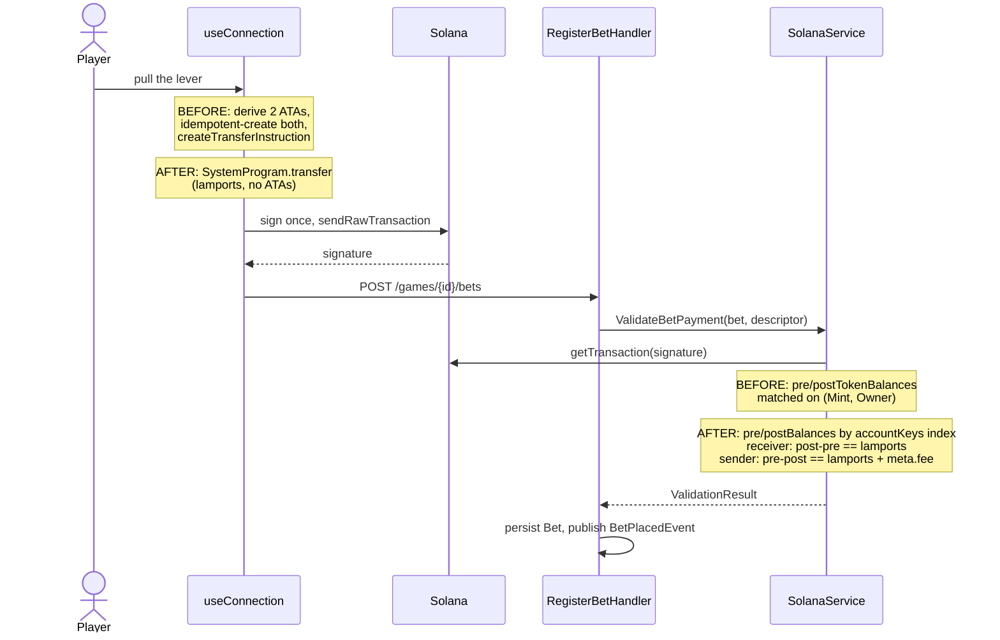

# SpaceStroker — "SOL Settlement" Feature — Implementation Spec

> **Status: Ready for implementation** — refined via Trello card
> [#174 Stop using USDC in the games](https://trello.com/c/K0Texy2Z/174-stop-using-usdc-in-the-games)
> (2026-08-20). **Level: `Feature`** — a mandatory happy-path integration test and a dedicated
> `features/sol-settlement.md` KB doc are both required.
>
> Repos affected: **`monkify-backend`** (the money path), **`monkify-front`** (the transfer builder and
> every money readout), **`monkify-lp`** (the terms page and token copy), and **`monkify-meta`**
> (this spec, the deploy config, the KB).
>
> **Purpose:** every game settles in the one configured token, today real mainnet USDC. This moves
> settlement to **native SOL** — 0.02 SOL for Cosmic Sprint, 0.1 SOL for Space Jackpot, 0.02 SOL for
> the gated Beast Mode — so stakes and payouts are denominated in the chain's own asset rather than a
> dollar-pegged SPL token.

---

## 1. Summary

SOL is **native**, not an SPL token. There is no mint, no associated token account, no
`TokenProgram`, and no `preTokenBalances` metadata. Every money path in the app is SPL-shaped, so
this is not a config swap:

| Concern | Today (SPL USDC) | After (native SOL) |
| --- | --- | --- |
| Player pays | `createTransferInstruction` between two ATAs, both created idempotently in the same tx | `SystemProgram.transfer` wallet → treasury, no ATA instructions |
| Payment check | `meta.preTokenBalances` / `postTokenBalances`, matched on `(Mint, Owner)` | `meta.preBalances` / `postBalances`, matched by **account-key index**, with `meta.fee` netted out on the payer |
| House pays | `TokenProgram.Transfer` from `SenderAccount` (an ATA) to the winner's ATA, looked up via `getTokenAccountsByOwner` | `SystemProgram.Transfer` from the treasury wallet to the winner's wallet — no lookup at all |
| Balance read | `getTokenAccountBalance` on a derived ATA | `getBalance` on the wallet |
| Decimals | 6 | **9** |
| Orbit pool key | `(OrbitAccount, MintAddress)` | `(OrbitAccount, sentinel mint)` — a **new pool starting at zero** |
| Gas | a separate SOL balance, unrelated to the stake | **the same lamports as the stake** |

**The design keeps the mint-shaped seams.** `So11111111111111111111111111111111111111112` (wrapped
SOL's canonical mint) is used as a **sentinel identifier** — never as a real wSOL mint, and no
account of it is ever created. It flows through config, `GameParametersDto.TokenMintAddress`, the
`/solana/balance` active-mint check, and Orbit's pool stamping exactly as a mint does, so those
contracts and their caches are unchanged. Only the **transport** branches.

The second half of the work is money that already exists. `Bet.Amount`, `OrbitBalance.Amount` and
`Game.CarriedExtra` are bare `numeric(18,9)` values with **no currency stamp**, so a pre-switch
figure settled after the switch pays its USDC number in SOL — roughly a 200× overpay. That is
handled by a **drain-then-switch runbook plus a fail-closed guard**, not by making settlement
multi-token.

---

## 2. Constraints (MANDATORY)

From `constraints.md` (full list there):

- **Worktree-per-repo:** `feature/sol-settlement` in `monkify-backend`, `monkify-front`,
  `monkify-lp` and `monkify-meta`, each at `.worktrees/sol-settlement/<repo>`. The shared checkouts
  stay on their default branch. ⚠️ `monkify-lp`'s default branch is **`master`**, not `main`.
- **Unit tests:** update and add in `SpaceStroker.Tests`; run via `scripts/run_tests.bat` (never the
  full `dotnet test` — `ProductionSessions` is a slow Monte Carlo suite). Report changed tests.
- **Integration tests:** this is a `Feature`, so `SpaceStroker.Tests.Integration` **must** gain a
  happy-path test, plus one for the refund path and one for the pre-cutover guard (a fail-closed
  branch — `constraints.md` §3 requires complex flows to get their own).
- **EF mapping** stays inline in `SpaceStrokerDbContext.OnModelCreating`. **No migration is expected
  in this feature** — see §4.
- **Secrets/config:** mock-only values in committed files. The real treasury, Orbit and house-seed
  keys live in Secret Manager and are never touched here.
- **Vague messaging:** payment and bet refusals keep their existing vague copy. The Orbit deposit
  bound is the one sanctioned exception (`constraints.md` §6) and must stay **accurate** after
  rescaling — it is refused client-side before the transfer is signed.
- **Host split:** all money movement stays in `SpaceStroker.Consumers`; the API validates with public
  data only (`ToDescriptor(includePrivateKey: false)`).
- **Production safety:** the cutover runbook (§13) moves real money and is executed **by the user**,
  never by an agent (`constraints.md` §5).

---

## 3. Resolved product decisions

| # | Decision |
| --- | --- |
| 1 | **Transport is native SOL** via `SystemProgram.Transfer`. Wrapped SOL was rejected: winners would be paid into a wSOL ATA the house cannot unwrap for them. |
| 2 | **`So11111111111111111111111111111111111111112` is a SENTINEL id, not a real mint.** No wSOL account is ever created or read. It exists so config, DTOs, the active-mint check and Orbit's `(account, mint)` pool key keep their shape. |
| 3 | **In-flight money: drain, then switch, plus a fail-closed guard.** A `SettlementCutoverUtc` config value; any bet created before it is refused by the money path. Per-bet mint stamping (dual-token settlement) was rejected as a much larger feature. |
| 4 | **Stats are cut at the cutover.** Global, per-type and per-player totals count only rounds completed after `SettlementCutoverUtc`. Games history and provably-fair are untouched — only the summing stops. |
| 5 | **Beast Mode is repriced to 0.02 SOL now**, while `ComingSoon` is still true, so un-gating it later cannot silently ask 1 SOL a ticket. |
| 6 | **New `RequiredAmount` values reach existing rows by one-off SQL** (§13.3, committed at `deploy/sql/sol-settlement-cutover.sql`), **not** a fourth startup self-heal. Accepted cost: config and an existing database disagree until the SQL is re-run, and local/dev stacks seeded before this change keep the old prices. `DefaultGames` is still updated so fresh environments seed correctly. |
| 7 | **Orbit players are force-cashed-out in USDC before the switch**; `SUM(OrbitBalance.Amount)` for the USDC pool must be `0`. Leaving the old pool withdraw-only was rejected: no screen reads a non-configured pool, so the money would be stranded. |
| 8 | **Orbit knobs rescale and the whole-number deposit rule is DROPPED:** options `0.05 / 0.1 / 0.5` SOL, `MaxDepositPerTransaction` 5, `MinimumCashOut` 0.05. In SOL a whole-number floor is a ~$200 minimum deposit. |
| 9 | **The low-SOL guards become solvency checks.** Orbit: `solBalance − Σ(pool ledger balances) ≥ MinimumSolBalance`. House seed: `solBalance − stake ≥ MinimumSolBalance`. With native SOL the flat floor would pass permanently on player deposits. |
| 10 | **Display is SOL only.** SOL mark replaces the USDC brand mark, the `$` prefix comes off the header pills, and the formatters widen past 2dp. No price feed — a stale USD quote on a money readout is worse than none. |
| 11 | **`Game.CarriedExtra` is verified `0`** on the Space Jackpot successor round before the deploy. An un-won carry survives a "settle the open round" drain. |
| 12 | **Repricing stays manual.** 0.02 / 0.1 SOL are fixed numbers; a SOL price move changes the real ticket price. USD-pegged pricing was rejected — a variable per-bet stake collides with the `InvalidAmount` check, the `ChoiceAlreadyTaken` refund path, and the fixed-stake assumption the commission math rests on. |
| 13 | **Copy moves to SOL and the permanence claim is dropped.** `GuideToken.vue`'s *"The game runs on USDC and always will."* does not survive. `terms.astro` is a legal document and ships in the same change. |
| 14 | **The commission stays at 1%** — the rate is a percent, so no code or config change. It is read at payout time and never snapshotted, which is precisely why the drain must leave no paid round open. |

---

## 4. Data model

### 4.1 Entity / column changes

**None.** No new column, no changed type, no new table.

- `Bet.Amount`, `Game.CarriedExtra`, `GameParameters.RequiredAmount`, `TransactionLog.Amount` and
  `OrbitBalance.Amount` are already `numeric(18,9)`, which holds 9-decimal SOL exactly.
- `OrbitBalance` / `OrbitTransaction` already stamp `(OrbitAccount, MintAddress)`, so pointing the
  config at the sentinel starts a new pool with no schema work.

### 4.2 EF configuration (inline)

Unchanged.

### 4.3 Migration

**No migration.** The cutover boundary is configuration, not data. If implementation discovers a
column that cannot hold a 9-decimal value, stop and raise it rather than adding a migration
silently — that would change this decision.

⚠️ `GameParameters.RequiredAmount` is changed by the **runbook SQL** (§13.3), not by EF.

---

## 5. Configuration

### 5.1 `spacestrokersettings.json` — `GeneralSettings:Operator:Token`

```jsonc
{
  "Symbol": "SOL",
  "MintAddress": "So11111111111111111111111111111111111111112",  // SENTINEL — native SOL, never a wSOL account
  "SenderAccount": "MOCK_TREASURY_PUBLIC_KEY",                    // native: the treasury WALLET, not an ATA
  "TokenOwnerPublicKey": "MOCK_TREASURY_PUBLIC_KEY",
  "Decimals": 9,
  "CommissionPercentage": 1.0,
  "SettlementCutoverUtc": null,                                   // new — see 5.3
  "Orbit": {
    "DepositOptions": [0.05, 0.1, 0.5],
    "MaxDepositPerTransaction": 5,
    "MinimumCashOut": 0.05,
    "MinimumSolBalance": 0.02
  }
}
```

⚠️ Committed values stay **mock/dev**. Devnet has no faucet-mintable USDC problem any more — native
SOL is airdroppable on devnet, which makes the local paid-bet path materially easier to exercise
than it was (see `features/games.md` and the local-stack notes).

### 5.2 `DefaultGames` prices

| Name | `RequiredAmount` today | After |
| --- | --- | --- |
| Cosmic Sprint | 1 | **0.02** |
| Beast Mode (`ComingSoon: true`) | 1 | **0.02** |
| Space Jackpot | 2 | **0.1** |

`LotteryPot` stays `0` (the jackpot is built from `CarriedExtra`, not a config base).

### 5.3 `SettlementCutoverUtc` (new)

`TokenSettings.SettlementCutoverUtc` — `DateTime?`, UTC.

- **Null** ⇒ no cutover. The pre-cutover money guard is inert and stats apply no extra floor. This is
  the value every fresh/dev environment carries, and it keeps the local stack and the whole existing
  test suite behaving exactly as before.
- **Set** ⇒ the instant the platform started settling in SOL. Everything created before it is
  pre-cutover.

⚠️ Must be a UTC `DateTime`; it is compared against `timestamptz` columns, and a `Local` or
`Unspecified` kind would silently shift the boundary by the host's offset — the same trap
`StatsWindowExtensions.Cutoff` already documents.

### 5.4 Deploy config (`monkify-meta/deploy`)

`secrets.production.json` / `secrets.development.json` → `appConfig`:

| Key | New value |
| --- | --- |
| `GeneralSettings:Operator:Token:Symbol` | `SOL` |
| `GeneralSettings:Operator:Token:MintAddress` | `So11111111111111111111111111111111111111112` |
| `GeneralSettings:Operator:Token:SenderAccount` | the treasury **wallet** (same as `TokenOwnerPublicKey`) |
| `GeneralSettings:Operator:Token:Decimals` | `9` |
| `GeneralSettings:Operator:Token:SettlementCutoverUtc` | the cutover instant, set during the runbook |

`frontBuild` → `VUE_APP_USDC_TOKEN_ADDRESS` becomes the sentinel.

⚠️ These live in **`appConfig`**, which the deploy tool writes as plain Cloud Run env vars — **not**
in the `secrets` block, so no Terraform binding is needed. If any key is ever moved into `secrets`,
it must also be hand-added to `base_secret_ids` **and** `base_secret_env` in
`deploy/terraform/workload/main.tf` or it silently does nothing (`SecretBindingCheck` guards this).

---

## 6. Backend behaviour

### 6.1 The native marker — one seam, three factories

Add to `SpaceStroker.Domain/Games/ValueObjects/`:

```csharp
public static class NativeSol
{
    // Wrapped SOL's canonical mint, used here ONLY as an identifier for native SOL. No wSOL
    // account is ever created, read, or transferred. See specs/sol-settlement.md §3 decision 2.
    public const string SentinelMint = "So11111111111111111111111111111111111111112";
    public const int Decimals = 9;
    public const string Symbol = "SOL";
    public const ulong LamportsPerSol = 1_000_000_000;

    // A SystemProgram transfer to an account that does not exist yet must leave it rent-exempt.
    public const ulong RentExemptMinimumLamports = 890_880;
}
```

and a **computed** member on the existing record:

```csharp
public record SolanaTokenDescriptor(
    string MintAddress, string SenderAccount, string TokenOwnerPublicKey,
    string TokenOwnerPrivateKey, int Decimals)
{
    public bool IsNative => MintAddress == NativeSol.SentinelMint;
}
```

⚠️ **Computed, not a constructor parameter.** The three `ToDescriptor` factories
(`OperatorSettings`, `OrbitAccountResolver`, `HouseSeedAccountResolver`) and every existing test
fixture that constructs a descriptor positionally keep compiling untouched.

**`SenderAccount` inverts meaning for native.** The two resolvers currently derive an associated
token account and carry a prominent ⚠️ that `SenderAccount` must be a *token* account. In native
mode they must pass the **wallet public key** instead and skip the derivation entirely — the
existing comments must be updated, not deleted, so the SPL rationale survives for whoever reads it
next:

```csharp
public SolanaTokenDescriptor ToDescriptor(bool includePrivateKey)
{
    var sender = Token.MintAddress == NativeSol.SentinelMint
        ? Orbit.PublicKey                                   // native: SystemProgram source IS the wallet
        : DeriveAssociatedTokenAccount(...).Key;            // SPL: must be a token account (see below)
    ...
}
```

### 6.2 `SolanaService` — the transport branch

All five money methods branch on `token.IsNative`.

**`TransferTokens` (private, serves all four transfer entry points)**

- Native: skip the `getTokenAccountsByOwner` lookup entirely (there is no token account to find) and
  build `SystemProgram.Transfer(ownerAccount.PublicKey, new PublicKey(wallet), amount.ValueInTokens)`.
- ⚠️ **The memo instruction still applies, for exactly the same reason.** A Solana signature is
  deterministic over the message; the auto-bet engine places concurrent, identical Orbit → house
  transfers, and without a distinguishing memo the second is rejected as a replayed signature and its
  player is left debited with no bet. Nothing about native transport changes that.
- ⚠️ **Rent-exemption:** if `amount.ValueInTokens < NativeSol.RentExemptMinimumLamports` **and** the
  destination account does not exist, the transaction fails on-chain. Both ticket prices clear the
  floor by two orders of magnitude, but a partial refund (`CalculateRemainingBetPayout`) can fall
  below it. Log an explicit error and return `null` **before** sending, so the caller's existing
  failure branch marks the bet for manual analysis rather than retrying a transaction that can never
  land.
- The fee payer stays the owner account, as today.

**`ValidateBetPayment`**

Native mode reads a different half of the transaction meta:

| | SPL (today) | Native |
| --- | --- | --- |
| Source | `meta.preTokenBalances` / `postTokenBalances` | `meta.preBalances` / `meta.postBalances` |
| Matching | on `(Mint, Owner)` | on the **index** of the pubkey in `transaction.message.accountKeys` |
| Receiver check | `post − pre == tokensBet` | `post − pre == lamportsBet` |
| Sender check | `pre − post == tokensBet` | `pre − post == lamportsBet + meta.fee` ⚠️ |

⚠️ **The fee netting is the whole trap.** The bettor is the transaction's fee payer, so their lamport
balance drops by the stake *plus* the fee. Without adding `meta.fee` back, **every** bet is refused
as `SignaturePaidLessThanBetAmount` — by exactly 5,000 lamports.

⚠️ **Resolve the account index, never assume position 0.** If the wallet or the treasury pubkey is
absent from `accountKeys`, return the existing `SignatureWithoutBetAccount` /
`SignatureWithoutOwnerAccount` message rather than defaulting to an index. Our SPA sends legacy
transactions so both keys are always in `message.accountKeys`; a versioned transaction with an
address-lookup table would put some in `meta.loadedAddresses`, and a silent index guess there would
compare the wrong account's balance.

Mirror the existing extraction pattern: add a `GetLamportBalances(...)` parser alongside
`GetAccountBalances`, and put the arithmetic in **static, RPC-free** `DescribeNativeExchangeFor…`
helpers — the same reasoning that made `DescribeIncomingTransfer` static ("extracted so the
asymmetry below is directly testable — it is subtle and it cost a live deposit failure once
already"). The two new helpers cost a live *bet* failure if they are wrong.

**Error messages are unchanged.** `SignaturePaidLessThanBetAmount`,
`SignaturePaidMoreThanBetAmount`, `SignatureWithoutBetAccount`, `SignatureWithoutOwnerAccount` and
the support-email advice all still apply verbatim.

**`ValidateIncomingTransfer` (Orbit deposits)**

Same lamport-diff treatment, keeping the deliberate asymmetry documented on
`DescribeIncomingTransferMismatch`:

- **Receiver**, missing pre-balance is normal in SPL because the ATA is created in the same tx. In
  native mode a wallet always has a lamport entry once it appears in `accountKeys`, so the
  "missing pre-balance is normal" branch is **not** needed — but the *sender* rejection still is: a
  sender that did not lose the lamports did not fund the deposit.
- ⚠️ The `catch` that rejects a signature "carried no token balance metadata" must **not** fire for a
  native transfer, which legitimately has no `preTokenBalances`. Branch before that guard.
- The SUPPLIED-vs-NULL `expectedAmount` asymmetry (assert vs read) is unchanged.
- ⚠️ The **depositor** is also the fee payer here, so the sender side nets out `meta.fee` exactly as
  in `ValidateBetPayment`.

**`GetTokenBalance`**

Native: skip the ATA derivation and call `getBalance` (the same RPC `GetSolBalance` already uses,
with its retry + single-fallback + masked-logging discipline). A never-funded account returns a
**zero** balance, not an error — matching today's "no token account" behaviour. Convert with the
existing exact-decimal `ToUiAmount(raw, 9)`; ⚠️ do **not** reuse `GetSolBalance`'s
`/ 1_000_000_000m` shortcut in a path that must also return `RawAmount` and `Decimals`.

`GetTokenBalanceHandler` needs **no change**: `GetActiveMints` builds its dictionary from
`token.MintAddress → token.Decimals`, which becomes `sentinel → 9`, and the cache key, the TTL and
the vague unknown-mint refusal all keep working.

### 6.3 The pre-cutover money guard (fail-closed)

A shared domain helper, so the three call sites cannot drift:

```csharp
// SpaceStroker.Domain — true when this bet predates the settlement switch and must never be
// settled in the current token. Null cutover (dev, fresh installs) ⇒ always false.
public static bool IsPreCutover(Bet bet, DateTime? cutoverUtc)
    => cutoverUtc is { } cutover && bet.CreatedDate < cutover;
```

Applied in `SpaceStroker.Consumers`, before any Solana call:

| Site | Behaviour |
| --- | --- |
| `RewardGameConsumer` | skip the payout, set the bet to `NeedsManualAnalysis`, `Log.Error`. Do **not** fail the round — the other winners still settle. |
| `RefundInvalidBetConsumer` | skip the refund, set `NeedsManualAnalysis`, `Log.Error`. ⚠️ Do **not** leave it `NeedsRefunding`, or the 12h sweep republishes it forever. |
| `PendingRefundSweepJob` | do not publish a `RefundInvalidBetEvent` for a pre-cutover bet at all; count and log them. Cheaper than waking the consumer to refuse. |

⚠️ **`Log.Error`, not `Log.Information`** — production logging is Warning-and-above, so an
informational line would never reach Cloud Logging and the straggler would be invisible.

This guard is what makes decision 3 safe **after** the drain as well: a stale SPA build can still pay
in USDC at any time, and the resulting bet must land in manual analysis rather than the auto-refund
path (§9 / §12 AC 7).

### 6.4 Stats cutover floor

Three services aggregate completed rounds, each calling `window.Cutoff(DateTime.UtcNow)`:
`GlobalStatsService.CompletedRounds`, `GameStatsService.CompletedRounds`, and `PlayerStatsService`.

Add one shared resolver and use it at all three sites:

```csharp
// The effective lower bound: the later of the requested window and the settlement cutover.
// Null only when BOTH are null.
public static DateTime? EffectiveCutoff(StatsWindow window, DateTime? settlementCutoverUtc, DateTime utcNow)
```

⚠️ **Do not change the shape of the predicate.** The existing bound is written as two index-usable
arms (`EndDate >= cutoff || (EndDate == null && CreatedDate >= cutoff)`) specifically to avoid an
unsargable `COALESCE` that would forfeit `IX_Games_ParametersId_Status_EndDate_CreatedDate`. Feeding
a different **value** into the same predicate keeps that intact; rewriting the predicate does not.

Untouched, deliberately: `GetGamesHistory`, `GetRecentRounds`, `GetGameVerification`. Pre-cutover
rounds stay listed and stay verifiable — only the summing stops.

### 6.5 Orbit

**Deposit bounds** (`CreditOrbitDepositHandler`, `OrbitSettings`, and the client-side check in
`useOrbit.deposit`): drop the whole-number rule; accept any amount within
`[min(AvailableDepositOptions), MaxDepositPerTransaction]`. Round/validate to 9 decimals.

⚠️ `OrbitSettings.AvailableDepositOptions` falls back to a hard-coded `[1m, 5m, 10m]` when
`DepositOptions` is empty. **That fallback must change to `[0.05m, 0.1m, 0.5m]`** or an environment
with no explicit config silently offers 1–10 SOL deposits.

⚠️ The published bound message is a **sanctioned exception** to vague messaging precisely because it
is accurate and client-side. Reword it to state the real SOL bounds (e.g. *"Deposits are between
0.05 and 5 SOL."*) — a message that still says "whole numbers" would be worse than vague, it would
be wrong.

**Solvency guard** (`PlaceOrbitBetConsumer` ~line 439, `OrbitCashOutConsumer` ~line 181):

```
available = solBalance − Σ(OrbitBalance.Amount for the active pool)
proceed only when available >= Orbit.MinimumSolBalance
```

Today's check is `solBalance >= MinimumSolBalance`, which with native SOL is satisfied by player
deposits and therefore passes permanently. Keep the existing "unreadable balance ⇒ proceed"
leniency (`sol is not { } balance || …`) — a transport failure must not silently pause every player.

The pool sum is one indexed aggregate on `OrbitBalance` for the configured
`(OrbitAccount, MintAddress)`; the placement consumer already has the DB context.

⚠️ The **pool key does the migration for us.** Pointing `MintAddress` at the sentinel starts a new
pool at zero and leaves the USDC pool rows intact — but no UI reads a non-configured pool, which is
exactly why decision 7 force-cashes everyone out first.

### 6.6 House seed

`HouseSeedBetService` (~line 137): `solBalance − stake >= MinimumSolBalance`, for the same reason.
The stake is the round's `RequiredAmount`, already in scope at that point.

The existing treasury/Orbit collision refusals are unchanged and still matter — ⚠️ in native mode a
house wallet equal to the treasury makes the transfer a **same-account no-op** just as the same-ATA
case did, and the bet is then refused as underpaid *after* the money appears to have moved.

### 6.7 Domain / money math

- `BetDomainService` rounding moves from 6 to 9 decimals automatically — it already reads
  `TokenSettings.Decimals`. **Verify** no hard-coded `6` or `1_000_000` survives.
- `BetTransactionAmountResult.ValueInTokens` (`ulong`) now carries **lamports**. 0.1 SOL =
  100,000,000 — comfortably inside `ulong`. Update its XML comment.
- The commission formula is untouched (decision 14).
- `GameParameters.RequiredAmount`'s `(USD)` comment is now wrong — fix it.

---

## 7. Frontend behaviour

### 7.1 The transfer builder

`useConnection.buildTransferTransaction` is the single place both the desktop and the mobile-deeplink
paths build the payment, so both change once:

- Drop `getAssociatedTokenAddress`, both
  `createAssociatedTokenAccountIdempotentInstruction` calls, and `createTransferInstruction`.
- Add `SystemProgram.transfer({ fromPubkey: feePayer, toPubkey, lamports })`.
- `toBaseUnits(value, 9)` — the helper already guards exponential notation and is decimals-driven, so
  it needs no change.
- Keep the optional priority-fee instructions, the `confirmed` blockhash, the explicit `feePayer`,
  and the sign-once-then-`sendRawTransaction` path (its `preflightCommitment: 'confirmed'` comment
  still applies).
- The `tokenAddress` parameter becomes unused for the transfer itself. **Keep the signature** — the
  mobile bridge and `useOrbit` both call it — and ignore the value, documenting why.

`WalletBridgePage`, `useMobileWallet` and `walletDeepLink` serialize whatever this builds, so they
inherit the change. ⚠️ **Verify the deeplink path explicitly** rather than assuming: it serializes
the transaction for the wallet app to sign, and a legacy `Transaction` with different instructions is
exactly the kind of change that silently breaks a path nobody clicked.

### 7.2 The gas problem, surfaced

⚠️ The wallet balance shown in the header **is now also the gas balance**. A player holding exactly
0.02 SOL can see "enough for a ticket" and still fail. Add a headroom check in the bet path: when
`balance < requiredAmount + FEE_HEADROOM` (0.001 SOL — two orders of magnitude above a 5,000-lamport
fee, and still trivial), refuse client-side with a clear message naming the network fee. This is
**new copy**, not a vague-messaging violation: it is client-side, before anything is signed, and it
states only what the player's own wallet already tells them.

### 7.3 Money display

| File | Change |
| --- | --- |
| `utils/money.ts` `formatCompact` | 2dp → **4dp**, trailing zeros still trimmed. At 2dp a 0.005 pot renders as `0.01` and a 0.02 ticket loses its shape the moment anything smaller appears. |
| `components/ui/MoneyValue.vue` | Drop the `$` prefix at its call sites — `0.02 SOL` is not `$0.02`. The `PixelText` `$`-correction machinery stays (documented, unused). |
| Orbit's local 2dp `money()` (`OrbitStatStrip`, `OrbitStatusBanner`, `OrbitBetLog`) | Same widening. |
| `assets/usdc.svg` → `assets/sol.svg` | The USDC brand mark is **the** money mark app-wide (owner's call, 2026-08-09). Replace the asset and every reference in `constants/icons.ts`, keeping the `` + `image-rendering: auto` treatment its comments explain. |
| `GameTypeCard.vue` | `showCoin` currently gates on `symbol.toUpperCase() === 'USDC'` → `'SOL'`; default symbol `'USDC'` → `'SOL'`. |
| `GameHeader.vue`, `WalletButtons.vue`, `HomeFloor.vue`, `HomePlayerStats.vue` | Same `|| 'USDC'` default → `'SOL'`; `WalletButtons`' hard-coded `tokenName: 'USDC'`. |
| `constants/keys.ts` | `USDC_TOKEN_ADDRESS` → rename to `SETTLEMENT_MINT`, defaulting to the sentinel. Update `VUE_APP_USDC_TOKEN_ADDRESS` → `VUE_APP_SETTLEMENT_MINT` in `.env*` and the deploy `frontBuild`. |
| `constants/practiceGame.ts`, `PracticeTerminal.vue` | Synthetic `1 USDC` / `2 USDC` become the SOL prices, so practice keeps mirroring the real formatting with no fork. |
| `types/index.ts`, `types/orbit.ts` | Comment/field updates where USDC is named. |
| `assets/styles/arcade.css` | The `usdc` class/asset reference. |

⚠️ **Resolve everything from the catalogue payload, never from a name or id.** `tokenSymbol`,
`tokenDecimals` and `tokenMintAddress` already ride on `GameParametersDto`; the same "resolve by
shape, never name or id" rule `utils/gameArt.ts` documents applies here.

### 7.4 Copy

`GuideWhatYouWin.vue`, `GuideToken.vue`, `HomeTokenCard.vue`: SOL replaces USDC.

⚠️ `GuideToken.vue` carries **"The game runs on USDC and always will."** with a comment marking that
clause as load-bearing and requiring it to survive any rewrite. Decision 13 retires it: the sentence
becomes a statement about SOL with **no permanence claim**, and the comment must be updated to say
so — leaving the comment in place would instruct the next reader to restore a promise we deliberately
dropped.

The token narrative is otherwise unaffected: the 1% cut still funds the buyback, it is simply
denominated in SOL now.

### 7.5 `monkify-lp`

`terms.astro` (**a legal document** — it has already been found stating a stale figure once),
`TokenSection.vue`, `index.astro`, `SpaceRoadmap.vue`, `Layout.astro`. Same substitution, same
dropped permanence claim.

---

## 8. Flow diagram — a paid bet, before and after



---

## 9. Out of scope

- USD-pegged pricing, any price feed, and automatic repricing.
- Multi-token / dual-currency settlement and per-bet mint stamping.
- Un-gating Beast Mode — it is repriced, not published.
- A legacy-pool withdrawal UI (superseded by the forced cash-out, decision 7).
- The escrow Anchor program in `monkify-backend/program/`.
- A follow-up copy sweep — copy ships with this card.
- Executing the cutover runbook. §13 documents it; the **user** runs it.

---

## 10. File checklist

### 10.1 Backend (`monkify-backend`)

| # | File | Change |
| --- | --- | --- |
| 1 | `SpaceStroker.Domain/Games/ValueObjects/NativeSol.cs` | **New** — sentinel mint, decimals, symbol, lamports-per-SOL, rent-exempt minimum |
| 2 | `SpaceStroker.Domain/Games/ValueObjects/SolanaTokenDescriptor.cs` | Computed `IsNative`; update the record's summary |
| 3 | `SpaceStroker.Domain/Configs/Entities/TokenSettings.cs` | `SettlementCutoverUtc`; update the `Symbol`/`MintAddress` comments |
| 4 | `SpaceStroker.Domain/Configs/Entities/OrbitSettings.cs` | New defaults; `AvailableDepositOptions` fallback `[0.05, 0.1, 0.5]`; `MinimumSolBalance` semantics comment |
| 5 | `SpaceStroker.Domain/Configs/Entities/HouseSeedSettings.cs` | `MinimumSolBalance` semantics comment |
| 6 | `SpaceStroker.Domain/Configs/Entities/OperatorSettings.cs` | `ToDescriptor` — native `SenderAccount` |
| 7 | `SpaceStroker.Domain/Bets/Services/BetDomainService.cs` | Verify no hard-coded 6-decimal/1e6 math; `IsPreCutover` helper |
| 8 | `SpaceStroker.Domain/Bets/ValueObjects/BetTransactionAmountResult.cs` | Comment: `ValueInTokens` is lamports in native mode |
| 9 | `SpaceStroker.Domain/Games/Entities/GameParameters.cs` | `RequiredAmount` — drop the `(USD)` comment |
| 10 | `SpaceStroker.Infrastructure/Services/Solana/SolanaService.cs` | Native branches in `TransferTokens`, `ValidateBetPayment`, `ValidateIncomingTransfer`, `GetTokenBalance`; `GetLamportBalances`; static `DescribeNativeExchangeFor…` helpers; rent-exempt pre-check |
| 11 | `SpaceStroker.Infrastructure/Services/Orbit/OrbitAccountResolver.cs` | Native `SenderAccount` = wallet; update the ⚠️ comment |
| 12 | `SpaceStroker.Infrastructure/Services/HouseSeed/HouseSeedAccountResolver.cs` | Same |
| 13 | `SpaceStroker.Infrastructure/Services/HouseSeed/HouseSeedBetService.cs` | Solvency guard (`balance − stake`) |
| 14 | `SpaceStroker.Infrastructure/Consumers/OrbitBetPlacement/PlaceOrbitBetConsumer.cs` | Solvency guard (`balance − pool held`) |
| 15 | `SpaceStroker.Infrastructure/Consumers/OrbitCashOut/OrbitCashOutConsumer.cs` | Same |
| 16 | `SpaceStroker.Infrastructure/Handlers/Orbit/CreditOrbitDeposit/CreditOrbitDepositHandler.cs` | Decimal deposits within the new bounds |
| 17 | `SpaceStroker.Infrastructure/Consumers/RewardGame/RewardGameConsumer.cs` | Pre-cutover guard |
| 18 | `SpaceStroker.Infrastructure/Consumers/RefundInvalidBet/RefundInvalidBetConsumer.cs` | Pre-cutover guard |
| 19 | `SpaceStroker.Infrastructure/Jobs/PendingRefundSweepJob.cs` | Skip + count pre-cutover bets |
| 20 | `SpaceStroker.Infrastructure/Services/Games/GlobalStatsService.cs` | `EffectiveCutoff` |
| 21 | `SpaceStroker.Infrastructure/Services/Games/GameStatsService.cs` | `EffectiveCutoff` |
| 22 | `SpaceStroker.Infrastructure/Services/Players/PlayerStatsService.cs` | `EffectiveCutoff` |
| 23 | `SpaceStroker.Domain/Games/ValueObjects/StatsWindow.cs` | `EffectiveCutoff` extension beside `Cutoff` |
| 24 | `SpaceStroker.Infrastructure/Contracts/Games/GameParametersDto.cs` | `TokenIsNative` pass-through (explicit beats a client-side string compare) |
| 25 | `SpaceStroker.Common/spacestrokersettings.json` | §5.1 + §5.2 |

### 10.2 Frontend (`monkify-front`)

| # | File | Change |
| --- | --- | --- |
| 1 | `src/hooks/useConnection.ts` | `SystemProgram.transfer`; drop ATA instructions |
| 2 | `src/hooks/useGame.ts` | Fee-headroom guard; SOL copy |
| 3 | `src/hooks/useOrbit.ts` | Decimal deposits; reworded bound message; native transfer |
| 4 | `src/pages/WalletBridgePage.vue`, `src/hooks/useMobileWallet.ts`, `src/utils/walletDeepLink.ts` | Verify the serialized native transaction round-trips |
| 5 | `src/utils/money.ts` | `formatCompact` 2dp → 4dp |
| 6 | `src/components/ui/MoneyValue.vue` | Drop the `$` prefix at call sites |
| 7 | `src/assets/sol.svg` (**new**), `src/constants/icons.ts`, `src/assets/styles/arcade.css` | The money mark |
| 8 | `src/components/game-selection/GameTypeCard.vue` | `showCoin` + default symbol |
| 9 | `src/components/GameHeader.vue`, `src/components/header/WalletButtons.vue` | Symbol defaults, mint constant |
| 10 | `src/components/home/HomeFloor.vue`, `HomePlayerStats.vue`, `HomeTokenCard.vue` | Symbol defaults + copy |
| 11 | `src/components/orbit/*` (`OrbitStatStrip`, `OrbitStatusBanner`, `OrbitAmountField`, `OrbitModal`, `OrbitStopRulesTab`, `OrbitBetLog`) | Mark, unit labels, precision, SOL-scaled stop-rule thresholds |
| 12 | `src/components/guide/sections/GuideToken.vue`, `GuideWhatYouWin.vue` | SOL copy; retire the permanence claim **and its comment** |
| 13 | `src/constants/keys.ts`, `src/constants/practiceGame.ts`, `src/components/practice/PracticeTerminal.vue` | Sentinel mint; synthetic prices |
| 14 | `src/types/index.ts`, `src/types/orbit.ts` | `tokenIsNative`; comment updates |
| 15 | `.env*` | `VUE_APP_SETTLEMENT_MINT` |

### 10.3 LP (`monkify-lp`)

| # | File | Change |
| --- | --- | --- |
| 1 | `src/pages/terms.astro` | **Legal** — settlement currency |
| 2 | `src/components/TokenSection.vue`, `src/components/SpaceRoadmap.vue`, `src/pages/index.astro`, `src/layouts/Layout.astro` | Copy |

### 10.4 Meta (`monkify-meta`)

| # | File | Change |
| --- | --- | --- |
| 1 | `specs/sol-settlement.md` | This spec |
| 2 | `INDEX.md` | Spec row + feature in flight |
| 3 | `deploy/secrets.production.json`, `deploy/secrets.development.json` | §5.4 |
| 4 | `deploy/sql/sol-settlement-cutover.sql` | **New** — the runbook SQL (§13.3) |
| 5 | `features/sol-settlement.md`, `features/money.md`, `features/games.md`, `features/orbit.md`, `features/stats-and-history.md`, `glossary.md` | At **ship** time, not now |

---

## 11. Unit tests

Project: `monkify-backend/src/SpaceStroker.Tests` — run via `scripts/run_tests.bat`.

| Test file | Test cases | Expected |
| --- | --- | --- |
| `SolanaServiceTests` (extend) | native receiver diff equals the stake | passes |
| | native sender diff equals stake **+ `meta.fee`** | passes |
| | native sender diff equals the stake **without** the fee | `SignaturePaidLessThanBetAmount` |
| | wallet pubkey absent from `accountKeys` | `SignatureWithoutBetAccount` |
| | treasury pubkey absent from `accountKeys` | `SignatureWithoutOwnerAccount` |
| | native transfer below the rent-exempt minimum | returns `null`, nothing sent |
| | SPL descriptor still takes the token-balance path | unchanged behaviour |
| `SolanaTokenDescriptorTests` (**new**) | sentinel mint ⇒ `IsNative`; any other mint ⇒ not | |
| `OrbitAccountResolverTests`, `HouseSeedAccountResolverTests` | native ⇒ `SenderAccount == wallet`, no ATA derivation; SPL ⇒ derived ATA | |
| `BetDomainServiceTests` (extend) | 9-decimal rounding, `MidpointRounding.ToZero` | ⚠️ its fixtures deliberately use their **own** `0.5m` commission rate with hardcoded expectations — **do not "fix" them** |
| `PreCutoverGuardTests` (**new**) | bet before / after / exactly at the cutover; null cutover | false only when null or after |
| `RewardGameConsumerTests` (extend) | pre-cutover winner | no Solana call, `NeedsManualAnalysis`, error logged, other winners still paid |
| `RefundInvalidBetConsumerTests` (extend) | pre-cutover bet | no refund, `NeedsManualAnalysis` — ⚠️ assert it is **not** left `NeedsRefunding` |
| `PendingRefundSweepJobTests` (extend) | mixed pre/post-cutover queue | only post-cutover events published |
| `GlobalStatsServiceTests`, `GameStatsServiceTests`, `PlayerStatsServiceTests` (extend) | window + cutover combinations | the **later** bound wins; null cutover ⇒ today's behaviour |
| `GetTokenBalanceHandlerTests` (extend) | sentinel mint served with decimals 9; unknown mint still vague | |
| `OrbitDepositTests` / `CreditOrbitDepositHandlerTests` | 0.15 accepted; below floor and above max refused | |
| `PlaceOrbitBetConsumerTests` (extend) | balance high but fully owed to players ⇒ **paused**; unreadable balance ⇒ proceeds | |
| `HouseSeedBetServiceTests` (extend) | `balance − stake` below the floor ⇒ skipped | ⚠️ its fixture builds a descriptor with decimals `6` — update |
| `CommissionRateTests` | unchanged — still pins `1.0` | |

### Integration (`SpaceStroker.Tests.Integration`, `scripts/run_integration_tests.bat`)

| Test | Covers |
| --- | --- |
| `SolSettlementTests.PaidNativeSolRace_RunsAndPaysWinner` | **The mandatory happy path** — paid native-SOL bet → round runs → winner credited pot minus the commission → ledger balances |
| `SolSettlementTests.PaidNativeSolBet_InvalidChoice_IsRefundedInSol` | The refund path |
| `SolSettlementTests.PreCutoverBet_IsNeverSettled` | The fail-closed branch |

⚠️ `FakeSolanaService` (`Harness/TestDoubles.cs`) must learn the native descriptor — it currently
returns canned results regardless of mint. `IntegrationGameParameters` needs SOL-priced fixtures.
⚠️ Watch the known typer-cap flakiness when adding race fixtures.

---

## 12. Acceptance criteria

Copied 1:1 from the Trello **Acceptance Criteria** checklist (22 items).

1. Given the token is configured as native SOL, when a player places a paid bet on Cosmic Sprint, then the SPA builds a SystemProgram transfer of 20,000,000 lamports with no ATA instructions and the backend accepts the bet.
2. Given a paid bet whose bettor is also the transaction fee payer, when `ValidateBetPayment` compares pre/post lamport balances, then the transaction fee is netted out and the bet is NOT rejected as underpaid.
3. Given a winning paid bet on a native-SOL round, when `RewardGameConsumer` settles it, then the winner receives `pot/payableWinnerCount` minus 1% of profit above their own stake as a SystemProgram transfer, rounded down to 9 decimals, and exactly one `Credit` `TransactionLog` row is written.
4. Given an invalid paid bet placed after the cutover, when `RefundInvalidBetConsumer` refunds it, then the full stake returns as a native SOL transfer, the bet becomes `Refunded`, and a re-published event returns `BetHasAlreadyBeenRefunded` without moving money twice.
5. Given a wallet address and the sentinel mint, when `GET /solana/balance` is called, then the native lamport balance is returned at 9 decimals (zero for a never-funded account), and an unknown mint still yields the same vague refusal as today.
6. Given a bet created BEFORE the configured cutover timestamp, when `RewardGameConsumer`, `RefundInvalidBetConsumer` or the 12h `PendingRefundSweepJob` picks it up, then no money moves, the bet is marked `NeedsManualAnalysis`, and an error is logged.
7. Given a stale SPA build that pays with an SPL token transfer, when the signature is submitted as a bet payment, then the bet is refused with the existing vague payment-validation message and routed to manual analysis — never to the auto-refund path, which would return the amount in SOL.
8. Given the cutover SQL has been applied, when `GET /games/active-types` is called, then Cosmic Sprint returns `requiredAmount` 0.02, Space Jackpot 0.1 and Beast Mode 0.02, all with `tokenSymbol` "SOL" and `tokenDecimals` 9.
9. Given a fresh environment with no `GameParameters` rows, when Consumers seeds from `DefaultGames`, then the three types are created with the same SOL prices as production and no self-heal rewrites `RequiredAmount` on an existing row.
10. Given an Orbit player holding a positive USDC balance, when the cutover cash-out runs, then their full balance leaves custody on-chain and `SUM(OrbitBalance)` for the USDC pool is 0 before the token switch is deployed.
11. Given the token is switched to the SOL sentinel, when an Orbit player deposits, then a new pool keyed `(OrbitAccount, sentinel)` starts at zero, the old USDC pool rows are untouched, and the invariant `OrbitBalance.Amount == SUM(OrbitTransaction.Amount)` holds per pool.
12. Given the SOL deposit bounds (0.05 / 0.1 / 0.5 options, max 5 SOL per transaction), when a player enters a decimal amount such as 0.15 SOL, then it is accepted client-side and the published bound message states the SOL bounds accurately instead of "whole numbers".
13. Given the Orbit custody wallet holds player deposits but its SOL balance minus the sum of player ledger balances is below `MinimumSolBalance`, when the auto-bet engine plans a round, then placement is skipped and the player sees the honest "paused" state — the guard does not pass on player money.
14. Given the house seed wallet's balance minus the round's stake is below its configured floor, when a new round opens, then no seed bet is placed, the round opens empty, and the existing treasury/Orbit collision refusals still apply.
15. Given rounds settled before the cutover timestamp, when global stats, player stats or per-game-type stats are requested, then those rounds are excluded from every total — while remaining fully visible and verifiable in games history and provably-fair.
16. Given the Space Jackpot successor round at cutover, when the runbook verification step runs, then `Game.CarriedExtra` is 0 and no paid round is open in any game type before Consumers is deployed with the new token.
17. Given the SOL build, when any money figure renders (header pills, lobby cards, pot, stats, Orbit strip and banner), then it carries the SOL mark, no `$` prefix, and a precision that does not round a 0.005 pot to 0.01 — with no USDC asset left anywhere in the bundle.
18. Given the guide, the home token card, practice mode and the LP terms page, when a player reads them, then each names SOL as the settlement currency, none names USDC, and none claims the settlement currency will never change.
19. Given a free bet (amount 0, no payment signature), when it is placed and wins, then no on-chain call is made, no commission is taken, and behaviour is byte-identical to before the switch.
20. Given the same committed `ServerSeed` and bets, when a round runs after the switch, then the character stream, the winner and the provably-fair verification are unchanged — the settlement currency touches no part of the typer.
21. Given the `SpaceStroker.Tests.Integration` harness, when the mandatory happy-path test runs, then a paid native-SOL bet is placed, the round runs to `Ended`, the winner is credited pot-minus-commission and the ledger balances — asserted end to end, plus a refund-path case.
22. Given Orbit places bets for several players in the same round, when their identical custody-to-house transfers are built, then each still carries a distinguishing memo and no placement is rejected as a replayed signature.

---

## 13. The cutover runbook (executed by the user, not by an agent)

⚠️ Every step here moves or verifies **real money on mainnet**. `constraints.md` §5 keeps agents off
production; the implementer's job is to make the steps possible and testable, not to run them.

### 13.1 Before the deploy

1. Announce a maintenance window covering at least one full Space Jackpot period (24h).
2. Let the open **Space Jackpot** round draw and settle. Confirm the successor round's
   `Game.CarriedExtra == 0`.
3. Confirm no paid round is open in any type (`Status IN (WaitingBets, GameStarting, InProgress)`
   with any paid bet).
4. Force the refund sweep and confirm **zero** bets remain in `NeedsRefunding`, `NeedsRewarding` or
   `NeedsManualAnalysis`.
5. **Cash out every Orbit balance** and confirm `SUM(OrbitBalance.Amount) == 0` for the USDC pool.
6. Fund the treasury, Orbit custody and house-seed wallets with SOL — the treasury needs enough to
   pay out pots **and** its own transaction fees, which are now the same balance.

⚠️ **`Solnet`'s preflight commitment is `Finalized`.** A freshly funded wallet can fail a signed
transfer for ~13 s after the funding lands. Wait for finality before the first payout.

### 13.2 The deploy

7. Set `SettlementCutoverUtc` to the intended switch instant and apply the §5.4 config.
8. Deploy **Consumers and the API together** — Consumers computes payouts, the API validates payments
   and serves the catalogue. A split deploy has one host on each token.
9. Deploy the front and the LP with the same change (the terms page must not lag the product).

### 13.3 Immediately after

10. Run `deploy/sql/sol-settlement-cutover.sql` — sets `RequiredAmount` on the three existing rows
    (0.02 / 0.02 / 0.1) and asserts the row count it touched.
11. Verify by **observable state, not by a log line**: `GET /games/active-types` must return the SOL
    prices, symbol and decimals. ⚠️ Production logging is Warning-and-above, so `Log.Information`
    never reaches Cloud Logging — "the deploy finished" is not evidence.
12. Place one small real bet end to end and confirm the payout lands.

⚠️ **Do not bet from the treasury wallet.** Same sender and receiver makes the transfer a confirmed
no-op and the bet is then refused as underpaid — a documented past incident, and native transport
does not change it.

---

## 14. Trello / pipeline

- **Source card:** [#174 Stop using USDC in the games](https://trello.com/c/K0Texy2Z/174-stop-using-usdc-in-the-games)
  — list **Specs created**; the **Implementation** section on the card carries the branch, worktrees
  and level.
- **Branch:** `feature/sol-settlement` in `monkify-backend`, `monkify-front`, `monkify-lp`
  (from `origin/master`) and `monkify-meta`.
- **Next:** `/monkify-implement-feature`, then `/monkify-ship-feature`.

---

## 15. Open items for the implementer

Not ambiguities in the design — checks that need a live codebase to settle:

1. **Confirm no migration is needed** once every money column is inspected (§4.3).
2. **`VUE_APP_ORBIT_ENABLED`** is `"true"` in `secrets.production.json` while `features/orbit.md`
   says Orbit is dark in production. This spec assumes custody is **live with real player USDC**.
   Confirm with the user before the runbook — it decides whether step 13.1.5 has anything to drain.
3. **Verify the mobile deeplink path** with a real wallet app; it serializes the transaction rather
   than signing in-page (§7.1).
4. **`monkify-front` builds from a worktree** need the hub's gitignored `yarn.lock` copied in first,
   or the Docker build silently serves a **stale** image. Verify the served bundle actually changed.
5. **Avoid bulk `sed -i` across `monkify-backend`** — it flips CRLF→LF repo-wide and produces ~200
   phantom-modified files.

---

## 16. Revision log

| Date | Change |
| --- | --- |
| 2026-08-20 | Initial spec from refined card #174 (`/monkify-create-spec`) |
