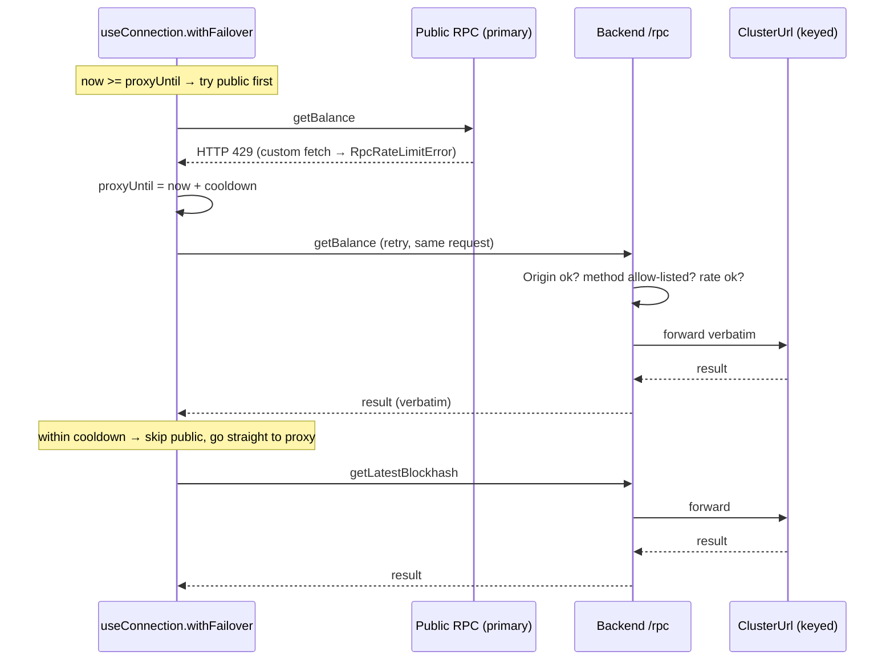
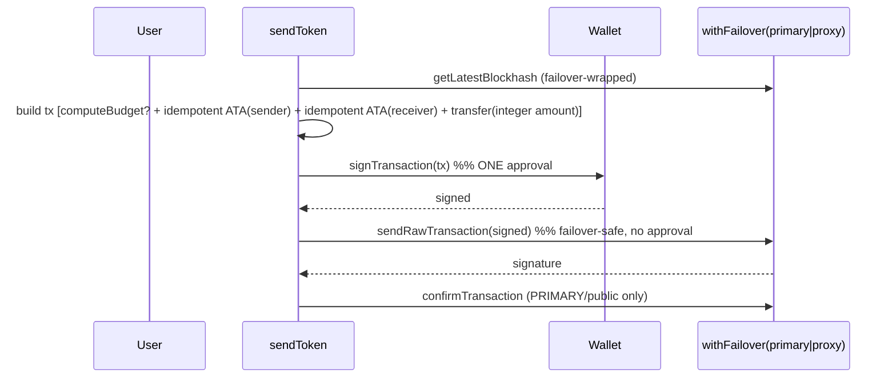

# SpaceStroker — "Improve Solana Wallet Connection & RPC Calls" — Implementation Spec

> **Status: Shipped** (2026-07-24) — merged via `feature/solana-connection-rpc` into `main`
> (`monkify-backend` + `monkify-front` + `monkify-meta`). Distilled: `../features/solana-connection-rpc.md`.
> Refined via Trello card
> [improve solana wallet connection and RPC calls](https://trello.com/c/7Fm2RhGB) (2026-07-23).
> Repos affected: `monkify-backend`, `monkify-front`, and this doc in `monkify-meta`.
>
> **Post-ship note:** the send's `preflightCommitment` is pinned to `'confirmed'` (matching the
> `'confirmed'` blockhash) — without it `sendRawTransaction` preflight defaults to `'finalized'` and
> rejects the just-fetched blockhash with "Blockhash not found" (found during QA).
>
> **Level: Feature** — a new backend endpoint (`POST /rpc` proxy) plus a substantive frontend
> connection/transfer rework. Per `constraints.md` this ships with a **mandatory happy-path backend
> integration test** and unit tests; a distilled `features/solana-connection-rpc.md` follows at ship time.
>
> **Purpose:** Keep the game playable under real mainnet traffic. Today the frontend talks straight to
> Solana's **public** RPC (`clusterApiUrl`) with `disableRetryOnRateLimit: true`, so once the public
> endpoint returns HTTP 429 the wallet balance, blockhash, send and confirmation calls all fail — and
> we cannot fix it by shipping a paid RPC key, because every `VUE_APP_*` value is compiled into the
> public bundle. This card adds a **429-only failover** to a thin backend `/rpc` proxy (which reuses
> the already-configured key-bearing `TokenSettings.ClusterUrl`) and bundles the long-standing
> crypto-transfer reliability fixes (one wallet approval instead of up to three, a priority fee, and
> exact integer amount math).

---

## 1. Summary

Two coordinated changes plus a new backend endpoint:

| Area | Today | After |
| --- | --- | --- |
| **RPC transport (FE)** | Single public `Connection` (`clusterApiUrl`), `disableRetryOnRateLimit: true`. A 429 fails the call outright. | **Public stays primary.** On a **429 only**, the same call is retried against a backend **`/rpc` proxy** and traffic *sticks* to the proxy for a short **cooldown** (~60 s, configurable) before drifting back to public. |
| **`/rpc` proxy (BE)** | — | New `POST /rpc` in `SpaceStroker.Api`: a thin JSON-RPC passthrough to `TokenSettings.ClusterUrl` (the key-bearing endpoint Solnet payouts already use). Gated by **Origin allowlist + per-IP rate limit + strict method allowlist**; **not** launch-token gated. |
| **Confirmation (FE)** | `confirmTransaction` on the single connection. | **Unchanged** — always on the **primary/public** connection so the confirmation WebSocket keeps working. We never proxy a socket. |
| **Crypto transfer (FE)** | Up to **3** wallet approvals (separate ATA-creation txs), **no** priority fee, `value * Math.pow(10, decimals)` float math. | **One** approval — idempotent-ATA + transfer bundled in a **single** tx; optional **ComputeBudget priority fee** (0 disables); **integer/BigInt** base-unit math (exact). |

Non-goals (explicitly out of scope, §9): proxying the RPC **WebSocket** / switching confirmation to
HTTP polling; `WalletButtons.vue` DOM-hack refactor + debug-log cleanup; trust/UX copy; Mobile Wallet
Adapter; any change to the backend's own Solnet payout RPC usage.

---

## 2. Constraints (MANDATORY)

From `monkify-meta/constraints.md` (full list there):

- **Worktree-per-repo:** `feature/solana-connection-rpc` in **both** `monkify-backend` and
  `monkify-front` (and `monkify-meta` for this doc); hubs stay on `main`. Same branch name in each.
- **Secrets/config:** committed files carry **mock/placeholder** values only. The real
  `Token:ClusterUrl` key lives in deploy secrets — never printed, never committed. The proxy must
  **never log the key** — reuse the existing host-only `MaskRpcUrl` masking pattern
  (`SolanaRpcClientProvider.MaskRpcUrl`) anywhere it logs an endpoint.
- **Unit tests:** update/add in `SpaceStroker.Tests` (run via `scripts/run_tests.bat`, never the full
  `dotnet test`); **report changed tests** at the end of implementation.
- **Integration test (mandatory — this is a Feature):** at least one happy-path test in
  `SpaceStroker.Tests.Integration` (Testcontainers) driving the `/rpc` proxy end to end. Point the
  proxy's upstream at a **local fake RPC** — never real mainnet (see §11).
- **API stays stateless:** `/rpc` lives on the `SpaceStroker.Api` host. **No** domain entity/enum, **no**
  EF mapping, **no** migration, **no** consumer.
- **Vague messaging:** proxy errors stay generic (no RPC/provider/contract internals leaked); the
  wallet-bridge popup already returns generic errors.

---

## 3. Resolved product decisions

| # | Decision |
| --- | --- |
| 1 | **Failover, not always-proxy.** Public mainnet stays the **primary** path (free, fast, zero backend load). The proxy is used only *after* a 429. |
| 2 | **Failover triggers ONLY on 429 / rate-limit.** A normal RPC error (failed tx, expired blockhash, etc.) does **not** flip traffic to the proxy — it surfaces exactly as today. |
| 3 | **Sticky cooldown.** After a 429, subsequent RPC calls go **directly** to the proxy (no public attempt) for a cooldown window (`VUE_APP_SOLANA_RPC_PROXY_COOLDOWN_MS`, default ~60 000). After it expires, calls resume trying public first. |
| 4 | **Confirmation is unchanged.** The primary stays public, so `confirmTransaction`'s WebSocket subscription keeps working. A tx *broadcast* through the proxy still confirms on the public connection (same cluster) — correct by design. We never proxy a socket. |
| 5 | **Backend `/rpc` reuses `TokenSettings.ClusterUrl`.** No new provider, no new secret. It forwards to the already-configured key-bearing endpoint. |
| 6 | **`/rpc` is NOT launch-token gated.** It is deliberately kept out of `LaunchTokenValidationMiddleware.ProtectedPrefixes` so the same-origin wallet-bridge popup (which by design never receives a launch token — see `walletBridge.ts` / `useEmbeddedWallet.ts`) keeps working. |
| 7 | **`/rpc` gating = Origin allowlist + per-IP rate limit + strict method allowlist.** Reuse `CorsOriginResolver` for the Origin check; add an `AspNetCoreRateLimit` per-IP rule for `/rpc`; forward only the allow-listed JSON-RPC methods. Anything else → **403** (never let the proxy become an open relay that burns the paid quota). |
| 8 | **Method allowlist** = exactly what the frontend `Connection` calls: `getBalance`, `getTokenAccountsByOwner`, `getTokenAccountBalance`, `getParsedAccountInfo`, `getLatestBlockhash`, `getTransaction`, `sendTransaction`. |
| 9 | **Reliability fixes bundled** into `useConnection.sendToken`: single-tx idempotent-ATA transfer (1 approval), ComputeBudget priority fee (configurable, `0` disables), integer/BigInt amount math. |
| 10 | **Dev/devnet no-op.** If `VUE_APP_SOLANA_PROXY_URL` is unset, `withFailover` is a pass-through to the public endpoint — no proxy calls are ever made. |
| 11 | **Backward compatible.** Standard/USD (off-chain) bets and free bets never touch RPC → unaffected. The embedded wallet-bridge popup reuses `useConnection`, so it inherits failover + single-tx transfer with **no popup-specific change and no launch token**. Mobile deep-link path unaffected. |

---

## 4. Data model

**No data-model change.** No entity, enum, EF mapping, or migration. `/rpc` is a stateless passthrough
and the frontend rework is transport-only.

---

## 5. Configuration

### 5.1 Frontend env vars (`monkify-front/.env.example` — mock/dev defaults + production notes)

Vue CLI bakes `VUE_APP_*` in at **build** time; the GCP deploy tool generates real production values
from `secrets.<env>.json` and does **not** read `.env.example`. Add:

| Var | Dev default | Production note | Meaning |
| --- | --- | --- | --- |
| `VUE_APP_SOLANA_RPC_URL` | *(empty → falls back to `clusterApiUrl(VUE_APP_SOLANA_NETWORK)`)* | public mainnet RPC (or a public provider URL) | The **primary/public** RPC endpoint. Preserves today's behaviour when empty. |
| `VUE_APP_SOLANA_PROXY_URL` | *(empty → failover disabled)* | `https://api.spacestroker.com/rpc` | The backend `/rpc` proxy. **Unset ⇒ `withFailover` is a no-op.** |
| `VUE_APP_SOLANA_RPC_PROXY_COOLDOWN_MS` | `60000` | `60000` (tune as needed) | How long traffic sticks to the proxy after a 429. |
| `VUE_APP_SOLANA_PRIORITY_FEE_MICROLAMPORTS` | `0` | e.g. `50000` (tune) | Compute-unit price for transfers. **`0` disables** the priority-fee instruction. |

> Keep `.env.local` / `.env.production` mock-only; only `.env.example` is documented here. `.env.local`
> may leave `VUE_APP_SOLANA_PROXY_URL` unset so local dev never proxies (dev hits public devnet).

### 5.2 Backend config (`spacestrokersettings.json` / `GeneralSettings`)

- **Reuses `GeneralSettings:Token:ClusterUrl`** — no new secret. The committed value stays the keyless
  public devnet URL (`https://api.devnet.solana.com/`); the real keyed endpoint is injected via deploy
  secrets in production, exactly as the Solnet payout path already consumes it.
- **Rate-limit rule for `/rpc`** — add a per-IP `AspNetCoreRateLimit` rule (see §6.4). Prefer a small
  config block so the limit is tunable; a hardcoded constant is acceptable if kept out of the request path.
- **Method allowlist / timeout** — a small optional `GeneralSettings:Rpc` block
  (`AllowedMethods`, `TimeoutSeconds`) or a hardcoded constant array in the controller. Either is fine;
  keep it in one place.

---

## 6. Backend behaviour (`monkify-backend`)

### 6.1 New `RpcController` (`POST /rpc`, `SpaceStroker.Api/Controllers/RpcController.cs`)

A thin JSON-RPC passthrough — **not** a MediatR/`BaseController` flow (there is no domain work; it just
forwards bytes). Steps, in order:

1. **Origin allowlist** (§6.3). Disallowed Origin → **403**, do not forward.
2. **Parse** the JSON-RPC body enough to read the `method` field (support a single request object; a
   batch array is out of scope — reject or forward-single as the spec author decides, default: only
   single-object requests, else 400). Malformed body → **400**.
3. **Method allowlist** (§6.2). Disallowed method → **403**, do not forward.
4. **Forward** the raw request body to `TokenSettings.ClusterUrl` via `IHttpClientFactory` (a named
   client, e.g. `"SolanaRpc"`), preserving `Content-Type: application/json`.
5. **Return the provider response verbatim** — same status code and JSON body, JSON-RPC-level errors
   (e.g. `{ "error": {...} }`) passed through **unchanged**. The key is never present in a response.
6. **Failure mapping:** provider unreachable / timeout → **502**. Never surface the endpoint or key.
7. **Never log the key.** If any endpoint is logged, mask it with `MaskRpcUrl` (host-only).

> The controller must **not** be added to `LaunchTokenValidationMiddleware.ProtectedPrefixes` (it isn't
> today — `/games /operators /players /fx`) nor to `AdminTokenValidationMiddleware`'s prefixes. Confirm
> both middlewares skip `/rpc`.

### 6.2 Method allowlist

Exactly these seven (decision #8): `getBalance`, `getTokenAccountsByOwner`, `getTokenAccountBalance`,
`getParsedAccountInfo`, `getLatestBlockhash`, `getTransaction`, `sendTransaction`. Case-sensitive match
on the JSON-RPC `method` string. Anything else → 403 before any forward.

### 6.3 Origin allowlist (server-side, independent of browser CORS)

- Reuse `CorsOriginResolver.ResolveAllowedOrigins(configuration)` (default
  `https://app.spacestroker.com`, override via `GeneralSettings:Cors:AllowedOrigins`). Compare against
  the request `Origin` header; a mismatch → 403.
- **⚠ Environment tension (must resolve — see §12/AC-06 + §13):** the global CORS policy
  (`app.UseCors("DevOrigins")`) **allows any origin in Development** and only enforces
  `ResolveAllowedOrigins` in non-Development. Browser CORS is *client-enforced* and does not stop a
  server-to-server relay, which is exactly why we add this **server-side** Origin check on `/rpc`. To
  keep it testable in the Development-environment integration harness, the `/rpc` Origin check must be
  **enforced regardless of `IWebHostEnvironment`** and driven purely by the configured allowlist
  (optionally also permitting `localhost`/`127.0.0.1` origins for local dev). The integration test
  sets `GeneralSettings:Cors:AllowedOrigins` to a known value and asserts a foreign `Origin` → 403 and
  the allowed `Origin` (or no `Origin`) → forwarded. **Do not** rely on the browser CORS middleware for
  this guarantee.

### 6.4 Per-IP rate limit (`AspNetCoreRateLimit`)

`Program.cs` already wires `IpRateLimiting` (`EnableEndpointRateLimiting: true`) with a single
`GeneralRules` entry (`api/*`, 100/min). `/rpc` is **not** under `api/*`, so it is currently uncovered.
Add a dedicated per-IP rule for `/rpc` — endpoint format is `{verb}:{path}`, e.g.:

```jsonc
// spacestrokersettings.json → IpRateLimiting.GeneralRules (append)
{ "Endpoint": "*:/rpc", "Period": "1m", "Limit": 120 }
```

Forwarded headers already expose the real client IP (`UseForwardedHeaders` runs before
`UseIpRateLimiting`). Over-limit → the limiter's **429** (AC-07). Tune the number in the spec/PR; it
must comfortably cover a normal player's burst (balance + blockhash + send + a few reads per bet) while
capping abuse.

### 6.5 What does NOT change

- Reward math (`BetDomainService`), the typer, SignalR contracts, the game/bet lifecycle.
- The backend's own Solnet payout/refund RPC usage (`SolanaRpcClientProvider`, `SolanaService`).
- `LaunchTokenValidationMiddleware.ProtectedPrefixes` (add nothing).

---

## 7. Frontend behaviour (`monkify-front`)

All changes are in **`src/hooks/useConnection.ts`** (the composable singleton). No new API service
call; the wallet-bridge popup and `useGame.bet()` are unchanged callers.

### 7.1 Primary + proxy connections

- Build the **primary** `Connection` from `VUE_APP_SOLANA_RPC_URL` (default = current
  `clusterApiUrl((VUE_APP_SOLANA_NETWORK) || 'devnet')` behaviour), keeping the existing
  `confirmTransactionInitialTimeout`. **Drop `disableRetryOnRateLimit: true` is NOT required** — instead
  we detect the 429 ourselves (§7.2); keep the config otherwise equivalent.
- Build a **proxy** `Connection` pointing at `VUE_APP_SOLANA_PROXY_URL` (→ backend `/rpc`) **only when
  that var is set**. When unset, there is no proxy connection and `withFailover` is a pass-through
  (decision #10).
- **Refactor note:** today `connection` is a single module `ref` created lazily in `startConnection`
  (only on wallet connect). Reads like `getTokenBalance` depend on it. The rework needs the **primary**
  connection available for reads/confirmation independent of the proxy connection. Keep both as
  module-scoped singletons (mirrors the existing pattern); `confirmTransaction` always uses **primary**.

### 7.2 `withFailover(call)` + reliable 429 detection

- Module-level `proxyUntil` timestamp (epoch ms; `0` = not in cooldown). Safe under JS single-thread.
- `withFailover(op)` runs `op(connection)` where `connection` is the **proxy** if `now < proxyUntil`
  **and** a proxy connection exists, else **primary**. On a caught **429**, set
  `proxyUntil = now + cooldown` and **retry the same op once on the proxy** (if a proxy exists),
  returning its result. A **non-429** error propagates unchanged (decision #2).
- **Detecting 429 reliably (implementation crux — do not string-match error messages loosely):**
  `@solana/web3.js` accepts a custom `fetch` in the `Connection` config. Wire the **primary**
  connection with a `fetch` wrapper that inspects `response.status === 429` and throws a **typed**
  error (e.g. `class RpcRateLimitError extends Error`). `withFailover` catches that type as its 429
  signal. This covers both reads and `sendTransaction` (the wallet adapter's send ultimately uses the
  connection's `fetch`). Prefer this over parsing thrown message strings.
- **Which calls route through `withFailover`:** the reads `getBalance`, `getTokenAccountsByOwner`,
  `getTokenAccountBalance`, `getParsedAccountInfo`, `getLatestBlockhash`, `getTransaction`, **and**
  `sendTransaction`. **`confirmTransaction` does NOT** — it always uses primary/public (decision #4).

### 7.3 `sendTransaction` failover **without a second wallet approval** (must resolve)

> **⚠ Non-obvious blocker.** Today `sendToken` uses `useWallet().sendTransaction(tx, connection)`, which
> **signs *and* sends**. Naively "retry `sendTransaction` on the proxy" would prompt the wallet a
> **second time** — contradicting the single-approval goal. Resolve by **signing once, sending raw with
> failover**:
> 1. Build the tx, set `recentBlockhash` (from a `getLatestBlockhash` that itself goes through
>    `withFailover`) + `feePayer`.
> 2. `const signed = await wallet.signTransaction(tx)` — **one** approval.
> 3. `withFailover(conn => conn.sendRawTransaction(signed.serialize()))` — the raw send has **no**
>    approval, so retrying it on the proxy is free and safe (identical signed bytes de-duplicate
>    on-chain).
> 4. `confirmTransaction` on **primary** with the blockheight strategy, as today.
>
> If `signTransaction` is unavailable for a given adapter, fall back to the current
> `sendTransaction(tx, primary)` (single approval, no send-failover) rather than risk a double prompt.
> **AC-08 (one approval) governs the ATA/first-time-bettor path and must hold regardless.**

### 7.4 `sendToken` reliability rework

Replace the current up-to-3-tx flow (`createTokenAccount` for sender + receiver, then a separate
transfer) with a **single** transaction:

- Use `createAssociatedTokenAccountIdempotentInstruction` (from `@solana/spl-token`) for **both** the
  sender and receiver ATAs, bundled with `createTransferInstruction` in one `Transaction`. Idempotent
  = no pre-check needed and no failure if the ATA already exists. First-time sender ⇒ **one** approval
  (AC-08).
- Prepend a **priority fee**: `ComputeBudgetProgram.setComputeUnitPrice({ microLamports })` (+
  `setComputeUnitLimit`) when `VUE_APP_SOLANA_PRIORITY_FEE_MICROLAMPORTS > 0`; **omit both** when `0`
  (AC-09). The fee must **not** alter the transfer amount/economics.
- **Integer amount math (AC-10):** replace `value * Math.pow(10, numberDecimals)` with
  integer/`BigInt` base-unit conversion (e.g. scale via string/`BigInt`, never float multiplication) so
  the on-chain amount is exact for fractional tokens.
- Keep the blockheight-based `confirmTransaction` on **primary** (§7.3 step 4). Remove the noisy
  `console.log` debug lines only if trivially adjacent — otherwise leave (debug-log cleanup is a
  separate out-of-scope card).

### 7.5 Callers — no change required

- **`useGame.bet()`** (`src/hooks/useGame.ts`) calls `sendToken(...)` for the standalone/in-frame path
  and drives the popup handoff (`useEmbeddedWallet`) for the cross-origin iframe. Signature of
  `sendToken` is unchanged; it just becomes more reliable.
- **`WalletBridgePage.vue`** (`src/pages/WalletBridgePage.vue`) uses the same `useConnection`, so the
  popup inherits failover + single-tx transfer automatically — **no popup-specific change, no launch
  token** (AC-11).
- **UI:** failover is transparent; no new user-facing surface in this card.

---

## 8. Flow diagrams

### 8.1 Read with 429 failover + cooldown



### 8.2 Crypto bet transfer (single approval)



---

## 9. Out of scope

- Backend proxying of the RPC **WebSocket** / switching confirmation to HTTP polling (explicitly
  rejected — confirmation stays on the public socket).
- `WalletButtons.vue` DOM-hack refactor and debug-log cleanup (separate card).
- Trust/UX copy — amount + receiver in the bridge popup, post-bet explorer link, non-custodial
  reassurance text (separate card).
- Mobile Wallet Adapter (MWA) — separate follow-up.
- Changing the backend's own Solnet payout RPC usage.

---

## 10. File checklist

### 10.1 Backend (`monkify-backend`)

| # | File | Change |
| --- | --- | --- |
| 1 | `src/SpaceStroker.Api/Controllers/RpcController.cs` | **New.** `POST /rpc` passthrough: Origin allowlist → parse method → method allowlist → forward raw body to `TokenSettings.ClusterUrl` via named `IHttpClientFactory` client → return verbatim; 403 (Origin/method), 400 (malformed), 502 (upstream). Never log the key (`MaskRpcUrl`). |
| 2 | `src/SpaceStroker.Api/Program.cs` | Register the named `HttpClient` (`"SolanaRpc"`, timeout from config); ensure DI has `TokenSettings` available to the controller. No new middleware ordering needed (`/rpc` bypasses both token middlewares). |
| 3 | `src/SpaceStroker.Common/spacestrokersettings.json` | Append `IpRateLimiting.GeneralRules` entry for `*:/rpc`; optional `GeneralSettings:Rpc` block (allowed methods / timeout). Mock/keyless values only. |
| 4 | *(optional)* `src/SpaceStroker.Domain/Configs/Entities/` | If using a typed `Rpc` settings block, add a small POCO bound under `GeneralSettings`. Skip if using a controller constant. |

### 10.2 Frontend (`monkify-front`)

| # | File | Change |
| --- | --- | --- |
| 1 | `src/hooks/useConnection.ts` | Primary (`VUE_APP_SOLANA_RPC_URL`) + proxy (`VUE_APP_SOLANA_PROXY_URL`) connections; custom `fetch` on primary that throws a typed 429 error; `withFailover` + module `proxyUntil` cooldown; route the 7 reads/send through it; `confirmTransaction` stays on primary. Rework `sendToken`: single idempotent-ATA + transfer + optional ComputeBudget priority fee; sign-once + `sendRawTransaction` failover; integer/BigInt amount math. |
| 2 | `.env.example` | Add `VUE_APP_SOLANA_RPC_URL`, `VUE_APP_SOLANA_PROXY_URL`, `VUE_APP_SOLANA_RPC_PROXY_COOLDOWN_MS`, `VUE_APP_SOLANA_PRIORITY_FEE_MICROLAMPORTS` with dev defaults + production notes (§5.1). |
| 3 | `.env.local` / `.env.production` *(as needed)* | Mock-only; leave `VUE_APP_SOLANA_PROXY_URL` unset locally so dev never proxies. |

### 10.3 Meta (`monkify-meta`)

| # | File | Change |
| --- | --- | --- |
| 1 | `specs/solana-connection-rpc.md` | **This spec.** |
| 2 | `INDEX.md` | Add the spec row (status Ready) + set "Feature currently in flight". |

---

## 11. Tests

### 11.1 Unit tests — `monkify-backend/src/SpaceStroker.Tests`

| Test file | Test cases | Expected |
| --- | --- | --- |
| `UnitTests/…/RpcMethodAllowlistTests.cs` (or the controller's guard, unit-testable in isolation) | allow-listed method (each of the 7) passes the guard | not rejected |
| " | a non-allow-listed method (e.g. `requestAirdrop`, `getProgramAccounts`) | guard rejects → 403 path, no forward |
| " | malformed / missing `method` body | 400 path |
| *(Origin helper)* | reuse/extend `CorsOriginResolverTests` if the Origin-check logic is factored into a testable helper | allowed vs disallowed origin |

> The controller's forward-to-upstream is covered end-to-end by the integration test (below) against a
> fake RPC, so unit tests focus on the **guards** (method/Origin/parse) which need no network.

### 11.2 Integration test (mandatory) — `SpaceStroker.Tests.Integration`

New `RpcProxyTests.cs` following the `LaunchTokenValidationTests` / harness pattern. **Point the
proxy's upstream at a local fake RPC**, not mainnet. Two viable seams (pick one in implementation):

- **Preferred:** override the named `"SolanaRpc"` `HttpClient`'s primary handler in
  `TestWebAppFactory.ConfigureTestServices` with a stub `HttpMessageHandler` that records the forwarded
  body and returns a canned JSON-RPC 200 (mirrors how the harness swaps `ISolanaService`→
  `FakeSolanaService`). No real socket, fully deterministic.
- **Alternative:** set `GeneralSettings__Token__ClusterUrl` (env var) to a tiny in-process fake RPC.

Happy-path + guard assertions (map to §12):

| Case | Assert |
| --- | --- |
| Allow-listed method (`getBalance`) from an allowed Origin, **no launch token** | 200; body is the fake provider's response **verbatim**; the stub received the forwarded request; **no api-key** appears in the response or in `LogSink` (AC-04, AC-06 no-token). |
| Non-allow-listed method (e.g. `getProgramAccounts`) | **403**; the stub was **not** called (AC-05). |
| Disallowed `Origin` header (allowlist set to a known value via `GeneralSettings:Cors:AllowedOrigins`) | **403**, not forwarded (AC-06). |
| Over the per-IP limit (hammer `/rpc` past the configured rule) | subsequent requests get **429** from the limiter (AC-07). |

> FE-only ACs (01/02/03 failover, 08/09/10 transfer, 11 confirmation/popup, 12 no-op) are verified by
> manual QA (§13) and, where practical, `useConnection` logic can be exercised in isolation — but the
> harness has no headless wallet, so the transfer ACs are QA-verified.

---

## 12. Acceptance criteria

Mapped 1:1 from the Trello **Acceptance Criteria** checklist:

1. **AC-01** — Given the public RPC returns HTTP 429 for a read (e.g. `getBalance`), when the FE makes
   that call, then it transparently retries the same request against the backend `/rpc` proxy and
   returns a successful result with **no user-visible error**.
2. **AC-02** — Given a 429 has occurred, when subsequent RPC calls are made within the cooldown window,
   then they go **directly** to the proxy (no public attempt); after the cooldown expires, calls resume
   trying public first.
3. **AC-03** — Given a normal (non-429) RPC error, when a call fails, then failover is **NOT** triggered
   and the error surfaces exactly as today.
4. **AC-04** — Given a JSON-RPC request for an allow-listed method, when `/rpc` forwards it to
   `ClusterUrl`, then it returns the provider response **verbatim** and the API key is **never** present
   in the response or any log line.
5. **AC-05** — Given a JSON-RPC request for a non-allow-listed method, when `/rpc` processes it, then it
   responds **403** and does **not** forward to the provider.
6. **AC-06** — Given a request to `/rpc` from a disallowed Origin, then it is rejected and not forwarded;
   and given **no launch token**, the request still succeeds (`/rpc` requires no `X-Launch-Token`).
7. **AC-07** — Given `/rpc` is hit beyond its configured per-IP rate limit, then further requests receive
   a **429** from the API rate limiter.
8. **AC-08** — Given a first-time crypto bettor with no SPL token account, when they place a SolanaToken
   bet, then the transfer completes with **exactly one** wallet approval (idempotent ATA creation +
   transfer bundled in a single transaction).
9. **AC-09** — Given a configured non-zero priority fee, when a transfer is built, then it includes a
   ComputeBudget `setComputeUnitPrice` (and unit-limit) instruction; given a fee of `0`, then **no**
   priority-fee instruction is added.
10. **AC-10** — Given a fractional token amount, when it is converted to base units, then integer/BigInt
    math is used (no floating-point multiplication) and the on-chain amount is **exact**.
11. **AC-11** — Given a bet placed through either the standalone or embedded-popup path, when the tx is
    confirmed, then confirmation behavior is **unchanged** (still via the public/primary connection) and
    the embedded popup requires **no** launch token.
12. **AC-12** — Given `VUE_APP_SOLANA_PROXY_URL` is unset (dev/devnet), when RPC calls are made, then
    `withFailover` is a **no-op pass-through** to the public endpoint and **no** request is ever sent to
    the proxy.

---

## 13. Manual QA

Backend (local docker stack, `setup_local_environment.bat`):

1. `curl -X POST http://localhost:6001/rpc -H 'Content-Type: application/json' -H 'Origin: https://app.spacestroker.com' -d '{"jsonrpc":"2.0","id":1,"method":"getLatestBlockhash","params":[]}'` → 200 with a devnet blockhash (dev `ClusterUrl` is public devnet — safe). No `X-Launch-Token` sent.
2. Same with `"method":"getProgramAccounts"` → **403**, not forwarded.
3. Same with `-H 'Origin: https://evil.example'` → **403**.
4. Hammer `/rpc` past the configured limit → **429** from the limiter.
5. `grep` the API logs — the RPC endpoint appears **host-only** (masked), never with a key.

Frontend (against devnet; proxy left unset locally ⇒ failover no-op — AC-12):

6. Connect a devnet wallet on `/space-stroker/game`, place a **SolanaToken** bet as a first-time bettor
   (fresh ATA) → **one** approval prompt; tx confirms; balance updates.
7. Repeat as a returning bettor → still one approval; exact amount on the explorer (integer math).
8. To exercise failover locally, set `VUE_APP_SOLANA_PROXY_URL=http://localhost:6001/rpc` and force a
   429 (or temporarily point the primary at a throttled endpoint) → calls transparently continue via
   `/rpc`; confirmation still works.
9. Embedded (`?embed=1` / iframe example) + wallet-bridge popup bet → works with no launch token, single
   approval (AC-11).

---

## 14. Trello / pipeline

- **Source card:** [improve solana wallet connection and RPC calls](https://trello.com/c/7Fm2RhGB) —
  list **Specs created**; the card's **Implementation** section lists branch + spec + worktree.
- **Branch:** `feature/solana-connection-rpc` in `monkify-backend`, `monkify-front`, `monkify-meta`
  (worktrees under `.worktrees/solana-connection-rpc/<repo>`).
- **Next:** `/monkify-implement-feature improve solana wallet connection and RPC calls` to build it;
  then `/monkify-ship-feature …` to sync the KB and merge to `main`.

---

## 15. Code-exploration findings (hidden blockers flagged for the implementer)

1. **`sendTransaction` failover would double-prompt the wallet.** `useWallet().sendTransaction` signs
   *and* sends. To fail over without a second approval, **sign once** (`signTransaction`) then
   `withFailover(conn => conn.sendRawTransaction(raw))` (§7.3). This is the crux of reconciling the
   failover with AC-08's single-approval requirement.
2. **429 detection must be structural, not string-matched.** Wire a custom `fetch` into the primary
   `Connection` that throws a typed error on `response.status === 429` (§7.2). `disableRetryOnRateLimit`
   alone only surfaces a generic error; message-string matching is fragile across web3.js versions.
3. **The server-side `/rpc` Origin check fights the dev CORS bypass.** `app.UseCors("DevOrigins")`
   allows any origin in Development; the integration harness runs in Development. The `/rpc` Origin
   allowlist must therefore be enforced **independent of environment** (driven by the configured
   allowlist), or AC-06 can't be tested and the guarantee is illusory in prod-vs-dev (§6.3).
4. **`/rpc` is uncovered by the current rate-limit rule.** `IpRateLimiting.GeneralRules` only lists
   `api/*`; `/rpc` needs its own `*:/rpc` rule for AC-07 (§6.4). Forwarded headers already expose the
   real client IP before the limiter runs.
5. **`connection` is created lazily on wallet connect** (`startConnection`) and shared by reads. The
   primary connection must exist for reads/confirmation regardless of the proxy; keep both as
   module-scoped singletons and never route `confirmTransaction` through the proxy (§7.1, decision #4).

---

## 16. Revision log

| Date | Change |
| --- | --- |
| 2026-07-23 | Initial spec from refined Trello card #87 (7Fm2RhGB). |
