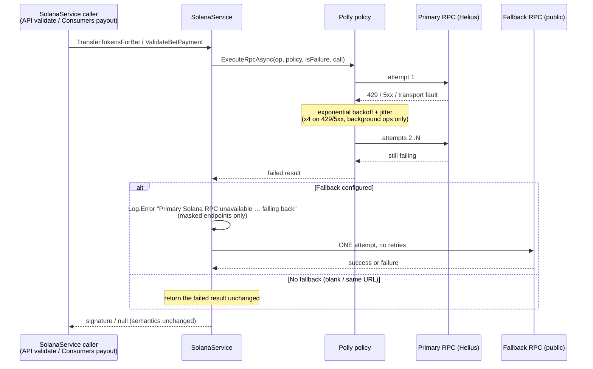

# SpaceStroker — "Call Solana RPC With API Key" — Implementation Spec

> **Status: Ready for implementation** — refined via Trello card
> [Call Solana RPC With API Key](https://trello.com/c/h0bO1Adv) (2026-07-23).
> Repos affected: `monkify-backend` and this doc + the deploy stack in `monkify-meta`
> (**no `monkify-front`**).
>
> **Level: Minor change** — backend infra/resilience. No new happy-path integration test and no
> dedicated `features/<slug>.md` doc (see §2). Unit tests are mandatory as always.
>
> **Purpose:** Point the backend's Solana RPC at the purchased **Helius** endpoint instead of the free
> public one, and close the resilience gaps that let a single RPC blip fail a payout. Today
> `GeneralSettings:Token:ClusterUrl` is `https://api.devnet.solana.com/` locally and
> `https://api.mainnet-beta.solana.com/` in production — a globally throttled, unauthenticated
> endpoint sitting directly on the money path (bet-payment validation in the API, winner payouts and
> refunds in Consumers). This is for ops/reliability, not for players: no game, bet, payout, or
> realtime behaviour changes shape.

---

## 1. Summary

Three things change, all inside `SpaceStroker.Infrastructure`:

| # | Change | Why |
| --- | --- | --- |
| 1 | **`ClusterUrl` carries the whole Helius URL** (`https://mainnet.helius-rpc.com/?api-key=<KEY>`), supplied per environment. Because the key now rides in that value, the setting **moves from the deploy tool's `appConfig` block to its `secrets` block** (Secret Manager), which also requires two additions in `deploy/terraform/workload/main.tf`. | The endpoint swap itself. The move is **mandatory**, not cosmetic — `appConfig` becomes plaintext Cloud Run env vars. |
| 2 | **Retry policies on all four RPC operations**, with exponential backoff + jitter and explicit 429/5xx awareness. `SendTransactionAsync` and `GetTokenAccountsByOwnerAsync` have **no** policy today. | A single blip on `sendTransaction` currently fails a payout outright. |
| 3 | **Per-call fallback to the public RPC** after the primary's retries are exhausted, behind a new `GeneralSettings:Token:FallbackClusterUrl`, with an **Error** log on every fallback. | A Helius outage / exhausted credits must not stop payouts. |

Before / after:

| Aspect | Before | After |
| --- | --- | --- |
| RPC endpoint (prod) | `https://api.mainnet-beta.solana.com/` (public, unauthenticated) | Helius mainnet with API key |
| RPC endpoint (local / Docker / tests) | `https://api.devnet.solana.com/` | **Unchanged** — keyless public devnet, spends no credits |
| Where the URL is configured | `appConfig` → plaintext Cloud Run env var | `secrets` → Secret Manager → `GeneralSettings__Token__ClusterUrl` |
| RPC clients in DI | one `IRpcClient` singleton | `ISolanaRpcClientProvider` singleton exposing **Primary** + optional **Fallback** (`IRpcClient` still resolvable, aliased to Primary) |
| `getLatestBlockhash` | 3 retries, fixed 1s, no 429 handling | N retries, exponential + jitter, 429/5xx-aware, then fallback |
| `getTransaction` | 3 retries, fixed 1s, no 429 handling | same shape (no rate-limit multiplier — API request path), then fallback |
| `getTokenAccountsByOwner` | **no retry** | N retries + fallback |
| `sendTransaction` | **no retry** | N retries + fallback |
| Failure after everything | `OperatorWalletError.Unavailable` → bet `NeedsRefunding` → 12h sweep | **Unchanged** |
| Frontend | `new Connection(clusterApiUrl(VUE_APP_SOLANA_NETWORK))` | **Untouched** |
| Schema / migration / API contract | — | **None** |

Nothing about Helius is hard-coded: the backend keeps speaking plain JSON-RPC through Solnet, so the
provider is a config value and stays swappable.

---

## 2. Constraints (MANDATORY)

From `monkify-meta/constraints.md` (full list there):

- **Worktree-per-repo / branch-per-repo (§2):** work lives in
  `.worktrees/solana-rpc-api-key/<repo>`; each hub stays on `main` (never `git checkout -b` in a hub).
  Branch `feature/solana-rpc-api-key` in `monkify-backend` and `monkify-meta` is the merge/PR ref;
  push after every commit.
- **Secrets (§1) — the sharp edge of this card.** The Helius key is a **real credential** and it rides
  inside a URL. Therefore:
  - No committed file may ever contain it. `spacestrokersettings.json` keeps the **keyless public
    devnet** URL; `deploy/secrets.example.json` gets a `REPLACE_ME_helius_api_key` placeholder only.
  - The real value goes **only** into the operator's unversioned `deploy/secrets.<env>.json`
    (git-ignored by `deploy/.gitignore` → `secrets*.json`) and from there into Secret Manager.
  - **The URL must never be logged verbatim.** Masking is implemented in the provider (§6.2) so the
    raw string never reaches `SolanaService` or any log statement.
  - The user supplies the key **after** implementation — do not ask for it, and do not block on it.
- **Unit tests (§3):** update/add in `SpaceStroker.Tests`; run via **`scripts/run_tests.bat`** (not a
  bare `dotnet test` — `ProductionSessions` is a slow Monte Carlo suite) and **report exactly which
  tests changed** at the end.
- **No new integration test (§3 "Integration tests" + card `## Level`).** This is a `Minor change`,
  and the suite structurally cannot exercise it: `SpaceStroker.Tests.Integration` replaces
  `ISolanaService` with `FakeSolanaService` (`Harness/IntegrationTestFixture.cs:140-141`) and never
  constructs an `IRpcClient`. The existing integration suite must still be **green and unchanged**.
- **EF / migrations (§4):** **N/A** — no entity, no mapping, no migration.
- **Production data & external APIs (§5):** do **not** point tools at the production Helius endpoint
  and do not spend the user's credits from an agent session. Verification against a real key is the
  user's step (§13).
- **Hosts (§8):** the API stays stateless; money work stays in `SpaceStroker.Consumers`. This change
  lives in shared `SpaceStroker.Infrastructure` and alters neither host's responsibilities.
- **Operator messaging (§6):** unchanged — no new user-facing error text; failures still surface as
  the existing vague `OperatorWalletError.Unavailable` path.

---

## 3. Resolved product decisions

| # | Decision |
| --- | --- |
| 1 | **Backend only.** `monkify-front` is untouched — `useConnection.ts` keeps `clusterApiUrl(VUE_APP_SOLANA_NETWORK)`. Each player's browser calls from their own IP on the public endpoint's free quota; routing it through Helius would spend **our** credits on every player (~7–8 RPC calls per paid bet, plus ~6/min per idle tab from the `TokenBalance.vue` poll). |
| 2 | **Config shape:** the whole Helius URL (including `?api-key=…`) goes in the **existing** `GeneralSettings:Token:ClusterUrl`. No separate api-key setting, no new settings section — Solnet needs the composed URL anyway. |
| 3 | **Environments:** prod → `https://mainnet.helius-rpc.com/?api-key=<KEY>`; deployed dev → `https://devnet.helius-rpc.com/?api-key=<KEY>` (same key, different subdomain). Committed `spacestrokersettings.json` **keeps the keyless public devnet URL**, so local dev, the Docker stack, paid-devnet-bet testing and CI need no key and burn no credits. |
| 4 | **Retries added where there are none** — `sendTransaction` and `getTokenAccountsByOwner`. |
| 5 | **Backoff replaced:** exponential with jitter, treating HTTP 429 / 5xx / transport faults as retryable, instead of 3 × fixed 1 s. |
| 6 | **Fallback to public RPC, per call, after retries are exhausted** — no circuit breaker (rejected: in-process state, half-open probe path, and each Cloud Run instance would carry its own breaker). |
| 7 | **Fallback covers all four operations**, `sendTransaction` included. Safe because the transaction is already signed: identical bytes ⇒ identical signature ⇒ the chain de-duplicates. No double-payout risk. |
| 8 | **Every fallback logs at Error**, provider-agnostic wording ("primary Solana RPC"), so an RPC outage is obvious in Cloud Logging instead of looking like a chain problem. |
| 9 | **Both endpoints failing ⇒ today's behaviour, unchanged:** `OperatorWalletError.Unavailable` → bet `NeedsRefunding` → the 12 h `PendingRefundSweepJob` returns the money. |
| 10 | **Blank `FallbackClusterUrl` disables the fallback** — degrades to exactly today's behaviour, no startup exception. |
| 11 | **The RPC URL is masked wherever it is logged.** |
| 12 | **Helius MCP is a local dev aid only** (`claude mcp add helius npx helius-mcp@latest`) — nothing committed, no runtime dependency, no Helius-specific API adopted. |
| 13 | **Level = `Minor change`** — no new integration test, no `features/<slug>.md`. |
| 14 | **Reversal of a card note (decided during code exploration, see §6.1):** the refined card floated **.NET 8 keyed DI** for the two clients. The spec uses a small **`ISolanaRpcClientProvider`** instead. Keyed DI cannot express "fallback is absent" (an unregistered key throws rather than injecting `null`), it forces `[FromKeyedServices]` attributes into a constructor that 14 existing unit tests build by hand, and it would leave the raw URLs reachable from `SolanaService`. The provider handles all three cleanly. Same behaviour, strictly simpler. |

---

## 4. Data model

**N/A.** No entity, no column, no EF mapping, no migration. Nothing in
`SpaceStrokerDbContext.OnModelCreating` changes and `SpaceStroker.Infrastructure/Migrations/` gains no
file.

---

## 5. Configuration

### 5.1 `TokenSettings` — new `FallbackClusterUrl`

`monkify-backend/src/SpaceStroker.Domain/Configs/Entities/TokenSettings.cs`:

```csharp
public string ClusterUrl { get; set; }
// Public/secondary RPC used for ONE last attempt after the primary's retries are exhausted.
// Blank (or equal to ClusterUrl) disables the fallback. Never carries an API key — it is a plain
// public endpoint and is committed/deployed as ordinary config, not a secret.
public string FallbackClusterUrl { get; set; }
```

### 5.2 `PollySettings` — new retry/backoff knobs

`monkify-backend/src/SpaceStroker.Domain/Configs/Entities/PollySettings.cs`:

```csharp
public int LatestBlockshashRetryCount { get; set; }        // existing
public int GetTransactionRetryCount { get; set; }          // existing
public int SendTransactionRetryCount { get; set; }         // new, default 3
public int GetTokenAccountsRetryCount { get; set; }        // new, default 3
public int RpcRetryBaseDelayMilliseconds { get; set; }     // new, default 500 (0 = no delay)
public int RpcRetryMaxDelayMilliseconds { get; set; }      // new, default 4000
public int RpcRateLimitedDelayMultiplier { get; set; }     // new, default 4
```

The existing two counts keep their names (including the historical `Blockshash` typo — renaming it is
out of scope and would silently break any deployed override).

### 5.3 `spacestrokersettings.json` (committed — MOCK/keyless values only)

`monkify-backend/src/SpaceStroker.Common/spacestrokersettings.json`:

```jsonc
"Token": {
  // Local/dev default: the KEYLESS public devnet endpoint. The real Helius URL (which carries the
  // api-key) is supplied per environment via deploy/secrets.<env>.json → Secret Manager. Never
  // commit a keyed URL here.
  "ClusterUrl": "https://api.devnet.solana.com/",
  "FallbackClusterUrl": "https://api.devnet.solana.com/",
  ...
},
"Polly": {
  "LatestBlockshashRetryCount": 3,
  "GetTransactionRetryCount": 3,
  "SendTransactionRetryCount": 3,
  "GetTokenAccountsRetryCount": 3,
  "RpcRetryBaseDelayMilliseconds": 500,
  "RpcRetryMaxDelayMilliseconds": 4000,
  "RpcRateLimitedDelayMultiplier": 4
}
```

Locally `ClusterUrl == FallbackClusterUrl`, which the provider detects and treats as **no fallback**
(§6.2) — otherwise every local failure would pointlessly hit the same endpoint twice.

### 5.4 Deploy stack (`monkify-meta/deploy`) — the non-obvious part

**`ClusterUrl` must move from `appConfig` to `secrets`.** Today it sits in `appConfig`
(`deploy/secrets.example.json:36`), and `appConfig` entries become **plaintext Cloud Run env vars**
(`tools/SpaceStroker.Deploy/Deployer.cs:143-145` → `plain_env` → `cloud_run_api/main.tf` `dynamic "env"`).
A keyed URL there would be readable by anyone with console access and would sit in the tfvars file.

The `secrets` path is data-driven at sync time but **hard-coded in Terraform**, so three edits are
required and they are coupled — doing only one silently half-works:

1. `deploy/secrets.example.json` — move the key:

   ```jsonc
   "secrets": {
     ...
     // The Helius RPC endpoint carries the api-key in its query string, so the whole URL is a secret.
     // Devnet: https://devnet.helius-rpc.com/?api-key=...
     "GeneralSettings:Token:ClusterUrl": "https://mainnet.helius-rpc.com/?api-key=REPLACE_ME_helius_api_key"
   },
   // `REPLACE_ME_helius_api_key` is the concrete form of acceptance criterion #3's
   // "<HELIUS_API_KEY> placeholder" — it follows this file's existing REPLACE_ME_* convention.
   "appConfig": {
     ...
     // REMOVED from here: GeneralSettings:Token:ClusterUrl (now a secret, above)
     "GeneralSettings:Token:FallbackClusterUrl": "https://api.mainnet-beta.solana.com/"
   }
   ```

2. `deploy/terraform/workload/main.tf` — add the id to **both** hard-coded lists (`main.tf:10-18` and
   `main.tf:24-32`):

   ```hcl
   base_secret_ids = [
     ...
     "GeneralSettings-Token-ClusterUrl",
   ]

   base_secret_env = {
     ...
     "GeneralSettings__Token__ClusterUrl" = "GeneralSettings-Token-ClusterUrl"
   }
   ```

   `EnvNaming.SecretId` (`tools/.../EnvNaming.cs:99`) maps `:` → `-`, so the sync tool produces exactly
   `<prefix>-GeneralSettings-Token-ClusterUrl` and the two lists line up. **No C# change is needed in
   the deploy tools** — `SyncSecrets` iterates whatever keys the secrets file holds.

3. `deploy/README.md` — update the secret inventory / "Secrets to replace for production" so the list
   matches reality (grep it for `Fx:ApiKey` to find every place the set is enumerated).

**Operator action (not an agent action, document it in the README + report):** each existing
unversioned `deploy/secrets.<env>.json` must have `GeneralSettings:Token:ClusterUrl` **moved** out of
`appConfig` into `secrets` with the Helius URL, and gain
`GeneralSettings:Token:FallbackClusterUrl` in `appConfig`. Those files are the user's — the
implementer must not create or edit them.

> **Pre-existing observation, out of scope:** `appConfig` keys are emitted as Cloud Run env var names
> *verbatim*, i.e. containing `:` (`GeneralSettings:Token:MintAddress`), whereas the secret path
> correctly uses the `__` form. Whether Cloud Run accepts `:` in an env var name should be settled the
> first time a real `apply` runs; this card does not touch it, and the key we care about moves to the
> `__` form regardless. Note it, don't fix it here.

---

## 6. Backend behaviour

### 6.1 What exists today

`SolanaService` (`monkify-backend/src/SpaceStroker.Infrastructure/Services/Solana/SolanaService.cs`)
takes a single `IRpcClient` (`:29`) registered as a singleton from `ClusterUrl`
(`DependencyInjection.cs:98`) and performs four operations:

| Op | Line | Retry today | Host / path |
| --- | --- | --- | --- |
| `GetLatestBlockHashAsync` | `:67` (Confirmed), `:141` (Finalized, inside a transfer) | `_blockhashPolicy`, 3 × fixed 1 s | Consumers (payout/refund); also `RewardGameConsumer.cs:68-88` reachability pre-check |
| `GetTokenAccountsByOwnerAsync` | `:146` | **none** | Consumers (transfer) |
| `SendTransactionAsync` | `:162` | **none** | Consumers (transfer) |
| `GetTransactionAsync` | `:174` | `_getTransactionPolicy`, 3 × fixed 1 s | **API** — `SolanaTokenPaymentMethodService.Debit` → bet placement |

Neither policy inspects the status code, so a 429 burns three attempts in three seconds and fails.
`TransferTokens` returns `null` on a missing blockhash or token account (`:144`, `:151`) despite a
non-nullable declared return type; callers null-check, so this works — **leave it as is**, it is
outside this card.

### 6.2 New: `ISolanaRpcClientProvider`

New files under `SpaceStroker.Infrastructure/Services/Solana/`:

```csharp
/// Owns the RPC endpoints. The raw URLs (which carry the API key) never leave this type — callers
/// only ever see the masked, host-only form.
public interface ISolanaRpcClientProvider
{
    IRpcClient Primary { get; }
    /// Null when no distinct fallback is configured — the fallback is then disabled entirely.
    IRpcClient? Fallback { get; }
    /// Masked, safe to log (e.g. "https://mainnet.helius-rpc.com").
    string PrimaryEndpoint { get; }
    string? FallbackEndpoint { get; }
}

public sealed class SolanaRpcClientProvider : ISolanaRpcClientProvider
{
    // Production ctor: builds both clients from config.
    public SolanaRpcClientProvider(TokenSettings token) { ... }

    // Test/explicit ctor: inject clients directly (used by SolanaServiceTests).
    public SolanaRpcClientProvider(IRpcClient primary, IRpcClient? fallback,
                                   string primaryEndpoint = "primary", string? fallbackEndpoint = "fallback") { ... }

    /// Host-only form of an RPC URL — scheme + host, query string and path DISCARDED, so an api-key
    /// can never reach a log. Unparseable input returns "(unparseable endpoint)"; blank returns "(unset)".
    public static string MaskRpcUrl(string? url);
}
```

Fallback resolution rules (in the config ctor):

- `FallbackClusterUrl` blank/whitespace ⇒ `Fallback = null`.
- `FallbackClusterUrl` equal to `ClusterUrl` (ordinal-ignore-case) ⇒ `Fallback = null` — hitting the
  same endpoint twice is not a fallback. This is the normal local/dev case (§5.3).
- Otherwise ⇒ `Fallback = ClientFactory.GetClient(FallbackClusterUrl)`.

`MaskRpcUrl` returns `{scheme}://{host}` and nothing else. Discarding the path as well as the query is
deliberate: some providers put the key in the path, and no diagnostic value is lost.

### 6.3 DI wiring

`DependencyInjection.cs` — replace the bare client registration at `:98`:

```csharp
services.AddSingleton<ISolanaRpcClientProvider>(_ => new SolanaRpcClientProvider(settings.Token));
// Kept so IRpcClient stays resolvable; aliases the primary, so no second client is constructed.
services.AddSingleton<IRpcClient>(sp => sp.GetRequiredService<ISolanaRpcClientProvider>().Primary);
```

Both are lazy singleton factories, so the integration harness (which swaps out `ISolanaService`
entirely) never constructs a client — confirmed unchanged behaviour for
`SpaceStroker.Tests.Integration`.

`SolanaService`'s constructor becomes `(ISolanaRpcClientProvider clients, GeneralSettings settings)`.

### 6.4 Retry policies

All four policies are built in the `SolanaService` constructor with the same shape, via one helper:

```csharp
private AsyncRetryPolicy<RequestResult<T>> BuildPolicy<T>(
    string operation, int retryCount, Func<RequestResult<T>, bool> isFailure, bool applyRateLimitMultiplier)
```

- **Predicate:** `Policy.HandleResult<RequestResult<T>>(isFailure)` where every `isFailure` is
  **null-safe** — `x is null || !x.WasSuccessful || <op-specific extra>`. Null-safety matters: Solnet
  can hand back a null `RequestResult`, and an existing test exercises exactly that (§11).
- **Backoff:** `WaitAndRetryAsync(retryCount, sleepDurationProvider, onRetryAsync)` where

  ```text
  delay = min(BaseDelay * 2^(attempt-1) * multiplier, MaxDelay) + jitter(0..250ms)
  multiplier = applyRateLimitMultiplier && IsThrottledOrServerError(result) ? RpcRateLimitedDelayMultiplier : 1
  IsThrottledOrServerError(r) = r?.HttpStatusCode == HttpStatusCode.TooManyRequests || (int)r.HttpStatusCode >= 500
  ```

  `BaseDelay == 0` ⇒ no delay at all (how unit tests stay fast). Jitter uses `Random.Shared`.
  `RequestResult<T>.HttpStatusCode` exists in Solnet 6.1.0 — confirmed against the package's XML docs.
- **`onRetry`:** keep the current Error-level log (attempt, `Reason`, `RawRpcResponse`) and add the
  operation name, the **masked** endpoint, and the status code.

Per-operation configuration:

| Policy | Retry count | Rate-limit multiplier | Rationale |
| --- | --- | --- | --- |
| `_blockhashPolicy` | `LatestBlockshashRetryCount` | **yes** | Consumers/background — latency is cheap, success matters |
| `_getTokenAccountsPolicy` *(new)* | `GetTokenAccountsRetryCount` | **yes** | Consumers/background |
| `_sendTransactionPolicy` *(new)* | `SendTransactionRetryCount` | **yes** | Consumers/background |
| `_getTransactionPolicy` | `GetTransactionRetryCount` | **no** | Runs on the **API request path** during bet placement. With the multiplier this would add up to ~10 s to a player-facing request; without it the worst case is ~3.5 s + one fallback call, versus 3 s-then-hard-fail today. |

Document that worst-case table in code comments — it is the reason the four policies are not identical.

### 6.5 Primary → fallback execution

One private helper, used by all four call sites:

```csharp
private async Task<RequestResult<T>> ExecuteRpcAsync<T>(
    string operation,
    AsyncRetryPolicy<RequestResult<T>> policy,
    Func<RequestResult<T>, bool> isFailure,
    Func<IRpcClient, Task<RequestResult<T>>> call)
{
    var result = await policy.ExecuteAsync(() => call(_clients.Primary));

    if (!isFailure(result) || _clients.Fallback is null)
        return result;

    Serilog.Log.Error(
        "Primary Solana RPC unavailable for {Operation} after retries (endpoint {PrimaryEndpoint}, status {Status}). Falling back to the public RPC endpoint {FallbackEndpoint}.",
        operation, _clients.PrimaryEndpoint, result?.HttpStatusCode, _clients.FallbackEndpoint);

    return await call(_clients.Fallback);
}
```

Properties this must hold — they are what the tests assert:

- The **same** `isFailure` predicate drives both the retry policy and the fallback decision, so
  "policy exhausted" and "we should fall back" can never disagree.
- **Exactly one** fallback attempt, with **no** retry policy around it.
- No fallback when `Fallback is null`, and no Error log in that case either (nothing was skipped).
- The message is provider-agnostic ("primary Solana RPC"), never "Helius".
- Endpoints are logged **only** via the provider's masked properties.

Call-site changes in `SolanaService` (behaviour otherwise identical, including every existing
null-check, warning, and error message):

| Call site | Change |
| --- | --- |
| `GetLatestBlockhashForTokenTransfer` (`:67`) | wrap in `ExecuteRpcAsync("getLatestBlockhash", …)`; predicate `x is null \|\| !x.WasSuccessful \|\| string.IsNullOrWhiteSpace(x.Result?.Value?.Blockhash)` |
| `TransferTokens` (`:146`) | wrap `GetTokenAccountsByOwnerAsync`; predicate `x is null \|\| !x.WasSuccessful \|\| x.Result?.Value is null \|\| !x.Result.Value.Any()` — note this folds the existing "no token account" check into the retry/fallback decision, which is intended (a throttled response and an empty result are indistinguishable to the caller today) |
| `TransferTokens` (`:162`) | wrap `SendTransactionAsync`; predicate `x is null \|\| !x.WasSuccessful \|\| string.IsNullOrWhiteSpace(x.Result)` |
| `ValidateBetPayment` (`:174`) | wrap `GetTransactionAsync`; predicate `x is null \|\| !x.WasSuccessful` |

Everything downstream — `GetAccountBalances`, both `ValidateTokenExchangeFor*` methods, the
`ErrorMessages.*` strings, the `null` returns, `SolanaTokenPaymentMethodService`, `RewardGameConsumer`
— is **unchanged**.

### 6.6 Consequences worth stating

- `RewardGameConsumer.cs:68-88` uses the blockhash call as a "is the chain reachable" pre-check before
  crypto payouts. With the fallback in place, a Helius outage no longer stops that batch — the intent
  of the card.
- On the money path, failure semantics are **unchanged**: both endpoints failing yields the same
  `null` / `Unavailable` result as today, so `NeedsRefunding` + the 12 h `PendingRefundSweepJob`
  (`features/refund-safeguards.md`) still recovers the money.
- Falling back on `sendTransaction` cannot double-pay: the transaction was already built and signed
  against a fixed recent blockhash, so both endpoints submit **identical bytes** with an identical
  signature and the cluster de-duplicates. Worst case the second submit returns "already processed".

---

## 7. Frontend behaviour

**None — explicitly out of scope.** `monkify-front` must show a **zero-line diff**:
`src/hooks/useConnection.ts` keeps `new Connection(clusterApiUrl(process.env.VUE_APP_SOLANA_NETWORK …))`
with `disableRetryOnRateLimit: true`, and no `VUE_APP_SOLANA_*` variable changes. Players keep using
the public endpoint on their own per-IP quota, spending none of our Helius credits.

---

## 8. Flow diagram



---

## 9. Out of scope

- **Frontend RPC** — `monkify-front` stays on `clusterApiUrl()`.
- **Signature confirmation after `sendTransaction`** — the returned signature is still written to the
  ledger with no `getSignatureStatuses` / `confirmTransaction` poll. A real correctness gap on the
  money path, deliberately deferred to its own card (it changes payout flow and would pull in
  integration-test work).
- **Helius enhanced APIs** — parsed-transaction API, priority-fee API, webhooks, DAS. Staying on plain
  JSON-RPC is what keeps the provider swappable.
- **WebSocket / streaming RPC** — none exists today, none added.
- **Circuit breaker** for the fallback.
- **The unguarded `JObject` indexing in `GetAccountBalances`** (`SolanaService.cs:200-203`) — a
  successful-but-shape-different RPC response throws `NullReferenceException` outside any try/catch in
  `ValidateBetPayment`. Real latent bug found during refinement; its own card.
- **Renaming `LatestBlockshashRetryCount`** (historical typo) — would break deployed overrides.
- **The plaintext `TokenOwnerPrivateKey` committed in `spacestrokersettings.json`** — separate concern.
- **The `:`-in-env-var-name question for the remaining `appConfig` keys** (§5.4) — note only.
- **Running `terraform apply` / deploying** — an ops step.

---

## 10. File checklist

### 10.1 Backend (`monkify-backend`, worktree `.worktrees/solana-rpc-api-key/monkify-backend`)

| # | File | Change |
| --- | --- | --- |
| 1 | `src/SpaceStroker.Domain/Configs/Entities/TokenSettings.cs` | Add `FallbackClusterUrl` + comment (§5.1) |
| 2 | `src/SpaceStroker.Domain/Configs/Entities/PollySettings.cs` | Add 5 retry/backoff properties (§5.2) |
| 3 | `src/SpaceStroker.Common/spacestrokersettings.json` | Add `Token.FallbackClusterUrl` (keyless devnet) + the 5 `Polly` keys; **leave `ClusterUrl` on public devnet** (§5.3) |
| 4 | `src/SpaceStroker.Infrastructure/Services/Solana/ISolanaRpcClientProvider.cs` | **New** — interface (§6.2) |
| 5 | `src/SpaceStroker.Infrastructure/Services/Solana/SolanaRpcClientProvider.cs` | **New** — config + explicit ctors, fallback resolution rules, `MaskRpcUrl` (§6.2) |
| 6 | `src/SpaceStroker.Infrastructure/DependencyInjection.cs` | Replace the `:98` client registration with the provider + `IRpcClient` alias (§6.3) |
| 7 | `src/SpaceStroker.Infrastructure/Services/Solana/SolanaService.cs` | Ctor takes the provider; `BuildPolicy` + 4 policies; `ExecuteRpcAsync`; wrap the 4 call sites; masked logging (§6.4–6.5) |
| 8 | `src/SpaceStroker.Tests/UnitTests/Services/SolanaServiceTests.cs` | Update `Service()` to the provider; set `RpcRetryBaseDelayMilliseconds = 0`; add the new retry/fallback cases; fix the one test whose call count changes (§11) |
| 9 | `src/SpaceStroker.Tests/UnitTests/Services/SolanaRpcClientProviderTests.cs` | **New** — masking + fallback-resolution tests (§11) |

### 10.2 Frontend (`monkify-front`)

**None.** No file is touched.

### 10.3 Meta (`monkify-meta`, worktree `.worktrees/solana-rpc-api-key/monkify-meta`)

| # | File | Change |
| --- | --- | --- |
| 1 | `specs/solana-rpc-api-key.md` | This spec |
| 2 | `INDEX.md` | Spec row + "Feature currently in flight" |
| 3 | `deploy/secrets.example.json` | Move `GeneralSettings:Token:ClusterUrl` → `secrets` with the Helius placeholder; add `GeneralSettings:Token:FallbackClusterUrl` to `appConfig` (§5.4) |
| 4 | `deploy/terraform/workload/main.tf` | Add `GeneralSettings-Token-ClusterUrl` to `base_secret_ids` **and** `base_secret_env` (§5.4) |
| 5 | `deploy/README.md` | Update the secret inventory; document that `ClusterUrl` is now a Secret Manager value and the operator must move it in their `secrets.<env>.json` |
| 6 | `architecture.md` | The Solana section says one global RPC URL for all operators — extend it with the primary/fallback pair and that the URL is a secret (**at ship time**, via `/monkify-ship-feature`) |

---

## 11. Unit tests

Project: `monkify-backend/src/SpaceStroker.Tests`. Run with **`scripts/run_tests.bat`**.

**Setup changes to `SolanaServiceTests`:** `Service()` becomes
`new(new SolanaRpcClientProvider(_rpcClientMock.Object, _fallbackClientMock?.Object), _settings)`;
`_settings.Polly` gains `SendTransactionRetryCount = 3`, `GetTokenAccountsRetryCount = 3`,
`RpcRetryBaseDelayMilliseconds = 0` (keeps the suite fast — it also removes the ~3 s each that the
existing blockhash-failure tests currently spend in `Task.Delay`).

| Test file | Test case | Expected |
| --- | --- | --- |
| `SolanaServiceTests` (existing, **update**) | `TransferTokensForBet_ExceptionThrown_ReturnsNull` | Now that `sendTransaction` has a policy and the predicate is null-safe, a `null` result is retried: assert `Times.Exactly(4)` (was `1`) and rename to `…_NullSendResult_RetriesThenReturnsNull`. **Call this out in the changed-tests report.** |
| `SolanaServiceTests` (existing, verify unchanged) | `GetLatestBlockhash_*`, `TransferTokensForBet_ValidBet…`, `RefundTokens_*`, `ValidateBetPayment_*` | Same assertions and call counts as today (no fallback client configured ⇒ single-endpoint behaviour is byte-for-byte the old behaviour) |
| `SolanaServiceTests` (new) | `SendTransaction_FailsThenSucceedsOnRetry_ReturnsSignature` | Fails twice then succeeds ⇒ signature returned, `SendTransactionAsync` called 3× |
| `SolanaServiceTests` (new) | `GetTokenAccounts_FailsThenSucceedsOnRetry_CompletesTransfer` | `GetTokenAccountsByOwnerAsync` retried, transfer completes |
| `SolanaServiceTests` (new) | `RateLimited429_IsRetried` | Primary returns `HttpStatusCode.TooManyRequests` ⇒ retried up to the configured count (not failed on the first response) |
| `SolanaServiceTests` (new) | `PrimaryExhausted_FallbackConfigured_UsesFallbackExactlyOnce` | For **each** of the four ops: primary fails every attempt, fallback succeeds ⇒ result is the fallback's, primary called `retryCount + 1`×, fallback called exactly **1**× |
| `SolanaServiceTests` (new) | `PrimaryExhausted_NoFallback_ReturnsFailure` | `Fallback` null ⇒ result is the primary's failure, no extra call |
| `SolanaServiceTests` (new) | `BothEndpointsFail_ReturnsNull` | Transfer path returns `null` (unchanged failure semantics) |
| `SolanaServiceTests` (new) | `PrimarySucceeds_FallbackNeverCalled` | Fallback mock verified `Times.Never` |
| `SolanaRpcClientProviderTests` (new) | `MaskRpcUrl_StripsApiKey` | `"https://mainnet.helius-rpc.com/?api-key=SECRET"` ⇒ `"https://mainnet.helius-rpc.com"`; result must **not** contain `SECRET` or `api-key` |
| `SolanaRpcClientProviderTests` (new) | `MaskRpcUrl_StripsPathEmbeddedKey` | `"https://rpc.example.com/v1/SECRET"` ⇒ host only, no `SECRET` |
| `SolanaRpcClientProviderTests` (new) | `MaskRpcUrl_BlankOrUnparseable` | `"(unset)"` / `"(unparseable endpoint)"`, never throws |
| `SolanaRpcClientProviderTests` (new) | `Fallback_BlankUrl_IsNull` | `FallbackClusterUrl = ""` ⇒ `Fallback` null |
| `SolanaRpcClientProviderTests` (new) | `Fallback_SameAsPrimary_IsNull` | Identical URLs (any casing) ⇒ `Fallback` null |
| `SolanaRpcClientProviderTests` (new) | `Fallback_DistinctUrl_IsBuilt` | Distinct URL ⇒ non-null `Fallback`, `FallbackEndpoint` masked |

Integration suite: run `scripts/run_integration_tests.bat` unchanged and confirm it is still green —
**no integration test is added or modified** (§2).

---

## 12. Acceptance criteria

Copied 1:1 from the Trello **Acceptance Criteria** checklist:

1. Given `GeneralSettings:Token:ClusterUrl` is set to a Helius URL, when the backend starts, then the primary `IRpcClient` singleton is constructed from that exact URL and every Solana call issues against Helius.
2. Given the repository is checked out fresh with no Helius key anywhere, when a developer runs the local Docker stack and places a paid devnet SolanaToken bet, then everything works against the public devnet endpoint and no Helius credits are spent.
3. Given the whole repository is searched after the change, when looking for a Helius api-key value, then no committed file contains a real key — `spacestrokersettings.json` holds the keyless public devnet URL and `deploy/secrets.example.json` holds only a `<HELIUS_API_KEY>` placeholder.
4. Given the RPC URL contains `?api-key=<KEY>`, when any log line, error log, or exception message emitted by `SolanaService` or the DI wiring includes the endpoint, then the api-key value is masked and never appears in the output.
5. Given the primary RPC returns HTTP 429 on `sendTransaction`, when `TransferTokensForBet` runs, then the call is retried with exponential backoff plus jitter (default 3 attempts) instead of failing immediately as it does today.
6. Given the primary RPC returns HTTP 429 or 5xx on `getTokenAccountsByOwner`, when a transfer resolves the sender's token account, then the call is retried under the same backoff policy rather than returning null on the first failure.
7. Given the primary RPC fails every retry attempt and `FallbackClusterUrl` is configured, when any of `getLatestBlockhash`, `getTokenAccountsByOwner`, `sendTransaction` or `getTransaction` is invoked, then exactly one attempt is made against the fallback client and an Error-level log records that the primary Solana RPC was unavailable.
8. Given the primary RPC is exhausted and the fallback attempt succeeds, when a winner payout runs, then the payout completes normally, the signature is written to `CryptoTransactionLog` as usual, and the bet is not marked `NeedsRefunding`.
9. Given both the primary and the fallback RPC fail, when a crypto payout is attempted, then the call fails exactly as it does today — `OperatorWalletError.Unavailable`, the bet is left `NeedsRefunding` for `PendingRefundSweepJob`, and no new user-facing error or operator-status detail is surfaced.
10. Given `FallbackClusterUrl` is blank or absent from configuration, when the primary RPC exhausts its retries, then no fallback attempt is made, the call fails as it does today, and the application still starts without error.
11. Given the frontend is diffed against `main` after the change, when reviewing `monkify-front`, then there are zero modifications — `useConnection.ts` still calls `clusterApiUrl(VUE_APP_SOLANA_NETWORK)` and no `VUE_APP_SOLANA_*` variable changed.
12. Given the change is complete, when `scripts/run_tests.bat` is run, then the `SpaceStroker.Tests` suite is green, `SolanaServiceTests` covers retry-then-succeed / fallback-succeeds / both-fail / fallback-disabled / url-masking, and the changed and added tests are reported.
13. Given the integration suite is run, when `SpaceStroker.Tests.Integration` executes, then it is still green and unchanged — `FakeSolanaService` remains in place and no test reaches a real RPC endpoint.

---

## 13. Manual QA

**Agent-runnable (no key, no credits):**

1. `scripts/run_tests.bat` — full unit suite green; note it should now run *faster* than before
   (`RpcRetryBaseDelayMilliseconds = 0` removes the old fixed 1 s sleeps).
2. `scripts/run_integration_tests.bat` — green, unchanged.
3. `git -C monkify-front status` — clean; `git diff main` on the front worktree is empty.
4. Repo-wide grep for `helius` and `api-key` — hits only in `deploy/secrets.example.json`
   (placeholder), the spec, and comments.
5. Run the local Docker stack (`setup_local_environment.bat`) and place a paid **devnet** SolanaToken
   bet end to end — proves the keyless default path still works.
6. Point `ClusterUrl` at a deliberately broken URL and `FallbackClusterUrl` at public devnet in a
   **local, uncommitted** settings override; place a paid bet and confirm the Error log
   ("Primary Solana RPC unavailable … falling back") appears with a masked endpoint and the bet still
   settles.

**User steps (needs the real key — do not attempt from an agent session):**

7. Put the Helius URL into `deploy/secrets.development.json` under `secrets` (moving it out of
   `appConfig`), add `FallbackClusterUrl` to `appConfig`, and run the deploy tool's secret sync +
   apply for the development environment.
8. Confirm in Cloud Run that `GeneralSettings__Token__ClusterUrl` shows as a **Secret Manager
   reference**, not a plaintext env var, and that a devnet bet + payout completes.

---

## 14. Trello / pipeline

- **Source card:** [Call Solana RPC With API Key](https://trello.com/c/h0bO1Adv) (#62) — list
  **Specs created**; the `## Implementation` block on the card carries branch, worktree, spec path and
  **Level**.
- **Branch:** `feature/solana-rpc-api-key` in `monkify-backend` + `monkify-meta`;
  worktrees at `.worktrees/solana-rpc-api-key/<repo>`.
- **Next:** `/monkify-implement-feature Call Solana RPC With API Key`, then
  `/monkify-ship-feature Call Solana RPC With API Key`.
- **Level: Minor change** ⇒ ship-feature updates `architecture.md` (and any other affected existing
  doc) but creates **no** `features/solana-rpc-api-key.md`.

---

## 15. Revision log

| Date | Change |
| --- | --- |
| 2026-07-23 | Initial spec from the refined card (#62) + code exploration. Two findings recorded that the card did not have: `ClusterUrl` must move from the deploy tool's `appConfig` to `secrets` (plus two hard-coded Terraform lists), and the card's "keyed DI" note is replaced by `ISolanaRpcClientProvider` (§3 decision 14). |
