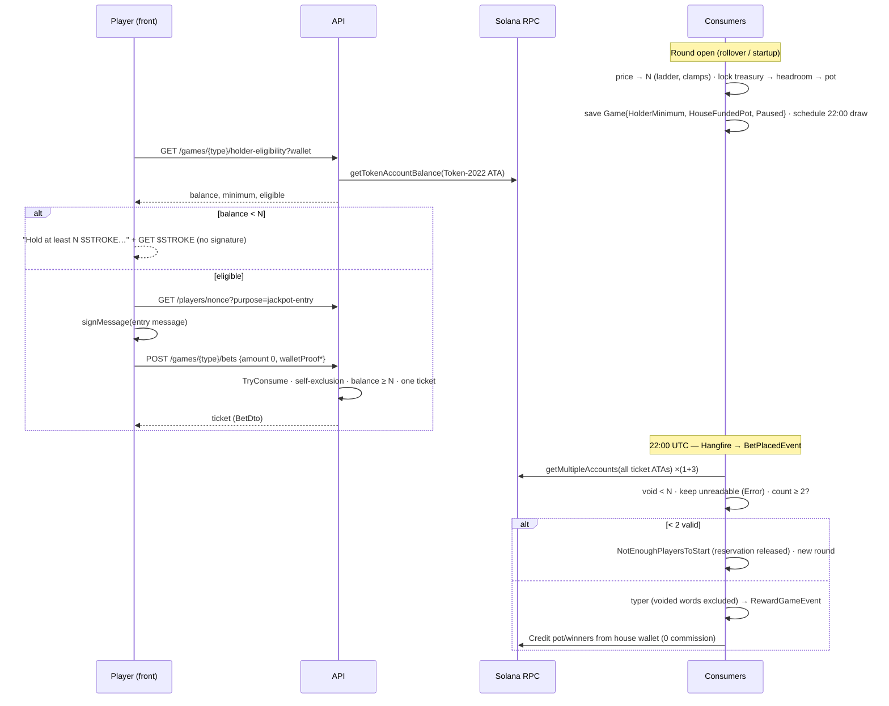

# SpaceStroker — "Space Jackpot: free daily draw for $STROKE holders" — Implementation Spec

> **Status: Shipped** — merged to `main` on 2026-10-01 (and to `master` in `monkify-lp`) via branch
> `feature/space-jackpot-refactor`. Distilled in
> [`../features/space-jackpot-refactor.md`](../features/space-jackpot-refactor.md).
> ⚠️ **The implementation deviates from this body in several places** — the §16 revision-log entry dated
> 2026-10-01 lists every one, and where they disagree **that entry and the code win**.
>
> Refined via Trello card
> [#196 Space Jackpot refactor](https://trello.com/c/mEB01ur9/196-space-jackpot-refactor) (2026-09-28).
> Level **`Feature`**. Repos affected: `monkify-backend`, `monkify-front`, `monkify-lp`, and this doc in
> `monkify-meta`. Branch `feature/space-jackpot-refactor` in every repo. Worktrees were at
> `.worktrees/space-jackpot-refactor/<repo>`.
>
> **Purpose:** Space Jackpot stops being a paid 0.1 SOL lottery. It becomes a **free daily lottery for
> $STROKE holders**, which gives people a reason to buy and hold the token. A wallet enters by
> **signing a message**: no transaction and no fee. The wallet must hold at least **N $STROKE**, where
> N is worth about $10 and is frozen per round. The balance is checked at entry and again at the draw,
> so one bag cannot back several tickets. The pot is **funded by the house**. It is sized from the game
> wallet's free headroom, frozen when the round opens, and reserved against Hyper Roll and Monkey Duel.
> The 100k $STROKE winner bonus is removed.

---

## 1. Summary

| | Today (paid lottery) | After this change (holder lottery) |
| --- | --- | --- |
| Entry | 0.1 SOL transfer (`paymentSignature`) | `WalletProof` signed message, purpose `jackpot-entry`. No transaction and no fee. |
| Eligibility | Anyone with SOL | Wallet's **Token-2022 ATA** holds **≥ N $STROKE**, checked at entry and again at the draw |
| N | n/a | ≈ `TargetUsd` ($10) ÷ Jupiter price, rounded **up** on the 1-2-5 ladder, clamped, **frozen on the round** |
| Tickets per wallet | One bet per round (application rule) | **One ticket per wallet per round**, enforced by the application **and** a DB unique index |
| Pot | Σ stakes + `LotteryPot` (0) + `CarriedExtra` | **`Game.HouseFundedPot`** = `PotPercent` × house free headroom, clamped, **frozen and reserved** as house-edge exposure |
| Commission | 2% of profit above stake | **0** (the whole pot is house-funded, so the existing `houseFundedShare` exclusion covers it) |
| Under-subscribed (< 2 valid tickets) | Paid bets refunded, pot carries | No draw. The reservation is released and **nothing carries**. |
| Winner bonus | 100,000 $STROKE per winning wallet | **Removed** |
| Stats / leaderboards | Paid bets counted | Holder entries **contribute nothing**. The round still shows in history and in provably-fair. |
| Paid bets on this type | Yes | **No.** Any paid or dev-free bet on a holder-only type is refused. |

These do not change: the 22:00 UTC daily draw (`LotteryParameters.DrawTimeUtc`), the 6-letter free-text
pick, the typer and its provably-fair derivation, the same-word split of the pot, and `AllowOrbit: false`.

---

## 2. Constraints (MANDATORY)

From `monkify-meta/constraints.md` (see that file for the full list):

- **Worktree per repo.** Use `feature/space-jackpot-refactor` in `monkify-backend`, `monkify-front`,
  `monkify-lp` and `monkify-meta`. Every hub stays on `main` (LP hub: `master`).
- **Unit tests.** Run `scripts/run_tests.bat` (not a bare `dotnet test`: that also runs the
  `ProductionGames` Monte Carlo suite). Update the affected tests, add tests for new behaviour, and
  **report which tests changed** at the end.
- **Integration tests are mandatory** (`SpaceStroker.Tests.Integration`, `run_integration_tests.bat`).
  Cover the happy path plus the complex flows listed in §11.2.
- **EF mapping** stays inline in `SpaceStrokerDbContext.OnModelCreating`. Generate the migration with
  `dotnet ef migrations add` and never hand-edit the snapshot. Only **Consumers** applies migrations.
- **Money runs in Consumers.** The API stays stateless. It verifies the entry and reads a balance, but it
  never computes a pot, never reserves anything, and never pays.
- **Mock-only secrets.** The Jupiter lite price endpoint needs no key. If a key is ever required, commit
  a mock value only.
- **Messaging (§6 of constraints).** A bad signature, an unknown nonce and a replayed nonce all return one
  vague sentence. The **below-N message is specific**: this is a new sanctioned exception, and §12 of the
  ship checklist records it in `constraints.md` §6. N is a public bound published on the round payload,
  the same kind of bound as Orbit's deposit limits.
- **The new-mode convention** (`conventions/general.md`) applies in spirit. The mode's rules change, so
  the how-to-play section and the LP change on this branch too (§7.4, §7.5).

---

## 3. Resolved product decisions

| # | Decision (card #196 refinement, 2026-09-28) |
| --- | --- |
| 1 | **Holder-only and free.** Paid tickets are removed and the whole pot is house-funded. |
| 2 | **Anti pass-the-bag:** the balance is checked at entry **and** re-checked at the draw. Tickets below N at the draw are **voided** before the typer runs, so each N tokens backs at most one ticket. |
| 3 | **N ≈ $10 of $STROKE, frozen per round.** Jupiter Price API → `TargetUsd ÷ price` → rounded **up** on the 1-2-5 ladder → clamped to ×2 / ÷2 of the previous round's N → clamped to the config floor and ceiling. If the price fetch fails, use the previous N (first round: the configured starting N) and log at `Error`. The balance read is the **Token-2022 ATA only**. |
| 4 | **Dynamic pot, frozen at round creation and reserved.** `pot = PotPercent × (houseSol − openExposure − feeReserve − ReserveFloor)`. `PotPercent` defaults to 0.5% and must be < 1%. The pot is clamped to config min/max and rounded to a clean SOL figure. It counts as exposure in `HouseEdgeCoverageService`. |
| 5 | If headroom cannot cover the pot floor, the round opens **PAUSED** (entries closed) and logs at `Error`. A pot is never half-funded. |
| 6 | **Min players stays 2.** Under-subscribed (including after voids) → no draw and the reservation is released. **Nothing carries over** (no stacking; see #191). |
| 7 | **The 100k $STROKE bonus is removed** (`JackpotRewardService` and its call). `Token2022Program` is kept. The mint config is repurposed as holder-token config. All copy becomes **"Token holders get a free daily lottery draw."** |
| 8 | **Deploy transition:** a Consumers startup self-heal refunds the paid bets in the live Space Jackpot round, closes that round (`GameEndedAbruptely`) and opens a fresh holder round. It is idempotent and never touches settled rounds. Deploy right after the 22:00 UTC draw. |
| 9 | **Entry:** type the word → lever → sign (`jackpot-entry`) → the server verifies the nonce, reads balance ≥ round N and stores the ticket. **One ticket per wallet per round.** Typer and provably-fair are unchanged. Same-word tickets split the pot. |
| 10 | **Draw recheck failure = fail-open.** Reads are batched (`getMultipleAccounts`) with 3 retries. A wallet still unreadable after that keeps its ticket and logs at `Error`. The draw stays on time. |
| 11 | **Entry-time balance read failure = refuse** with a vague "could not be processed, try again". |
| 12 | **Below-N messaging is specific.** The front checks before signing: "Hold at least 1,000,000 $STROKE to enter today's draw." The server returns the same text. A voided ticket reads: "Ticket voided — balance was below 1,000,000 $STROKE at the draw." Signature and nonce failures stay vague. |
| 13 | **Stats and leaderboards exclude holder entries.** The round still appears in games history and in the provably-fair view. |
| 14 | **Commission = 0.** This falls out of `houseFundedShare`. |
| 15 | Holder tickets are a **new entry kind**, distinct from dev free bets. Dev free bets still pay nothing and stay disabled in prod. |

### 3.1 Decisions taken while writing this spec (non-product, reversible)

| # | Decision | Why |
| --- | --- | --- |
| S1 | The front reads the holder balance through a **new API endpoint** (`GET /games/{typeId}/holder-eligibility`). It does not derive the ATA itself through the RPC proxy. | The card asks for a read "via the existing Helius gateway". The API's RPC client **is** that gateway, and this keeps one Token-2022 derivation (§2 of `jackpot-stroke-reward.md`: a classic derivation silently reads **0**). The front and the server can then never disagree about eligibility. The proxy allow-list (`RpcProxyOptions`) stays as it is. |
| S2 | The voided state is a new **`BetStatus.Voided = 7`**. Voided tickets are not deleted. | The player has to see "TICKET VOIDED", and the provably-fair keystream prefix already includes their seed (see §6.6). |
| S3 | `BetExtensions.IsFreeBet` becomes `Amount == 0 && EntryKind != Holder` and is **not** redefined on `EntryKind` alone. | This is the smallest change: every existing `Amount == 0` path (refund skip, leaderboard filters, Orbit) keeps working, and the holder exception is explicit. |
| S4 | The "clean SOL figure" = **floored to 2 significant figures** (0.237 → 0.23, 1.284 → 1.2). | Flooring never exceeds `PotPercent`, and a pot like `0.4637281 SOL` reads as noise. |
| S5 | When a ×2 / ÷2 clamp binds, N may land **off** the ladder (for example 4,000,000). The next unclamped round snaps back onto it. | On a strict 1-2-5 ladder, 2 → 5 is ×2.5, so snapping a clamped value would stop N from ever growing past 2M. |
| S6 | A non-production-only `DevAssumedBalance` setting lets local QA enter without real $STROKE. | On devnet the mainnet mint's ATA never exists, so every local wallet reads 0 and nobody could enter. It is ignored in Production, the same way `AllowFreeBet` is forced off there. |

---

## 4. Data model

### 4.1 `Bet` — new `EntryKind` (`SpaceStroker.Domain/Bets/Entities/Bet.cs`)

```csharp
public enum BetEntryKind { Paid = 1, Free = 2, Holder = 3 }   // SpaceStroker.Domain/Bets/ValueObjects/BetEntryKind.cs
public BetEntryKind EntryKind { get; set; } = BetEntryKind.Paid;
```

`BetStatus` (`SpaceStroker.Domain/Bets/ValueObjects/BetStatus.cs`) gains **`Voided = 7`**. It is terminal
and set only by the draw recheck (§6.5).

`BetExtensions` (`SpaceStroker.Domain/Bets/Services/BetExtensions.cs`):

```csharp
public static bool IsFreeBet(this Bet bet) => bet.Amount == 0 && bet.EntryKind != BetEntryKind.Holder;
public static bool IsHolderEntry(this Bet bet) => bet.EntryKind == BetEntryKind.Holder;
```

`RegisterBetHandler` sets `EntryKind = Free` on a dev free bet and `Holder` on a holder ticket.

### 4.2 `Game` — frozen holder round values (`SpaceStroker.Domain/Games/Entities/Game.cs`)

```csharp
public decimal? HolderMinimum { get; set; }      // N, in whole $STROKE. Null on every non-holder round.
public decimal? HouseFundedPot { get; set; }     // frozen pot in SOL. Null on every non-holder round.
public bool HolderEntriesPaused { get; set; }    // true → entries closed, lobby shows PAUSED.
public bool IsHolderRound => HolderMinimum != null;   // unmapped
```

A paused round has `HouseFundedPot = null` and `HolderEntriesPaused = true`. It still has a `HolderMinimum`,
so the lobby can show the bound.

### 4.3 `LotteryParameters.HolderOnly` (`SpaceStroker.Domain/Games/Entities/LotteryParameters.cs`)

`bool HolderOnly` (default `false`). It marks the type as a holder lottery. Gate on this flag, **never on
the type's name** (same rule as `jackpot-stroke-reward.md` D3).

### 4.4 EF configuration (inline, `SpaceStrokerDbContext.OnModelCreating`)

- Game: `HolderMinimum` → `HasPrecision(20,6)`. `HouseFundedPot` → `HasPrecision(18,9)`.
  `HolderEntriesPaused` → default `false`. `Ignore(x => x.IsHolderRound)`.
- Bet: `EntryKind` → int, required, default `1`. Add a new **unique partial index**:
  ```csharp
  b.HasIndex(x => new { x.GameId, x.PlayerId })
   .IsUnique()
   .HasFilter("\"EntryKind\" = 3")
   .HasDatabaseName("IX_GameBets_GameId_PlayerId_Holder");
  ```
  The existing non-unique `(PlayerId, GameId)` index stays. The only other unique index on bets is
  `(GameId, ExclusiveChoice)`.
- LotteryParameters: `HolderOnly` → default `false`.

### 4.5 Migration `HolderJackpot`

```bash
dotnet ef migrations add HolderJackpot --project src/SpaceStroker.Infrastructure --startup-project src/SpaceStroker.Consumers
```

- The migration is additive: the columns above plus the partial unique index.
- **Backfill in `Up`:** `UPDATE "GameBets" SET "EntryKind" = 2 WHERE "Amount" = 0;` (existing dev free bets).
  Holder rows cannot exist yet, so the unique index builds on an empty filter.
- `Down` drops the index and the columns.
- The latest migration today is `20260925213622_DuelHouseWordOnRound`. Rebase if `main` moves.

---

## 5. Configuration

### 5.1 Holder token (repurposes `JackpotRewardSettings`)

Rename `JackpotRewardSettings` → **`HolderTokenSettings`** (`SpaceStroker.Domain/Configs/Entities/`). Keep
`MintAddress`, `Symbol`, `Decimals`, `TokenProgramId` (default Token-2022), and `IsConfigured` (fails closed
and trims). **Delete** `AmountPerWinner` and `RawAmountPerWinner`. `TokenSettings.JackpotReward` →
`TokenSettings.HolderToken`. In `spacestrokersettings.json`, move `Operator:Token:JackpotReward` →
`Operator:Token:HolderToken` with the same mint (`Dts45D3W…pump`, public, committed), `STROKE`, `6`,
Token-2022, and drop `AmountPerWinner`. Nothing in `monkify-meta/deploy` or `tools/` references the old key
(checked).

⚠️ A blank or invalid mint (`!IsConfigured`) means **no holder can be verified**. Holder rounds then open
**PAUSED** (§6.2) and entries are refused vaguely. That is fail-closed, never "everyone is eligible".

### 5.2 `GeneralSettings:Games:HolderJackpot` (new `HolderJackpotSettings`, off `GameSettings`)

| Key | Default | Rule |
| --- | --- | --- |
| `TargetUsd` | `10` | > 0 |
| `StartingMinimum` | `1000000` | N for the first holder round, and whenever no previous N exists |
| `MinimumFloor` / `MinimumCeiling` | `100000` / `100000000` | floor ≤ starting ≤ ceiling |
| `PotPercent` | `0.5` | percent, **0 < x < 1** |
| `ReserveFloor` | `5` | SOL the house never offers |
| `PotMinimum` / `PotMaximum` | `0.05` / `2` | SOL. Headroom < `PotMinimum` → PAUSED. |
| `PriceApiUrl` | `https://lite-api.jup.ag/price/v3` | Jupiter Price v3, no key |
| `PriceTimeoutSeconds` | `5` | |
| `DrawRecheckAttempts` | `3` | the card's "3 retries" means 3 attempts after the first failure. Implement `1 + DrawRecheckAttempts` tries. |
| `DevAssumedBalance` | `null` | **Ignored when `IsProduction()`.** When it is set elsewhere, every holder balance read returns it (S6). |

Validate these at startup in both hosts: bad values log at `Error` and holder rounds open PAUSED. Pin the
defaults with a binding test. Pot min/max are **owner-tunable config**, and the defaults are a starting
point.

### 5.3 Default game (`Operator:DefaultGames` → "Space Jackpot")

`DefaultGameSettings` gains `HolderOnly` (bool). Space Jackpot becomes `"HolderOnly": true`,
`"RequiredAmount": 0`, `"LotteryPot": 0`. Everything else is unchanged (`MinimumNumberOfPlayers 2`,
`ChoiceRequiredLength 6`, `AllowOrbit false`, `LotteryFrequency "1.00:00:00"`, `DrawTimeUtc "22:00:00"`).

**Settings self-heal.** The seeder (`Consumers/Program.cs` → `CreateDefaultGameParametersAsync`) is
create-only by name, so an existing prod type would never pick these values up. Add a
`HolderLotteryReconciler.Reconcile(context, defaults)` (pattern: `ComingSoonReconciler`). For each default
with `HolderOnly = true` whose type exists, it sets `LotteryParameters.HolderOnly = true`,
`LotteryParameters.LotteryPot = 0`, `RequiredAmount = 0` and `AllowFreeBet = false`. It only touches values
that differ (`ExecuteUpdate` with change predicates), so it is idempotent. Call it next to the other
reconcilers in a `try/catch` + `Log.Error`, before the ActiveParameters cache drop.

### 5.4 Front env

There is no new env var. `VUE_APP_TOKEN_MINT` (`constants/token.ts`) keeps driving `TOKEN_BUY_URL`, which is
the **GET $STROKE** link (pump.fun, as the existing CTAs use).

---

## 6. Backend behaviour

### 6.1 Pure rules (Domain, unit-tested in isolation)

**`HolderMinimumRules.Compute(decimal? priceUsd, decimal? previousN, HolderJackpotSettings s)` →
`(decimal N, bool usedFallback)`**

1. If `priceUsd` is null or ≤ 0 → return `previousN ?? s.StartingMinimum` with `usedFallback = true`.
2. `raw = s.TargetUsd / priceUsd`, then `n = LadderUp(raw)`. `LadderUp` is the smallest value of the form
   `{1,2,5} × 10^k` that is ≥ raw, using exact decimal maths (no `Math.Pow` on doubles).
3. If `previousN` is set: `n = clamp(n, previousN / 2, previousN × 2)` (S5).
4. `n = clamp(n, s.MinimumFloor, s.MinimumCeiling)`.

**`HolderJackpotPotRules.Compute(decimal? houseBalance, decimal exposure, decimal feeReserve, HolderJackpotSettings s)`
→ `decimal? pot`** (null means PAUSED)

1. If `houseBalance` is null (unreadable) → null. This fails closed.
2. `headroom = houseBalance − exposure − feeReserve − s.ReserveFloor`.
3. `pot = clamp(Floor2Sig(headroom × s.PotPercent / 100), s.PotMinimum, s.PotMaximum)`.
4. If `headroom < pot` → null. This is how "cannot cover the pot floor" shows up.

**`HolderEligibility.IsEligible(decimal balance, decimal n) => balance >= n`.** Balances are UI amounts
(raw / 10^Decimals).

### 6.2 Opening a holder round (Consumers)

All four `GameService.CreateGame` callers run in Consumers (`OpenNewGames`, `RunGameConsumer` rollover,
`BetPlacedConsumer` under-subscription, `GameParametersCreatedConsumer`). Inside `CreateGame`
(`GameService.cs:894`), when `parameters.LotteryParameters?.HolderOnly == true`, delegate to a new
**`IHolderJackpotRoundPlanner.PlanAsync(parameters, ct)`** before the save:

1. **N.** Read `previousN` from the most recent round of this type with `HolderMinimum != null`. Fetch the
   price with `IStrokePriceClient.GetUsdPriceAsync(mint)` (§6.8). Then compute `HolderMinimumRules.Compute`.
   If `usedFallback` is true, log at `Error`: "Holder jackpot price fetch failed; N kept at {N}".
2. **Pot, under the shared treasury lock.** Call `HouseEdgeCoverageService.AcquireLockAsync` (the same
   advisory lock Hyper Roll and House duels use). This opens a transaction, and the game insert joins it.
   Under the lock, a new method `HouseEdgeCoverageService.EvaluateHeadroomAsync()` returns
   `(balance?, exposure, feeReserve)` using the **same** `ExposureRounds` query (which includes other
   reserved pots, §6.3) and a fresh `GetSolBalanceForRequest(TokenOwnerPublicKey)`. Then compute
   `HolderJackpotPotRules.Compute`.
3. Set `HolderMinimum = N`. Set `HouseFundedPot = pot`. Set `HolderEntriesPaused = pot == null || !HolderToken.IsConfigured`.
   Set `CarriedExtra = 0`, whatever carry the caller passed (decision 6).
4. Save and commit (the lock is released). The existing rest of `CreateGame` (seed commit, `ScheduleLottery`,
   `GameCreatedEvent`, `GameOpenedEvent`) runs unchanged.
5. If paused, log at `Error`: "Holder jackpot round {GameId} opened PAUSED: headroom {h} < pot floor". A paused
   round still gets its draw scheduled. At the draw it has 0 tickets, so it goes under-subscribed and the next
   round recomputes (§6.5). This is how a paused jackpot recovers by itself the next day.

If lock acquisition times out (5 s), retry once. If it fails again, open the round **PAUSED**, log at
`Error`, and never throw out of `CreateGame`. A throw there would leave the type with no live round.

### 6.3 The reservation (`HouseEdgeCoverageService` / `HouseEdgeCoverage`)

`ExposureRounds` (`HouseEdgeCoverageService.cs:117`) today only selects rounds that have bet rows. Add a
second query term, **reserved pots**: rounds with `HouseFundedPot != null` whose status is in
`HouseEdgeCoverage.UnsettledStatuses`. Pass it to `HouseEdgeCoverage.Evaluate` as a new parameter
`IReadOnlyCollection<decimal> reservedPots`:

- `exposure += Σ reservedPots`.
- Add one `TreasuryFeeReservePerTransfer` per reserved pot.

This happens in `EvaluateAsync` (Hyper Roll bets, House duel bets, House duel open) and in
`CheckBetAvailabilityHandler`. Hyper Roll's `maxStake` and the VS HOUSE ceiling therefore shrink by the
reserved pot **all day**, which is intended.

The reservation is released automatically once the round leaves `UnsettledStatuses`:
`NotEnoughPlayersToStart` (under-subscribed or type deactivated), `RewardForWinnersCompleted`,
`ErrorWhenProcessingRewards`, or `GameEndedAbruptely`. No release code is needed.

⚠️ During rollover, `RunGameConsumer` creates the next round while the finished one is still `Ended`, so the
new pot is sized with yesterday's unpaid pot still counted. That is conservative, and intended.

### 6.4 Entry — `POST /games/{typeId}/bets` holder branch (`RegisterBetHandler`)

**Body** (`RegisterBetRequestBody.cs`) gains two optional fields: `[MaxLength(64)] string? WalletProofNonce`
and `[MaxLength(128)] string? WalletProofSignature`. `Nonce` (the provably-fair `long`) and `Seed` keep their
meaning.

**Nonce purpose.** Add `WalletNoncePurpose.JackpotEntry = "jackpot-entry"` and add it to `IsKnown`
(`GetWalletNonceRequest.cs`).

**Message** (a new static `JackpotEntryMessages.Build(wallet, gameId, choice, nonce)`, byte-identical to the
front's copy):

```
Space Stroker jackpot entry
Wallet: {wallet}
Round: {gameId}
Word: {choice}
Nonce: {nonce}
```

`Round` and `Word` bind the signature to this ticket, so a relayed proof cannot be replayed onto another
round or another word inside the 5-minute nonce TTL.

**Flow.** When `game.Parameters.LotteryParameters?.HolderOnly == true`, `HandleRequest` takes the holder
branch **right after `GetGameById`**. It never reaches the free-bet gates (`AllowFreeBets` /
`AllowFreeBet`) or `ValidatePayment`:

| # | Check | On failure |
| --- | --- | --- |
| 1 | `Amount == 0`, `PaymentSignature` empty, `Wallet` present, not Orbit-funded | `InvalidAmount` (existing, vague) |
| 2 | `game.HolderEntriesPaused == false` and status is in `GameAcceptingBets` | `GameNotValidForBets` (existing) |
| 3 | `WalletProof.TryConsume(cache, JackpotEntry, wallet, nonce, sig, (w, n) => JackpotEntryMessages.Build(w, game.Id, choice, n))` | **`JackpotEntryInvalid`** = "We could not verify that request. Please try again." (same sentence as `OrbitRequestInvalid`). Bad signature, unknown nonce and replayed nonce all get it. |
| 4 | `UpsertPlayerAsync`, then self-exclusion (existing step 9) | `SelfExclusionActive` (existing) |
| 5 | Orbit auto-play active (existing step 11) | existing message |
| 6 | Balance: `IHolderBalanceReader.GetBalanceAsync(wallet)` (§6.8) | null → **`HolderBalanceUnavailable`** = "Your entry could not be processed. Please try again." |
| 7 | `balance ≥ game.HolderMinimum` | **`HolderBelowMinimum`** = `"Hold at least {N:N0} ${Symbol} to enter today's draw."` (formatted with `CultureInfo.InvariantCulture`, e.g. `1,000,000`) |
| 8 | One ticket per wallet: extend `BetRoundRules.PerRoundLimitRefusal` to holder entries | the existing per-round refusal message |
| 9 | `ValidateBetParameters` otherwise unchanged (length, duplicate characters, alphabet, accepting-bets status). `ChoiceIsValidForGame`'s amount check accepts 0. | existing messages |
| 10 | Build the bet with `EntryKind = Holder`, `Amount = 0`, `Signature = null`, then `RegisterBet` → `InsertBet` | a unique violation on `IX_GameBets_GameId_PlayerId_Holder` (concurrent double entry) → same message as #8 |

Also:

- Proof (3) runs before the balance read (6), so unauthenticated calls cannot spend RPC.
- A refused holder entry has **nothing to refund**. `RefundInvalidBet` already short-circuits on
  `Amount == 0`. The implementer must confirm it does not append `ErrorMessages.RefundWarning` on that path,
  because "your payment will be refunded" would be wrong here. Add a test.
- The flow skips `WritePlacementLedgerRow` (no money moved). It publishes no `BetPlacedEvent` (lottery, as
  today). The live bet notification via `InsertBet` stays.
- **Paid or dev-free bets on a holder-only type** (`Amount > 0`, or a plain free bet with no proof) are
  refused at step 1, with a refund when `Amount > 0` and a signature is present. Refunds go through the
  existing `RefundInvalidBet` path.

### 6.5 The draw (Consumers — `BetPlacedConsumer`, triggered by the Hangfire `ScheduleLottery` job)

For a holder round (`game.IsHolderRound`) in `GameAcceptingBets`, **before** the player count:

1. **Recheck.** Load the tickets with `Status == Made` and `EntryKind == Holder`. Call
   `IHolderBalanceReader.GetBalancesAsync(wallets)` (batched `getMultipleAccounts`, §6.8), with
   `1 + DrawRecheckAttempts` tries on a failed batch and a short backoff.
2. For each ticket:
   - Readable and `< HolderMinimum` → `UpdateBetStatus(Voided)`, logged at `Information`.
   - Readable and `≥ N` → kept.
   - **Unreadable after all tries → kept (fail-open)**, with an `Error` log naming the wallet and game.
3. The existing `playerCount` then counts only **non-voided** bets. Voided tickets are also excluded from
   `RunGameConsumer`'s "mark winners `NeedsRewarding`" step and from the typer's choices (§6.6).
4. **Under-subscribed** (< `MinimumNumberOfPlayers`): take the existing lottery branch. It publishes no
   refund (holder `Amount == 0` is already skipped), sets `NotEnoughPlayersToStart`, and calls `CreateGame`.
   The planner forces carry 0 (§6.2). In `LotteryPotCarry.NextCarriedExtra`, return `0` when the round
   `IsHolderRound`, so the rule is written down in the one carry function too.
5. Otherwise the start proceeds unchanged.

The recheck is **idempotent**. A redelivered `BetPlacedEvent` either finds the round no longer accepting
bets (skip), or re-reads balances for the `Made` tickets only. Void is terminal, so a voided ticket is never
revived.

The recheck must finish before `TryStartGame`. Balance reads cost about one RPC call per 100 wallets, well
inside `MinimumLotteryDrawLeadSeconds`. Do not block the draw on retries past a total budget of about 20 s:
after the budget, treat whatever is still unread as unreadable (fail-open).

### 6.6 Typer and provably-fair

- `SpaceStrokerTyper.SetBets` (`SpaceStrokerTyper.cs:267`) **skips `Status == Voided`** bets, so a voided word
  cannot win. For a lottery the character pool is the full alphabet, so the pool is unaffected.
- The **keystream prefix (`orderedBetSeeds`, L216) is unchanged**: it still includes every ticket's seed,
  voided ones too. Those seeds were committed at entry, and dropping them would make the stream depend on a
  post-entry RPC read.
- `GetGameVerificationHandler` lists every bet with a new `voided` flag. The verifier (`src/utils/provablyFair.ts`,
  `verify.html`) keeps building the prefix from **all** bets, and takes the racing choices from the server's
  `orderedChoices`. Those come from `typer.Bets` and therefore already exclude voided tickets. Add an
  integration assertion that a round with a voided ticket re-verifies offline.

### 6.7 Reward (`RewardGameConsumer`, `BetDomainService`)

- `BetDomainService` (`BetDomainService.cs`):
  - `_houseFundedBase = game.HouseFundedPot ?? (LotteryPot + CarriedExtra)` (L55).
  - `SetPotAmount` adds `HouseFundedPot` instead of `LotteryPot + CarriedExtra` when set (L217).
  - `_payableWinnerCount` already uses `!IsFreeBet`, so holder winners count (S3).
  - Commission: `winnerReward − 0 − pot/count = 0` → **0**. No code change is needed there, but pin it with
    a test.
- `RewardGameConsumer`:
  - A holder winner is not a free bet, so it follows the normal credit path and is paid to the
    **player's wallet** (`settlement.Credit`, never Orbit) from the house settlement wallet.
  - Add the holder round to `treasuryFunded` (L109), so the running treasury-balance pre-check applies.
  - Redelivery safety is unchanged: `CalculateRewardForBet` subtracts prior `Credit` rows →
    `BetHasAlreadyBeenRewarded`.
  - **Remove** the `IJackpotRewardService` block (L255–263) and the `bonusWinners` list.
- **Delete:**
  - `JackpotRewardService` and `IJackpotRewardService`, and their DI line (`DependencyInjection.cs:73`).
  - `ISolanaService.TransferJackpotReward`, with its implementation and fakes.
  - `JackpotRewardServiceTests`, `JackpotRewardFlowTests`, and the `JackpotRewards` recording in `TestDoubles`
    (plus its use in `OrbitWalletFlowTests`).
  - Keep `Token2022Program` in full (`CreateAssociatedTokenAccountIdempotent` / `TransferChecked` may be
    trimmed only if nothing else references them. Keeping them is fine).

### 6.8 Token-2022 balance reads and the price client (Infrastructure)

- **`IHolderBalanceReader`** (new, `Services/Solana/HolderBalanceReader.cs`). The API and Consumers both
  register it.
  - `Task<decimal?> GetBalanceAsync(string wallet)`: derives the ATA with
    `Token2022Program.DeriveAssociatedTokenAccount(wallet, HolderToken.MintAddress, HolderToken.TokenProgramId)`
    and calls `getTokenAccountBalance` through `ExecuteRpcAsync`, the pattern `GetJackpotRewardBalance` uses
    today. **Account not found → 0** (a definite answer). RPC failure → null.
  - `Task<IReadOnlyDictionary<string, decimal?>> GetBalancesAsync(IEnumerable<string> wallets)`: derives every
    ATA and calls `getMultipleAccounts` in chunks of **100**. It parses the SPL account layout: amount = `u64`
    little-endian at byte offset **64**, which is the same in Token-2022 because extensions follow the
    165-byte base. A null account → 0. A failed chunk → null for every wallet in it.
  - Both return `DevAssumedBalance` when it is set and `!IsProduction()` (S6).
  - `!HolderToken.IsConfigured` → null (vague refusal at entry, fail-open at the draw; the round is PAUSED
    anyway).
- **Refactor `GetJackpotRewardBalance`.** Its only caller was the bonus, so it goes away and its logic moves
  into `GetBalanceAsync`.
- **`GetTokenBalance` (the classic derivation) is not touched.** ⚠️ It must never be used for $STROKE.
- **`IStrokePriceClient`** (new, `Services/Pricing/JupiterPriceClient.cs`):
  - Named HttpClient `"JupiterPrice"`, timeout `PriceTimeoutSeconds`.
  - `GET {PriceApiUrl}?ids={mint}` → `{ "<mint>": { "usdPrice": <number>, ... } }` → `decimal?`.
  - Any non-200, missing key, parse failure or timeout → null. It never throws.
  - Registered in **Consumers only**, because only round creation needs a price.

### 6.9 Holder eligibility endpoint (API, S1)

`GET /games/{gameTypeId:guid}/holder-eligibility?wallet=` → `GetHolderEligibilityHandler`:

```json
{ "data": { "wallet": "…", "symbol": "STROKE", "minimum": 1000000, "balance": 2345678.5, "eligible": true, "entriesPaused": false } }
```

- `minimum` / `entriesPaused` come from the type's current live round. If the type is unknown, is not
  holder-only, or has no live round → the existing generic "not found / unavailable".
- `balance` is null (and `eligible` is false) when unreadable. The front then shows "balance unavailable" and
  still lets the player try: the server has the final word.
- Cache per `(wallet)` for **15 s** (`CacheHelper`). The existing API rate limiter covers the route. A bad
  base58 wallet → validation failure.

### 6.10 Round payload

- `ActiveGameDto` gains `holderOnly`, `holderMinimum`, `houseFundedPot`, `entriesPaused`. `lotteryPot` and
  `carriedExtra` stay (0 on holder rounds).
- `BetDto` gains `voided` (`Status == Voided`).
- `GameParametersDto.LotteryParametersDto` gains `holderOnly`.
- `GameCreatedEvent` carries the new round, and the front refetches through the existing flow.

### 6.11 Other code paths that must learn about holder rounds (hidden blockers)

| Where | Today | Required fix |
| --- | --- | --- |
| House seed bet service (`HouseSeedBetService`, skip rule) | Skips house-edge, duel and small types, but **not lotteries** | Also skip `LotteryParameters?.HolderOnly == true`. A house seed bet is a paid bet, and it would be refused anyway. |
| `GameHistoryService.BuildRow` (L201–223) | `pot = Σpaid + config LotteryPot + CarriedExtra`. `WinnerCount` counts paid winners only. | `pot = HouseFundedPot ?? (…)`. Count holder winners in `WinnerCount`. |
| `GlobalStatsService` (L78–80, L162–174) | Credit query joins **all** bets | Exclude credits whose bet `EntryKind == Holder` from `TotalPaidOut`, `WinnersPaid` and `BiggestSinglePayout`. Exclude holder rounds from `BiggestPot`. |
| `GameStatsService` (L58–85) | Same | Same exclusions for the per-type stats. |
| `PlayerStatsService` (L124–132) | `creditByBet` unfiltered | Exclude holder credits from `TotalWon`, `Net` and `BiggestSingleWin` (decision 13: holder entries contribute nothing to stats). |
| `LeaderboardService` (L419, L431, L456) | `Amount > 0` filters | Already excludes holder entries. **Pin with tests** and change nothing. |
| `GetActiveGameForParameterHandler` | Loads the round with bets | Also map the new DTO fields. |
| `GameTypeDeactivatedConsumer` | Refunds paid bets, sets `NotEnoughPlayersToStart` | Nothing to refund on a holder round. The reservation is released by status. No change. |
| Admin lottery form (`AdminLotterySettings`) | Can edit `lotteryPot` | On a holder type the reconciler re-zeroes `LotteryPot` at every boot. Show the field read-only for holder types (front, §7.3). |

### 6.12 Deploy transition self-heal (Consumers startup)

Add `HolderJackpotTransition.RunAsync(scope)` as a testable class plus a `Program.cs` local-function call.
It runs in `ApplicationStarted` **after** `CreateDefaultGameParametersAsync` (so `HolderOnly` is already
reconciled) and **before** `OpenNewGames`. For each type with `LotteryParameters.HolderOnly == true`:

1. Select the **legacy** live rounds: status in `GameAcceptingBets` (`WaitingBets`, `GameStarting`) **and**
   `HolderMinimum == null`.
2. For each bet with `Amount > 0` and `Status == Made`: set `NeedsRefunding` and publish
   `RefundInvalidBetEvent(bet.Id, wallet, bet.Amount, "Space Jackpot is now free for token holders.", game.Id, bet.Signature, bet.FundedByOrbit)`.
   The existing consumer is idempotent (it subtracts prior Refund rows), and `PendingRefundSweepJob` retries
   stragglers.
3. Set the round to `GameEndedAbruptely`. If `CarriedExtra > 0`, log at `Warning` "dropped carry {x} SOL"
   (decision 6: nothing carries).
4. `OpenNewGames` then sees no live round for the type and creates a fresh **holder** round through the
   planner.

A second startup finds no legacy live round (every live round now has `HolderMinimum`), so it changes
nothing. Settled rounds are never selected. The old round's Hangfire draw still fires, and
`BetPlacedConsumer` skips it because the round is not accepting bets. The whole call is wrapped in
`try/catch` + `Log.Error` ("never take the host down").

⚠️ `CloseOngoingGames` runs first and moves any `InProgress` round to `GameEndedAbruptely` with
`NeedsManualAnalysis` bets. That is why the deploy must land **after** the 22:00 UTC draw has settled
(decision 8). Put it in the deploy note.

---

## 7. Frontend behaviour (`monkify-front`)

### 7.1 Types and service

- `src/types/index.ts`:
  - `LotteryParameters.holderOnly?: boolean`.
  - `GameInstance.holderMinimum?`, `houseFundedPot?`, `entriesPaused?`, `holderOnly?`.
  - `Bet.voided?: boolean`.
  - `BodyGameBet.walletProofNonce?` and `walletProofSignature?`.
  - A new `HolderEligibility`.
- `src/services/mainService.ts`:
  - `getHolderEligibility(gameTypeId, wallet)`.
  - Add `'jackpot-entry'` to the `getWalletNonce` purpose union.
- `src/utils/gameArchetype.ts`: a holder lottery keeps the `'lottery'` archetype. Add
  `isHolderLottery(game) => !!game.lotteryParameters?.holderOnly`.
- `src/utils/pot.ts:25-32`: a holder instance's pot = `houseFundedPot ?? 0` (not stakes plus base).

### 7.2 `useHolderJackpot.ts` (new composable)

- `eligibility`: fetched on wallet connect, on game select, and every 30 s while the terminal shows a holder
  game. Refetched right after an entry fails with the below-N message.
- `buildJackpotEntryMessage(wallet, gameId, word, nonce)`: byte-identical to §6.4.
- `signEntry(...)`. Template: `useDuel.ts:683-711`. It throws `'This wallet cannot sign messages.'` when
  `signMessage` is missing. It reuses the **mobile deeplink sign hop** (`buildSignMessageDeeplink` /
  `parseSignMessageReturn`, and the pending-stash pattern in `useSelfExclusion.ts:130-142`), so the entry
  resumes after the wallet app returns. Signatures are Base64 (`toBase64`).

### 7.3 Bet flow (`useGame.ts` → `runBet`, `GameConsole.vue`)

The holder branch in `runBet` starts **after** the self-exclusion guard and the choice checks
(`useGame.ts:1333-1396`), and **before** Orbit/wallet source selection:

1. `entriesPaused` → `'Jackpot paused — entries reopen with the next draw.'`, and stop.
2. `eligibility.balance != null && balance < minimum` → show `Hold at least {N} $STROKE to enter today's draw.`
   with a **GET $STROKE** link (`TOKEN_BUY_URL`), and stop. **No signature is requested** (acceptance
   criterion 2).
3. Get a nonce (`'jackpot-entry'`) → `signEntry` → `submitBet(gameId, choice, { amount: 0, choice, paymentSignature: '', wallet, seed, nonce, walletProofNonce, walletProofSignature })`.
4. Skip the SOL headroom check, the transfer, `applyDebit` and free-bet mode.
5. On an error, the holder path **shows the server message** (the below-N text, the vague proof sentence, or
   the vague balance-unavailable sentence). It does not replace it with `'There was an error processing your bet'`.

`GameConsole.vue`: `allowBets` is false when `entriesPaused`, and the lever label reads **ENTER FREE**
instead of the price. Admin `GameTypeForm.vue`: for a holder type, the lottery pot input is read-only with
the note "house-funded, sized per round".

### 7.4 Screens

**Lobby card (`GameTypeCard.vue`)** for a holder lottery:

- Price chip → label **`FREE FOR HOLDERS`**, text **`≥ {N} $STROKE`** (compact: 1M, 500K).
- Pot chip → `houseFundedPot` in SOL.
- A new **countdown chip** from `instance.startDate` (the draw time), using the same formatter as the
  terminal's `lotteryCountdown`.
- `entriesPaused` → the pot chip reads **`PAUSED`**, with a dimmed accent.

**Terminal (`GameTerminal.vue`)**, idle view for a holder lottery:

```
> ENTRY: FREE FOR HOLDERS (≥ 1,000,000 $STROKE)
> YOUR $STROKE: 2,345,678 ✓        (✗ when below; "UNAVAILABLE" when null; "CONNECT WALLET" when none)
> POT: 0.23 SOL
> DRAW IN 5H 12M 03S
```

- The `> BET: {requiredAmount}` line is hidden.
- Below N: `> GET $STROKE →` (link).
- After entry: `> YOUR TICKET: {word}`.
- A voided ticket (`bets[].voided` for my wallet): `> TICKET VOIDED — BALANCE WAS BELOW 1,000,000 $STROKE AT THE DRAW.`
- Paused: `> JACKPOT PAUSED — ENTRIES REOPEN WITH THE NEXT DRAW.`
- The lottery status map (`GameTerminal.vue:558-579`): replace "PLACE YOUR BETS!" with "ENTER FREE!" for
  holder rounds.

### 7.5 Copy — app

Every Space Jackpot line must say that **token holders get a free daily lottery draw**. It must not mention
paid entry, refunds or the $STROKE winner bonus.

| File | Change |
| --- | --- |
| `components/home/HomeTokenCard.vue:223-228` | Heading: **`Holders play Space Jackpot free`**. Body: **`Token holders get a free daily lottery draw. Hold the day's minimum {{ TOKEN_TICKER }} at the draw.`** ⚠️ This is the verbatim twin of LP `TokenSection.vue`, so change both together. Update the comments at 50-58 and 217-222 (the "bonus on top of the SOL pot" anchor is gone). |
| `components/guide/sections/GuideToken.vue:195-196` | Title `'FREE JACKPOT FOR HOLDERS'`. Body: `` `Token holders get a free daily lottery draw. Hold at least the day's minimum ${TOKEN_TICKER} when you enter and when Edson draws at 10PM UTC — move it before then and your ticket is voided.` `` Rework the comments at 46, 51 and 189-194. |
| `components/guide/GuideModeCards.vue:102-103, 163-164` | Blurb: `` `Hold ${TOKEN_TICKER}, pick your ${n} characters, and your ticket is free. The house funds the pot; the draw runs on a clock.` ``. `priceLabel` for a holder lottery → `'ENTRY'`, price → `'FREE FOR HOLDERS'`. |
| `components/guide/sections/GuideHowTheGameWorks.vue:44, 61, 75-84` | Split the race from the jackpot. The jackpot line reads `'Space Jackpot is free for token holders: sign to enter, the house funds the pot, and Edson draws at 10PM UTC.'`. The house-cut sentence applies to Cosmic Sprint only. The "Everyone buys in" line is scoped to Cosmic Sprint. |
| `components/guide/sections/GuideRefunds.vue:28-29` | Replace the "A LOTTERY THAT DOES NOT FILL" row with **`'SPACE JACKPOT HAS NOTHING TO REFUND'`**: `'Entry is free for token holders, so a draw that does not fill is simply called off — no one paid, nothing goes home.'` |
| `components/guide/sections/GuideWhatYouWin.vue:35` | `'Every stake in the round, piled up. Space Jackpot is different: the house puts up the pot, and it is fixed when the round opens.'` |
| `components/guide/sections/GuideTheModes.vue:27-30` | Keep "buy into one pot" for races only, and add that the jackpot is free for holders. |

Not changed: `constants/token.ts:123`, LP `constants.ts:126` and `FeedbackerSection.vue:77-78` ("jackpot
seed"). These are the **tokenomics allocation** notes owned by the owner, and nothing in them promises paid
entry. They are listed in §14 as a follow-up.

---

## 8. LP (`monkify-lp`)

| File | Change |
| --- | --- |
| `src/components/TokenSection.vue:282-295` | The same heading and body as `HomeTokenCard` (verbatim twin). Update the comment at 288-292. |
| `src/components/GameModes.vue:70-74` | tag `"FREE FOR HOLDERS · DAILY"`, blurb `"Hold $STROKE, grab a free ticket, one holder bags the daily jackpot."` |
| `src/pages/terms.astro:69-72` | The house-cut clause names **Cosmic Sprint** only (plus the duel's own clause at 82). Add a clause: *Space Jackpot is free to enter for wallets holding at least the round's published minimum of $STROKE. Eligibility is checked when you enter and again at the draw; a ticket whose wallet is below the minimum at the draw is void. The pot is funded by the house, fixed when the round opens, and carries no house cut. A draw with fewer than two valid tickets is cancelled and nothing carries over. We may pause entries for a round when the house cannot fund the pot.* |
| `src/components/SpaceRoadmap.vue:75, 113` | Checked. Nothing implies paid entry, so no change. |

---

## 9. Flow diagrams



---

## 10. Out of scope

- Pot rollover or stacking (#191).
- A holding-duration requirement.
- Non-ATA token accounts: a holder whose $STROKE sits in a non-associated account reads as below N.
- What to do with the house's leftover 2M $STROKE.
- Other game modes.
- The tokenomics "jackpot seed" allocation notes (§7.5).
- The production deploy itself (the timing note is in §6.12).

---

## 11. Tests

### 11.1 Unit (`SpaceStroker.Tests`, run with `scripts/run_tests.bat`)

| Test file | Cases |
| --- | --- |
| `Domain/Games/HolderMinimumRulesTests.cs` (new) | Ladder up (0.9M → 1M, 1.01M → 2M, 2.1M → 5M, exact 5M → 5M). ×2 cap (prev 1M, raw 5M → 2M). ÷2 cap (prev 2M, raw 100k → 1M). Off-ladder clamp kept (prev 2M → 4M). Floor and ceiling. Price null / 0 / negative → prev. No prev → starting. |
| `Domain/Games/HolderJackpotPotRulesTests.cs` (new) | Formula: B − E − F − R at 0.5%. Floor to 2 significant figures. Clamp to min / max. Headroom < min → null (paused). Balance null → null. Negative headroom → null. |
| `Domain/Games/BetDomainServiceTests.cs` | Holder pot = `HouseFundedPot` (ignores `LotteryPot` / `CarriedExtra`). Two holder winners split it. Commission 0. Holder winners counted in `PayableWinnerCount`. `IsFreeBet` false for a holder entry. |
| `Domain/Games/LotteryPotCarryTests.cs` | Holder round → carry 0 in every status. |
| `Domain/Games/HouseEdgeCoverageTests.cs` | Reserved pots add to exposure plus one fee reserve each. Hyper Roll bet refused when the pot eats the headroom. Duel ceiling reduced. |
| `Services/HouseEdgeCoverageServiceTests.cs` | `ExposureRounds` includes a `WaitingBets` holder round with a pot. Excludes it once `NotEnoughPlayersToStart` / `RewardForWinnersCompleted`. `EvaluateHeadroomAsync`. |
| `Handlers/RegisterBetHandlerTests.cs` | Holder happy path (EntryKind Holder, Amount 0, no ledger row, no `BetPlacedEvent`). Bad signature / unknown nonce / replayed nonce → identical `JackpotEntryInvalid`. Below N → exact `HolderBelowMinimum` text. Balance null → `HolderBalanceUnavailable`. Paused → `GameNotValidForBets`. Second entry → per-round refusal. Self-excluded → `SelfExclusionActive`. Paid bet on a holder type → refused and refunded. Dev free bet on a holder type → refused. Refusal text never contains `RefundWarning`. The message binds round and word (a signature for word A fails for word B). |
| `Handlers/GetWalletNonceHandlerTests.cs` | `jackpot-entry` is known. |
| `Handlers/GetHolderEligibilityHandlerTests.cs` (new) | Eligible / below / unreadable / non-holder type → unavailable / cached 15 s. |
| `Services/HolderBalanceReaderTests.cs` (new) | Token-2022 ATA derivation (never classic). Missing account → 0. Account data parse at offset 64. Chunking > 100. Failed chunk → null. `DevAssumedBalance` honoured outside Production and ignored in Production. |
| `Services/JupiterPriceClientTests.cs` (new) | Parses `usdPrice`. Non-200 / missing mint / timeout → null. |
| `Services/HolderJackpotRoundPlannerTests.cs` (new) | Price fail → previous N plus an `Error` log. Pot frozen. Paused when headroom is short or the mint is unconfigured. Carry forced 0. Lock timeout → paused, no throw. |
| `Consumers/BetPlacedConsumerTests.cs` | Recheck voids below-N. Keeps unreadable (Error log). Voids drop the count below 2 → `NotEnoughPlayersToStart` plus a new round, no refunds. Redelivery does not revive a void. |
| `Background/RewardWinnersHandlerTests.cs` | Holder winner paid via `Credit` from the treasury. Redelivery → `BetHasAlreadyBeenRewarded`. No jackpot-bonus call (the service is gone). |
| `Domain/Games/SpaceStrokerTyperTests.cs` | A voided choice is excluded from `Bets`. The keystream prefix is unchanged by voiding. |
| `Services/HolderJackpotTransitionTests.cs` (new) | Legacy live round → paid bets `NeedsRefunding` plus events, round `GameEndedAbruptely`. Second run → no-op. Settled round untouched. Holder round untouched. |
| `Services/HolderLotteryReconcilerTests.cs` (new) | Flips `HolderOnly`, zeroes `LotteryPot` / `RequiredAmount`, `AllowFreeBet` false. Idempotent. |
| `Services/GlobalStatsServiceTests.cs`, `GameStatsServiceTests.cs`, `PlayerStatsServiceTests.cs`, `GameHistoryServiceTests.cs`, `LeaderboardServiceTests.cs`, `LeaderboardHallOfFameTests.cs` | Holder credit excluded from paid-out, winners-paid, biggest payout and player won/net. Holder round excluded from biggest pot. History pot = `HouseFundedPot` and counts the holder winner. Leaderboards unchanged (pinned). |
| `Api/HolderTokenSettingsBindingTests.cs` (renamed from `JackpotRewardSettingsBindingTests`) plus `HolderJackpotSettingsBindingTests.cs` (new) | Committed mint / decimals / Token-2022 program. Holder jackpot defaults. `PotPercent` < 1. |
| **Deleted** | `JackpotRewardServiceTests.cs`. |

### 11.2 Integration (`SpaceStroker.Tests.Integration`, Testcontainers, pattern `GameFlowTests`)

Harness:

- `FakeSolanaService` gains `SetHolderBalance(wallet, decimal?)` and `HolderBalanceReadFails`. A fake
  `IHolderBalanceReader` backed by it is registered in both hosts.
- A new `FakeStrokePriceClient` gets `SetPrice(decimal?)`.
- `IntegrationGameParameters` gets a holder lottery type (`HolderOnly = true`, min players 2).
- Signing uses a test keypair (Solnet `Account`) to produce real ed25519 signatures over the entry message.

`HolderJackpotFlowTests.cs` (new):

1. **Happy path.** Price $0.00001 → N = 1,000,000. Treasury 100 SOL → pot = 0.5% × (100 − 0 − fee − 5) floored.
   Two holders (≥ N) sign and enter. Steer the draw (`FindSeedForFallbackIndex` + `SetMaxTyperCharacters(1)`,
   as `JackpotRewardFlowTests` did). The draw completes, the winner gets exactly one `Credit` = frozen pot,
   and no commission applies. No `JackpotRewards` recording exists. No error logs.
2. **Pass-the-bag.** Three holders enter, then one's balance is set below N before the draw. That ticket is
   `Voided`, its word cannot win, the others are paid, and the verification payload re-verifies with the
   voided ticket present.
3. **Under-subscribed after voids.** Two enter and one is voided. The round goes to `NotEnoughPlayersToStart`,
   there is no `Credit`, the next round has `CarriedExtra = 0` and a freshly computed N and pot, and the old
   pot no longer counts in `EvaluateHouseEdgeCoverageAsync`.
4. **Fail-open.** Balance reads fail at the draw. The tickets are kept, the draw runs, and an `Error` log
   names the wallet.
5. **Entry refusals.** Below N → specific text. Replayed nonce → vague text. A concurrent double entry → one
   row (unique index).
6. **Pot reservation vs Hyper Roll.** Set the treasury so a Hyper Roll max bet fits without the pot and not
   with it. The Hyper Roll bet is refused and refunded while the holder round is open, and accepted once the
   round has settled.
7. **Deploy self-heal.** Seed a legacy `WaitingBets` Space Jackpot round with two paid bets and restart the
   Consumers host. Both are refunded (Refund ledger rows), the round is `GameEndedAbruptely`, and a holder
   round is live. Restart again → no new refunds.
8. **Paused.** Treasury at 1 SOL → the round opens paused, the entry is refused with `GameNotValidForBets`,
   and an `Error` is logged.

Also:

- **Delete** `JackpotRewardFlowTests.cs`.
- Update `DefaultGameSeedingTests` (Space Jackpot `HolderOnly`, `RequiredAmount 0`).
- Update `GlobalStatsFlowTests` / `GamesHistoryFlowTests` / `LeaderboardsFlowTests` wherever they assert
  lottery figures.

---

## 12. File checklist

### 12.1 Backend (`monkify-backend/src`)

| # | File | Change |
| --- | --- | --- |
| 1 | `SpaceStroker.Domain/Bets/ValueObjects/BetEntryKind.cs` | new enum |
| 2 | `SpaceStroker.Domain/Bets/Entities/Bet.cs` | `EntryKind` |
| 3 | `SpaceStroker.Domain/Bets/ValueObjects/BetStatus.cs` | `Voided = 7` |
| 4 | `SpaceStroker.Domain/Bets/Services/BetExtensions.cs` | `IsFreeBet` excludes Holder; `IsHolderEntry` |
| 5 | `SpaceStroker.Domain/Games/Entities/Game.cs` | `HolderMinimum`, `HouseFundedPot`, `HolderEntriesPaused`, `IsHolderRound` |
| 6 | `SpaceStroker.Domain/Games/Entities/LotteryParameters.cs` | `HolderOnly` |
| 7 | `SpaceStroker.Domain/Games/Services/HolderMinimumRules.cs`, `HolderJackpotPotRules.cs` | new pure rules |
| 8 | `SpaceStroker.Domain/Games/Services/LotteryPotCarry.cs` | holder → 0 |
| 9 | `SpaceStroker.Domain/Games/Services/HouseEdgeCoverage.cs` | `reservedPots` term |
| 10 | `SpaceStroker.Domain/Games/Services/SpaceStrokerTyper.cs` | `SetBets` skips Voided |
| 11 | `SpaceStroker.Domain/Bets/Services/BetDomainService.cs` | `HouseFundedPot` base/pot |
| 12 | `SpaceStroker.Domain/Bets/Services/BetRoundRules.cs` | one ticket per wallet for Holder |
| 13 | `SpaceStroker.Domain/Configs/Entities/JackpotRewardSettings.cs` → `HolderTokenSettings.cs`; `TokenSettings.cs` | rename, drop amount fields |
| 14 | `SpaceStroker.Domain/Configs/Entities/HolderJackpotSettings.cs` (new), `GameSettings.cs` | holder jackpot config |
| 15 | `SpaceStroker.Domain/Configs/Entities/OperatorSettings.cs` | `DefaultGameSettings.HolderOnly` |
| 16 | `SpaceStroker.Common/spacestrokersettings.json` | `HolderToken`, `Games:HolderJackpot`, Space Jackpot defaults |
| 17 | `SpaceStroker.Common/Resources/ErrorMessages.resx` (+ Designer) | `JackpotEntryInvalid`, `HolderBalanceUnavailable`, `HolderBelowMinimum` |
| 18 | `SpaceStroker.Infrastructure/Data/Context/SpaceStrokerDbContext.cs` | inline mapping plus the unique partial index |
| 19 | `SpaceStroker.Infrastructure/Migrations/*_HolderJackpot.cs` | migration plus backfill |
| 20 | `SpaceStroker.Infrastructure/Handlers/Games/RegisterBet/RegisterBetHandler.cs`, `RegisterBetRequestBody.cs` | holder branch, proof fields |
| 21 | `SpaceStroker.Infrastructure/Handlers/Games/RegisterBet/JackpotEntryMessages.cs` (new) | message builder |
| 22 | `SpaceStroker.Infrastructure/Handlers/Players/GetWalletNonce/GetWalletNonceRequest.cs` | `jackpot-entry` |
| 23 | `SpaceStroker.Infrastructure/Handlers/Games/GetHolderEligibility/*` (new) + `SpaceStroker.Api/Controllers/GamesController.cs` | endpoint |
| 24 | `SpaceStroker.Infrastructure/Services/Solana/HolderBalanceReader.cs` + interface (new) | Token-2022 single and batch reads |
| 25 | `SpaceStroker.Infrastructure/Services/Solana/ISolanaService.cs`, `SolanaService.cs` | remove `TransferJackpotReward` / `GetJackpotRewardBalance` |
| 26 | `SpaceStroker.Infrastructure/Services/Pricing/JupiterPriceClient.cs` + `IStrokePriceClient` (new) | price |
| 27 | `SpaceStroker.Infrastructure/Services/Games/HolderJackpotRoundPlanner.cs` + interface (new) | N plus pot at open |
| 28 | `SpaceStroker.Infrastructure/Services/Games/GameService.cs` | `CreateGame` → planner for holder types |
| 29 | `SpaceStroker.Infrastructure/Services/Games/HouseEdgeCoverageService.cs` (+ interface) | reserved pots, `EvaluateHeadroomAsync` |
| 30 | `SpaceStroker.Infrastructure/Handlers/Games/CheckBetAvailability/CheckBetAvailabilityHandler.cs` | passes reserved pots (via service) |
| 31 | `SpaceStroker.Infrastructure/Consumers/BetPlaced/BetPlacedConsumer.cs` | draw recheck, voids, count non-voided |
| 32 | `SpaceStroker.Infrastructure/Consumers/RunGame/RunGameConsumer.cs` | skip Voided when marking winners |
| 33 | `SpaceStroker.Infrastructure/Consumers/RewardGame/RewardGameConsumer.cs` | `treasuryFunded` includes holder; remove bonus |
| 34 | `SpaceStroker.Infrastructure/Services/Games/JackpotRewardService.cs`, `IJackpotRewardService.cs` | **delete** |
| 35 | `SpaceStroker.Infrastructure/DependencyInjection.cs` | drop the bonus; add reader, price client (`"JupiterPrice"` HttpClient), planner |
| 36 | House seed bet service (skip rule) | skip holder lotteries |
| 37 | `SpaceStroker.Infrastructure/Services/Games/GameHistoryService.cs`, `GlobalStatsService.cs`, `GameStatsService.cs`, `Services/Players/PlayerStatsService.cs` | holder exclusions / pot |
| 38 | `SpaceStroker.Infrastructure/Contracts/Games/ActiveGameDto.cs`, `BetDto.cs`, `GameParametersDto.cs` | new fields |
| 39 | `SpaceStroker.Infrastructure/Handlers/Games/GetGameVerification/GetGameVerificationHandler.cs` | `voided` flag |
| 40 | `SpaceStroker.Infrastructure/Services/Games/HolderLotteryReconciler.cs`, `HolderJackpotTransition.cs` (new) | self-heals |
| 41 | `SpaceStroker.Consumers/Program.cs` | call the reconciler and the transition (order in §6.12) |
| 42 | `SpaceStroker.Tests/**`, `SpaceStroker.Tests.Integration/**` | §11 |

### 12.2 Frontend (`monkify-front/src`)

| # | File | Change |
| --- | --- | --- |
| 1 | `types/index.ts` | §7.1 fields |
| 2 | `services/mainService.ts` | `getHolderEligibility`, nonce purpose |
| 3 | `utils/gameArchetype.ts`, `utils/pot.ts` | `isHolderLottery`, holder pot |
| 4 | `hooks/useHolderJackpot.ts` (new) | eligibility, message, sign (desktop and mobile hop) |
| 5 | `hooks/useGame.ts` | holder branch in `runBet`, error display; route the mobile sign return |
| 6 | `components/game/GameConsole.vue` | paused gate, ENTER FREE |
| 7 | `components/game/GameTerminal.vue` | idle lines, ticket / voided / paused, status map |
| 8 | `components/game-selection/GameTypeCard.vue` | FREE FOR HOLDERS chip, pot, countdown, PAUSED |
| 9 | `components/admin/GameTypeForm.vue` | pot read-only for holder types |
| 10 | `components/home/HomeTokenCard.vue` | copy (twin of LP) |
| 11 | `components/guide/sections/GuideToken.vue`, `GuideHowTheGameWorks.vue`, `GuideRefunds.vue`, `GuideWhatYouWin.vue`, `GuideTheModes.vue`; `components/guide/GuideModeCards.vue` | copy |
| 12 | `utils/provablyFair.ts` / `public/verify.html` | confirm the prefix uses all bets and the choices come from `orderedChoices`. Change only if not. |

### 12.3 LP (`monkify-lp/src`)

`components/TokenSection.vue`, `components/GameModes.vue`, `pages/terms.astro` (see §8).

### 12.4 Meta (`monkify-meta`, at ship)

| File | Change |
| --- | --- |
| `constraints.md` §6 | Add the **second sanctioned exception**: the holder-minimum message (public N bound, shown before signing and returned by the server). Proof errors stay vague. |
| `features/token-launch.md` (~L93, "nothing may imply the token can be used to place bets") | Record the **deliberate reversal** for Space Jackpot, so nobody "fixes" the copy back. The token still never stakes a bet: it grants a free entry. |
| `features/games.md` | Rewrite §15 "$STROKE bonus" (removed) and §16 stacking (holder rounds never carry). Fix the stale "pot 5" / 5% commission. Add a holder-lottery section. |
| `features/money.md`, `features/leaderboards.md`, `features/stats-and-history.md` | Reserved pot as exposure. Holder exclusions. |
| `specs/jackpot-stroke-reward.md` | A header note: superseded by this spec (bonus removed). |
| `features/space-jackpot-refactor.md` (new, Level Feature) | The distilled doc. |

---

## 13. Acceptance criteria (from the Trello checklist)

1. Given a wallet holding ≥ the round's N $STROKE, when the player picks a 6-letter word and signs the
   jackpot-entry message, then a holder ticket is recorded with no SOL transfer and no fee.
2. Given a wallet holding < N $STROKE, when the player tries to enter, then the front shows "Hold at least
   &lt;N&gt; $STROKE to enter today's draw" plus a GET $STROKE link before any signature is requested, and
   the API refuses the entry with the same message.
3. Given a wallet that already has a ticket in the current round, when it tries to enter again (including
   concurrent requests), then the second entry is refused and only one ticket exists (DB unique index).
4. Given an entry with a bad signature, unknown nonce or replayed nonce, when submitted, then the API returns
   the same vague message for all three.
5. Given a holder who entered and then moved their tokens so their balance is below N at 22:00 UTC, when the
   draw runs, then their ticket is voided before the typer starts, their word cannot win, and they see
   "Ticket voided — balance was below &lt;N&gt; $STROKE at the draw".
6. Given two or more valid holder tickets at draw time, when the draw completes, then the winning ticket(s)
   are paid the round's frozen SOL pot from the house wallet (split equally if several share the word), with
   0 commission, and a redelivered reward event does not double-pay.
7. Given fewer than 2 valid tickets after the draw-time recheck, when the draw time arrives, then no draw
   runs, the pot reservation is released, nothing carries into the next round, and a new round is created
   with a freshly computed N and pot.
8. Given an entrant whose balance cannot be read at the draw after 3 retries, when the draw runs, then the
   ticket is kept (fail-open), an Error log names the wallet, and the draw runs on time.
9. Given the balance read fails at entry time, when a player tries to enter, then the entry is refused with
   the vague "could not be processed, try again" message and no ticket is stored.
10. Given a Jupiter $STROKE price P and TargetUsd = 10, when a new round is created, then N = TargetUsd ÷ P
    rounded UP on the 1-2-5 ladder, clamped to ×2/÷2 of the previous round's N and to the config
    floor/ceiling, and frozen on the round.
11. Given the Jupiter price fetch fails, when a new round is created, then N equals the previous round's N
    (or the configured starting N for the first round) and an Error is logged.
12. Given house SOL balance B, open house-edge exposure E, fee reserve F and ReserveFloor R, when a new round
    is created, then pot = PotPercent (default 0.5%) × (B − E − F − R), clamped to config min/max, rounded to
    a nice SOL figure, and frozen on the round.
13. Given an open Space Jackpot round with a reserved pot, when a Hyper Roll or house Monkey Duel bet would
    need headroom that includes the reserved pot, then HouseEdgeCoverageService counts the pot as exposure
    and refuses/limits that stake.
14. Given free headroom that cannot cover the pot floor, when a new round is created, then entries are
    closed, the lobby and terminal show JACKPOT PAUSED, and an Error is logged.
15. Given the live Space Jackpot round holds paid 0.1 SOL bets at deploy, when Consumers start, then every
    paid bet is refunded via the existing refund path, the round is closed, and a fresh holder round is
    created; running startup again changes nothing.
16. Given a Space Jackpot winner, when the round settles, then no $STROKE bonus is sent (JackpotRewardService
    removed).
17. Given holder tickets and a holder win in the current week, when the gamble race, PNL, hall of fame and
    global stats are computed, then holder entries contribute nothing; the round still appears in games
    history and the provably-fair view.
18. Given a self-excluded wallet holding ≥ N, when it tries to enter, then the entry is refused as it is for
    paid bets today.
19. Given the lobby and the Space Jackpot terminal, when a player views them, then they show "FREE FOR
    HOLDERS · ≥ N $STROKE" (no SOL price), the frozen SOL pot, the draw countdown, and the connected
    wallet's $STROKE balance with ✓/✗ vs N.
20. Given the app (HomeTokenCard, GuideToken, GuideModeCards, GuideHowTheGameWorks, GuideRefunds) and the LP
    (TokenSection, GameModes, terms, roadmap/community lines), when read, then all Space Jackpot copy says
    token holders get a free daily lottery draw, with no mention of paid entry, refunds or the $STROKE
    winner bonus.
21. Given the backend test suite, when run, then integration tests cover the happy path (2 holders enter →
    draw → winner paid the frozen pot) and the complex flows: pass-the-bag void, under-subscribed after
    voids, the deploy self-heal refund, and pot reservation vs Hyper Roll.

---

## 14. Manual QA (local stack) and known follow-ups

**Manual QA.**

1. Set `GeneralSettings__Games__HolderJackpot__DevAssumedBalance=5000000` on both hosts. Rebuild api and
   consumers (`compose --project-name monkify-backend up -d --build --no-deps api consumers`).
2. Open `/game-select`. The Space Jackpot card shows FREE FOR HOLDERS · ≥ N, the pot and the countdown.
3. Connect a devnet wallet and type a word. The lever reads ENTER FREE, a sign prompt appears (no
   transaction), and `YOUR TICKET` shows.
4. Set `DevAssumedBalance=1`, reload, and try again. The below-N line and GET $STROKE show, and no sign
   prompt appears.
5. Set the treasury very low (fake or devnet) and restart consumers. PAUSED shows on the card and the
   terminal.
6. Check that a Hyper Roll max stake quoted by availability drops by the pot while the round is open.

**Known follow-ups (not in this card).**

- The "jackpot seed" tokenomics notes (app `constants/token.ts:123`, LP `constants.ts:126`,
  `FeedbackerSection.vue:77-78`): the owner decides whether the community slice still "seeds the jackpot".
- A holder whose $STROKE sits in a non-associated token account reads as below N (out of scope, decision).
- The Jupiter lite endpoint is keyless and rate-limited. One call per day per holder type is well inside the
  limit.

---

## 15. Trello / pipeline

- **Source card:** [#196 Space Jackpot refactor](https://trello.com/c/mEB01ur9/196-space-jackpot-refactor).
  It is in list **Specs created**, and its **Implementation** section lists the worktree, branch, spec,
  repos and level.
- **Next:** `/monkify-implement-feature Space Jackpot refactor`, then `/monkify-ship-feature Space Jackpot refactor`.

---

## 16. Revision log

| Date | Change |
| --- | --- |
| 2026-09-28 | Initial spec from the refined card (#196, complete-mode refinement) plus code exploration of backend `8d44feb`, front `179943c` and LP `e9ef8d3`. |
| 2026-10-01 | **Aligned with the implementation.** Where this spec and the code disagree, the code and the list below win (full table: `docs/superpowers/plans/2026-09-28-space-jackpot-refactor-backend.md` → "Spec corrections"). (1) `BetStatus.Voided = 6`, not 7. (2) `IsFreeBet` stays a plain static; the "nothing was paid" guards (`RefundInvalidBet`, `BetPlacedConsumer`, `GameTypeDeactivatedConsumer`) key on `Amount == 0`. (3) The planner is an optional `GameService` dependency registered in Consumers only; a holder round opened without it (API host) opens PAUSED. (4) Balance reads are `ISolanaService.GetToken2022Balance(s)` wrapped by `HolderBalanceReader`. (5) **Entries close at the draw time**: a holder entry needs `Status == WaitingBets` and `now < StartDate` (checked again right before the insert), so the `GameStarting` countdown after the recheck accepts nothing (§6.4 row 2 said `GameAcceptingBets`). (6) One ticket per wallet is `BetRoundRules.HolderTicketRefusal` → `OneBetPerPresetRound`, backed by the unique index (`HolderTicketAlreadyExistsException`). (7) **Free-text word exclusivity is kept** — two wallets cannot hold the same word, so decision 9's "same-word tickets split the pot" is not reachable. (8) Voided tickets are also excluded from `RunGameConsumer`'s winner marking and both `GameResult` branches; a void only counts once it is persisted (`TryUpdateBetStatus`), otherwise the ticket is kept. (9) A paid bet on a holder type is payment-validated before it is refunded. (10) **`CreateGame` skips a holder type that already has a live round** (checked under the treasury lock) — found in the live rehearsal: an overdue draw job and startup `OpenNewGames` created two rounds and two reserved pots. (11) A failed save/commit in `CreateGame` detaches the game. (12) The reconciler also updates the type `Description`; the `AllowFreeBet` startup patch skips holder types. (13) The transition runs right after `CreateDefaultGameParametersAsync`; only `WaitingBets` legacy rounds reach it. (14) Stats: holder **credits** are excluded; participation counts (bets placed, rounds played) are unchanged, like dev free bets. (15) Front: `AppliedBet.voided` (no `Bet` type); `submitBet` passes server messages through for holder entries; bets are refetched when a holder round leaves `WaitingBets` so `TICKET VOIDED` shows live; admin `GameTypeForm` unchanged (create-only). (16) Rate-limit rule `get:/games/*/holder-eligibility` 30/min. **Verified**: unit + integration suites; devnet live runs with a real Token-2022 mint (entry, below-N, one ticket, pass-the-bag void, payout, rollover, deploy-transition refunds); read-only mainnet probe of the production balance/price/pot code (mint is Token-2022/6 decimals; N = 1,000,000 at $0.0000160; pot ≈ 0.06 SOL at 17.16 SOL treasury). **Known follow-ups**: `WalletProof.TryConsume` is not atomic (pre-existing, affects duel-cancel/Orbit too); concurrent first entry by a brand-new wallet can 500 on the Player upsert (pre-existing); non-holder lotteries still have the boot-time duplicate-round race (no pot involved). |
