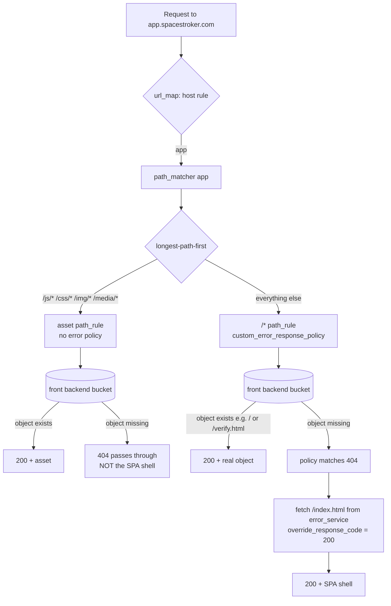
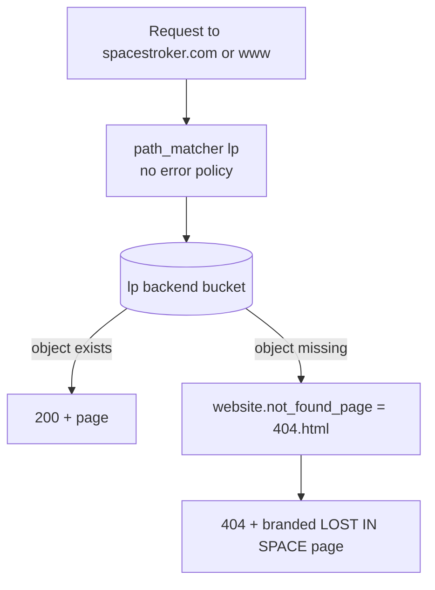

# SpaceStroker — "Static-site HTTP status codes" — Implementation Spec

> **Status: Shipped (merged 2026-07-27, `feature/static-site-status-codes` → `main` in `monkify-meta`)
> — but NOT yet applied.** The Terraform is on `main`; no `terraform apply` has run and the config was
> never `terraform validate`-ed (no terraform binary in the authoring environment). Production still
> serves the old behaviour until the next `apply` + CDN invalidation, so **acceptance criteria 1-13 in
> §12 are unverified**. Verify them against the deployed LB after applying, then drop this caveat here,
> in `INDEX.md`, and in `features/terraform-gcp-deploy.md`.
>
> Refined via Trello card
> [Fix static-site HTTP status codes: SPA deep links return 404, LP's branded 404 page is unreachable](https://trello.com/c/mkogi4tR)
> (2026-07-27).
> Repos affected: **`monkify-meta`** only (`deploy/terraform/` + KB). `monkify-backend`,
> `monkify-front` and `monkify-lp` are **not** touched.
>
> **Purpose:** Both production static sites currently serve the correct HTML with the wrong HTTP
> status code. Every deep link on `app.spacestroker.com` returns **404** while rendering the SPA, and
> `spacestroker.com` returns the **LP homepage** with a 404 status instead of the branded 404 page
> that is already built and already deployed. This spec fixes the status codes at the load balancer
> and the bucket website config, so monitors, link unfurls, crawlers and failed chunk loads all see
> the truth.

---

## 1. Summary

One hardcoded line — `not_found_page = "index.html"` in the shared `static_site` module — produces
two distinct bugs because the module serves two very different sites.

| Host | Today | After |
| --- | --- | --- |
| `app.spacestroker.com/` | 200, real `index.html` object | unchanged — 200 |
| `app.spacestroker.com/game-select` | **404** + SPA shell | **200** + SPA shell |
| `app.spacestroker.com/game?type=1` | **404** + SPA shell | **200** + SPA shell |
| `app.spacestroker.com/js/missing.js` | **404** + SPA shell (`text/html`) | **404**, *not* the SPA shell |
| `app.spacestroker.com/js/app.<hash>.js` | 200, `application/javascript` | unchanged — 200 |
| `spacestroker.com/` | 200, landing page | unchanged — 200 |
| `spacestroker.com/nonexistent` | **404** + **LP homepage** | **404** + **branded `404.html`** |
| `www.spacestroker.com/nonexistent` | **404** + LP homepage | **404** + branded `404.html` |
| `api.spacestroker.com/unknown` | 404 + `ApiResult` | unchanged — must not regress |

Two mechanisms, deliberately different:

- **App (SPA):** the fallback moves **to the load balancer**, because a GCS website config can never
  return a 200. A `custom_error_response_policy` on a `/*` path rule rewrites 404 → `/index.html`
  with `override_response_code = 200`. Asset prefixes get their own, **more specific** path rule with
  no policy, so a genuinely missing chunk still 404s.
- **LP (one-pager):** stays a plain bucket concern. `not_found_page` simply points at the already
  shipped `404.html`, and the 404 status is **correct** and preserved — there are no client-side
  routes to rescue.

### 1.1 Why this is not cosmetic

Browsers render a 404 body fine, so a human clicking around never notices. Everything that reads the
status code does:

- **Uptime / health monitors** on any deep link report the app as down.
- **Link unfurls** (Discord, X, Telegram) drop previews for shared deep links — live concern during
  launch promotion.
- **Crawlers** treat every route as missing; the app is effectively unindexable.
- **Silent chunk failure.** A missing JS chunk returns `text/html` with a 404. `gsutil -m rsync -r -d`
  (`deploy/tools/SpaceStroker.Deploy/Deployer.cs:504`) **deletes** superseded hashed chunks on every
  deploy, and `index.html` is served with `Cache-Control: public, max-age=3600`, so for up to an hour
  after a deploy a returning user can request a chunk that no longer exists and receive HTML. The
  cache half is a **separate card** ([bSSvCfKF](https://trello.com/c/bSSvCfKF)); this spec is what
  makes the failure legible instead of silent.

---

## 2. Constraints (MANDATORY)

From `monkify-meta/constraints.md` (full list there):

- **Worktree per repo:** work in `.worktrees/static-site-status-codes/monkify-meta` on branch
  `feature/static-site-status-codes`. The hub stays on `main` — never `git checkout -b` there.
  Only `monkify-meta` is affected, so this is the only worktree.
- **Secrets/config:** `secrets.<env>.json` is unversioned; only mock/placeholder values may ever be
  written into committed files. This change needs no secret at all.
- **Production applies are an operator step** (`constraints.md` §5). The implementing agent may write
  the config and run `terraform fmt` / `validate` / `plan`; **the user runs `apply`** and confirms the
  live behaviour. Acceptance criteria §12.1–§12.13 are verified against the deployed LB by the user.
- **Unit tests (§3):** no .NET code changes, so `SpaceStroker.Tests` is untouched. See §11.
- **Integration tests (§3):** the card is classified **Minor change** (infra bug fix), so the
  mandatory happy-path integration test does **not** apply — and could not, since the Testcontainers
  suite cannot exercise a GCP load balancer.
- **Knowledge base must be corrected.** `features/terraform-gcp-deploy.md` and the `static_site`
  module comment both currently document the buggy behaviour as intended. See §10.3.

---

## 3. Resolved product decisions

| # | Decision |
| --- | --- |
| 1 | **Fix the SPA fallback at the load balancer, not the bucket.** A GCS website config always returns 404 for `not_found_page`; there is no way to override the status there. The URL map is the only place that can emit a 200. |
| 2 | **`error_service` needs no new resource.** The provider requires a **BackendBucket** for `error_service`; `var.app_backend_bucket_id` already is one. |
| 3 | **Asset misses keep a real 404.** `/js/*`, `/css/*`, `/img/*`, `/media/*` route through a more specific path rule that carries **no** error policy, so a missing chunk stays diagnosable instead of returning HTML. |
| 4 | **Asset prefixes are `/js/ /css/ /img/ /media/`** — verified against a real `monkify-front/dist`. vue-cli emits `css/ img/ js/ media/`; fonts and audio land in **`media/`**. There is **no** `fonts/` directory — do not carve one out. |
| 5 | **The app bucket drops `not_found_page` entirely.** If the bucket keeps serving `index.html` for misses, a missing `/js/*.js` still returns an HTML body and decision #3 achieves nothing. `main_page_suffix` **stays** so `/` keeps working. |
| 6 | **Trade-off accepted for #5:** the bucket-level fallback was an accidental safety net. After this change a misconfigured LB policy means a broken app, not merely a mis-statused one — hence §12 must be verified against the deployed LB, not just `terraform plan`. |
| 7 | **LP serves the existing `404.html` with a genuine 404.** `monkify-lp/src/pages/404.astro` already builds to `dist/404.html` and is already deployed (`https://spacestroker.com/404.html` → 200, 15 KB). Only the Terraform wiring is missing. **No `monkify-lp` code change.** |
| 8 | **LP keeps the 404 status.** It is a one-pager with anchor-only navigation — no client-side routes to preserve, so a 404 is the correct answer. The LP gets **no** LB error policy and **no** status override. |
| 9 | **`not_found_page` becomes a module variable** on `static_site`, since the two sites now need different values. |
| 10 | **`www.spacestroker.com` needs no special handling** — it shares the `lp` path matcher (`modules/edge/main.tf:112-115`). |
| 11 | **Cache-Control is out of scope** — companion card [bSSvCfKF](https://trello.com/c/bSSvCfKF). |
| 12 | **⚠️ Correction to the card (found during code exploration):** the carve-out **cannot** be done by putting the policy on the path matcher default and omitting it on the asset path rule. See §6.1 — an omitted policy **inherits**. The structure below is the corrected one. |

---

## 4. Data model

**Not applicable.** No entities, no columns, no EF mapping, no migration. This change touches
infrastructure configuration only.

---

## 5. Configuration

No secret, no environment variable, no `GeneralSettings` key, and no `.tfvars` change. Every value in
this spec is a literal in committed Terraform. `secrets.<env>.json` is not read or written.

The change is environment-agnostic: it flows through the existing `local.name_prefix`, so
`development` and `production` (which share one GCP project) both get it with no per-environment
branching.

---

## 6. Infrastructure behaviour

### 6.1 ⚠️ Blocker found during code exploration — the card's carve-out design does not work

The card states the asset carve-out can be achieved by putting
`default_custom_error_response_policy` on the `app` **path matcher** and giving the asset `path_rule`
**no** policy. **That is wrong**, and would silently ship a carve-out that does nothing.

The Terraform provider documentation for `path_rule.custom_error_response_policy` states:

> "If a policy for an error code is not configured for the PathRule, a policy for the error code
> configured in `pathMatcher.defaultCustomErrorResponsePolicy` is applied. If one is not specified in
> `pathMatcher.defaultCustomErrorResponsePolicy`, the policy configured in
> `UrlMap.defaultCustomErrorResponsePolicy` takes effect."

So an omitted policy **inherits** from the matcher; it does not opt out. Assets would still be
rewritten to `index.html` with a 200 — the exact outcome decision #3 exists to prevent.

**The corrected structure** relies on two documented behaviours instead:

1. Path rules are resolved **longest-path-first** — provider docs: *"Matches are always done on the
   longest-path-first basis."* So `/js/*` wins over `/*`.
2. Inheritance only walks **upward**. If neither `pathMatcher.defaultCustomErrorResponsePolicy` nor
   `UrlMap.defaultCustomErrorResponsePolicy` defines a policy, a path rule without one gets **no**
   policy, and the backend's real 404 passes through untouched.

Therefore: put the SPA fallback on a **`/*` path rule**, leave the **matcher default empty**, and let
the more specific asset rule inherit nothing.

### 6.2 URL map — the `app` path matcher

`deploy/terraform/workload/modules/edge/main.tf`, replacing the current three-line `app` path matcher
at **lines 121-124**:

```hcl
  path_matcher {
    name            = "app"
    default_service = var.app_backend_bucket_id

    # NOTE: deliberately NO default_custom_error_response_policy here. A path_rule that omits the
    # policy INHERITS the matcher default, so a matcher-level policy would silently apply to the
    # asset rule below and defeat the carve-out. Leaving matcher + url_map defaults unset is what
    # lets the asset rule fall through to the bucket's real 404.

    # Hashed build assets. Longest-path-first matching means these win over "/*" below, and with no
    # policy anywhere up the chain a missing chunk surfaces as a genuine 404 instead of HTML.
    path_rule {
      paths   = ["/js/*", "/css/*", "/img/*", "/media/*"]
      service = var.app_backend_bucket_id
    }

    # Everything else is an SPA history route: serve the shell with a 200 so monitors, unfurls and
    # crawlers see a real page. The bucket 404s (its not_found_page is unset — see static_site), and
    # this policy rewrites that 404 into /index.html + 200.
    path_rule {
      paths   = ["/*"]
      service = var.app_backend_bucket_id

      custom_error_response_policy {
        error_response_rule {
          match_response_codes   = ["404"]
          path                   = "/index.html"
          override_response_code = 200
        }
        # Must be a BackendBucket; nothing higher in the url_map sets one to inherit.
        error_service = var.app_backend_bucket_id
      }
    }
  }
```

**Untouched, deliberately:**

- `path_matcher "api"` (lines 117-120) — the API's own 404s must keep their `ApiResult` bodies.
- `path_matcher "lp"` (lines 125-128) — the LP is fixed at the bucket, not the LB.
- `google_compute_url_map.lb.default_service` (line 102) — no url_map-level error policy may be
  added; that would leak the SPA rewrite onto the `api` and `lp` matchers via inheritance.
- `google_compute_url_map.redirect` (lines 162-175) — the HTTP→HTTPS redirect uses a separate url
  map and must not be modified.

**Query strings are safe.** Provider docs on `paths`: *"The string fed to the path matcher does not
include any text after the first `?` or `#`."* So `/game?type=1` matches `/*` on `/game` and the query
string is untouched on the way to the client.

### 6.3 `static_site` module — `not_found_page` becomes a variable

`deploy/terraform/workload/modules/static_site/variables.tf` — add the variable. **Place it directly
after `location` (before `custom_response_headers`)**, not at the end of the file: the in-flight
`feature/static-bucket-armor` branch appends `edge_security_policy_id` immediately before
`variable "labels"`, and placing this there guarantees a merge conflict (see §7).

```hcl
variable "not_found_page" {
  type        = string
  description = <<-EOT
    Object served for unmatched paths (GCS website config). GCS ALWAYS returns HTTP 404 with it —
    the status cannot be overridden here — so this is only appropriate for a real error page.
    The front SPA leaves this null and gets its 200 fallback from the load balancer's
    custom_error_response_policy instead (see modules/edge). Null ⇒ GCS returns its own plain 404,
    which is what lets missing build assets surface as real 404s.
  EOT
  default     = null
}
```

`deploy/terraform/workload/modules/static_site/main.tf` — the `website` block at **lines 13-16**:

```hcl
  website {
    main_page_suffix = "index.html"
    not_found_page   = var.not_found_page
  }
```

And the module header comment at **lines 1-3**, which currently asserts the bug is the design:

```hcl
# Reusable static site: a public GCS website bucket behind a Cloud CDN backend bucket.
# Used for both the front SPA and the lp landing page. NOTE: GCS serves not_found_page with an
# HTTP 404 and cannot override that status, so it is only used for real error pages (the lp's
# 404.html). The SPA's history-mode fallback is handled at the load balancer instead — see
# modules/edge, which rewrites the bucket's 404 into /index.html with a 200.
```

### 6.4 Wiring the two sites

`deploy/terraform/workload/main.tf` — `module "front_site"` (**lines 132-140**) is left as-is:
omitting `not_found_page` takes the `null` default, which is the intended "no bucket-level fallback"
behaviour. Add one line to `module "lp_site"` (**lines 142-149**):

```hcl
module "lp_site" {
  source      = "./modules/static_site"
  project_id  = var.project_id
  name_prefix = "${local.name_prefix}-lp"
  bucket_name = var.lp_bucket_name
  location    = var.bucket_location
  # The lp is a one-pager with anchor-only nav — a 404 status is correct, so this is a real error
  # page rather than an SPA fallback. monkify-lp/src/pages/404.astro already builds to dist/404.html.
  not_found_page = "404.html"
  labels         = var.labels
}
```

> Run `terraform fmt` after editing — adding `not_found_page` widens the `=` alignment of the block.

---

## 7. Known overlap with `feature/static-bucket-armor` (READ BEFORE IMPLEMENTING)

At spec time an **unmerged, un-carded, un-specced** branch `origin/feature/static-bucket-armor`
(commit `1494f21`, 2026-07-27 09:11) edits **three of the four files** this spec touches. It attaches
a Cloud Armor **edge** policy to both backend buckets so LB logs carry `regionCode`. It is unrelated
in purpose but overlapping in location.

This spec is written against **`origin/main`**, so nothing conflicts today (the spec file is new and
`INDEX.md` is not touched by that branch). The conflict is an **implementation-time** concern:

| File | `static-bucket-armor` | This spec | Risk |
| --- | --- | --- | --- |
| `modules/static_site/main.tf` | adds `edge_security_policy` to `google_compute_backend_bucket.cdn` (line ~30+) | edits `google_storage_bucket.site.website` (lines 13-16) + header comment | **Low** — different resources, auto-merges |
| `modules/static_site/variables.tf` | appends `edge_security_policy_id` before `variable "labels"` | adds `not_found_page` **after `location`** (§6.3) | **Low if placed as specified**, otherwise a guaranteed conflict |
| `workload/main.tf` | edits both `front_site` and `lp_site` module blocks | adds one line to `lp_site` | **High** — same blocks |
| `modules/edge/main.tf` | untouched | url_map path rules | **None** |

**Instruction to the implementer:** before opening a PR, `git fetch origin && git merge origin/main`
in the worktree. If `static-bucket-armor` has landed by then, resolve `workload/main.tf` by keeping
**both** arguments on `lp_site` (`edge_security_policy_id` **and** `not_found_page`) and both on
`front_site`. If it has not landed, do nothing — whichever branch merges second resolves it.

---

## 8. Flow diagram





---

## 9. Out of scope

- **Cache-Control headers on upload** and the stale-`index.html`-plus-deleted-chunks window —
  companion card [bSSvCfKF](https://trello.com/c/bSSvCfKF).
- Any change to the SPA's routing, the LP's content, or the 404 page's design.
- **The Vercel residual.** `spacestroker.com` still answers at Vercel's edge for resolvers holding the
  pre-migration delegation (`.com` NS TTL 48 h from the 2026-07-26 18:28 UTC change, so drained by
  ~2026-07-28 18:30 UTC), and Vercel still holds a TLS cert for the apex. Detaching the domain in the
  Vercel dashboard is a manual ops step, not part of this card.
- API error-response shaping, Cloud Armor rules, TLS/cert changes, DNS changes.
- `monkify-backend`, `monkify-front`, `monkify-lp` — no code change in any of them.

---

## 10. File checklist

### 10.1 Backend (`monkify-backend`)

**None.** Not affected.

### 10.2 Frontend (`monkify-front` / `monkify-lp`)

**None.** Not affected. `monkify-lp/src/pages/404.astro` already exists and already deploys; this
spec only makes GCS serve it.

### 10.3 Meta (`monkify-meta`) — branch `feature/static-site-status-codes`

| # | File | Change |
| --- | --- | --- |
| 1 | `deploy/terraform/workload/modules/static_site/variables.tf` | Add `variable "not_found_page"` (string, default `null`) **after `location`** — placement matters, see §7. |
| 2 | `deploy/terraform/workload/modules/static_site/main.tf` | `website.not_found_page` → `var.not_found_page`; rewrite the misleading header comment (lines 1-3) per §6.3. |
| 3 | `deploy/terraform/workload/main.tf` | `module "lp_site"`: add `not_found_page = "404.html"` + rationale comment. `front_site` unchanged (takes the `null` default). Run `terraform fmt`. |
| 4 | `deploy/terraform/workload/modules/edge/main.tf` | Replace the `app` path matcher (lines 121-124) with the two path rules from §6.2. Do not touch `api`, `lp`, `default_service`, or the redirect url map. |
| 5 | `features/terraform-gcp-deploy.md` | Correct the Topology bullet claiming *"SPA history routing is served by `not_found_page = index.html`"* — describe the LB rewrite + the lp's `404.html`. |
| 6 | `INDEX.md` | Add the `specs/static-site-status-codes.md` row; set **Feature currently in flight**. |
| 7 | `specs/static-site-status-codes.md` | This spec. |

> Items 5 and 6 are partly done by this skill (6, 7) and partly at ship time (5) — see §14.

---

## 11. Unit tests

**None.** This change contains no .NET code, so `SpaceStroker.Tests` and
`SpaceStroker.Tests.Integration` are untouched, and there is nothing for the deploy tool's
`SpaceStroker.Deploy.Tests` to cover either — the change is declarative Terraform with no branching
logic.

Verification is instead:

| Gate | Command / action | Owner |
| --- | --- | --- |
| Syntax + formatting | `terraform fmt -check` and `terraform validate` in `deploy/terraform/workload` | implementing agent |
| Non-destructive plan | `terraform plan` — assert no `google_storage_bucket` replacement and no change to `google_compute_global_address.lb_ip` | implementing agent |
| Live behaviour | §12 acceptance criteria against the deployed LB after `apply` | **user** (operator step) |

---

## 12. Acceptance criteria

Mapped 1:1 from the Trello **Acceptance Criteria** checklist (14 items).

1. Given the deployed LB, when `GET https://app.spacestroker.com/game-select`, then the response is
   HTTP **200** with the SPA `index.html` body.
2. Given a deep link carrying a query string, when `GET https://app.spacestroker.com/game?type=1`,
   then the response is HTTP **200** and the query string reaches the client so the game page reads
   `type=1`.
3. Given a path that is not a real SPA route, when `GET https://app.spacestroker.com/nonexistent-xyz`,
   then the response is HTTP **200** with the SPA shell and the Vue router decides what to render.
4. Given a hashed asset that does not exist, when `GET https://app.spacestroker.com/js/does-not-exist.js`,
   then the response is HTTP **404** and the body is **not** the SPA `index.html` (same for `/css/*`,
   `/img/*`, `/media/*`).
5. Given a real hashed asset, when `GET https://app.spacestroker.com/js/app.<hash>.js`, then the
   response is HTTP **200** with content-type `application/javascript` (unchanged from before the fix).
6. Given the real public objects shipped in `monkify-front/public`, when `GET /favicon.ico`,
   `/verify.html` and `/embed-example.html` on `app.spacestroker.com`, then each returns HTTP **200**
   with its own content and not the SPA shell.
7. Given the app root, when `GET https://app.spacestroker.com/`, then the response is HTTP **200** and
   serves `index.html` (`main_page_suffix` still in effect after `not_found_page` is dropped).
8. Given an unknown LP path, when `GET https://spacestroker.com/nonexistent-xyz`, then the response is
   HTTP **404** and the body is the branded `404.html` page (Edson / "LOST IN SPACE"), not the LP
   homepage.
9. Given the `www` alias shares the `lp` path matcher, when `GET https://www.spacestroker.com/nonexistent-xyz`,
   then it behaves identically to the apex (404 + branded 404 page).
10. Given the LP home page, when `GET https://spacestroker.com/`, then the response is still HTTP
    **200** with the landing page (no regression from the `not_found_page` change).
11. Given the API must keep its own error semantics, when a request hits an unknown route on
    `api.spacestroker.com`, then it still returns HTTP **404** with the `ApiResult` body and never the
    SPA shell or a 200 override.
12. Given the change is applied via Terraform, when `terraform plan` runs for both `development` and
    `production`, then the plan updates the url map and buckets **in place** with no
    `google_storage_bucket` replacement and no change to the LB global IP address.
13. Given the HTTP→HTTPS redirect uses a separate url map, when `GET http://app.spacestroker.com/game-select`,
    then it still 301-redirects to the https equivalent with the path and query preserved.
14. Given the KB documents the old behaviour as correct, when the feature is shipped, then
    `features/terraform-gcp-deploy.md` and the `static_site/main.tf` module comment both describe SPA
    fallback at the LB and the LP's `404.html`, with no remaining claim that `not_found_page` handles
    SPA routing.

---

## 13. Manual QA

After the operator runs `terraform apply` (and a CDN invalidation, since Cloud CDN is enabled on both
backend buckets — `modules/static_site/main.tf:29`):

```bash
# App — SPA routes must be 200
for p in / /game-select "/game?type=1" /nonexistent-xyz; do
  printf "%-22s " "$p"; curl -sS -o /dev/null -w "%{http_code}\n" "https://app.spacestroker.com$p"
done            # expect: 200 200 200 200

# App — real objects unchanged, missing assets a genuine 404
curl -sS -o /dev/null -w "%{http_code} %{content_type}\n" https://app.spacestroker.com/js/does-not-exist.js
                # expect: 404 and NOT text/html carrying the SPA shell
curl -sS -o /dev/null -w "%{http_code}\n" https://app.spacestroker.com/verify.html      # expect 200
curl -sS -o /dev/null -w "%{http_code}\n" https://app.spacestroker.com/embed-example.html # expect 200

# LP — branded 404 page with a real 404 status
curl -sS -w "\n[%{http_code}]\n" https://spacestroker.com/nonexistent-xyz | grep -i "LOST IN SPACE"
curl -sS -o /dev/null -w "%{http_code}\n" https://www.spacestroker.com/nonexistent-xyz  # expect 404
curl -sS -o /dev/null -w "%{http_code}\n" https://spacestroker.com/                     # expect 200

# API must not have inherited anything
curl -sS -o /dev/null -w "%{http_code}\n" https://api.spacestroker.com/definitely-not-a-route # expect 404
```

Then load `https://app.spacestroker.com/game-select` in a browser and confirm the SPA still boots
with **0 console errors** and the game cards populate.

---

## 14. Trello / pipeline

- **Source card:** [#102 — Fix static-site HTTP status codes](https://trello.com/c/mkogi4tR) — list
  **Specs created**; the **Implementation** section on the card carries branch, spec path and worktree.
- **Companion card:** [#103 — Set Cache-Control on static-site uploads](https://trello.com/c/bSSvCfKF)
  (Backlog, unrefined).
- **Level:** `Minor change` → `/monkify-implement-feature` **skips** the mandatory integration test and
  `/monkify-ship-feature` **skips** a dedicated `features/<slug>.md`. Correcting
  `features/terraform-gcp-deploy.md` (§10.3 item 5) is **not** waived.
- **Next:** `/monkify-implement-feature 102`, then `/monkify-ship-feature 102`.

---

## 15. Revision log

| Date | Change |
| --- | --- |
| 2026-07-27 | Initial spec from refined card #102. Corrected the card's carve-out design (§6.1 — an omitted `path_rule` policy inherits the matcher default, so the SPA policy moves to a `/*` path rule); documented the `feature/static-bucket-armor` overlap (§7). |
