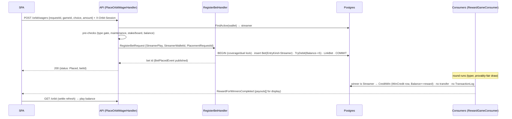

# SpaceStroker — "Streamer Wallets" (play-money PVE bets for streamers) — Implementation Spec

> **Status: Shipped — merged to `main` via `feature/streamer-wallets` on 2026-10-07** (`monkify-backend`,
> `monkify-front`, `monkify-meta`). Distilled in [`../features/streamer-wallets.md`](../features/streamer-wallets.md).
> **The code wins** over the body below; as-built departures:
>
> - **Decision 3 / §6.0 house side:** there is no duel house bet to mirror (removed by `duel-treasury-house`);
>   a streamer's House duel draws the house word as usual, skips the treasury lock and coverage pricing, and
>   settles `S × (2 − rate)` into the play ledger.
> - **§6.6 quotes are session-gated:** `/availability` and `POST /games/{id}/duels` honour body `wallet`
>   **only** with a valid `X-Orbit-Session` for the same wallet (`IsVerifiedActiveStreamer`); otherwise the
>   answer is any wallet's, with no lookup (anti-probing, `constraints.md` §6). The **OpenRoom streamer branch
>   was removed** from both routes — an open room answers/opens like anyone's and the `RegisterBetHandler`
>   guard refuses the play bet.
> - **§6.1 reconciler (changed 2026-11-05, `feature/streamer-table-source`):** the `StreamerWallets` TABLE is
>   the source of truth — config only inserts missing wallets and never activates/deactivates a row; seeding
>   and the enrolment switch-off follow the table's active rows (a hand-inserted row is seeded); the seed is
>   **3 SOL** (was 3.7). The Orbit-balance Warning now fires when a wallet is first seeded.
> - **§6.1 reconciler (as first built):** seeds **active** wallets only (a wallet listed `Active: false` gets no seed until
>   activated); `MOCK_` values are skipped **silently** (no Error); the Orbit-balance Warning fires for newly
>   inserted wallets; and on **every** run it disables any `Enabled` Orbit enrolment of an active streamer
>   (`Enabled = false`, #200's `WaitingForHouseSince = null`).
> - **§6.2 ledger:** `TryDebit` takes the `betId` and stamps it directly (no separate `LinkBet`); `WonFor`
>   returns a per-bet dictionary. FK `StreamerTransactions → StreamerWallets` is `Restrict`.
> - **§6.3 / §6.4:** the streamer branch of `GET /orbit`, `POST /orbit/wagers` and `GET /orbit/wagers/{id}`
>   runs **before** the Orbit `IsConfigured` gate; `GET /orbit` also defaults every #200 solo field.
>   §6.10 refusals log a Warning.
> - **§6.9 referral roster:** no `EntryKind` predicate — play bets carry `ReferralCode = null`, so the code
>   match excludes them and the covering index still serves the query.
> - **§4.4 migration:** `20261007033746_AddStreamerWallets`, regenerated after #200 merged (orders after
>   `OrbitSoloAutoBet`, carries only the two streamer tables).
> - **#200 interactions (not in the body):** active streamers are excluded from the solo loop (tick +
>   pre-place re-check), `OrbitSoloAutoBetSweepJob`, `KickOrbitSoloLoops` and the shared planner's
>   `ResolveCandidates`; the SPA turns #200's follow-auto-round logic off for a streamer.
> - **§7 frontend:** a durable per-device marker `space-stroker.orbit.streamer.<wallet>` backs `isStreamer`
>   for a lapsed session; quotes send `X-Orbit-Session`; the duel streamer watchers are installed on the first
>   `useDuel()` call (a module-level watch reached `useWallet()` before `initWallet` and blanked the app);
>   `HomeOrbitCard` is hidden for a streamer.
> - **Decision 12** (last-stake memory, all players) shipped as written, and pauses while Orbit auto-play
>   drives the round.
> - **§5 ops:** adding/removing/topping up a streamer is a **full** `deploy --env <env>` (component deploys
>   never apply `appConfig`), not "`deploy consumers` + `deploy api`".
>
> *Original status: Ready for implementation* — refined via Trello card
> [#201 Streamer wallets](https://trello.com/c/t0toZxny/201-streamer-wallets) (refined 2026-10-06, spec
> 2026-10-06, short answer mode).
> Repos affected: `monkify-backend`, `monkify-front`, and this doc in `monkify-meta`.
> Branch / worktree: `feature/streamer-wallets` → `.worktrees/streamer-wallets/<repo>`.
> Change level: **Feature** — mandatory happy-path integration test (`constraints.md` §3) **plus**
> dedicated integration tests for the Monkey Duel VS HOUSE streamer flow, the refusal paths and the
> config reconciler.
>
> **Purpose:** let a streamer demo the game live without the house giving away real SOL. A small set of
> **registered streamer wallets** gets a fixed **3.7 SOL play-money balance**, shown exactly like an Orbit
> balance, and spends it on the two player-vs-house games — **Hyper Roll** and **Monkey Duel VS HOUSE**.
> Balances go up and down on screen; **no on-chain transfer ever happens**, the treasury is never
> touched, and the play money can never be cashed out.

---

## 1. Summary

| Aspect | Real Orbit manual bet (unchanged) | **Streamer play bet (new)** |
| --- | --- | --- |
| Who | Any wallet with an Orbit session | A wallet listed in `Operator:Streamers:Wallets` (active) |
| Game types | Every paid type | **Hyper Roll + Monkey Duel `DuelKind.House` only** |
| Balance | `OrbitBalance` (custody-backed SOL) | **`StreamerWallet.Balance`** (play money, no lamports behind it) |
| Funding | Deposits | **3.7 SOL seeded once** on first registration + config top-ups applied once |
| Endpoint | `POST /orbit/wagers` → async consumer → custody transfer | **Same endpoint**, streamer branch → **synchronous** `RegisterBetRequest { StreamerPlay = true }`, no event, no transfer |
| `Bet.EntryKind` | `Paid` | **`Streamer` (new, = 4)** |
| Treasury coverage / exposure | Counted | **Excluded** |
| Win / refund lands in | Orbit custody (on-chain) + `WinCredit`/`Refund` `OrbitTransaction` | **Play ledger only** (`StreamerTransaction` `WinCredit`/`Refund`) — no `TransactionLog` row, no transfer |
| Cash-out / deposit / auto-bet | Allowed | **Refused** |
| Wallet-signed bets, Cosmic Sprint, Space Jackpot, OPEN DUELS | Allowed | **Refused** (a real stake already sent is refunded via the existing path) |
| History / public feed | Shown | **Shown, identical** (no DEMO marking) |
| Leaderboards, stats money figures, partner turnover | Counted | **Excluded** (participation still counted) |

---

## 2. Constraints (MANDATORY)

From `monkify-meta/constraints.md` (full list there):

- **Worktree-per-repo:** all work in `.worktrees/streamer-wallets/<repo>` on `feature/streamer-wallets`;
  the hubs stay on `main`.
- **Unit tests:** update/add in `SpaceStroker.Tests` (`scripts/run_tests.bat` — never the full
  `dotnet test`, the `ProductionGames` Monte Carlo suite is excluded on purpose); report every changed /
  added test at the end.
- **Integration tests (mandatory, Feature):** `SpaceStroker.Tests.Integration` (`scripts/run_integration_tests.bat`), §11.2.
- **EF mapping:** inline in `SpaceStrokerDbContext.OnModelCreating`; no `IEntityTypeConfiguration`.
  ⚠️ The context is **NoTracking by default** — every ledger write is an `ExecuteUpdate` / explicit `Add`
  + `SaveChanges`, never load-mutate-save.
- **Migrations:** one new migration under `SpaceStroker.Infrastructure/Migrations/`, applied only by
  `SpaceStroker.Consumers`; regenerate the snapshot with `dotnet ef migrations add`.
- **Secrets/config:** committed `spacestrokersettings.json` carries an **empty** wallet list; examples use
  `MOCK_` values. Real streamer wallets are **public keys** and go in `deploy/secrets.<env>.json` →
  **`appConfig`** (plain env vars — **not** the `secrets` block, so no Terraform binding is needed).
- **Messaging (§6):** every refusal reuses existing copy. The only specific message a streamer sees is the
  already-sanctioned *"Not enough Orbit balance for that bet."* (about the caller's own state). Nothing
  ever tells a caller that a wallet *is* a streamer.
- **Money invariant:** a streamer round must never move SOL, write a `TransactionLog` row, or change the
  treasury's exposure. Tests assert zero `FakeSolanaService.Transfers` for streamer flows.

---

## 3. Resolved product decisions

| # | Decision |
| --- | --- |
| 1 | **Separate play-money ledger**, never the real Orbit ledger — so play money can never be cashed out of custody and Orbit's custody-backed invariant stays intact. |
| 2 | **Scope = Hyper Roll + Monkey Duel VS HOUSE.** OPEN DUELS, Cosmic Sprint and Space Jackpot are out. |
| 3 | **Duel VS HOUSE in play money**: no real house stake, no coverage requirement; the streamer wins `S × (2 − rate)` into the play balance. *(Refinement assumed a HouseSeed mirror bet — see §6.0: the house side is now a drawn word, so there is simply no house bet to mirror; the intent is unchanged.)* The streamer's duel ceiling is the type's `MaximumStake`, never clamped by treasury coverage. |
| 4 | **Registration = config → DB reconciler** at Consumers startup; seeded **exactly once**; removed wallets are **deactivated, never deleted**. |
| 5 | **Fixed 3.7 SOL** starting balance (overrides the card's original "random"). **Refill** = per-wallet config top-up applied exactly once (idempotent on a top-up id). No automatic refill. |
| 6 | **Streamer-only wallet**: on Hyper Roll / Duel VS HOUSE it always pays from play money with **no wallet fallback**; everything else (other types, OPEN DUELS, Space Jackpot, wallet-signed bets, Orbit deposit / cash-out / auto-bet) is refused server-side and hidden / disabled in the UI. |
| 7 | **Aggregates**: own history, round history and public feed show streamer bets normally. Excluded from leaderboards (3 boards + own row), every **money** figure in global + per-type stats, and partner/referral turnover + commission. Participation (rounds played, bets placed, unique players) still counts. Keyed on **`Bet.EntryKind == Streamer`**, never the wallet list. |
| 8 | **No public marking** anywhere. ⚠️ Knowingly accepted: viewer disclosure is left to the streamer, off-app; no Terms clause. |
| 9 | **Auth + UI**: reuse the Orbit session (`X-Orbit-Session`) and the violet Orbit pill; `GET /orbit` returns `isStreamer: true` + the play balance; deposit / cash-out / auto-bet / notifications / recover hidden. |
| 10a | Streamer bets are excluded from Hyper Roll + House-duel **coverage/exposure** and the payout-time treasury check; the **maintenance switch still applies**. |
| 10b | Same game rules (stake bounds, board TTL, reroll, provably-fair draw, win banners). |
| 10c | A **deactivated** streamer reverts to a normal wallet; the play balance is frozen (kept, invisible); past bets keep `EntryKind = Streamer`. |
| 10d | **Self-exclusion** is still checked. |
| 10e | No Telegram / Orbit notifications for streamer bets — ordinary win toasts only. |
| 10f | Play debit + `Bet` insert are **one DB transaction**; settlement credits **exactly once**. No reconciler job (nothing is on-chain). |
| 11 | *(Spec default, from code)* **Personal stats** (`GET /players/stats`) and the streamer's **own history columns** (`MyPayout`) **include** play-money results, read from the play ledger — the streamer's own view must show their wins on stream (card: "show the wallet increase/decrease"). The public **history Pot** includes the play stake, like any bet ("appear normally"). |
| 12 | *(Owner, 2026-10-06, during QA — ALL players, not only streamers)* **Monkey Duel and Hyper Roll remember the last stake** per wallet and game type, exactly like the duel word carry-over: `src/utils/lastStake.ts` (`localStorage` key `space-stroker.last-stake.<gameTypeId>.<wallet>`), written when a paid bet is placed (wallet or Orbit), restored on entering the game and after every round only over the default/self-filled value, clamped to the current bounds (Hyper Roll `[min, MaximumStake]`, duel `[min, current ceiling]`). Device-local; no backend. |

---

## 4. Data model

### 4.1 `BetEntryKind` — new value

`SpaceStroker.Domain/Bets/ValueObjects/BetEntryKind.cs`

```csharp
Paid = 1,      // real SOL stake, wallet or Orbit (default)
Free = 2,      // dev free bet
Holder = 3,    // Space Jackpot holder ticket
Streamer = 4   // play-money stake from a registered streamer wallet — never on-chain, never in money aggregates
```

`BetExtensions` (`SpaceStroker.Domain/Bets/Services/BetExtensions.cs`) gains
`public static bool IsStreamerPlay(Bet bet) => bet.EntryKind == BetEntryKind.Streamer;`.
⚠️ `IsFreeBet` stays `Amount == 0 && EntryKind != Holder` — a streamer bet has `Amount > 0`, so it is
**not** free; every money path that branches on "free" must branch on "streamer" explicitly (§6).

### 4.2 New entities

`SpaceStroker.Domain/Streamers/Entities/StreamerWallet.cs` (extends `TableEntity` → `Id`, `CreatedDate`, `UpdatedDate`):

```csharp
public class StreamerWallet : TableEntity
{
    public string Wallet { get; set; }        // base58 public key, == Player.ExternalPlayerId
    public bool Active { get; set; }
    public decimal Balance { get; set; }      // materialised; == SUM(StreamerTransaction.Amount) for this wallet
}
```

`SpaceStroker.Domain/Streamers/Entities/StreamerTransaction.cs`:

```csharp
public class StreamerTransaction : TableEntity
{
    public Guid StreamerWalletId { get; set; }
    public StreamerTransactionType Type { get; set; }
    public decimal Amount { get; set; }               // signed: + seed/top-up/win/refund, − bet debit
    public string? TopUpId { get; set; }              // Type = TopUp
    public Guid? PlacementRequestId { get; set; }     // Type = BetDebit (the /orbit/wagers requestId)
    public Guid? BetId { get; set; }                  // BetDebit / WinCredit / Refund
}
```

`SpaceStroker.Domain/Streamers/ValueObjects/StreamerTransactionType.cs`:
`Seed = 1, TopUp = 2, BetDebit = 3, WinCredit = 4, Refund = 5`.

**Ledger invariant:** `StreamerWallet.Balance == SUM(StreamerTransaction.Amount)` per wallet, all rows.
Corrections are appended rows, never edits or deletes. Every balance change is **one transaction** that
both inserts the row and moves `Balance` with a conditional `ExecuteUpdate`.

### 4.3 EF configuration (inline, `SpaceStrokerDbContext.OnModelCreating`)

Add `DbSet<StreamerWallet> StreamerWallets` and `DbSet<StreamerTransaction> StreamerTransactions` next to
the Orbit sets (line ~33). Mapping beside the Orbit block (~462-541), same style:

```csharp
modelBuilder.Entity<StreamerWallet>(e =>
{
    e.ToTable("StreamerWallets");
    e.Property(x => x.Wallet).HasMaxLength(50).IsRequired();
    e.Property(x => x.Balance).HasPrecision(18, 9);
    e.HasIndex(x => x.Wallet).IsUnique();
});

modelBuilder.Entity<StreamerTransaction>(e =>
{
    e.ToTable("StreamerTransactions");
    e.Property(x => x.Type).HasConversion<int>().IsRequired();
    e.Property(x => x.Amount).HasPrecision(18, 9);
    e.Property(x => x.TopUpId).HasMaxLength(64);
    e.HasOne<StreamerWallet>().WithMany().HasForeignKey(x => x.StreamerWalletId);
    e.HasIndex(x => x.StreamerWalletId).IsUnique().HasFilter("\"Type\" = 1")
        .HasDatabaseName("IX_StreamerTransactions_Seed");                // seeded once
    e.HasIndex(x => x.TopUpId).IsUnique().HasFilter("\"TopUpId\" IS NOT NULL")
        .HasDatabaseName("IX_StreamerTransactions_TopUpId");             // each top-up once
    e.HasIndex(x => x.PlacementRequestId).IsUnique().HasFilter("\"Type\" = 3")
        .HasDatabaseName("IX_StreamerTransactions_PlacementRequestId_BetDebit"); // idempotent wager
    e.HasIndex(x => new { x.BetId, x.Type }).IsUnique().HasFilter("\"BetId\" IS NOT NULL")
        .HasDatabaseName("IX_StreamerTransactions_BetId_Type");          // one debit / win / refund per bet
});
```

`Bet.EntryKind` mapping (line 314) is unchanged — it is already an `int` column; `4` needs no schema change.

### 4.4 Migration

`dotnet ef migrations add AddStreamerWallets` (project `SpaceStroker.Infrastructure`, startup
`SpaceStroker.Consumers`). Creates the two tables + indexes. No backfill, no change to existing tables.
Latest migration today: `20261001185217_HolderJackpot`. Forward-safe; `Down()` drops both tables.

---

## 5. Configuration

`SpaceStroker.Domain/Configs/Entities/OperatorSettings.cs` gains
`public StreamerSettings Streamers { get; set; } = new();` and a new
`SpaceStroker.Domain/Configs/Entities/StreamerSettings.cs`:

```csharp
public class StreamerSettings
{
    public decimal InitialBalance { get; set; } = 3.7m;
    public List<StreamerWalletSettings> Wallets { get; set; } = new();   // { Wallet, Active = true }
    public List<StreamerTopUpSettings> TopUps { get; set; } = new();     // { Id, Wallet, Amount }
}
```

Committed `SpaceStroker.Common/spacestrokersettings.json` → `GeneralSettings:Operator`:

```json
"Streamers": { "InitialBalance": 3.7, "Wallets": [], "TopUps": [] }
```

`deploy/secrets.example.json` → `appConfig` gains placeholders plus a `_comment_streamers` note
(public keys, appConfig not secrets, adding/removing = Consumers redeploy, top-up ids must be unique and
never reused):

```json
"GeneralSettings:Operator:Streamers:InitialBalance": 3.7,
"GeneralSettings:Operator:Streamers:Wallets:0:Wallet": "MOCK_STREAMER_WALLET",
"GeneralSettings:Operator:Streamers:TopUps:0:Id": "MOCK_TOPUP_1",
"GeneralSettings:Operator:Streamers:TopUps:0:Wallet": "MOCK_STREAMER_WALLET",
"GeneralSettings:Operator:Streamers:TopUps:0:Amount": 1.0
```

⚠️ `appConfig` env vars override image defaults, so adding a streamer is `deploy consumers` (reconciler)
**and** `deploy api` (the API reads the table, not config — but keep both on the same config).

---

## 6. Backend behaviour

### 6.0 Code finding — there is no duel house bet any more

Refinement decision 3 described a "mirrored play-money house bet". In code, `DuelHouseBetService`,
`DuelHouseBetConsumer`, `DuelCreatorBetPlacedEvent` and `DuelHouseCoverageService` were **removed** by
`specs/duel-treasury-house.md` (§5.6). A House duel's opponent is now a **drawn word on the round**
(`Game.HouseWord`, set in `RegisterBetHandler.DrawHouseSideUnderLock`, l.978-1035); the pot is padded by
`Game.Stake` in `BetDomainService.SetPotAmount` (l.244-245), the treasury pays the winner, and the
treasury check is `HouseEdgeCoverageService` at the flat `DuelHouseRules.PayoutMultiplier`. So for a
streamer: register the creator's play bet, **skip the coverage pricing**, draw the house word as usual,
and settle the payout `S × (2 − rate)` into the play ledger. The pot math is reused unchanged.
`features/monkey-duel.md` still describes the HouseSeed house bet and is stale — fix it at ship time.

### 6.1 `StreamerWalletReconciler` (Consumers startup)

New static class `SpaceStroker.Infrastructure/Services/Streamers/StreamerWalletReconciler.cs`, modelled on
`DuelWordPoolReconciler` (static so the integration suite can drive it):
`public static int Reconcile(SpaceStrokerDbContext context, StreamerSettings settings)`.

1. Normalise entries: trim; skip blank, `MOCK_`-prefixed and non-base58 / wrong-length (32–44) wallets with
   `Log.Error("STREAMERS — skipping …")`; dedupe.
2. **Activate / deactivate** existing rows to match the configured set (`ExecuteUpdate` on `Active`) —
   never delete. A wallet listed with `Active: false` is deactivated.
3. **Insert** missing wallets with `Balance = 0`, then **seed** each wallet that has no `Seed` row: one
   transaction inserting `StreamerTransaction { Type = Seed, Amount = InitialBalance }` and
   `ExecuteUpdate(Balance += InitialBalance)`. The filtered unique index `IX_StreamerTransactions_Seed`
   makes a racing second instance lose on `23505` (catch, log Information, continue). A reactivated wallet
   is **not** re-seeded.
4. **Top-ups**: for each `TopUps` entry whose wallet is a known streamer and whose `Id` has no row, one
   transaction inserting `{ Type = TopUp, TopUpId = Id, Amount }` + `Balance += Amount`. `Amount ≤ 0` or an
   unknown wallet → `Log.Error`, skipped. Unique `TopUpId` index → applied once.
5. If a newly registered wallet already holds a **real Orbit balance > 0**, `Log.Warning("STREAMERS —
   wallet {Wallet} has a real Orbit balance; it is hidden while streaming, cash it out first")`.
6. Return the change count.

Invoked in `SpaceStroker.Consumers/Program.cs` startup, right after `CreateDefaultReferralPartners`
(l.295), wrapped like the other reconcilers (`try { … Log.Information(count) } catch (ex) { Log.Error }`).

### 6.2 `IStreamerLedger` (Infrastructure service)

`SpaceStroker.Infrastructure/Services/Streamers/StreamerLedger.cs` — the only writer of the play ledger
outside the reconciler:

| Method | Behaviour |
| --- | --- |
| `Task<StreamerWallet?> FindActive(string wallet, ct)` | `AsNoTracking` lookup by unique `Wallet` with `Active` |
| `Task<bool> IsActiveStreamer(string? wallet, ct)` | convenience; `false` for null/blank |
| `Task<bool> TryDebit(Guid streamerWalletId, decimal amount, Guid? requestId, ct)` | **joins the caller's open transaction**: conditional `ExecuteUpdate(Balance -= amount WHERE Id = @id AND Balance >= amount)`; 0 rows → `false`. Then inserts `BetDebit { Amount = −amount, PlacementRequestId = requestId }` (BetId set by `LinkBet`). |
| `Task LinkBet(Guid requestId or debitId, Guid betId, ct)` | stamps `BetId` on the debit row inside the same transaction |
| `Task<bool> CreditWin(Bet bet, decimal amount, ct)` | own transaction: insert `WinCredit { BetId }` + `Balance += amount`; a `23505` on `IX_StreamerTransactions_BetId_Type` → already credited → `true` (idempotent) |
| `Task<bool> Refund(Bet bet, ct)` | same shape, `Type = Refund`, `Amount = bet.Amount` |
| `Task<decimal> WonFor(IEnumerable<Guid> betIds, ct)` | sum of `WinCredit` per bet, for history / personal stats (§6.9) |

### 6.3 `GET /orbit` — streamer view

`GetOrbitHandler` (`Handlers/Orbit/GetOrbit/GetOrbitHandler.cs`): after resolving the player, if
`FindActive(wallet)` hits, return an `OrbitDto` with **`IsStreamer = true`** (new bool on `OrbitDto`,
`GetOrbitRequest.cs`), `Balance = streamer.Balance`, `Enabled = false`, `GameParametersId = null`,
`EligibleGameTypes = []` (hides auto-bet), `TotalWonViaOrbit = 0`, `OrbitBetsPlaced = 0`,
`TelegramEnabled = false`, and the deposit / cash-out fields as today (the UI hides them). The real Orbit
balance is **not** returned. Non-streamers: `IsStreamer = false`, behaviour unchanged.

### 6.4 `POST /orbit/wagers` — streamer branch (API, synchronous)

`PlaceOrbitWagerHandler` (`Handlers/Orbit/PlaceOrbitWager/PlaceOrbitWagerHandler.cs`, pre-checks l.76-153).
After step 3 (player resolved), if `FindActive(request.Wallet)` hits → `PlaceStreamerWager`:

1. **Idempotency:** `_results.TryGet(player.Id, requestId)` → return it; else if a `BetDebit` with this
   `PlacementRequestId` exists → `Placed(betId)`.
2. `player.IsSelfExcluded(now)` → `SelfExclusionActive`.
3. Load the game (same include set). `null` → `GameNotValidForBets`.
4. **Type gate:** allowed only when `game.Parameters.IsHouseEdge` **or**
   (`game.Parameters.IsDuel && game.DuelKind == DuelKind.House`). Anything else → `GameNotValidForBets`.
5. Maintenance (`HouseEdgeEnabled == false`) → `HouseEdgeUnderMaintenance` (both Hyper Roll and House duel).
6. `_preChecks.Check(game, player.Id, choice, amount)` — stake bounds, board freshness (< 10 s refused),
   choice, per-round rules — unchanged.
7. `streamer.Balance < amount` → `OrbitInsufficientBalance` (early, read-only; the authoritative check is
   the conditional debit in step 8).
8. `await _mediator.Send(new RegisterBetRequest(game.Id, body) { StreamerPlay = true,
   StreamerWalletId = streamer.Id, PlacementRequestId = requestId })` with `body = { Amount, Choice,
   Seed, Nonce, Wallet = player.ExternalPlayerId, DisplayName = player.DisplayName }` (no
   `PaymentSignature`). The handler registers the bet and debits the play ledger in one transaction
   (§6.5). A refusal surfaces as the handler's message.
9. Store and return `Placed(betId)` (`status: 2`) — or `Refused(message)` on a handler refusal, stored so a
   retry with the same `requestId` returns it.

No `PlaceManualOrbitBetEvent`, no claim, no transfer, no `Pending` state. The response contract is the one
the SPA already parses; it simply reads `Placed` on the first poll (or directly from the POST).

`GET /orbit/wagers/{requestId}` (`GetOrbitWagerHandler`): for an active streamer, answer from the play
ledger — a `BetDebit` with this `PlacementRequestId` and a `BetId` → `Placed`; otherwise the stored
result; otherwise `NotFound`.

### 6.5 `RegisterBetHandler` — the streamer branch and the streamer-wallet guard

`RegisterBetRequest` (`Handlers/Games/RegisterBet/RegisterBetRequest.cs`) gains three **init-only internal
flags** (never bound from the public body, like `FundedByOrbit`):
`bool StreamerPlay`, `Guid? StreamerWalletId`, `Guid? PlacementRequestId`.

In `RegisterBetHandler` set `_isStreamerPlay = request.StreamerPlay` next to `_isFreeBet` (l.117-120), then:

| Location (today) | Change |
| --- | --- |
| l.127-132 Orbit-claim guard | unchanged; `StreamerPlay && FundedByOrbit` together → `FailedToRegisterBet` + `Log.Error` (programming error) |
| l.135-139 shape check (amount > 0 needs a signature) | `_isStreamerPlay` → require **no** signature and `amount > 0` |
| l.163-191 bet build | `_isStreamerPlay` → `EntryKind = BetEntryKind.Streamer`, `ReferralCode = null`, `Signature = null` |
| l.204-205 `ValidatePayment` | skip when `_isStreamerPlay` (also the reuse guard — a null signature would match every null row) |
| l.210-216 self-exclusion | unchanged (applies) |
| **new, right after self-exclusion** | **Streamer-wallet guard** for every *non*-streamer-play request: if `IsActiveStreamer(wallet)` → `RefundInvalidBet(GameNotValidForBets)` (a paid wallet stake is refunded through the existing path; a free bet is just rejected). Covers wallet-signed bets on **every** type, OPEN DUELS rooms and joins, and real Orbit manual / auto bets. |
| `RegisterHolderEntry` (l.709-815) | add the same guard after the wallet proof → `JackpotEntryInvalid` (vague, nothing moved) |
| l.255-260 dispatch | `_isStreamerPlay` on a type that is neither house-edge nor House duel → `GameNotValidForBets` (backstop for §6.4 step 4). A House-duel **join** is already refused for everyone (l.1077). |
| `RegisterHouseEdgeBet` l.625-627, l.641-648 | treat `_isStreamerPlay` like `_isFreeBet`: **no** `EvaluateAsync`, no fail-closed coverage refusal. The coverage lock is still taken (it serialises the solo-round claim). Maintenance (l.597) still applies. The l.615 replay re-check is skipped. |
| `RegisterDuelBet` l.880-884, l.889-890 | skip the replay re-check and do **not** take the treasury lock for `_isStreamerPlay` |
| `DrawHouseSideUnderLock` l.987-1000, l.913-922 | skip the coverage pricing and the fail-closed refusal for `_isStreamerPlay`; the maintenance check (l.981) and the house-word draw are unchanged |
| bet insert (both paths, inside the lock's transaction) | **before commit**: `TryDebit(StreamerWalletId, Amount, PlacementRequestId)` → `false` → roll back and refuse `OrbitInsufficientBalance`; then `LinkBet(…, _bet.Id)`. One transaction: the bet exists **iff** the debit exists. |
| l.263-264 `WritePlacementLedgerRow` | skip for `_isStreamerPlay` (no `TransactionLog` Debit) |
| `RefundInvalidBet` l.1283-1343 | `_isStreamerPlay` → release locks, **reject only**, publish nothing (the debit rolled back with the insert). |
| l.266-267 `BetPlacedEvent` | unchanged — `BetPlacedConsumer` starts the round (house-edge / `HasDrawnHouseWord` ⇒ 1 player, l.123) |

### 6.6 Coverage and availability

- **`HouseEdgeCoverageService`** (`Services/Games/HouseEdgeCoverageService.cs`): add
  `&& b.EntryKind != BetEntryKind.Streamer` to the bet filters in `ExposureRounds` (l.149-156, inside
  `Bets.Any`) and `LoadAsync` (l.108-111). A streamer's solo round then contributes **zero** exposure and
  real players' max stake is unaffected.
- **`CheckBetAvailabilityHandler`** (`POST /games/{gameTypeId}/availability`): `CheckBetAvailabilityRequestBody`
  gains an optional `Wallet` (max 50). When it is an active streamer:
  - house-edge: maintenance → `UnderMaintenance`; otherwise `Open` **without** coverage (board freshness
    checks unchanged);
  - duel: `OpenRoom` kind → `available: false` (OPEN DUELS refused); `House` → maintenance check, floor /
    ceiling check, and `maxStake = parameters.Duel.MaximumStake` (the **type** ceiling, not the
    treasury-clamped quote).
  The wallet is unauthenticated here; spoofing it only yields a quote — the bet path re-checks with the
  session's wallet.
- **`OpenDuelRoomHandler`** (`POST /games/{gameTypeId}/duels`): body gains an optional `Wallet`. For
  `kind == House` with an active-streamer wallet, skip the coverage refusal (l.51-61; the maintenance
  check stays). For `kind == OpenRoom` with an active-streamer wallet → `GameNotValidForBets`. A spoofed
  wallet only opens an unbet shell, which the existing TTL sweep deletes.

### 6.7 Settlement — `RewardGameConsumer`

`Consumers/RewardGame/RewardGameConsumer.cs`:

- l.86 `paidWinners`: exclude `IsStreamerPlay` (they need no blockhash pre-check and no fee reserve).
- l.112-120 treasury running balance: computed over `paidWinners` only, so a streamer-only round **never
  reads the treasury**.
- Winner loop, before l.147 (cutover) and l.154: for an `IsStreamerPlay` winner →
  `reward = betService.CalculateRewardForBet(winner)` (house-edge: `stake × multiplier`; House duel:
  `2S − S × rate` — `SetPotAmount` already pads the pot), then `streamerLedger.CreditWin(winner, reward)`;
  success → `Rewarded` + (house-edge) `AddHouseEdgePayout(wallet, reward)` so the broadcast
  `result.payouts[]` shows it like any win; failure → `NeedsManualAnalysis`. **No** treasury check, **no**
  `settlement.Credit`, **no** `TransactionLog` row. Idempotency comes from `IX_StreamerTransactions_BetId_Type`
  (`BetDomainService`'s Credit-row subtraction sees nothing, which is correct).
- Losers: unchanged (no money moves either way).
- `EvaluateOrbitFloors`: unchanged (streamer bets are never `OrbitAutoPlaced`).

### 6.8 Refunds — `RefundInvalidBetConsumer`

`Consumers/RefundInvalidBet/RefundInvalidBetConsumer.cs`: when the bet row exists and
`IsStreamerPlay(bet)` (before l.59) → `streamerLedger.Refund(bet)` → `MarkRefunded`. Never touches
`settlement.Refund` / `RefundToOrbit`. Sources that can reach it: `PendingRefundSweepJob`
(`NeedsRefunding`), `CloseOngoingGames` at startup, `GameEndedAbruptely` paths. `RefundWithoutBet` never
applies (a streamer bet is never refused after a transfer).

### 6.9 Read paths

| File | Change |
| --- | --- |
| `Services/Leaderboards/LeaderboardService.cs` l.419 (`PaidBetsIn`) and l.431 (`WinningBets`) | add `&& bet.EntryKind != BetEntryKind.Streamer` — covers gamble race, weekly PnL, hall of fame **and** the caller's own row (`RankOfAsync` uses the same queryables) |
| `Services/Games/GlobalStatsService.cs` l.77 (`paidBets`), l.81 (`creditedBets`), l.172 (`BiggestPot`) | exclude `Streamer`; participation (`RoundsPlayed`, `TotalBetsPlaced`, `UniquePlayers`, `MostPlayedType`) unchanged |
| `Services/Games/GameStatsService.cs` l.62, l.66 | exclude `Streamer` (biggest pot / payout, total paid, hottest choice); `RoundsPlayed` unchanged |
| `Services/Referrals/ReferralEarningsService.cs` l.158 (`EarningBets`) | add `&& x.EntryKind != BetEntryKind.Streamer` (belt-and-braces: streamer bets also carry `ReferralCode = null`) |
| `Handlers/Referrals/GetReferralPlayers/GetReferralPlayersHandler.cs` l.87-93 | same predicate on `referred` |
| `monkify-meta/deploy/sql/referral-payout-report.sql` | add `AND "EntryKind" <> 4` — must stay byte-equivalent to `EarningBets` (comment at `ReferralEarningsService.cs:121-122`) |
| `Services/Games/GameHistoryService.cs` l.259-285 (`MyStake` / `MyPayout`) | for the caller's `Streamer` bets, `MyPayout` = `IStreamerLedger.WonFor(betIds)` (there are no `Credit` rows). `BuildRow` (pot, bet count, winner) **unchanged** — the round appears normally. |
| `Services/Players/PlayerStatsService.cs` l.120-143 | include streamer stakes in `TotalWagered`; take streamer winnings from `WonFor` into `TotalWon` / `Net` / `BiggestSingleWin` / `BiggestWinMultiplier` (decision 11) |

### 6.10 Orbit endpoints a streamer must not use

In `OrbitController` handlers, after resolving the wallet, an active streamer gets the vague
`OrbitRequestInvalid` (400) on: `POST /orbit/deposits` (`CreditOrbitDepositHandler`),
`POST /orbit/cash-outs` (`RequestOrbitCashOutHandler`), `PATCH /orbit/settings`
(`UpdateOrbitSettingsHandler`), `POST /orbit/telegram/link` / `verify`. `POST /orbit/session`,
`GET /orbit`, `GET /orbit/history` (returns an empty page for a streamer) and the wager routes work.
⚠️ A deposit transfer the SPA never sends cannot be lost — the UI hides the control (§7).

### 6.11 No new error messages

Reused: `GameNotValidForBets`, `HouseEdgeUnderMaintenance`, `OrbitInsufficientBalance`,
`OrbitRequestInvalid`, `JackpotEntryInvalid`, `SelfExclusionActive`, `FailedToRegisterBet`.

---

## 7. Frontend behaviour (`monkify-front/src`)

### 7.1 Types and state

- `types/orbit.ts` `OrbitState` (l.38-119): add `isStreamer: boolean`.
- `hooks/useOrbit.ts`: export `isStreamer = computed(() => !!orbit.value?.isStreamer && sessionWallet.value === <connected wallet>)`.
  Balance display (l.277) and `applyOrbitDebit` work unchanged on the play balance.
- `services/mainService.ts`: `checkGameAvailability` and `openDuelRoom` send `wallet` when the connected
  wallet is a streamer (§6.6).

### 7.2 Bet source — `hooks/useGame.ts`

- `nextBetSource` (l.599-612): when `isStreamer`:
  - Hyper Roll, or a duel on the House tab → `'orbit'` **regardless of balance**;
  - any other type (and the duel board tab) → `null` (no paid bet possible).
- `runBet`: when `isStreamer`, **skip** silent fallback A (l.1746-1750) and race fallback B (l.1871-1902):
  an `'insufficient'` outcome shows *"Not enough Orbit balance for that bet."* and stops; the lapsed-session
  path (l.1665-1742) re-mints the session and never falls to the wallet for a streamer.
  `orbitOutOfFunds.triggerOrbitOutOfFunds` is **not** called.
- The out-of-funds coverage watcher (l.823-842) passes `null` for a streamer (its toast says "deposit more
  … or use your own wallet funds", which is wrong here).
- Settle refresh (l.718-780) unchanged — `placeFromOrbit` sets `manualOrbitSettle.pending` on `Placed`, so
  the pill re-reads after the round.

### 7.3 Monkey Duel — `hooks/useDuel.ts`, `components/game/DuelConsole.vue`, `DuelTabs.vue`, `DuelBoard.vue`

- `orbitCanPay` (l.116-121): for a streamer, true on the House tab regardless of balance.
- `placeCreatorBet` (l.491-589): for a streamer on House → Orbit (play) only; `'insufficient'` → show the
  message and stop (no wallet path l.550-580).
- `availability` / `stakeCeiling` (l.215, 336): the availability call now carries the wallet, so the server
  returns `maxStake` = type `MaximumStake` for a streamer — no client special case beyond sending it.
- OPEN DUELS: for a streamer, `DuelTabs` hides/refuses the OPEN DUELS tab (l.15-17, 28-43), `loadBoard`
  never switches to `'board'` (l.424-427), and `takeRoom` / `openOwnRoom` refuse up front.

### 7.4 Game console and other types — `components/game/GameConsole.vue`

For a streamer on a type that is not Hyper Roll or a duel (Cosmic Sprint, Space Jackpot): the lever is
disabled (`inputsLocked`, l.286) and `placeBet` (l.308) refuses with the generic
`GameNotValidForBets` text. No streamer-specific copy anywhere.

### 7.5 Orbit surfaces

- `OrbitLauncher.vue`: unchanged look; shows the play balance; `lit` follows `nextBetSource`.
- `OrbitQuickBody.vue` (l.43-47): hide ADD MONEY / `OrbitDepositControl` and CASH OUT /
  `OrbitCashOutControl` when `isStreamer` (status banner + balance stay).
- `OrbitModal.vue`: `visibleSections` (l.651-657) → `['wallet']` only for a streamer; inside WALLET
  (l.920-933) hide deposit + cash-out controls. `autoBetType` is already null (empty `eligibleGameTypes`).
- `components/home/HomeOrbitCard.vue`: hide the deposit CTA for a streamer.
- **No `DEMO` badge or marking** anywhere (decision 8).

`monkify-front` has no test runner: `yarn lint` + `yarn build` (copy the hub `yarn.lock` into the worktree
first; watch CRLF/prettier) + browser QA (§13).

---

## 8. Flow diagrams



---

## 9. Out of scope

OPEN DUELS for streamers; random starting balances; automatic refills; an admin UI / endpoint for
registration; in-app `DEMO` marking or a Terms clause; play-money cash-out or conversion to real SOL;
Cosmic Sprint / Space Jackpot for streamers; Orbit auto-bet or Telegram notifications for streamers;
moving an existing real Orbit balance (it is only hidden — ops cash it out first).

---

## 10. File checklist

### 10.1 Backend (`monkify-backend/src`)

| # | File | Change |
| --- | --- | --- |
| 1 | `SpaceStroker.Domain/Bets/ValueObjects/BetEntryKind.cs` | `Streamer = 4` |
| 2 | `SpaceStroker.Domain/Bets/Services/BetExtensions.cs` | `IsStreamerPlay` |
| 3 | `SpaceStroker.Domain/Streamers/Entities/StreamerWallet.cs`, `StreamerTransaction.cs`, `ValueObjects/StreamerTransactionType.cs` | new |
| 4 | `SpaceStroker.Domain/Configs/Entities/StreamerSettings.cs` (+ `StreamerWalletSettings`, `StreamerTopUpSettings`), `OperatorSettings.cs` | new settings + `Streamers` property |
| 5 | `SpaceStroker.Infrastructure/Data/Context/SpaceStrokerDbContext.cs` | DbSets + inline mapping §4.3 |
| 6 | `SpaceStroker.Infrastructure/Migrations/<ts>_AddStreamerWallets.cs` (+ Designer, snapshot) | generated |
| 7 | `SpaceStroker.Infrastructure/Services/Streamers/StreamerWalletReconciler.cs` | new §6.1 |
| 8 | `SpaceStroker.Infrastructure/Services/Streamers/IStreamerLedger.cs`, `StreamerLedger.cs` | new §6.2; register in `DependencyInjection.cs` |
| 9 | `SpaceStroker.Consumers/Program.cs` | call the reconciler after `CreateDefaultReferralPartners` |
| 10 | `SpaceStroker.Infrastructure/Handlers/Orbit/GetOrbit/GetOrbitRequest.cs`, `GetOrbitHandler.cs` | `IsStreamer` + streamer view §6.3 |
| 11 | `SpaceStroker.Infrastructure/Handlers/Orbit/PlaceOrbitWager/PlaceOrbitWagerHandler.cs` | streamer branch §6.4 |
| 12 | `SpaceStroker.Infrastructure/Handlers/Orbit/GetOrbitWager/GetOrbitWagerHandler.cs` | streamer ledger read |
| 13 | `SpaceStroker.Infrastructure/Handlers/Games/RegisterBet/RegisterBetRequest.cs`, `RegisterBetHandler.cs` | flags, streamer branch, streamer-wallet guard §6.5 |
| 14 | `SpaceStroker.Infrastructure/Services/Games/HouseEdgeCoverageService.cs` | exclude `Streamer` bets §6.6 |
| 15 | `SpaceStroker.Infrastructure/Handlers/Games/CheckBetAvailability/*` | optional `Wallet`, streamer quote |
| 16 | `SpaceStroker.Infrastructure/Handlers/Games/OpenDuelRoom/*` | optional `Wallet`, streamer House / OpenRoom rules |
| 17 | `SpaceStroker.Infrastructure/Consumers/RewardGame/RewardGameConsumer.cs` | streamer settlement §6.7 |
| 18 | `SpaceStroker.Infrastructure/Consumers/RefundInvalidBet/RefundInvalidBetConsumer.cs` | streamer refund §6.8 |
| 19 | `SpaceStroker.Infrastructure/Services/Leaderboards/LeaderboardService.cs` | predicate l.419, l.431 |
| 20 | `SpaceStroker.Infrastructure/Services/Games/GlobalStatsService.cs`, `GameStatsService.cs` | money exclusions |
| 21 | `SpaceStroker.Infrastructure/Services/Referrals/ReferralEarningsService.cs`, `Handlers/Referrals/GetReferralPlayers/GetReferralPlayersHandler.cs` | predicate |
| 22 | `SpaceStroker.Infrastructure/Services/Games/GameHistoryService.cs`, `Services/Players/PlayerStatsService.cs` | streamer own payout from the play ledger |
| 23 | Orbit handlers: `CreditOrbitDeposit`, `RequestOrbitCashOut`, `UpdateOrbitSettings`, Telegram link/verify, `GetOrbitHistory` | refuse / empty for a streamer §6.10 |
| 24 | `SpaceStroker.Common/spacestrokersettings.json` | `Operator:Streamers` (empty list, 3.7) |

### 10.2 Frontend (`monkify-front/src`)

| # | File | Change |
| --- | --- | --- |
| 1 | `types/orbit.ts` | `isStreamer` |
| 2 | `hooks/useOrbit.ts` | `isStreamer` computed |
| 3 | `services/mainService.ts`, `types/index.ts` | `wallet` on availability + open-duel calls |
| 4 | `hooks/useGame.ts` | `nextBetSource`, no wallet fallbacks, no out-of-funds toast for a streamer |
| 5 | `hooks/useDuel.ts`, `components/game/DuelConsole.vue`, `DuelTabs.vue`, `DuelBoard.vue` | House-only, no fallback, OPEN DUELS hidden |
| 6 | `components/game/GameConsole.vue` | lever disabled on other types for a streamer |
| 7 | `components/orbit/OrbitQuickBody.vue`, `OrbitModal.vue`, `components/home/HomeOrbitCard.vue` | hide deposit / cash-out / auto-bet / notifications / recover |

### 10.3 Meta (`monkify-meta`)

| # | File | Change |
| --- | --- | --- |
| 1 | `specs/streamer-wallets.md` | this spec |
| 2 | `INDEX.md` | map row + feature in flight |
| 3 | `deploy/secrets.example.json` | `Streamers` appConfig placeholders + `_comment_streamers` |
| 4 | `deploy/sql/referral-payout-report.sql` | `"EntryKind" <> 4` |
| 5 | *(ship)* `features/streamer-wallets.md` new; `features/orbit-wallet.md`, `leaderboards.md`, `stats-and-history.md`, `referral-program.md`, `monkey-duel.md` (also fix the stale HouseSeed house-side text, §6.0), `glossary.md` (`EntryKind.Streamer`, streamer wallet) | KB sync |

---

## 11. Tests

### 11.1 Unit (`SpaceStroker.Tests`, `scripts/run_tests.bat`)

| Test file | Cases | Expected |
| --- | --- | --- |
| `StreamerWalletReconcilerTests` (new) | new wallet; restart; removed wallet; re-added wallet; `MOCK_`/invalid wallet; top-up once / twice; top-up unknown wallet; negative amount | seeded 3.7 once; deactivated not deleted; not re-seeded; skipped + logged; top-up applied once |
| `StreamerLedgerTests` (new) | debit ≥ balance / < balance; `CreditWin` twice; `Refund` twice | conditional debit; idempotent credit / refund; invariant holds |
| `PlaceOrbitWagerTests` | streamer on Hyper Roll / House duel / Cosmic Sprint / OpenRoom duel / Space Jackpot; maintenance; insufficient; same `requestId` twice | Placed synchronously; `GameNotValidForBets`; `HouseEdgeUnderMaintenance`; `OrbitInsufficientBalance`; one bet |
| `GetOrbitWagerTests`, `GetOrbitTests` | streamer | ledger-backed `Placed`; `isStreamer = true`, play balance, empty `eligibleGameTypes` |
| `RegisterBetHandlerTests` | `StreamerPlay` happy path (no `ValidatePayment`, no `TransactionLog` Debit, `EntryKind = Streamer`, `ReferralCode = null`); coverage not evaluated; debit fails → no bet; streamer wallet-signed bet on Cosmic Sprint → refund event; streamer free bet → reject; holder entry → `JackpotEntryInvalid` | as stated |
| `HouseEdgeCoverageServiceTests` / `HouseEdgeCoverageTests` | open streamer round | zero exposure |
| `CheckBetAvailabilityHandlerTests`, `OpenDuelRoomHandlerTests` | streamer wallet | type ceiling, no coverage, OpenRoom refused |
| `RewardGameConsumerTests` | streamer Hyper Roll win; streamer House-duel win; redelivery; streamer-only round with treasury read failing | play `WinCredit` = `S × mult` / `S × (2 − rate)`; no `settlement.Credit`; credited once; treasury not read |
| `RefundInvalidBetConsumerTests` | streamer bet `NeedsRefunding` | play `Refund`, `Refunded`, no transfer |
| `LeaderboardServiceTests`, `LeaderboardHallOfFameTests`, `GlobalStatsServiceTests`, `GameStatsServiceTests`, `GameHistoryServiceTests`, `PlayerStatsServiceTests` | streamer bets mixed with paid | excluded from money / boards; counted in participation; own payout from ledger |
| `ReferralEarningsServiceTests`, `GetReferralPlayersHandlerTests` | referred streamer | no turnover / commission |
| Orbit deposit / cash-out / settings handler tests | streamer | `OrbitRequestInvalid` |
| `StreamerSettingsBindingTests` (new, like `OrbitSettingsBindingTests`) | committed file | `InitialBalance = 3.7`, empty lists |

### 11.2 Integration (mandatory — `StreamerWalletsFlowTests`, new)

Set `GeneralSettings__Operator__Streamers__Wallets__0__Wallet` (a real test keypair) in the fixture, or
drive `StreamerWalletReconciler.Reconcile` via `CreateConsumersScope()`.

1. **Happy path (Hyper Roll):** reconcile → balance 3.7; open an Orbit session; open a board; force the
   streamer's word to win (`SetServerSeedAsync`); `POST /orbit/wagers` → `Placed`; round completes;
   play balance `= 3.7 − S + S × mult`; ledger `Seed, BetDebit, WinCredit` sums to the balance;
   `Bet.EntryKind = Streamer`; **zero** `ConsumersSolanaService.Transfers` / `SolanaService.Transfers` for
   the wallet; no `TransactionLog` rows for the bet; `GET /leaderboards` and `GET /games/stats` money
   figures unchanged, `roundsPlayed` incremented; the round appears in `GET /games/{type}/history`.
2. **Duel VS HOUSE:** open a House room with the streamer wallet, bet S via `/orbit/wagers`, round runs;
   on a streamer win the balance moves by `S × (1 − rate)` net, on a loss by `−S`; treasury balance read
   never required; zero transfers.
3. **Refusals:** streamer wallet-signed bet on Cosmic Sprint → refused and refunded (one refund transfer
   recorded); `/orbit/wagers` on Cosmic Sprint → `GameNotValidForBets`, balance unchanged;
   `POST /orbit/deposits` → 400; insufficient balance → `OrbitInsufficientBalance`, no bet.
4. **Reconciler:** run twice → one `Seed` row; add a top-up and run twice → one `TopUp` row; remove the
   wallet → `Active = false`, balance kept, next wallet-signed bet behaves as a normal wallet.

---

## 12. Acceptance criteria (from the Trello checklist)

1. Given a wallet newly added to `Streamers:Wallets`, when Consumers starts, then a `StreamerWallet` row
   exists with a play balance of exactly 3.7 SOL, and restarting Consumers again does not seed it a second time.
2. Given a configured top-up entry for a streamer, when Consumers starts (once or repeatedly), then the play
   balance increases by that amount exactly once.
3. Given a streamer signed in to Orbit with 3.7 SOL play balance, when they place a Hyper Roll bet via
   `POST /orbit/wagers` and win, then the play balance becomes 3.7 − stake + stake × multiplier, and no
   on-chain transfer, Orbit custody movement or `TransactionLog` Credit row is created.
4. Given a streamer opens a Monkey Duel VS HOUSE round, when they bet stake S, then the round runs with no
   real house stake and no coverage check, and a streamer win credits S × (2 − rate) to the play balance while a
   loss leaves the balance down by S, with the treasury unchanged. *(Card text said "mirrored play-money house
   bet … HouseSeed"; corrected per §6.0.)*
5. Given a streamer wallet, when it tries to bet on Cosmic Sprint, enter Space Jackpot, open/join an OPEN
   DUEL, place a wallet-signed bet, deposit/cash out of Orbit or enable auto-bet, then the request is refused
   server-side with existing vague copy (and any already-transferred real stake is refunded via the existing path).
6. Given a streamer whose play balance is below the stake, when they pull the lever on Hyper Roll or Duel VS
   HOUSE, then they see "Not enough Orbit balance for that bet." and the SPA does NOT fall back to a wallet bet.
7. Given completed streamer rounds, when `GET /leaderboards` and the global/per-type stats are read, then
   streamer bets are absent from every leaderboard and every money figure (paid out, volume, biggest
   pot/payout/multiplier, hottest choice) but are counted in rounds played / bets placed.
8. Given a streamer referred by a partner, when the streamer plays rounds, then the partner's turnover and
   commission do not increase.
9. Given completed streamer rounds, when the streamer's own history, the round history and the public feed are
   viewed, then the streamer's bets appear exactly like real bets (no DEMO marking).
10. Given an unsettled streamer Hyper Roll round, when a real player requests `/availability` or places a Hyper
    Roll bet, then the treasury coverage/exposure and max stake are unaffected by the streamer round.
11. Given Hyper Roll maintenance is on (`HouseEdgeEnabled=false`), when a streamer places a play bet, then it is
    refused with the maintenance message and the play balance is unchanged.
12. Given the same `requestId` posted twice, or a settlement message redelivered, when processed, then exactly
    one bet, one play debit and at most one play credit exist.
13. Given a streamer signed in to Orbit, when the SPA loads, then the violet Orbit pill shows the play balance
    (same look as real Orbit), deposit/cash-out/auto-bet controls are hidden, and the balance refreshes after
    each round.
14. Given a streamer wallet removed from config, when Consumers restarts, then the `StreamerWallet` is
    deactivated (not deleted), its play balance is kept but hidden, the wallet behaves as a normal wallet, and
    its past bets keep the streamer marker.

---

## 13. Manual QA (local stack)

1. Put a devnet wallet you control in `GeneralSettings:Operator:Streamers:Wallets:0:Wallet` (local compose
   env), redeploy Consumers + API (no `down -v` needed beyond the migration), confirm the reconcile log line.
2. Connect that wallet, sign in to Orbit → the pill reads **3.7 SOL**; quick popup and modal show no
   deposit / cash-out / auto-bet.
3. Hyper Roll: pull until a win and a loss; the pill moves each round; the treasury balance on devnet is
   unchanged; no wallet signature is ever requested.
4. Monkey Duel: VS HOUSE works with the stake up to 0.5 SOL; OPEN DUELS tab is hidden.
5. Cosmic Sprint / Space Jackpot: the lever is disabled.
6. Drain the balance below the minimum stake → the short-balance message, no wallet prompt.
7. `/leaderboard` and `/game/stats` show no change; `/game/history` shows the rounds.
8. Remove the wallet from config, restart → the wallet behaves normally (real Orbit, all types).

---

## 14. Trello / pipeline

- **Source card:** [#201 Streamer wallets](https://trello.com/c/t0toZxny/201-streamer-wallets) — list
  **Specs created**; the **Implementation** section on the card lists branch, worktree, spec and level.
- **Next:** `/monkify-implement-feature Streamer wallets`, then `/monkify-ship-feature Streamer wallets`.
- **Deploy:** migration ⇒ deploy **Consumers + API together**, then the front (check the live Cloud Run
  revision first). Register real streamer wallets via `secrets.production.json` → `appConfig`.

---

## 15. Revision log

| Date | Change |
| --- | --- |
| 2026-10-06 | Decision 12 added during QA: last-stake memory for Monkey Duel + Hyper Roll (all players, frontend-only). |
| 2026-10-06 | Initial spec from the refined card + same-chat refinement (short mode). Code exploration corrected decision 3 (no duel house bet exists since `duel-treasury-house`) and added decision 11 (personal stats / own history read the play ledger). |
