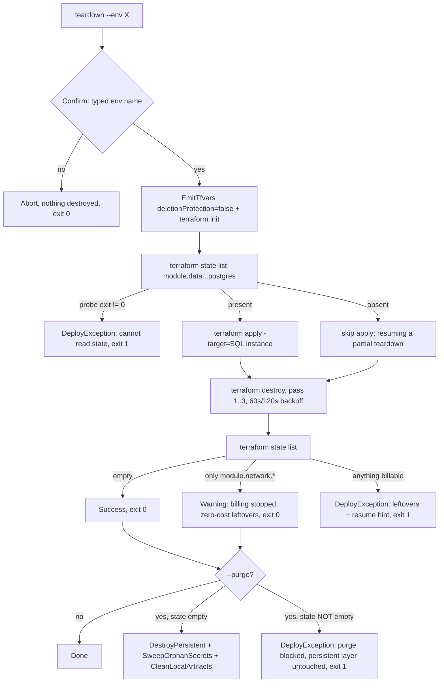

# SpaceStroker — "Fix teardown: resuming a partial teardown re-creates the workload" — Implementation Spec

> **Status: Ready for implementation** — refined via Trello card
> [Fix teardown: resuming a partial teardown re-creates the workload](https://trello.com/c/7a9aYZiG) (2026-07-27).
> Repos affected: **`monkify-meta` only** (`deploy/tools/` + `deploy/README.md` + `deploy/docs/`).
> `monkify-backend` and `monkify-front` are untouched.
> **Level: Minor change** — ops-tooling bug fix. No new backend integration test, no new
> `features/<slug>.md`; the existing `features/terraform-gcp-deploy.md` is corrected at ship time.
>
> **Purpose:** Make `spacestroker-deploy teardown` **resumable**. Today a teardown that fails part-way
> cannot be re-run — the tool's pre-destroy `terraform apply` re-creates everything the failed pass
> already destroyed, so recovery means dropping to raw Terraform. After this change, re-running
> `teardown` never creates a resource, retries the transient ordering failures itself, and reports an
> exit code that reflects what actually survived.

---

## 1. Summary

`Deployer.DestroyWorkload()` (`deploy/tools/SpaceStroker.Deploy/Deployer.cs:325`) currently does:

```csharp
EmitTfvars(deletionProtectionOverride: false);
TerraformInit(wl, "workload");
terraform apply   -auto-approve -var-file=<env>.tfvars.json    // <-- converges the WHOLE stack
terraform destroy -auto-approve -var-file=<env>.tfvars.json
```

The `apply` exists for one reason: push `deletion_protection = false` onto the Cloud SQL instance so
the `destroy` is allowed to delete it (Decision 12 of `specs/terraform-gcp-deploy.md`). On an intact
stack that is harmless. On a **partially destroyed** stack it is actively harmful — it rebuilds
everything the previous pass deleted.

Observed on the first real `development` teardown (2026-07-26): pass 1 destroyed Cloud Run, Redis,
buckets, LB/Armor and Artifact Registry, then failed on ordering errors; pass 2 **re-created**
`spacestroker-dev-redis` (~4 min) and the Artifact Registry, then aborted with
`Error code 5 … Image '…/spacestroker-dev/consumers:latest' not found` (pass 1 had deleted the image
with the registry) and **never reached `destroy`**.

| Behaviour | Today | After this spec |
| --- | --- | --- |
| Pre-destroy apply | Full-stack `apply` — creates whatever is missing | **Targeted** apply on the Cloud SQL instance only, and **skipped entirely** when that instance is already gone |
| Transient ordering failure | Aborts the run; operator re-runs by hand | **Retried** in-process, up to 3 destroy passes (60s / 120s backoff) |
| Outcome when resources survive | Non-zero from Terraform; no classification | **Classified**: empty ⇒ exit 0 · zero-cost network leftovers ⇒ exit 0 + loud warning · anything billable ⇒ exit 1 with the leftovers listed |
| Resume | Impossible with the tool (raw `terraform destroy` required) | Re-running the same `teardown` command is the supported resume path, and every failure path prints it |
| `--purge` after a partial workload destroy | Destroys the state bucket regardless ⇒ orphans untracked resources | **Stops** before the persistent layer while any workload state remains |

The change is confined to the C# tool. **No Terraform source changes** — `enable_deletion_protection`,
the tfvars plumbing and the module graph all stay exactly as they are.

### 1.1 Why the targeted apply is cheap

`deploy/terraform/workload/modules/data/main.tf:14` uses the **provider-level** guard:

```hcl
resource "google_sql_database_instance" "postgres" {
  deletion_protection = var.enable_deletion_protection   # Terraform-level, NOT settings.deletion_protection_enabled
```

That attribute lives only in Terraform state — flipping it issues **no** GCP API mutation. So
`terraform apply -target=module.data.google_sql_database_instance.postgres` is a state-only update:
it creates nothing, changes nothing in the project, and completes in seconds. This is what makes
"targeted apply" a strictly better replacement for the full apply rather than a partial workaround.

---

## 2. Constraints (MANDATORY)

From `monkify-meta/constraints.md` (full list there):

- **Worktree-per-repo:** `feature/teardown-resume`, worktree `.worktrees/teardown-resume/monkify-meta`.
  The `monkify-meta` hub stays on `main`; never `git checkout -b` there. Push after every branch update.
- **Unit tests:** the backend rule (`SpaceStroker.Tests`) does **not** apply — no `monkify-backend`
  change. This spec ships its own test project (§11) and the implementer reports which tests were added.
- **No integration test:** Minor change, and `SpaceStroker.Tests.Integration` is a Testcontainers
  game-flow suite that cannot exercise Terraform (`constraints.md` §3 → "Scope of new feature").
- **EF / migrations:** N/A — no database change.
- **Secrets:** `secrets.<env>.json` is the operator's file. It is never committed, and the tool must
  keep never printing a secret value — the new console output prints Terraform **addresses** only.
- **Operator messaging:** N/A — no user-facing surface.
- **No production commands:** the implementing agent does **not** run `terraform apply`/`destroy`,
  `gcloud`, or anything against a real GCP project (`constraints.md` §5). Verification is the unit
  suite plus `dotnet build`; a real teardown is an ops step for the user.

---

## 3. Resolved product decisions

| # | Decision |
| --- | --- |
| 1 | **Targeted apply.** Replace the full pre-destroy `apply` with `terraform apply -auto-approve -target=module.data.google_sql_database_instance.postgres -var-file=<env>.tfvars.json`. |
| 2 | **Skip when absent.** Run that apply **only if** the instance is still in state. Probe with `terraform state list module.data.google_sql_database_instance.postgres`; empty output ⇒ skip and go straight to `destroy`. |
| 3 | **Fail closed on probe error.** If the probe command exits non-zero, **abort** with an explanatory `DeployException`. A failed probe is never read as "empty state" — that would silently skip clearing deletion-protection on an intact stack. |
| 4 | **Bounded blind retry.** Wrap `terraform destroy` in up to **3 passes**, sleeping **60s** before pass 2 and **120s** before pass 3, retrying on **any** non-zero exit. No stderr string-matching: `destroy` is idempotent, `ProcessRunner` does not redirect stderr today, and GCP error wording drifts. |
| 5 | **Leftover classification decides the exit code.** After the retry loop, read `terraform state list`. Empty ⇒ success, exit 0. Every remaining address under `module.network.` ⇒ exit 0 + loud warning. Anything else remaining ⇒ `DeployException` ⇒ exit 1. |
| 6 | **Zero-cost allow-list is `module.network.` only.** The VPC, subnet and PSA range are the resources the Google-managed `serverless-ipv4-*` address holds hostage, and all three are free. Cloud SQL, Redis, Cloud Run, buckets, the registry and the edge are billable and always fail the run. |
| 7 | **`--purge` stop-guard.** In `TeardownTotal`, if **any** workload state remains after `DestroyWorkload()` — including zero-cost leftovers — stop **before** `DestroyPersistent` / `SweepOrphanSecrets` / `CleanLocalArtifacts` and exit non-zero. Destroying the state bucket while it still tracks live resources would orphan them untracked. |
| 8 | **Retry scope is the workload layer only.** `DestroyPersistent`, `SweepOrphanSecrets` and `CleanLocalArtifacts` are unchanged apart from the new guard gating them. The persistent layer is a DNS zone + a `force_destroy` bucket with no ordering hazards, already guarded by `StateBucketExists()`. |
| 9 | **Resume hint on every give-up path.** Print the copy-pasteable `dotnet run -- teardown --env <env> [--purge]` (now safe to re-run) plus the raw `terraform destroy` escape hatch. |
| 10 | **Pure decision helpers + a real test project.** Extract the decisions into a side-effect-free `TeardownDecisions` static class and cover it with a new `SpaceStroker.Deploy.Tests` xUnit project. Terraform/gcloud invocation stays behind `ProcessRunner` and is not tested. |
| 11 | **No Terraform change.** The fix is entirely in the C# tool. |

---

## 4. Data model

**N/A.** No entity, no EF mapping, no migration — this feature touches no database.

---

## 5. Configuration

**N/A.** No new setting, env var, secret or Terraform variable. `secrets.<env>.json`,
`EmitTfvars` output and `enable_deletion_protection` are unchanged.

The retry schedule (3 passes, 60s/120s) is a **compile-time constant** in `TeardownDecisions`, not a
CLI flag — a flag was considered during refinement and deliberately dropped as unnecessary surface.

---

## 6. Tool behaviour (`SpaceStroker.Deploy`)

### 6.1 New file — `TeardownDecisions.cs`

A pure, side-effect-free static class. Every decision the teardown makes lives here so it can be
tested without a process, a network or a GCP project.

```csharp
namespace SpaceStroker.Deploy;

/// <summary>
/// Pure decisions behind `teardown`: which Terraform address must have its deletion-protection
/// cleared, how many destroy passes to run, and how to classify whatever survives. No I/O — every
/// method takes already-captured command output and returns a value or a message.
/// </summary>
public static class TeardownDecisions
{
    /// <summary>The only resource whose deletion_protection blocks `destroy` (Terraform-level guard,
    /// so flipping it is a state-only update — nothing is created or mutated in GCP).</summary>
    public const string SqlInstanceAddress = "module.data.google_sql_database_instance.postgres";

    /// <summary>VPC + subnet + PSA range. All zero-cost, and the trio the Google-managed
    /// serverless-ipv4 address reservation holds hostage after Cloud Run is gone.</summary>
    public const string ZeroCostPrefix = "module.network.";

    /// <summary>Waits BETWEEN destroy passes; the count implies the number of passes.</summary>
    public static readonly IReadOnlyList<TimeSpan> DestroyBackoff =
        [TimeSpan.FromSeconds(60), TimeSpan.FromSeconds(120)];

    public static int DestroyAttempts => DestroyBackoff.Count + 1;   // 3

    /// <summary>Split `terraform state list` stdout into trimmed, non-empty addresses.</summary>
    public static IReadOnlyList<string> ParseStateList(string stdout);

    /// <summary>True when the exact address is present (not a prefix match).</summary>
    public static bool Contains(IReadOnlyList<string> addresses, string address);

    /// <summary>True when SOMETHING is left and every remaining address is zero-cost.
    /// An empty list is NOT "zero-cost only" — it is a complete teardown.</summary>
    public static bool IsZeroCostOnly(IReadOnlyList<string> leftovers);

    public static string ResumeHint(string environment, bool purge);
    public static string ZeroCostWarning(IReadOnlyList<string> leftovers, string environment);
    public static string BillableLeftoverError(IReadOnlyList<string> leftovers, string environment, bool purge);
    public static string PurgeBlockedMessage(IReadOnlyList<string> leftovers, string environment);
}
```

`ResumeHint` renders both forms:

```
Resume with:
  cd deploy/tools/SpaceStroker.Deploy && dotnet run -- teardown --env development
Escape hatch (raw Terraform, from deploy/terraform/workload):
  TF_DATA_DIR=.terraform-dev terraform destroy -auto-approve -var-file="development.tfvars.json"
```

### 6.2 `DestroyWorkload()` — rewritten

Signature changes from `void` to `IReadOnlyList<string>` so both callers can act on what survived.
It throws on billable leftovers, so neither caller has to re-check that case.

```csharp
/// <summary>
/// Destroys the workload layer and returns whatever is still in state (empty == fully destroyed).
/// Throws when anything BILLABLE survives; a zero-cost network remainder is returned, not thrown.
/// </summary>
private IReadOnlyList<string> DestroyWorkload()
{
    EmitTfvars(deletionProtectionOverride: false);
    var wl = _paths.TerraformWorkload;
    TerraformInit(wl, "workload");

    // Clear Cloud SQL deletion-protection WITHOUT converging the stack. A full apply here is what
    // made a partial teardown un-resumable: it re-created everything the failed pass had destroyed.
    if (Contains(ReadState(wl, TeardownDecisions.SqlInstanceAddress), TeardownDecisions.SqlInstanceAddress))
    {
        ProcessRunner.RunOrThrow("terraform",
            $"apply -auto-approve -target={TeardownDecisions.SqlInstanceAddress} -var-file=\"{TfVarsPath(wl)}\"",
            wl, TfEnv());
    }
    else
    {
        Console.WriteLine($"  {TeardownDecisions.SqlInstanceAddress} is not in state — " +
                          "skipping the pre-destroy apply (resuming a partial teardown).");
    }

    RunDestroyWithRetries(wl);

    var leftovers = ReadState(wl);
    if (leftovers.Count > 0 && !TeardownDecisions.IsZeroCostOnly(leftovers))
        throw new DeployException(TeardownDecisions.BillableLeftoverError(leftovers, _s.Environment, purge));

    return leftovers;
}
```

`purge` is threaded in as a parameter (`DestroyWorkload(bool purge)`) purely so the resume hint
prints the right command; it changes nothing else in this method.

### 6.3 `RunDestroyWithRetries` — new private helper

```csharp
/// <summary>
/// Runs `terraform destroy` up to TeardownDecisions.DestroyAttempts times. The three known ordering
/// failures each clear once the resource that was blocking them is really gone, so a blind re-pass
/// is both correct and cheaper than parsing GCP's error text. A still-failing final pass does NOT
/// throw here — the leftover classification decides the outcome.
/// </summary>
private void RunDestroyWithRetries(string wl)
{
    for (var attempt = 1; attempt <= TeardownDecisions.DestroyAttempts; attempt++)
    {
        var code = ProcessRunner.Run("terraform",
            $"destroy -auto-approve -var-file=\"{TfVarsPath(wl)}\"", wl, TfEnv());
        if (code == 0) return;
        if (attempt == TeardownDecisions.DestroyAttempts) return;

        var wait = TeardownDecisions.DestroyBackoff[attempt - 1];
        Console.WriteLine();
        Console.WriteLine($"!! destroy pass {attempt}/{TeardownDecisions.DestroyAttempts} exited {code} — " +
                          $"waiting {wait.TotalSeconds:0}s and retrying (dependency ordering usually clears).");
        Thread.Sleep(wait);
    }
}
```

**Why it does not throw on the last pass:** a destroy can exit non-zero having still removed
everything that matters (that is exactly the `serverless-ipv4` case). The exit code of the *tool* is
decided by what is left in state, not by Terraform's last exit code.

### 6.4 `ReadState` — new private helper (fails closed)

```csharp
/// <summary>
/// Reads `terraform state list` (optionally filtered to one address). A non-zero exit ABORTS: a
/// failed probe must never be mistaken for "nothing left", which would skip clearing Cloud SQL
/// deletion-protection on an intact stack, or report a successful teardown that never happened.
/// </summary>
private IReadOnlyList<string> ReadState(string wl, string? address = null)
{
    var args = address is null ? "state list" : $"state list {address}";
    var (code, stdout) = ProcessRunner.Capture("terraform", args, wl, TfEnv());
    if (code != 0)
        throw new DeployException(
            $"'terraform {args}' exited with code {code} — cannot tell what is still deployed. " +
            "Check the workload backend/state and re-run; nothing was destroyed by this step.");
    return TeardownDecisions.ParseStateList(stdout);
}
```

An **empty but readable** state exits 0 with no output — that is the normal post-destroy case.

### 6.5 `TeardownWorkloadOnly()` — report what survived

```csharp
_naming.Validate();
var leftovers = DestroyWorkload(purge: false);

Console.WriteLine();
if (leftovers.Count == 0)
{
    Console.WriteLine("Workload destroyed. DNS zone + state bucket preserved — re-run `deploy` to recreate + re-attach.");
}
else
{
    // Zero-cost only (billable leftovers already threw inside DestroyWorkload).
    Console.WriteLine(TeardownDecisions.ZeroCostWarning(leftovers, _s.Environment));
}
Console.WriteLine("!! Cloud SQL instance names stay reserved ~7 days — to redeploy sooner, bump");
Console.WriteLine($"!! gcp.dbInstanceSuffix in secrets.{_s.Environment}.json (e.g. \"2\").");
```

`ZeroCostWarning` renders (addresses come from the real state list):

```
Workload destroyed — ALL BILLABLE RESOURCES ARE GONE.

!! 3 zero-cost resource(s) could not be destroyed yet:
!!   module.network.google_compute_network.vpc
!!   module.network.google_compute_subnetwork.subnet
!!   module.network.google_service_networking_connection.private_vpc_connection
!! They are held by the Google-managed Direct VPC egress address
!! (serverless.googleapis.com/.../addressReservations/serverless-ipv4-*), which releases
!! ASYNCHRONOUSLY after Cloud Run is deleted. `gcloud compute addresses delete` cannot force it.
!! Nothing here is billed. Finish the teardown later with:
!!   cd deploy/tools/SpaceStroker.Deploy && dotnet run -- teardown --env development
```

### 6.6 `TeardownTotal()` — the `--purge` stop-guard

```csharp
var leftovers = DestroyWorkload(purge: true);
if (leftovers.Count > 0)
    throw new DeployException(TeardownDecisions.PurgeBlockedMessage(leftovers, _s.Environment));

DestroyPersistent();
SweepOrphanSecrets();
CleanLocalArtifacts();
```

The guard fires on **any** remainder, zero-cost included — the point is that the state bucket about
to be destroyed is the only record of those resources. `PurgeBlockedMessage` renders:

```
!! --purge STOPPED — 3 resource(s) are still in the workload state:
!!   module.network.google_compute_network.vpc
!!   ...
!! Destroying the Terraform state bucket now would ORPHAN them (no state, no way to `destroy`).
!! The DNS zone, the state bucket and the secrets were NOT touched.
!! Re-run once they release:
!!   cd deploy/tools/SpaceStroker.Deploy && dotnet run -- teardown --env development --purge
```

Exit code comes free: `Program.cs:54-58` already maps `DeployException` → `error: <message>` on
stderr → **exit 1**.

### 6.7 Unchanged behaviour (explicit)

- The typed-environment `Confirm()` prompt, the production `--purge` hard-block and the
  registrable-apex refusal all stay exactly as they are, and still run **before** anything is destroyed.
- `EmitTfvars(deletionProtectionOverride: false)` still runs on every teardown — `destroy` needs the
  var-file whether or not the targeted apply is skipped.
- Workload-only teardown still leaves `spacestroker-<envCode>-*` Secret Manager secrets
  (`SweepOrphanSecrets` runs under `--purge` only). Intentional; a later `deploy` reuses them.
- `DestroyPersistent()` keeps its `StateBucketExists()` early-return and its local-state migration.

---

## 7. Frontend behaviour

**None.** `monkify-front` is not touched.

---

## 8. Flow diagram



---

## 9. Out of scope

- The `deploy` path in general — including the known "images must be pushed to Artifact Registry
  **before** the Terraform apply" ordering bug. Separate card.
- Any change to `DestroyPersistent`, `SweepOrphanSecrets` or `CleanLocalArtifacts` beyond the new
  `--purge` guard gating them.
- Any Terraform / module change, and any retry on the `deploy` side.
- Making `SweepOrphanSecrets` run on a workload-only teardown (the surviving secrets are intentional).
- A CLI flag for the retry count, and a `--dry-run` mode — both considered and dropped in refinement.
- Running a real `terraform apply`/`destroy` against GCP as part of the deliverable — that is an ops step.
- `specs/terraform-gcp-deploy.md` and `specs/terraform-development-deploy.md` — the shipped specs stay
  as the historical record of what was built then; only `features/terraform-gcp-deploy.md` is corrected.
- **Known, unchanged limitation:** re-running `teardown` after a `--purge` that already destroyed the
  state bucket still fails at `terraform init` (the backend bucket is gone). `EnsurePersistentLayer()`
  runs on `deploy`, not `teardown`. Pre-existing; the new `--purge` guard makes it much harder to reach.

---

## 10. File checklist

### 10.1 Backend (`monkify-backend`)

None.

### 10.2 Frontend (`monkify-front`)

None.

### 10.3 Meta (`monkify-meta`)

| # | File | Change |
| --- | --- | --- |
| 1 | `deploy/tools/SpaceStroker.Deploy/TeardownDecisions.cs` | **New.** Pure decision helpers: `SqlInstanceAddress`, `ZeroCostPrefix`, `DestroyBackoff`/`DestroyAttempts`, `ParseStateList`, `Contains`, `IsZeroCostOnly`, `ResumeHint`, `ZeroCostWarning`, `BillableLeftoverError`, `PurgeBlockedMessage` (§6.1). |
| 2 | `deploy/tools/SpaceStroker.Deploy/Deployer.cs` | `DestroyWorkload()` → returns `IReadOnlyList<string>`, takes `bool purge`, targeted+conditional apply, retry loop, billable-leftover throw (§6.2). New private `RunDestroyWithRetries` (§6.3) and `ReadState` (§6.4). `TeardownWorkloadOnly()` reports what survived (§6.5). `TeardownTotal()` gains the purge stop-guard (§6.6). |
| 3 | `deploy/tools/SpaceStroker.Deploy.Tests/SpaceStroker.Deploy.Tests.csproj` | **New.** `net8.0`, `IsTestProject`, xUnit 2.4.2 + `xunit.runner.visualstudio` 2.4.5 + `Microsoft.NET.Test.Sdk` 17.6.0 + Shouldly 4.2.1 (matching `SpaceStroker.Tests`); `ProjectReference` → `SpaceStroker.Deploy.csproj`. |
| 4 | `deploy/tools/SpaceStroker.Deploy.Tests/TeardownDecisionsTests.cs` | **New.** The cases in §11. |
| 5 | `deploy/tools/SpaceStroker.DeployTools.sln` | Register the test project (`{A1B2C3D4-0003-4E5F-8A9B-000000000003}`, Debug/Release Any CPU rows) alongside `SpaceStroker.Deploy` and `SpaceStroker.DbConsole`. |
| 6 | `deploy/README.md` | Rewrite **"Teardown — workload-only by default, `--purge` for a full wipe"** (line ~123): drop "overrides Cloud SQL deletion-protection" → describe the targeted apply; add the retry passes, the zero-cost-leftover exit-0 warning, the `--purge` stop-guard; add a **"Resuming a failed teardown"** subsection. **Correct the now-false claim at line ~145** — "If this fails part-way the run stops here … re-running teardown resumes safely" — which is exactly the bug this card fixes. |
| 7 | `deploy/docs/FIRST-DEV-DEPLOY.human.md` | Add the "resuming a failed teardown" note (re-run the same command; what a zero-cost-leftover warning means). |
| 8 | `deploy/docs/FIRST-DEV-DEPLOY.agent.md` | Same note, agent-phrased. |
| 9 | `INDEX.md` | Map row for `specs/teardown-resume.md`; "Feature currently in flight". |

> `features/terraform-gcp-deploy.md` is **not** edited here — the KB sync happens in
> `/monkify-ship-feature`, on the feature branch, before the merge.

---

## 11. Unit tests

Project: **`monkify-meta/deploy/tools/SpaceStroker.Deploy.Tests`** (new). Run with
`dotnet test deploy/tools/SpaceStroker.DeployTools.sln`. Everything under test is pure — no process,
no network, no GCP.

| Test file | Test case | Expected |
| --- | --- | --- |
| `TeardownDecisionsTests.cs` | `ParseStateList_TrimsAndDropsBlankLines` | CRLF/LF mix with trailing blanks → exact address list, no empty entries |
| `TeardownDecisionsTests.cs` | `ParseStateList_EmptyOutput_ReturnsEmpty` | `""` / whitespace → empty list |
| `TeardownDecisionsTests.cs` | `Contains_MatchesExactAddressOnly` | `module.data.google_sql_database_instance.postgres` found; a longer address sharing the prefix (e.g. `…postgres_replica`) does **not** match |
| `TeardownDecisionsTests.cs` | `Contains_SqlInstanceAbsent_IsFalse` | Post-destroy list without the instance → `false` (⇒ the apply is skipped) |
| `TeardownDecisionsTests.cs` | `IsZeroCostOnly_EmptyList_IsFalse` | Empty ⇒ `false` — an empty state is a *complete* teardown, not a "leftover" |
| `TeardownDecisionsTests.cs` | `IsZeroCostOnly_AllNetworkAddresses_IsTrue` | VPC + subnet + PSA connection ⇒ `true` |
| `TeardownDecisionsTests.cs` | `IsZeroCostOnly_AnyBillableAddress_IsFalse` | Network addresses **plus** `module.data.google_sql_database_instance.postgres` ⇒ `false` |
| `TeardownDecisionsTests.cs` | `IsZeroCostOnly_RejectsNearMissPrefix` | `module.networking_extra.…` (not `module.network.`) ⇒ `false` |
| `TeardownDecisionsTests.cs` | `DestroyAttempts_IsThreeWithSixtyAndOneTwentySecondBackoff` | `DestroyAttempts == 3`; `DestroyBackoff == [60s, 120s]` |
| `TeardownDecisionsTests.cs` | `ResumeHint_IncludesPurgeFlagWhenPurging` | `purge: true` ⇒ hint contains `--purge`; `purge: false` ⇒ it does not |
| `TeardownDecisionsTests.cs` | `ResumeHint_NamesTheEnvironment` | `development` ⇒ `--env development` in both the tool command and the raw-Terraform hatch |
| `TeardownDecisionsTests.cs` | `ZeroCostWarning_ListsEveryLeftoverAndStatesBillingStopped` | Message contains each address, the async-release explanation and the resume command |
| `TeardownDecisionsTests.cs` | `BillableLeftoverError_ListsEveryLeftoverAndResumeHint` | Message contains each address + the resume hint |
| `TeardownDecisionsTests.cs` | `PurgeBlockedMessage_ExplainsOrphanRiskAndSaysNothingPersistentWasTouched` | Message names the leftovers, the orphan risk, and that zone/bucket/secrets were untouched |

**Not tested (by design):** `ProcessRunner`, the actual `terraform`/`gcloud` invocations, and
`Deployer`'s wiring — those need a real process and a real GCP project. §13 covers them manually.

---

## 12. Acceptance criteria

Mapped 1:1 from the Trello **Acceptance Criteria** checklist.

1. Given an intact workload whose Cloud SQL instance has `deletion_protection = true`, when `teardown` runs, then the only pre-destroy apply issued is `terraform apply -auto-approve -target=module.data.google_sql_database_instance.postgres -var-file=<env>.tfvars.json` and the subsequent `destroy` removes the instance successfully.
2. Given a partially-destroyed workload environment, when `teardown` is re-run, then no Terraform resource is created by the run (no `apply` that would add a resource) and it proceeds directly to `destroy`.
3. Given `module.data.google_sql_database_instance.postgres` is absent from Terraform state, when `teardown` runs, then the targeted apply is skipped entirely and the Cloud SQL instance is not re-created.
4. Given the `terraform state list` probe itself exits non-zero, when `teardown` evaluates whether to run the targeted apply, then the run aborts with an explanatory error and never treats the failed probe as an empty state.
5. Given `terraform destroy` exits non-zero, when `teardown` runs, then it retries the destroy up to 3 passes total, waiting 60s before the second and 120s before the third, and stops retrying as soon as a pass succeeds.
6. Given the workload state is empty after the destroy loop, when `teardown` finishes, then it prints the existing completion messages (DNS zone + state bucket preserved, 7-day instance-name note) and exits 0.
7. Given every address left in workload state after the destroy loop is under `module.network.`, when `teardown` finishes, then it exits 0 and prints a warning that names each leftover address, states all billable resources are gone, explains the async `serverless.googleapis.com` address-reservation hold, and gives the resume command.
8. Given at least one address outside `module.network.` remains in workload state after the destroy loop (e.g. Cloud SQL, Redis, Cloud Run, a bucket, the registry), when `teardown` finishes, then it lists the leftovers with the resume hint and exits non-zero.
9. Given `teardown --purge` and a non-empty workload state after `DestroyWorkload`, when the run continues, then it stops before `DestroyPersistent` / `SweepOrphanSecrets` / `CleanLocalArtifacts`, leaves the DNS zone and state bucket intact, prints the remaining addresses and the orphaning risk, and exits non-zero.
10. Given `teardown --purge` and an empty workload state after `DestroyWorkload`, when the run continues, then `DestroyPersistent`, `SweepOrphanSecrets` and `CleanLocalArtifacts` execute exactly as before the change.
11. Given any give-up path (retries exhausted with billable leftovers, or the `--purge` stop-guard), when `teardown` reports failure, then the output contains a copy-pasteable resume command `dotnet run -- teardown --env <env> [--purge]` plus the raw `terraform destroy` escape hatch.
12. Given the new `SpaceStroker.Deploy.Tests` project, when the suite runs, then it covers skip-apply-when-instance-absent, fail-closed-on-probe-error, zero-cost-only leftover classification, rejection of a non-network leftover, the 3-pass/60s/120s retry schedule, and the `--purge` stop-guard predicate — and all tests pass.
13. Given the change is complete, when `deploy/README.md` (Teardown) and both `deploy/docs/FIRST-DEV-DEPLOY.*.md` runbooks are read, then they describe the targeted apply, the retry passes, the exit-0-with-warning leftover case, the `--purge` stop-guard, and how to resume a failed teardown.
14. Given no `monkify-backend` or `monkify-front` file is touched, when the change is reviewed, then the Terraform sources under `deploy/terraform/` are unchanged and the diff is confined to `deploy/tools/`, `deploy/README.md` and `deploy/docs/`.

> Criterion 4 is covered by the `ReadState` fail-closed contract (§6.4) — assert it via the
> `DeployException` message, since the probe itself is a `ProcessRunner` call.

---

## 13. Manual QA

Local, no GCP required:

1. `dotnet build deploy/tools/SpaceStroker.DeployTools.sln` — three projects build.
2. `dotnet test deploy/tools/SpaceStroker.DeployTools.sln` — the new suite is green.
3. `cd deploy/tools/SpaceStroker.Deploy && dotnet run -- teardown --env development`, then type a
   **wrong** environment name at the prompt → "Confirmation did not match. Aborting" and exit 0.
   Confirms the guard still runs before any Terraform call.

Ops verification (the **user** runs these against the `development` project, not the agent):

4. `teardown --env development` on an intact stack → the console shows a **`-target=…postgres`** apply,
   not a full one, and the destroy completes.
5. Interrupt a teardown mid-destroy (Ctrl-C), then re-run the same command → the log shows
   "not in state — skipping the pre-destroy apply", and **nothing is created**.
6. If the run ends on the `module.network.*` leftovers → exit code is 0 and the zero-cost warning
   prints; `echo $?` / `$LASTEXITCODE` confirms 0. Re-run later → it completes.

---

## 14. Trello / pipeline

- **Source card:** [#98 Fix teardown: resuming a partial teardown re-creates the workload](https://trello.com/c/7a9aYZiG)
  — list **Specs created**; the **Implementation** section on the card carries branch, worktree, spec and level.
- **Next:** `/monkify-implement-feature Fix teardown` → then `/monkify-ship-feature Fix teardown`.
- **Level `Minor change`** ⇒ implement-feature skips the mandatory integration test; ship-feature
  skips the new `features/<slug>.md` and instead **corrects `features/terraform-gcp-deploy.md`**.

---

## 15. Revision log

| Date | Change |
| --- | --- |
| 2026-07-27 | Initial spec from the refined card (#98) + the refinement conversation. |
