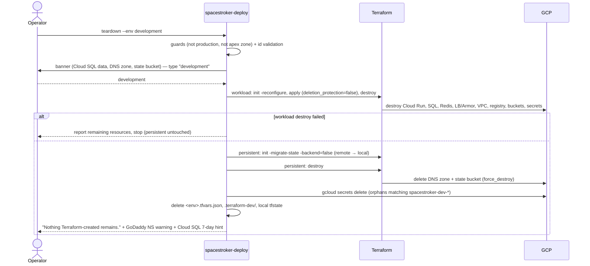
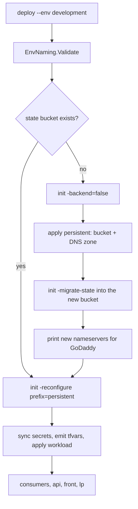

# SpaceStroker — "Terraform development deploy" — Implementation Spec

> **Status: Shipped** — merged via `feature/terraform-development-deploy` on **2026-07-23**
> (`monkify-meta` only). Refined + specced from Trello card
> [Terraform development deploy #85](https://trello.com/c/fHU4Dpis) (2026-07-23).
> Repos affected: **`monkify-meta` only** (`deploy/` + knowledge base). No `monkify-backend`,
> no `monkify-front`, no `monkify-lp` change.
>
> **Post-ship notes — what shipped differs from this spec in two small ways:**
> 1. **§11 verification is executable, not just documented.** The id-cap check landed as a first-class
>    `spacestroker-deploy validate [--env <env>]` command that prints every derived id with PASS/FAIL,
>    and `Validate()` also enforces the GCP **charset** rules (not only lengths). A
>    `gcp.dnsZoneName` **drift warning** (non-fatal) was added on top of the spec.
> 2. **Local cleanup is slightly wider than §7.5 step 8.** `CleanLocalArtifacts()` also removes the
>    **legacy** `production.auto.tfvars.json` and any old shared `.terraform/` dir, since an
>    environment deployed by the previous tool leaves both behind and Terraform would auto-load the
>    former. `secrets.<env>.json` and `*.tfvars` are still never touched.
>
> **Not executed at ship time:** the real GCP round-trip in §13 (tear down the pre-rename dev env →
> deploy fresh → teardown → redeploy) remains an **operator step**. The change is verified by
> `dotnet build`, `terraform validate`/`fmt`, the `validate` command, and dry runs of the teardown
> guards — no `terraform apply`/`destroy` has run against the dev project.
>
> **Purpose:** make a **development** teardown wipe the environment completely — after
> `spacestroker-deploy teardown --env development`, nothing Terraform created remains in GCP; the
> only surviving asset is the **GoDaddy registration of `spacestroker.com`**. Because development
> and production share **one GCP project**, that is only safe once the stack is **environment-scoped**,
> so this spec covers both halves: per-environment naming/state, and the total dev teardown (plus the
> auto re-bootstrap that makes it round-trippable).

---

## 1. Summary

Two changes, in this order — the second depends on the first.

| # | Half | What it does |
| --- | --- | --- |
| **A** | **Environment scoping** | Every project-global GCP id gains an env code derived from `secrets.<env>.json` → `environment` (`development → dev`, `production → prod`), so `spacestroker-dev-*` and `spacestroker-prod-*` can coexist in one project. Per-env Terraform **state bucket**, per-env **Cloud SQL + Memorystore**, per-env **Secret Manager ids**, per-env **Artifact Registry** repo, per-env **tfvars file** and per-env **`TF_DATA_DIR`**. |
| **B** | **Total development teardown** | `teardown --env development` destroys the workload layer **and** the persistent layer (dev Cloud DNS zone + dev state bucket), sweeps orphan Secret Manager containers, cleans locally generated files, and warns about the now-dead GoDaddy NS delegation. `--env production` keeps today's behaviour (workload only). `deploy --env development` afterwards **auto re-bootstraps** the persistent layer. |

### Before / after

| Aspect | Today | After |
| --- | --- | --- |
| Resource names | `spacestroker-api`, `spacestroker-pg`, `spacestroker-urlmap`, SA `spacestroker-api@…` | `spacestroker-dev-api`, `spacestroker-dev-pg`, `spacestroker-dev-urlmap`, SA `spacestroker-dev-api@…` |
| Secret ids | `ConnectionStrings-SpaceStroker` | `spacestroker-dev-ConnectionStrings-SpaceStroker` |
| Artifact Registry | repo `spacestroker` | repo `spacestroker-dev` |
| GCS buckets | `spacestroker-front-<projectId>`, state `spacestroker-tfstate-<projectId>` | `spacestroker-dev-front-<projectId>`, state `spacestroker-tfstate-dev-<projectId>` |
| tfvars written by the tool | `production.auto.tfvars.json` (auto-loaded by Terraform) | `<env>.tfvars.json`, passed **only** via `-var-file` |
| Terraform working dir | shared `.terraform/` | `TF_DATA_DIR=.terraform-<envCode>` per layer |
| `teardown --env development` | workload only; DNS zone + state bucket preserved | **everything** Terraform-created for that env |
| `teardown --env production` | workload only | unchanged |
| `deploy` after a total teardown | fails (no state bucket) — manual bootstrap | auto re-bootstraps, prints new nameservers |

---

## 2. Constraints (MANDATORY)

From `monkify-meta/constraints.md` (full list there):

- **Worktree-per-repo:** work lives in `.worktrees/terraform-development-deploy/monkify-meta`; the
  `monkify-meta` hub stays clean on `main`. Branch `feature/terraform-development-deploy` is pushed to
  `origin` (§2 Git).
- **Secrets — mock only in committed files.** `deploy/secrets.example.json` keeps placeholders;
  `secrets.<env>.json`, `*.tfvars` and `*.tfvars.json` stay git-ignored. The tool must keep pushing
  secret **values** via a temp file / stdin and must never echo a value or write one into Terraform
  state, logs or the emitted tfvars. Secret **ids** may be printed; **values** never.
- **No production queries / no pointing tools at production.** The real `terraform apply` / `destroy`
  is an operator step; this card delivers code + docs only.
- **Backend:** unchanged ⇒ **no `SpaceStroker.Tests` change expected** and **no integration test**
  (`## Level` on the card is **Minor change**; `constraints.md` §3 exempts bug fixes / QOL /
  dev-experience changes from the new-feature integration-test mandate).
- **Knowledge base stays current:** `deploy/README.md`, `features/terraform-gcp-deploy.md` and
  `INDEX.md` must describe env-scoped naming and the two teardown behaviours.
- **Feature-specific:** the teardown must never be able to destroy production's persistent layer, and
  must never destroy a zone that is the registrable apex.

---

## 3. Resolved product decisions

| # | Decision |
| --- | --- |
| 1 | The Terraform stack becomes **environment-scoped** so `development` and `production` can coexist in one GCP project. Both layers, all 9 modules, and the deploy tool are in scope. |
| 2 | `name_prefix = spacestroker-<envCode>`; **`envCode` is derived** from the existing `environment` field (`development → dev`, `production → prod`) — no new hand-maintained field. |
| 3 | The short code is **required**, not cosmetic: `spacestroker-development-consumers` (34) exceeds the service-account `account_id` cap of 30, and `spacestroker-development-vpcconn` (32) exceeds the Serverless VPC connector cap of 25. |
| 4 | **One Cloud SQL + one Memorystore instance per environment** (`spacestroker-dev-pg`, `spacestroker-dev-redis`), so a dev teardown can never reach production data. Accepted cost: a second instance set once production is real. |
| 5 | **One Terraform state bucket per environment**: `spacestroker-tfstate-<envCode>-<projectId>`, prefixes `persistent` / `workload`. Mandatory — a total dev teardown deletes its own state bucket. |
| 6 | The deploy tool **validates every derived id against its GCP cap before invoking Terraform** and aborts with the offending id + limit. |
| 7 | Production is renamed too (`spacestroker-prod-*`). Harmless: production has never been applied (`secrets.production.json` is all placeholders). |
| 8 | Total teardown triggers **automatically on the environment**: `--env development` ⇒ total; `--env production` ⇒ today's workload-only behaviour. |
| 9 | Total teardown order: workload destroy → persistent destroy (DNS zone + state bucket) → orphan-secret sweep → local generated-file cleanup → GoDaddy warning. |
| 10 | **State circularity** is resolved by migrating the persistent layer's state to a **local** backend (`terraform init -migrate-state -backend=false`), destroying zone + bucket with Terraform, then discarding the local state file. |
| 11 | **Orphan Secret Manager sweep:** after the destroy, delete every Secret Manager secret whose id starts with the env's `name_prefix`, plus any id derived from a key in `secrets.<env>.json`. |
| 12 | **Local generated artifacts are cleaned:** `<env>.tfvars.json`, both layers' `TF_DATA_DIR`, and the migrated local state file. **Never** `secrets.<env>.json` or `*.tfvars` (the operator's source of truth). |
| 13 | **Guardrails:** (a) total teardown is hard-blocked when `environment == production`; (b) it refuses any persistent layer whose `dnsDomain` is the registrable apex (`spacestroker.com.`) — only sub-zones such as `dev.spacestroker.com.` may be destroyed. |
| 14 | Confirmation UX unchanged (re-type the environment name); only the banner text grows to name the DNS zone + state bucket. |
| 15 | **GoDaddy is never touched** — no registrar API, no credential. Teardown warns the dev NS delegation is now dead; the next deploy prints the new nameservers. |
| 16 | `deploy --env development` **auto re-bootstraps** the persistent layer when the state bucket / zone is missing, so a total teardown is fully round-trippable without raw Terraform. |
| 17 | The **existing** dev environment migrates by **tear-down-and-redeploy** under the new naming — no `terraform state mv`. The dev DNS zone is recreated, so the GoDaddy NS delegation is re-pointed once. |
| 18 | **Level: Minor change** — deploy tooling only. No new integration test, no new `features/<slug>.md`; existing KB docs are still corrected. |

---

## 4. Environment identity, naming and id caps

There is **no application data model change** — no entity, no EF mapping, no migration. This section
replaces §4 of the template with the environment-identity model, which is the thing the implementer
must get exactly right.

### 4.1 Env code derivation (deploy tool, single source of truth)

New `EnvNaming` static class in `deploy/tools/SpaceStroker.Deploy/`:

```csharp
// development -> dev, production -> prod, staging -> stg; otherwise the first 4 alphanumerics.
public static string ToEnvCode(string environment) => environment.Trim().ToLowerInvariant() switch
{
    "development" => "dev",
    "production"  => "prod",
    "staging"     => "stg",
    var e when e.Length > 0 => new string(e.Where(char.IsLetterOrDigit).Take(4).ToArray()),
    _ => throw new DeployException("secrets.<env>.json: 'environment' is empty."),
};
```

The result must match `^[a-z][a-z0-9]{1,4}$`, else abort. `NamePrefix => $"spacestroker-{EnvCode}"`.

### 4.2 Derived ids (envCode = `dev`, projectId = `project-ecdfb1b6-ed69-4e49-899`, 30 chars)

| Thing | Derived id | Length | Cap | OK |
| --- | --- | --- | --- | --- |
| `name_prefix` | `spacestroker-dev` | 16 | — | — |
| Cloud Run API / Consumers | `spacestroker-dev-api` / `-consumers` | 20 / 26 | 49 | ✓ |
| Service account `account_id` | `spacestroker-dev-api` / `-consumers` | 20 / 26 | **30** | ✓ |
| VPC connector | `spacestroker-dev-vpcconn` | 24 | **25** | ✓ (1 to spare) |
| VPC / subnet / router / NAT / PSA range | `spacestroker-dev-vpc`, `-subnet`, `-router`, `-nat`, `-psa-range` | ≤26 | 63 | ✓ |
| Cloud SQL instance | `spacestroker-dev-pg` (+ optional suffix, §4.4) | 19 | 98 | ✓ |
| Memorystore instance | `spacestroker-dev-redis` | 22 | **40** | ✓ |
| Artifact Registry repo | `spacestroker-dev` | 16 | 63 | ✓ |
| Secret Manager id | `spacestroker-dev-GeneralSettings-LaunchTokens-MainSigningPrivateKeyPem` | 70 | 255 | ✓ |
| Front / lp buckets | `spacestroker-dev-front-<projectId>` | 53 | **63** | ✓ |
| State bucket | `spacestroker-tfstate-dev-<projectId>` | 55 | **63** | ✓ |
| Edge (armor/urlmap/cert/lb-ip/fr/neg/backend) | `spacestroker-dev-<suffix>` | ≤29 | 63 | ✓ |
| DNS zone | `spacestroker-dev-zone` | 21 | 63 | ✓ |

> The **VPC connector has only 1 character of headroom** at `dev`. A longer env code (e.g. `stg2`)
> would break it — which is exactly why §4.3 validation is mandatory rather than advisory.

### 4.3 Fail-fast validation (runs before every `apply` / `destroy`)

`EnvNaming.Validate(SecretsFile)` builds every derived id and checks it against a table of caps
(service account 30, VPC connector 25, GCS bucket 63, Memorystore 40, Cloud Run 49, Artifact Registry
63, Cloud SQL 98, DNS zone 63, Secret Manager 255) plus the GCS/GCP charset rules (lowercase
alphanumerics + hyphen, must start with a letter). On the first violation it throws a
`DeployException` naming the id, its length and its limit. Exposed as a standalone command:

```
spacestroker-deploy validate --env development     # prints every derived id + PASS/FAIL, exit 1 on any failure
```

### 4.4 Code-exploration finding — Cloud SQL instance names cannot be reused immediately

Google does **not** free a deleted Cloud SQL instance name for up to **7 days**. A total dev teardown
followed by a same-week redeploy would therefore fail on `spacestroker-dev-pg` already existing.

**Resolution:** add an optional `gcp.dbInstanceSuffix` (string, default empty) to
`secrets.<env>.json`, emitted as the Terraform variable `db_instance_suffix`; the Cloud SQL instance
becomes `${var.name_prefix}-pg${var.db_instance_suffix == "" ? "" : "-${var.db_instance_suffix}"}`.
Teardown prints, as its final instruction:

> `Cloud SQL instance names are reserved for ~7 days. To redeploy sooner, bump gcp.dbInstanceSuffix in secrets.development.json (e.g. "2").`

Deploy surfaces the same hint when the create fails with an "instance already exists" error.

---

## 5. Configuration

### 5.1 `secrets.<env>.json` (git-ignored; `secrets.example.json` is the tracked placeholder)

| Field | Change |
| --- | --- |
| `environment` | **now load-bearing** — drives `envCode`, every derived id, the state bucket and the teardown mode. Validation: non-empty, resolves to a valid env code. |
| `gcp.stateBucket` | **Derived, no longer authored.** The tool computes `spacestroker-tfstate-<envCode>-<projectId>`. If the field is present and differs, abort with a message telling the operator to remove it. Dropped from `secrets.example.json`. |
| `gcp.dnsZoneName` | Convention `spacestroker-<envCode>-zone`; the tool warns (not aborts) when it doesn't match. |
| `gcp.dnsDomain` | Unchanged. Used by guardrail 13(b) — must not equal the registrable apex for a total teardown. |
| `gcp.dbInstanceSuffix` | **New, optional** (§4.4). |

### 5.2 Terraform variables emitted by the tool

Written to **`<env>.tfvars.json`** (see §7.3 — the `.auto.` name is deliberately dropped) and passed
with `-var-file`. New/changed keys:

| Var | Value |
| --- | --- |
| `name_prefix` | `spacestroker-<envCode>` — **now always emitted** (was left at its default) |
| `front_bucket_name` / `lp_bucket_name` | `spacestroker-<envCode>-front-<projectId>` / `-lp-<projectId>` |
| `db_instance_suffix` | from `gcp.dbInstanceSuffix` (default `""`) |
| `labels` | `{ app = "spacestroker", environment = <environment>, managed_by = "terraform" }` so every resource is filterable by env in the console |

### 5.3 Persistent-layer tfvars (`development.tfvars`, `production.tfvars.example`)

| Var | Development | Production |
| --- | --- | --- |
| `dns_zone_name` | `spacestroker-dev-zone` | `spacestroker-prod-zone` |
| `dns_domain` | `dev.spacestroker.com.` | `spacestroker.com.` |
| `state_bucket_name` | `spacestroker-tfstate-dev-<projectId>` | `spacestroker-tfstate-prod-<projectId>` |
| `protect_persistent` | **`false`** (new) | **`true`** (new) |

---

## 6. Terraform changes

### 6.1 Persistent layer — destructible for non-production

`lifecycle.prevent_destroy` **must be a literal** — Terraform rejects a variable there. So a single
resource cannot be conditionally protected. Use **mutually exclusive resource pairs** keyed on the new
`var.protect_persistent` (bool, no default — must be set explicitly):

```hcl
# terraform/persistent/main.tf

resource "google_storage_bucket" "tf_state_protected" {
  count         = var.protect_persistent ? 1 : 0
  name          = var.state_bucket_name
  # …identical body…
  force_destroy = false
  lifecycle { prevent_destroy = true }
}

resource "google_storage_bucket" "tf_state_ephemeral" {
  count         = var.protect_persistent ? 0 : 1
  name          = var.state_bucket_name
  # …identical body…
  force_destroy = true          # required: the bucket still holds this layer's migrated-away state objects
}
```

The same pair pattern for `google_dns_managed_zone` (`primary_protected` / `primary_ephemeral`;
the ephemeral one also sets `force_destroy = true` so leftover record sets don't block the destroy).
`outputs.tf` coalesces:

```hcl
output "dns_zone_name"    { value = one(concat(google_dns_managed_zone.primary_protected[*].name, google_dns_managed_zone.primary_ephemeral[*].name)) }
output "dns_name_servers" { value = one(concat(google_dns_managed_zone.primary_protected[*].name_servers, google_dns_managed_zone.primary_ephemeral[*].name_servers)) }
output "state_bucket"     { value = one(concat(google_storage_bucket.tf_state_protected[*].name, google_storage_bucket.tf_state_ephemeral[*].name)) }
```

Header comment updated: the layer survives teardown **only when `protect_persistent = true`**.

### 6.2 Workload root (`terraform/workload/main.tf`)

- `local.secret_ids` becomes prefixed:

  ```hcl
  base_secret_ids = ["ConnectionStrings-SpaceStroker", "ConnectionStrings-Messaging", "ConnectionStrings-Redis",
                     "GeneralSettings-Token-TokenOwnerPrivateKey", "GeneralSettings-LaunchTokens-MainSigningPrivateKeyPem",
                     "GeneralSettings-SecretProtection-Key", "GeneralSettings-Fx-ApiKey"]
  secret_ids      = toset([for id in local.base_secret_ids : "${local.name_prefix}-${id}"])
  secret_env      = { for env_name, id in local.base_secret_env : env_name => "${local.name_prefix}-${id}" }
  ```

  (Keep the existing `ConnectionStrings__SpaceStroker → ConnectionStrings-SpaceStroker` map as
  `base_secret_env`; only the values gain the prefix. The **env var names stay unprefixed** — the app
  config keys must not change.)
- `module "registry"` now receives `repository_id = local.name_prefix` (it currently takes no
  `name_prefix` and falls back to the default `spacestroker`).
- `module "data"` receives the new `db_instance_suffix`.
- `local.plain_env` keeps `ASPNETCORE_ENVIRONMENT = "Production"` as its default — the dev
  environment still runs the **Production** ASP.NET environment in Cloud Run; `secrets.development.json`
  → `appConfig` overrides it if the operator wants otherwise. Documented explicitly so nobody
  "fixes" it.

### 6.3 Workload modules

| Module | Change |
| --- | --- |
| `registry` | Nothing structural — it already takes `repository_id`; the root now passes it. Labels gain `environment`. |
| `data` | New `variable "db_instance_suffix" { type = string, default = "" }`; instance name becomes `"${var.name_prefix}-pg${var.db_instance_suffix == "" ? "" : "-${var.db_instance_suffix}"}"`. Database names (`spacestroker`, `spacestroker_messaging`) and the DB user stay unchanged — the instance is per-env, so no collision. |
| `network`, `iam`, `cloud_run_api`, `cloud_run_consumers`, `edge`, `static_site`, `secrets` | **No structural change** — they already derive every name from `var.name_prefix` / passed ids. They inherit env scoping for free once the root emits `name_prefix`. Verify by `terraform plan` diff, don't edit blindly. |

### 6.4 Backends

Both `versions.tf` files keep `backend "gcs" {}` with the bucket/prefix supplied by `-backend-config`
at init. The comments are updated to name the **per-env** bucket. Because the backend config now
differs per environment, every `init` in the tool passes **`-reconfigure`** and sets
**`TF_DATA_DIR=.terraform-<envCode>`**, so two environments never share or clobber a working
directory. `deploy/.gitignore` gains `.terraform-*/` and `*.tfvars.json`.

---

## 7. Deploy tool changes (`deploy/tools/SpaceStroker.Deploy/`)

### 7.1 New file — `EnvNaming.cs`

Owns `EnvCode`, `NamePrefix`, `StateBucket`, `FrontBucket`, `LpBucket`, `RegistryRepo`, `SecretId(key)`,
`CloudRunService(role)`, `UrlMapName`, `TfDataDir`, `TfVarsFileName`, and `Validate()` (§4.3). Every
other class asks `EnvNaming` for a name — no string is built twice.

### 7.2 `ProcessRunner.cs` — add output capture

`Run`/`RunOrThrow` currently set `RedirectStandardOutput = false`, so the tool cannot read command
output. The re-bootstrap (`terraform output -json dns_name_servers`), the bucket-existence probe and
the secret sweep all need it. Add:

```csharp
public static (int ExitCode, string Stdout) Capture(string file, string args, string? workingDir = null, IDictionary<string,string>? env = null);
```

Streaming behaviour of the existing methods is unchanged; `Capture` is used only where output is
consumed. Both paths gain an optional environment-variable dictionary so `TF_DATA_DIR` can be set per
invocation.

### 7.3 `Deployer.cs`

| Member | Change |
| --- | --- |
| `EmitTfvars` | Writes `<env>.tfvars.json` (not `production.auto.tfvars.json`). **Reason (finding):** `*.auto.tfvars.json` is auto-loaded by Terraform for *every* run in that directory — with two environments both files would load and the last one alphabetically would silently win. The tool already passes `-var-file` explicitly, so the `.auto.` name is not just redundant, it is a cross-env contamination bug. Also emits `name_prefix`, the env-scoped bucket names, `db_instance_suffix` and the `environment` label. |
| `TerraformInit` | Takes the layer + backend prefix; always `-reconfigure`; passes `TF_DATA_DIR`; bucket from `EnvNaming.StateBucket`. |
| `SyncSecrets` | Secret ids become `EnvNaming.SecretId(key)` (prefixed). Values still via temp file; still never printed. |
| `BuildAndPushImage` / `UpdateCloudRun` | Registry path `…/{projectId}/{EnvNaming.RegistryRepo}/{image}:latest`; service names from `EnvNaming.CloudRunService`. |
| `BucketName` | Delegates to `EnvNaming`. |
| `UploadAndInvalidate` | URL map name from `EnvNaming.UrlMapName`. |
| `DeployAll` / `DeployComponent` | Call `EnvNaming.Validate` then `EnsurePersistentLayer()` (§7.4) before anything else. |
| `Teardown` | Split into `TeardownWorkload()` (today's behaviour) and `TeardownTotal()` (§7.5); dispatch on `IsTotalTeardownEnvironment`. |

### 7.4 `EnsurePersistentLayer()` — auto re-bootstrap

```
1. Probe the state bucket:  gcloud storage buckets describe gs://<stateBucket>   (Capture, non-throwing)
2. If it exists → terraform init (-reconfigure, prefix=persistent) and return.
3. If it is missing → BOOTSTRAP:
   a. terraform init -backend=false                        (TF_DATA_DIR set)
   b. terraform apply -auto-approve -var-file=<env>.tfvars  → creates bucket + DNS zone
   c. terraform init -migrate-state -force-copy \
        -backend-config="bucket=<stateBucket>" -backend-config="prefix=persistent"
   d. Capture `terraform output -json dns_name_servers` and PRINT:
      "Set these nameservers at GoDaddy for <dnsDomain> (managed TLS will not validate until you do): …"
4. Abort with a clear message if <env>.tfvars is missing from terraform/persistent/.
```

The bootstrap is idempotent: an interrupted run re-probes and resumes.

### 7.5 `TeardownTotal()` — the development path

```
 1. GUARD  environment == "production"            -> abort ("total teardown is blocked for production")
 2. GUARD  dnsDomain is the registrable apex      -> abort ("refusing to destroy the apex zone <domain>; only sub-zones may be destroyed")
 3. EnvNaming.Validate()
 4. Banner + confirmation (type the environment name). Banner now lists: Cloud SQL AND ALL ITS DATA,
    the Cloud DNS zone <dnsDomain>, and the Terraform state bucket <stateBucket>.
 5. WORKLOAD:  EmitTfvars(deletionProtectionOverride: false)
               init(workload, -reconfigure) ; apply ; destroy
               -> on failure: report what remains, DO NOT continue to step 6, exit non-zero
 6. PERSISTENT: init -migrate-state -force-copy -backend=false   (remote -> local)
                terraform destroy -auto-approve -var-file=<env>.tfvars     (zone + bucket)
                -> "state/bucket already absent" is treated as already-torn-down, not an error
 7. SECRET SWEEP: gcloud secrets list --project=<p> --format="value(name)" --filter="name~^<namePrefix>-"
                  + every EnvNaming.SecretId(key) for keys in secrets.<env>.json
                  -> gcloud secrets delete <id> --quiet   (ids printed, values never touched)
 8. LOCAL CLEANUP: delete <env>.tfvars.json, .terraform-<envCode>/ in both layers, and the local
                   terraform.tfstate(+backup) left by step 6.
                   NEVER delete secrets.<env>.json or *.tfvars.
 9. PRINT: the GoDaddy warning (dead NS delegation for <dnsDomain> should be removed) and the
           Cloud SQL 7-day name-reservation hint (§4.4).
```

**Apex detection (guard 2)** is deliberately simple and conservative: strip the trailing dot and count
labels; a zone with **two or fewer labels** (`spacestroker.com`) is treated as the apex and refused.
Anything deeper (`dev.spacestroker.com`) is allowed. No public-suffix list, no network call.

Idempotency: every destructive external call tolerates "not found" (`Run`, not `RunOrThrow`, with the
exit code inspected), so re-running teardown after a partial failure completes rather than crashing.

### 7.6 `Program.cs`

- New command `validate` (§4.3).
- `teardown` help text distinguishes the two behaviours.
- Usage banner documents `--env development` ⇒ total teardown.

---

## 8. Flow diagrams

### 8.1 Total development teardown



### 8.2 Deploy after a total teardown



---

## 9. Out of scope

- **Non-Terraform GCP leftovers:** enabled GCP APIs (`google_project_service` is deliberately absent —
  API enablement stays out-of-band), Cloud Logging buckets/sinks/retained logs, hand-made IAM grants,
  billing/budget config. The requirement is "nothing **Terraform** created", plus the orphan-secret sweep.
- **GoDaddy automation** — no registrar API, no stored credential; NS changes stay a printed manual step.
- Any **`monkify-backend` / `monkify-front` / `monkify-lp`** change.
- **Running the real `apply` / `destroy` against GCP** — an operator step.
- Terraform **workspaces**, multi-region, CI/CD automation, staging/QA environments beyond making the
  scheme env-generic, and cost optimisation of the second data-tier instance set.
- Production's own persistent bootstrap / first real production deploy.
- Migrating existing dev resources in place (`terraform state mv`) — decision 17 replaces it.

---

## 10. File checklist

### 10.1 Backend (`monkify-backend`)

**None.** No file changes.

### 10.2 Frontend (`monkify-front`, `monkify-lp`)

**None.** No file changes. The dev SPA build keeps reading `frontBuild` from `secrets.development.json`
via the existing `.env.production.local` mechanism.

### 10.3 Meta (`monkify-meta`)

| # | File | Change |
| --- | --- | --- |
| 1 | `deploy/terraform/persistent/main.tf` | Protected/ephemeral resource pairs for the state bucket + DNS zone keyed on `var.protect_persistent`; `force_destroy = true` on the ephemeral variants; header comment updated |
| 2 | `deploy/terraform/persistent/variables.tf` | New `protect_persistent` (bool, no default) |
| 3 | `deploy/terraform/persistent/outputs.tf` | Coalesce the three outputs across the resource pairs |
| 4 | `deploy/terraform/persistent/versions.tf` | Backend comment: per-env bucket + `TF_DATA_DIR` |
| 5 | `deploy/terraform/persistent/production.tfvars.example` | `protect_persistent = true`, `spacestroker-prod-zone`, `spacestroker-tfstate-prod-<projectId>` |
| 6 | `deploy/terraform/persistent/development.tfvars` *(git-ignored, local)* | `protect_persistent = false`, `state_bucket_name = spacestroker-tfstate-dev-…`; bootstrap comment updated |
| 7 | `deploy/terraform/workload/main.tf` | Prefixed `secret_ids` / `secret_env` values; `repository_id` passed to `registry`; `db_instance_suffix` passed to `data`; comment on `ASPNETCORE_ENVIRONMENT` |
| 8 | `deploy/terraform/workload/variables.tf` | New `db_instance_suffix`; doc-comment on `name_prefix` (now always supplied, env-scoped) |
| 9 | `deploy/terraform/workload/modules/data/main.tf` + `variables.tf` | `db_instance_suffix` in the instance name |
| 10 | `deploy/terraform/workload/modules/registry/variables.tf` | Drop the `spacestroker` default (now always supplied) |
| 11 | `deploy/terraform/workload/production.tfvars.example` | Rename/retitle to show `name_prefix` + env-scoped bucket names |
| 12 | `deploy/tools/SpaceStroker.Deploy/EnvNaming.cs` | **New** — env code, all derived ids, cap validation |
| 13 | `deploy/tools/SpaceStroker.Deploy/Deployer.cs` | Env-scoped names everywhere; `<env>.tfvars.json`; `TF_DATA_DIR` + `-reconfigure`; `EnsurePersistentLayer`; `TeardownWorkload` / `TeardownTotal` |
| 14 | `deploy/tools/SpaceStroker.Deploy/ProcessRunner.cs` | `Capture(...)` + per-invocation env vars |
| 15 | `deploy/tools/SpaceStroker.Deploy/SecretsFile.cs` | Validate `environment`; derive `StateBucket`; reject an authored `gcp.stateBucket`; new optional `gcp.dbInstanceSuffix` |
| 16 | `deploy/tools/SpaceStroker.Deploy/Program.cs` | `validate` command; updated usage/help |
| 17 | `deploy/secrets.example.json` | Drop `stateBucket`; add `dbInstanceSuffix`; comment that `environment` is load-bearing (placeholders only) |
| 18 | `deploy/.gitignore` | Add `.terraform-*/` and `*.tfvars.json` |
| 19 | `deploy/README.md` | Env-scoping section, the two teardown behaviours, the re-bootstrap, the GoDaddy NS step, the Cloud SQL 7-day caveat, the `validate` command |
| 20 | `features/terraform-gcp-deploy.md` | Update "Two-layer split" + topology to describe env-scoped naming and the development total teardown |
| 21 | `INDEX.md` | Spec row + "Feature currently in flight" |
| 22 | `specs/terraform-development-deploy.md` | **This spec** |

---

## 11. Tests

**No `SpaceStroker.Tests` / `SpaceStroker.Tests.Integration` change** — this card touches no backend
code and no game flow (`## Level` = Minor change; `constraints.md` §3). The deploy tools have no test
project and none is added; verification is executable instead:

| Check | Command | Expected |
| --- | --- | --- |
| Terraform formatting | `terraform fmt -check -recursive deploy/terraform` | clean |
| Persistent layer valid (dev + prod) | `terraform validate` in `deploy/terraform/persistent` for each tfvars | clean |
| Workload layer valid | `terraform validate` in `deploy/terraform/workload` | clean |
| Tool builds | `dotnet build deploy/tools/SpaceStroker.DeployTools.sln` | 0 warnings-as-errors, 0 errors |
| Derived ids | `spacestroker-deploy validate --env development` | prints every id with PASS; exit 0 |
| Cap enforcement | `spacestroker-deploy validate` against a temp secrets file with `environment: "integration"` (envCode `inte` → `spacestroker-inte-vpcconn` = 25 ✓, but `environment: "preproduction"` → `prep` … use a 5+ char code) | exits 1 naming the id + limit |
| No secret leakage | `git grep -nE "(PrivateKey|ApiKey|Password)\s*[:=]\s*\"[^\"]{12,}" -- deploy` (excluding `secrets.example.json` placeholders) | no hits |

---

## 12. Acceptance criteria

Mirrors the Trello **Acceptance Criteria** checklist 1:1.

1. Given a `secrets.<env>.json` with `environment: "development"`, when the deploy tool emits Terraform vars, then every project-global resource id is prefixed `spacestroker-dev-` (Cloud Run, service accounts, VPC/subnet/connector/router/NAT/PSA range, Cloud SQL, Memorystore, Artifact Registry, Secret Manager ids, GCS buckets, LB/Armor/cert/IP, DNS zone) and `production` yields `spacestroker-prod-` instead.
2. Given the development and production secrets files both point at the same GCP project, when both environments are planned, then no two resources share an id and no two states share a bucket/prefix — each env uses `spacestroker-tfstate-<envCode>-<projectId>` with prefixes `persistent`/`workload`.
3. Given an environment whose derived ids would exceed a GCP cap (service account 30, VPC connector 25, GCS bucket 63, Memorystore 40, Cloud Run 49), when any deploy or teardown command runs, then the tool aborts before invoking Terraform and names the offending id and its limit.
4. Given `teardown --env development` is confirmed, when it completes successfully, then the workload layer is destroyed (Cloud Run, Cloud SQL and all its data, Memorystore, LB/Armor/certs/IP, VPC+NAT+connector, Artifact Registry and its images, GCS site buckets, Secret Manager containers) AND the persistent layer is destroyed (the `dev.spacestroker.com` Cloud DNS zone and the dev state bucket).
5. Given a completed development teardown, when the GCP project is inspected, then no resource created by Terraform for that environment remains — the only surviving DNS asset is the GoDaddy registration of `spacestroker.com` itself.
6. Given the persistent state lives in the very bucket being destroyed, when the development teardown runs, then it migrates that state to a local backend first, destroys zone + bucket via Terraform, and discards the local state file — leaving no orphaned state object.
7. Given a Secret Manager secret exists whose id matches a key in `secrets.development.json` but is not managed by Terraform, when the development teardown finishes, then that secret is deleted too and the deletion is reported (secret values are never printed).
8. Given a development teardown completes, when the local `deploy/` folder is inspected, then `production.auto.tfvars.json`, both layers' `.terraform/` dirs and the migrated local state file are gone, while `secrets.development.json` and `terraform/persistent/development.tfvars` are untouched.
9. Given `teardown --env production`, when it runs, then it destroys the workload layer only and preserves the DNS zone + state bucket exactly as today — the total-teardown path is unreachable for production.
10. Given a non-production secrets file whose `dnsDomain` is the registrable apex `spacestroker.com.`, when a total teardown is attempted, then it aborts before destroying anything and explains that only sub-zones may be destroyed.
11. Given the teardown confirmation prompt, when a development teardown is requested, then the banner states that the DNS zone and the Terraform state bucket are destroyed in addition to all Cloud SQL data, and typing anything other than the environment name aborts with nothing destroyed.
12. Given the dev DNS zone has just been destroyed, when the teardown finishes, then it warns that the `dev` NS delegation records at GoDaddy now point at a dead zone and must be removed manually — and the tool makes no call to any registrar API.
13. Given a development environment that was totally torn down, when `deploy --env development` is run, then the tool detects the missing state bucket/zone, re-bootstraps the persistent layer itself (local state → apply → migrate into the new bucket), prints the new nameservers to set at GoDaddy, and proceeds with the workload deploy — no raw Terraform commands required from the operator.
14. Given the workload destroy fails partway, when the teardown handles that failure, then the persistent destroy does not run, the tool reports what still exists, and re-running teardown resumes safely without erroring on already-deleted resources.
15. Given the finished change, when `terraform fmt -check` + `terraform validate` are run on both layers for both environments and `dotnet build` on `deploy/tools/SpaceStroker.DeployTools.sln`, then all are clean, and no committed file contains a real secret value.
16. Given the change ships, when the knowledge base is read, then `deploy/README.md`, `features/terraform-gcp-deploy.md` and `INDEX.md` describe the env-scoped naming, the per-env state buckets and the two distinct teardown behaviours (development = total, production = keeps the domain), including the one-off migration of the existing dev environment.

---

## 13. Manual QA (operator, against the real dev project)

The code lands without a real `apply`; this is the round-trip the operator runs to sign it off.

1. `spacestroker-deploy validate --env development` → every derived id PASSes.
2. **Tear down the pre-rename environment** with the current tool (`teardown --env development`,
   workload-only) so the old un-scoped resources go away; then delete the old
   `spacestroker-tfstate-<projectId>` bucket and `spacestroker-*-zone` by hand (one-off, decision 17).
3. `spacestroker-deploy deploy --env development` → observe the **auto re-bootstrap**, note the printed
   nameservers, set them at GoDaddy for `dev.spacestroker.com`, wait for the managed cert.
4. Confirm the app answers on `app.dev.spacestroker.com` and `api.dev.spacestroker.com/health`.
5. In the GCP console, filter by label `environment=development` → every resource is `spacestroker-dev-*`.
6. `spacestroker-deploy teardown --env development`, type `development`.
7. Verify: no Cloud Run services, no Cloud SQL instance, no Memorystore, no LB/Armor, no VPC/connector,
   no Artifact Registry repo, no GCS buckets (sites **and** state), no `spacestroker-dev-*` secrets, no
   Cloud DNS zone. Only the GoDaddy registration remains.
8. `spacestroker-deploy deploy --env development` again (bump `gcp.dbInstanceSuffix` if within 7 days)
   → full round-trip succeeds.
9. `spacestroker-deploy teardown --env production` → refuses to touch the persistent layer.

---

## 14. Trello / pipeline

- **Source card:** [Terraform development deploy #85](https://trello.com/c/fHU4Dpis) — list **Specs created**;
  the **Implementation** section on the card carries branch, spec path, worktree and Level.
- **Branch / worktree:** `feature/terraform-development-deploy` in `monkify-meta`, worktree
  `.worktrees/terraform-development-deploy/monkify-meta`.
- **Next:** `/monkify-implement-feature Terraform development deploy`, then
  `/monkify-ship-feature Terraform development deploy`.
- **Level: Minor change** ⇒ no happy-path integration test, no new `features/<slug>.md`;
  `features/terraform-gcp-deploy.md` + `deploy/README.md` are updated instead.

---

## 15. Revision log

| Date | Change |
| --- | --- |
| 2026-07-23 | Initial spec from refined card #85 (+ in-chat refinement). Adds the env-scoping half after discovering dev and prod share one GCP project; documents three code-exploration findings: `prevent_destroy` cannot be variable-driven (§6.1), `*.auto.tfvars.json` cross-env contamination (§7.3), Cloud SQL 7-day name reservation (§4.4), plus `ProcessRunner` having no output capture (§7.2). |
| 2026-07-23 | **Shipped** (`feature/terraform-development-deploy` → `main`, `monkify-meta`). Status banner + post-ship notes added: `validate` became a real command with charset checks and a zone-name drift warning; local cleanup also removes the legacy `production.auto.tfvars.json` and shared `.terraform/`. The §13 GCP round-trip is still an operator step. |
