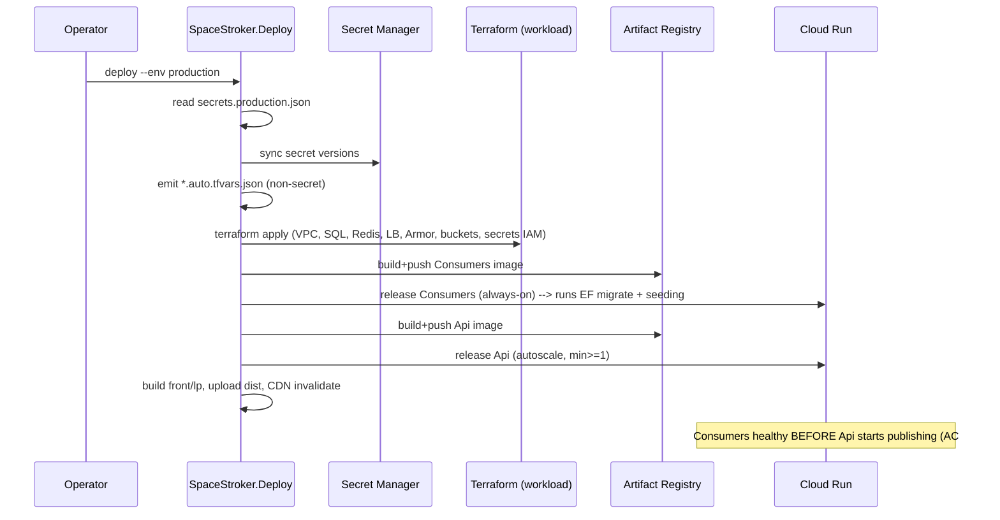

# SpaceStroker — "Create Terraform to deploy the app (GCP)" — Implementation Spec

> **Status: Shipped** — merged via `feature/terraform-gcp-deploy` on 2026-07-17. Distilled summary:
> `../features/terraform-gcp-deploy.md`. Refined via Trello card
> [Create terraform to deploy the app](https://trello.com/c/QrjmQttY) (2026-07-16).
> **Post-ship note:** the API already exposed `/health` via `HomeController` (only Consumers gained one);
> the committed CORS default + Main-operator seed URLs are `app.spacestroker.com` (retired `monkify.net`). The
> real `terraform apply` is an ops step (needs a registered domain + real Solana/Fx secrets).
> Repos affected: `monkify-meta` (Terraform + both C# console apps + secrets template/docs — **primary**),
> `monkify-backend` (Cloud Run readiness — health probes, forwarded headers, deploy ordering; **no game
> behaviour change**), `monkify-front` (production static-build config for GCS/CDN). `monkify-lp` is
> **built and deployed by the tool** but has **no repo change** (see §10.3).
>
> **Blocked by #64** — [Replace RabbitMQ with MassTransit Postgres SQL transport](https://trello.com/c/nPCH4e5R)
> (spec `specs/masstransit-postgres-transport.md`, **Specs created**). This spec assumes #64's outcome:
> **no broker**, events on the MassTransit **Postgres SQL transport**, game DB `spacestroker` + messaging DB
> `spacestroker_messaging` on **one** Cloud SQL instance, new secret `ConnectionStrings:Messaging`, and the
> game-DB user holding **CREATE DATABASE**. Implement/ship **after or in lockstep with #64**.
>
> **Purpose:** Stand up a secure, production **GCP** deployment of all of SpaceStroker as Infrastructure-as-Code,
> plus two local **C# console tools** (deploy + DB access), driven by a single **unversioned local secrets
> file**. The app moves crypto and will be actively attacked, so hardening (WAF, private data tier,
> least-privilege, admin surfaces off the public edge) is a first-class requirement.

---

## 1. Summary

Three deliverables, all authored in `monkify-meta` (except the operator's local secrets file, which is
never committed):

| # | Deliverable | What it does |
| --- | --- | --- |
| 1 | **Terraform project** | Provisions the full GCP stack. Split into a **persistent layer** (Cloud DNS zone + domain + remote-state bucket, `prevent_destroy`) and a **workload layer** (everything else). Production-only now, structured as a reusable module + per-env tfvars. Remote state in a versioned+locked GCS bucket. |
| 2 | **Deploy console app (C#)** | `deploy [api\|consumers\|front\|lp]` builds/releases each component independently; `teardown` destroys the workload layer only. Reads the local `secrets.<env>.json`, syncs secrets → Secret Manager, feeds Terraform vars + the static build config, and runs `terraform apply`/`destroy`. |
| 3 | **DB query console app (C#)** | Interactive **read-write** REPL against **both** databases (game `spacestroker` + messaging `spacestroker_messaging`) via the **Cloud SQL Auth Proxy + IAM**, with a typed confirmation prompt before any write. |

### 1.1 Target topology

```
                       Cloud DNS (persistent layer)  ─┐  Google-managed TLS certs
                                                       │
Internet ──► External HTTPS LB ──► Cloud Armor (WAF + per-IP rate limit)
                 │
                 ├─ /  , /space-stroker/*  (host app.spacestroker.com) ──► GCS bucket + Cloud CDN  (front, static)
                 ├─ /            (host spacestroker.com / www)     ──► GCS bucket + Cloud CDN  (lp, static)
                 └─ api.*        (host api.spacestroker.com)       ──► Cloud Run: SpaceStroker.Api (autoscale, min≥1)

   SpaceStroker.Consumers (Cloud Run, CPU always-on, count = var.consumer_count default 1)
        └─ NOT on the public LB (hosts /hangfire + owns migrations/seeding) — internal ingress / IAP

   Private tier (VPC, no public IPs, egress via Cloud NAT):
        Cloud SQL Postgres 16  (one instance: DB spacestroker + DB spacestroker_messaging)
        Memorystore Redis 7
   Cloud Run ──(Serverless VPC Access connector)──► private tier
   Artifact Registry: SpaceStroker.Api + SpaceStroker.Consumers images
   Secret Manager: all app secrets (synced from secrets.<env>.json by the deploy tool)
```

The current front `nginx.conf` header `Content-Security-Policy: frame-ancestors *` moves to an **LB
response-header policy** (no nginx in the static path — see §10.2).

---

## 2. Constraints (MANDATORY)

From `monkify-meta/constraints.md` (full list there):

- **Worktree-per-repo:** work lives in `.worktrees/terraform-gcp-deploy/<repo>`; each shared checkout stays
  on `main`. Branch `feature/terraform-gcp-deploy` in each affected repo (the merge/PR ref), pushed to `origin`.
- **Secrets/config — MOCK values only in committed files.** Every value written into any file in the repos
  is a placeholder (`MOCK_VALUE`, `your-project-id`, `Password=postgres`, …). Real credentials live **only**
  in the operator's local unversioned `secrets.<env>.json` and in **Secret Manager** — never printed,
  echoed, or committed. Terraform state (which can contain secrets) lives in the **private GCS state
  bucket**, never in the repo; secret material is passed to Cloud Run via Secret Manager references, not
  via committed tfvars or plaintext service env.
- **`.gitignore`** in `monkify-meta` must exclude `secrets*.json`, `*.tfvars` (except `*.example`),
  `*.tfstate*`, `.terraform/`, and the C# `bin/`/`obj/` output.
- **Unit tests (backend):** the backend changes here (health endpoints, forwarded headers) are small; add
  focused unit tests in `SpaceStroker.Tests` and **report changed tests** at the end of implementation.
- **EF/migrations:** unchanged — **migrations are applied only by `SpaceStroker.Consumers`** at startup. The
  deploy tool must therefore **release Consumers before Api** (AC #8). No EF entity/migration in this card.
- **Operator messaging:** unchanged — vague errors only; nothing here changes user-facing operator copy.
- **This is infra/deploy tooling, not a new game feature** → **no new backend integration test is required**
  by the "integration test mandatory" rule (that rule scopes to game features). The game happy path is
  already covered by the existing `SpaceStroker.Tests.Integration` suite (which #64 keeps green over the Postgres
  transport). See §14.

---

## 3. Resolved product decisions

| # | Decision |
| --- | --- |
| 1 | **API → Cloud Run**, autoscaling, `min_instances ≥ 1` (no cold starts), configurable `max`. Public via the LB. |
| 2 | **Consumers → Cloud Run**, **CPU always-on** (`cpu_idle = false`), instance count pinned to `var.consumer_count` (**default 1**, set manually), **never scales to zero** (runs the game loop, Hangfire, migrations/seeding). **Not on the public LB** (internal ingress / IAP). |
| 3 | **front + lp → GCS bucket + Cloud CDN** behind the LB (static hosting; **no containers**, neither has a needed Dockerfile in the static path). |
| 4 | **Container images (API + Consumers) → Artifact Registry.** |
| 5 | **Postgres → Cloud SQL for PostgreSQL 16**, **one instance, two databases**: game `spacestroker` + messaging `spacestroker_messaging` (messaging owned by #64). **Private IP only.** The app user has **CREATE DATABASE** (per #64) so MassTransit provisions `spacestroker_messaging` at Consumers startup. |
| 6 | **Redis → Memorystore for Redis 7**, private IP only. |
| 7 | **No message broker** — RabbitMQ dropped (#64); events ride the MassTransit **Postgres SQL transport**. |
| 8 | **Secrets:** local `secrets.<env>.json` is the source of truth. The **deploy tool** syncs each secret into **Secret Manager**; Cloud Run reads them via **IAM at boot** (secret **references**, not values, in Terraform/service config). The same file also feeds Terraform vars + build-time front/lp config. |
| 9 | **Security posture:** one external **HTTPS LB** → **Cloud Armor** (managed/OWASP rules + per-IP rate limiting, complementing the app's in-process `IpRateLimiting`) → api / app / lp. Private-only data tier (VPC, no public IPs, Cloud NAT egress, Serverless VPC Access connector). Admin surfaces (`/hangfire`, management endpoints) **not** on the public LB (internal-only / IAP). **Least-privilege SA per component.** |
| 10 | **Domains/DNS/TLS:** new domains swapping `monkify → spacestroker` — **`.com` preferred, `.net` fallback**. Hosts as **Terraform variables** (nothing hard-coded): `api.spacestroker.com` (API), `app.spacestroker.com` (front), `spacestroker.com`/`www` (lp). Terraform manages the **Cloud DNS** zone + **Google-managed TLS certs**. Domain **registration is an out-of-band prerequisite**. |
| 11 | **Project/state/region:** **existing GCP project** (id via tfvars/secrets). Remote state in a **versioned + locked GCS bucket**. Region default **`us-central1`**. Production-only now, structured (module + per-env tfvars) for more envs later. State-bucket chicken-and-egg documented. |
| 12 | **Teardown ("drop everything, keep the domain"):** Terraform split into a **persistent layer** (DNS zone + domain + state bucket, `prevent_destroy`; teardown never touches it) and a **workload layer** (everything else). `teardown` runs `terraform destroy` on the **workload layer only**, requires a **typed confirmation** (re-type the environment name), warns about **irreversible Cloud SQL data loss**, and deliberately overrides Cloud SQL **deletion-protection**. Re-running `deploy` recreates the workload and **re-attaches** to the preserved domain/DNS + managed certs. |
| 13 | **Deploys are manual** via the console app — **no CI/CD** in scope (structure it callable for CI later). |
| 14 | **Consumers at >1 instance is an APP concern, not solved here** — duplicate Hangfire recurring jobs, a startup EF-migration race, and re-seeding can occur; `consumer_count` defaults to **1**, running higher is a documented caveat. |

---

## 4. Repository & directory layout (`monkify-meta`)

All new artefacts live under a single top-level `deploy/` tree in `monkify-meta` (keeps IaC + tooling
together and out of the knowledge-base prose):

```
monkify-meta/
  deploy/
    README.md                      # how to bootstrap state, deploy, teardown, and the secrets rundown
    secrets.example.json           # committed template — placeholders only (§6, §17)
    .gitignore                     # secrets*.json (except .example), *.tfvars (except .example), *.tfstate*, .terraform/, bin/, obj/
    terraform/
      persistent/                  # LAYER 1 — DNS zone + domain + remote-state bucket (prevent_destroy)
        backend.tf                 # GCS backend for the persistent state (or local until bootstrapped — see §5.6)
        main.tf  variables.tf  outputs.tf
        production.tfvars.example
      workload/                    # LAYER 2 — everything teardown may destroy
        backend.tf                 # GCS backend (versioned+locked bucket from layer 1 / bootstrap)
        main.tf  variables.tf  outputs.tf  providers.tf
        production.tfvars.example
        modules/
          network/                 # VPC, subnet, Cloud NAT, router, Serverless VPC Access connector, private-service-access
          data/                    # Cloud SQL 16 (1 instance, 2 DBs, private IP, deletion-protection var), Memorystore Redis 7
          registry/                # Artifact Registry repo
          cloud_run_api/           # API service (autoscale min≥1), SA, secret bindings, VPC connector, ingress=all
          cloud_run_consumers/     # Consumers service (always-on, count var), SA, secret bindings, ingress=internal
          static_site/             # reusable: GCS bucket + CDN backend-bucket (used for front and lp)
          edge/                    # external HTTPS LB, URL map/host rules, Cloud Armor policy, managed certs, response-header policy (CSP)
          secrets/                 # Secret Manager secret + version placeholders + IAM accessor bindings per SA
          iam/                     # per-component service accounts + least-privilege role bindings
    tools/
      SpaceStroker.Deploy/             # C# console — deploy [api|consumers|front|lp] + teardown (§7)
        SpaceStroker.Deploy.csproj     # net8.0, OutputType Exe, SDK Microsoft.NET.Sdk
        Program.cs  ...
      SpaceStroker.DbConsole/          # C# console — interactive read-write REPL over both DBs (§8)
        SpaceStroker.DbConsole.csproj
        Program.cs  ...
      SpaceStroker.DeployTools.sln     # ties the two console apps together (self-contained; does NOT reference monkify-backend)
```

> The console apps are **standalone** — they operate on the backend via CLI (`docker`, `gcloud`,
> `terraform`) and over the network (Npgsql through the Cloud SQL Auth Proxy). They **do not** reference
> the `SpaceStroker.*` backend projects, so nothing is added to `src/SpaceStroker.sln`.

---

## 5. Terraform architecture

### 5.1 Two layers / two states (teardown safety)

| Layer | State | Contents | Teardown |
| --- | --- | --- | --- |
| **persistent** | its own state prefix in the GCS bucket | Cloud DNS **managed zone**, domain reference, (and the bootstrap of the **state bucket** itself) | **Never destroyed.** DNS zone + any registration guarded with `lifecycle { prevent_destroy = true }`. |
| **workload** | separate state prefix | VPC + subnet + Cloud NAT + router + Serverless VPC Access connector, Cloud SQL (2 DBs), Memorystore, Artifact Registry, both Cloud Run services, GCS+CDN buckets (front/lp), external HTTPS LB, Cloud Armor, managed certs, Secret Manager secrets + IAM, per-component SAs | `terraform destroy` (workload only). |

The workload references the persistent layer's DNS zone via a **`terraform_remote_state`** data source (or
plain variables holding the zone name + managed-cert-attached domains) so the LB forwarding rule + DNS
A/AAAA records attach to the preserved zone on every re-deploy.

### 5.2 Compute — Cloud Run

- **API** (`modules/cloud_run_api`): image from Artifact Registry; `scaling { min_instance_count = var.api_min_instances (≥1); max_instance_count = var.api_max_instances }`; ingress `all` (fronted by the LB); Serverless VPC connector for private egress to Cloud SQL/Redis; container port **8080** (matches the Dockerfile `ASPNETCORE_URLS=http://+:8080`; Cloud Run's default `$PORT` is 8080 — see §9.3); startup + liveness probes hit **`/health`** (added in §9.1); env from Secret Manager references + plain config.
- **Consumers** (`modules/cloud_run_consumers`): `scaling { min_instance_count = var.consumer_count; max_instance_count = var.consumer_count }` (pinned, default 1); `template { annotations = { "run.googleapis.com/cpu-throttling" = "false" } }` (**CPU always-on**); **ingress `internal`** (not on the public LB — it hosts `/hangfire` and owns migrations/seeding); startup/liveness probe hits `/health`; same VPC connector + secret bindings.

### 5.3 Data tier — private only

- **Cloud SQL Postgres 16** (`modules/data`): one `google_sql_database_instance`, **private IP** only
  (`ip_configuration { ipv4_enabled = false, private_network = <vpc> }`), **no public IP**; two
  `google_sql_database` resources — `spacestroker` and `spacestroker_messaging`; one `google_sql_user` (the app
  user) — **granted `CREATE DATABASE`** (per #64 so MassTransit provisions the messaging DB at startup; if
  the chosen approach is to pre-create the DB instead, both DBs are declared here and the user needs only
  schema rights — the module supports both via a variable). **`deletion_protection = var.enable_deletion_protection`** (default `true`; the deploy tool's `teardown` flips it to `false` — Decision 12). `max_connections` sized via a database flag for EF pool + Hangfire + transport LISTEN/poll (per #64 §14 handoff).
- **Memorystore Redis 7** (`modules/data`): private IP only, same VPC.
- **Private Service Access**: `google_service_networking_connection` for Cloud SQL/Memorystore private IP.

### 5.4 Edge — LB + Cloud Armor + CDN + TLS

- **`modules/edge`**: one external **HTTPS** application LB (global). URL map with **host rules**:
  `api.spacestroker.com` → API serverless NEG (Cloud Run); `app.spacestroker.com` → front backend-bucket (CDN);
  `spacestroker.com`/`www.spacestroker.com` → lp backend-bucket (CDN).
- **Cloud Armor** (`google_compute_security_policy`): managed/OWASP preconfigured WAF rules +
  `rate_limit_options` per-IP throttling, attached to the API backend service (and optionally the bucket
  backends).
- **Managed TLS**: `google_compute_managed_ssl_certificate` for all hosts, attached to the HTTPS proxy.
- **Response-header policy** on the front backend-bucket/service to emit
  `Content-Security-Policy: frame-ancestors *` and deliberately **omit** `X-Frame-Options` — reproducing the
  retired `nginx.conf` behaviour (front `EMBEDDING.md` contract). See §10.2.
- **SPA rewrite**: the front bucket is a website bucket with `not_found_page = index.html` **and** the URL
  map serves `index.html` for unknown `/space-stroker/*` paths (history-mode routing — §10.1).

### 5.5 Static hosting — `modules/static_site` (reused for front + lp)

`google_storage_bucket` (uniform access, website config) + `google_compute_backend_bucket` with `enable_cdn
= true`. The deploy tool uploads the built `dist/` and issues a CDN cache-invalidation on release.

### 5.6 State bucket bootstrap (chicken-and-egg)

The remote-state bucket must exist before `terraform init` can use it as a backend. Document in
`deploy/README.md`: (1) a one-time bootstrap — create the **versioned + object-locked** GCS state bucket
either with a tiny `gcloud`/`gsutil` step or by applying the persistent layer with a **local** backend
first, then migrating state into the bucket (`terraform init -migrate-state`); (2) thereafter both layers
use the GCS backend with distinct `prefix`es. The deploy tool automates the check (creates the bucket if
missing before `init`).

### 5.7 Variables (no hard-coding)

All environment-specific values are Terraform variables fed from `secrets.<env>.json` by the deploy tool
(via a generated `*.auto.tfvars.json`, git-ignored): `project_id`, `region` (default `us-central1`),
`billing`/labels, `dns_zone_name`, `domain_api`/`domain_app`/`domain_lp` (+ `www`), `consumer_count`
(default 1), `api_min_instances` (default 1) / `api_max_instances`, DB tier/flags,
`enable_deletion_protection`, Redis tier, and the **names** (not values) of the Secret Manager secrets each
service reads. `production.tfvars.example` documents them with placeholders.

---

## 6. Secrets flow (local file → Secret Manager → Cloud Run)

```
secrets.production.json  (local, unversioned, operator-owned — NEVER committed)
        │
        ▼   (deploy tool reads it)
   ┌──────────────────────────────────────────────────────────────────┐
   │ 1. Sync each secret → GCP Secret Manager (add a new version)       │
   │ 2. Emit non-secret settings → *.auto.tfvars.json (git-ignored)     │
   │ 3. Emit build-time front/lp config → .env.production.local /       │
   │    Astro env (baked into the static bundle at build)               │
   └──────────────────────────────────────────────────────────────────┘
        │
        ▼   terraform apply (workload)
   Cloud Run services reference Secret Manager secrets by name; each component's
   least-privilege SA has secretmanager.secretAccessor ONLY on its own secrets.
   Secret VALUES never enter Terraform state or plaintext service config.
```

- **Secret set** (moved to Secret Manager): `ConnectionStrings:SpaceStroker` (contains the DB password),
  `ConnectionStrings:Messaging` (#64 — same instance/user, `Database=spacestroker_messaging`),
  `ConnectionStrings:Redis`, `GeneralSettings:Token:TokenOwnerPrivateKey`,
  `GeneralSettings:LaunchTokens:MainSigningPrivateKeyPem`, `GeneralSettings:SecretProtection:Key`,
  `GeneralSettings:Fx:ApiKey`, and each `GeneralSettings:OperatorWallets:Operators:<guid>:ApiKey`.
- **Non-secret config** (plain Cloud Run env or tfvars): `ASPNETCORE_ENVIRONMENT=Production`, public keys
  (`MainOperatorPublicKeyPem`), `Token` public fields (`ClusterUrl`, `MintAddress`, `SenderAccount`,
  `TokenOwnerPublicKey`, `Decimals`), timings, DNS/domain names.
- Config keys map to env via the `__` delimiter (backend already calls `.AddEnvironmentVariables()` in
  `AddSpaceStrokerSettings()`), e.g. `ConnectionStrings__SpaceStroker`, `GeneralSettings__Token__TokenOwnerPrivateKey`.
- **Dev keys excluded in prod**: `LaunchTokens:DevSigningPrivateKeyPem`/`DevOperatorPublicKeyPem` are not
  synced for a production deploy.

---

## 7. Deploy console app — `SpaceStroker.Deploy`

A .NET 8 console app (SDK `Microsoft.NET.Sdk`, `OutputType Exe`). Commands:

| Command | Behaviour |
| --- | --- |
| `deploy api` | Build `SpaceStroker.Api` image (from `monkify-backend/src`, `SpaceStroker.Api/Dockerfile`) → push to Artifact Registry → `terraform apply -target` the API Cloud Run service (image tag var). Does **not** touch other components. |
| `deploy consumers` | Same for `SpaceStroker.Consumers`. **Consumers is deployed before Api in a full deploy** (owns EF migrations/seeding — AC #8). |
| `deploy front` | Generate the front build env from secrets → `yarn install --frozen-lockfile` + `yarn build` (clean worktree, so the `.env.production.local` dev footgun is absent — §10.1) → `gsutil rsync`/upload `dist/` to the front bucket → CDN cache-invalidate. |
| `deploy lp` | `npm ci` + `astro build` → upload `dist/` to the lp bucket → CDN cache-invalidate. |
| `deploy` (all / `apply`) | Sync secrets → Secret Manager; ensure state bucket; `terraform apply` the workload; then release components in order **consumers → api → front → lp**. |
| `teardown` | Prompt: re-type the environment name to confirm; warn loudly about **irreversible Cloud SQL data loss**; set `enable_deletion_protection=false`; `terraform destroy` the **workload layer only** (persistent DNS/domain untouched). |

Cross-cutting:
- Reads `secrets.<env>.json` (path/`--env` arg). Performs steps §6.1–6.3 before any apply.
- Shells out to `gcloud`/`gsutil`/`docker`/`terraform` (documented prerequisites in `deploy/README.md`);
  fails fast with a clear message if a CLI or auth is missing.
- **Never prints secret values**; logs only key names + resource ids.
- Structured so a CI runner could call the same commands later (Decision 13 — but no CI here).

---

## 8. DB query console app — `SpaceStroker.DbConsole`

A .NET 8 console REPL:

- On start, pick the target DB (`spacestroker` game DB or `spacestroker_messaging`), connect via **Cloud SQL Auth
  Proxy + IAM** (the tool starts/uses the proxy; Npgsql connects to the local proxy endpoint). No public DB
  IP is required (matches the private-only data tier).
- **Read-write** REPL: `SELECT`/read queries run immediately; any statement that mutates data
  (`INSERT/UPDATE/DELETE/DDL`) triggers an **explicit confirmation prompt** ("This will modify data. Type
  YES to proceed") before executing — AC #11.
- Prints result sets in a readable table; reports affected-row counts on writes.
- Honors `constraints.md §5` in spirit: this is an operator tool run locally against the operator's own
  environment; it must **not** be pointed at anything the agent runs, and it never logs full row contents to
  shared output.

---

## 9. Backend changes required (`monkify-backend`) — Cloud Run readiness

Grounded in the current code (file:line). **No game behaviour changes**; these make the two hosts
deployable on Cloud Run behind an LB.

### 9.1 Health endpoints for Cloud Run probes

**Correction (found in implementation):** the **API already exposes `GET /health`** via
`HomeController` (`[Route("/")]` + `[HttpGet("health")]` → `Ok("Api running!")`, 200) — the compose
`api` healthcheck already targets it and passes. So only **`SpaceStroker.Consumers`** genuinely lacked a
health endpoint (its compose healthcheck probed `/hangfire`).

- `src/SpaceStroker.Api/Program.cs`: **no health-endpoint change** — the existing `HomeController` `/health`
  is the Cloud Run probe. (Do **not** add `MapHealthChecks("/health")` here — it duplicates the
  controller route and risks an ambiguous match.)
- `src/SpaceStroker.Consumers/Program.cs`: add `builder.Services.AddHealthChecks()` +
  `app.MapHealthChecks("/health")` (after `UseRouting`) so Cloud Run can probe Consumers without relying
  on `/hangfire`. Liveness-only (`Healthy` when the host is up; not gated on DB/Redis). The compose
  consumers healthcheck moves from `/hangfire` → `/health`.

### 9.2 Honor the proxy — forwarded headers + HTTPS redirect (redirect-loop risk)

The API calls `app.UseHttpsRedirection()` (`SpaceStroker.Api/Program.cs:134`). Behind Cloud Run + the external
LB, TLS is terminated at the edge and the container receives **HTTP**; without forwarded-header handling
`UseHttpsRedirection` can cause redirect loops and SignalR/websocket issues.

- Add `app.UseForwardedHeaders(new ForwardedHeadersOptions { ForwardedHeaders = XForwardedProto | XForwardedFor })`
  **early** in the pipeline (before `UseHttpsRedirection`/`UseCors`), configured to trust the Cloud Run/LB
  hop. Alternatively, if simpler and safe behind the always-HTTPS LB, drop `UseHttpsRedirection` in
  Production. Choose one; document in the spec-driven PR. (Consumers is internal — no change needed there.)

### 9.3 Container port / `$PORT`

Both Dockerfiles set `ENV ASPNETCORE_URLS=http://+:8080` and `EXPOSE 8080`. Cloud Run injects `PORT`
(default **8080**), so the current fixed 8080 works. For robustness, optionally change to
`ASPNETCORE_URLS=http://+:${PORT}` (with a 8080 default) in both Dockerfiles so a non-default Cloud Run port
still binds. Low-risk; note in the PR.

### 9.4 CORS allowed origin (config-driven)

`SpaceStroker.Api/Program.cs` previously hardcoded the non-dev CORS origin as `https://app.monkify.net`. It is
now **config-driven** via `CorsOriginResolver.ResolveAllowedOrigins(config)` reading
`GeneralSettings:Cors:AllowedOrigins` (both hosts). The **committed default is `https://app.spacestroker.com`**
(`CorsOriginResolver.DefaultOrigins` + `spacestrokersettings.json`) — the retired `monkify.net` domain is gone
from the code; production can still override the origin list via `GeneralSettings__Cors__AllowedOrigins__0`.
The Main-operator seed `MainPageUrl`/`IconUrl` (`SpaceStroker.Consumers/Program.cs`) were likewise moved to
`https://app.spacestroker.com`.

### 9.5 Hangfire dashboard exposure

`SpaceStroker.Consumers/Program.cs:155-159` serves `/hangfire` with an **allow-all** authorization filter
(`AllowAllHangfireDashboardAuthorizationFilter`). Because Consumers is deployed with **internal ingress**
(not on the public LB — §5.2), the dashboard is not internet-reachable, satisfying AC #6 **without an app
change**. Document this dependency (the allow-all filter is only safe because the network keeps it private);
do not expose Consumers publicly. No code change required unless the team later wants IAP in front of it.

---

## 10. Frontend / lp — build & static hosting

### 10.1 `monkify-front` — production build (baked at build time)

All `VUE_APP_*` vars are inlined at build by Vue CLI; a static host cannot change them at runtime, so the
**deploy tool must set the correct production values before `yarn build`**:

| Var | Production value |
| --- | --- |
| `VUE_APP_API_BASE_URL` | `https://api.spacestroker.com` |
| `VUE_APP_WEBSOCKET_BASE_URL` | `https://api.spacestroker.com/Hubs` |
| `VUE_APP_SOLANA_NETWORK` | **`mainnet-beta`** (currently `devnet` even in `.env.production` — must flip) |
| `VUE_APP_GAME_TOKEN_ADDRESS` / `VUE_APP_USDC_TOKEN_ADDRESS` | real mainnet mint addresses (from secrets/config) |
| `VUE_APP_ALLOW_FREE_BETS` | `false` |
| `VUE_APP_DEV_LAUNCH` | **`false`** (also flips route shape — `/space-stroker/game` becomes the lobby, dev launch buttons gone) |

- The build env is **generated by the deploy tool from `secrets.<env>.json`** (same mechanism
  `scripts/setup_local_environment.bat` already uses to materialize `.env.production.local`). Building from a
  **clean worktree** means the local `.env.production.local` dev-override footgun is absent.
- **Assets from root**: `vue.config.js` sets no `publicPath`, so assets load from `/`; the front bucket must
  hold `index.html` + hashed assets at the domain root even though app routes live under `/space-stroker/*`.
- **SPA history-mode rewrite**: `createWebHistory()` (`main.ts:23`) → the LB/bucket must serve `index.html`
  for unknown `/space-stroker/*` paths (bucket `not_found_page = index.html`).
- **Front repo change**: minimal — align the committed **`.env.example`** to document the prod-relevant vars
  (mainnet, spacestroker hosts, flags off) as guidance; keep only **mock/placeholder** values committed. No
  app-logic change. (The real values come from the operator's secrets file at deploy time.)

### 10.2 CSP header moves to the LB

`monkify-front/nginx.conf:11` emits `Content-Security-Policy: frame-ancestors *` and intentionally **no**
`X-Frame-Options` (iframe-embedding contract, `EMBEDDING.md:152-156`). In the static path there is no nginx,
so the **LB response-header policy** on the front backend reproduces exactly this header (§5.4). The
front's `nginx.conf` + `dockerfile` are **retired from the deploy path** (left in the repo for local docker
use; not used by GCS/CDN).

### 10.3 `monkify-lp` — built by the tool, no repo change

Astro static (`astro build` → `dist/`, no `site`/`base`, no env vars). The deploy tool builds and uploads
it; **no repo change is required** (card checkbox left unchecked). **Caveat/handoff:** `src/pages/index.astro`
hardcodes the **`https://app.monkify.net`** "Play now" links (lines ~91/161/200). Under the new spacestroker
domains these point at the retired host — flag for the domain/ops cards (#62/#63); updating the literal is a
content edit outside this card's terraform scope. Documented here so it isn't lost.

---

## 11. Flow diagrams

### 11.1 Full deploy (ordering)



### 11.2 Teardown (keep the domain)

```mermaid
sequenceDiagram
    participant Op as Operator
    participant CLI as SpaceStroker.Deploy
    participant TFw as Terraform (workload)
    participant TFp as Terraform (persistent)
    Op->>CLI: teardown --env production
    CLI->>Op: re-type environment name to confirm (irreversible SQL data loss)
    Op->>CLI: "production"
    CLI->>TFw: set enable_deletion_protection=false; terraform destroy (workload ONLY)
    Note over TFp: persistent layer (DNS zone + domain) untouched (prevent_destroy)
    Op->>CLI: deploy (later) --> recreates workload, re-attaches to preserved DNS + certs
```

---

## 12. Out of scope

- **CI/CD pipeline** — deploys are manual via the console app (structured callable, but no GitHub Actions).
- **The broker swap itself (#64)** — this card consumes its outcome.
- **Non-production environments** — structure allows them later (per-env tfvars); only `production` now.
- **Making `SpaceStroker.Consumers` horizontally scale-safe** (`consumer_count` default 1 caveat).
- **Actual domain purchase** and provisioning of **real Solana mainnet keys** (out-of-band prerequisites).
- **Updating the lp hardcoded `app.monkify.net` link** and finalizing CORS/token symbol — owned by #62/#63 + ops.
- **IAP wiring in front of Consumers/Hangfire** beyond internal-ingress (internal-only is sufficient here).

---

## 13. File checklist

### 13.1 Meta (`monkify-meta`) — primary

| # | File / area | Change |
| --- | --- | --- |
| 1 | `deploy/terraform/persistent/*` | DNS managed zone + domain + state-bucket bootstrap; `prevent_destroy` |
| 2 | `deploy/terraform/workload/*` + `modules/{network,data,registry,cloud_run_api,cloud_run_consumers,static_site,edge,secrets,iam}` | full workload stack (§5) |
| 3 | `deploy/terraform/**/production.tfvars.example` | placeholder tfvars per layer |
| 4 | `deploy/tools/SpaceStroker.Deploy/*` | deploy console app (§7) |
| 5 | `deploy/tools/SpaceStroker.DbConsole/*` | DB query console app (§8) |
| 6 | `deploy/tools/SpaceStroker.DeployTools.sln` | solution for the two console apps |
| 7 | `deploy/secrets.example.json` | committed secrets template — placeholders only (§17) |
| 8 | `deploy/README.md` | bootstrap, deploy, teardown, and the "replace for production" rundown |
| 9 | `deploy/.gitignore` | ignore `secrets*.json` (except `.example`), `*.tfvars` (except `.example`), `*.tfstate*`, `.terraform/`, `bin/`, `obj/` |
| 10 | `specs/terraform-gcp-deploy.md` | this spec |
| 11 | `INDEX.md` | add spec row (Ready); update "Feature currently in flight" |
| 12 | `architecture.md` | **at ship time only** (`/monkify-ship-feature`): add a "Deployment (GCP)" section; not edited now |

### 13.2 Backend (`monkify-backend`)

| # | File | Change |
| --- | --- | --- |
| 1 | `src/SpaceStroker.Api/Program.cs` | add `UseForwardedHeaders` (before HTTPS redirect/rate-limiting); make CORS allowed origin config-driven. **No** health change — `HomeController` already serves `/health`. |
| 2 | `src/SpaceStroker.Consumers/Program.cs` | `AddHealthChecks()` + `MapHealthChecks("/health")` (the host that lacked one); CORS config-driven |
| 3 | `src/SpaceStroker.Api/Dockerfile`, `src/SpaceStroker.Consumers/Dockerfile` | (optional) `ASPNETCORE_URLS=http://+:${PORT}` with 8080 default (§9.3) |
| 4 | `src/SpaceStroker.Common/spacestrokersettings.json` | add a mock CORS `AllowedOrigins` config key (placeholder) for §9.4 |
| 5 | `docker-compose.yml` | (optional) point the `api` healthcheck at the now-real `/health` |
| 6 | `src/SpaceStroker.Tests/**` | unit tests for the new health endpoints (§14) |

### 13.3 Frontend (`monkify-front`)

| # | File | Change |
| --- | --- | --- |
| 1 | `.env.example` | document prod-relevant vars (mainnet, spacestroker hosts, `DEV_LAUNCH=false`, `ALLOW_FREE_BETS=false`) — placeholders only |

> `monkify-lp`: no repo change (§10.3).

---

## 14. Tests

**Backend** (`SpaceStroker.Tests`, run via `scripts/run_tests.bat`): add a focused test asserting `/health`
returns `200 Healthy` for the API host (and, if feasibly testable, Consumers) and that it is reachable
without a launch/admin token (bypasses the auth middleware + rate limiting). Report the added/changed tests
at implementation end.

**Integration:** **no new integration test required** — this is infra/deploy tooling, not a new game
feature (constraints.md "integration test mandatory" scopes to game features). The game happy path stays
covered by the existing `SpaceStroker.Tests.Integration` suite (kept green over the Postgres transport by #64).
The Terraform + console apps are verified by **manual QA** (§16) against a real/scratch GCP project — they
are not exercised by the .NET test suites.

**Terraform hygiene:** `terraform fmt -check` + `terraform validate` on both layers (documented in
`deploy/README.md`); optionally `tflint`. These are the "green bar" for the IaC.

---

## 15. Acceptance criteria

Mapped 1:1 from the Trello **Acceptance Criteria** checklist:

1. Given the Terraform project + a valid secrets file, when `terraform apply` runs against a clean GCP
   project, then the full workload is provisioned (API + Consumers on Cloud Run; front + lp on GCS+CDN;
   Cloud SQL one-instance/two-DBs; Memorystore Redis; external HTTPS LB with Cloud Armor; private VPC + NAT
   + connector; Artifact Registry; Cloud DNS + managed certs) with no manual console steps.
2. Given the deployed stack, when I run `deploy api|consumers|front|lp` for one component, then only that
   component is rebuilt/released (image push + Cloud Run update for api/consumers; bundle→GCS + CDN
   invalidate for front/lp) without redeploying the others.
3. Given secrets exist only in the local unversioned secrets file, when the deploy tool runs, then each
   secret is synced into Secret Manager and Cloud Run reads it via IAM at boot — and no secret value appears
   in Terraform state, Cloud Run plaintext config, or any committed file.
4. Given `var.consumer_count = N`, when applied, then exactly N always-on Consumers instances run (default
   1), and changing N + re-applying scales the count without touching the API service.
5. Given the API is an autoscaling Cloud Run service, when load increases, then the API scales out (min ≥ 1
   up to a configured max) automatically, while Cloud SQL, Memorystore, and all backend↔data traffic stay on
   private IPs with no public exposure.
6. Given Cloud Armor fronts the edge, when a request hits the public LB, then WAF/managed rules + per-IP rate
   limiting apply, and `/hangfire` and other admin surfaces are **not** reachable from the public internet
   (Consumers internal ingress).
7. Given each component has a dedicated least-privilege SA, when a component runs, then it can access only
   the secrets/resources it needs (its own Secret Manager entries + Cloud SQL client role) and nothing more.
8. Given a full deploy, when Consumers and API are released, then Consumers is deployed first (applying EF
   migrations/seeding at startup) before the API is released, so the API never starts against an unmigrated DB.
9. Given a deployed environment, when I run `teardown` and confirm by typing the environment name, then all
   workload-layer resources are destroyed while the persistent layer (Cloud DNS zone + domain) remains intact
   and the domain stays active.
10. Given a prior teardown, when I re-run `deploy`, then the full workload is recreated and re-attaches to the
    preserved Cloud DNS zone + managed TLS certs, serving on the same domains without re-registering DNS.
11. Given the DB query console tool, when I connect it to the game DB or the messaging DB (via the Cloud SQL
    Auth Proxy + IAM), then I can run SELECTs freely and any write requires an explicit confirmation prompt.
12. Given the work is complete, when I open the delivered docs, then there is a `secrets.<env>.json` template
    with placeholders plus an explicit rundown of every value to replace for production (§17).
13. Given front + lp are static on GCS+CDN, when a browser loads them, then each is served over HTTPS on its
    configured domain and the front responds with `Content-Security-Policy: frame-ancestors *` (reproduced at
    the CDN/LB, replacing nginx).

---

## 16. Manual QA (against a scratch/real GCP project)

1. Bootstrap the state bucket per `deploy/README.md`; `terraform init` both layers.
2. `SpaceStroker.Deploy deploy --env production` against a clean project; confirm every AC-1 resource exists
   (`gcloud run services list`, `gcloud sql instances describe`, `gcloud compute security-policies`, DNS zone,
   managed cert `ACTIVE`).
3. Confirm **no** public IP on Cloud SQL/Memorystore; Consumers ingress is **internal**; `/hangfire` is
   unreachable from the internet but the game runs (place a bet via the app on `app.spacestroker.com`).
4. `deploy front` only → confirm the API/Consumers revisions are unchanged and the CDN cache is invalidated.
5. `curl -I https://app.spacestroker.com` → `Content-Security-Policy: frame-ancestors *` present, no
   `X-Frame-Options`.
6. Connect `SpaceStroker.DbConsole` to both DBs; run a `SELECT` (immediate) and an `UPDATE` (prompts for
   confirmation).
7. `teardown` → type the env name → confirm workload gone but DNS zone + domain remain; then `deploy` again
   → serves on the same domains (certs re-attach).

---

## 17. Secrets to replace for production (final rundown — `deploy/README.md` + `secrets.example.json`)

- **GCP:** `project_id`, `region`, billing/labels.
- **Cloud SQL:** app-user password(s) → `ConnectionStrings:SpaceStroker` (game `spacestroker`) and
  `ConnectionStrings:Messaging` (messaging `spacestroker_messaging`, #64).
- **Redis:** Memorystore AUTH string (if enabled) → `ConnectionStrings:Redis`.
- **Solana `Token`:** `ClusterUrl` (devnet → **mainnet**), `MintAddress`, `SenderAccount`,
  `TokenOwnerPublicKey`, **`TokenOwnerPrivateKey`** (secret), `Decimals`.
- **`LaunchTokens`:** **`MainSigningPrivateKeyPem`** (secret) + `MainOperatorPublicKeyPem` (dev PEMs excluded
  in prod).
- **`SecretProtection:Key`** (secret — encrypts operator token keys at rest).
- **`Fx:ApiKey`** (FreeCurrencyAPI).
- **`OperatorWallets:Operators:<guid>:ApiKey`** (per real Standard operator, if any).
- **Domains/CORS:** `domain_api`/`domain_app`/`domain_lp`, and the API CORS allowed origin
  (`https://app.spacestroker.com`).
- **Front/lp build config:** `VUE_APP_API_BASE_URL`, `VUE_APP_WEBSOCKET_BASE_URL`,
  `VUE_APP_SOLANA_NETWORK=mainnet-beta`, token addresses, `VUE_APP_ALLOW_FREE_BETS=false`,
  `VUE_APP_DEV_LAUNCH=false`.

Every one of these is a **placeholder** in committed files; real values live only in the operator's local
`secrets.<env>.json` and in Secret Manager.

---

## 18. Trello / pipeline

- **Source card:** [#61 QrjmQttY](https://trello.com/c/QrjmQttY) — list **Specs created**; **Implementation**
  section on the card carries branch + spec + worktree.
- **Depends on:** [#64 nPCH4e5R](https://trello.com/c/nPCH4e5R) (Postgres transport + DB rename) — implement
  #61 **after or in lockstep with** #64.
- **Prerequisites (out-of-band):** register `spacestroker.com` (fallback `.net`); real Solana mainnet token +
  keys (#62 [h0bO1Adv](https://trello.com/c/h0bO1Adv)); FreeCurrencyAPI production key.
- **Next:** `/monkify-implement-feature Create terraform to deploy the app` (build it), then
  `/monkify-ship-feature Create terraform to deploy the app` (sync KB — incl. `architecture.md` — and merge
  to `main`).

---

## 19. Revision log

| Date | Change |
| --- | --- |
| 2026-07-16 | Initial spec from refined card #61 (same-session; grounded in code exploration of both hosts, front, and lp; consumes #64's Postgres-transport foundation). |
