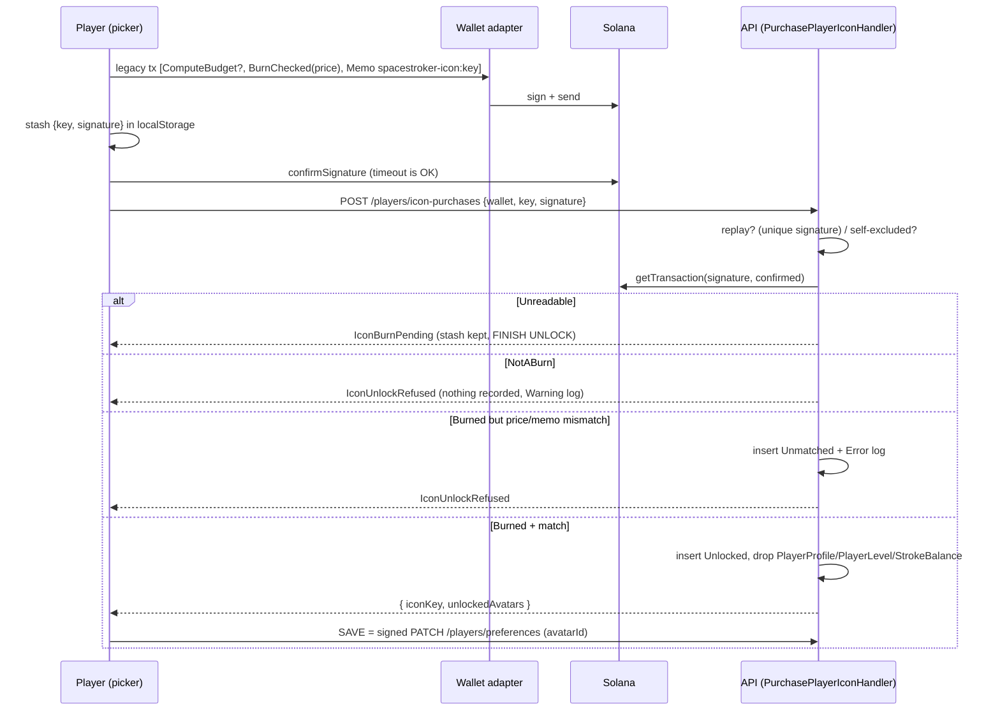
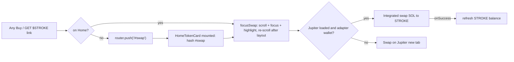

# SpaceStroker — "Token integration" ($STROKE burn icons, balance, in-app swap, jackpot notice) — Implementation Spec

> **Status: Shipped (2026-10-30, branch `feature/token-integration`)** in `monkify-backend`,
> `monkify-front` and `monkify-meta`. Distilled in
> [`../features/token-integration.md`](../features/token-integration.md); where this spec and the code
> disagree, the code wins. See the post-ship note in §15.
>
> *(Original status:)* **Ready for implementation** — refined via Trello card
> [#212 Improve token integration within app](https://trello.com/c/5DDoD8Qk) (refined 2026-10-26, spec 2026-10-26).
> Repos affected: `monkify-backend`, `monkify-front`, and this doc in `monkify-meta`. **Not** `monkify-lp`.
> Branch / worktree: `feature/token-integration` → `.worktrees/token-integration/<repo>`.
> Change level: **Feature**, so the happy-path integration test is mandatory (`constraints.md` §3).
>
> **Purpose:** $STROKE barely exists inside the app. The only balance read is the Space Jackpot
> eligibility check, every "Buy" link leaves for pump.fun, nothing can be spent, and a newcomer reaching
> Space Jackpot is never told why to hold the token. This feature serves three owner goals at once (buy
> pressure, burned supply, visibility). It adds **profile icons a player unlocks by burning $STROKE from
> their own wallet**, a **$STROKE balance** in the header popup and the icon picker, a **Jupiter swap
> card on Home** that every buy link now leads to, and a **one-time Space Jackpot notice** explaining
> the holder draw.

---

## 1. Summary

| Area | Today | **After this feature** |
| --- | --- | --- |
| Spending $STROKE | nothing to spend it on | 14 **burn icons**: the player burns a fixed per-icon price (config) from their own wallet, the backend verifies the burn on-chain and records ownership **permanently** |
| Icon unlocks | derived on read, no inventory table (`features/profile-v2.md`) | derived **plus** the new `PlayerIconPurchases` rows (first persisted icon inventory) |
| $STROKE balance | only on the jackpot screen (`YOUR $STROKE` plate via holder eligibility) | also a `$STROKE` row in the header profile popup and a balance line in the icon picker, from a new `GET /players/stroke-balance` |
| Buying | pump.fun / LP in a **new tab** from 5 surfaces | a **Jupiter Plugin** swap (SOL → $STROKE) inside the Home `$STROKE` card; **every** buy link goes to `/#swap` same-tab, scrolls to the card and highlights it; pump.fun becomes a small secondary link |
| Space Jackpot onboarding | none | a one-time `ArcadeModal` per browser on the first visit to a holder-only type: free daily draw, today's minimum N, "you hold X", balance checked at entry and at the draw, GET $STROKE |

Backend adds **one table** (`PlayerIconPurchases`), one migration, a `Burn` unlock kind, a per-icon price
config block, an on-chain **burn verifier** in `SolanaService`, and three routes:
`POST /players/icon-purchases`, `GET /players/stroke-balance`, `GET /players/icon-prices`. **No settlement
path changes.** The burn moves no house money: the tokens are destroyed in the player's own transaction.

---

## 2. Constraints (MANDATORY)

From `monkify-meta/constraints.md` (full list there):

- **Worktree per repo, hub stays on `main`:** `feature/token-integration` in `monkify-backend`, `monkify-front`,
  `monkify-meta`, checked out at `.worktrees/token-integration/<repo>`.
- **Unit tests:** `SpaceStroker.Tests` via `scripts/run_tests.bat` (never a bare `dotnet test`, which also runs
  the excluded `ProductionGames` Monte Carlo suite). Report the changed and added tests at the end.
- **Integration test (Feature):** happy path + signature replay in `SpaceStroker.Tests.Integration` (§11.2).
- **EF mapping inline** in `SpaceStrokerDbContext.OnModelCreating`; migration under
  `SpaceStroker.Infrastructure/Migrations/`, applied only by `SpaceStroker.Consumers` at startup.
- **Mock-only config.** Burn prices are committed as the placeholder `10000` per icon; the owner sets real
  prices in the deploy env before go-live. The holder mint is already a non-secret committed value
  (`HolderTokenSettings`). Locally, mint/treasury env are absent from both hubs: add mock base58 values for
  QA and **revert before commit** (KB memory: token surfaces are invisible locally).
- **§6 messaging.** Every purchase refusal is **one generic sentence** (`IconUnlockRefused`, *"That icon could
  not be unlocked."*); the real reason is logged server-side only. The only other message is the retryable
  *"Your burn could not be confirmed yet. Please try again."* (`IconBurnPending`), the same kind of
  "unreadable, try again" sentence §6 already sanctions for the jackpot balance read.
- **Token copy.** Burn prices, the popup balance and the notice's "you hold X" / N are **token counts**, an
  owner-sanctioned exception to `token-launch.md` §7 "percentages only" (third exception after the supply
  total and the Feedbacker program). Scope: icon picker, the popup `$STROKE` row, the jackpot notice. Nothing
  else. **No em dashes** in any new token copy (the guide rule, applied here by choice).
- **Every token surface is gated** on `tokenLive && !isEmbedded` (`constants/token.ts`, `hooks/useEmbed.ts`).

---

## 3. Resolved product decisions

From the card (owner, 2026-10-26) plus spec-time calls marked *(spec)*.

| # | Decision |
| --- | --- |
| 1 | All four parts ship in **one** card/branch. The app-review extras (USD value, post-win buy nudge, "$STROKE spent" stat, feed entry for burns, public holder badge) are **rejected**, out of scope. |
| 2 | **14 burn icons** with the owner's **final art, keys and names** (2026-10-30, §5.1; they replaced the `burn-01` … `burn-10` placeholders before any deploy, so no rows were orphaned). New unlock kind **`Burn`** (backend `PlayerIcons.UnlockKind` + front `PlayerIconUnlock`). |
| 3 | Price is **per icon, fixed, in $STROKE (UI units), in config**: `GeneralSettings:PlayerIcons:BurnPrices:<key>`. Placeholder **10,000** each. A Burn icon with **no price configured is not purchasable** (fail closed: hidden from the picker, purchase refused). |
| 4 | **Real burn from the player's own wallet** (not a burn wallet, not the treasury): one legacy transaction with Token-2022 **`BurnChecked`** of exactly the price from the player's ATA for `Operator:Token:HolderToken`, plus a **Memo v2** instruction `spacestroker-icon:<key>` binding it to the icon. |
| 5 | The **burn signature proves the wallet** (the wallet is fee payer + burn authority), so no extra message signature or nonce. |
| 6 | **Persisted ownership:** new table `PlayerIconPurchases`. This reverses Profile V2's "derive on read, no inventory table" for burn icons only. Trophy/free/staff icons stay derived. |
| 7 | **Permanent.** Selling or moving $STROKE never removes a bought icon; `PlayerAvatarGuard` keeps clearing only Trophy/AllTrophies picks. |
| 8 | **Idempotent + retry-safe.** `BurnSignature` is unique. Re-submitting a recorded signature: same wallet + icon + `Unlocked` → success; anything else → refusal. Burn landed but verification could not run (RPC down / not yet confirmed) → nothing recorded, the front **keeps the signature** and retries with it; it never asks for a second burn for that icon. |
| 9 | **No refunds.** The picker says so before signing. |
| 10 | **Self-excluded wallets cannot buy.** The front blocks before any signature is requested; the backend refuses too. |
| 11 | A **verified burn that does not match** (amount below the current price, memo missing or naming another icon) is **recorded as `Unmatched` and logged at Error** for manual review, never dropped. The caller gets the generic refusal. |
| 12 | *(spec)* **Strict transaction shape.** Top-level instructions may only be ComputeBudget, exactly **one** Token-2022 `BurnChecked`, and at most one Memo v2. Anything else (other programs, a second token instruction, a transfer) is **not a burn**: refused, not recorded, logged at Warning. This keeps the verifier small and makes "a burn, not a transfer" provable from the transaction alone. |
| 13 | *(spec)* **"Mint supply dropped by the amount"** is proven from the transaction metadata: the **sum over every token account of the mint** of (post − pre) equals −amount, **and** the owner's own ATA dropped by the same amount. A transfer nets to 0; only a burn makes the mint-wide sum negative. No separate supply RPC call. |
| 14 | *(spec)* Overpaying (`amount > price`) is accepted and recorded with the real amount. A second verified burn for an icon the wallet **already owns** is recorded `Unlocked` again, returns success, logs Warning (tokens are never stranded without a row). |
| 15 | *(spec)* **The purchase does not equip.** Equipping stays the existing signed `PATCH /players/preferences` (`avatarId`), which now accepts purchased keys. After a successful unlock the picker selects the icon so one SAVE equips it. |
| 16 | *(spec, flag for owner)* **Burning needs an adapter wallet**, the same gate as the icon SAVE (which already throws *"This wallet cannot sign messages."* for mobile deeplink sessions, `useDisplayNameSigning.ts:110`). A mobile-deeplink session sees prices and balance but the action reads `OPEN IN A WALLET BROWSER TO UNLOCK`, disabled. A deeplink burn hop (stash + resume arm, donation pattern) would give those players an icon they still could not equip; it is left for a follow-up that fixes both. Orbit (custodial) can never burn. |
| 17 | **Balance:** `$STROKE` row in `ProfileMenuHead.vue` under WALLET, and a balance line in the picker. **Token amount only, no USD.** Unknown (`null`) renders `—`, never `0`. Refreshes after a burn purchase and after a completed swap. Not on the profile page, no public badge. |
| 18 | **Balance read** is a new lightweight `GET /players/stroke-balance?wallet=` (not tied to a game type), via `HolderBalanceReader` → `GetToken2022Balance` (⚠️ never the classic `GetTokenBalance`, which reads Token-2022 holders as 0). `DevAssumedBalance` applies outside Production. 15 s cache. |
| 19 | **Swap:** the **Jupiter Plugin** (`https://plugin.jup.ag/plugin-v1.js`, `displayMode: 'integrated'`), preset SOL → $STROKE with the output locked to `VUE_APP_TOKEN_MINT`, wallet passthrough to the connected adapter wallet. Lives in `HomeTokenCard.vue`. Fallback when the widget fails or cannot use the wallet: a `Swap on Jupiter ↗` link (new tab). |
| 20 | **Every Buy / GET $STROKE link goes to `/#swap` same-tab** and scrolls to + highlights the swap card (owner: no in-place panel). ⚠️ This **reverses** the "new tab is load-bearing, never `router.push`" rule in `token-launch.md` §6 for buy links only. Leaving a game page mid-round is accepted; placed bets are unaffected (settlement is server-side). Chart / Solscan / Streamflow links stay external, new tab. pump.fun becomes a small secondary link in the card. |
| 21 | **Jackpot notice:** shown to everyone, **once per browser** (localStorage), on the first open of a holder-only type (`LotteryParameters.HolderOnly`, never the type name), gated on `tokenLive`. Same guards as `useFirstWinUpsell`. Already eligible → "You're in: enter today's draw" with GET $STROKE secondary. Disconnected → no "you hold" line. Copy never implies $STROKE is a stake. |
| 22 | *(card, my call)* When the token is not live or the app is embedded, burn icons are **hidden** from the picker (not shown locked). |

---

## 4. Data model

### 4.1 `PlayerIconPurchase` (`SpaceStroker.Domain/Players/Entities/PlayerIconPurchase.cs`, new)

```csharp
public class PlayerIconPurchase : TableEntity          // Id, CreatedDate, UpdatedDate
{
    public string Wallet { get; set; } = "";           // owner = burn authority, max 44
    public string IconKey { get; set; } = "";          // the key the request named, max 20 (PlayerIcons.MaxLength)
    public string BurnSignature { get; set; } = "";    // max 100, UNIQUE
    public decimal Amount { get; set; }                // UI units actually burned, precision (18,9)
    public decimal? PriceAtPurchase { get; set; }      // configured price when verified (null = none configured)
    public string? Memo { get; set; }                  // memo text found in the tx, max 100
    public IconPurchaseStatus Status { get; set; }     // Unlocked = 1, Unmatched = 2 (stored as int)
    public string? UnmatchedReason { get; set; }       // "below-price" | "memo-mismatch" | "no-price", max 40, private
}

public enum IconPurchaseStatus { Unlocked = 1, Unmatched = 2 }
```

One table covers both outcomes (the card said "purchases + unmatched burns"): the unique signature
then guards both, and manual review is one query (`WHERE "Status" = 2`).

### 4.2 EF configuration (inline, `Infrastructure/Data/Context/SpaceStrokerDbContext.cs`)

Modelled on the `Donation` block (unique signature):

```csharp
modelBuilder.Entity<PlayerIconPurchase>(builder =>
{
    builder.ToTable("PlayerIconPurchases");
    builder.HasKey(x => x.Id);
    builder.Property(x => x.Wallet).HasMaxLength(44).IsRequired();
    builder.Property(x => x.IconKey).HasMaxLength(PlayerIcons.MaxLength).IsRequired();
    builder.Property(x => x.BurnSignature).HasMaxLength(100).IsRequired();
    builder.Property(x => x.Amount).HasPrecision(18, 9);
    builder.Property(x => x.PriceAtPurchase).HasPrecision(18, 9);
    builder.Property(x => x.Memo).HasMaxLength(100);
    builder.Property(x => x.UnmatchedReason).HasMaxLength(40);
    builder.Property(x => x.Status).HasConversion<int>();
    builder.HasIndex(x => x.BurnSignature).IsUnique();
    builder.HasIndex(x => new { x.Wallet, x.Status });
});
```

Plus `public DbSet<PlayerIconPurchase> PlayerIconPurchases { get; set; }`. The context is `NoTracking` by
default: insert with `Add` + `SaveChangesAsync`.

### 4.3 Migration

```
cd monkify-backend/src
dotnet ef migrations add AddPlayerIconPurchases -p SpaceStroker.Infrastructure -s SpaceStroker.Consumers
```

Additive (new table + 2 indexes), no backfill. Never hand-edit the model snapshot.

---

## 5. Catalog and configuration

### 5.1 Catalog (`SpaceStroker.Domain/Players/PlayerIcons.cs`)

- `enum UnlockKind { Free, Trophy, AllTrophies, Staff, Burn }` (append; nothing persists the enum).
- Append 14 `UnlockKind.Burn` rules after the staff icons, in this order (catalog order = picker order;
  burn icons render as their own group, §7.1). Art = the owner's `21.HoboEdson.png` … `34.Eddie.png`
  (480 px, transparent background, same framing as the Profile V2 set), file number order:

  | # | Key | Name | Source art |
  | --- | --- | --- | --- |
  | 1 | `hobo` | Hobo | `21.HoboEdson.png` |
  | 2 | `bandit` | Bandit | `22.BanditEdson.png` |
  | 3 | `mage` | Mage | `23.MageEdson.png` |
  | 4 | `bag` | Bag | `24.BagEdson.png` |
  | 5 | `space` | Space | `25.SpaceEdson.png` |
  | 6 | `west` | West | `26.WestEdson.png` |
  | 7 | `nerdson` | Nerdson | `27.Nerdson.png` |
  | 8 | `sailor` | Sailor | `28.SailorEdson.png` |
  | 9 | `droid` | Droid | `29.DroidEdson.png` |
  | 10 | `cave` | Cave | `30.CaveEdson.png` |
  | 11 | `mexico` | Mexico | `31.mexicoEdson.png` |
  | 12 | `sombrero` | Sombrero | `32.SombreroEdson.png` |
  | 13 | `chedson` | Chedson | `33.Chedson.png` |
  | 14 | `eddie` | Eddie | `34.Eddie.png` |

- Keys stay ≤ 20 chars, exact, case-sensitive, identical in **both** repos, and must not change after
  go-live (a key rename after real purchases would orphan `PlayerIconPurchases` rows). The memo is
  `spacestroker-icon:<key>`.

### 5.2 Prices (`Domain/Configs/Entities/GeneralSettings.cs` → `PlayerIconSettings`)

```csharp
public Dictionary<string, decimal> BurnPrices { get; set; } = new(StringComparer.Ordinal);
```

`Common/spacestrokersettings.json`, under the existing `PlayerIcons` block:

```json
"BurnPrices": { "hobo": 10000, "bandit": 10000, "...": 10000, "eddie": 10000 }
```

Env override: `GeneralSettings__PlayerIcons__BurnPrices__hobo=25000`. A helper
`PlayerIconSettings.BurnPriceFor(key)` returns the price only when the key is a `Burn` icon **and** the
price is `> 0` **and** `price × 10^Decimals` is a whole number; otherwise `null` (not purchasable). The
committed `10000` is a placeholder: the owner sets the real values before deploy.

### 5.3 `PlayerIconRules` (`Infrastructure/Services/Players/PlayerIconRules.cs`)

- `Unlocked` / `UnlockedOrdered` gain a parameter: `IReadOnlyCollection<string> purchasedKeys`. A `Burn`
  rule is unlocked iff its key is in `purchasedKeys` (replace the `_ => false` arm of `IsUnlocked`, line ~79,
  with an explicit `UnlockKind.Burn => purchased.Contains(rule.Key)` and keep `_ => false`).
- `Effective(wallet, stored)` is unchanged: it already lets non-staff kinds through, and a burn key can only
  have been stored through the validated save.
- New `IPlayerIconPurchases` (`Infrastructure/Services/Players/PlayerIconPurchases.cs`, scoped):
  `Task<IReadOnlyCollection<string>> OwnedKeysAsync(string wallet, CancellationToken ct)` =
  distinct `IconKey` where `Wallet == wallet && Status == Unlocked` (uses the `(Wallet, Status)` index).
- Update all four callers to load owned keys first: `UpdatePlayerPreferencesHandler.cs:158`,
  `GetPlayerProfileHandler.cs:78` and `:115`, `PlayerAvatarGuard.cs:66`. In the profile handler the owned
  keys are loaded **live** with the other live stamps (not inside the 60 s cached body).
- `PlayerAvatarGuard.NeedsTrophyCheck` stays Trophy/AllTrophies only, so a burn pick is never cleared.
  Pin it with a test (§11.1).

---

## 6. Backend behaviour

### 6.1 Burn verifier (`Infrastructure/Services/Solana/SolanaService.cs`)

```csharp
Task<IconBurnCheck> VerifyIconBurnAsync(string signature, string wallet, HolderTokenSettings token);

public record IconBurnCheck(IconBurnOutcome Outcome, decimal Amount, string? Memo, string? Reason);
public enum IconBurnOutcome { Burned, NotABurn, Unreadable }
```

- Fetch through the existing `ExecuteRpcAsync(... client.GetTransactionAsync(sig, Commitment.Confirmed))`
  path (Polly + fallback endpoint). Not found / RPC failure / not yet confirmed → `Unreadable`.
- ⚠️ **Solnet 6.1.0's `GetTransactionAsync` cannot fetch v0 transactions** (no
  `maxSupportedTransactionVersion`, the RPC errors and `GetTransactionFailed` counts it as transport
  failure). The front **must build a legacy `Transaction`** (it already does for bets/deposits). A v0
  burn would read as `Unreadable` forever; that is the documented reason for the legacy requirement.
- Parse the raw JSON in a **public static pure function**
  `DescribeIconBurn(JObject tx, string wallet, HolderTokenSettings token)` (template:
  `DescribeIncomingTransfer`, line ~1139) so unit tests run without RPC. Checks, in order. Any failure →
  `NotABurn` with a private `Reason`:
  1. `meta.err == null` (the transaction succeeded).
  2. `transaction.message.accountKeys[0] == wallet` (fee payer, therefore a signer).
  3. Top-level instructions use only ComputeBudget (`ComputeBudget111111111111111111111111111111`),
     Token-2022 (`token.TokenProgramId`) and Memo v2 (`MemoSq4gqABAXKb96qnH8TysNcWxMyWCqXgDLGmfcHr`).
  4. Exactly one Token-2022 instruction, decoded as **`BurnChecked`** (discriminator `15`; Solnet
     `TokenProgramData.DecodeBurnCheckedData` or a manual decode: u8 tag, u64 amount LE, u8 decimals).
     Accounts: `[0]` = the wallet's Token-2022 ATA (`Token2022Program.DeriveAssociatedTokenAccount`),
     `[1]` = `token.MintAddress`, `[2]` = authority = `wallet`; `decimals == token.Decimals`.
  5. Owner delta: in `meta.preTokenBalances` / `postTokenBalances`, the wallet's account of the mint
     dropped by exactly the burned raw amount.
  6. **Mint-wide delta:** Σ over every entry with `mint == token.MintAddress` of (post − pre) == −amount
     (a missing post entry counts as 0). This is the "supply dropped" proof (decision #13).
  7. Memo: at most one Memo v2 instruction; decode its data (base58 in `json` encoding) as UTF-8. `Memo`
     is returned as found (null when absent). The memo is **not** a `NotABurn` condition: a real burn
     with a wrong memo is recorded `Unmatched` (§6.2).
- `Amount` = raw ÷ 10^decimals (decimal, exact).

### 6.2 `POST /players/icon-purchases` (`Handlers/Players/PurchasePlayerIcon/`, new)

Body `PurchasePlayerIconRequest { Wallet [MaxLength 44], IconKey [MaxLength 20], BurnSignature [MaxLength 100] }`.
Template: `Handlers/Chat/ReportDonation/ReportDonationHandler.cs` (on-chain verify without a session,
idempotent by signature, `DbUpdateException` race catch, one vague message).

Execution order:

1. Shape: wallet is a valid base58 public key, `PlayerIcons.Find(IconKey)?.Kind == Burn`, signature
   non-empty. Fail → `IconUnlockRefused`.
2. `HolderToken.IsConfigured` must be true. Otherwise `IconUnlockRefused`.
3. **Replay check:** a row with this `BurnSignature` exists → if `Wallet`, `IconKey` match and
   `Status == Unlocked` return success (same DTO); otherwise `IconUnlockRefused`. No RPC call.
4. **Self-exclusion:** load the `Player` by wallet (inline form as in `GetPlayerProfileHandler.cs:66`);
   active exclusion → `IconUnlockRefused` (logged Information). No row = not excluded.
5. `VerifyIconBurnAsync`:
   - `Unreadable` → `IconBurnPending`, nothing written (the player retries with the same signature).
   - `NotABurn` → `IconUnlockRefused`, nothing written, log **Warning** with the reason.
   - `Burned` → continue.
6. Match: `price = BurnPriceFor(IconKey)`; expected memo = `spacestroker-icon:{IconKey}`.
   - `price != null && Amount >= price && Memo == expected` → insert `Status = Unlocked`.
   - else → insert `Status = Unmatched` with `UnmatchedReason` (`no-price` / `below-price` /
     `memo-mismatch`), log **Error** (`"Unmatched icon burn {Signature} wallet {Wallet} icon {Key} amount {Amount} reason {Reason}"`),
     return `IconUnlockRefused`.
   - Already owning the icon does not change this (decision #14: recorded `Unlocked`, Warning).
7. Concurrent duplicate: catch `DbUpdateException` on the unique index (Postgres 23505), reload the row
   by signature and apply step 3's rule.
8. On `Unlocked`: drop `PlayerProfile:{wallet}`, `PlayerLevel:{wallet}` and `StrokeBalance:{wallet}`.

Response `PlayerIconPurchaseDto { IconKey, UnlockedAvatars: string[] }` (catalog order, same as the
profile's). HTTP 200 via `ProcessRequest`. Messages added to `Common/Resources/ErrorMessages.resx` +
Designer: `IconUnlockRefused` = *"That icon could not be unlocked."*, `IconBurnPending` = *"Your burn could
not be confirmed yet. Please try again."*.

### 6.3 `GET /players/stroke-balance?wallet=` (`Handlers/Players/GetStrokeBalance/`, new)

- Response `StrokeBalanceDto { Symbol, Decimals, Balance: decimal? }`. `Balance == null` = unknown.
- Invalid wallet or token not configured → `{ symbol, decimals, balance: null }` (HTTP 200, never an error:
  this is a display read).
- `HolderBalanceReader.GetBalanceAsync(wallet)` (Token-2022 ATA, `DevAssumedBalance` outside Production).
- Cache `StrokeBalance:{wallet}` 15 s in `CacheHelper` (`GenerateStrokeBalanceCacheSettings`), stored only
  after a successful (non-null) read, like `HolderEligibility:`.

### 6.4 `GET /players/icon-prices` (`Handlers/Players/GetIconPrices/`, new)

`IconPricesDto { Symbol, Decimals, Mint, Prices: { key: decimal } }`, only purchasable burn keys
(`BurnPriceFor != null`), catalog order. Pure config read, no cache needed. Token not configured →
empty `Prices`.

### 6.5 Preferences save (`Handlers/Players/UpdatePlayerPreferences/`)

Only change: the unlock check (line ~158) passes the owned keys, so a purchased burn key saves. Unknown
key before the signature, unlock check after the signature + nonce: both unchanged. A burn key the wallet
does not own is the same generic refusal as any locked icon.

### 6.6 Controller + rate limits

- `SpaceStroker.Api/Controllers/PlayersController.cs`: the three routes + `[HttpOptions]` entries.
- `spacestrokersettings.json` `IpRateLimiting.GeneralRules` (no `/players/*` rule exists today):
  `post:/players/icon-purchases` **10/min**, `get:/players/stroke-balance` **30/min**,
  `get:/players/icon-prices` **30/min**.
- Register `IPlayerIconPurchases` in `Infrastructure/DependencyInjection.cs` (scoped).

### 6.7 Unavailable profile body

Unchanged: `PlayerProfileDto.Unavailable` still lists the **free keys only**, so it never reveals a
purchase.

---

## 7. Frontend behaviour

### 7.1 Catalog + art (`src/constants/playerIcons.ts`, `src/assets/player-icons/`)

- `PlayerIconUnlock` gains `{ kind: 'burn' }` (the price comes from `GET /players/icon-prices`, not the
  bundle, so the owner can change it without a front deploy).
- 14 entries, keys/names/order as §5.1, art `<key>.png` (128 px) + `<key>-48.png` (48 px), made like the
  Profile V2 set: `System.Drawing` `NearestNeighbor` + `PixelOffsetMode.Half` straight from the 480 px
  source (this reproduces the existing `spartan.png` / `spartan-48.png` pixel for pixel).
- `PLAYER_ICON_KEYS_FREE` unchanged.

### 7.2 Token-2022 burn builder (`src/hooks/useConnection.ts` or new `src/utils/iconBurn.ts`)

```ts
buildIconBurnTransaction(owner: PublicKey, iconKey: string, priceUi: number, decimals: number): Promise<Transaction>
```

- **Legacy `Transaction`** (see §6.1), blockhash `getLatestBlockhash('confirmed')`, fee payer = owner,
  optional priority-fee ComputeBudget instruction exactly as `buildTransferTransaction` does.
- `getAssociatedTokenAddressSync(TOKEN_MINT, owner, false, TOKEN_2022_PROGRAM_ID)` +
  `createBurnCheckedInstruction(ata, mint, owner, BigInt(priceUi × 10^decimals), decimals, [], TOKEN_2022_PROGRAM_ID)`
  from `@solana/spl-token` (already a dependency, 0.4.14, first import in `src`).
- Memo hand-built, **no new package**:
  `new TransactionInstruction({ programId: MEMO_PROGRAM_ID, keys: [{ pubkey: owner, isSigner: true, isWritable: false }], data: Buffer.from('spacestroker-icon:' + iconKey, 'utf8') })`.
- Raw amount computed with integer math from the API's `decimals` (never float multiply). Send with the
  existing `sendToken` path (adapter `signTransaction` → `sendRawTransaction`, fallback `sendTransaction`)
  and confirm with `confirmSignature`.

### 7.3 Burn flow in `PlayerIconPicker.vue` (+ new `src/hooks/useIconBurn.ts`)

- On open: load `GET /players/icon-prices` (once per session) and the $STROKE balance (§7.4). Burn icons
  render as their own group after the player icons, **only when** `tokenLive && !isEmbedded` and the key has
  a price. Owned burn icons (in `unlockedAvatars`) behave like any unlocked icon.
- Locked burn cell: `pick()` selects it for **preview** (today it ignores locked cells, `PlayerIconPicker.vue:95`);
  the `#strip` area shows, for the selected locked burn icon:
  - `PRICE 10,000 $STROKE` · `YOU HOLD 12,345 $STROKE` (or `—`).
  - `Burned tokens are gone for good. No refunds.`
  - Action:
    - balance ≥ price → **`BURN & UNLOCK`** (replaces SAVE for that selection);
    - balance known and < price → **`GET $STROKE`** → `goToSwap('icon_picker')` (§7.6, closes the picker);
    - self-excluded (`useSelfExclusion().selfExcluded`) → disabled, `Unavailable while your self-exclusion is active.` (same wording family as `useDonate.ts:134`); no transaction is built;
    - no adapter wallet (mobile deeplink session, decision #16) → disabled `OPEN IN A WALLET BROWSER TO UNLOCK`.
  - Balance unknown (`null`) does not block the burn: the wallet itself refuses an over-balance burn.
- `useIconBurn.burn(iconKey)`:
  1. If a pending stash exists for this wallet + icon → skip to step 4 with its signature.
  2. Build, sign, send. Before confirming, **stash** `{ iconKey, signature, at }` in `localStorage`
     `space-stroker.icon-burn.pending.{wallet}` (try/catch; storage failure only loses the retry convenience).
  3. `confirmSignature`. A confirmation timeout is **not** a failure: keep the stash and go to step 4.
  4. `POST /players/icon-purchases`.
     - success → clear the stash, `forgetPlayerProfile(wallet)`, refresh the balance, select the icon so
       SAVE equips it, toast `Icon unlocked`;
     - `IconBurnPending` / network error → keep the stash, the action becomes **`FINISH UNLOCK`** (retries
       step 4 with the stored signature; never a second burn);
     - `IconUnlockRefused` → clear the stash, show *"That icon could not be unlocked."* (`err.handled = true`).
  5. User rejected the signature in the wallet → nothing stashed, no message beyond the existing pattern.
- On every picker open, a pending stash for the connected wallet shows `FINISH UNLOCK` on that icon.
- Reload safety: a lost stash is fine, because the same signature always re-submits (§6.2 step 3/5).

### 7.4 $STROKE balance (`src/hooks/useStrokeBalance.ts`, new; `services/mainService.ts`)

- `mainService.getStrokeBalance(wallet)` → `GET /players/stroke-balance`; `getIconPrices()` →
  `GET /players/icon-prices`. Types `StrokeBalance`, `IconPrices` in `src/types/index.ts`.
- Singleton keyed by the connected wallet (do **not** reuse `useTokenBalance`, which holds the settlement
  mint for the WALLET pill): `balance: Ref<number | null | undefined>` (`undefined` = loading),
  `refresh()`. Loads on wallet change and on popup open; no polling.
- `ProfileMenuHead.vue`: a `$STROKE` row right after the WALLET row (insert after line ~164), same
  `profile-row` styling, value formatted with thousands separators, `—` for `null`; hidden unless
  `tokenLive && !isEmbedded` and a wallet is connected. Clicking the row → `goToSwap('menu_balance')`.
- Refresh after a successful burn purchase (§7.3) and after the Jupiter `onSuccess` (§7.5).

### 7.5 Swap card (`src/components/home/HomeTokenCard.vue` + new `src/components/home/JupiterSwap.vue`)

- `HomeTokenCard` root (`home-section`, line ~107) gets `id="swap"` and `tabindex="-1"` (the attribute
  falls through to `HomeSection`'s `<section>`), plus `scroll-margin-top` matching the header.
- `JupiterSwap.vue` is placed in the card above the CTA rail (lines ~246–286):
  - Lazy-inject `https://plugin.jup.ag/plugin-v1.js` once (reuse the `injectTag` pattern from
    `useAnalytics.ts:63–68`; no CSP blocks it: `public/index.html` has none, `nginx.conf` sets only
    `frame-ancestors`).
  - `window.Jupiter.init({ displayMode: 'integrated', integratedTargetId: 'jupiter-swap', formProps: { initialInputMint: 'So11111111111111111111111111111111111111112', initialOutputMint: TOKEN_MINT, fixedMint: TOKEN_MINT }, enableWalletPassthrough: true, onRequestConnectWallet, onSuccess, onSwapError, branding: { name: 'Space Stroker' } })`.
  - **Passthrough:** build a plain `WalletContextState`-shaped object from `solana-wallets-vue`'s
    `useWallet()` (`publicKey`, `connected`, `connecting`, `wallet`, `signTransaction`,
    `signAllTransactions`, `sendTransaction`, `signMessage`, `connect`, `disconnect`) and call
    `window.Jupiter.syncProps({ passthroughWalletContextState })` on mount and on every change.
    `onRequestConnectWallet` runs the same connect action as the header's CONNECT.
  - `onSuccess` → `useStrokeBalance().refresh()`. `onSwapError` → nothing extra (the widget shows it).
  - **Fallback** `Swap on Jupiter ↗` (`TOKEN_JUPITER_URL = https://jup.ag/swap/SOL-${TOKEN_MINT}`, new
    constant in `constants/token.ts`, new tab, `token_click` source `home_jupiter`) when: the script fails
    to load, `window.Jupiter` is absent 8 s after injection, `init` throws, or the session is a mobile
    deeplink session with no adapter (decision #16 reasoning: the widget cannot sign there).
  - Brand colours through the plugin's `:root` CSS variables (`--jupiter-plugin-primary` = primary
    orange), set once.
- Card copy: the existing "Buy on pump.fun" CTA becomes a small secondary text link
  (`Also on pump.fun ↗`, source `home_buy`). `Read more` stays.
- ⚠️ Rewrite the load-bearing comments in `HomeTokenCard.vue` that describe pump.fun as the primary CTA.
- Jupiter is mainnet-only: on local devnet the widget is smoke-tested for render + fallback only.

### 7.6 Every buy link → `/#swap` (`src/hooks/useSwapTarget.ts`, new)

- `goToSwap(source: TokenClickSource)`: `trackTokenClick(source)`, then
  - not on Home → `router.push({ name: 'Home', hash: '#swap' })`;
  - already on Home → no navigation (a same-hash push is a no-op), call `focusSwap()` directly.
- `focusSwap()` (exported reactive tick the card watches): after `nextTick` + one `requestAnimationFrame`,
  `scrollIntoView({ behavior: 'smooth', block: 'start' })` on `#swap`, `focus({ preventScroll: true })`,
  add a `swap-highlight` class for ~2 s (pulse ring, respects `prefers-reduced-motion`), then re-run the
  scroll once ~300 ms later because `GameTypes` above the card loads async and shifts layout (the router's
  `scrollBehavior` hash scroll in `main.ts:62–77` alone lands short).
- `HomeTokenCard` on mount: if `route.hash === '#swap'` → `focusSwap()`.
- Rewire, with `source` values:

| # | Surface | File:line (today) | Today | New `source` |
| --- | --- | --- | --- | --- |
| 1 | ☰ token row "Buy $STROKE now" | `components/GameHeader.vue:566–577` | `TOKEN_LP_URL`, new tab | `menu` (meaning changes: now in-app swap) |
| 2 | "GET $STROKE →" (holder below min) | `components/game/GameTerminal.vue:1614–1622` | pump.fun, new tab, untracked | `game_terminal` |
| 3 | "GET $STROKE →" (status line) | `components/game/RaceScreen.vue:565–572` | pump.fun, new tab, untracked | `race_screen` |
| 4 | "Buy on pump.fun" | `components/guide/sections/GuideToken.vue:673–681` | pump.fun, new tab | `guide_buy` |
| 5 | PUMP.FUN "BUY ▸" tile | `components/home/HomeCommunity.vue:69–85` | pump.fun, new tab | `home_community` (scrolls up to the card) |
| 6 | Picker GET $STROKE | new | — | `icon_picker` |
| 7 | Jackpot notice GET $STROKE | new | — | `jackpot_notice` |
| 8 | Popup `$STROKE` row | new | — | `menu_balance` |

- Links become `<a href="/#swap" @click.prevent="goToSwap(...)">` (keeps middle-click / copy-link sane).
- **Unchanged, still external new tab:** `GuideToken.vue` Chart ↗ (`guide_supply`), every Solscan ↗,
  Streamflow `VESTING_URL`. `TOKEN_LP_URL` stays exported (its comments say not to delete it).
- `useAnalytics.ts:191–199` `TokenClickSource` gains `game_terminal`, `race_screen`, `icon_picker`,
  `jackpot_notice`, `menu_balance`, `home_jupiter`.
- Copy: `GuideToken`'s "Buy on pump.fun" becomes "Get $STROKE" (no em dash; it is guide token copy).
- ⚠️ Update the "NEW TAB IS LOAD-BEARING" comments at `GameHeader.vue:556–557` to the new rule.

### 7.7 First-time Space Jackpot notice (`src/hooks/useFirstJackpotNotice.ts` + `src/components/game/JackpotHolderNotice.vue`, new)

- Storage `space-stroker.jackpot.first-visit-seen` (per browser, try/catch, hydrate once; storage
  failure → treat as seen, never nag).
- `maybeOpen()` triggered from the existing holder watcher in `useGame.ts` (~3173–3192, which already runs
  while `isHolderLottery(selectedGame)`) once the round payload is loaded. Guards, in order: `tokenLive`,
  `!seen`, `!isEmbedded`, not already open, no other modal open (`useHeaderModals` settings/fair/orbit,
  **plus** the first-win upsell, the icon picker and the donate modal), `!recovering`
  (`useBootRecovery`), not idle-disconnected, not relaunching, `termsAccepted`. Mirrors
  `useFirstWinUpsell.maybeOpen` (80–117). If a guard blocks, try again on the next trigger (not marked seen).
- `dismiss()` marks seen on every exit (close, CTA, ESC).
- Mounted next to `OrbitFirstWinModal` in `GameHeader.vue:605–612`, `v-if="tokenLive && !isEmbedded"`.
- `ArcadeModal`, `size="compact"`, title `SPACE JACKPOT`. Body (final copy is the owner's, no em dashes):
  - `A free daily draw for $STROKE holders. No stake, no ticket price.`
  - `Hold at least {N} $STROKE to enter today's draw.` (N = `gameInstance.holderMinimum`, falling back to
    `eligibility.minimum` exactly like `useGame.ts:1850`).
  - Connected only: `You hold {X} $STROKE.` (from `useHolderJackpot().eligibility.balance`; `null` → `—`).
  - `Your balance is checked when you enter and again at the draw.`
- Footer: not eligible → primary **`GET $STROKE`** (`goToSwap('jackpot_notice')`) + `GOT IT`. Eligible →
  heading line `You're in: enter today's draw`, primary **`ENTER`** (closes), secondary `GET $STROKE`.
  Disconnected → like "not eligible" without the "you hold" line.

---

## 8. Flow diagrams





---

## 9. Out of scope

Public holder badge, USD price / market cap, post-win buy nudge, "$STROKE spent" stat, a notifications-feed
entry for burns, $STROKE balance on the profile page, buyback-and-burn from the house cut, staking $STROKE
on bets, LP changes, a mobile-deeplink burn hop (decision #16), an admin UI for `Unmatched` rows (manual
review is a DB query), final icon art / keys / names / prices (owner, before deploy).

---

## 10. File checklist

### 10.1 Backend (`monkify-backend/src`)

| # | File | Change |
| --- | --- | --- |
| 1 | `SpaceStroker.Domain/Players/PlayerIcons.cs` | `UnlockKind.Burn`; 14 burn rules (§5.1) |
| 2 | `SpaceStroker.Domain/Players/Entities/PlayerIconPurchase.cs` (new) | entity + `IconPurchaseStatus` |
| 3 | `SpaceStroker.Domain/Configs/Entities/GeneralSettings.cs` | `PlayerIconSettings.BurnPrices` + `BurnPriceFor` |
| 4 | `SpaceStroker.Common/spacestrokersettings.json` | `PlayerIcons.BurnPrices` placeholders (10000); 3 rate-limit rules |
| 5 | `SpaceStroker.Infrastructure/Data/Context/SpaceStrokerDbContext.cs` | DbSet + inline mapping (§4.2) |
| 6 | `SpaceStroker.Infrastructure/Migrations/<ts>_AddPlayerIconPurchases.cs` (+ snapshot) | generated |
| 7 | `Infrastructure/Services/Players/PlayerIconRules.cs` | `purchasedKeys` param, `Burn` arm |
| 8 | `Infrastructure/Services/Players/PlayerIconPurchases.cs` (new) | `IPlayerIconPurchases.OwnedKeysAsync` |
| 9 | `Infrastructure/Services/Players/PlayerAvatarGuard.cs` | pass owned keys (line ~66); guard rule unchanged |
| 10 | `Infrastructure/Services/Solana/SolanaService.cs` (+ `ISolanaService`) | `VerifyIconBurnAsync`, static `DescribeIconBurn`, `IconBurnCheck` |
| 11 | `Infrastructure/Handlers/Players/PurchasePlayerIcon/` (new) | request, handler, `PlayerIconPurchaseDto` |
| 12 | `Infrastructure/Handlers/Players/GetStrokeBalance/` (new) | handler + `StrokeBalanceDto` |
| 13 | `Infrastructure/Handlers/Players/GetIconPrices/` (new) | handler + `IconPricesDto` |
| 14 | `Infrastructure/Handlers/Players/UpdatePlayerPreferences/UpdatePlayerPreferencesHandler.cs` | owned keys into the unlock check (~158) |
| 15 | `Infrastructure/Handlers/Players/GetPlayerProfile/GetPlayerProfileHandler.cs` | owned keys, loaded live (~78, ~115) |
| 16 | `Infrastructure/Services/Cache/CacheHelper.cs` | `GenerateStrokeBalanceCacheSettings` (15 s) |
| 17 | `Infrastructure/DependencyInjection.cs` | register `IPlayerIconPurchases` |
| 18 | `SpaceStroker.Common/Resources/ErrorMessages.resx` + `.Designer.cs` | `IconUnlockRefused`, `IconBurnPending` |
| 19 | `SpaceStroker.Api/Controllers/PlayersController.cs` | 3 routes + OPTIONS |
| 20 | `SpaceStroker.Tests.Integration/Harness/TestDoubles.cs` | `FakeSolanaService.VerifyIconBurnAsync` + `SetIconBurn(sig, wallet, amount, memo)` / unreadable switch |

### 10.2 Frontend (`monkify-front/src`)

| # | File | Change |
| --- | --- | --- |
| 1 | `constants/playerIcons.ts` + `assets/player-icons/<key>(.png, -48.png)` | burn kind, 14 entries (§5.1) |
| 2 | `constants/token.ts` | `TOKEN_JUPITER_URL`, `MEMO_PROGRAM_ID` (or in `utils/iconBurn.ts`) |
| 3 | `utils/iconBurn.ts` (new) or `hooks/useConnection.ts` | `buildIconBurnTransaction` (legacy, BurnChecked + memo) |
| 4 | `hooks/useIconBurn.ts` (new) | burn → stash → confirm → purchase → retry |
| 5 | `components/player/PlayerIconPicker.vue` | burn group, preview of locked burn cells, price/balance/no-refund strip, BURN & UNLOCK / GET $STROKE / FINISH UNLOCK, self-exclusion + adapter gates |
| 6 | `hooks/useStrokeBalance.ts` (new) | singleton balance |
| 7 | `services/mainService.ts`, `types/index.ts` | `purchasePlayerIcon`, `getStrokeBalance`, `getIconPrices` + types |
| 8 | `components/header/ProfileMenuHead.vue` | `$STROKE` row after WALLET |
| 9 | `components/home/HomeTokenCard.vue` | `id="swap"`, embed `JupiterSwap`, pump.fun secondary, highlight, hash focus, comments |
| 10 | `components/home/JupiterSwap.vue` (new) | script load, init, passthrough sync, fallback |
| 11 | `hooks/useSwapTarget.ts` (new) | `goToSwap`, `focusSwap` |
| 12 | `components/GameHeader.vue` | ☰ row → `goToSwap('menu')`, comments; mount `JackpotHolderNotice` |
| 13 | `components/game/GameTerminal.vue`, `components/game/RaceScreen.vue` | GET $STROKE → `goToSwap` |
| 14 | `components/guide/sections/GuideToken.vue` | buy → `goToSwap('guide_buy')`, "Get $STROKE" |
| 15 | `components/home/HomeCommunity.vue` | buy tile → `goToSwap('home_community')` |
| 16 | `hooks/useAnalytics.ts` | new `source` values |
| 17 | `hooks/useFirstJackpotNotice.ts`, `components/game/JackpotHolderNotice.vue` (new) | notice |
| 18 | `hooks/useGame.ts` | call `maybeOpen` from the holder watcher (~3173) |

### 10.3 Meta (`monkify-meta`, at ship)

| # | File | Change |
| --- | --- | --- |
| 1 | `features/token-integration.md` (new) | distilled feature doc |
| 2 | `features/token-launch.md` | §6 buy links now `/#swap` same-tab (reversal), the swap card, §7 third counts exception, §8 new `source` values |
| 3 | `features/profile-v2.md` | burn kind, `PlayerIconPurchases` inventory exception, permanence |
| 4 | `features/space-jackpot-refactor.md` | first-visit notice |
| 5 | `constraints.md` §6 | note `IconBurnPending` as the sanctioned retryable sentence |
| 6 | `INDEX.md` | map row + in-flight entry |

---

## 11. Tests

### 11.1 Unit (`SpaceStroker.Tests`, run `scripts/run_tests.bat`)

| Test file | Cases | Expected |
| --- | --- | --- |
| `UnitTests/Domain/PlayerIconsTests.cs` | update `UnlockKinds_AreSplit10_10_1_3` → `…_3_10`; burn keys ≤ 20 chars, unique | pinned counts incl. 14 Burn |
| `UnitTests/Services/Players/PlayerIconRulesTests.cs` | burn key unlocked only when purchased; not unlocked without; ordered output includes it | rule honours `purchasedKeys` |
| `UnitTests/Services/Players/PlayerAvatarGuardTests.cs` | equipped burn icon, zero balance / no trophies → not cleared | permanence (AC5) |
| `UnitTests/Services/IconBurnVerificationTests.cs` (new, mirrors `IncomingTransferValidationTests`) | valid BurnChecked + memo → `Burned` with amount/memo; **transfer** (Σ delta 0) → NotABurn; wrong mint; wrong authority / fee payer; owner delta ≠ amount; `meta.err` set; extra program instruction; two token instructions; decimals mismatch; no memo → `Burned`, `Memo = null` | §6.1 checks 1–7 |
| `UnitTests/Handlers/PurchasePlayerIconHandlerTests.cs` (new) | happy → Unlocked row + caches dropped; replay same wallet+icon → success, 1 row; replay other wallet / other icon → refused; replay of Unmatched → refused; self-excluded → refused, verifier never called; non-burn key → refused; Unreadable → `IconBurnPending`, no row; NotABurn → refused, no row; below price → Unmatched row + Error log + refused; wrong memo → Unmatched; no price configured → Unmatched (`no-price`); overpay → Unlocked with real amount; already owned → Unlocked again; unique-index race → reload + replay rule; token not configured → refused | §6.2 |
| `UnitTests/Handlers/UpdatePlayerPreferencesIconTests.cs` | purchased burn key saves; unowned burn key refused after signature | §6.5 |
| `UnitTests/Handlers/GetPlayerProfileHandlerTests.cs` | `unlockedAvatars` includes purchased keys (live, not from cache); unavailable body unchanged | §5.3, §6.7 |
| `UnitTests/Handlers/GetStrokeBalanceHandlerTests.cs` (new) | balance from reader; null → null and not cached; invalid wallet → null; cache hit | §6.3 |
| `UnitTests/Handlers/GetIconPricesHandlerTests.cs` (new) | only priced burn keys, catalog order; zero / fractional-raw price excluded; token unconfigured → empty | §6.4 |
| `UnitTests/Configs/PlayerIconSettingsBindingTests.cs` | `BurnPrices` binds from env `GeneralSettings__PlayerIcons__BurnPrices__hobo` | §5.2 |

### 11.2 Integration (`SpaceStroker.Tests.Integration`), MANDATORY

New `IconBurnFlowTests.cs` (pattern: `ProfileV2FlowTests`, reuse its `SaveIconAsync` signing helper):

1. **Happy path:** real keypair wallet, `fixture.SolanaService.SetIconBurn(sig, wallet, 10000, "spacestroker-icon:hobo")`
   → `POST /players/icon-purchases` 200 → `GET /players/profile` `unlockedAvatars` contains `hobo` →
   signed `PATCH /players/preferences` `avatarId=hobo` 200 → profile `avatarId == "hobo"` and
   `GET /players/levels` `avatars[wallet] == "hobo"`.
2. **Replay:** the same POST again → 200, exactly one `PlayerIconPurchases` row; same signature from a
   second wallet → 400 generic.
3. **Permanence:** `SetHolderBalance(wallet, 0)` → profile still shows `hobo` equipped and unlocked.
4. **Retry after unreadable:** verifier set to unreadable → `IconBurnPending`, no row; switch to readable →
   same signature → 200.
5. **Self-excluded:** wallet with an active exclusion → 400, verifier not called.
6. `GET /players/stroke-balance` returns the fake holder balance; `GET /players/icon-prices` lists
   all 14 burn keys, `hobo` at 10000.

Run with `scripts/run_integration_tests.bat` (Docker required).

---

## 12. Acceptance criteria (from the Trello checklist)

1. Given a connected, non-self-excluded wallet holding ≥ an icon's configured burn price, when it clicks BURN & UNLOCK and signs, then one Token-2022 BurnChecked (+ icon memo) tx burns exactly the price from its own ATA, the backend verifies it on-chain (signer, mint, owner balance delta, mint supply delta, memo, success), records the purchase, and the icon appears unlocked and can be equipped.
2. Given a purchase submitted with a transfer (not a burn), wrong mint, wrong signer, short amount, wrong memo or failed tx, when the backend verifies it, then no icon is unlocked and the caller gets one generic refusal sentence (constraints §6); a verified burn that only mismatches price/memo is recorded as unmatched and logged at Error.
3. Given a burn signature already recorded, when it is submitted again (same or concurrent request), then exactly one purchase row exists; same wallet+icon returns success, anything else is refused.
4. Given the burn landed but the purchase call failed (RPC down / unconfirmed), when the player retries with the same signature, then the icon is unlocked; the picker never asks for a second burn for that icon.
5. Given a wallet owns a burn icon, when it later sells or moves all its $STROKE, then the icon stays unlocked and equipped (PlayerAvatarGuard does not clear it).
6. Given a self-excluded wallet, when it opens the icon picker, then no burn transaction is ever requested, and a direct purchase call is refused.
7. Given the icon picker, when a burn icon is locked, then it shows its price in $STROKE, the player's $STROKE balance, a no-refund line before signing, and BURN & UNLOCK (or GET $STROKE when the balance is below the price).
8. Given a connected wallet and a live token, when the header profile popup opens, then a $STROKE row shows the Token-2022 balance as a token amount (no USD), or "—" when the read fails; it refreshes after a burn purchase or a completed swap.
9. Given the home page with a live token and not embedded, when it renders, then the $STROKE card contains a Jupiter Plugin swap preset SOL → $STROKE using the connected wallet, with a "Swap on Jupiter ↗" fallback if the widget fails to load.
10. Given any Buy / GET $STROKE link in the app (☰ menu row, GameTerminal, RaceScreen, GuideToken, HomeCommunity, icon picker, jackpot notice), when clicked, then the app navigates to / and scrolls to and highlights the swap card (no new tab); Chart/Solscan links still open in a new tab.
11. Given a browser that has never seen it, when the user first opens a holder-only Space Jackpot game, then a one-time modal explains the free holder draw, today's minimum N, the entry + draw balance checks, "you hold X" (connected only), and a GET $STROKE CTA to the home swap card; eligible wallets see "You're in: enter today's draw". It never shows again in that browser.
12. Given the app is embedded or the token is not live, when any of these surfaces would render, then the swap card, $STROKE popup row, jackpot notice and burn icons are all absent.
13. Given the backend changes, when the suites run, then run_tests.bat passes with new unit tests for burn verification + unlock rules, and a Testcontainers integration test covers burn → purchase → unlocked → equipped, plus signature replay.

---

## 13. Manual QA

1. Local stack per `CLAUDE.md`; add mock base58 `VUE_APP_TOKEN_MINT` / treasury env to the front worktree
   and revert before commit.
2. Burns on devnet need a **Token-2022 stand-in mint** (see the holder-jackpot rehearsal notes): point
   `GeneralSettings__Operator__Token__HolderToken__MintAddress` and `VUE_APP_TOKEN_MINT` at it via a compose
   override, mint some to a test wallet, set a burn price to a small value.
3. Picker: locked burn icon shows price, balance, no-refund line → BURN & UNLOCK → wallet shows one burn →
   icon unlocks → SAVE equips → header + profile show it. Check the tx on a devnet explorer: supply dropped.
4. Kill the API right after signing → `FINISH UNLOCK` appears; restart → it completes without a second burn.
5. Self-excluded wallet: action disabled, no wallet prompt.
6. Popup `$STROKE` row shows the balance; `—` with the RPC blocked.
7. Every link in §7.6's table lands on `/#swap`, scrolled and highlighted, including from mid-round and from
   Home itself. Chart/Solscan still open new tabs.
8. Jupiter widget: renders on mainnet build only; on devnet confirm the fallback link appears when the script
   is blocked (DevTools request blocking).
9. Clear `localStorage`, open Space Jackpot → notice once; reload → not again. Eligible vs not, disconnected.
10. `?embed=1` → no swap card, no popup row, no notice, no burn icons.

---

## 14. Trello / pipeline

- **Source card:** [#212 Improve token integration within app](https://trello.com/c/5DDoD8Qk), list
  **Specs created**; the card's **Implementation** section lists the worktree, branch and this spec.
- **Next:** `/monkify-implement-feature Improve token integration within app`, then
  `/monkify-ship-feature Improve token integration within app`.
- **Before deploy (owner):** final icon art, keys, names and per-icon prices (both repos + deploy env).

---

## 15. Revision log

| Date | Change |
| --- | --- |
| 2026-10-26 | Initial spec from refined card #212 (+ backend/front code exploration). Spec-time calls: strict tx shape, mint-wide delta as supply proof, single table with `Status`, overpay/already-owned handling, purchase does not equip, adapter-wallet-only burns (mobile deeplink deferred, flagged), `GET /players/icon-prices`, retryable `IconBurnPending`. |
| 2026-10-30 | Burn icons: the `burn-01` … `burn-10` placeholders replaced by the owner's 14 final icons (`hobo` … `eddie`, §5.1, §7.1); prices stay 10000 each. |
| 2026-10-30 | **Shipped.** Post-ship notes (code wins): decision #12 softened, a proven burn with extra top-level programs is recorded `Unmatched` (`extra-instructions`) and one with two or more memos `Unmatched` (`multiple-memos`, first memo read), never refused unrecorded (ComputeBudget still allowed); a memo naming a **different** catalog burn key is refused with **no row** (anti-grief, signatures are public); zero-amount burns and non-signature-shaped input are refused before/without RPC; memo NULs stripped before storing. Front: the signed tx must match the built one exactly or it is never broadcast, the price is re-read before signing (price consent), the stash also lives in memory, and only the final refusal (or a provably expired burn) clears it. Picker gained a PROFILE PREVIEW aside (`ArcadeModal` second panel); Home card swap sits in a compact right column (GET key on phones), themed via `jupiterTheme.ts` (plugin-1.0.17). Integration suite: 7 tests (concurrent replay added). Rode along: Monkey Duel quick play + reveal/result rework (`features/monkey-duel.md`). |
