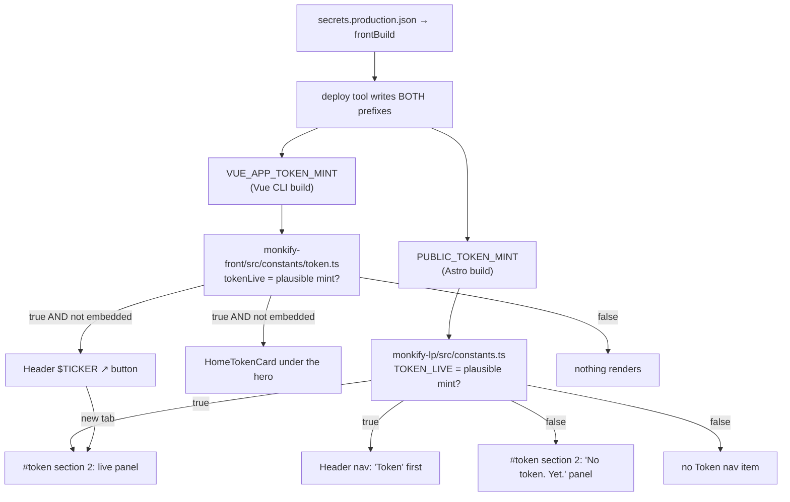

# SpaceStroker — "Prepare UI for token launch" Feature — Implementation Spec

> **Status: Ready for implementation** — refined via Trello card
> [Prepare UI for token launch (#160)](https://trello.com/c/vDAP4YCE) (2026-08-09), spec written 2026-08-10.
> Repos affected: `monkify-lp` (branch `master`), `monkify-front` (branch `main`), and this doc in
> `monkify-meta`. **`monkify-backend` is NOT affected** — see §2.1.
>
> **Purpose:** build both front doors for a **pump.fun** token launch *ahead of time*, so going live is
> filling one env value and redeploying — not a last-minute code drop. The landing page gets a live
> token section promoted to position 2 (falling back to today's honest "No token. Yet." panel while the
> env key is empty), and the game app gets one home card plus a dedicated header button. The token is
> **information and marketing only**: rounds keep settling in USDC.

---

## 1. Summary

One env value — the **mint address** — decides everything. Non-empty and plausible ⇒ every token
surface renders. Empty, whitespace, absent or implausible ⇒ the pre-launch state everywhere.

| Surface | Env empty (today, and until launch day) | Env filled (launch) |
| --- | --- | --- |
| **LP section 2** | today's **"No token. Yet."** panel, moved from position 6 to position 2 | the live token section: coin + ticker + contract bar + 2 CTAs, then 2 mechanic cards + the treasury line |
| **LP nav** | no `Token` item (desktop or mobile) | `Token` is the **first** nav item, desktop + mobile |
| **App home** | nothing renders where the token card would be | the token card, **directly under the hero, above the mode cards** |
| **App header** | no token button | a dedicated brand-orange slot (`$TICKER ↗`), on **every** screen including mid-round |
| **Backend / bets** | unchanged | **unchanged** — rounds settle in USDC, `VUE_APP_GAME_TOKEN_ADDRESS` is untouched |

Two things this deliberately costs, both accepted at refinement:

1. **Pre-launch, the loudest section on the LP says "there's nothing to buy."** That is the point —
   it keeps the anti-scam warning visible during exactly the window when fake tokens appear.
2. **The app's mode cards drop below the fold.** `HomePage.vue` argues at length that the actionable
   thing comes first; this card takes that slot, so **that comment must be rewritten in the same
   commit** (§7.3.4) rather than left contradicting the code.

**The design mockup is the visual authority for anything this spec does not pin down:**
<https://claude.ai/code/artifact/4e2bcba0-5d73-46f3-9867-22fff0575220> (rejected directions:
<https://claude.ai/code/artifact/38ef70b8-fc2f-4d24-b8ca-cc314f2775da>). Every string in §7 is quoted
from it verbatim.

---

## 2. Constraints (MANDATORY)

From `monkify-meta/constraints.md` (full list there):

- **Worktree per repo** (`constraints.md` §2): `feature/token-launch-ui` at
  `.worktrees/token-launch-ui/<repo>`; the hubs stay on their default branch. ⚠️ **`monkify-lp`'s
  default branch is `master`, not `main`** — its worktree is branched off `origin/master` (already
  done, see §14).
- **Secrets/config** (`constraints.md` §1): the new env keys get **empty or mock** values in every
  committed file (`deploy/secrets.example.json`, `deploy/secrets.development.json`,
  `monkify-front/.env.example`). The real mint goes into `secrets.production.json`, which is never
  committed. A mint address is public information, not a credential — but it still must not be
  hardcoded in source (AC 19).
- **Unit tests** (`constraints.md` §3): **not applicable** — no backend change. See §11.
- **Integration test** (`constraints.md` §3 → "Integration tests are mandatory for every new
  feature", `AGENTS.md` rule 8): **not applicable**. The rule mandates a happy path in
  `SpaceStroker.Tests.Integration`, and this feature adds **no** endpoint, DTO, entity, migration,
  consumer or SignalR contract for such a test to drive. The card states this explicitly; §2.1
  records the evidence.
- **EF mapping / migrations** (`constraints.md` §4): **not applicable** — no schema change.
- **Scope discipline** (`constraints.md` §8): prefer editing existing files; do not create docs
  nobody asked for. The LP has no test suite.

### 2.1 Why `monkify-backend` is genuinely untouched

The copy names two mechanics — a **buyback-and-burn from the existing 1% house cut** and a
**$STROKE-seeded Space Jackpot bonus** — and **neither exists in code**. Both are written in the
**future tense** for that reason (AC 6). The 1% referenced in the copy is the already-shipped
`GeneralSettings.Operator.Token.CommissionPercentage` (`features/crypto-commission.md`,
`specs/commission-rate-1-percent.md`) and **is not read, changed or referenced by any code in this
card** — the copy merely describes it. Building either mechanic is a separate card (§9).

### 2.2 Feature-specific constraints

- **Copy tense.** Every buyback-burn and jackpot-seed sentence is future tense ("will buy and burn",
  never "buys and burns"). Present tense is a claim that fails an on-chain check on day one.
- **Nothing may imply the token is a stake.** Rounds settle in USDC. This includes fixing
  `SpaceRoadmap.vue:133` (§7.1.5).
- **`VUE_APP_GAME_TOKEN_ADDRESS` must not be reused or touched.** That is the **settlement** mint;
  conflating the two means changing one silently changes the other.
- **Fail-closed.** The env test follows `VUE_APP_ORBIT_ENABLED`'s convention, not
  `VUE_APP_ALLOW_FREE_BETS`'s: anything that is not a plausible mint renders the pre-launch state. A
  Buy button must never point at an empty address.

---

## 3. Resolved product decisions

| # | Decision | Source |
| --- | --- | --- |
| D1 | **Scope is info / marketing only.** No in-game utility; bets keep settling in USDC. Utility is a backend + money-path feature that cannot be "finished in a branch and deployed". | card |
| D2 | **Flip mechanism = an env flag on the default branch**, not a long-lived `feature/token-launch` branch. Both sites move weekly and a rotting branch turns "simply deploy it" into "resolve conflicts and re-QA" on launch day. Knowingly accepted: the live copy sits in the shipped bundle pre-launch and is scrapeable — the **mint address does not**, it comes from env. | card |
| D3 | **One env key: the mint address.** `PUBLIC_TOKEN_MINT` (LP) / `VUE_APP_TOKEN_MINT` (app). Non-empty + plausible = live. Ticker and copy are *content* and live next to the copy they belong to. | card |
| D4 | **LP section order** → `Hero → Token → Basics (#about) → Modes → Story → Roadmap → Community`. Token becomes section 2; everything else keeps its relative order. | card |
| D5 | **Pre-launch (env empty) = today's "No token. Yet." panel, in the new slot 2.** Not hidden — the anti-scam warning must stay visible. | card |
| D6 | **LP nav gains `Token` first; nothing else is renamed.** | card |
| D7 | **LP visual direction = "Insert coin"** (option 02 of the pitch): coin sprite hero, ticker under it, contract bar, two CTAs. | card |
| D8 | **LP content = hero + ONE substance block.** Permanently cut: total supply, decimals, mint authority, LP/liquidity status, the four-stat strip, and the Jupiter + Solscan buttons — free facts on any pump.fun launch, and "LP burned" would be false until graduation. Kept: the **two mechanics** and the **treasury disclosure**, the only content on the page not true of every other pump.fun token. | card + mockup |
| D9 | **Utility named in copy = buyback-and-burn (from the existing 1% cut) + $STROKE-seeded Space Jackpot bonus**, both **future tense**. Each becomes its own follow-up card. | card |
| D10 | **The treasury (~50%) is disclosed and framed as the game treasury** — one line plus an on-chain link, **not a panel**. DexScreener / Bubblemaps / RugCheck surface a position that size within minutes; silence reads as concealment, and framing it as the fuel for the two mechanics is what turns the number from a red flag into the point of the section. | card |
| D11 | **`SpaceRoadmap.vue:133` is fixed in this card.** Phase 1's "The token drops on Solana" is left alone. | card |
| D12 | **App = one home card, no `/token` route.** Two surfaces restating supply and treasury is two places that can contradict each other; the card links out to the LP for depth. | card |
| D13 | **App card layout:** big coin on the **left** with the contract bar **directly beneath it**; heading, one short paragraph and the CTAs on the **right**. | card (owner) |
| D14 | **App card placement = directly under the hero, above the mode cards** — and `HomePage.vue`'s section-order rationale comment is updated in the same commit. | card |
| D15 | **App header = a dedicated button, not a `≡` menu cell.** Its own permanent slot (brand orange, coin icon, `$TICKER ↗`), alongside audio / menu / wallet. Opens the LP `#token` section in a **new tab** so a player mid-round never loses the game or the SignalR connection. | card |

### 3.1 Decisions this spec resolves (they were open, or the card contradicted itself)

| # | Question | Resolution + why |
| --- | --- | --- |
| S1 | **Where does the treasury disclosure live?** The card's *Frontend impact* says `Footer.vue` ("treasury wallet link lives here, moved out of the token section"); its *Decisions* block, **AC 5** and the mockup all put it **in the token section**. | **In the token section**, as one line plus a `TREASURY ↗` link. **`Footer.vue` is NOT touched by this card.** AC 5 is the definition of done and the mockup is the agreed build target; both agree. The card's Footer line is a stale note from an earlier draft. |
| S2 | **Do the token surfaces render in an embedded (iframe) session?** The card lists it as an open edge case. | **No — both hide when embedded.** Three concrete reasons: (a) `main.ts:101` already puts `Home` in `EMBED_REDIRECT_ROUTES`, so a framed `/` never mounts `HomePage` — the card is unreachable in a frame anyway, and an explicit `!isEmbedded` guard is the same defence-in-depth `HomeOrbitCard` and `HomeFeatureCards` already keep; (b) the header button is the **only** element in the header that leaves the app, and firing a new-tab marketing link out of a partner casino's iframe is a different judgement from firing it out of our own tab; (c) `useAnalytics` is **disabled** when embedded (`useAnalytics.ts:21`), so **AC 14** ("no CTA navigates without reporting") is structurally unsatisfiable in a frame — rendering the CTAs there would ship a knowingly untracked control. |
| S3 | **What does the `CHART` CTA point at?** | `https://dexscreener.com/solana/<mint>`. D8 cut the *Jupiter and Solscan* buttons as boilerplate; a chart is neither, and AC 3 requires exactly two CTAs of which one is Chart. |
| S4 | **What is the LP anchor URL the app links to?** The card says `https://www.spacestroker.com/#token`; `astro.config.mjs` sets `site: 'https://spacestroker.com'` and `features/lp-final-adjustments.md` records the LP domain as the **apex** (no `www`). | Spec the **apex**: `https://spacestroker.com/#token`, matching the configured `site`. ⚠️ **Confirm before the live build** (§12, open input 4) — if `www` is canonical, one constant changes. |
| S5 | **Does the `↗` external cue need an icon?** `features/icons-and-menu-overhaul.md` says no text character may stand in for a glyph. | Use the **text character `↗`**, no new glyph. Precedent already in the app: `MobileWalletModal.vue:24` uses `↗` as a *directional cue* ("opens in the wallet app") beside `›` ("stays in place"). The icons rule bans text characters *substituting for icons* (`✓ ✗ ▶ ▼`, the VT323 `X`); a directional cue inside a label is typography. |
| S6 | **Which GA event do the CTAs fire?** The card says "a `home_link_click`-style event" for both the card CTAs and the header button. | A **new** `token_click` event with a `source` param (§7.3.5). The header button fires from **every** screen, so folding it into `home_link_click` — whose documented meaning is "which surface players reach for **from the front door**" (`useAnalytics.ts:148`) — would poison that series. |

---

## 4. Data model

**Not applicable.** No entity, column, EF mapping or migration. Nothing is persisted; nothing is read
from the database. See §2.1.

---

## 5. Configuration

### 5.1 The one env key, in both prefixes

Each toolchain only exposes its own prefix (Vue CLI: `VUE_APP_*`; Astro/Vite: `PUBLIC_*`), and the
deploy tool writes the **same** `frontBuild` block into **both** repo builds — exactly the pattern
`*_GA_MEASUREMENT_ID` already uses.

| Key | Repo | Meaning |
| --- | --- | --- |
| `PUBLIC_TOKEN_MINT` | `monkify-lp` | The SPL mint address of the launched token. Empty ⇒ pre-launch state. |
| `VUE_APP_TOKEN_MINT` | `monkify-front` | Same value, same meaning. |

⚠️ **Not `VUE_APP_GAME_TOKEN_ADDRESS`.** That is the settlement mint and stays untouched (AC 19).

### 5.2 Committed config (mock/empty only)

`monkify-meta/deploy/secrets.example.json` → `frontBuild`, alongside the existing keys:

```json
    "VUE_APP_GA_MEASUREMENT_ID": "",
    "PUBLIC_GA_MEASUREMENT_ID": "",
    "VUE_APP_TOKEN_MINT": "",
    "PUBLIC_TOKEN_MINT": ""
```

Add a `_comment_token_mint` sibling to the existing `_comment_analytics` / `_comment_orbit_flag`
notes, stating: one value serves both builds; **empty = pre-launch state on both sites**; it is the
**launch** mint, **never** `VUE_APP_GAME_TOKEN_ADDRESS` (settlement); and that both sites are static
builds, so filling it is a **rebuild + redeploy of two sites**, not a runtime toggle.

`monkify-meta/deploy/secrets.development.json` → the same two keys, **empty** (development never
shows a live token).

`monkify-meta/deploy/README.md` → one row per key in the `frontBuild` table.

`monkify-front/.env.example` → a commented block in the existing house style:

```
# Token launch (#160). The MINT ADDRESS of the launched pump.fun token — the single value that
# decides whether the app shows any token surface. FAIL-CLOSED, like VUE_APP_ORBIT_ENABLED: empty,
# whitespace, or anything that is not a plausible base58 mint hides the home token card AND the
# header token button. ⚠️ NOT the settlement mint — that is VUE_APP_GAME_TOKEN_ADDRESS above and
# these two must never be conflated. The landing page reads PUBLIC_TOKEN_MINT and uses the SAME
# value; both are written by the deploy tool's frontBuild block, so launch day rebuilds BOTH sites.
# production: the real mint, supplied by secrets.production.json -> frontBuild
VUE_APP_TOKEN_MINT=
```

The LP commits no `.env` file at all (it has none today) — its value arrives only from the deploy
tool, exactly as `PUBLIC_GA_MEASUREMENT_ID` does.

### 5.3 Content constants (source, not env)

Ticker, treasury percentage and treasury wallet are **content**, so they live next to the copy as
source constants — one line to edit, reviewed like copy. Both repos get the same three, each marked
`TODO(launch)` until §12's open inputs are answered.

---

## 6. Backend behaviour

**Not applicable.** No handler, consumer, endpoint, DTO, header or SignalR contract changes. See §2.1.

---

## 7. Frontend behaviour

### 7.1 `monkify-lp` (branch `master`)

#### 7.1.1 The shared token module — `src/constants.ts`

Extend the existing file (it currently exports only `GAME_URL`). Both `index.astro` (build-time
frontmatter) and the Vue islands import from here, so the live/pre-launch test exists **once**.

```ts
// --- Token launch (#160) ---------------------------------------------------------------------
// The mint is the ONLY value from env; everything else here is content. FAIL-CLOSED: anything that
// is not a plausible base58 mint renders the pre-launch state, so a Buy button can never point at
// an empty address. Vite statically replaces `import.meta.env.PUBLIC_*` in BOTH the server render
// and the client bundle, so islands and static markup agree.
const MINT_PATTERN = /^[1-9A-HJ-NP-Za-km-z]{32,44}$/;
const RAW_MINT = (import.meta.env.PUBLIC_TOKEN_MINT ?? "").trim();

export const TOKEN_MINT = MINT_PATTERN.test(RAW_MINT) ? RAW_MINT : "";
export const TOKEN_LIVE = TOKEN_MINT !== "";

// TODO(launch): the real ticker. Every screen uses $STROKE as a stand-in (Trello #160).
export const TOKEN_TICKER = "$STROKE";
// TODO(launch): the real figure and the real wallet — both are being PUBLISHED, so neither may be
// a guess. An empty wallet renders the treasury line without its link rather than a dead one.
export const TREASURY_PERCENT = "~50%";
export const TREASURY_WALLET = "";

export const TOKEN_BUY_URL = `https://pump.fun/coin/${TOKEN_MINT}`;
export const TOKEN_CHART_URL = `https://dexscreener.com/solana/${TOKEN_MINT}`;
export const TREASURY_URL = TREASURY_WALLET ? `https://solscan.io/account/${TREASURY_WALLET}` : "";

/** `7xKX…pump` — the DISPLAY form. The clipboard always gets TOKEN_MINT in full (AC 10). */
export const shortMint = (mint: string): string =>
  mint.length > 12 ? `${mint.slice(0, 4)}…${mint.slice(-4)}` : mint;
```

#### 7.1.2 The section reorder — `src/pages/index.astro` ⚠️ read this before moving anything

The `ContentSection` props are **positional, not per-section**. Today's six sections carry a
deliberate, monotonic sweep around the colour wheel:

| Position | Section | `hue` | `neb` | `pattern` | `nebOpacity` | `art` |
| --- | --- | --- | --- | --- | --- | --- |
| 1 | `#about` | `6` | `oklch(0.62 0.13 248)` | `1` | `0.58` | `about` |
| 2 | `#modes` | `-14` | `oklch(0.58 0.15 278)` | `2` | `0.74` | `modes` |
| 3 | `#story` | `-10` | `oklch(0.56 0.155 305)` | `3` | `0.48` | `story` |
| 4 | `#roadmap` | `14` | `oklch(0.57 0.16 332)` | `4` | `0.32` | `token` |
| 5 | `#token` | `-20` | `oklch(0.58 0.16 8)` | `5` | `0.34` | `roadmap` |
| 6 | `#community` | `-6` | `oklch(0.62 0.15 42)` | `6` | `0.30` | `community` |

The `neb` hue angle runs **248 → 278 → 305 → 332 → 8 → 42**, and `pattern` is `1..6` in order (each
maps to a hardcoded `.neb-p{n}` class so no two sections put their clouds in the same place —
`ContentSection.vue:26`). Carrying `#token`'s props with it to position 2 would drop hue `8` between
`248` and `278` and put `pattern 5` next to `pattern 1`. **Therefore: the four backdrop props stay
with the POSITION; only the section content moves.** This is precisely what AC 9 means by "rebalanced,
not just reordered".

After the move:

| Position | Section | `hue` | `neb` | `pattern` | `nebOpacity` | `art` |
| --- | --- | --- | --- | --- | --- | --- |
| 1 | **`#token`** | `6` | `oklch(0.62 0.13 248)` | `1` | `0.58` | `token` |
| 2 | `#about` | `-14` | `oklch(0.58 0.15 278)` | `2` | `0.74` | `about` |
| 3 | `#modes` | `-10` | `oklch(0.56 0.155 305)` | `3` | `0.48` | `modes` |
| 4 | `#story` | `14` | `oklch(0.57 0.16 332)` | `4` | `0.32` | `story` |
| 5 | `#roadmap` | `-20` | `oklch(0.58 0.16 8)` | `5` | `0.34` | `roadmap` |
| 6 | `#community` | `-6` | `oklch(0.62 0.15 42)` | `6` | `0.30` | `community` |

⚠️ **`art` is the exception — it travels WITH the section**, because it is subject matter, not
backdrop: `SectionSpaceArt.vue`'s `SCENES` are keyed by name (`about` has a satellite, `story` a
galaxy and a rocket, `community` the Earth and a disco ball). Note the two `art` values today are
**crossed**: `#roadmap` renders `art="token"` and `#token` renders `art="roadmap"`. Both scenes are
generic space furniture and the swap is invisible, but leaving it crossed after a reorder makes the
next reader assume the mapping is meaningless. **Uncross it** in this card — the table above already
does — and note it in the commit message. This is cosmetic and touches no other section.

#### 7.1.3 The section content — new `src/components/TokenSection.vue`

Mounted from `index.astro` at position 1 (`<TokenSection client:visible />`) inside the
`ContentSection id="token"` wrapper. It owns **both** states and branches on `TOKEN_LIVE`.

⚠️ **It must be a hydrated island.** `Layout.astro:174-177` records the exact bug this avoids:
components rendered by Astro with no `client:*` directive ship as static HTML with no Vue runtime, so
a component handler *silently never fires*. The copy control (AC 10) is a real handler. Use
`client:visible`, matching `GameModes` and `StoryCarousel`.

**Pre-launch branch (`!TOKEN_LIVE`)** — today's panel, **moved verbatim** out of `index.astro`
(`index.astro:342-390`): the `STRAIGHT TALK` chip, the `No token. Yet.` heading, both paragraphs, the
`⚠` anti-scam box, the `Join the gang` secondary button, and the dimmed-coin `TICKER / TBD / NOTHING
TO BUY` visual. **Do not rewrite this copy** — `features/lp-final-adjustments.md` records it as final.

**Live branch (`TOKEN_LIVE`)** — two blocks inside one `arcade-panel scanlines`:

*Hero block* (the "insert coin" direction — `monk-coin-main.png` at full opacity, ticker slammed
under it):

| Element | Copy / behaviour |
| --- | --- |
| status chip | `● LIVE ON PUMP.FUN` |
| ticker | `{{ TOKEN_TICKER }}` — the largest type in the section |
| lede | `Edson's coin is out. Bets still settle in USDC — this is the one the house runs on.` (`USDC` emphasised) |
| contract bar | label `CONTRACT`, value `{{ shortMint(TOKEN_MINT) }}`, and a `COPY` button |
| anti-scam line | `One contract only. Check it before you buy — copies show up within minutes of any launch.` |
| CTAs | exactly **two**: `BUY ON PUMP.FUN` → `TOKEN_BUY_URL` (primary), `CHART` → `TOKEN_CHART_URL` (secondary). Both `target="_blank" rel="noopener noreferrer"`. |

The `COPY` control writes **`TOKEN_MINT` in full**, never the truncated display form (AC 10):
`await navigator.clipboard.writeText(TOKEN_MINT)` inside a `try/catch`; on success swap the label to
`COPIED` for ~1.5 s, on failure leave it unchanged (no toast — the LP has no toast system).

*Substance block* — eyebrow `WHAT IT'S FOR`, then two cards and one line:

| Card | Heading | Body (⚠️ future tense — AC 6) |
| --- | --- | --- |
| 1 | `THE HOUSE BURNS IT` | `The 1% the house takes from every pot will buy $STROKE on the open market and burn it. The more the game gets played, the less of this coin exists.` |
| 2 | `IT STACKS THE JACKPOT` | `The daily Space Jackpot will carry a $STROKE bonus seeded from the treasury, riding on top of the USDC pot. Win the draw, take both.` |

Treasury — **one line with a link, never its own panel** (D10, AC 5): `{{ TREASURY_PERCENT }}` set as
a figure, then `of the supply sits in the game treasury, bought on the open curve like everyone
else's. It's what pays for both of the above — and you can watch it on-chain.` followed by a
`TREASURY ↗` link to `TREASURY_URL` (`target="_blank"`). ⚠️ When `TREASURY_WALLET` is still empty the
line renders **without** the link rather than with a dead one.

The coin may carry a slow float animation. **No explicit reduced-motion rule is needed on the LP** —
`global.css:710-716` already clamps every `animation-duration` to `0.001ms` under
`prefers-reduced-motion`, and line 733 kills `.blink`. (Contrast with the app: §7.3.3.) Confirm it,
do not duplicate it.

#### 7.1.4 The nav — `src/components/Header.vue`

`Token` becomes the **first** entry of the `nav` array, rendered only when live. Both the desktop
`<nav>` and the mobile panel iterate the same array, so one change covers AC 1 and AC 2:

```ts
import { TOKEN_LIVE } from "../constants";

const nav = [
  ...(TOKEN_LIVE ? [{ label: "Token", href: "#token" }] : []),
  { label: "Basics", href: "#about" },
  // …unchanged
];
```

`TOKEN_LIVE` is a build-time constant, so this is not reactive and does not need to be — the value
cannot change at runtime. **Rename nothing else** (D6). The existing `smoothScroll` handles `#token`
already.

#### 7.1.5 The roadmap fix — `src/components/SpaceRoadmap.vue:133`

Phase 5's third item currently reads:

```ts
{ text: 'Break into new universes beyond crypto — the token stays your stake in all of it', wide: true }
```

That claims the token **is** a betting currency. Pre-launch it is vague future talk; the moment a real
contract address sits two sections above it, it becomes a checkable lie. Rewrite the clause so no
replacement wording claims the token is a stake (AC 8) — keep the "beyond crypto" ambition, drop the
stake claim, e.g.:

```ts
{ text: 'Break into new universes beyond crypto — new worlds for Edson, and for the coin that rides with him', wide: true }
```

⚠️ **Phase 1's "The token drops on Solana" is left alone** (D11), and `wide: true` stays — the item is
laid out as a full-width row.

#### 7.1.6 Explicitly NOT touched on the LP

`Footer.vue` (§3.1 S1), `GameModes.vue`, `astro.config.mjs`, and `Layout.astro`'s delegated
`cta_play_click` listener (§9).

### 7.2 `monkify-front` — shared pieces

#### 7.2.1 New `src/constants/token.ts`

The app's mirror of §7.1.1, in the house style of `src/constants/featureFlags.ts` (whose fail-closed
comment is the model to follow):

```ts
/**
 * Token launch (#160). The MINT ADDRESS of the launched pump.fun token is the single value that
 * decides whether the app shows any token surface at all.
 *
 * ⚠️ FAIL-CLOSED, the same test `orbitEnabled` uses and the OPPOSITE of `allowFreeBets`: empty,
 * whitespace, unset, or anything that is not a plausible base58 mint hides BOTH the home card and
 * the header button. An un-configured build must never render a Buy button pointing at nothing.
 *
 * ⚠️ NOT `VUE_APP_GAME_TOKEN_ADDRESS` (`keys.ts`) — that is the SETTLEMENT mint the games actually
 * pay out in. The two are independent and conflating them means changing one silently changes the
 * other. Rounds settle in USDC; this token is information only.
 *
 * Build-time only, like every other flag here — Vue CLI bakes `VUE_APP_*` in at build time, so
 * going live is a rebuild, not a runtime toggle.
 */
const MINT_PATTERN = /^[1-9A-HJ-NP-Za-km-z]{32,44}$/;
const RAW_MINT = (process.env.VUE_APP_TOKEN_MINT || '').trim();

export const TOKEN_MINT = MINT_PATTERN.test(RAW_MINT) ? RAW_MINT : '';
export const tokenLive = TOKEN_MINT !== '';

// TODO(launch): the real ticker — every surface uses $STROKE as a stand-in.
export const TOKEN_TICKER = '$STROKE';

export const TOKEN_BUY_URL = `https://pump.fun/coin/${TOKEN_MINT}`;
// The LP's token section — the app links OUT for depth rather than restating supply and treasury in
// a second place that can drift (Trello #160 D12). Apex domain, matching the LP's Astro `site`.
export const TOKEN_LP_URL = 'https://spacestroker.com/#token';

/** `7xKX…pump` — DISPLAY only; the clipboard always gets the full mint. */
export const shortMint = (mint: string): string =>
  mint.length > 12 ? `${mint.slice(0, 4)}…${mint.slice(-4)}` : mint;
```

#### 7.2.2 One new icon — `src/constants/icons.ts`

The header button needs a coin mark (D15). `features/icons-and-menu-overhaul.md` records that **both
pixel coins were deleted for want of a consumer** and that "re-adding one needs a consumer first" —
**this card is that consumer**, and it is the sanctioned path.

Add `'token'` to the `IconName` union (under "Page & feature identity") and one **coarse 8×8**
drawing. ⚠️ It paints `currentColor` and carries **no `fill`** — the registry has exactly two baked
fills (`win-at`, `falls-to`) and there must not be a third. A starting cut (the implementer may
re-draw it, provided it stays coarse-grid and single-fill):

```ts
  token: {
    b: [
      '..####..',
      '.##..##.',
      '##.##.##',
      '##.##.##',
      '##.##.##',
      '##.##.##',
      '.##..##.',
      '..####..',
    ],
  },
```

⚠️ **`usdc.svg` must not enter the registry** — it is a brand mark and stays the way *money* is
marked. This is the *launch token*, a different thing, and it is drawn.

#### 7.2.3 Analytics — `src/hooks/useAnalytics.ts`

Add one method (§3.1 S6). Do **not** widen `trackHomeLinkClick`'s union.

```ts
  // Trello #160. A LABEL only — no wallet, no amount, no mint. Deliberately NOT folded into
  // `home_link_click`: that series' documented meaning is "which surface players reach for FROM THE
  // FRONT DOOR", and the header button fires from every screen in the app, mid-round included.
  // Mixing the two would make both unreadable.
  trackTokenClick: (info: { source: 'home_buy' | 'home_read_more' | 'header' }): void =>
    track('token_click', { source: info.source }),
```

⚠️ `HomePage.vue`'s own comments record that **a CTA which routes without firing its event silently
kills the GA series** (the `practice` button nearly shipped that way). Every one of the three controls
fires before it navigates.

### 7.3 `monkify-front` — the surfaces

#### 7.3.1 New `src/components/home/HomeTokenCard.vue`

Built on `HomeSection` like every other front-door panel, so it inherits the CRT frame, the eyebrow,
the `icon`-replaces-the-pluses rule and the `#actions` row.

- **Gate:** `v-if="tokenLive && !isEmbedded"` (§3.1 S2). A false gate renders a comment node, which is
  not a grid item — the page's rhythm is byte-identical to the pre-change build, exactly as
  `HomeOrbitCard` documents.
- **Section props:** `icon="token"`, `tone="line"`, `eyebrow="The coin"`,
  `title="EDSON'S COIN IS OUT"`. ⚠️ **`tone="orbit"` is forbidden** — violet is Orbit's identity and
  nothing else's (`HomeSection.vue` header).
- **Layout (D13):** a two-column grid at `md+`, stacking to one column below.
  - **Left:** `@/assets/hero/coin.png` (the existing asset `HomeHero` already uses — **no new art is
    needed**), rendered `pixelated`, sized to the column; **directly beneath it** the contract bar:
    `CONTRACT` label · `{{ shortMint(TOKEN_MINT) }}` · a `COPY` control writing the **full** mint.
  - **Right:** the heading (from `HomeSection`'s `title`), one short paragraph, then the actions.
- **Paragraph** (verbatim from the mockup, ⚠️ future tense):
  `Your bets don't change — rounds still settle in USDC. What changes is what the house does with its
  cut: the 1% from every pot will buy $STROKE and burn it, and the daily Space Jackpot will carry a
  $STROKE bonus on top.`
- **Actions (`#actions` slot):** two anchors, both `target="_blank" rel="noopener noreferrer"`.
  - `BUY ON PUMP.FUN` → `TOKEN_BUY_URL`, `btn-arcade btn-arcade--primary`,
    fires `trackTokenClick({ source: 'home_buy' })`.
  - `READ MORE ↗` → `TOKEN_LP_URL`, `btn-arcade btn-arcade--ghost`,
    fires `trackTokenClick({ source: 'home_read_more' })`.
  - ⚠️ `READ MORE` **leaves the app** — the `↗` is not decoration; without it the control reads as an
    in-app navigation (§3.1 S5).
- **Emits nothing.** Unlike `HomeOrbitCard` (which emits so `HomePage` owns the route), both CTAs here
  are external anchors with no route to own, so the component owns its own tracking. Say so in a
  comment, or the next reader will "fix" it to match its sibling.

#### 7.3.2 `src/pages/HomePage.vue`

One line, directly under the hero and **above** `<game-types bare />`:

```html
    <home-token-card />
```

It sits **outside** the `<section class="grid gap-5 md:gap-6">` that wraps the picker, as the first
child of the `grid gap-6 md:gap-10 …` stack — so it takes the page's section rhythm like every other
panel.

⚠️ **The SECTION ORDER comment (lines 18-22) must be rewritten in the same commit** (D14). It
currently argues *"The modes come first because the cards are the only thing here a visitor can act
on, and every reference lobby puts the actionable thing above the accounting."* That is now false.
The replacement must state what changed and why, and must record the accepted cost: the mode cards
move below the fold, deliberately, because the token launch is the thing the page is promoting for
this window.

#### 7.3.3 Reduced motion (app side) ⚠️ not free here

If the coin gets a float animation, it needs **its own** `@media (prefers-reduced-motion: reduce)`
block in `arcade.css`. The app has **no blanket rule** — every animation opts in individually (see
`.app-icon--spin`, the money chips, the light-graphics list). This is the opposite of the LP (§7.1.3),
and assuming the LP's behaviour here is how AC 18 fails on one surface only. The simplest compliant
answer is **no animation on the app card at all**, which also satisfies AC 18 trivially; if one is
added, add the guard with it.

#### 7.3.4 `src/components/GameHeader.vue` — the dedicated button

Its own permanent slot in the header cluster, **not** a `menuCells` entry (D15). Place it inside the
existing `flex items-center gap-1.5 md:gap-3 min-w-0` row, **before** the wallet cluster and the `≡`
menu.

```html
<a
  v-if="tokenLive && !isEmbedded"
  :href="TOKEN_LP_URL"
  target="_blank"
  rel="noopener noreferrer"
  :aria-label="`${TOKEN_TICKER} on pump.fun — opens in a new tab`"
  class="btn-arcade btn-arcade--primary …"
  @click="trackTokenClick({ source: 'header' })"
>
  <AppIcon name="token" :size="16" />
  <span class="hidden md:inline">{{ TOKEN_TICKER }} ↗</span>
</a>
```

- **New tab is load-bearing** (AC 16): the app tab keeps its route, its game state and its SignalR
  connection. Never `router.push`, never same-tab navigation.
- **Mobile collapse + priority (AC 17).** Below `md` the label is dropped and the button renders
  **icon-only**; the `aria-label` carries the name at every width, so the accessible name never
  changes. ⚠️ **Stated priority, in order of what gets dropped first:** the token label → the token
  button entirely (only if a narrower device demands it) → the audio control (already `md`-only, it
  lives in the `≡` pad on phones). **The wallet button and the balance pill are never dropped** — they
  are how a player funds and reads a round. `#151` already cut the desktop wordmark below `lg` to pay
  for the second header number; do not spend that budget again.
- **Weight against a live round.** The button is brand orange on every screen including mid-game. That
  is the point of the exclusive slot, but it is a deliberate call, not a QA discovery — verify it
  against the in-game primary actions during QA (§13 step 9) and dial the emphasis down (ghost with an
  amber mark) only if the owner asks.
- **Icon size 16px**, on the coarse ladder — matching `HomeSection`'s marks. The 24px header glyphs
  (`menu`, `sound-*`) are bare icon buttons; this is a labelled pill, so its mark is the smaller rung.

#### 7.3.5 Explicitly NOT touched in the app

`src/constants/keys.ts` (`VUE_APP_GAME_TOKEN_ADDRESS` / `USDC_TOKEN_ADDRESS`), the `menuCells` array,
`useGame`, any service, any route. **No `/token` route** (D12).

---

## 8. Flow diagram — how one env value reaches five surfaces



⚠️ **Both sites are static builds.** The token is live on-chain the instant it is minted; the sites
only catch up when the pipeline finishes, and **launch day must redeploy both** or they disagree.

---

## 9. Out of scope

- **Any in-game utility.** The token is not a stake currency; game types keep their existing mint.
- **Building buyback-and-burn or jackpot seeding.** Copy only — each is its own follow-up card, and
  the copy stays future tense until its card ships.
- **Live price / market-cap / holder-count stats** — needs a runtime DexScreener fetch on two static
  sites.
- **A `/token` route in the app.**
- **Any backend, DB or settlement change.**
- **Renaming existing LP nav labels or the three game-mode cards.**
- **LP analytics for the token CTAs.** `Layout.astro`'s delegated listener only reports links whose
  href starts with `gameUrl` (`cta_play_click`); widening it is a change to shared analytics plumbing
  that no acceptance criterion asks for. AC 14 is app-only. Worth its own card if the funnel is wanted.
- **`Footer.vue`** (§3.1 S1).

---

## 10. File checklist

### 10.1 `monkify-backend`

**None.** No branch was created for this repo (§2.1).

### 10.2 `monkify-lp` (branch `feature/token-launch-ui`, off `master`)

| # | File | Change |
| --- | --- | --- |
| 1 | `src/constants.ts` | Add the token module — `TOKEN_MINT`, `TOKEN_LIVE`, `TOKEN_TICKER`, `TREASURY_PERCENT`, `TREASURY_WALLET`, the three URLs and `shortMint` (§7.1.1). |
| 2 | `src/components/TokenSection.vue` | **New.** Both states of the token section; owns the copy control. Hydrated (`client:visible`). |
| 3 | `src/pages/index.astro` | Move `#token` to position 1 of the `ContentSection` stack; **rebalance `hue`/`neb`/`pattern`/`nebOpacity` by position** and uncross the two `art` values (§7.1.2); render `<TokenSection client:visible />`; delete the inline pre-launch panel now living in the component; drop the now-unused `coin` import if the component owns it. |
| 4 | `src/components/Header.vue` | Prepend a `Token` nav item, gated on `TOKEN_LIVE` (§7.1.4). |
| 5 | `src/components/SpaceRoadmap.vue` | Rewrite the phase-5 item on line ~133 to drop the "token stays your stake" claim (§7.1.5). |

### 10.3 `monkify-front` (branch `feature/token-launch-ui`, off `main`)

| # | File | Change |
| --- | --- | --- |
| 1 | `src/constants/token.ts` | **New.** `TOKEN_MINT`, `tokenLive`, `TOKEN_TICKER`, `TOKEN_BUY_URL`, `TOKEN_LP_URL`, `shortMint` (§7.2.1). |
| 2 | `src/constants/icons.ts` | Add `'token'` to `IconName` + one coarse 8×8 drawing, `currentColor`, no baked fill (§7.2.2). |
| 3 | `src/hooks/useAnalytics.ts` | Add `trackTokenClick({ source })` → `token_click` (§7.2.3). |
| 4 | `src/components/home/HomeTokenCard.vue` | **New.** The home card: coin + contract bar left, copy + CTAs right; gated `tokenLive && !isEmbedded` (§7.3.1). |
| 5 | `src/pages/HomePage.vue` | Render `<home-token-card />` directly under the hero, above `<game-types bare />`; **rewrite the SECTION ORDER comment** (§7.3.2). |
| 6 | `src/components/GameHeader.vue` | The dedicated header button — own slot, new tab, `↗`, icon-only below `md` (§7.3.4). |
| 7 | `src/assets/styles/arcade.css` | *Only if* the card animates: the matching `prefers-reduced-motion` block (§7.3.3). |
| 8 | `.env.example` | Document `VUE_APP_TOKEN_MINT` (§5.2). |

### 10.4 `monkify-meta` (branch `feature/token-launch-ui`)

| # | File | Change |
| --- | --- | --- |
| 1 | `specs/token-launch-ui.md` | **New.** This spec. |
| 2 | `INDEX.md` | KB-map row for this spec (**Ready**) + "Feature currently in flight". |
| 3 | `deploy/secrets.example.json` | Both keys in `frontBuild` (empty) + a `_comment_token_mint` note (§5.2). |
| 4 | `deploy/secrets.development.json` | Both keys in `frontBuild`, empty. |
| 5 | `deploy/README.md` | One `frontBuild` table row per key. |

> Items 3–5 land with the implementation commit, not with this spec commit.

---

## 11. Unit tests

**None.** `constraints.md` §3 scopes the unit-test mandate to **backend** behaviour changes and there
are none (§2.1); `monkify-front` and `monkify-lp` have **no test runner** at all. `AGENTS.md` rule 8's
mandatory integration test has no backend happy path to drive.

**What replaces them — the definition of done:**

| Repo | Gate |
| --- | --- |
| `monkify-lp` | `npm run build` completes clean |
| `monkify-front` | `yarn lint` clean **and** `yarn build` completes |
| both | browser QA (§13) in **both** env states, **0 console errors** |
| both | a source sweep proving no mint is hardcoded and `VUE_APP_GAME_TOKEN_ADDRESS` is untouched (AC 19) |

This is the same bar `lp-final-adjustments`, `icons-and-menu-overhaul` and
`off-page-game-presentation` shipped on.

---

## 12. Acceptance criteria

Copied 1:1 from the Trello **Acceptance Criteria** checklist (21 items).

1. **LP ·** Given `PUBLIC_TOKEN_MINT` is empty at build time, when a visitor loads the landing page,
   then the section in position 2 renders the existing "No token. Yet." panel and no "Token" item
   appears in the nav (desktop or mobile).
2. **LP ·** Given `PUBLIC_TOKEN_MINT` holds a mint address at build time, when a visitor loads the
   landing page, then the live token section renders in position 2 (immediately after the hero,
   before `#about`) and "Token" is the first nav item on desktop and mobile.
3. **LP ·** Given the live token section renders, when a visitor reads its hero block, then it shows
   the coin, the ticker, the mint address sourced from env, a working copy-to-clipboard control, an
   anti-scam line, and exactly two CTAs (Buy on pump.fun, Chart).
4. **LP ·** Given the live token section renders, when a visitor reads it, then it does NOT display
   total supply, decimals, mint authority or LP/liquidity status anywhere.
5. **LP ·** Given the live token section renders, when a visitor scrolls past the hero block, then
   the two mechanic cards (house buys and burns, jackpot bonus) and the treasury disclosure appear,
   with the treasury as a single line plus an on-chain link and NOT as its own panel.
6. **COPY ·** Given any buyback-burn or jackpot-seeding sentence on either site, when it is read,
   then it is written in the future tense and never asserts that either mechanic is already running.
7. **COPY ·** Given the whole landing page and the whole app, when the built output is swept for
   token copy, then nothing states or implies the token can be used to place bets — rounds settle in
   USDC.
8. **COPY ·** Given `SpaceRoadmap.vue`, when its phase copy renders, then "the token stays your stake
   in all of it" is gone and no replacement wording claims the token is a stake.
9. **LP ·** Given the token section has moved from position 6 to position 2, when the page is
   scrolled end to end, then no two adjacent `ContentSection`s share the same nebula hue/pattern —
   the `hue`/`neb`/`pattern`/`art` props were rebalanced, not just reordered.
10. **LP ·** Given a visitor activates the copy control on the address bar, when the clipboard is
    inspected, then it holds the FULL mint address, not the truncated display form.
11. **APP ·** Given `VUE_APP_TOKEN_MINT` is empty, unset or whitespace, when a player loads any app
    screen, then no token card renders on the home page and no token button appears in the header
    (fail-closed, as `VUE_APP_ORBIT_ENABLED` does).
12. **APP ·** Given `VUE_APP_TOKEN_MINT` holds a mint, when a player loads the app home page, then
    the token card renders directly under the hero and above the mode cards.
13. **APP ·** Given the token card renders at desktop width, when its layout is inspected, then the
    coin image sits in the left column with the contract bar directly beneath it, and the heading,
    explanation and CTAs sit in the right column.
14. **APP ·** Given a player activates any CTA on the token card or the header token button, when GA
    is inspected, then an analytics event fires identifying which control was used (no CTA navigates
    without reporting).
15. **APP ·** Given `VUE_APP_TOKEN_MINT` holds a mint, when a player is on ANY app screen including
    mid-round, then the dedicated token button is visible in the header bar as its own slot (not
    inside the `≡` menu grid) and carries an external-link affordance.
16. **APP ·** Given a player is in a live round and activates the header token button, when the click
    resolves, then the LP token section opens in a NEW browser tab and the app tab keeps its route,
    its game state and its SignalR connection.
17. **APP ·** Given a mobile viewport below the header's collapse breakpoint with the token button
    present, when the header renders, then the wallet button and balance remain visible — the token
    button collapses (icon-only) before anything wallet-related is dropped.
18. **A11Y ·** Given `prefers-reduced-motion` is set, when either token surface renders, then the
    coin float animation and any blink do not run.
19. **BUILD ·** Given the source of either repo, when it is searched for a mint address, then none is
    hardcoded — the value reaches the UI only through `PUBLIC_TOKEN_MINT` / `VUE_APP_TOKEN_MINT`, and
    `VUE_APP_GAME_TOKEN_ADDRESS` (the settlement mint) is untouched.
20. **BUILD ·** Given the deploy tool's `frontBuild` block, when a deploy runs, then both
    `PUBLIC_TOKEN_MINT` and `VUE_APP_TOKEN_MINT` are emitted into their respective builds, and every
    committed config file (`secrets.example.json`, `secrets.development.json`, `.env.example`) carries
    only mock or empty values.
21. **BUILD ·** Given both repos, when the branch is verified, then `npm run build` (`monkify-lp`) and
    `yarn lint` + `yarn build` (`monkify-front`) complete clean, and browser QA of both surfaces in
    BOTH env states shows 0 console errors.

### 12.1 Open inputs — needed before the LIVE build, not before implementation

Implementation proceeds with the placeholders in §5.3; each is a one-line source constant.

1. **The ticker.** Every surface uses `$STROKE` as a stand-in.
2. **The exact treasury percentage and its wallet address** — both are being published, so neither may
   be a guess. Until the wallet is known, the treasury line renders without its link.
3. **Confirmation that buyback-and-burn and jackpot-seeding are genuinely intended** — naming them in
   copy makes them a public promise, and each becomes a follow-up card.
4. **The LP anchor URL** — apex (`https://spacestroker.com/#token`, what `astro.config.mjs` configures
   and what this spec assumes) vs `www`. See §3.1 S4.

---

## 13. Manual QA

Run each site twice — once with the env key **empty**, once with a **real-looking mint** (any base58
string of 32–44 chars works; `7xKXtg2CW87d97TXJSDpbD5jBkheTqA83TZRuJosgAsU` is a well-known devnet-safe
sample). ⚠️ Both are **build-time** values: change the env and **rebuild**; a dev-server reload is not
enough for Astro's static frontmatter.

1. **LP, env empty** — section 2 is the "No token. Yet." panel; no `Token` in the desktop nav or the
   mobile menu; console clean.
2. **LP, env filled** — section 2 is the live panel; `Token` is the first nav item on both; clicking it
   smooth-scrolls to `#token`.
3. **LP, env filled** — the contract bar shows the truncated mint; `COPY` puts the **full** mint on the
   clipboard (paste it somewhere and compare character by character).
4. **LP, env filled** — `BUY ON PUMP.FUN` and `CHART` open the right URLs in new tabs; there is no
   supply / decimals / mint-authority / LP-status text anywhere in the section.
5. **LP** — scroll the whole page and confirm no two adjacent sections share a backdrop; then scroll to
   the roadmap, open phase 5 and confirm the stake claim is gone.
6. **LP** — with `prefers-reduced-motion` forced on (DevTools → Rendering), nothing in the token
   section animates and `NOTHING TO BUY` stops blinking.
7. **App, env empty** — `/` shows no token card and the mode cards sit where they always did; no token
   button on `/`, `/game`, `/game/play`, `/orbit`.
8. **App, env filled** — the card renders under the hero and above the mode cards; at desktop width the
   coin + contract bar are the left column and the copy + CTAs the right; `COPY` yields the full mint.
9. **App, env filled** — the header button is present on **every** screen. Sit through a live round and
   look at it next to the in-game primary actions: is its weight right? (§7.3.4.)
10. **App, env filled** — place a bet, then click the header button mid-round: a new tab opens on the LP
    `#token`, and the app tab still shows the running round with its terminal still updating (SignalR
    intact).
11. **App, env filled** — narrow to a phone width: the token button is icon-only, and the wallet button
    plus the balance pill are both still visible and tappable.
12. **App, env filled** — with `?ga_debug` and a measurement id set, click each of the three controls and
    confirm one `token_click` per click with the right `source`.
13. **App, embedded** — load `public/embed-example.html`: no token card, no header button (§3.1 S2).

---

## 14. Trello / pipeline

- **Source card:** [Prepare UI for token launch (#160)](https://trello.com/c/vDAP4YCE) — list
  **Specs created**; the card's **Implementation** section carries the branch, spec path, repos and
  worktree.
- **Branch:** `feature/token-launch-ui` — created and pushed in `monkify-lp` (off `origin/master`),
  `monkify-front` and `monkify-meta` (off `origin/main`). **No `monkify-backend` branch.**
- **Worktrees:** `.worktrees/token-launch-ui/<repo>`.
- **Next:** `/monkify-implement-feature Prepare UI for token launch`, then
  `/monkify-ship-feature Prepare UI for token launch`.

---

## 15. Revision log

| Date | Change |
| --- | --- |
| 2026-08-10 | Initial spec from the refined card (#160), its two refinement comments, the 21-item acceptance checklist, the agreed design mockup, and code exploration of `monkify-lp` + `monkify-front`. Resolves six questions the card left open or contradictory (§3.1). |
