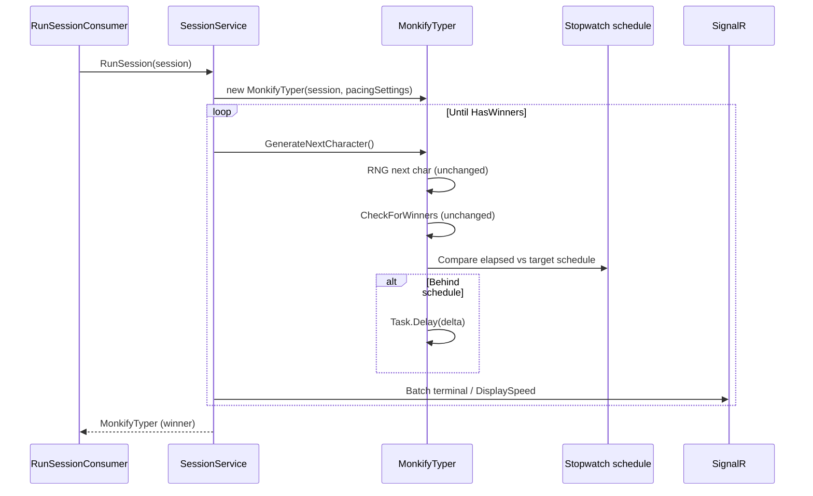

# Monkify — "Typer Pacing Scalability" Feature — Implementation Spec

> **Status: Ready for implementation** — refined via Trello card
> [Check monkify typer logic to make more scallable](https://trello.com/c/uCTNtBDe/10-check-monkify-typer-logic-to-make-more-scallable) (2026-06-26).
> Repos affected: `monkify-backend`, `monkify-front`, and this doc in `monkify-meta`.
>
> **Purpose:** Retune `MonkifyTyper` wall-clock pacing so session duration stays within agreed
> statistical bounds across choice length, charset, bet count, and server hardware — **without**
> changing RNG, seed derivation, character order, or winning outcomes.

---

## 1. Summary

Today the typer derives pacing from `poolSize^QueueLength / numChoices` and applies a **1 ms
`Task.Delay` every `_betDelayInterval` characters** inside `GenerateNextCharacter`. That works
for 6-letter races but breaks down for 7–8 character configs and larger charsets: sessions can
finish instantly or run for **minutes**. Duration also varies by CPU speed and Consumer load.

| Aspect | Today | After this feature |
| --- | --- | --- |
| **Pacing driver** | Modulo counter + sparse 1 ms delays | **Time-budget** pacing from mode-specific target duration (Stopwatch-scheduled) |
| **Fairness** | Seed → character stream → winner | **Unchanged** — same seed, same stream, same winner |
| **Race duration** | ~OK at 6L; unstable at 7L+ | Mean **8–18 s**, **p95 ≤ 30 s** |
| **Lottery duration** | Same typer, longer tail | Mean **10–30 s**, **p95 ≤ 45 s** |
| **Cross-server** | CPU-bound loop drift | Hardware-agnostic + load-stable (explicit time targets) |
| **Frontend** | 50 ms refresh + 20k crop | Tuned for faster streams; `DisplaySpeed` stays in sync |

**Play modes in scope:**

| Mode | Typer runs? | Duration targets |
| --- | --- | --- |
| Free-type race | Yes | Mean 8–18 s / p95 ≤ 30 s |
| Preset-choice race | Yes | Mean 8–18 s / p95 ≤ 30 s |
| Lottery draw | Yes (same typer) | Mean 10–30 s / p95 ≤ 45 s |

Lottery **Hangfire scheduling** (when the draw fires) is out of scope — only typer run duration.

---

## 2. Constraints (MANDATORY)

From `monkify-meta/constraints.md` (full list there):

- **Branch-per-repo:** `feature/typer-pacing-scalability` in `monkify-backend`, `monkify-front`,
  and `monkify-meta`.
- **Unit tests:** update/add in `Monkify.Tests`; report changed tests at end of implementation.
  Run full suite before declaring done.
- **EF mapping / migrations:** **None** — no schema changes.
- **Secrets/config:** mock-only values in committed config if touched.
- **Operator messaging:** unchanged.
- **Pacing-only:** do **not** change `GenerateSessionSeed`, `CheckForWinners`, character selection
  (`_random.Next`), or bet/choice map logic.

---

## 3. Resolved product decisions

| # | Decision |
| --- | --- |
| 1 | **Pacing-only** — same seed → same character sequence and winner; only wall-clock timing changes |
| 2 | **Race modes** (free-type + preset): mean **8–18 s**, **p95 ≤ ~30 s** |
| 3 | **Lottery draws:** mean **10–30 s**, **p95 ≤ 45 s** |
| 4 | **No minimum duration** — instant wins acceptable |
| 5 | **Parameter coverage:** seeded defaults + planned production configs (6L/7L letters, 6N digits, preset races, `NumbersAndLetters` up to length 8) |
| 6 | **Bet count sweep:** targets must hold for **2–400 bets** per config |
| 7 | **Frontend:** backend pacing + sync `DisplaySpeed` + tune `GameTyper.vue` batching/cropping |
| 8 | **Tests:** extend/restructure `ProductionSessionTests` / `BaseSessionMetricsTestsClass` — Monte Carlo (100+ runs), p95, mode-specific bounds |
| 9 | **Cross-server:** hardware-agnostic **and** load-stable — mean on any host within mode bounds; concurrent Consumer sessions must not stretch duration vs idle baseline |
| 10 | **Out of scope:** RNG/seed changes, Hangfire lottery scheduling, DB, operator/payment/rewards, admin pacing UI |

---

## 4. Data model

**No entity or migration changes.**

Lottery vs race is detected at runtime from existing `Session.Parameters.LotteryParameters != null`.

---

## 5. Configuration

Add pacing settings under `GeneralSettings.Sessions` (or a nested `TyperPacing` object on
`SessionSettings`).

File: `monkify-backend/src/Monkify.Domain/Configs/Entities/SessionSettings.cs`

```csharp
// Suggested properties (names may be adjusted; wire in monkifysettings.json)
public int RaceTargetMeanSecondsMin { get; set; } = 8;
public int RaceTargetMeanSecondsMax { get; set; } = 18;
public int RaceTargetP95SecondsMax { get; set; } = 30;
public int LotteryTargetMeanSecondsMin { get; set; } = 10;
public int LotteryTargetMeanSecondsMax { get; set; } = 30;
public int LotteryTargetP95SecondsMax { get; set; } = 45;
```

File: `monkify-backend/src/Monkify.Common/monkifysettings.json` — add defaults above under
`GeneralSettings.Sessions`. Use the same numeric defaults; no secrets.

Inject settings into `MonkifyTyper` via constructor overload or factory from `SessionService`
(the typer today is `new MonkifyTyper(session)` only — extend to pass pacing settings + lottery flag).

---

## 6. Backend behaviour

### 6.1 Root cause (code exploration)

File: `Monkify.Domain/Sessions/Services/MonkifyTyper.cs`

1. **`CalculateDelayIntervals`** sets `_expectedCharsToWin = poolSize^QueueLength / Bets.Count`
   (dictionary **key** count, including preset choices registered at 0).
2. **`GenerateNextCharacter`** applies `await Task.Delay(1)` when
   `CharactersTypedCount % _betDelayInterval == 0` — delay magnitude is fixed at **1 ms** regardless
   of how far off the target duration is.
3. When `_betDelayInterval` is **small** (low `baseTime`), the typer adds ~1 ms per character →
   multi-minute sessions at scale.
4. When `_expectedCharsToWin` is **large**, the inner loop is CPU-bound for millions/billions of
   iterations with almost no delay → duration varies by hardware (cross-server drift).
5. Speed ramp (`CurrentTypingSpeed` 1→2→3) triggers at `_expectedCharsToWin` and `2×` that count —
   decoupled from wall-clock targets.

File: `Monkify.Infrastructure/Services/Sessions/SessionService.cs` — `RunSession` loops
`GenerateNextCharacter`, batches to `TerminalBatchLimit` (500), emits `DisplaySpeed` on change.
No wall-clock pacing at this layer today.

### 6.2 Required pacing redesign (pacing-only)

**Goal:** schedule wall-clock progress against a **target session duration** derived from session
parameters and mode (race vs lottery), using **`Stopwatch` + `Task.Delay`**, not CPU iteration rate.

Recommended approach (implementer may refine constants but must honour decisions §3):

1. **At construction** (after existing setup methods):
   - Keep `_expectedCharsToWin` as a **statistical estimate** (existing formula) for schedule shape only.
   - Compute **target mean duration** `T_mean` from settings:
     - Race: midpoint of `[8, 18]` → 13 s (or interpolate by complexity — document chosen formula in code).
     - Lottery: midpoint of `[10, 30]` → 20 s.
   - Derive **target ms per character** schedule: spread `T_mean` across expected character milestones
     so early session is slower, ramp matches `CurrentTypingSpeed` transitions.
   - Store `_sessionStopwatch` (started on first `GenerateNextCharacter` call).

2. **In `GenerateNextCharacter`** (after character is chosen and enqueued — **do not reorder RNG**):
   - Compute **scheduled elapsed** for `CharactersTypedCount` (piecewise linear or stepped curve aligned
     with speed tiers 1/2/3).
   - If `_sessionStopwatch.Elapsed` is **behind** schedule → `await Task.Delay(scheduled - elapsed)`.
   - If **ahead** of schedule (many iterations needed) → **no extra delay** (do not slow further).
   - Replace the old `% _betDelayInterval` 1 ms logic entirely.
   - Retune speed milestones to **fractions of `T_mean`** (e.g. 33 % / 66 %) instead of raw
     `_expectedCharsToWin` counts, so `DisplaySpeed` ramps feel consistent across configs.

3. **Reproducibility guard:** delays must **never** branch on wall-clock randomness or thread timing for
   character selection — only **after** the character is determined.

4. **`SessionService.RunSession`:** keep batching contract. Optionally flush terminal batch when pacing
   delay exceeds a threshold so clients receive chunks during long waits. Do not change SignalR payload
   shapes (`{ TypingSpeed }`, terminal string batches).

### 6.3 Cross-server / load stability

- All pacing uses **configured second targets** and `Stopwatch`, not iterations/second of the host.
- Under concurrent sessions, each typer instance carries its **own** stopwatch — no shared static state.
- Do not throttle based on global CPU metrics in v1.

### 6.4 Code findings — test harness gaps

| Gap | Required fix in spec |
| --- | --- |
| `BaseSessionMetricsTestsClass` uses `ProcessorCount/2` runs (~4–8) | Increase to **≥ 100** runs per assertion (configurable constant) |
| Validates **average only** (10–20 s + outlier margin) | Add **p95** + mode-specific bounds (§3) |
| `SessionMetricsTestParameters` has no lottery flag | Add `IsLottery` or `LotteryParameters` helper; new test methods for 7L lottery |
| No 7L/8L / `NumbersAndLetters` cases | Add `ProductionSessionTests` theories |
| No reproducibility test | New test: fixed bets + fixed bet seeds → same char sequence before/after pacing change |
| `MonkifyTyperTests.DefaultSessionAverageDuration` unused | Remove or wire to new pacing unit tests |

### 6.5 Host ownership

| Component | Host |
| --- | --- |
| `MonkifyTyper` pacing | `Monkify.Consumers` (via `RunSessionConsumer` → `SessionService.RunSession`) |
| SignalR terminal / DisplaySpeed | Same (Consumers publish via hub) |
| API | **No changes** |

---

## 7. Frontend behaviour

Display-only tuning — no bet, wallet, or session mechanic changes.

### 7.1 `useSession.ts`

- `typingSpeed` (1–3) is set from `{ typingSpeed }` on `…/DisplaySpeed` — keep contract.
- Verify `gradualSpeedReset()` still behaves when sessions end/roll over after faster streams.
- No new env vars required.

### 7.2 `GameTyper.vue`

Current behaviour:

- Crops `terminalOutput` to last 2000 chars when length ≥ 20000 every **500 ms**.
- Refreshes DOM from `terminalOutput` every **50 ms**.

**Required:** tune intervals so faster backend batching does not stutter or flood the DOM:

- Consider tying refresh interval to `typingSpeed` (e.g. 50 ms / 35 ms / 25 ms for speeds 1–3).
- Consider adaptive crop threshold or interval when append rate is high.
- Fix duplicate `clearInterval(cropInterval)` in `onUnmounted` (both lines clear the same ref — minor cleanup while touching file).

### 7.3 `GameMonkey.vue` / `App.vue`

- `speed-multiplier` driven by `typingSpeed` — verify animation remains natural at new pacing tiers.
- No API changes.

---

## 8. Flow diagrams

### Pacing loop (unchanged outcome, new timing)



---

## 9. Out of scope

- Win detection / RNG / seed algorithm changes
- Lottery Hangfire scheduling (draw wall-clock, not typer duration)
- New session types, DB migrations, operator/payment/reward logic
- Admin UI for per-game pacing tuning
- New game mechanics or terminal UX beyond display tuning
- Server-side rate limiting of typer throughput based on cluster load

---

## 10. File checklist

### 10.1 Backend (`monkify-backend`)

| # | File | Change |
| --- | --- | --- |
| 1 | `Monkify.Domain/Sessions/Services/MonkifyTyper.cs` | Time-budget pacing; inject settings; retune speed milestones; remove modulo 1 ms delay |
| 2 | `Monkify.Domain/Configs/Entities/SessionSettings.cs` | Add typer pacing target properties |
| 3 | `Monkify.Common/monkifysettings.json` | Default pacing values under `GeneralSettings.Sessions` |
| 4 | `Monkify.Infrastructure/Services/Sessions/SessionService.cs` | Pass pacing settings + lottery flag into typer; optional batch flush tuning |
| 5 | `Monkify.Tests/UnitTests/Shared/BaseSessionMetricsTestsClass.cs` | Monte Carlo size, p95 helper, mode-specific validators |
| 6 | `Monkify.Tests/UnitTests/Shared/SessionMetricsTestParameters.cs` | Lottery / charset / length helpers |
| 7 | `Monkify.Tests/UnitTests/Domain/ProductionSessionTests.cs` | New theories: 7L lottery, 7–8L races, NumbersAndLetters; updated bounds |
| 8 | `Monkify.Tests/UnitTests/Domain/Sessions/MonkifyTyperTests.cs` | Reproducibility test; remove dead constant or add pacing assertions |
| 9 | `Monkify.Tests/UnitTests/Shared/SessionServiceTestFactory.cs` | Wire pacing settings in test `GeneralSettings` |

### 10.2 Frontend (`monkify-front`)

| # | File | Change |
| --- | --- | --- |
| 1 | `src/components/game/GameTyper.vue` | Tune refresh/crop intervals; fix duplicate clearInterval |
| 2 | `src/hooks/useSession.ts` | Verify DisplaySpeed / gradualSpeedReset under new pacing (adjust if needed) |
| 3 | `src/components/game/GameMonkey.vue` | Verify speed-multiplier animation (adjust if needed) |

### 10.3 Meta (`monkify-meta`)

| # | File | Change |
| --- | --- | --- |
| 1 | `specs/typer-pacing-scalability.md` | This spec |
| 2 | `INDEX.md` | Feature in flight + map row (done in create-spec step) |
| 3 | `features/sessions.md` | Update §7 Typer pacing after ship (via ship-feature) |

---

## 11. Unit tests

Project: `monkify-backend/src/Monkify.Tests`.

### 11.1 Refactor metrics harness

**File:** `BaseSessionMetricsTestsClass.cs`

| Change | Detail |
| --- | --- |
| `RunCount` | Default **100** (constant; override for CI speed if needed, but prod gate = 100) |
| `ValidateSessionRuns` | Accept `SessionMode.Race` or `SessionMode.Lottery`; assert mean in range **and** p95 ≤ ceiling |
| p95 helper | `Percentile(durations, 0.95)` on `TotalSeconds` |
| Remove | Old 10–20 s average-only + `OUTLIERS_MARGIN` widening (replace with explicit bounds) |

### 11.2 Production session tests

**File:** `ProductionSessionTests.cs`

Keep existing 2–400 bet `[InlineData]` sweep; update assertions to new validator.

| Test method | Parameters | Mode | Expected |
| --- | --- | --- | --- |
| `Session_SixLetterGame_ShouldSelectWinnerInTime` | Letters, len 6 | Race | Mean 8–18 s, p95 ≤ 30 s |
| `Session_SixNumberGame_ShouldSelectWinnerInTime` | Number, len 6 | Race | Mean 8–18 s, p95 ≤ 30 s |
| `Session_SixLetterHorseGame_ShouldSelectWinnerInTime` | Preset 8 animals, len 6 | Race | Mean 8–18 s, p95 ≤ 30 s |
| **New** `Session_SevenLetterLottery_ShouldSelectWinnerInTime` | Letters, len 7, `LotteryParameters` | Lottery | Mean 10–30 s, p95 ≤ 45 s |
| **New** `Session_NumbersAndLettersRace_ShouldSelectWinnerInTime` | NumbersAndLetters, len 7–8 | Race | Mean 8–18 s, p95 ≤ 30 s |

### 11.3 Reproducibility

**File:** `MonkifyTyperTests.cs` (or new `MonkifyTyperReproducibilityTests.cs`)

| Test | Expected |
| --- | --- |
| Fixed `Session` with fixed bet seeds/choices → collect full character sequence until win **before** pacing refactor baseline (golden snapshot) or compare two typer instances with same inputs on same build | Identical character sequence and `FirstChoiceTyped` |
| Same test after pacing change | Still identical sequence and winner |

Implementation tip: extract package-private helper to drain typer without SignalR for deterministic comparison.

### 11.4 Cross-server / concurrent (best effort in unit tests)

| Test | Expected |
| --- | --- |
| Parallel `RunMultipleSessions` with high `MaxDegreeOfParallelism` | Each run's duration within mode bounds; p95 ≤ ceiling |
| Document in test output mean durations for CI trend | Host variance ≤ 2 s mean when run on same machine (cross-machine check is Manual QA) |

---

## 12. Acceptance criteria

(Copied from Trello **Acceptance Criteria** checklist.)

1. Given a 6-letter race with 2–400 bets, when 100+ simulated runs complete via `SessionService.RunSession`, then mean duration is 8–18s and p95 ≤ 30s.
2. Given a 6-number race with 2–400 bets, when 100+ simulated runs complete, then mean duration is 8–18s and p95 ≤ 30s.
3. Given a preset horse race (8 choices, 6 letters) with 2–400 bets, when 100+ simulated runs complete, then mean duration is 8–18s and p95 ≤ 30s.
4. Given a 7-letter lottery session (Sevenfold Sunset params) with 2–400 bets, when 100+ simulated runs complete, then mean duration is 10–30s and p95 ≤ 45s.
5. Given `NumbersAndLetters` charset at choice length 7–8 (planned production config), when 100+ simulated race runs complete, then mean duration is 8–18s and p95 ≤ 30s.
6. Given a fixed session seed and bet set, when pacing is applied before and after the change, then the character sequence and winning choice are identical (only wall-clock duration differs).
7. Given a race session at the new pacing, when characters stream to the frontend, then `DisplaySpeed` updates remain in sync and `GameTyper` renders without stutter or DOM flooding.
8. Given the same session parameters and bet set on a dev machine and a production-class host, when 100+ simulated runs complete on each, then mean duration on each host falls within mode-specific bounds and the two hosts' means differ by ≤ 2s.
9. Given N concurrent sessions running on Consumers (N ≥ typical deploy pod count), when each session completes, then its mean duration matches the single-session baseline within mode-specific bounds (no load-induced multi-minute sessions).

---

## 13. Manual QA

1. Start Consumers + API + front locally; open **6L Lexicon Lightning** — confirm race feels ~8–18 s.
2. Open **7L Sevenfold Sunset** lottery — confirm draw typer feels ~10–30 s (not minutes).
3. Place many bets (or use dev seed with high bet count) — duration stays in range.
4. Watch monkey animation + terminal — no stutter; speed ramps 1→2→3 visibly track backend.
5. Optional: run same session type on two machines; compare subjective duration (should match within ~2 s mean).

---

## 14. Trello / pipeline

- **Source card:** [Check monkify typer logic to make more scallable](https://trello.com/c/uCTNtBDe/10-check-monkify-typer-logic-to-make-more-scallable) — list **Specs created**; **Implementation** section on card lists branch + spec.
- **Branch:** `feature/typer-pacing-scalability` in `monkify-backend`, `monkify-front`, `monkify-meta`.
- **After merge:** `/monkify-ship-feature Check monkify typer logic to make more scallable`

---

## 15. Revision log

| Date | Change |
| --- | --- |
| 2026-06-26 | Initial spec from refined Trello card + refinement conversation |
