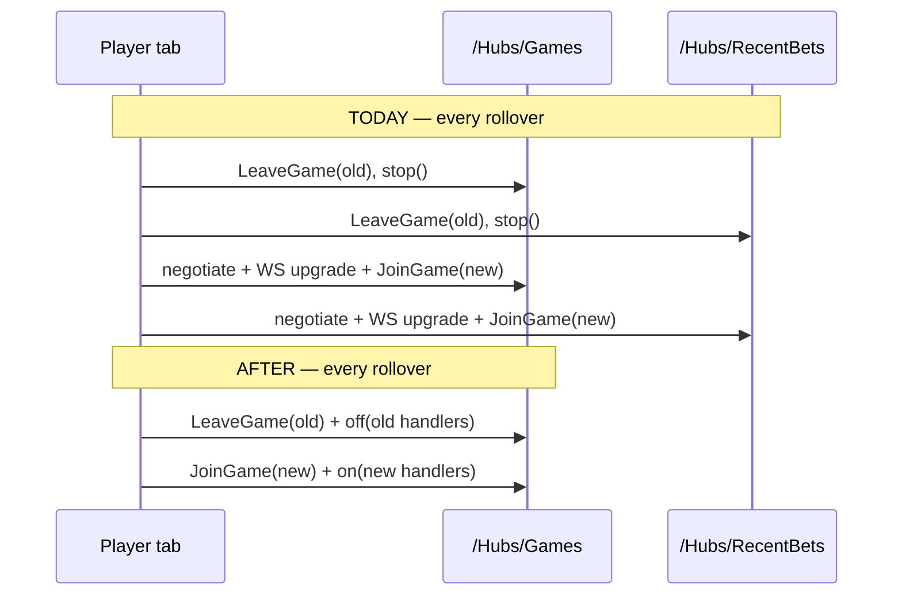
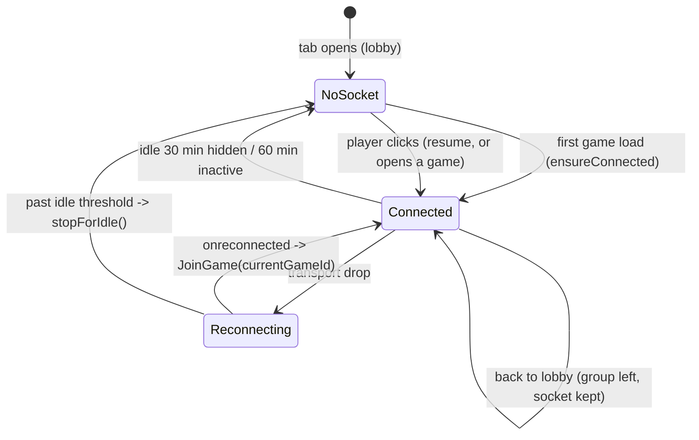

# SpaceStroker — "Unified WebSocket Connection" — Implementation Spec

> **Status: Ready for implementation** — refined via Trello card
> [unify websocket calls into 1 connection per player](https://trello.com/c/b2PoXJ1I) (#120, refined
> 2026-07-28).
> Repos affected: `monkify-backend`, `monkify-front`, and this doc in `monkify-meta`.
>
> **Purpose:** every player currently holds **two** SignalR connections that are **torn down and
> rebuilt on every round rollover**. Collapse them into **one hub and one connection per browser tab**,
> held across rounds, game switches and lobby round-trips — halving the concurrent requests a player
> pins on Cloud Run and removing the per-rollover negotiate burst, with **zero change to what the
> player sees**.

---

## 1. Summary

### 1.1 What exists today

| | `/Hubs/Games` (`ActiveGamesHub`) | `/Hubs/RecentBets` (`RecentBetsHub`) |
| --- | --- | --- |
| Server methods | `JoinGame`, `LeaveGame`, `SendChatMessage` | `JoinGame`, `LeaveGame` — nothing else |
| Events out | `GameReceived` (broadcast), `{gameId}/Terminal`, `{gameId}/DisplaySpeed`, `{gameId}/Status`, `{gameId}/ChatMessage` | `{gameId}/Bets` |
| Producers | `GameService` (`_activeGamesHub`), `ActiveGamesHub.SendChatMessage` | `BetNotificationConsumer` only |
| Client | `wsGamesConnection` in `useGame.ts` | `wsBetsConnection` in `useGame.ts` |

`RecentBetsHub` carries **no logic of its own** — its `JoinGame`/`LeaveGame` are byte-identical to
`ActiveGamesHub`'s — and `GameService` takes `IHubContext<RecentBetsHub> betsHub` in its constructor,
assigns it to `_betsHub`, and **never reads it** (`GameService.cs:41,47,56`).

Both connections are stopped and rebuilt on **every** rollover: `updateNewGame` →
`disconnectAllPreviousConnections()` (`stop()` on both) → `getBets()` →
`initalizeWebsocketConnections()` (two fresh `HubConnectionBuilder`s). Each rollover therefore costs
**2 negotiates + 2 WebSocket upgrades per player**.

### 1.2 What we are building

| | Before | After |
| --- | --- | --- |
| Hubs mapped | 2 (`/Hubs/Games`, `/Hubs/RecentBets`) | **1** (`/Hubs/Games`) |
| Sockets per player on the game screen | 2 | **1** |
| Sockets per player in the lobby | 0 | **0** (unchanged — lazy connect) |
| Rollover cost | 2 stops + 2 negotiates + 2 upgrades | **0** — group swap only (`LeaveGame` → `JoinGame`) |
| Game-type switch | 2 stops + 2 negotiates | **0** — same socket, group swap |
| Event names | `{gameId}/…` + `GameReceived` | **unchanged** |
| Idle policy | `GamePage`-scoped watch closes both hubs | watch owned by the connection, route-independent |
| Player-visible behaviour | — | **identical** |

### 1.3 Why it matters

- The Cloud Run API declares no `max_instance_request_concurrency`
  (`deploy/terraform/workload/modules/cloud_run_api/main.tf`), so the platform default of **80
  concurrent requests per instance** applies, and a WebSocket pins one request for its whole
  lifetime — today that is ~40 players per instance instead of ~80.
- Every negotiate + upgrade is a request against the per-IP Cloud Armor rule (600/60 s). Card
  **#111** established that one shared VPN exit is one bucket, and this player base is
  crypto-oriented, so shared exits are the norm. Halving the request count halves that pressure.
- It removes a dead hub, a dead route and a dead constructor dependency.

---

## 2. Constraints (MANDATORY)

From `monkify-meta/constraints.md` (full list there):

- **Worktree-per-repo (§2):** work lives in `.worktrees/unified-websocket-connection/<repo>` on
  `feature/unified-websocket-connection`; the shared checkouts stay clean on `main`. Push after
  branch work.
- **Unit tests (§3):** update/add in `SpaceStroker.Tests`; run via `scripts/run_tests.bat`; **report
  exactly which unit tests changed** at the end of implementation.
- **Integration tests (§3):** this is a `Minor change`, so no *new* integration test is mandated by
  the rule — but the card requires one anyway (AC #2, §11.2 below). It is the only failure mode that
  is silent.
- **Secrets/config (§1):** nothing new; no config file gains a value.
- **EF/migrations (§4):** **not applicable** — no entity, no mapping, no migration (§4).
- **Operator messaging (§6):** unaffected — no user-facing copy changes.
- **Host responsibilities (§8):** the API stays stateless; the Consumers host keeps emitting during
  runs. Both keep `AddSignalR().AddStackExchangeRedis(...)` — the Redis backplane is untouched.

---

## 3. Resolved product decisions

| # | Decision |
| --- | --- |
| 1 | **Merge *and* make it long-lived.** Merging alone would still re-negotiate on every rollover; the rollover burst is where the concurrency and per-IP win lands. |
| 2 | **Tab-scoped, lazy lifetime.** The socket opens on the **first game load** and is kept for the tab across rollovers, game-type switches and back-to-lobby. Not app-boot (that would *raise* the total, since lobby-only visitors hold nothing today), not cross-tab `SharedWorker`. Never more sockets than today. |
| 3 | **Per-game event names kept.** `{0}/Status`, `{0}/Bets`, `{0}/Terminal`, `{0}/DisplaySpeed`, `{0}/ChatMessage` and the broadcast `GameReceived` stay exactly as configured in `GeneralSettings.Games`. Flattening to static names would rewrite the contract everywhere for zero socket-count gain, and is *less* safe: after `LeaveGame(old)` the old-named events simply stop arriving, whereas a wrong static-name filter silently corrupts the next round. |
| 4 | **Clean break.** `RecentBetsHub`, its `MapHub` route and the dead `GameService` injection are deleted in the same release — no dual-publish window. The user confirmed (2026-07-28) there are no players yet, so the "old bundle loses its live bet list until refresh" transition risk is theoretical. |
| 5 | **A new `useGameHub` composable owns the connection.** Its lifetime is now *wider* than one round, so it must not be owned by the round-scoped `useGame.ts` (~925 lines) — which is exactly where the stale-event bugs its own teardown comment warns about came from. |
| 6 | **`useGameHub` also owns the idle watch.** *(Resolved during spec exploration — the refinement could not see it.)* `startIdleWatch`/`stopIdleWatch` are currently bound to `GamePage` mount/unmount (`GamePage.vue:36,74`), so a tab-scoped socket would be **unpoliced in the lobby** and an abandoned tab would pin a Cloud Run request forever — contradicting `specs/idle-websocket-disconnect.md` and this card's own goal. The watch now follows the resource it protects: armed when the socket connects, stopped when it closes. |
| 7 | **Level: `Minor change`.** No new player-facing capability; no `features/unified-websocket-connection.md`. Existing KB docs are corrected at ship (§10.3). |

---

## 4. Data model

**Not applicable.** No entity, enum, EF mapping, migration or DB read/write changes. `Bet`,
`Game`, `TransactionLog` and every money path are untouched.

---

## 5. Configuration

**No new configuration.** Confirming what stays exactly as-is:

| Setting | Value | Status |
| --- | --- | --- |
| `Games.ActiveGamesEndpoint` | `GameReceived` | unchanged |
| `Games.GameStatusEndpoint` | `{0}/Status` | unchanged |
| `Games.GameBetsEndpoint` | `{0}/Bets` | unchanged — **only the hub it is sent on changes** |
| `Games.GameTerminalEndpoint` | `{0}/Terminal` | unchanged |
| `Games.GameSpeedEndpoint` | `{0}/DisplaySpeed` | unchanged |
| `Games.GameChatEndpoint` | `{0}/ChatMessage` | unchanged |
| `VUE_APP_WEBSOCKET_BASE_URL` | e.g. `http://localhost:6001/Hubs` | unchanged — only the `Games` suffix is ever appended now |
| `VUE_APP_IDLE_DISCONNECT_HIDDEN_MS` / `_INACTIVE_MS` | 30 min / 60 min defaults | unchanged |
| SignalR server options (`HandshakeTimeout`, `KeepAliveInterval` 15 s, `ClientTimeoutInterval` 30 s, `MaximumReceiveMessageSize` 32 KB) | as in both `Program.cs` files | unchanged |

---

## 6. Backend behaviour (`monkify-backend`)

### 6.1 Route the bets event onto `ActiveGamesHub`

`SpaceStroker.Infrastructure/Consumers/BetNotification/BetNotificationConsumer.cs` — resolve the
other hub context. Group name (the game id) and event name
(`settings.Games.GameBetsEndpoint` → `{gameId}/Bets`) are unchanged, so the payload contract is
untouched:

```csharp
var hubContext = scope.ServiceProvider.GetRequiredService<IHubContext<ActiveGamesHub>>();
...
string gameBetsEndpoint = string.Format(settings.Games.GameBetsEndpoint, message.GameId.ToString());
await hubContext.Clients.Group(message.GameId.ToString()).SendAsync(gameBetsEndpoint, message.AsJson());
```

This is safe because both hubs already keyed their groups on the bare game id, and the client joins
the same group on the surviving hub. The publisher side is untouched: `GameService.InsertBet`
(`GameService.cs:190`) still publishes `BetNotificationEvent` for **every** bet, free bets included.

### 6.2 Delete `RecentBetsHub`

- Delete `SpaceStroker.Infrastructure/Hubs/RecentBetsHub.cs`.
- `SpaceStroker.Api/Program.cs` — remove line 183
  (`app.MapHub<RecentBetsHub>("/Hubs/RecentBets").RequireCors("DevOrigins");`) and the now-unused
  `using` if it becomes one. `/Hubs/Games` (line 182) keeps its `RequireCors("DevOrigins")`.
- `SpaceStroker.Consumers/Program.cs` — nothing to change: it registers SignalR + the backplane but
  maps no hub.

### 6.3 Drop the dead `GameService` dependency

`SpaceStroker.Infrastructure/Services/Games/GameService.cs` — remove the
`IHubContext<RecentBetsHub> betsHub` constructor parameter (line 41), its assignment (line 47) and
the `_betsHub` field (line 56). It is written once and never read; the class already streams
everything through `_activeGamesHub`. DI resolves `GameService` by constructor injection, so no
registration change is needed.

### 6.4 What does **not** change

- `ActiveGamesHub` itself — `JoinGame`, `LeaveGame`, `SendChatMessage`, `MaxChatMessageLength`, the
  chat broadcast + `ChatMessagePersistedEvent` publish are all untouched.
- The Redis backplane, hub options, CORS policy, launch/admin token middleware (both already exclude
  `/Hubs/*`), rate-limit rules.
- Every event payload shape.

---

## 7. Frontend behaviour (`monkify-front`)

### 7.1 New composable: `src/hooks/useGameHub.ts`

A module-singleton composable (the established pattern — see `conventions/frontend.md`) that owns
**the** connection for the tab. `useGame` becomes a consumer.

```ts
// Module scope — one connection per tab.
const connection = ref<HubConnection>();
let starting: Promise<HubConnection | null> | null = null;   // single-flight
const currentGameId = ref<string | null>(null);
const boundGameEvents: string[] = [];       // fully-qualified names bound for currentGameId
const boundBroadcasts = new Set<string>();  // tab-lifetime events (GameReceived)
```

Exposed API:

| Member | Behaviour |
| --- | --- |
| `ensureConnected()` | Builds (if absent) and starts the connection; returns the live `HubConnection`. **Single-flight**: concurrent callers await the same promise, so a rollover racing a mount can never open two sockets. On a successful start it calls `startIdleWatch()` (§7.4). Re-entrant and idempotent when already `Connected`. |
| `attachToGame(gameId, handlers)` | `await ensureConnected()` → `invoke('JoinGame', gameId)` → bind `` `${gameId}/${suffix}` `` for each entry of `handlers` (`Terminal`, `DisplaySpeed`, `Status`, `ChatMessage`, `Bets`) → record `currentGameId` + `boundGameEvents`. |
| `detachFromGame()` | For the recorded `currentGameId`: `.off()` every name in `boundGameEvents`, then `invoke('LeaveGame', id)` (guarded — a down connection must not break the next load), clear the record. **Never stops the socket.** |
| `onBroadcast(event, cb)` | Binds a tab-lifetime event exactly once (`boundBroadcasts` guard) — used for `GameReceived`. Survives rollover; never re-bound. |
| `invoke(method, ...args)` | Passthrough used by `sendChatMessage`. No-ops when not connected. |
| `stopForIdle()` | `detachFromGame()` is **not** called (the round is still the current one); `connection.stop()` + `stopIdleWatch()`. |
| `isConnected` / `connectionId` | `computed` — `state === HubConnectionState.Connected`. Consumed by `waitForRoundLoaded` and the tests. |

Connection construction is lifted verbatim from today's `startConnection('Games')` — same
`VUE_APP_WEBSOCKET_BASE_URL`, `HttpTransportType.WebSockets`, `withAutomaticReconnect()`,
`LogLevel.Information`.

Reconnect wiring lives here, once (today it is duplicated on both connections):

```ts
connection.onreconnected(async () => {
  if (currentGameId.value) await connection.invoke('JoinGame', currentGameId.value);  // current group ONLY
});
connection.onreconnecting(() => {
  evaluateIdle();                                     // a frozen tab may be long past the threshold
  if (isIdleDisconnected.value) void stopForIdle();   // kill the revival instead of reviving it
});
```

### 7.2 `src/hooks/useGame.ts` changes

- **Remove** `wsGamesConnection`, `wsBetsConnection`, `startConnection`, and the
  `HubConnectionBuilder` / `HttpTransportType` / `LogLevel` imports.
- `initalizeWebsocketConnections()` becomes **attach-only** — no `stop()`, no builder:

  ```ts
  const initalizeWebsocketConnections = async () => {
    hub.onBroadcast('GameReceived', onGameReceived);        // once per tab, idempotent
    await hub.attachToGame(gameInstance.value!.gameId, {
      Terminal: onTerminal,        // unchanged body (terminalOutput += data; nearMiss.feed(data))
      DisplaySpeed: onDisplaySpeed,
      Status: onStatus,            // unchanged body (status, embedded lifecycle, end-of-game audio)
      ChatMessage: onChatMessage,
      Bets: onBets,                // unchanged body (bet list, currentPot, recordOwnChoice)
    });
    isLoading.value = false;
  };
  ```

  The five handler bodies move to named functions **unchanged** — this card changes *where* they are
  bound, never what they do.
- `getBets()` must **await** the attach (today `initalizeWebsocketConnections()` is called
  un-awaited at `useGame.ts:242`), so "round loaded" and "stream live" are one deterministic step —
  `waitForRoundLoaded` and AC #4 depend on it.
- `disconnectAllPreviousConnections()` → renamed/reduced to `detachFromCurrentGame()`, delegating to
  `hub.detachFromGame()`. **The socket is not stopped.** `GameReceived` is *not* unbound (it is now
  tab-lifetime).
- `waitForRoundLoaded()` — replace `wsBetsConnection.value?.state === HubConnectionState.Connected`
  with `hub.isConnected.value`. **This is the highest-risk line in the card**: leave it pointing at
  the old ref and a mobile-wallet-return bet silently fails to appear without a manual refresh.
- `sendChatMessage(displayName, text)` → `hub.invoke('SendChatMessage', gameId, displayName, text)`.
- The `onIdleReached` registration keeps its shape; its body becomes `await hub.stopForIdle()` +
  `postToParent('idle-disconnected', { gameId })`.
- `resumeFromIdle()` is unchanged in shape: clear the flag, `markActivity()`, `updateNewGame(true)` —
  which now lazily re-opens the socket through `ensureConnected()`.
- **The exported surface of `useGame` does not change.** No component is touched: `GameConsole.vue`,
  `GameTypes.vue`, `GameTerminal.vue`, `GameSidePanel.vue`, `GameIdleOverlay.vue` and
  `useGameChat.ts` all keep calling the same functions.

### 7.3 Ordering rules (the correctness core)

`updateNewGame()` keeps its current shape and its guarantee — teardown **before** the next load:

```
updateNewGame(ignoreInitialBets)
  1. await detachFromCurrentGame()      // off(old events) + LeaveGame(old)   [socket stays up]
  2. await getBets(ignoreInitialBets)   // loads the new round, then attachToGame(new)
  3. reset per-round state (terminal, pot seed, ownBetChoices, nearMiss, chat, pendingCryptoBet…)
  4. reseedOwnBetsFromInstance()
```

Invariants an implementer must preserve:

- **Unbind before join.** A handler bound twice double-pushes bets and double-counts `currentPot`.
- **`GameReceived` is bound exactly once for the tab** and must be inert when no round is loaded
  (it only writes `nextGame` + `gradualSpeedReset()`, which is already safe, but the guard is
  explicit now that it outlives the round).
- **Reconnect re-joins only `currentGameId`** — never a stale id.
- **Leaving the game route does not stop the socket**; it only leaves the group and unbinds, via the
  same `detachFromCurrentGame()`.

### 7.4 Idle disconnect under the new lifetime (decision 6)

| | Today | After |
| --- | --- | --- |
| Watch armed | `GamePage.onMounted → startIdleWatch()` | `useGameHub.ensureConnected()` on successful start |
| Watch stopped | `GamePage.onUnmounted → stopIdleWatch()` | `useGameHub.stopForIdle()` when the socket closes |
| Lobby with a live socket | impossible (socket closed on unmount) | **watched** — the 30/60 min rules still apply |
| Overlay | `GamePage` renders `<game-idle-overlay v-if="isIdleDisconnected">` | unchanged |

- `GamePage.vue` **keeps** its `onMounted → startIdleWatch()` (idempotent: `startIdleWatch` early-returns
  when already `watching`). It prevents an overlay flash when the player arrives after having idled
  out elsewhere, because `startIdleWatch` resets `isIdleDisconnected = false` on a fresh arm.
- `GamePage.vue` **drops** `onUnmounted → stopIdleWatch()` — that is now the socket's business.
- `useIdleDisconnect.ts` itself is **unchanged**: it still only *detects* idleness and never touches
  SignalR. Its file-header comment ("`useGame` registers what to do via `onIdleReached`") should be
  updated to name `useGameHub`.
- **Drop the old "stay down" guard** at `useGame.ts:265` (`if (isIdleDisconnected.value) return`).
  Under the new ownership an explicit game load is a user action: `ensureConnected()` → `startIdleWatch()`
  re-arms and clears the flag. Keeping the guard would make a lobby click land on a dead game screen
  when the player had idled out in the lobby. Automatic revival is still blocked, by the
  `onreconnecting` branch in §7.1.

### 7.5 What the player sees

**Nothing changes.** Terminal stream, `> POT:`, live bet list, near-miss rows, chat, victory/lose
audio, embedded lifecycle postMessages, the idle overlay and the mobile segmented layout all behave
exactly as they do today.

---

## 8. Flow diagrams

### 8.1 Rollover — before vs after



### 8.2 Connection lifetime for the tab



---

## 9. Out of scope

- Cross-tab connection sharing (`SharedWorker`) — one socket per **tab**, not per human across tabs.
- Flattening the SignalR event names to static names + a gameId in the payload.
- Per-player groups / an app-boot connection — that is Orbit **#123**
  ([NIH7XFHi](https://trello.com/c/NIH7XFHi)). This card must not conflict with it, but must not
  pre-build it either.
- Setting `max_instance_request_concurrency` on the Cloud Run API — **worth its own card** now that a
  player pins one request instead of two. ⚠️ The 80/instance figure used in §1.3 is **inferred from
  the setting's absence** in `deploy/terraform/workload/modules/cloud_run_api/main.tf`, not read from
  a live Cloud Run service.
- Any change to the Redis backplane, `KeepAliveInterval` / `ClientTimeoutInterval`, or the idle
  thresholds.
- Renaming `ActiveGamesHub` or the `/Hubs/Games` route.
- Ended-view behaviour, chat history replay, and every money path — untouched.

---

## 10. File checklist

### 10.1 Backend (`monkify-backend`)

| # | File | Change |
| --- | --- | --- |
| 1 | `src/SpaceStroker.Infrastructure/Consumers/BetNotification/BetNotificationConsumer.cs` | Resolve `IHubContext<ActiveGamesHub>` instead of `IHubContext<RecentBetsHub>`; group + event name unchanged. |
| 2 | `src/SpaceStroker.Infrastructure/Hubs/RecentBetsHub.cs` | **Delete.** |
| 3 | `src/SpaceStroker.Api/Program.cs` | Remove the `MapHub<RecentBetsHub>("/Hubs/RecentBets")` line (183); tidy the `using` if unused. |
| 4 | `src/SpaceStroker.Infrastructure/Services/Games/GameService.cs` | Drop the `IHubContext<RecentBetsHub> betsHub` ctor param, its assignment and the `_betsHub` field. |
| 5 | `src/SpaceStroker.Tests/UnitTests/Shared/GameServiceTestFactory.cs` | Remove the `_recentBetsHub` mock + field; fix the `GameService` construction. |
| 6 | `src/SpaceStroker.Tests/UnitTests/Services/GameServiceTests.cs` | Same removal (`_recentBetsHubContextMock`, its `IHubClients`/`IClientProxy` setup, the ctor arg). |
| 7 | `src/SpaceStroker.Tests/UnitTests/Services/GameServiceParametersTests.cs` | Same removal. |
| 8 | `src/SpaceStroker.Tests/UnitTests/Background/CreateGameTests.cs` | Remove the two local `Mock<IHubContext<RecentBetsHub>>` constructions (≈ lines 148, 202) and their use. |
| 9 | `src/SpaceStroker.Tests.Integration/HubBetNotificationTests.cs` | **New** — §11.2. |

### 10.2 Frontend (`monkify-front`)

| # | File | Change |
| --- | --- | --- |
| 1 | `src/hooks/useGameHub.ts` | **New** — the tab-scoped connection: `ensureConnected` (single-flight), `attachToGame`, `detachFromGame`, `onBroadcast`, `invoke`, `stopForIdle`, `isConnected`; reconnect + idle-watch wiring. |
| 2 | `src/hooks/useGame.ts` | Delete both connection refs + `startConnection`; `initalizeWebsocketConnections` → attach-only (awaited from `getBets`); `disconnectAllPreviousConnections` → `detachFromCurrentGame`; `waitForRoundLoaded` gates on `hub.isConnected`; `sendChatMessage` → `hub.invoke`; idle callback → `hub.stopForIdle()`; drop the `isIdleDisconnected` early-return in the connect path. Exported surface unchanged. |
| 3 | `src/pages/GamePage.vue` | Drop `onUnmounted(() => stopIdleWatch())`; keep `onMounted → startIdleWatch()`. |
| 4 | `src/hooks/useIdleDisconnect.ts` | Comment-only: the header says `useGame` registers the disconnect action — now `useGameHub`. No behaviour change. |

### 10.3 Meta (`monkify-meta`)

| # | File | Change |
| --- | --- | --- |
| 1 | `specs/unified-websocket-connection.md` | **New** — this spec. |
| 2 | `INDEX.md` | Spec row + "Feature currently in flight". |
| 3 | `architecture.md` §6 | *(at ship)* One hub; `{gameId}/Bets` now on `ActiveGamesHub`; the client holds one tab-scoped connection; "closes **both** hubs" → one. |
| 4 | `conventions/frontend.md` | *(at ship)* Lines 57-60: "two hubs (`Games`, `RecentBets`)" → one hub + `useGameHub`. |
| 5 | `specs/idle-websocket-disconnect.md` | *(at ship)* Post-ship note: one connection, watch owned by `useGameHub`, no longer `GamePage`-scoped. |
| 6 | `features/game-chat.md`, `features/game-pot-display.md`, `features/characters-away.md` | *(at ship)* Correct any `RecentBets` mention. |

---

## 11. Tests

### 11.1 Unit tests — `monkify-backend/src/SpaceStroker.Tests`

No new behaviour is introduced, so this is a **compile-and-still-green** surface rather than new
assertions. The suite must be run with `scripts/run_tests.bat` and the changed files reported.

| Test file | Change | Expected |
| --- | --- | --- |
| `UnitTests/Shared/GameServiceTestFactory.cs` | Drop the `RecentBetsHub` mock; construct `GameService` with the reduced ctor. | Builds; all consumers of the factory stay green. |
| `UnitTests/Services/GameServiceTests.cs` | Drop `_recentBetsHubContextMock` + setup + ctor arg. | Terminal/status/batch assertions unchanged and green. |
| `UnitTests/Services/GameServiceParametersTests.cs` | Same. | Green. |
| `UnitTests/Background/CreateGameTests.cs` | Drop both local `RecentBetsHub` mocks. | `GameReceived` broadcast assertions unchanged and green. |
| `UnitTests/Hubs/ActiveGamesHubTests.cs` | **No change** — the hub is untouched. | Green. |

### 11.2 Integration test (required by AC #2) — `SpaceStroker.Tests.Integration`

New file `HubBetNotificationTests.cs`, modelled on `GameChatTests` (hub client) + `GameFlowTests`
(bet placement). It proves the one thing that can break silently: bets arriving on the surviving hub.

```csharp
[Collection(IntegrationCollection.Name)]
public class HubBetNotificationTests
{
    private static readonly TimeSpan Timeout = TimeSpan.FromSeconds(30);
    // ... fixture ctor + LogSink.Clear() as in GameChatTests

    [Fact]
    public async Task BetNotification_ArrivesOnGamesHub()
    {
        var parameters = await _fixture.GetParameterAsync(_fixture.CryptoOperatorId, "6L Lexicon Lightning");
        var gameId = await _fixture.SeedWaitingBetsGameAsync(parameters.Id);
        var token = _fixture.MintToken(_fixture.CryptoOperatorId, externalPlayerId: null);

        var connection = _fixture.CreateGamesHubConnection();     // Hubs/Games — the ONLY hub now
        var received = new TaskCompletionSource<string>(TaskCreationOptions.RunContinuationsAsynchronously);
        connection.On<string>($"{gameId}/Bets", json => received.TrySetResult(json));

        await connection.StartAsync();
        try
        {
            await connection.InvokeAsync("JoinGame", gameId.ToString());
            await _fixture.PlaceBetAsync(gameId, token, new RegisterBetRequestBody
            {
                Amount = 0, Choice = "aaaaaa", Seed = Guid.NewGuid().ToString("N"),
            });

            var winner = await Task.WhenAny(received.Task, Task.Delay(Timeout));
            winner.ShouldBe(received.Task, "Expected {gameId}/Bets on the Games hub after RecentBetsHub was removed.");
            (await received.Task).ShouldContain("aaaaaa");
        }
        finally { await connection.DisposeAsync(); }
    }
}
```

Notes for the implementer:

- Use the **free-bet** body (`Amount = 0`): `GameService.InsertBet` publishes `BetNotificationEvent`
  for every bet regardless of payment method (`GameService.cs:190`), and a free bet avoids the
  payment fakes entirely.
- One bet only. `MinimumNumberOfPlayers` is 2 for the seeded types, so the round stays in
  `WaitingBets` and the typer never runs — the test stays fast and load-insensitive (see the
  `ProvablyFairFlowTests` wall-clock flake noted in `INDEX.md`).
- The event travels **API → bus → Consumers `BetNotificationConsumer` → Redis backplane → API hub
  client**, so this also proves the backplane still fans out after the hub swap.
- `CreateGamesHubConnection()` already exists (`Harness/IntegrationTestFixture.cs:769`) and uses
  long-polling over the in-memory `TestServer` — no new harness code needed.

### 11.3 Frontend

`monkify-front` has no test runner wired for composables; verification is §12 + §13.

---

## 12. Acceptance criteria

Copied 1:1 from the Trello **Acceptance Criteria** checklist (#120).

1. Given a player opens a game screen, when the round has loaded, then exactly ONE SignalR connection
   is open (to `/Hubs/Games`) and no connection to `/Hubs/RecentBets` is attempted.
2. Given a SignalR client joined to a game group on `/Hubs/Games`, when a bet is placed and
   `BetNotificationConsumer` publishes it, then that client receives the `{gameId}/Bets` event with
   the bet payload — asserted in `SpaceStroker.Tests.Integration` (mandatory, see Level).
3. Given a live round in the browser, when another player's bet arrives, then the live bet list gains
   exactly one row and `> POT:` increases by exactly that bet's amount (no duplicate handling from a
   doubly-bound handler).
4. Given a round ends and the next round starts, when the rollover completes, then the SAME
   connection is reused (its `connectionId` is unchanged, no negotiate is issued) and only the new
   game's group is joined.
5. Given a rollover has happened, when the new round streams `Terminal` / `Status` / `Bets`, then no
   handler bound for the previous round fires — terminal output, pot, bets, near-miss rows and chat
   contain only the new round's data.
6. Given a player returns to the lobby and opens a different game type, when the second game loads,
   then the same connection is reused, the old group was left, the new group is joined, and no event
   from the old game mutates state.
7. Given a visitor who stays in the games lobby and never opens a game, when they browse, then no
   SignalR connection is opened at all.
8. Given the tab has been hidden past `VUE_APP_IDLE_DISCONNECT_HIDDEN_MS` (30 min) or inactive past
   `VUE_APP_IDLE_DISCONNECT_INACTIVE_MS` (60 min), when idle disconnect fires, then the single
   connection is stopped, `idle-disconnected` is posted to the parent when embedded, and the resume
   overlay is shown.
9. Given the connection was closed by idle disconnect, when the player clicks to resume, then a
   connection is lazily re-created, the current round's group is re-joined, and the
   terminal/bets/chat streams resume without a page reload.
10. Given the socket drops and `withAutomaticReconnect` recovers it, when `onreconnected` fires, then
    only the group of the round currently loaded is re-joined (never a stale gameId), and if the idle
    threshold has since passed the reconnect attempt is aborted instead.
11. Given a mobile player returns from the wallet deep-link (a fresh page load) with a pending bet,
    when the bet resumes, then `waitForRoundLoaded` gates on the unified connection being `Connected`
    and the placed bet appears in the live bet list without a manual refresh.
12. Given a player sends a chat message, when `SendChatMessage` is invoked on the unified connection,
    then the message is broadcast to the game group and persisted exactly as today (existing
    `GameChatTests` still green, unchanged in intent).
13. Given the game runs inside an iframe, when a round starts, settles and ends, then `ready` /
    `game-started` / `bet-placed` / `bet-settled` / `game-ended` / `resize` / `idle-disconnected`
    postMessages fire exactly as before — no new message, no contract change.
14. Given the backend after this change, when the solution is searched, then `RecentBetsHub`, its
    `MapHub("/Hubs/RecentBets")` route and every `IHubContext<RecentBetsHub>` reference (including the
    unused `GameService` ctor param) no longer exist, and `SpaceStroker.Tests` is green via
    `scripts/run_tests.bat` with the changed unit tests reported.
15. Given the frontend after this change, when `useGame.ts` is inspected, then it holds no
    `HubConnection` of its own — connection lifecycle, join/leave, handler binding, reconnect and idle
    wiring all live in `src/hooks/useGameHub.ts`.

**Coverage map:** AC 2 → §11.2 integration test. AC 14 → §11.1 + a repo-wide search. AC 1, 3-13, 15 →
§13 manual QA + code review of §7.

---

## 13. Manual QA (local Docker stack)

With the stack up and the browser devtools **Network → WS** panel open:

1. Open the lobby (`/space-stroker/game`) and idle there. **No** WS connection appears (AC 7).
2. Open a game. Exactly **one** WS to `/Hubs/Games`; nothing to `/Hubs/RecentBets` (AC 1).
3. Place a bet from a second browser profile. The live bet list gains **one** row and `> POT:`
   increases by exactly that stake (AC 3).
4. Let the round end and roll over. The WS panel shows **no new connection** and the terminal/pot/bets
   contain only the new round (AC 4, 5).
5. Go back to the lobby and open a **different** game type. Still the same single socket (AC 6).
6. Send a chat message; confirm it appears for both profiles and lands in `GameChatMessage` (AC 12).
7. Temporarily set `VUE_APP_IDLE_DISCONNECT_INACTIVE_MS=60000` and leave the tab alone: the socket
   closes and the overlay appears (AC 8); click resume and the streams come back with no reload
   (AC 9). Repeat while sitting in the **lobby** to prove the watch survives the route change
   (decision 6).
8. Kill the API container briefly to force a reconnect; confirm only the current group is re-joined
   (AC 10).
9. Load `public/embed-example.html` and confirm the lifecycle postMessages still fire (AC 13).

---

## 14. Trello / pipeline

- **Source card:** [#120 — unify websocket calls into 1 connection per player](https://trello.com/c/b2PoXJ1I)
  — list **Specs created**; the **Implementation** section on the card carries branch, worktree, spec
  path and Level.
- **Level:** `Minor change` ⇒ no `features/unified-websocket-connection.md`; existing KB docs are
  corrected at ship (§10.3). The integration test in §11.2 is required by AC #2 regardless.
- **Next:** `/monkify-implement-feature unify websocket calls into 1 connection per player`, then
  `/monkify-ship-feature`.

---

## 15. Revision log

| Date | Change |
| --- | --- |
| 2026-07-28 | Initial spec from the refined card (#120) + code exploration. Adds decision 6 (idle-watch ownership), which the refinement could not see: the shipped idle watch is `GamePage`-scoped and would leave a tab-scoped socket unpoliced in the lobby. |
