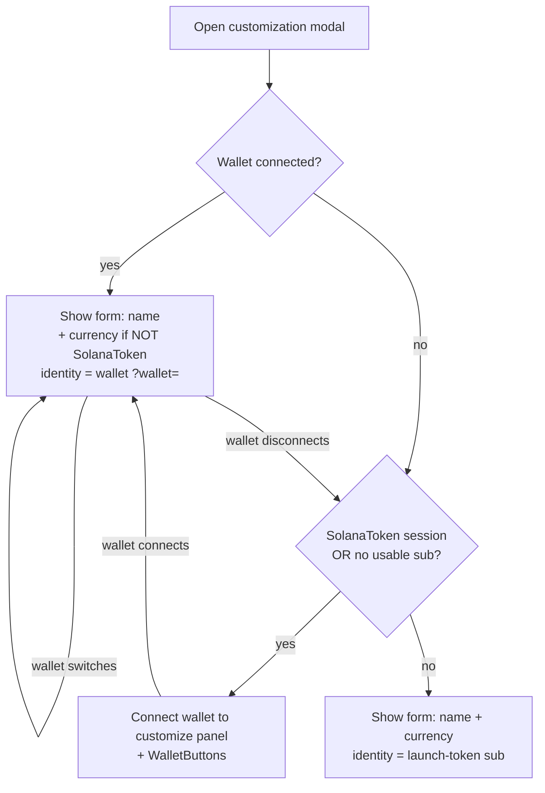

# Monkify — "Display name per connected wallet for SolanaToken sessions" — Implementation Spec

> **Status: Ready for implementation** — refined via Trello card
> [Display name per connected wallet for SolanaToken sessions](https://trello.com/c/sohAuZN0) (2026-07-14).
> Repos affected: `monkify-front`, `monkify-backend`, and this doc in `monkify-meta`. **Full-stack** —
> the original "frontend-only / backend no-change" scope was corrected during implementation (see §6).
>
> **Purpose:** For **SolanaToken** sessions a player's identity is their **connected wallet**, but the
> display-name / preferences flow does not consistently key off it: the app loads preferences on mount
> with no wallet, the customization gear has no wallet gate, and nothing reloads on wallet
> connect/switch. This makes crypto display names come back empty and lets a save run against a
> wrong/empty identity. This feature makes the display name (and the `YOU` / recent-bets / winner
> labels) resolve **per connected wallet** everywhere for SolanaToken sessions, and gates the
> customization modal behind a connected wallet when there is no other identity to write to.

Child of the umbrella **#46 refactor solana wallet flow** ([SX7avQTT](https://trello.com/c/SX7avQTT)).
**Independent of the escrow work — ships on its own.**

---

## 1. Summary

A **frontend-only consistency + gating** change in `monkify-front`. Two axes, kept distinct but
consistent in practice (a **paid** SolanaToken bet already requires a connected wallet, so
wallet-identity == session-identity in a live crypto session):

| Axis | Rule |
| --- | --- |
| **Identity keying** | Whenever preferences load/save: **wallet connected → key by wallet** (`GET /players/preferences?wallet=<wallet>`, `PATCH` body `wallet=<wallet>`); **no wallet → key by launch-token `sub`** (backend default). Today's rule, made **reactive** — reload on wallet connect / switch / disconnect, not only on mount / modal-open. |
| **The gate** | When the modal has **no identity to write to**, show a **"Connect wallet to customize"** state in place of the name form. Trigger: **no wallet connected AND (selected session is `SolanaToken` OR there is no usable launch-token `sub`)**. |
| **Currency field** | Hidden when the selected session's `paymentMethod === SolanaToken` (token-native amounts ignore it). Shown for Standard sessions / the sessions list. |

The backend already resolves preference identity correctly (`sub`-first, wallet-second; empty crypto
`sub` falls through to `?wallet=`), so **no backend change and no new backend integration test** — this
is verified in §6 and captured as an acceptance criterion.

---

## 2. Constraints (MANDATORY)

From `monkify-meta/constraints.md` (full list there):

- **Branch-per-repo / worktree-first:** `feature/wallet-display-name` in each affected repo, checked
  out at `.worktrees/wallet-display-name/<repo>`; the shared checkout stays a clean `main` hub (never
  `git checkout -b` there). Branch pushed to `origin` for the PR.
- **Backend unit tests + a happy-path integration test (now required).** The scope correction (§6) made
  this a backend change, so per `constraints.md` → "Integration tests are mandatory for every new
  feature" it ships with updated/added `Monkify.Tests` unit tests **and** a `Monkify.Tests.Integration`
  happy-path test proving the wallet-keyed display name end to end (see §11). Report the changed tests.
- **EF / migrations:** none — no entity, mapping, or migration change (§6.3).
- **Secrets/config:** none touched; only mock values ever committed.
- **Operator messaging:** vague errors only; never reveal contract status. (Not exercised here — the
  new user-facing copy is `"Connect wallet to customize"`, which carries no operator-status meaning.)
- **No backend behaviour change** unless implementation surfaces an actual SolanaToken path keyed off
  `sub` (none found — §6).

---

## 3. Resolved product decisions

| # | Decision |
| --- | --- |
| 1 | **Identity keying is driven by the connected wallet (global rule):** wallet connected → key by wallet (`?wallet=` on GET, `body.wallet` on PATCH); else launch-token `sub`. This is the existing rule made **reactive** — the fix is that preferences must (re)load on wallet connect / switch / disconnect, not only on mount / modal-open. |
| 2 | **Core bug — reactive per-wallet load.** `App.vue`'s mount load calls `loadPreferences()` with **no wallet** (`App.vue:59`), so SolanaToken preferences are empty until an incidental modal-open / chat-connect reload. Add a watcher on the connected wallet address so preferences reload with `?wallet=` as soon as a wallet is available and again on switch/disconnect. |
| 3 | **The gate — "Connect wallet to customize".** Show the connect prompt (with the wallet-connect affordance) **in place of the name form** when **no wallet is connected AND (the selected session is `SolanaToken` OR there is no usable launch-token `sub`)**. The last clause covers a crypto-only operator on the sessions list. Show the form only when there is a real identity (wallet connected, or a non-empty `sub`). |
| 4 | **Currency dropdown hidden in a SolanaToken context** (`selectedSession.paymentMethod === SolanaToken`); the modal then shows display name only. Standard / lobby: dropdown shown as today. |
| 5 | **In-session label resolution stays per method:** `YOU` / recent-bets / winner names resolve SolanaToken → wallet, Standard → `sub` (current `GameTerminal.vue` behaviour). The real fix is that the crypto name is now actually **loaded per wallet**, so it appears instead of a truncated id. |
| 6 | **~~Backend verified — no change needed~~ — CORRECTED (2026-07-14): the card is full-stack.** The original assumption (crypto `sub` is empty, so `sub`-first resolution is fine) is **false** for the dev operator and any operator offering both Standard + SolanaToken sessions — their launch token always carries a non-empty `sub`, so `sub`-first made the handlers **ignore the wallet**, saving/reading the display name on the `sub` identity while SolanaToken bets are keyed by the **wallet** → crypto bets showed ANON. See §6. |
| 7 | **No per-wallet preferences cache** (remembering multiple wallets at once). One active identity at a time — reload-on-change overwrites the shared `useDisplayCurrency` singleton (YAGNI). |
| 8 | **Backend fix (added):** `Get`/`UpdatePlayerPreferencesHandler` now **prefer the wallet when it is provided** (`request.Wallet ?? sub`), so SolanaToken preferences key off the wallet even when a `sub` exists. `SessionService.InsertBet` captures `GetWalletAddress()` **before** nulling `OperatorPlayer`, so live bet notifications carry `externalPlayerId` (restores the `YOU` match on live crypto bets). Frontend sends the wallet to the preference calls **only in a SolanaToken context** so a Standard player with a stray connected wallet is not mis-routed to the wallet under the new precedence. |

---

## 4. Data model

**No data-model change.** No entities, columns, EF mapping, or migrations. `PlayerPreferences` /
`PlayerPreferencesBody` (frontend `src/types/index.ts:156-167`) and the backend
`OperatorPlayer.DisplayName` / `Currency` columns are reused unchanged. DTOs and SignalR contracts are
untouched.

---

## 5. Configuration

**None.** No `GeneralSettings`, env vars, or seed data. (New user-facing copy string only — §7.)

---

## 6. Backend behaviour — CHANGED (the "no change" assumption was wrong)

> **Correction (2026-07-14, during implementation).** The pre-implementation reading concluded the
> backend needed no change because "the crypto `sub` is empty." Testing disproved this: the **dev
> launch token always carries `sub = "dev-player"`** (`DevController`), and any operator offering both
> Standard **and** SolanaToken sessions issues a launch token with a real `sub`. With the handlers
> resolving **`sub`-first**, a SolanaToken player's `?wallet=` was **ignored**, so the display name was
> written to / read from the `sub` `OperatorPlayer` while SolanaToken bets are keyed by the **wallet**
> `OperatorPlayer` (which had no name) → crypto bets rendered **ANON**. Two backend fixes are required.

### 6.1 Preference identity — prefer the wallet when provided

`Monkify.Infrastructure/Handlers/Players/GetPlayerPreferences/GetPlayerPreferencesHandler.cs` and
`.../UpdatePlayerPreferences/UpdatePlayerPreferencesHandler.cs`: change identity resolution from
`sub`-first to **wallet-first-when-present**:

```csharp
// SolanaToken → wallet (query param on GET / body on PATCH) when provided; else Standard → token sub.
var externalPlayerId = !string.IsNullOrWhiteSpace(request.Wallet /* or request.Body.Wallet */)
    ? request.Wallet
    : request.ExternalPlayerId;
```

The client only sends a wallet in a SolanaToken context (§7), so Standard prefs still resolve to the
`sub`. `PlayersController` (`GET [FromQuery] wallet`, `PATCH body.Wallet`) is unchanged.

### 6.2 Live bet notification — capture the wallet before detaching `OperatorPlayer`

`Monkify.Infrastructure/Services/Sessions/SessionService.cs` → `InsertBet` set `bet.OperatorPlayer =
null` **before** calling `bet.GetWalletAddress()` (which reads `OperatorPlayer.ExternalPlayerId`), so
every **live** `BetNotificationEvent` shipped `ExternalPlayerId = null` — breaking the `YOU` match on
live bets. Capture the id (like the display name already is) **before** nulling:

```csharp
var displayName = bet.OperatorPlayer?.DisplayName;
var externalPlayerId = bet.GetWalletAddress();   // BEFORE nulling the nav
bet.Session = null;
bet.OperatorPlayer = null;
...
var notificationEvent = new BetNotificationEvent(bet.SessionId, externalPlayerId, displayName, bet.Amount, bet.Choice);
```

### 6.3 Host / migration / DTO impact

None beyond the above. No entity, EF mapping, migration, DTO, or SignalR-contract change. Runs in the
existing hosts (API validates + reads prefs; `SessionService.InsertBet` runs where bets are inserted).

---

## 7. Frontend behaviour (`monkify-front`)

### 7.1 Reactive per-wallet preference load — `src/App.vue`

- **Today:** `onMounted` (`lines 51-61`) calls `await Promise.all([loadRates(), loadPreferences()])`
  (`line 59`) with **no wallet**. The only wallet watcher (`lines 78-82`) just calls
  `startConnection()`.
- **Change:** after the existing mount load, reload preferences whenever the **connected wallet
  address changes** so a SolanaToken player's saved name is fetched as soon as a wallet is available
  (and re-fetched on switch, cleared on disconnect). Watch the address string (not just `connected`)
  so account switches are caught:

  ```ts
  import { useWallet } from 'solana-wallets-vue';
  import { PaymentMethod } from '@/types';
  const { connected, publicKey } = useWallet();
  const { typingSpeed, selectedSession } = useSession();
  // ...
  // Send the wallet ONLY for SolanaToken sessions — the backend now prefers a wallet when present
  // (§6.1), so sending a stray wallet in a Standard session would mis-route that player's prefs.
  const walletForPrefs = () =>
    selectedSession.value?.paymentMethod === PaymentMethod.SolanaToken
      ? (publicKey.value?.toString() ?? undefined)
      : undefined;
  watch(
    [() => publicKey.value?.toString(), () => selectedSession.value?.paymentMethod],
    () => {
      if (route.name === 'Session' || route.name === 'Game') loadPreferences(walletForPrefs());
    }
  );
  ```

  Keep the existing `watch(connected, …) → startConnection()` as-is. Guard to the game routes so the
  wallet-bridge popup route does not trigger preference calls.

### 7.2 The gate + currency visibility — `src/components/header/PlayerCustomizationModal.vue`

The modal currently (`lines 15-19, 56-77, 81-110`) always renders the name + currency form, loads on
`props.open`, and identifies via `walletId() = publicKey.value?.toString() ?? undefined`.

Add the SolanaToken context + gate:

- **Import the current session + sub helper:**

  ```ts
  import { useSession } from '@/hooks/useSession';
  import { getPlayerIdFromToken } from '@/utils/launchToken';
  import { PaymentMethod } from '@/types';
  const { selectedSession } = useSession();
  ```

- **Derived flags:**

  ```ts
  const hasWallet = computed(() => !!publicKey.value);
  const isCryptoSession = computed(
    () => selectedSession.value?.paymentMethod === PaymentMethod.SolanaToken
  );
  const hasUsableSub = computed(() => !!getPlayerIdFromToken());
  // Show the connect prompt instead of the form when there is no identity to write to.
  const needsWalletToCustomize = computed(
    () => !hasWallet.value && (isCryptoSession.value || !hasUsableSub.value)
  );
  ```

- **Template:** when `needsWalletToCustomize` is true, render a **"Connect wallet to customize"**
  panel (message + the `WalletButtons` connect affordance — `import WalletButtons from './WalletButtons.vue'`)
  in place of the Display name / Preferred currency / Save controls. The **Provably-fair client seed**
  block is localStorage-only and identity-independent — keep it visible in both states (or, if
  simpler, keep the whole seed section always rendered below the gate). CANCEL still closes.
- **Currency field:** wrap the Preferred-currency `<label>` (`lines 137-147`) in `v-if="!isCryptoSession"`
  so it is hidden in a SolanaToken context; the Display name field always shows (when not gated).
- **Reactivity while open:** replace the `watch(() => props.open, …)` (`lines 66-77`) so it **also
  watches the wallet**, reloading preferences and re-evaluating the gate live when the player connects
  / switches / disconnects with the modal open:

  ```ts
  watch(
    [() => props.open, () => publicKey.value?.toString()],
    async ([isOpen]) => {
      if (!isOpen) return;
      errorMessage.value = '';
      syncFormFromState();
      await loadPreferences(walletId());       // walletId() already = publicKey ?? undefined
      if (!rates.value.length) await loadRates();
      syncFormFromState();
    },
    { immediate: false }
  );
  ```

- **Save:** unchanged mechanics (`lines 81-110`) — it already sends `body.wallet` when a wallet is
  connected (`lines 90-91`). With the gate in place, Save is only reachable when there is a usable
  identity, so the "no identity" 400 path is no longer hit from the UI.

### 7.3 Gear — `src/components/GameHeader.vue`

- The gear stays gated on `hasOperatorContext` only (`line 171`) — **no change**; the wallet gate
  lives inside the modal's connect-prompt state so the gear remains discoverable. `selectedSession`
  is already available here (`line 25`) and is a shared singleton, so the modal reading it directly
  needs no prop drilling. No new import required in `GameHeader.vue`.

### 7.4 In-session labels — `src/components/game/GameTerminal.vue` (no code change expected)

- `myId()` (`line 52`) already prefers `publicKey` then `ownExternalId`; `betPlayerLabel` /
  `winnerLabel` (`lines 69-82`) resolve names from held bets and `ownDisplayName`. These already key
  off the wallet for SolanaToken. The **observable fix** comes for free from §7.1: `ownDisplayName` /
  `ownExternalId` (the `useDisplayCurrency` singleton) are now loaded per wallet, so the player's own
  name renders instead of a truncated id. No edit expected here unless QA finds a gap.

### 7.5 `useDisplayCurrency` / `mainService` — no change

- `useDisplayCurrency.loadPreferences(wallet?)` (`src/hooks/useDisplayCurrency.ts:39-49`) already
  overwrites the shared `currency` / `displayName` / `externalPlayerId` singletons — correct for the
  reload-on-change model (one active identity at a time; no per-wallet cache — decision 7).
- `mainService.getPlayerPreferences(wallet?)` (`src/services/mainService.ts:96-101`) already passes
  `?wallet=`; `updatePlayerPreferences(body)` (`lines 88-94`) already carries `body.wallet`. **No
  change** — just ensure every call site threads the wallet (App mount/watcher §7.1, modal §7.2; chat
  already does at `useSessionChat.ts:43-51`).

### 7.6 User-facing copy

- **`"Connect wallet to customize"** — connect a wallet to set your display name for token sessions."
  (SolanaToken / no-identity state.) No operator-status wording.

---

## 8. Flow diagram



---

## 9. Out of scope

- Any **backend** change (unless an actual `sub`-keyed SolanaToken path is found — none exists today).
- The escrow work and the rest of umbrella #46 (Phases 0–3, in-game swap) — this card is independent.
- A **per-wallet preferences cache** (remembering several wallets at once) — one active identity at a
  time (decision 7).
- Settlement / payout / persistence / DTO / SignalR changes — display-only, all unchanged.
- Standard-session behaviour — unchanged (identity = `sub`, currency dropdown shown).

---

## 10. File checklist

### 10.1 Backend (`monkify-backend`)

| # | File | Change |
| --- | --- | --- |
| 1 | `.../Handlers/Players/GetPlayerPreferences/GetPlayerPreferencesHandler.cs` | Prefer `request.Wallet` when non-empty, else the token `sub` (§6.1). |
| 2 | `.../Handlers/Players/UpdatePlayerPreferences/UpdatePlayerPreferencesHandler.cs` | Prefer `request.Body.Wallet` when non-empty, else the token `sub` (§6.1). |
| 3 | `.../Services/Sessions/SessionService.cs` (`InsertBet`) | Capture `bet.GetWalletAddress()` before nulling `OperatorPlayer`; pass the captured id into `BetNotificationEvent` (§6.2). |

### 10.2 Frontend (`monkify-front`)

| # | File | Change |
| --- | --- | --- |
| 1 | `src/App.vue` | Import `PaymentMethod` + destructure `selectedSession`; add a watcher on `[publicKey, selectedSession.paymentMethod]` that reloads `loadPreferences(walletForPrefs())` on the game routes — sending the wallet **only** when the session is SolanaToken (§7.1). Keep the mount load + `watch(connected) → startConnection()`. |
| 2 | `src/components/header/PlayerCustomizationModal.vue` | Import `useSession`, `getPlayerIdFromToken`, `PaymentMethod`, `WalletButtons`; add `isCryptoSession` / `hasWallet` / `hasUsableSub` / `useWalletIdentity` / `needsWalletToCustomize`; `walletId()` returns the wallet only when `useWalletIdentity`; render the "Connect wallet to customize" panel when gated (SAVE hidden); wrap the currency `<label>` in `v-if="!isCryptoSession"`; load watcher also watches `publicKey`. |
| 3 | `src/components/game/GameTerminal.vue` | **No change** — benefits from §7.1 + the backend fixes (own live crypto bets now carry `externalPlayerId` → `YOU`; others → the per-wallet name). |

### 10.3 Meta (`monkify-meta`)

| # | File | Change |
| --- | --- | --- |
| 1 | `specs/wallet-display-name.md` | This spec (new). |
| 2 | `INDEX.md` | Add the spec row (status **Ready**); set "Feature currently in flight". |

---

## 11. Tests

**Backend unit — `Monkify.Tests` (added, all green — 342 total):**

| Test file | Test case | Asserts |
| --- | --- | --- |
| `UnitTests/Handlers/GetPlayerPreferencesHandlerTests.cs` | `WalletProvided_TakesPrecedenceOverSub` | With both a `sub` row and a wallet row seeded, a request carrying `sub` + `wallet` returns the **wallet** row's prefs. |
| `UnitTests/Handlers/UpdatePlayerPreferencesHandlerTests.cs` | `WalletInBody_TakesPrecedenceOverSub_WritesToWalletIdentity` | PATCH with `sub` in the token + `wallet` in the body writes the name to the **wallet** `OperatorPlayer`; no `sub` row is created. |

**Backend integration — `Monkify.Tests.Integration` (mandatory happy path, added):**

| Test file | Test case | Asserts |
| --- | --- | --- |
| `PlayerPreferencesTests.cs` | `CryptoPreferences_TokenAlsoHasSub_WalletTakesPrecedenceOverSub` | Reproduces the bug end-to-end: a **SolanaToken** launch token that **also carries a `sub`**, PATCH `{displayName, wallet}` → GET-by-wallet returns the name, GET-by-`sub` does **not**, and at the DB level the name is on the wallet `OperatorPlayer`, not the sub. |

The `InsertBet` fix (§6.2) is covered by the wallet-precedence identity being correct plus manual QA
(own live crypto bet shows `YOU`); asserting the live SignalR `BetNotificationEvent` payload directly
would require a streaming client and is left to manual QA (§13).

**Frontend:** `monkify-front` has no established component-test harness for these
composables/components (prior frontend-only features — iframe, pot-display, audio — shipped with manual
QA). Verification is **manual QA (§13)** plus the "no `sub`-keyed crypto path" audit. The
`needsWalletToCustomize` / `useWalletIdentity` truth tables are the natural units if a FE test setup is
added later.

---

## 12. Acceptance criteria

Mapped 1:1 from the Trello **Acceptance Criteria** checklist:

1. Given a SolanaToken session with no connected wallet, when the player opens the customization
   modal, then a "Connect wallet to customize" state (with the wallet-connect affordance) is shown in
   place of the name form, with no editable name field.
2. Given the customization modal is open in a SolanaToken context, when the player connects a wallet,
   then the modal reloads and replaces the connect prompt with the name form bound to that wallet's
   saved display name (or empty if none).
3. Given a connected wallet, when preferences are loaded or saved, then the request keys off the
   wallet address (`GET /players/preferences?wallet=<wallet>`; `PATCH` with `body.wallet=<wallet>`).
4. Given a SolanaToken context where the wallet is already connected at app load or connects after
   mount, when preferences load, then `App.vue` fetches that wallet's saved display name (the name is
   not blank) — the mount load no longer omits the wallet.
5. Given a connected wallet is switched to a different wallet, when the switch completes, then
   preferences reload for the new wallet and the displayed name (and the `YOU`/bet-row/winner labels)
   update to the new wallet's identity.
6. Given the selected session's `paymentMethod` is SolanaToken, when the customization modal shows the
   form, then the preferred-currency dropdown is hidden and only the display-name field is shown.
7. Given a Standard session or the sessions list (no SolanaToken session selected), when the
   customization modal is shown, then the preferred-currency dropdown remains visible (unchanged).
8. Given a SolanaToken session with a connected wallet and a saved display name, when bets and results
   render, then the `YOU` label, recent-bets rows and winner names show that name resolved per wallet
   (not a truncated wallet id).
9. Given a crypto-only operator (empty launch-token `sub`) on the sessions list with no connected
   wallet, when the player opens the modal, then the "Connect wallet to customize" prompt is shown (no
   editing against an empty id).
10. Given a Standard session with a usable launch-token `sub` and no connected wallet, when the player
    opens the modal, then the name form is shown (no gate) and edits the `sub` identity as today.
11. Given a SolanaToken player with the modal open, when they disconnect the wallet, then the modal
    reverts to the "Connect wallet to customize" state.
12. Given a free SolanaToken session (amount 0, wallet-connect skipped) with no connected wallet, when
    the player opens the modal, then customization is unavailable (connect prompt) and the player
    renders as ANON until they optionally connect a wallet.
13. Given the implemented code, when the preferences/identity paths are audited, then no SolanaToken
    path keys player identity off the (empty) launch-token `sub`, and no backend change was required.

---

## 13. Manual QA

Run the local stack (`setup_local_environment.bat`) with the dev operator (both Standard + SolanaToken
default session types seeded — see `features/payment-methods.md`).

1. **Crypto empty-name-on-load:** enter a **SolanaToken** session, connect a wallet, set a display
   name, save. Hard-reload. Confirm the name renders (`YOU`, bet rows) without opening the modal
   (§7.1). ✔ ACs 4, 8.
2. **Gate:** in a SolanaToken session with **no** wallet connected, open the gear → "Connect wallet to
   customize" panel (no name field). Connect a wallet from the panel → form appears with that wallet's
   name. ✔ ACs 1, 2.
3. **Wallet switch:** with the modal open, switch wallet accounts → the shown name updates to the new
   wallet; disconnect → reverts to the connect prompt. ✔ ACs 5, 11.
4. **Currency visibility:** SolanaToken session → currency dropdown hidden; Standard session / sessions
   list → dropdown shown. ✔ ACs 6, 7.
5. **Standard unaffected:** Standard session, no wallet → form shows, edits `sub` identity, name
   renders. ✔ AC 10.
6. **Crypto-only lobby:** on the sessions list with only SolanaToken types and no wallet → gear opens
   the connect prompt. ✔ AC 9.
7. **Free SolanaToken:** free (amount 0) SolanaToken session, no wallet → connect prompt; player shows
   ANON. ✔ AC 12.
8. **Network check:** DevTools → confirm `GET /players/preferences?wallet=…` and `PATCH` body carry the
   connected wallet. ✔ AC 3.

---

## 14. Trello / pipeline

- **Source card:** [Display name per connected wallet for SolanaToken sessions](https://trello.com/c/sohAuZN0)
  — moved to **Specs created**; **Implementation** section on the card lists branch + spec + worktree.
- **Next:** `/monkify-implement-feature Display name per connected wallet for SolanaToken sessions`
  to build it, then `/monkify-ship-feature …` to sync the KB and merge `feature/wallet-display-name`
  → `main` (`monkify-front` + `monkify-meta`).

---

## 15. Revision log

| Date | Change |
| --- | --- |
| 2026-07-14 | Initial spec from the refined card (grounded in a read of `App.vue`, `PlayerCustomizationModal.vue`, `GameHeader.vue`, `useDisplayCurrency.ts`, `useSessionChat.ts`, `GameTerminal.vue`, `mainService.ts`, `types/index.ts`, and the two backend preference handlers + `PlayersController`). Backend verified no-change. |
