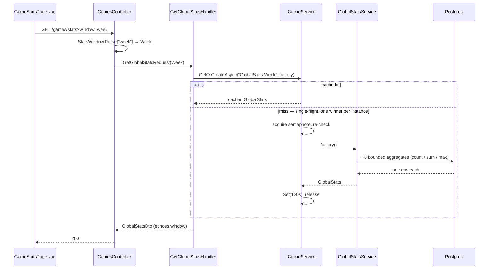

# SpaceStroker — "Windowed stats + query-layer performance" — Implementation Spec

> **Status: SHIPPED** — merged via `feature/query-indexes` on 2026-08-05. Distilled summary:
> `../features/windowed-stats-query-performance.md`. Ships Trello #148 and #133 together.
>
> **What changed between spec and ship** (the spec is design intent; the feature doc is what runs):
> - **§6.7 keyset pagination was NOT implemented.** Keyset needs a cursor and the endpoint is
>   page-number addressed; the cache-key bound landed instead. The deep-page cost remains.
> - **§4.3's index set lost `GameBets(Status)`.** The §6.9 write gate measured 92% → 0% HOT updates on
>   bet settlement; it was net-negative and the migration was regenerated without it.
> - **§6.6's single LEFT JOIN became two bounded queries** — the join would not materialise in EF. The
>   N+1 is gone either way.
>
> Originally: **Ready for implementation** — refined via Trello card
> [Windowed stats (weekly/monthly) + query-layer performance fixes](https://trello.com/c/UhmNIabO) (2026-08-04).
> Repos affected: `monkify-backend`, `monkify-front`, and this doc in `monkify-meta`.
>
> ⚠️ **Branch is `feature/query-indexes`, not `feature/windowed-stats-query-performance`.** This card
> deliberately rides the branch created for card #133 (Table indexes) because item [3] below depends on
> an index that branch adds. Worktrees: `.worktrees/query-indexes/<repo>`.
>
> **Purpose:** Stop the Stats page reading every completed round ever into application memory, and give
> players a **Weekly / Monthly / All-time** view of it. The window is the visible half; the load-bearing
> half is moving aggregation from C# into Postgres. Four further query-layer defects found in the same
> audit ride along, and this card is the vehicle that merges the `AddQueryCoveringIndexes` migration.

---

## 1. Summary

The Stats page (`/space-stroker/game/stats`, shipped by `specs/fair-stats-menu.md`) has two sections —
deployment-wide **global** tiles and **per-type** tiles behind a dropdown. Both are backed by services
that pull rows into memory and aggregate them with LINQ-to-objects.

| Concern | Today | After this feature |
| --- | --- | --- |
| **Global aggregation** | `GlobalStatsService` loads all completed round ids → every bet of those rounds → every credit log, then aggregates in C# | ~8 bounded aggregate queries; Postgres computes `count`/`sum`/`max`; no unbounded result set |
| **Per-type aggregation** | `GameStatsService` chains **three** unbounded loads per type | Same treatment; hottest choice becomes a `GROUP BY … LIMIT 1` |
| **Time span** | All-time only | `week` \| `month` \| `all`, selectable; **defaults to `all`** |
| **Cache key** | `GlobalStats`, `GameStats:{id}` | `GlobalStats:{window}`, `GameStats:{id}:{window}` — TTL unchanged at 120s |
| **Cache miss** | Every concurrent miss runs its own aggregation | In-process single-flight: one aggregation per instance |
| **Orbit reconciliation** | One `SUM` query **per balance row** | One grouped query |
| **History pagination** | `Skip/Take` (`OFFSET`), O(offset) | Keyset seek on `(EndDate DESC, CreatedDate DESC)` |
| **`pageNumber`** | Unbounded upward → unbounded cache keys | Clamped to the real page count |
| **Cancellation** | 12 `ToListAsync()` with no token | Token threaded from the handler |

**No new entity and no migration** for the stats work. The only migration on this branch is
`AddQueryCoveringIndexes`, already written and green.

---

## 2. Constraints (MANDATORY)

From `monkify-meta/constraints.md` (full list there):

- **Worktree-per-repo:** work lives in `.worktrees/query-indexes/<repo>`; each hub stays clean on
  `main`. Branch `feature/query-indexes` already exists and is pushed in all three repos.
- **Unit tests** (§3): update/add in `SpaceStroker.Tests`; **report changed tests** at the end. Run via
  `scripts/run_tests.bat` — never a bare `dotnet test` (the ProductionGames Monte Carlo suite is slow).
- **Integration test is MANDATORY** (§3) — this card is **`Feature`** level. Extend
  `SpaceStroker.Tests.Integration`; run via `scripts/run_integration_tests.bat`.
- **EF mapping:** inline in `SpaceStrokerDbContext.OnModelCreating`; no `IEntityTypeConfiguration`.
- **Migrations** (§4): under `SpaceStroker.Infrastructure/Migrations/`, applied **only** by
  `SpaceStroker.Consumers`. Never hand-edit the snapshot. Never pass `--no-build` to
  `dotnet ef migrations add`.
- **Secrets/config** (§1): mock-only values in committed files.
- **Vague messaging** (§6): an unknown or deactivated game type keeps collapsing to the same
  `ParameterNotFound`. The window must never become a channel that reveals whether a type exists.
- **Production data** (§5): do not run production queries. Row counts for prioritisation are the
  user's to run.
- **NoTracking default:** `SpaceStrokerDbContext` is `NoTracking`; a load-mutate-`SaveChanges` silently
  persists nothing. Everything in this spec is read-only except the reconciliation job's logging.

---

## 3. Resolved product decisions

| # | Decision | Why |
| --- | --- | --- |
| 1 | One card, not split — windowing and the four internal fixes ship together | They touch the same read paths; splitting means conflicting edits across two branches |
| 2 | **All-time survives**; aggregation moves into SQL | The defect is aggregating in C# over materialised rows, not the time span. This is why no rollup table is needed |
| 3 | **Rolling** windows — last 7 / last 30 days, not calendar | No timezone or week-start to commit to; the window is always full size, so tiles never collapse on the 1st of a month |
| 4 | Per-type stats windowed too, driven by **one page-level selector** | A page whose halves describe different periods is confusing; `GameStatsService` is the worse offender anyway |
| 5 | Page **defaults to All time**; API defaults to `all` when the param is omitted | The SQL rewrite already removes the cost, so the default is a product call — a low-traffic week would make the trust page show near-zero. Also preserves the shipped contract |
| 6 | Stampede handled with **in-process single-flight** | ~20 lines, no new infra, no new failure mode on a public read path. Accepted limit: multi-instance Cloud Run means one aggregation *per instance*, not per deployment |
| 7 | Unknown window value ⇒ `all`, **not** a 400 | Mirrors the history endpoint, where an out-of-range page returns an empty page rather than an error |
| 8 | The recent-rounds feed is **out of scope** | Its filter matches ~99% of `Games`, so its Seq Scan is the correct plan; the `(Status, EndDate DESC)` idea is untested |
| 9 | This card owns the **index write-cost gate** | It is what merges `AddQueryCoveringIndexes`, and that migration's evidence is read latency only |

---

## 4. Data model

### 4.1 Entity / column changes

**None.** No new entity, no new column, no new migration for the stats work.

### 4.2 EF configuration

**Unchanged.** The only `OnModelCreating` edits on this branch are the index changes already committed
by #133.

### 4.3 Migration

The branch already carries **`20260804173850_AddQueryCoveringIndexes`**. Do **not** add another
migration unless §6.9 concludes `GameBets(Status)` must be dropped — in which case **regenerate** that
migration (`dotnet ef migrations remove` then `add`, as it has not shipped) rather than stacking a
second one.

Index state the migration leaves behind, for reference by §6.7:

| Table | Index |
| --- | --- |
| `GameBets` | `(Status)`, `(PlayerId, GameId)` |
| `Games` | `(Status)`, `(ParametersId, Status)`, `(ParametersId, Status, EndDate DESC, CreatedDate DESC)` |
| `GameParameters` | `(Active, AllowOrbit)` |
| `OrbitEnrollments` | `(GameParametersId, Enabled)` |

### 4.4 The `StatsWindow` value object (new)

`src/SpaceStroker.Domain/Games/ValueObjects/StatsWindow.cs`:

```csharp
public enum StatsWindow
{
    All = 0,     // sentinel: no date filter at all
    Week = 1,    // rolling: EndDate >= UtcNow.AddDays(-7)
    Month = 2,   // rolling: EndDate >= UtcNow.AddDays(-30)
}
```

Parsing is **lenient** (decision 7): a helper `StatsWindowExtensions.Parse(string?)` maps
`"week"`/`"month"` case-insensitively and returns `All` for null, empty, or anything unrecognised.
`Cutoff(DateTime utcNow)` returns `null` for `All`, otherwise the rolling boundary.

---

## 5. Configuration

**None.** No new `GeneralSettings` key, no new env var. Cache TTLs stay at their current values in
`CacheHelper` (120s for both stats keys).

---

## 6. Backend behaviour (`monkify-backend`)

### 6.1 The window filter, and why it is written the way it is

Completed rounds are selected today as:

```csharp
g.Status == GameStatus.RewardForWinnersCompleted
```

The windowed form adds a date bound. **`Game.EndDate` is nullable even on completed rounds** —
`features/games-history.md` documents `CreatedDate` as its fallback — so the filter must handle null
rather than assume it is set:

```csharp
// NOT COALESCE / (g.EndDate ?? g.CreatedDate) >= cutoff — that is unsargable and forfeits the index.
g.EndDate >= cutoff || (g.EndDate == null && g.CreatedDate >= cutoff)
```

Both arms are index-usable against `IX_Games_ParametersId_Status_EndDate_CreatedDate`.

⚠️ **Verify this with the benchmark rig before considering the work done.** The branch already ships
`SpaceStroker.Tests.Integration/Benchmarks/` — add the windowed query to `BenchmarkQueries.All(...)`
and confirm from the `EXPLAIN` output that it produces an index scan, not a Seq Scan.

### 6.2 `GlobalStatsService` — SQL aggregation

Replace the three-load body with bounded aggregate queries. Each returns **at most one row per active
game type** (currently a handful), never one row per round or per bet.

Composition, with `completed` as the reusable base `IQueryable<Game>`:

```csharp
var completed = _context.Games.Where(g => typeIds.Contains(g.ParametersId)
                                       && g.Status == GameStatus.RewardForWinnersCompleted
                                       && windowPredicate);
var bets = _context.GameBets.Join(completed, b => b.GameId, g => g.Id, (b, g) => b);
```

| Field | Query | Rows returned |
| --- | --- | --- |
| `RoundsPlayed` | `completed.CountAsync(ct)` | 1 |
| `TotalBetsPlaced` | `bets.CountAsync(ct)` | 1 |
| `UniquePlayers` | `bets.Select(b => b.PlayerId).Distinct().CountAsync(ct)` | 1 |
| `TotalVolumeWagered` | `bets.Where(b => b.Amount > 0m).SumAsync(b => (decimal?)b.Amount, ct)` | 1 |
| `BiggestPot` | see below | ≤ #types |
| `TotalPaidOut` | credits `.SumAsync(t => (decimal?)t.Amount, ct)` | 1 |
| `WinnersPaid` | `credits.Select(t => t.BetId).Distinct().CountAsync(ct)` | 1 |
| `BiggestSinglePayout` | `credits.GroupBy(t => t.BetId).Select(g => g.Sum(x => x.Amount)).MaxAsync(ct)` | 1 |
| `BiggestWinMultiplier` | per-bet credit sum joined to stake, `.MaxAsync(x => x.Sum / x.Stake, ct)` | 1 |
| `MostPlayedType*` | `completed.GroupBy(g => g.ParametersId).Select(…).OrderByDescending(…).FirstOrDefaultAsync(ct)` | 1 |

where `credits` is:

```csharp
_context.TransactionLogs
        .Where(t => t.Type == TransactionLogType.Credit && t.BetId != null)
        .Join(bets, t => t.BetId!.Value, b => b.Id, (t, b) => t);
```

**`BiggestPot` needs care.** It is `max over rounds of (Σ paid bet amounts + that type's lottery base)`,
and the lottery base differs per type. Grouping to one row *per round* would reintroduce an unbounded
result set. Instead group twice and finish in memory over a handful of rows:

```csharp
var maxPotPerType = await bets.Where(b => b.Amount > 0m)
    .GroupBy(b => new { b.GameId, ParametersId = /* from the join */ })
    .Select(g => new { g.Key.ParametersId, Pot = g.Sum(x => x.Amount) })
    .GroupBy(x => x.ParametersId)
    .Select(g => new { ParametersId = g.Key, MaxPot = g.Max(x => x.Pot) })
    .ToListAsync(ct);                                   // ≤ #active types rows

result.BiggestPot = maxPotPerType
    .Select(x => x.MaxPot + lotteryBaseByType[x.ParametersId])
    .DefaultIfEmpty(0m).Max();
```

**Accepted trade:** ~8 round trips instead of 3. Each is bounded and index-served, so total latency
falls sharply even though the query count rises. Do **not** collapse them into one hand-written SQL
string — the readability cost is not worth it and `constraints.md` favours EF here.

**Behaviour that must not change:** only `RewardForWinnersCompleted` rounds count; free bets
(`Amount == 0`) are excluded from every money figure but **counted** in `TotalBetsPlaced` and
`UniquePlayers`; `GlobalStats.Empty` is still returned when there are no active types.

### 6.3 `GameStatsService` — same treatment

Identical rewrite scoped to one `parameters.Id`, plus:

- `BiggestPot` — single type, so one `GroupBy(GameId).Select(Sum).MaxAsync(ct)` then add `lotteryBase`.
- `HottestChoice` — becomes a SQL `GROUP BY Choice ORDER BY count DESC, Choice ASC LIMIT 1`, preserving
  the existing ordinal tiebreak. Preset types only; free-text types still return none.
- `TotalPaidOut` / `BiggestSinglePayout` — as §6.2.

### 6.4 Cache keys and single-flight

`CacheHelper` gains the window in both keys, TTL unchanged:

```csharp
public static CacheSettings GenerateGlobalStatsCacheSettings(StatsWindow window)
    => new($"GlobalStats:{window}", TimeSpan.FromSeconds(120));

public static CacheSettings GenerateGameStatsCacheSettings(Guid parametersId, StatsWindow window)
    => new($"GameStats:{parametersId}:{window}", TimeSpan.FromSeconds(120));
```

`ICacheService` gains one member:

```csharp
Task<T> GetOrCreateAsync<T>(CacheSettings settings, Func<Task<T>> factory);
```

Implemented identically in `MemoryCacheService` and `RedisCacheService`:

1. `TryGet` → hit returns immediately, no lock taken.
2. Miss → acquire a `SemaphoreSlim(1,1)` from a `static ConcurrentDictionary<string, SemaphoreSlim>`
   keyed by `settings.Key`.
3. Inside the lock, `TryGet` **again** (the winner may have populated it while we waited).
4. Still missing → run `factory`, `Set`, return.
5. `finally` → release. **Release must be in a `finally`** or an exception inside `factory` deadlocks
   every later reader of that key.

Semaphore-dictionary growth is bounded in practice: keys are `GlobalStats:{3 windows}` and
`GameStats:{type}:{3 windows}`, so the ceiling is `3 × (1 + #game types)`. Do not add eviction — it
would introduce a race between removal and acquisition for no real gain.

Both stats services switch from the manual `TryGet`/`Set` pair to `GetOrCreateAsync`.

### 6.5 Endpoints

Both stay public, read-only, on the stateless API.

| Endpoint | Change |
| --- | --- |
| `GET /games/stats?window=` | New optional query param. Omitted or unrecognised ⇒ `all` |
| `GET /games/{parametersId}/stats?window=` | Same |

`GetGlobalStatsRequest` becomes `record GetGlobalStatsRequest(StatsWindow Window)`;
`GetGameTypeStatsRequest` becomes `record GetGameTypeStatsRequest(Guid ParametersId, StatsWindow Window)`.
Parsing happens in `GamesController` via `StatsWindowExtensions.Parse`, so an invalid value can never
reach the handler and the vague-error path in `GetGameTypeStatsHandler` is untouched.

`GlobalStatsDto` and `GameTypeStatsDto` each echo the applied window back (`window: "all" | "week" |
"month"`) so the client can render an unambiguous period label and detect a coerced value.

### 6.6 [2] `OrbitReconciliationJob.ReconcilePlayerColumns`

Today (`:38-45`) it loads every `OrbitBalance` row and issues one `SUM` per row — linear in the
enrolled player base, four times a day.

Replace with a **single grouped query**. It must be a **LEFT JOIN** from balances to the grouped
ledger: a balance row with *no* `OrbitTransactions` at all must still be compared and reported, because
a non-zero column with an empty ledger is exactly the drift this job exists to catch. An INNER JOIN
would silently skip it and turn a loud bug into a quiet one.

`ReconcilePoolsAgainstChain` is **unchanged** — it is bounded by pool count and its per-pool on-chain
read cannot be batched.

### 6.7 [3][4] History pagination and the cache-key bound

`GameHistoryService.BuildPageAsync` currently orders by `EndDate DESC, CreatedDate DESC` then
`Skip((pageNumber-1) * pageSize).Take(pageSize)`.

- Replace the `Skip` with a **keyset seek** on the same `(EndDate, CreatedDate)` tuple. The
  `IX_Games_ParametersId_Status_EndDate_CreatedDate` index carries both columns in exactly that order
  and direction, so the seek is a direct index descent.
- The **total count** query stays as it is — it already runs as an index-only scan on
  `(ParametersId, Status)`, which is why §4.3 keeps that narrow index.
- `GetGamesHistoryHandler` (`:38`) currently does `Math.Max(1, request.PageNumber)`. Add an upper clamp
  against the real page count derived from that total. This is what bounds the
  `GamesHistory:{parametersId}:{pageNumber}:{pageSize}` cache key and closes [4].
- **Past the last page must still return an empty page, not an error** — `features/games-history.md`
  documents that contract.
- `mineOnly` keeps its `myGameIds` subquery, which now runs as an index-only scan on
  `GameBets(PlayerId, GameId)`.

### 6.8 [6] Cancellation

Thread `CancellationToken` through `IGlobalStatsService`, `IGameStatsService` and `IGameHistoryService`
from the MediatR handlers, and pass it to every `ToListAsync` / `CountAsync` / `SumAsync` /
`MaxAsync` / `FirstOrDefaultAsync`. Twelve call sites currently take none.

A cancelled request must **not** write to the cache — `GetOrCreateAsync` must let the
`OperationCanceledException` propagate out of `factory` without calling `Set`.

### 6.9 [9] The index write-cost gate

**This must be settled before the branch merges.** All evidence behind `AddQueryCoveringIndexes` is read
latency. The specific risk: `GameService.UpdateBetStatusWithoutSaving` modifies only `Status` and
`UpdatedDate`. Before the migration **neither was indexed**, so Postgres could apply the update as a
**HOT** update with zero index writes. Indexing `GameBets.Status` forfeits that, and the update then
writes an entry into all seven `GameBets` indexes — on every bet at settlement
(`RunGameConsumer` → `NeedsRewarding`, `RewardGameConsumer` → `Rewarded`).

Against that, `PendingRefundSweepJob` runs on `0 */12 * * *`, so the measured 45.8ms → 6.3ms win is
worth roughly **80ms/day**.

Add a write phase to the existing rig (`SpaceStroker.Tests.Integration/Benchmarks/`):

1. Seed at 1M via the existing `BenchmarkSeeder`.
2. Under each index set, time N single-row bet **inserts** and N single-row **status updates**, each in
   its own transaction (the shape `RegisterBetHandler` and `UpdateBetStatus` actually issue).
3. Read `n_tup_upd` / `n_tup_hot_upd` from `pg_stat_user_tables` for `GameBets`, resetting counters with
   `pg_stat_reset_single_table_counters` before each run.

If `GameBets(Status)` is net-negative, **drop it** and regenerate the migration (§4.3). The other four
indexes are unaffected either way. Note `fillfactor` defaults to 100, so some of those updates may
already have been failing HOT eligibility before the change — which is precisely why this is measured
rather than argued.

---

## 7. Frontend behaviour (`monkify-front`)

### 7.1 Types (`src/types/index.ts`)

Add `export type StatsWindow = 'all' | 'week' | 'month';` and a `window: StatsWindow` field on both
`GlobalStats` (`:77`) and `GameTypeStats` (`:64`).

### 7.2 Service (`src/services/mainService.ts`)

`getGlobalStats(window)` (`:162`) and `getGameTypeStats(parametersId, window)` (`:155`) take the window
and pass it as a query param. Omit the param entirely when `all` so the shipped URL shape is unchanged
for the default case.

A `singleFlight` helper already exists in this file (`:175`, used by `getPlayerStats`) — use the same
pattern, with the window in the flight key so two windows can never collapse onto one promise.

### 7.3 Page (`src/pages/GameStatsPage.vue`)

One page-level **Weekly / Monthly / All time** control, defaulting to **All time**, driving *both*
sections. On change, re-fetch global and per-type together.

- The per-type load already has a request-sequence guard (`reqSeq`, `:67`). **`loadGlobal` (`:34`) has
  none** and needs one now that it is re-triggered by the window control — otherwise a slow `all`
  response can land after a fast `week` response and repaint stale numbers.
- Every tile must state the period it covers. A bare "TOTAL PAID OUT" is ambiguous once the window is
  selectable; label it from the DTO's echoed `window`, not from local state, so a coerced value shows
  the truth.
- The existing empty state (`globalHasRounds` `:17`, `typeHasRounds` `:59`) already keys off
  `roundsPlayed > 0`, so "No rounds yet" works unchanged for an empty window.
- The page-level house-cut badge (`:21-23`) is **window-independent** — it comes from configuration, not
  from rounds. Do not move it inside a windowed section.

### 7.4 ⚠️ Code-exploration finding — `GameStatsPanel.vue` is dead

The Trello card lists `src/components/game/GameStatsPanel.vue` under Frontend impact. **It is not
rendered anywhere** — `specs/fair-stats-menu.md` moved per-type stats out of the side panel into
`GameStatsPage.vue`, and the only surviving reference is a comment in `GameFairPanel.vue:18`. Do **not**
add window support to it. Deleting it is out of scope for this card.

---

## 8. Flow diagram — a windowed stats read



---

## 9. Out of scope

- Item [5], the recent-rounds feed (`GameHistoryService.GetRecentRounds`) — its own card.
- Any rollup / maintained-counter table.
- Calendar-based windows and player-local timezone handling.
- Windowing `GET /players/stats` or the games-history page.
- Frontend persistence of the selected window across navigation.
- Deleting the dead `GameStatsPanel.vue` (§7.4).

---

## 10. File checklist

### 10.1 Backend (`monkify-backend`)

| # | File | Change |
| --- | --- | --- |
| 1 | `src/SpaceStroker.Domain/Games/ValueObjects/StatsWindow.cs` | **NEW** — enum + lenient `Parse` + `Cutoff` |
| 2 | `src/SpaceStroker.Infrastructure/Services/Games/IGlobalStatsService.cs` | Signature takes `StatsWindow` + `CancellationToken` |
| 3 | `src/SpaceStroker.Infrastructure/Services/Games/GlobalStatsService.cs` | SQL-aggregation rewrite (§6.2) |
| 4 | `src/SpaceStroker.Infrastructure/Services/Games/IGameStatsService.cs` | Same signature change |
| 5 | `src/SpaceStroker.Infrastructure/Services/Games/GameStatsService.cs` | SQL-aggregation rewrite (§6.3) |
| 6 | `src/SpaceStroker.Infrastructure/Services/Games/GlobalStats.cs` | Add applied-window field |
| 7 | `src/SpaceStroker.Infrastructure/Services/Cache/CacheHelper.cs` | Window in both stats keys |
| 8 | `src/SpaceStroker.Infrastructure/Services/Cache/ICacheService.cs` | Add `GetOrCreateAsync<T>` |
| 9 | `src/SpaceStroker.Infrastructure/Services/Cache/MemoryCacheService.cs` | Implement single-flight |
| 10 | `src/SpaceStroker.Infrastructure/Services/Cache/RedisCacheService.cs` | Implement single-flight |
| 11 | `src/SpaceStroker.Infrastructure/Handlers/Games/GetGlobalStats/GetGlobalStatsRequest.cs` | Carry `StatsWindow` |
| 12 | `src/SpaceStroker.Infrastructure/Handlers/Games/GetGlobalStats/GetGlobalStatsHandler.cs` | Pass window + ct |
| 13 | `src/SpaceStroker.Infrastructure/Handlers/Games/GetGameTypeStats/GetGameTypeStatsRequest.cs` | Carry `StatsWindow` |
| 14 | `src/SpaceStroker.Infrastructure/Handlers/Games/GetGameTypeStats/GetGameTypeStatsHandler.cs` | Pass window + ct; vague-error path unchanged |
| 15 | `src/SpaceStroker.Api/Controllers/GamesController.cs` | `window` query param on `:57` and `:90`; parse leniently |
| 16 | `src/SpaceStroker.Infrastructure/Contracts/Games/GlobalStatsDto.cs` | Echo applied window |
| 17 | `src/SpaceStroker.Infrastructure/Contracts/Games/GameTypeStatsDto.cs` | Echo applied window |
| 18 | `src/SpaceStroker.Infrastructure/Jobs/OrbitReconciliationJob.cs` | N+1 → one grouped LEFT JOIN (§6.6) |
| 19 | `src/SpaceStroker.Infrastructure/Services/Games/IGameHistoryService.cs` | Add `CancellationToken` |
| 20 | `src/SpaceStroker.Infrastructure/Services/Games/GameHistoryService.cs` | Keyset pagination + ct (§6.7) |
| 21 | `src/SpaceStroker.Infrastructure/Handlers/Games/GetGamesHistory/GetGamesHistoryHandler.cs` | Upper-clamp `pageNumber` |
| 22 | `src/SpaceStroker.Tests.Integration/Benchmarks/WriteBenchmarkTests.cs` | **NEW** — write phase for §6.9 |
| 23 | `src/SpaceStroker.Tests.Integration/Benchmarks/BenchmarkQueries.cs` | Add the windowed query to verify its plan |

### 10.2 Frontend (`monkify-front`)

| # | File | Change |
| --- | --- | --- |
| 1 | `src/types/index.ts` | `StatsWindow` type; `window` on `GlobalStats` + `GameTypeStats` |
| 2 | `src/services/mainService.ts` | Window param on both stats calls; single-flight keyed by window |
| 3 | `src/pages/GameStatsPage.vue` | Window control; sequence guard on `loadGlobal`; period labels on tiles |

### 10.3 Meta (`monkify-meta`)

| # | File | Change |
| --- | --- | --- |
| 1 | `specs/windowed-stats-query-performance.md` | This spec |
| 2 | `INDEX.md` | Map row + "feature in flight" |
| 3 | `features/<slug>.md` | **At ship time** — new doc (card is `Feature` level) |
| 4 | `features/fair-stats-menu.md`, `features/game-type-stats.md`, `features/games-history.md` | **At ship time** — correct the all-time and pagination descriptions |

---

## 11. Unit tests

Project: `monkify-backend/src/SpaceStroker.Tests`. Run with `scripts/run_tests.bat`.

| Test file | Test cases | Expected |
| --- | --- | --- |
| `UnitTests/Services/GlobalStatsServiceTests.cs` (extend) | Window filters rounds by `EndDate`; a completed round with **null `EndDate`** falls back to `CreatedDate`; free bets counted in participation but not money; `BiggestPot` adds the lottery base per type; empty window returns zeroed stats | Windowed totals match hand-computed values |
| `UnitTests/Services/GameStatsServiceTests.cs` (extend) | Same window cases; `HottestChoice` is hottest **in window**; ordinal tiebreak preserved; free-text type returns none | Per-type totals scoped to the window |
| `UnitTests/Services/CacheServiceTests.cs` (extend) | `GetOrCreateAsync` runs the factory once under N concurrent misses; a hit never acquires the lock; a throwing factory releases the semaphore and does not cache | One factory invocation; no deadlock on the next call |
| `UnitTests/Services/RedisCacheServiceTests.cs` (extend) | Same three cases against the Redis implementation | Parity with in-memory |
| `UnitTests/Handlers/GetGlobalStatsHandlerTests.cs` (extend) | Omitted ⇒ `All`; `"week"` ⇒ `Week`; `"fortnight"` ⇒ `All`; ct forwarded | Window resolved leniently |
| `UnitTests/Handlers/GetGameTypeStatsHandlerTests.cs` (extend) | Same, plus unknown/inactive type still yields the vague `ParameterNotFound` **regardless of window** | No existence leak via the window |
| `UnitTests/Contracts/GlobalStatsDtoTests.cs` (extend) | DTO echoes the applied window, including a coerced one | `window` reflects what ran |
| `UnitTests/Handlers/GetGamesHistoryHandlerTests.cs` (extend) | `pageNumber` above the last page clamps; page 1 unchanged; empty page past the end, not an error | Clamped and non-throwing |
| `UnitTests/Services/GameHistoryServiceTests.cs` (extend) | Keyset walk returns every round exactly once with no duplicates or gaps across page boundaries, including ties on `EndDate` | Full traversal correct |
| `UnitTests/Jobs/OrbitReconciliationJobTests.cs` (**new** if absent) | A drifted balance is reported; a balance with **zero** transactions is still reported; a matching balance is silent | Same findings as the old per-row loop |

**Integration (MANDATORY — `Feature` level).** `SpaceStroker.Tests.Integration`, run with
`scripts/run_integration_tests.bat`. Extend `GlobalStatsFlowTests.cs` and `GameStatsFlowTests.cs`:
drive real rounds to settlement through the API + Consumers hosts, then assert
`GET /games/stats?window=week` counts only in-window rounds while `?window=all` counts all of them, and
that both agree when every round is inside the window. Note the harness's caches are **global** and
shared across tests — assert deltas or invalidate explicitly.

---

## 12. Acceptance criteria

Mirrors the Trello **Acceptance Criteria** checklist 1:1.

1. Given a caller that omits the window param, when `GET /games/stats` is requested, then the response covers all time and is byte-identical in shape to the currently shipped contract.
2. Given completed rounds both inside and outside the last 7 days, when `GET /games/stats?window=week` is requested, then only rounds whose `EndDate` is within the last 7 days contribute to every tile.
3. Given an unrecognised window value, when `GET /games/stats?window=fortnight` is requested, then the response is the all-time result with HTTP 200 and no validation error is returned.
4. Given a game type whose only completed rounds are older than 7 days, when the Stats page is set to Weekly, then both sections render the "No rounds yet" empty state rather than a row of zeros.
5. Given the Stats page is loaded for the first time, when no window has been chosen, then All time is selected and both the global and per-type sections describe the same period.
6. Given a stats request for any window, when the query executes, then no service loads round, bet or transaction-log rows into memory to aggregate them — `count`/`sum`/`max` are computed by Postgres and the result set is bounded regardless of table size.
7. Given N concurrent requests arriving on one API instance while a stats cache key is expired, when they all miss, then exactly one aggregation query is executed and the other N-1 await its result.
8. Given the same window is requested for two different game types, when both are cached, then they occupy distinct cache keys and neither returns the other's numbers.
9. Given an `OrbitBalance` row whose column disagrees with its ledger sum, and a second balance row with no `OrbitTransactions` at all, when `OrbitReconciliationJob` runs, then both are reported exactly as the old per-row loop reported them, using a single grouped query rather than one query per row.
10. Given a game type with more completed rounds than one page, when history pages are walked from first to last, then every round appears exactly once and no page issues a SQL `OFFSET`.
11. Given a `pageNumber` far beyond the last page, when the history endpoint is called, then it returns an empty page (not an error) and creates no cache key beyond the clamped maximum.
12. Given a client disconnects mid-request, when the cancellation propagates, then the stats/history query is cancelled server-side and no partial or poisoned value is written to the cache.
13. Given the write phase has been added to the benchmark rig, when bet inserts and bet status transitions are timed under both index sets, then the HOT-update ratio from `pg_stat_user_tables` is recorded and `GameBets(Status)` is either kept with evidence or dropped from the migration before merge.

---

## 13. Manual QA (local Docker stack)

1. Bring the stack up and play at least two rounds to settlement on one game type.
2. Open `/space-stroker/game/stats`. Confirm **All time** is preselected and the tiles match today's
   values.
3. Switch to **Weekly** → both sections re-fetch and still show the rounds (they are minutes old).
4. `curl "http://localhost:<port>/games/stats"` → all-time payload, unchanged shape.
5. `curl ".../games/stats?window=fortnight"` → **200** with the all-time payload, not a 400.
6. Hit `.../games/stats?window=week` ~20× concurrently right after a TTL expiry and confirm the backend
   log shows one aggregation, not twenty.
7. Walk the history page to its last page and one beyond → empty page, no error, no stack trace.
8. Run `scripts/run_index_benchmarks.bat` and confirm the windowed query's `EXPLAIN` shows an index
   scan, not a Seq Scan.

---

## 14. Trello / pipeline

- **Source card:** [#148 Windowed stats (weekly/monthly) + query-layer performance fixes](https://trello.com/c/UhmNIabO) — list **Specs created**; the `## Implementation` block on the card carries branch, worktree and level.
- **Also ships:** [#133 Table indexes](https://trello.com/c/hSF7flvu) — its migration and benchmark rig
  live on this same branch. Move it when this card ships.
- **Next:** `/monkify-implement-feature` to build it; then `/monkify-ship-feature` to sync the KB and
  merge to `main`.

---

## 15. Revision log

| Date | Change |
| --- | --- |
| 2026-08-04 | Initial spec from the refined card, plus code exploration (dead `GameStatsPanel.vue`, nullable `EndDate` on completed rounds, existing `singleFlight` helper on the frontend). |
